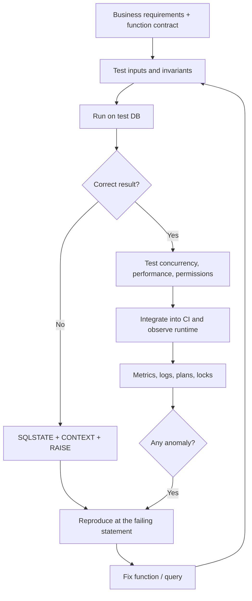

# Testing, Observing, and Debugging PL/pgSQL Functions in PostgreSQL

A PL/pgSQL function can look fine on a clean dataset and still fail on **`NULL` inputs**, a missing row, unexpected multiple rows, two concurrent sessions updating at the same time, or an internal SQL query running slowly against production-sized data. Writing `CREATE FUNCTION` is therefore not the finish line: you need **behavioral testing, runtime observability, and a repeatable debugging methodology**.

In PostgreSQL, these three activities play distinct roles:

- **Testing:** feeding known inputs and data states to a function, asserting expected return values or error codes, and checking database state changes.
- **Observability:** monitoring real invocations, execution times, affected row counts, messages, locks, wait events, nested queries, and resource consumption.
- **Debugging:** pinpointing why outputs, SQLSTATEs, execution order, or performance diverge from expectations; reproducing the bug; and fixing the exact root cause.

Core tools:

```sql
-- Messages and errors from PL/pgSQL:
RAISE NOTICE 'account_id=%', account_id;
RAISE EXCEPTION 'invalid amount: %', amount;

-- Diagnostics for the last SQL statement executed:
GET DIAGNOSTICS affected_rows = ROW_COUNT;

-- Error diagnostics inside an EXCEPTION handler:
GET STACKED DIAGNOSTICS
    error_code = RETURNED_SQLSTATE,
    error_message = MESSAGE_TEXT,
    error_context = PG_EXCEPTION_CONTEXT;

-- Check invariants while running tests/debugging:
ASSERT expected_condition, 'assertion failed';
```

These snippets are **PL/pgSQL body statements**, not standalone SQL commands executable directly outside a function or `DO` block.

This lesson builds a simulated money-transfer system to walk through `RAISE`, `ASSERT`, `FOUND`, `GET DIAGNOSTICS`, `GET STACKED DIAGNOSTICS`, `SELECT INTO STRICT`, transaction rollbacks, system catalogs, `pg_stat_activity`, `pg_stat_user_functions`, `pg_stat_statements`, `auto_explain`, JDBC, concurrency testing, log security, and incident runbooks.

> **Scope:** examples use an isolated practice schema. Never run data-modifying functions, `EXPLAIN ANALYZE` on side-effecting functions, cluster-wide verbose logging, or production configuration changes merely for learning.

## 1. Learning Objectives

After this lesson, you will be able to:

1. Distinguish syntax errors, PL/pgSQL compile-time errors, runtime SQL errors, business errors, and concurrency errors.
2. Design tests covering **inputs, return values, row mutations, SQLSTATEs, and rollbacks**.
3. Use transactions/rollbacks, savepoints, and exception blocks to isolate test cases.
4. Use `RAISE DEBUG/NOTICE/WARNING/EXCEPTION` with safe, consistent messages.
5. Understand `client_min_messages`, server logging, and why client notices differ from durable audit logs.
6. Use `ASSERT` to catch broken assumptions during development without substituting for business validation.
7. Use `FOUND` and `GET DIAGNOSTICS ... ROW_COUNT` at the exact right moment.
8. Use `SELECT INTO STRICT` and handle `NO_DATA_FOUND` and `TOO_MANY_ROWS`.
9. Catch exceptions with `EXCEPTION`, read `SQLSTATE`, `SQLERRM`, and `GET STACKED DIAGNOSTICS`, and rethrow with `RAISE;` when needed.
10. Read execution context using `PG_CONTEXT` and `PG_EXCEPTION_CONTEXT`.
11. Distinguish **subtransactions** of exception blocks from client `COMMIT`/`ROLLBACK`.
12. Observe timings, call counts, and internal queries inside functions with appropriate tools.
13. Inspect `pg_stat_activity`, `pg_locks`, and `pg_blocking_pids` when a function stalls waiting on locks.
14. Understand why `EXPLAIN SELECT my_function(...)` alone does not show all internal PL/pgSQL queries.
15. Understand plan caching, parameter-sensitive queries, and dynamic SQL inside functions.
16. Build boundary-condition tests and two-session concurrency tests to catch lost updates and deadlocks.
17. Test via Java/JDBC and classify failures by `SQLSTATE` rather than parsing message strings.
18. Understand optional tools like `pgTAP`, `plpgsql_check`, profilers/debuggers, and their deployment limits.
19. Build observability checklists and runbooks for wrong results or slow functions.

## 2. Big Picture: From Requirements to Evidence



A well-tested function relies on **evidence** rather than a gut feeling from "running `SELECT` once without error":

| Concern | Appropriate evidence |
| --- | --- |
| Right return value | Assertion against expected result |
| Correct data updates | Before/after row checks and sum invariants |
| Bad inputs rejected | Expected SQLSTATE, zero unintended side effects |
| Failed transaction rolled back | Data snapshot after rollback |
| Safe under concurrent calls | Concurrency test, final state, and lock behavior |
| Where time goes | Timings, nested SQL plans, wait events |
| Called too often? | Metrics, counters, and statistics |
| Enough error context? | Exception diagnostics, correlation ID, redaction |
| Reproducible? | Fixtures, schema version, inputs, isolation, plan/config |

## 3. Types of Errors in PL/pgSQL Functions

### 3.1. Definition or Syntax Errors

For example, missing `END IF;` or invalid `DECLARE` syntax. PostgreSQL reports these when creating the function or when compiling/executing the corresponding path or SQL statement.

### 3.2. Object and Data Type Errors

For example, a renamed column, dropped table, or invalid type-cast expression. Some surface only when the nested SQL statement inside the function actually runs.

### 3.3. Business Logic Errors

For example, transferring a negative amount, missing account, insufficient balance, or self-transfer. These should have explicit validation and recognizable error codes.

### 3.4. Row-Count Query Mismatches

`SELECT INTO` without `STRICT` can ignore extra rows and pick an arbitrary first row when `ORDER BY` is missing. Whenever the contract demands exactly one row, use `INTO STRICT` or validate explicitly.

### 3.5. Concurrency and Transaction Errors

Examples:

- Deadlocks when transactions acquire locks in opposite orders.
- Serialization failures under stricter isolation levels.
- Lock timeouts.
- Reading rows modified between consecutive statements.
- Non-idempotent retries writing duplicate records.

### 3.6. Performance Defects

The function returns correct values yet:

- Fires SQL inside loops tens of thousands of times.
- Lacks suitable indexes.
- Uses a generic plan ill-suited for skewed parameters.
- Waits on row/table locks.
- Abuses exception handlers for routine control flow.
- Emits excessive `RAISE NOTICE` messages.

**Always separate correctness bugs from performance issues**: a slow query is not necessarily wrong, and a sub-millisecond query can still corrupt data.

## 4. Setting Up a Safe Practice Schema

The running example simulates a money-transfer workflow inside a **learning database**. Its purpose is illustrating PostgreSQL behavior; never drop it straight into production financial cores without production-grade controls.

### 4.1. Create the Schema

```sql
CREATE SCHEMA IF NOT EXISTS plpgsql_debug_lab;
```

### 4.2. Create the Accounts Table

```sql
CREATE TABLE plpgsql_debug_lab.accounts (
    account_id bigint PRIMARY KEY,
    owner_label text NOT NULL,
    balance numeric(14, 2) NOT NULL
        CHECK (balance >= 0),
    updated_at timestamptz NOT NULL DEFAULT now()
);
```

### 4.3. Create the Successful Transfers Table

```sql
CREATE TABLE plpgsql_debug_lab.transfers (
    transfer_id bigint GENERATED ALWAYS AS IDENTITY PRIMARY KEY,
    source_account_id bigint NOT NULL
        REFERENCES plpgsql_debug_lab.accounts(account_id),
    destination_account_id bigint NOT NULL
        REFERENCES plpgsql_debug_lab.accounts(account_id),
    amount numeric(14, 2) NOT NULL CHECK (amount > 0),
    created_at timestamptz NOT NULL DEFAULT clock_timestamp(),
    CHECK (source_account_id <> destination_account_id)
);
```

### 4.4. Seed Sample Data

```sql
INSERT INTO plpgsql_debug_lab.accounts
    (account_id, owner_label, balance)
VALUES
    (1, 'Account A', 1000.00),
    (2, 'Account B', 500.00),
    (3, 'Account C', 0.00);
```

Total balance across all three accounts is **1,500.00**. In internal-transfer tests, **total balance must remain conserved**—a clean invariant to assert.

### 4.5. Inspect Initial State

```sql
SELECT account_id, owner_label, balance
FROM plpgsql_debug_lab.accounts
ORDER BY account_id;

SELECT COUNT(*) AS transfer_count
FROM plpgsql_debug_lab.transfers;
```

If you run experiments that `COMMIT`, actual data changes. Most test cases below use `BEGIN ... ROLLBACK` so subsequent steps start clean.

## 5. Writing a Transfer Function with an Explicit Contract

Sample function:

```sql
CREATE FUNCTION plpgsql_debug_lab.transfer_money(
    p_from_id bigint,
    p_to_id bigint,
    p_amount numeric
)
RETURNS bigint
LANGUAGE plpgsql
VOLATILE
CALLED ON NULL INPUT
PARALLEL UNSAFE
AS $func$
DECLARE
    v_balance numeric(14, 2);
    v_rows bigint;
    v_transfer_id bigint;
    v_id bigint;
BEGIN
    -- 1. Validate inputs. Avoid STRICT so we report specific errors.
    IF p_from_id IS NULL
       OR p_to_id IS NULL
       OR p_amount IS NULL
       OR p_amount <= 0
    THEN
        RAISE EXCEPTION USING
            ERRCODE = '22023',
            MESSAGE = 'Invalid transfer parameters';
    END IF;

    IF p_from_id = p_to_id THEN
        RAISE EXCEPTION USING
            ERRCODE = '22023',
            MESSAGE = 'Source and destination must differ';
    END IF;

    -- 2. Lock in ascending ID order to reduce deadlock risk.
    FOR v_id IN
        SELECT x.account_id
        FROM (
            VALUES (p_from_id), (p_to_id)
        ) AS x(account_id)
        ORDER BY x.account_id
    LOOP
        PERFORM 1
        FROM plpgsql_debug_lab.accounts AS a
        WHERE a.account_id = v_id
        FOR UPDATE;

        IF NOT FOUND THEN
            RAISE EXCEPTION USING
                ERRCODE = 'PZ002',
                MESSAGE = 'Account does not exist';
        END IF;
    END LOOP;

    -- 3. Check balance after locking both accounts.
    SELECT a.balance
    INTO STRICT v_balance
    FROM plpgsql_debug_lab.accounts AS a
    WHERE a.account_id = p_from_id;

    IF v_balance < p_amount THEN
        RAISE EXCEPTION USING
            ERRCODE = 'PZ001',
            MESSAGE = 'Insufficient funds';
    END IF;

    -- 4. Debit source; verify exact affected row count.
    UPDATE plpgsql_debug_lab.accounts
    SET balance = balance - p_amount,
        updated_at = clock_timestamp()
    WHERE account_id = p_from_id;

    GET DIAGNOSTICS v_rows = ROW_COUNT;

    IF v_rows <> 1 THEN
        RAISE EXCEPTION 'Unexpected source update count: %',
            v_rows;
    END IF;

    -- 5. Credit destination.
    UPDATE plpgsql_debug_lab.accounts
    SET balance = balance + p_amount,
        updated_at = clock_timestamp()
    WHERE account_id = p_to_id;

    GET DIAGNOSTICS v_rows = ROW_COUNT;

    IF v_rows <> 1 THEN
        RAISE EXCEPTION 'Unexpected destination update count: %',
            v_rows;
    END IF;

    -- 6. Record successful transfer in the same transaction.
    INSERT INTO plpgsql_debug_lab.transfers (
        source_account_id,
        destination_account_id,
        amount
    )
    VALUES (p_from_id, p_to_id, p_amount)
    RETURNING transfer_id INTO v_transfer_id;

    RETURN v_transfer_id;
END;
$func$;
```

### 5.1. Function Contract

| Condition | Expected outcome |
| --- | --- |
| Both accounts exist; positive amount; sufficient funds | Transfer succeeds, returns `transfer_id` |
| Amount is `NULL`, `0`, or negative | Raises `22023`, no transfer recorded |
| Either account ID is `NULL` or both match | Raises `22023` |
| Either account does not exist | Custom error `PZ002` |
| Insufficient funds | Custom error `PZ001` |
| Update does not hit exactly one row | Invariant error; failed transaction never commits |
| Any statement fails | Partial writes from failed call are never committed |

### 5.2. Why `VOLATILE` and `PARALLEL UNSAFE`?

The function writes to `accounts` and `transfers`. It cannot be `STABLE` or `IMMUTABLE`, and cannot safely run inside parallel workers.

### 5.3. Why Not `STRICT`?

With `STRICT` (`RETURNS NULL ON NULL INPUT`), PostgreSQL silently returns `NULL` on any `NULL` argument **without running validation**. Here the contract requires SQLSTATE `22023`, so we use `CALLED ON NULL INPUT` and check explicitly.

### 5.4. Why Lock in Consistent Order?

Concurrent transfers `1 → 2` and `2 → 1` contend for the same two rows. Locking row 1 first in one session and row 2 first in the other invites deadlocks. Acquiring locks in ascending `account_id` order reduces that risk.

This mitigates deadlocks **across code paths following the same lock ordering**. It cannot prevent every system-wide deadlock if unrelated code locks tables or rows in a different order.

### 5.5. Why Doesn't the Function `COMMIT`?

A PL/pgSQL `CREATE FUNCTION` runs as an expression inside a statement. Functions cannot issue arbitrary `COMMIT`/`ROLLBACK` like client code; the caller or transaction manager owns commits. Procedures invoked via `CALL` follow separate transaction-control rules in permitted contexts.

## 6. Testing the Happy Path with Transactions and Rollback

Goal: transfer `125` from A to B and verify:

- A: `1000 → 875`.
- B: `500 → 625`.
- C: stays `0`.
- Total A+B+C: stays `1500`.
- One new row exists in `transfers` during the transaction.

```sql
BEGIN;

SELECT plpgsql_debug_lab.transfer_money(
    1, 2, 125.00
) AS new_transfer_id;

SELECT
    account_id,
    balance
FROM plpgsql_debug_lab.accounts
ORDER BY account_id;

SELECT SUM(balance) AS invariant_total_balance
FROM plpgsql_debug_lab.accounts;

SELECT
    transfer_id,
    source_account_id,
    destination_account_id,
    amount
FROM plpgsql_debug_lab.transfers
ORDER BY transfer_id DESC
LIMIT 1;

ROLLBACK;
```

### 6.1. What Does `ROLLBACK` Achieve?

Both the balance updates and the `INSERT` into `transfers` run in the same transaction, so `ROLLBACK` undoes all row changes cleanly. Subsequent tests start from the original fixture.

### 6.2. `ROLLBACK` Does Not Undo Everything

Values issued by sequences/identity columns are **not rolled back** when a transaction aborts. Later tests can therefore see larger `transfer_id` values even though `transfers` kept no rows from rolled-back runs.

Never assert "`transfer_id` must always equal 1" across rollbacks. Assert that the returned ID is valid and matches the newly inserted row inside that transaction.

### 6.3. Do Not Check Only the Returned ID

A buggy function might return an ID while double-debiting, skipping the credit, or logging the wrong recipient. Tests must verify **database state and invariants**, not solely the return value.

## 7. Testing Bad Inputs and `SQLSTATE`

PostgreSQL assigns five-character `SQLSTATE` codes to classify errors without relying on fragile English message matching.

Testing an invalid amount:

```sql
BEGIN;

SELECT plpgsql_debug_lab.transfer_money(
    1, 2, -10.00
);

-- The statement above is expected to fail with 22023.
-- Roll back in the client after the error.
ROLLBACK;
```

Once a statement errors inside a transaction, the PostgreSQL session enters an aborted transaction state. You must execute `ROLLBACK` (or roll back to a savepoint) before running further queries.

### 7.1. `SQLSTATE` Codes Used in This Lab

| SQLSTATE | Meaning in examples |
| --- | --- |
| `22023` | Invalid parameter value |
| `PZ001` | Custom lab business code: insufficient funds |
| `PZ002` | Custom lab business code: account not found |
| `23514` | Table `CHECK` constraint violation |
| `23505` | Unique violation |
| `23503` | Foreign-key violation |
| `40P01` | Deadlock detected |
| `40001` | Serialization failure |
| `55P03` | Lock not available (e.g., `lock_timeout`) |
| `P0002` | `NO_DATA_FOUND` from PL/pgSQL `INTO STRICT` |
| `P0003` | `TOO_MANY_ROWS` from PL/pgSQL `INTO STRICT` |

`PZ001` and `PZ002` are **lab-defined custom codes**, not built-in PostgreSQL error codes.

### 7.2. Choosing Custom `SQLSTATE` Codes

PostgreSQL permits custom five-character alphanumeric `SQLSTATE` codes. Avoid `00000` (success) and avoid codes ending in `000` for specific conditions because `xx000` denotes error classes.

In larger apps, maintain a **documented, migration-stable error-code registry**. Never overload one code across distinct situations the client must handle differently.

## 8. Testing Expected Errors Without Aborting the Whole Session

In PL/pgSQL, a `BEGIN ... EXCEPTION ... END` block catches errors inside a sub-block. We can assert that a function throws the exact expected failure:

```sql
DO $test$
DECLARE
    v_state text;
    v_message text;
BEGIN
    BEGIN
        PERFORM plpgsql_debug_lab.transfer_money(
            1, 2, -10.00
        );

        -- If no error occurs, the test must fail.
        RAISE EXCEPTION 'TEST FAILED: expected SQLSTATE 22023';

    EXCEPTION
        WHEN SQLSTATE '22023' THEN
            GET STACKED DIAGNOSTICS
                v_state = RETURNED_SQLSTATE,
                v_message = MESSAGE_TEXT;

            RAISE NOTICE 'EXPECTED ERROR: state=%, message=%',
                v_state, v_message;
    END;
END;
$test$;
```

If the function throws `22023`, the handler confirms it and logs a notice. If no error occurs, `RAISE EXCEPTION 'TEST FAILED...'` raises a different code (`P0001`), so **`WHEN SQLSTATE '22023'` does not swallow it**.

### 8.1. Never Catch `WHEN OTHERS` and Always Pass

Wrong:

```sql
EXCEPTION WHEN OTHERS THEN
    RAISE NOTICE 'PASS';
```

That hides completely unrelated bugs: permission denied, missing table, division by zero, or regressions from recent edits.

In tests, **catch only the exact expected error**; let every unexpected failure escape so the test fails loudly.

### 8.2. Catching an Error Is Not Proof of Clean Data State

Even when the right `SQLSTATE` fires, check that `accounts` and `transfers` suffered no unintended mutations. For multi-DML functions, clean rollback on failure is part of the contract.

## 9. Writing Assertions Directly with `DO`

Without an external test runner, `DO` blocks can run simple assertions:

```sql
BEGIN;

DO $test$
DECLARE
    v_before numeric;
    v_after numeric;
    v_transfer_id bigint;
BEGIN
    SELECT SUM(balance) INTO v_before
    FROM plpgsql_debug_lab.accounts;

    v_transfer_id :=
        plpgsql_debug_lab.transfer_money(1, 2, 125.00);

    SELECT SUM(balance) INTO v_after
    FROM plpgsql_debug_lab.accounts;

    IF v_transfer_id IS NULL THEN
        RAISE EXCEPTION 'TEST FAILED: missing transfer_id';
    END IF;

    IF v_before IS DISTINCT FROM v_after THEN
        RAISE EXCEPTION
            'TEST FAILED: sum before %, after %',
            v_before, v_after;
    END IF;

    RAISE NOTICE 'PASS: total balance preserved';
END;
$test$;

ROLLBACK;
```

### 9.1. `IS DISTINCT FROM` Avoids `NULL` Traps

`a <> b` evaluates to `UNKNOWN` when either side is `NULL`. `a IS DISTINCT FROM b` has clean two-valued semantics for `NULL`, ideal for assertions.

### 9.2. Do Not Rely Only on Weak Invariants

Conserving the total sum **is not enough**: a broken function could debit A and credit C instead of B while keeping the sum at 1500. Always add assertions per account and on recorded transfer rows.

### 9.3. Keep Tests Small and Isolated

A small test that sets up its fixture, runs one scenario, asserts outcomes, and rolls back is far easier to debug than one mega-script chained across 30 dependent steps.

## 10. `EXCEPTION` Blocks Act as Subtransactions

In PL/pgSQL, when an `EXCEPTION` block catches an error, **database changes made inside that block are rolled back** before the handler runs. However, **PL/pgSQL local variables** keep values assigned prior to the error.

Try:

```sql
DO $block$
DECLARE
    v_counter integer := 0;
    v_balance_before numeric;
    v_balance_after numeric;
BEGIN
    SELECT balance INTO v_balance_before
    FROM plpgsql_debug_lab.accounts
    WHERE account_id = 1;

    BEGIN
        v_counter := 1;

        UPDATE plpgsql_debug_lab.accounts
        SET balance = balance - 20
        WHERE account_id = 1;

        RAISE EXCEPTION 'Simulated failure';

    EXCEPTION WHEN OTHERS THEN
        SELECT balance INTO v_balance_after
        FROM plpgsql_debug_lab.accounts
        WHERE account_id = 1;

        RAISE NOTICE
            'counter=%, balance before=%, balance after=%',
            v_counter, v_balance_before, v_balance_after;
    END;
END;
$block$;
```

Expected:

- `v_counter = 1` is preserved.
- The inner block's row balance update is rolled back.
- `v_balance_after = v_balance_before`.

### 10.1. Why Is This Useful?

It lets you:

- Catch a failing sub-operation inside a function.
- Collect SQLSTATE and context diagnostics.
- Continue executing outer logic when partial rollback is intentional by design.

### 10.2. Never Use `EXCEPTION` for Routine Control Flow

Exception blocks incur subtransaction overhead and obscure control flow. Never replace normal `IF` validation with `EXCEPTION WHEN OTHERS`.

### 10.3. Not Every Side Effect Rolls Back

Sequence increments, notices already sent to clients, and external side effects do not revert the way table row updates do. If triggers or extensions touch external APIs or state, account for those side effects separately.

## 11. `RAISE`: Basic Runtime Observability in PL/pgSQL

PL/pgSQL lacks `console.log` or `print` like JavaScript or Python. To emit diagnostics, use `RAISE`:

```sql
RAISE DEBUG 'Checking row %', v_id;
RAISE LOG 'Transfer flow reached stage %', stage_name;
RAISE INFO 'Processed % rows', v_rows;
RAISE NOTICE 'Balance before=%', v_balance;
RAISE WARNING 'Unexpected optional value: %', v_value;
RAISE EXCEPTION 'Invalid state for account %', p_from_id;
```

### 11.1. Severity Levels

| Level | Common use |
| --- | --- |
| `DEBUG` | Fine-grained debugging traces |
| `LOG` | Server backend logs per configuration |
| `INFO` | Operational info returned to callers |
| `NOTICE` | Non-fatal diagnostic notices |
| `WARNING` | Attention-worthy unexpected states |
| `EXCEPTION` | Raises an error and aborts normal flow |

Never use `RAISE EXCEPTION` for harmless logging: it alters control flow and transaction execution.

### 11.2. Placeholders in `RAISE`

```sql
RAISE NOTICE 'Account %, amount %, stage %',
    p_from_id, p_amount, 'validated';
```

`%` in the format string marks where arguments are interpolated. To print a literal percent sign, write `%%` per `RAISE` syntax.

### 11.3. Do Not Concatenate Strings Manually Just to Log

```sql
RAISE NOTICE 'processed id=% status=%', v_id, v_status;
```

is far cleaner than string concatenation. If data involves secrets (tokens, PII, real account numbers), **mask or omit** them rather than logging raw values.

## 12. `client_min_messages` and `log_min_messages`

A `RAISE NOTICE` reaches the client only if message thresholds allow it. PostgreSQL separates settings for client vs. server logs:

- `client_min_messages`: minimum severity sent to the client.
- `log_min_messages`: minimum severity written to the server log.

Lab session test:

```sql
SHOW client_min_messages;

SET client_min_messages = NOTICE;

DO $$
BEGIN
    RAISE DEBUG 'debug only';
    RAISE NOTICE 'notice visible when allowed';
    RAISE WARNING 'warning example';
END;
$$;

RESET client_min_messages;
```

### 12.1. Never Assume Client `NOTICE`s Are in Server Logs

Seeing a `NOTICE` on your client **does not prove** the server logged it to disk. Client and server logging configurations are independent.

### 12.2. Never Enable Global `DEBUG` Logging Just to Trace One Call

Cranking up cluster-wide log verbosity in production can:

- Flood disk with massive log volumes.
- Spike I/O and CPU overhead.
- Expose sensitive parameters and PII.
- Worsen an ongoing performance outage.

Prefer **session/role/call-scoped** adjustments with clear expiration, approval, and cleanup steps.

### 12.3. Client Notices Are Not Durable Audit Logs

A `NOTICE` streamed to a client lacks durability, retention, and exactly-once guarantees. Real audits require dedicated tables or audit pipelines engineered for compliance and durability.

## 13. `ASSERT`: Catching Broken Invariants During Development

PL/pgSQL supports:

```sql
ASSERT boolean_condition, 'explanation';
```

Example:

```sql
CREATE FUNCTION plpgsql_debug_lab.nonnegative_double(
    p_value numeric
)
RETURNS numeric
LANGUAGE plpgsql
IMMUTABLE
AS $$
DECLARE
    v_result numeric;
BEGIN
    v_result := p_value * 2;
    ASSERT v_result >= 0, 'Result must be nonnegative';
    RETURN v_result;
END;
$$;
```

Passing a negative value catches the broken invariant whenever assertions are enabled.

### 13.1. `ASSERT` Never Replaces Input Validation

`plpgsql.check_asserts` controls whether PL/pgSQL evaluates assertions. Because it can be disabled, **never use `ASSERT` to enforce business rules or security checks**.

In `transfer_money`, `p_amount > 0` must be enforced via `IF ... RAISE EXCEPTION` and table `CHECK` constraints, not `ASSERT`.

### 13.2. Checking Assertion State in Tests

```sql
SHOW plpgsql.check_asserts;
```

Changing this GUC depends on privileges, versions, and policies. Never assume defaults across environments; verify assertions are active when relying on them during testing.

### 13.3. `ASSERT` and `NULL`

Any boolean expression that does not evaluate to `TRUE` (including `NULL`) fails the assertion when enabled. Whenever `NULL` has specific semantics, write explicit predicates rather than leaving `NULL` evaluation implicit.

## 14. Measuring Wall-Clock Elapsed Time with `clock_timestamp()`

To measure elapsed time **within one invocation**, use `clock_timestamp()`, not `now()`:

```sql
CREATE FUNCTION plpgsql_debug_lab.debug_wait(
    p_delay_seconds numeric
)
RETURNS numeric
LANGUAGE plpgsql
VOLATILE
AS $$
DECLARE
    v_started timestamptz := clock_timestamp();
    v_elapsed_ms numeric;
BEGIN
    IF p_delay_seconds IS NULL
       OR p_delay_seconds < 0
       OR p_delay_seconds > 1
    THEN
        RAISE EXCEPTION 'Delay must be between 0 and 1 second';
    END IF;

    PERFORM pg_sleep(p_delay_seconds::double precision);

    v_elapsed_ms :=
        EXTRACT(EPOCH FROM
            (clock_timestamp() - v_started)) * 1000;

    RAISE NOTICE 'debug_wait elapsed_ms=%', v_elapsed_ms;
    RETURN v_elapsed_ms;
END;
$$;
```

Test on the learning database:

```sql
SELECT plpgsql_debug_lab.debug_wait(0.05);
```

### 14.1. Why Not Use `now()` to Time Code?

`now()` returns the transaction start timestamp. Inside one transaction, `now() - now()` stays `0` regardless of how long the function runs.

`clock_timestamp()` reads the live wall clock on each call, making it suitable for elapsed timing.

### 14.2. Timing Alone Does Not Explain *Why* Something Is Slow

500 ms elapsed could be:

- CPU work.
- Waiting on a lock.
- Disk reads.
- Network/FDW waits.
- Background worker or I/O saturation.

Combine `pg_stat_activity`, execution plans, buffers, and stats to pinpoint where time goes.

### 14.3. Avoid Logging Every Row Inside Large Loops

If a function loops over 100,000 rows and fires `RAISE NOTICE` per row, logging itself turns into the bottleneck. Log **per stage**, aggregate totals, or sample sparingly.

## 15. `FOUND`: Result Status of Supported Preceding Statements

PL/pgSQL maintains a special boolean variable `FOUND`, recording whether supported preceding statements retrieved or affected at least one row.

Example:

```sql
DO $$
DECLARE
    v_balance numeric;
BEGIN
    SELECT balance
    INTO v_balance
    FROM plpgsql_debug_lab.accounts
    WHERE account_id = 1;

    IF FOUND THEN
        RAISE NOTICE 'Account found, balance=%', v_balance;
    ELSE
        RAISE NOTICE 'Account not found';
    END IF;
END;
$$;
```

### 15.1. `FOUND` Can Be Overwritten by the Next Statement

Conceptually wrong:

```sql
SELECT balance INTO v_balance FROM accounts WHERE ...;
PERFORM another_query();
IF FOUND THEN
    -- No longer sure FOUND reflects the first SELECT.
END IF;
```

Always check or copy `FOUND` **immediately after the statement you want to test**.

### 15.2. Statements That Typically Update `FOUND`

In PL/pgSQL, statements such as `SELECT INTO`, `PERFORM`, `INSERT`, `UPDATE`, `DELETE`, and certain loop/`RETURN QUERY` forms update `FOUND` according to their documented rules.

### 15.3. `FOUND` Is Not a Row Count

`FOUND` is only a boolean. If an `UPDATE` modifies two rows when exactly one was expected, `FOUND = TRUE` **misses the bug**. Use `GET DIAGNOSTICS ... ROW_COUNT`.

### 15.4. Dynamic `EXECUTE` and `FOUND`

PL/pgSQL's dynamic `EXECUTE command` **does not update `FOUND` the way static DML statements do**. Whenever you need affected row counts from dynamic SQL, use `GET DIAGNOSTICS ... ROW_COUNT` right after `EXECUTE`.

## 16. `GET DIAGNOSTICS ROW_COUNT`: Affected Row Counts

After DML:

```sql
UPDATE plpgsql_debug_lab.accounts
SET updated_at = clock_timestamp()
WHERE account_id = p_from_id;

GET DIAGNOSTICS v_rows = ROW_COUNT;
```

`ROW_COUNT` reports how many rows the last SQL statement processed. Declare the target variable as `bigint`.

### 16.1. Difference from `FOUND`

| `UPDATE` result | `FOUND` | `ROW_COUNT` |
| --- | --- | ---: |
| 0 rows | `FALSE` | `0` |
| 1 row | `TRUE` | `1` |
| 5 rows | `TRUE` | `5` |

When the contract requires **exactly one row**:

```sql
IF v_rows <> 1 THEN
    RAISE EXCEPTION 'Expected one updated row, got %', v_rows;
END IF;
```

### 16.2. Read `ROW_COUNT` Immediately After the Statement

Never insert another SQL statement before reading `ROW_COUNT`, or you will read the diagnostic of that intervening statement instead.

### 16.3. Updating Zero Rows Does Not Throw Automatically

`UPDATE ... WHERE account_id = 9999` succeeds cleanly in SQL with **0 affected rows**. If business logic requires the account to exist, check `ROW_COUNT` or lock/verify existence explicitly.

## 17. `SELECT INTO` vs. `SELECT INTO STRICT`

In PL/pgSQL:

```sql
SELECT balance
INTO v_balance
FROM plpgsql_debug_lab.accounts
WHERE account_id = p_from_id;
```

stores the result into a variable.

If zero rows return, the variable becomes `NULL` and `FOUND = FALSE`. If multiple rows return, non-`STRICT` `SELECT INTO` grabs an arbitrary first row—**nondeterministically unless a matching `ORDER BY` is specified**.

### 17.1. When the Contract Demands Exactly One Row

```sql
SELECT balance
INTO STRICT v_balance
FROM plpgsql_debug_lab.accounts
WHERE account_id = p_from_id;
```

`INTO STRICT` requires **exact single-row cardinality**:

- 0 rows → `NO_DATA_FOUND`, SQLSTATE `P0002`.
- > 1 row → `TOO_MANY_ROWS`, SQLSTATE `P0003`.
- Exactly 1 row → populates variable, `FOUND = TRUE`.

### 17.2. Primary Keys Prevent `TOO_MANY_ROWS` on PK Lookups

Looking up `account_id` in a table with a primary key cannot return duplicate IDs. To test `TOO_MANY_ROWS`, query on a non-unique condition or test table.

### 17.3. Example of `INTO STRICT` Failing

```sql
DO $$
DECLARE
    v_id bigint;
BEGIN
    BEGIN
        SELECT account_id INTO STRICT v_id
        FROM plpgsql_debug_lab.accounts
        WHERE balance >= 0;

        RAISE EXCEPTION 'TEST FAILED: expected TOO_MANY_ROWS';

    EXCEPTION WHEN TOO_MANY_ROWS THEN
        RAISE NOTICE 'EXPECTED TOO_MANY_ROWS';
    END;
END;
$$;
```

Three accounts in the lab have non-negative balances, so the query returns multiple rows and hits the `TOO_MANY_ROWS` handler.

### 17.4. `INTO STRICT` Does Not Validate Everything

If a query returns one row belonging to the wrong tenant, having a negative amount, or lacking caller privileges, `INTO STRICT` stays silent. It checks **row count only**, not every business rule.

## 18. `plpgsql.print_strict_params`: Seeing Which Parameters Failed

When `SELECT INTO STRICT` fails, you often want to know **which parameter values** yielded zero or multiple rows.

PostgreSQL provides:

```sql
SHOW plpgsql.print_strict_params;
```

Inside a function definition, you can enable the compiler directive:

```sql
CREATE FUNCTION plpgsql_debug_lab.lookup_account_strict(
    p_account_id bigint
)
RETURNS numeric
LANGUAGE plpgsql
STABLE
AS $$
#print_strict_params on
DECLARE
    v_balance numeric;
BEGIN
    SELECT balance
    INTO STRICT v_balance
    FROM plpgsql_debug_lab.accounts
    WHERE account_id = p_account_id;

    RETURN v_balance;
END;
$$;
```

Test:

```sql
SELECT plpgsql_debug_lab.lookup_account_strict(9999);
```

This raises `NO_DATA_FOUND` and attaches parameter details per `print_strict_params` behavior.

### 18.1. Be Careful with Sensitive Data

Parameter values printed in errors or server logs can expose emails, tokens, customer IDs, or financial values. Never enable parameter printing broadly in production without redaction, log access controls, and retention policies.

### 18.2. Directives vs. GUCs

`#print_strict_params on` is a PL/pgSQL function compiler directive; `plpgsql.print_strict_params` is the corresponding session/server GUC. Both assist `INTO STRICT` debugging without replacing clean query contracts and tests.

## 19. `EXCEPTION`: Catch the Right Error Without Hiding New Bugs

Example handler:

```sql
DO $$
BEGIN
    BEGIN
        PERFORM plpgsql_debug_lab.transfer_money(1, 2, 999999.00);
    EXCEPTION
        WHEN SQLSTATE 'PZ001' THEN
            RAISE NOTICE 'Expected business error: insufficient funds';
    END;
END;
$$;
```

The function raises `PZ001` when amount exceeds balance, and this handler catches solely that business error for testing.

### 19.1. What Not to Do

```sql
EXCEPTION WHEN OTHERS THEN
    RETURN NULL;
```

when that is not an explicit contract turns:

- Permission denied.
- Deadlock / serialization conflicts.
- Missing tables after migrations.
- Wrong column types.
- Internal programming bugs.

into "the function returned `NULL`," leaving clients clueless about real failures.

### 19.2. Catch Specifically and Rethrow the Rest

```sql
EXCEPTION
    WHEN unique_violation THEN
        -- May map a specific duplicate error.
        -- Must inspect which constraint was actually violated.
        RAISE;
    WHEN OTHERS THEN
        -- Log minimal context, then rethrow the original error.
        RAISE;
END;
```

This merely illustrates handler structure. If the handler does nothing except `RAISE;`, omit the handler entirely and let the error propagate naturally.

### 19.3. `WHEN OTHERS` Has Exceptions

In PL/pgSQL, `OTHERS` catches almost all exceptions except specific conditions like `QUERY_CANCELED` and `ASSERT_FAILURE` per PostgreSQL documentation. Never treat it as guaranteeing "catches literally every possible condition."

## 20. `SQLSTATE` and `SQLERRM` Inside Handlers

Inside an `EXCEPTION` block, PL/pgSQL exposes:

- `SQLSTATE`: the SQLSTATE code of the active exception.
- `SQLERRM`: the primary error message text.

Example:

```sql
DO $$
BEGIN
    BEGIN
        PERFORM plpgsql_debug_lab.transfer_money(
            1, 2, -1
        );
    EXCEPTION WHEN OTHERS THEN
        RAISE NOTICE 'state=%, message=%', SQLSTATE, SQLERRM;
    END;
END;
$$;
```

### 20.1. Limits of `SQLERRM` Alone

The message string alone may omit:

- Constraint name.
- Table/schema name.
- `DETAIL` and `HINT`.
- Exact PL/pgSQL line or nested SQL statement that failed.

For deeper diagnostics, use `GET STACKED DIAGNOSTICS`.

### 20.2. Never Parse Messages Instead of `SQLSTATE`

Error phrasing can change across PostgreSQL versions and locales. Always branch on `SQLSTATE`, and map/sanitize text before surfacing errors to APIs.

## 21. `GET STACKED DIAGNOSTICS`: Complete Error Information

Inside an **`EXCEPTION` handler**, you can extract:

- `RETURNED_SQLSTATE`.
- `MESSAGE_TEXT`.
- `PG_EXCEPTION_DETAIL`.
- `PG_EXCEPTION_HINT`.
- `PG_EXCEPTION_CONTEXT`.
- `CONSTRAINT_NAME`, `TABLE_NAME`, `SCHEMA_NAME`, `COLUMN_NAME`, and `PG_DATATYPE_NAME` when populated by the error.

Example:

```sql
DO $demo$
DECLARE
    v_state text;
    v_message text;
    v_detail text;
    v_hint text;
    v_context text;
BEGIN
    BEGIN
        PERFORM plpgsql_debug_lab.transfer_money(
            1, 2, -10.00
        );

    EXCEPTION WHEN OTHERS THEN
        GET STACKED DIAGNOSTICS
            v_state = RETURNED_SQLSTATE,
            v_message = MESSAGE_TEXT,
            v_detail = PG_EXCEPTION_DETAIL,
            v_hint = PG_EXCEPTION_HINT,
            v_context = PG_EXCEPTION_CONTEXT;

        RAISE NOTICE 'SQLSTATE: %', v_state;
        RAISE NOTICE 'Message : %', v_message;
        RAISE NOTICE 'Detail  : %', v_detail;
        RAISE NOTICE 'Hint    : %', v_hint;
        RAISE NOTICE 'Context : %', v_context;
    END;
END;
$demo$;
```

### 21.1. `PG_EXCEPTION_CONTEXT` Pinpoints Where the Error Occurred

Its value looks like:

```text
PL/pgSQL function ... line ... at RAISE
SQL statement ...
PL/pgSQL function ... line ... at PERFORM
```

This is invaluable when functions call nested functions or internal SQL queries throw errors.

### 21.2. It Is Database Context, Not a Java Stack Trace

It describes PostgreSQL/PL/pgSQL call context at the instant of failure, not the calling Java stack or HTTP request metadata.

To correlate HTTP requests with database errors, carry a **correlation/trace ID** from the application into safe logging/tracing paths.

### 21.3. Never Dump Raw `DETAIL`/`CONTEXT` Everywhere

Error details can contain row values, object names, or sensitive SQL text. Enforce log policies, redaction, and tight log access in production.

## 22. `GET DIAGNOSTICS PG_CONTEXT`: Live Call Stack Context

`GET DIAGNOSTICS` can also inspect the current runtime stack outside errors:

```sql
CREATE FUNCTION plpgsql_debug_lab.current_context()
RETURNS text
LANGUAGE plpgsql
VOLATILE
AS $$
DECLARE
    v_context text;
BEGIN
    GET DIAGNOSTICS v_context = PG_CONTEXT;
    RETURN v_context;
END;
$$;

SELECT plpgsql_debug_lab.current_context();
```

Distinguish:

- `PG_CONTEXT`: call stack **at the point `GET DIAGNOSTICS` runs**.
- `PG_EXCEPTION_CONTEXT`: call stack **where an exception occurred**, valid inside exception handlers.

### 22.1. When Is `PG_CONTEXT` Handy?

When tracing multi-function call trees to learn which branch invoked a helper. Note that it is not a CPU line profiler.

### 22.2. Never Treat Context Strings as a Machine Protocol

Function signatures, line numbers, and formatting can shift across migrations and PostgreSQL releases. For structured logs, emit dedicated fields (`operation`, `trace_id`, `stage`, `SQLSTATE`) rather than parsing stack strings as business data.

## 23. `RAISE;` to Preserve the Original Error

A crucial pattern:

```sql
EXCEPTION WHEN OTHERS THEN
    -- Gather more diagnostics or emit a controlled message.
    RAISE;
```

Bare `RAISE;` inside a handler **rethrows the exact caught exception** rather than creating a fresh unrelated error.

### 23.1. When Is Rethrowing Needed?

- Adding context to logs.
- Incrementing error metrics.
- Cleaning up non-transactional local state.
- While still propagating the failure and original error semantics to the caller.

### 23.2. Why Not Write `RAISE EXCEPTION '%', SQLERRM`?

Creating a new exception from just `SQLERRM` discards the original `SQLSTATE`, `DETAIL`, `HINT`, and stack context, making upstream classification and debugging much harder.

### 23.3. Business Mapping Rule

If you deliberately **translate** a DB error into a business error code, do so intentionally for documented cases, log the root cause safely, and test the contract—never treat blanket translation as a shortcut to silence unknown failures.

## 24. Exception Handling and Already-Assigned Variables

Inside PL/pgSQL, an inner block with an `EXCEPTION` handler creates a subtransaction for database writes, **not for local PL/pgSQL variables**.

Example:

```sql
DO $demo$
DECLARE
    v_stage text := 'start';
BEGIN
    BEGIN
        v_stage := 'after-update';
        UPDATE plpgsql_debug_lab.accounts
        SET balance = balance + 50
        WHERE account_id = 3;

        RAISE EXCEPTION 'simulate failure';
    EXCEPTION WHEN OTHERS THEN
        RAISE NOTICE 'stage variable still=%', v_stage;
    END;

    -- The update inside the failing block was rolled back,
    -- yet v_stage remains 'after-update'.
END;
$demo$;
```

### 24.1. Impact on Retries Inside Handlers

If retry logic inspects `v_stage`, remember the variable kept its mutated value even though row writes rolled back. Careless retries can skip steps or double side effects.

### 24.2. Never Use `EXCEPTION` Blocks to Commit Broken Partial Work

If an essential step fails and a handler swallows the error, the outer transaction keeps going. That is acceptable only when business semantics **explicitly tolerate** rolling back the inner subtransaction while committing the rest.

In money transfers, never swallow a credit failure and commit the debit.

## 25. Designing Tests from an Input Matrix

For `transfer_money`, test at least:

| Category | Input | Expected result |
| --- | --- | --- |
| Happy path | `1 → 2, 125` | A `-125`, B `+125`, transfer row created |
| Boundary full balance | `1 → 2, 1000` | A hits `0`, B `+1000` |
| Overdraft | `1 → 2, 1000.01` | `PZ001`; no data modified |
| Zero amount | `1 → 2, 0` | `22023` |
| Negative amount | `1 → 2, -1` | `22023` |
| `NULL` amount | `1 → 2, NULL` | `22023` |
| `NULL` source ID | `NULL → 2` | `22023` |
| `NULL` destination ID | `1 → NULL` | `22023` |
| Self-transfer | `1 → 1` | `22023` |
| Missing source | `999 → 2` | `PZ002` |
| Missing destination | `1 → 999` | `PZ002` |
| Zero-balance source | `3 → 1, 1` | `PZ001` |
| Consecutive transfers | Two valid transfers | Total conserved, two transfer rows |
| Two concurrent sessions | Opposite directions | No lost funds, possible lock wait |

### 25.1. Never Test Assuming Implicit Row Ordering

Whenever assertions inspect multiple rows, always `ORDER BY` a deterministic key. Never rely on heap storage order or unsorted `SELECT` output.

### 25.2. Minimize Wall-Clock Coupling

When functions use `now()` or `clock_timestamp()`, never assert exact hardcoded timestamps. Assert range bounds (`between before and after`) or inject timestamps as parameters for deterministic tests.

### 25.3. Verify State After Errors

Raising `PZ001` proves little if the function emitted a stray audit row or mutated external state beforehand. Always assert both table state and external side effects after failures.

## 26. Isolating Test Data

Repeatable test suites must never depend on:

- Sequences starting at `1`.
- Empty tables untouched by other tests.
- Fixed wall-clock calendar dates.
- Specific test execution ordering.
- Absence of concurrent sessions modifying the same rows.

### 26.1. Transaction per Test

Pattern:

```sql
BEGIN;

-- Create fixtures or use isolated row IDs.
-- Call function.
-- Assert results.

ROLLBACK;
```

Clean and fast on dedicated test databases.

### 26.2. Dedicated Schemas or Databases

In CI, isolated schemas or test databases prevent concurrent pipelines from colliding. When testing privileges, RLS, locks, and isolation levels, you may need multiple connections to one test database while isolating test rows per case.

### 26.3. Manual `DELETE` Cleanup Does Not Always Replace `ROLLBACK`

Deleting fixtures afterward leaves sequence gaps, trigger audit logs, or metadata drift. `ROLLBACK` cleanly undoes normal table writes, though sequence numbers and external side effects still persist.

## 27. Manual Testing in `psql`

`psql`, PostgreSQL's interactive CLI, is great for running functions, inspecting plans, and viewing rich error details.

Helpful meta-commands:

```text
\timing on
\set VERBOSITY verbose
\set ON_ERROR_STOP on
\df+ plpgsql_debug_lab.*
\sf plpgsql_debug_lab.transfer_money(bigint, bigint, numeric)
```

### 27.1. `\timing`

Prints client-side elapsed time for every command executed by `psql`—**end-to-end client statement timing**, not line-by-line PL/pgSQL CPU profiling.

### 27.2. `VERBOSITY verbose`

Prints extra fields such as `SQLSTATE`, source location, and context when errors occur—essential when chasing tricky bugs.

### 27.3. `ON_ERROR_STOP`

In CI scripts, enabling `ON_ERROR_STOP` makes `psql` halt immediately on unexpected SQL errors rather than soldiering on and masking failures.

**Important:** for tests that **intentionally trigger errors**, catch them inside `DO`/`EXCEPTION` blocks or your test harness so scripts do not abort prematurely.

### 27.4. `\errverbose`

On supported `psql` versions, `\errverbose` reprints the most recent error in full verbose mode right after a statement fails.

### 27.5. `\sf` and `\df+`

Inspects live function definitions, signatures, language, and arguments. When functions are overloaded, pass the exact signature to inspect the right overload.

## 28. Extracting Live Function Definitions from Catalogs

Beyond `\sf`, query SQL directly:

```sql
SELECT pg_get_functiondef(
    'plpgsql_debug_lab.transfer_money(bigint,bigint,numeric)'
        ::regprocedure
) AS function_ddl;
```

### 28.1. Why Inspect the Live Function in the Database?

Production might have skipped a migration, retained an extra overload, or been hotfixed. Debugging always starts with **what is actually deployed in the target database**, not just the Git branch on your laptop.

### 28.2. Querying `pg_proc`

```sql
SELECT
    p.oid::regprocedure AS signature,
    l.lanname AS language,
    p.provolatile,
    p.proisstrict,
    p.proparallel,
    p.prosecdef
FROM pg_proc AS p
JOIN pg_namespace AS n
  ON n.oid = p.pronamespace
JOIN pg_language AS l
  ON l.oid = p.prolang
WHERE n.nspname = 'plpgsql_debug_lab'
  AND p.prokind = 'f'
ORDER BY p.proname;
```

This surfaces critical metadata:

- `VOLATILE`/`STABLE`/`IMMUTABLE`.
- `STRICT` behavior.
- `PARALLEL SAFE`/`RESTRICTED`/`UNSAFE`.
- `SECURITY DEFINER`.

Metadata directly controls planner eligibility, security context, and runtime behavior—it is never mere decoration.

## 29. Compile-Time PL/pgSQL Warnings and Errors

PostgreSQL provides:

```sql
SHOW plpgsql.extra_warnings;
SHOW plpgsql.extra_errors;
```

Depending on PostgreSQL version, extra checks include items such as:

- `shadowed_variables`: local variable shadowing an outer variable or parameter.
- `strict_multi_assignment`: column count mismatches on multi-variable assignments.
- `too_many_rows`: warnings or errors when queries assign multiple rows into scalar targets in supported cases.

### 29.1. Enabling Warnings in Dev Sessions

Example:

```sql
SET plpgsql.extra_warnings =
    'shadowed_variables,strict_multi_assignment,too_many_rows';
```

Compile/run functions in dev with these enabled to catch subtle smells early. Do not treat them as an exhaustive static analyzer covering every possible bug.

### 29.2. Warnings vs. Runtime Errors

Warnings never halt creation or execution. Before escalating checks via `plpgsql.extra_errors`, assess impact across existing migrations and legacy functions.

### 29.3. Lazy Statement Compilation at Execution Time

PL/pgSQL does not validate every schema-dependent SQL query at `CREATE FUNCTION` time like an ahead-of-time compiler. Bad table/column names inside rarely executed `IF` branches often surface only when that branch actually executes.

Therefore, always **execute real tests** exercising important branches after migrations rather than relying solely on clean DDL execution.

## 30. Ambiguous Variable and Column Names

In PL/pgSQL, an unqualified identifier can match both a **variable** and a **table column**.

Conceptually dangerous:

```sql
-- In a function with variable account_id and column account_id:
-- SELECT balance INTO v_balance
-- FROM plpgsql_debug_lab.accounts
-- WHERE account_id = account_id;
```

Depending on PL/pgSQL's conflict resolution mode, this fails with ambiguity or silently compares a column to itself (`TRUE` for every non-null row), ignoring the author's intent!

### 30.1. Always Use Table Aliases and Variable Prefixes

```sql
SELECT a.balance
INTO v_balance
FROM plpgsql_debug_lab.accounts AS a
WHERE a.account_id = p_from_id;
```

Convention:

- `p_`: input parameters.
- `v_`: local variables.
- Explicit table aliases on columns: `a.account_id`.

### 30.2. Never Silence Ambiguity Blindly

Settings and directives like `plpgsql.variable_conflict` exist, yet the cleanest maintainable fix is **unambiguous naming**. Flipping conflict policies session-wide risks breaking legacy functions unpredictably.

### 30.3. Why Is This So Dangerous?

An ambiguous `WHERE` inside an `UPDATE` can corrupt every account instead of one, or make `SELECT` pick an arbitrary row. `GET DIAGNOSTICS ROW_COUNT` and multi-row tests catch symptoms, while strict aliasing prevents the bug outright.

## 31. `EXPLAIN` of a Function Call Hides Internal SQL

Try:

```sql
EXPLAIN
SELECT plpgsql_debug_lab.lookup_account_strict(1);
```

The outer plan shows only a `Result` node calling a function expression. It hides the internal `SELECT`:

```sql
SELECT balance
FROM plpgsql_debug_lab.accounts
WHERE account_id = p_account_id;
```

### 31.1. Why?

PL/pgSQL runs its own procedural executor dispatching separate SQL queries; the outer SQL optimizer does not normally inline a procedural PL/pgSQL function body as a transparent SQL expression.

### 31.2. How to Analyze Inside Functions

- Extract individual SQL statements from the body and run `EXPLAIN` directly with representative parameters.
- Use `auto_explain` with nested-statement logging where authorized.
- Use `pg_stat_statements` with `track = all` when configured.
- Add stage timings around queries to spot which internal step dominates.

### 31.3. `EXPLAIN ANALYZE SELECT` on a Write Function Still Causes Side Effects

```sql
-- DO NOT run merely "to inspect the plan" on production:
-- EXPLAIN (ANALYZE, BUFFERS)
-- SELECT plpgsql_debug_lab.transfer_money(1,2,100);
```

`ANALYZE` **executes the function for real**. Money transfers commit (or errors raise). When profiling on a lab database, wrap inside `BEGIN; ...; ROLLBACK;`—remembering sequences and external side effects still persist.

## 32. Running `EXPLAIN` on Internal SQL Independently

Example balance lookup inside the function:

```sql
EXPLAIN (ANALYZE, BUFFERS)
SELECT a.balance
FROM plpgsql_debug_lab.accounts AS a
WHERE a.account_id = 1;
```

On tiny tables PostgreSQL uses `Seq Scan`; on larger tables it chooses the primary-key index scan when cost-effective.

### 32.1. What to Check in `EXPLAIN`

Inspect:

- `Index Cond`.
- `Filter`.
- `Rows Removed by Filter`.
- Estimated vs. actual rows.
- `shared hit/read` buffers.
- Node execution times and loop counts.

### 32.2. Parameterized Internal SQL

When a function executes queries with `p_from_id`, plans follow PL/pgSQL generic/custom plan rules. Testing `EXPLAIN` with hardcoded literal `1` may not reflect a generic plan chosen inside PL/pgSQL in every scenario.

### 32.3. Never Run `EXPLAIN ANALYZE` on DML Without Safeguards

On `UPDATE`, `INSERT`, or `DELETE`, `ANALYZE` performs actual writes. Wrap in `BEGIN`/`ROLLBACK` in a test database, never treating `EXPLAIN ANALYZE` as a harmless dry-run preview.

## 33. `pg_stat_user_functions`: Call Counts and Time Inside Functions

PostgreSQL tracks function metrics in `pg_stat_user_functions`, provided tracking is enabled.

First check:

```sql
SHOW track_functions;
```

Possible modes:

- `none`: function call tracking disabled.
- `pl`: tracks procedural language functions.
- `all`: tracks broader functions including SQL functions depending on inlining.

### 33.1. Reading Statistics

```sql
SELECT
    schemaname,
    funcname,
    calls,
    ROUND(total_time::numeric, 2) AS total_ms,
    ROUND(self_time::numeric, 2) AS self_ms
FROM pg_stat_user_functions
WHERE schemaname = 'plpgsql_debug_lab'
ORDER BY total_time DESC;
```

Meaning:

- `calls`: recorded invocation count.
- `total_time`: total time spent in the function including nested tracked calls per view semantics.
- `self_time`: time spent directly inside the function excluding nested tracked calls.

### 33.2. Why Could `calls` Be Zero?

- `track_functions` is disabled (`none`).
- The function hasn't run since tracking started or stats reset.
- Stats were reset.
- SQL functions were inlined or aren't tracked under the active mode.
- Insufficient privileges or stats collector flush delay.

### 33.3. Do Not Flip Global Tracking Without Evaluating Overhead

Changing `track_functions` on shared servers requires evaluating overhead and permissions. Admins may scope it at session or server level per policy.

### 33.4. `pg_stat_xact_user_functions`

PostgreSQL also offers transaction-scoped function counters in `pg_stat_xact_user_functions`. Verify availability and semantics against your server version and `track_functions` configuration.

## 34. `pg_stat_statements`: Seeing Aggregated SQL Workload

The `pg_stat_statements` extension captures aggregate execution metrics per normalized query:

- Call counts.
- Total/mean execution times.
- Row counts.
- Buffer and I/O counters depending on PostgreSQL version.

### 34.1. Deployment Prerequisites

Not every PostgreSQL instance enables it out of the box. Usually required:

- Module installed in PostgreSQL binaries.
- Loaded via `shared_preload_libraries` (typically requiring a server restart).
- `CREATE EXTENSION pg_stat_statements` executed in the target database by an authorized role.
- `pg_stat_statements.track` configured appropriately.

Never restart production or alter cluster preload libraries for a lab exercise.

### 34.2. Finding Top Statements

When enabled:

```sql
SELECT
    calls,
    ROUND(total_exec_time::numeric, 2) AS total_exec_ms,
    ROUND(mean_exec_time::numeric, 2) AS mean_exec_ms,
    rows,
    query
FROM pg_stat_statements
ORDER BY total_exec_time DESC
LIMIT 20;
```

### 34.3. Nested Statements

To capture SQL executed **inside PL/pgSQL functions**, check:

```sql
SHOW pg_stat_statements.track;
```

`top` tracks only top-level client commands, whereas `all` captures nested statements inside functions as well. Never see `SELECT transfer_money(...)` alone under `track = top` and conclude no internal `UPDATE` ran.

### 34.4. Do Not Mistake Statistics for an Audit Log

`pg_stat_statements` normalizes and aggregates queries without logging every invocation or raw parameter values. Counters reset, long queries truncate, and per-request history is absent. It is a performance diagnostic view, not a transactional audit log.

## 35. `auto_explain`: Capturing Slow Plans Automatically

When a PL/pgSQL function runs slowly due to internal queries, `auto_explain` logs **actual query plans** to the server log once duration crosses a threshold.

Example configuration:

```sql
-- Illustrative template for environments with the module and appropriate privileges.
-- Logging changes must be approved by operations.
--
-- LOAD 'auto_explain';
-- SET auto_explain.log_min_duration = '100ms';
-- SET auto_explain.log_nested_statements = on;
-- SET auto_explain.log_analyze = on;
-- SET auto_explain.log_buffers = on;
```

### 35.1. `log_nested_statements`

This setting is key for PL/pgSQL debugging: it logs plans for **statements executed inside functions**, instead of solely logging the trivial outer `Result` plan of `SELECT my_function(...)`.

### 35.2. Why Set a Duration Threshold?

Logging plans for every sub-millisecond query inside a high-frequency function floods disks and drags down throughput.

### 35.3. `auto_explain.log_analyze` Adds Overhead

`auto_explain.log_analyze` turns on full execution instrumentation (per-node timing), adding measurable CPU overhead on busy workloads. Combine it with sampling, reasonable duration thresholds, and session scoping.

### 35.4. Always Pair Slow Plans with Context

A logged plan means little without knowing database, session, `application_name`, timestamp, input skew, and workload concurrency. Secure detailed logs carefully since they can include SQL structure and literals.

## 36. PL/pgSQL Function Plan Caching

PL/pgSQL automatically prepares and caches plans for static internal SQL queries via SPI/PostgreSQL's plan cache.

Example:

```sql
CREATE FUNCTION plpgsql_debug_lab.count_transfers_for_account(
    p_account_id bigint
)
RETURNS bigint
LANGUAGE plpgsql
STABLE
AS $$
DECLARE
    v_count bigint;
BEGIN
    SELECT COUNT(*)
    INTO v_count
    FROM plpgsql_debug_lab.transfers
    WHERE source_account_id = p_account_id;

    RETURN v_count;
END;
$$;
```

### 36.1. One Plan May Not Fit Every Parameter

Suppose one institutional account has 10 million transfers while retail accounts have 10. The exact same statement may need vastly different plans depending on `p_account_id`.

PostgreSQL weighs **generic** vs. **custom plans** during prepared statement execution.

### 36.2. Why Testing Only One Tiny Account Misses Skew Bugs

Testing only account `1` makes every query look instant. A hot whale account can suddenly suffer an awful plan or heavy disk reads. Performance tests must cover **skewed parameter distributions**.

### 36.3. `plan_cache_mode`

PostgreSQL exposes:

```sql
SHOW plan_cache_mode;
```

In a lab, you can experiment with `plan_cache_mode` (`auto`, `force_generic_plan`, `force_custom_plan`) to analyze plan sensitivity—never force `force_custom_plan` or `force_generic_plan` cluster-wide as a blind Band-Aid for one uninvestigated query.

### 36.4. Dynamic `EXECUTE` Normally Replans

In PL/pgSQL, `EXECUTE command-string` builds dynamic SQL and plans fresh per execution rather than sharing a cached static plan.

That helps when parameter-specific plans are genuinely needed, at the cost of extra parse/plan overhead—and SQL injection risks if strings are concatenated carelessly.

## 37. Safe Dynamic SQL in PL/pgSQL

Counting rows in an **allowlisted table**:

```sql
CREATE FUNCTION plpgsql_debug_lab.count_rows_in_table(
    p_table_name text
)
RETURNS bigint
LANGUAGE plpgsql
STABLE
AS $$
DECLARE
    v_result bigint;
BEGIN
    IF p_table_name NOT IN ('accounts', 'transfers') THEN
        RAISE EXCEPTION USING
            ERRCODE = '22023',
            MESSAGE = 'Unsupported table';
    END IF;

    EXECUTE format(
        'SELECT count(*) FROM %I.%I',
        'plpgsql_debug_lab',
        p_table_name
    )
    INTO v_result;

    RETURN v_result;
END;
$$;
```

### 37.1. Why Use `format('%I')`?

Schema and table names are **identifiers**, which cannot be bound via `USING`. `format('%I', name)` quotes identifiers safely after validation.

### 37.2. Use `USING` for Data Values

```sql
EXECUTE format(
    'SELECT count(*) FROM %I.%I WHERE account_id = $1',
    'plpgsql_debug_lab',
    'accounts'
)
INTO v_result
USING p_account_id;
```

This is an **illustrative snippet inside a function**, not a top-level statement. `USING` binds typed values cleanly instead of concatenating untrusted text into SQL.

### 37.3. Never Use Dynamic SQL as a Universal Cure-All

Dynamic SQL adds parse/plan overhead and complicates dependency tracking, security auditing, testing, and logging. Reserve it for cases genuinely requiring runtime structure variation or proven per-parameter replanning.

## 38. Observing Locks and Wait Events

When a function appears to "hang," it is frequently **blocked waiting on a lock** rather than burning CPU.

Query:

```sql
SELECT
    pid,
    usename,
    application_name,
    state,
    wait_event_type,
    wait_event,
    pg_blocking_pids(pid) AS blocking_pids,
    query_start,
    now() - query_start AS query_age,
    query
FROM pg_stat_activity
WHERE datname = current_database()
  AND state <> 'idle'
ORDER BY query_start;
```

### 38.1. `wait_event_type = 'Lock'`

When blocked on a lock, `wait_event_type` shows `'Lock'` and `pg_blocking_pids(pid)` returns the PIDs blocking that backend.

### 38.2. Viewing Other Sessions Requires Privileges

PostgreSQL restricts session visibility unless your role holds appropriate membership such as `pg_read_all_stats`. Unprivileged roles cannot see query text or full details of other users' sessions.

### 38.3. Never Kill a Session Merely Because It Looks Slow

A long-running query might be an authorized migration, backup, or batch report. Verify owner, transaction state, and business impact before running cancel/terminate—never act rashly on one row of `pg_stat_activity`.

## 39. `pg_locks` and `pg_blocking_pids`

Inspecting locks:

```sql
SELECT
    l.pid,
    l.locktype,
    l.mode,
    l.granted,
    l.relation::regclass AS relation_name
FROM pg_locks AS l
WHERE l.pid = pg_backend_pid()
ORDER BY l.granted, l.mode;
```

### 39.1. `pg_locks` Is a Point-in-Time Snapshot

Lock states change between queries; it is not an audit history of past locks.

### 39.2. Why `pg_blocking_pids` Helps

Inferring blockers via self-joins on `pg_locks` is error-prone across lock modes and wait queues. `pg_blocking_pids(pid)` gives PostgreSQL's built-in view of which sessions are blocking a backend.

### 39.3. Two-Session Practice

**Session A**:

```sql
BEGIN;

SELECT account_id
FROM plpgsql_debug_lab.accounts
WHERE account_id = 1
FOR UPDATE;

SELECT pg_sleep(5);

COMMIT;
```

**Session B** (run while A holds the lock):

```sql
BEGIN;
SET LOCAL lock_timeout = '1s';

SELECT plpgsql_debug_lab.transfer_money(
    1, 2, 10.00
);

-- May hit lock timeout 55P03 if still blocked by A.
ROLLBACK;
```

Run in the learning database across two connections. Outcome depends on timing: if Session A commits before B requests the lock, B proceeds normally.

## 40. Deadlocks and Serialization Failures

Two transactions acquiring locks in conflicting orders form a wait cycle. PostgreSQL detects the deadlock and aborts one transaction to break it.

### 40.1. Deadlocks vs. Normal Lock Waits

```text
Lock wait:
    T1 holds lock; T2 waits on T1 and proceeds once T1 finishes.

Deadlock:
    T1 waits for a resource held by T2;
    T2 waits for a resource held by T1.
```

### 40.2. Critical `SQLSTATE`s

- `40P01`: deadlock detected.
- `40001`: serialization failure.
- `55P03`: lock not available (such as hitting `lock_timeout`).

### 40.3. Retry at the Right Boundary

Recoverable concurrency errors require **retrying the entire business transaction** from the client/service layer—never trying to re-run one SQL statement inside an already-aborted transaction.

### 40.4. Retries Require Idempotency

If a caller times out after PostgreSQL commits the transfer but before reading the HTTP response, blindly retrying creates a **duplicate transfer** unless backed by an idempotency request key, unique constraint, and deduplication logic.

`EXCEPTION WHEN deadlock_detected` inside a function does not solve client-level idempotency.

## 41. Stage-Based Timing Instead of Per-Row Logging

A complex function can be broken into stages:

```text
stage 1: validate input
stage 2: lock rows
stage 3: fetch source balance
stage 4: update source
stage 5: update destination
stage 6: insert transfer
```

When diagnosing latency, measure time across **key boundaries** and log under an intentionally enabled severity:

```sql
v_started := clock_timestamp();

-- Work...

v_elapsed_ms :=
    EXTRACT(EPOCH FROM clock_timestamp() - v_started) * 1000;

RAISE DEBUG 'stage=% elapsed_ms=%',
    'update_destination',
    v_elapsed_ms;
```

### 41.1. Why Stage-Based Instrumentation Works Well

- Far less overhead than per-row logs.
- Separates "lock wait" from "query execution."
- Maps cleanly to distributed tracing spans.
- Spots regressions immediately after migrations.

### 41.2. Include Context Without Leaking Data

Useful fields:

- Function name and deployment/schema version.
- Stage name.
- Application-supplied safe correlation/request ID.
- Elapsed time.
- Affected row counts.
- `SQLSTATE` on errors.

Never log raw tokens, credentials, emails, payment card data, sensitive payloads, or queries containing confidential literals.

## 42. Using `application_name` to Correlate Requests and DB Sessions

PostgreSQL tracks `application_name` per connection/session:

```sql
SHOW application_name;

SET application_name = 'learning-plpgsql-debug';
```

This value appears in `pg_stat_activity` and server logs when `log_line_prefix` includes it.

### 42.1. Be Careful with Connection Pools

Whenever modifying `application_name` or custom session GUCs per request:

- Reset them cleanly before returning connections to the pool.
- Prevent request B from inheriting request A's tags.
- Sanitize and bound values—never copy untrusted client strings straight into `application_name`.

### 42.2. `SET LOCAL`

Inside a transaction:

```sql
BEGIN;
SET LOCAL application_name = 'transfer-lab-check';
SELECT plpgsql_debug_lab.lookup_account_strict(1);
ROLLBACK;
```

`SET LOCAL` scopes the setting to the active transaction, preventing cross-request leakage across pooled sessions when transactions are managed cleanly.

### 42.3. End-to-End Tracing

To link SQL back to an HTTP request, propagate correlation IDs through safe application mechanisms; PostgreSQL has no automatic visibility into Java/HTTP request contexts.

## 43. Security: `SECURITY DEFINER` and `search_path`

A `SECURITY DEFINER` function runs with its owner's privileges per PostgreSQL rules, meaning it may hold write rights the caller lacks.

### 43.1. Testing Blind Spots

Tests executed exclusively as superuser will miss:

- Application roles missing `EXECUTE` grants.
- `SECURITY INVOKER` functions lacking table privileges.
- RLS policies blocking rows.
- `search_path` resolving unexpected objects.
- `SECURITY DEFINER` hijacking via unqualified object/function names.

### 43.2. Use Schema Qualification

Every table in our sample function is explicitly qualified with `plpgsql_debug_lab`. That makes lookups unambiguous and prevents object shadowing.

### 43.3. When Using `SECURITY DEFINER`

Pin a safe `search_path` (listing only trusted schemas and placing `pg_temp` appropriately), revoke object-creation rights in trusted schemas, restrict `EXECUTE` grants, and audit migrations carefully. Volatility and parallel annotations never substitute for security review.

### 43.4. Test Under the Application Role

A function passing under its owner role yet failing under the runtime service role is not ready for deployment.

## 44. Testing from Java/JDBC: Values, Errors, and Transactions

Java calls a PostgreSQL function via `PreparedStatement`:

```java
String sql = """
    SELECT plpgsql_debug_lab.transfer_money(?, ?, ?)
    """;

boolean previousAutoCommit = connection.getAutoCommit();
connection.setAutoCommit(false);

try (PreparedStatement ps = connection.prepareStatement(sql)) {
    ps.setLong(1, 1L);
    ps.setLong(2, 2L);
    ps.setBigDecimal(3, new BigDecimal("125.00"));

    try (ResultSet rs = ps.executeQuery()) {
        if (!rs.next()) {
            throw new IllegalStateException("Missing transfer result");
        }

        long transferId = rs.getLong(1);
        System.out.println("Created transfer ID: " + transferId);
    }

    connection.commit();
} catch (SQLException | RuntimeException e) {
    connection.rollback();
    throw e;
} finally {
    connection.setAutoCommit(previousAutoCommit);
}
```

This illustrative snippet assumes checked exceptions are handled/declared and `connection` comes from outside. In Spring or framework-managed environments, always use the framework's transaction manager instead of toggling `autoCommit` manually.

### 44.1. Use `BigDecimal` for Money

Never use `double` for exact decimal monetary values. `BigDecimal` maps cleanly to PostgreSQL `NUMERIC` with explicit scale and rounding control.

### 44.2. Reading `SQLSTATE`

```java
catch (SQLException e) {
    String state = e.getSQLState();

    if ("PZ001".equals(state)) {
        // Map insufficient-funds error.
    } else if ("PZ002".equals(state)) {
        // Map missing-account error.
    } else if ("40001".equals(state) || "40P01".equals(state)) {
        // Retry ENTIRE transaction at the right layer,
        // with idempotency and backoff.
    }

    // Roll back or propagate per transaction manager.
}
```

### 44.3. `NOTICE` Is Not a `ResultSet`

`RAISE NOTICE` arrives through JDBC driver warning chains (`SQLWarning`), not as rows from `executeQuery()`. Inspect warnings diagnostically if needed, never building business logic around parsing notices.

### 44.4. Never Leak Raw SQL Exceptions in HTTP Responses

Database errors can expose constraints, row data, internal object names, and SQL text. Map exceptions to stable public API error codes while recording sanitized internal logs safely.

## 45. Automated Testing with JUnit Against a Real Database

For PL/pgSQL, **unit tests mocking the Java repository never test the PostgreSQL function itself**. Write integration tests hitting a real test PostgreSQL instance matching your production major version as closely as possible.

### 45.1. Test Scenarios

A JUnit test can:

1. Seed fixtures or open an isolated transaction.
2. Invoke `transfer_money` through JDBC.
3. Query `accounts` and `transfers` to assert invariants.
4. Roll back on completion.
5. Assert expected `SQLSTATE` codes on bad inputs.

### 45.2. JUnit Pseudocode

```java
@Test
void transfersMoneyAtomically() throws Exception {
    try (Connection c = dataSource.getConnection()) {
        c.setAutoCommit(false);
        try {
            BigDecimal before = querySumBalances(c);

            long transferId = callTransfer(c, 1L, 2L,
                new BigDecimal("125.00"));

            assertTrue(transferId > 0);
            assertEquals(new BigDecimal("875.00"),
                queryBalance(c, 1L));
            assertEquals(new BigDecimal("625.00"),
                queryBalance(c, 2L));
            assertEquals(0, before.compareTo(querySumBalances(c)));
        } finally {
            c.rollback();
        }
    }
}
```

This is a **structural example**, assuming helpers like `querySumBalances`, `callTransfer`, and `queryBalance` exist rather than being a standalone compilable test file.

### 45.3. Testcontainers or Dedicated Test Databases

Use PostgreSQL via Testcontainers or isolated CI schemas so test runs stay independent. Align PostgreSQL version, extensions, and collation with production.

### 45.4. Test Through Real Migrations

Instead of creating functions from side-channel SQL scripts, run your real migration pipeline first and then execute integration tests. That catches dependency ordering, `search_path`, privilege, and metadata issues after deployment.

## 46. `pgTAP`: Optional SQL Testing Framework

`pgTAP` is a popular extension for writing assertions inside PostgreSQL. It is **not preinstalled** on every database by default.

Where available:

```sql
-- Illustrative example; requires pgTAP installed and appropriate privileges.
-- SELECT plan(2);
-- SELECT is(
--     (SELECT balance
--      FROM plpgsql_debug_lab.accounts
--      WHERE account_id = 1),
--     1000.00::numeric,
--     'Initial balance of A'
-- );
-- SELECT throws_ok(
--     'SELECT plpgsql_debug_lab.transfer_money(1,2,-1)',
--     '22023'
-- );
-- SELECT * FROM finish();
```

### 46.1. Benefits

- Keeps tests close to database logic.
- Named, readable assertions.
- Integrates cleanly as a CI suite.
- Tests `SQLSTATE`, constraints, outputs, and schema objects.

### 46.2. Limitations

- Requires installing and managing the extension.
- Tests still must isolate data cleanly.
- You must know which helpers roll back vs. persist side effects.
- Does not replace end-to-end tests covering app drivers, privileges, concurrency, and real load.

### 46.3. Never Install Extensions Ad Hoc in Production

Use `pgTAP` only in approved environments; where unavailable, `DO` blocks, `psql`, and JDBC integration tests cover the same behavioral checks.

## 47. `plpgsql_check` and Optional Debuggers

Tool ecosystems provide **static checking, profiling, and interactive debugging** for PL/pgSQL, such as the `plpgsql_check` extension or step-debuggers bundled in certain distributions and admin tools.

### 47.1. Static Analysis vs. Runtime Testing

Static analysis can spot:

- Data type mismatches.
- Unused variables.
- Invalid table/column references in SQL.
- Certain suspect execution paths.

It cannot prove:

- Transaction safety under concurrency.
- Business correctness across all inputs.
- Proper API authorization.
- Fast execution on skewed tenant datasets.

### 47.2. Interactive Breakpoints Are Not Built In Everywhere

Never expect every PostgreSQL server to provide an out-of-the-box IDE step-debugger like Java. Step-debuggers require specific extensions, server setup, and high privileges.

Even without one, you can investigate effectively with:

- Minimal reproducible test cases.
- Scoped `RAISE DEBUG`/`NOTICE` traces.
- Exception diagnostics.
- Source line context (`PG_CONTEXT` / `PG_EXCEPTION_CONTEXT`).
- Nested query execution plans.
- Lock and wait statistics.

### 47.3. Profilers Add Overhead Too

Instruction-level profiling slows function execution. Enable it strictly within scoped, planned troubleshooting windows.

## 48. Functional Testing vs. Performance Testing

A function can pass:

```text
Valid input -> Right output
```

yet still crawl in production due to:

- Sequential scans across massive tables.
- Misestimated nested-loop joins.
- SQL queries fired inside loops.
- Lock contention.
- Dynamic SQL replanning continuously.
- Excessive `RAISE NOTICE` spam.

### 48.1. Functional Testing Focus

- Exact expected outputs.
- `SQLSTATE` error codes.
- Table state and side effects.
- Isolation and retry behavior.
- Privilege boundaries.

### 48.2. Performance Testing Focus

- Realistic production-like data skew and volume.
- Invocation counts per request.
- P50/P95/P99 latencies.
- Nested query plans and buffer I/O.
- Total rows scanned/processed.
- Lock wait and I/O time.
- Logging/instrumentation overhead.

### 48.3. Avoid Brittle Millisecond Thresholds on Shared CI Runners

Asserting "function must finish under 5 ms" flakes constantly on contended CI VMs. Run benchmarks in controlled environments, track trends, and evaluate SLAs in context.

## 49. Performance Bug Example: N+1 Inside a PL/pgSQL Loop

Suboptimal pattern:

```sql
CREATE FUNCTION plpgsql_debug_lab.total_product_prices_slow()
RETURNS numeric
LANGUAGE plpgsql
STABLE
AS $$
DECLARE
    v_row record;
    v_total numeric := 0;
    v_price numeric;
BEGIN
    FOR v_row IN
        SELECT product_id
        FROM plpgsql_debug_lab.accounts
    LOOP
        -- Schematic only: accounts table has no product_id.
        -- Do not run in the lab as a complete function.
        NULL;
    END LOOP;
    RETURN v_total;
END;
$$;
```

This snippet is **not meant to run in the lab** because `accounts` has no `product_id`. It illustrates the classic anti-pattern:

```text
FOR each row in a large set:
    SELECT a value from another table by key
    add to accumulator
END LOOP
```

Whenever a set-based `JOIN` + `SUM` expresses the rule, PostgreSQL can optimize it far better than thousands of repeated single-row lookups.

### 49.1. Set-Based SQL Equivalent

On the lab's `transfers` table, summing outgoing amounts per account:

```sql
SELECT
    source_account_id,
    SUM(amount) AS total_sent
FROM plpgsql_debug_lab.transfers
GROUP BY source_account_id
ORDER BY source_account_id;
```

No loop over every transfer row updating a manual accumulator is needed.

### 49.2. Inspecting Real Loops

If a function contains a large `FOR` loop:

- Track iteration count with a counter variable.
- Time stages across loop phases.
- Use `pg_stat_statements.track = all` (where permitted) to catch identical nested SQL firing thousands of times.
- `EXPLAIN` nested queries with hot skewed parameters.

Never throw RAM or random indexes at a function before identifying repeated loop work.

## 50. Monitoring Progress in Long-Running Functions

A batch function may emit progress messages:

```sql
RAISE NOTICE 'batch progress: processed=%', v_processed;
```

However, if everything runs inside one long transaction:

- Uncommitted row writes stay invisible to other sessions.
- Large updates pile up WAL and row locks.
- Client `NOTICE`s can arrive even before the transaction commits.
- If a later error triggers rollback, earlier "`processed=...`" messages never resulted in committed data.

### 50.1. Progress Has Two Distinct Meanings

1. **Rows attempted/processed inside the uncommitted transaction.**
2. **Rows durably committed.**

Those numbers diverge completely whenever errors force a rollback.

### 50.2. Chunked Batch Transactions Beat Monolithic Blocks

When business rules allow splitting work, drive idempotent per-batch commits from a job runner or eligible orchestrator—never breaking an operation that requires all-or-nothing atomicity into partial commits.

## 51. Multi-Layer Observability for Slow Functions

Healthy production observability spans layers:

| Layer | Signal | Tooling |
| --- | --- | --- |
| API | Request latency, error rate | App metrics/tracing |
| JDBC | Pool wait time, driver query timing | Driver/pool instrumentation |
| Function | Calls, total/self time | `pg_stat_user_functions` when enabled |
| Nested SQL | Execution counts and times | `pg_stat_statements` nested tracking |
| Plans | Scans, joins, buffers, rows | `EXPLAIN`/`auto_explain` |
| Locks | Wait events, blocking PIDs | `pg_stat_activity`/`pg_locks` |
| DB resources | CPU, I/O, memory, WAL | Host/DB monitoring |
| Data correctness | `SQLSTATE`, invariants, audits | Assertions, tests, business checks |

### 51.1. Never Blame "PL/pgSQL Is Slow" from End-to-End Request Time Alone

A 2-second HTTP request might spend 1.5 seconds waiting in the JDBC connection pool and only 10 ms executing the function. Always break down timings by layer.

### 51.2. High Function Time Isn't Always CPU-Bound

A function showing high `total_time` while idle on a lock needs lock/blocker resolution; tuning arithmetic in the body won't help.

### 51.3. Align Time Windows

Logs and metrics across services often use mixed clocks or timezones. Normalize investigations to UTC timestamps and consistent correlation IDs.

## 52. Diagnosing Failures After Schema Migrations

Suppose a migration renames `balance` to `available_balance`, while a function still runs `SELECT balance`.

### 52.1. Errors Can Surface Late

Because some PL/pgSQL statements compile lazily upon execution, `CREATE FUNCTION` succeeds—or existing functions keep working—until someone hits the code branch referencing the old column.

### 52.2. Resolution Workflow

1. Inspect `SQLSTATE` and `PG_EXCEPTION_CONTEXT`.
2. Fetch the live body with `pg_get_functiondef`.
3. Inspect real table columns via system catalogs or `information_schema`.
4. Check migration execution order and deployed version.
5. Update function/schema cleanly to match the approved contract.
6. Run regression tests covering even rarely exercised branches.

### 52.3. Never Hotfix Production Without Source Control

If an emergency `CREATE OR REPLACE FUNCTION` hotfix is applied, immediately sync migration scripts/Git, verify owner and privileges, and recheck volatility, strictness, and parallel safety declarations.

## 53. Debugging Data Type and Casting Errors

PL/pgSQL enforces strict type conversion on assignments. Wrongly typed variables or overflowed scales raise runtime errors:

```sql
DO $$
DECLARE
    v_quantity integer;
BEGIN
    v_quantity := 'not-an-integer';
    RAISE NOTICE '%', v_quantity;
END;
$$;
```

This raises a conversion error—run in the lab to inspect the resulting error code and context.

### 53.1. Use `%TYPE`

Instead of hardcoding column types:

```sql
DECLARE
    v_balance plpgsql_debug_lab.accounts.balance%TYPE;
```

links the variable type directly to the column declaration, surviving simple type changes. Remember migrations can still alter semantics, constraints, precision, and logic; `%TYPE` never replaces regression tests.

### 53.2. Never Mask Bad Data via Sloppy Casts

Explicit casts like `CAST(text AS numeric)` or `::integer` need explicit validation for malformed inputs. Never silently turn invalid strings into `0` if business rules require rejecting bad inputs.

## 54. Raising Custom Exceptions with `DETAIL` and `HINT`

When structured context helps diagnostics:

```sql
DO $$
BEGIN
    RAISE EXCEPTION USING
        ERRCODE = 'PZ003',
        MESSAGE = 'Transfer rejected by business rule',
        DETAIL = 'Destination account is not eligible',
        HINT = 'Check account status before retrying';
END;
$$;
```

`PZ003` is a custom lab code.

### 54.1. Separate Developer Diagnostics from User Messages

- `SQLSTATE`: machine/application classification.
- `MESSAGE`: primary summary.
- `DETAIL`: troubleshooting detail (may contain sensitive info).
- `HINT`: remediation suggestion.

Never echo raw `DETAIL` containing internal state or data straight to external end users.

### 54.2. Assert `SQLSTATE` First, Text Second

Tests checking `PZ003` remain resilient across environments and wording tweaks. Standardize public user-facing copy at the application layer.

## 55. Timeouts and Query Cancellation

For functions at risk of stalling:

```sql
BEGIN;
SET LOCAL statement_timeout = '2s';
SET LOCAL lock_timeout = '500ms';

SELECT plpgsql_debug_lab.lookup_account_strict(1);

COMMIT;
```

These values are illustrative for a lab session, not default production SLAs.

### 55.1. `statement_timeout`

Caps total server execution time of one statement, including the entire PL/pgSQL function call inside that statement.

### 55.2. `lock_timeout`

Caps lock-acquisition wait per lock attempt—**it does not cap total function runtime** across multiple statements.

### 55.3. Cancellation and Transactions

When canceled or timed out, handle transaction rollback and pooled connection health cleanly per driver/framework rules. Never catch `QUERY_CANCELED` and pretend nothing happened.

### 55.4. Never Raise Timeouts Before Diagnosing Root Cause

A function waiting 30 seconds on a lock rarely wants a 5-minute timeout—more likely another session forgot to `COMMIT`. Check `wait_event` and blocking PIDs first.

## 56. Runbook: Function Returns Wrong Results

1. **Confirm the contract.** What should return, and which rows should change?
2. **Capture inputs and state safely.** Keep secrets out of logs.
3. **Reproduce on a test DB** matching major version, schema, GUCs, role, and isolation level.
4. **Read the live function** via `pg_get_functiondef`.
5. **Isolate the faulty branch** with scoped assertions/`RAISE` probes.
6. **Check `FOUND`, `ROW_COUNT`, `INTO STRICT`**, `NULL` logic, and implicit casts.
7. **Audit transaction/exception behavior**, especially overly broad exception handlers.
8. **Inspect before/after state** across all affected tables.
9. **Add a regression test**, patch the bug, and verify.
10. **Review security and performance** if execution behavior changed.

Never tweak an `IF` condition just to force a test green without understanding why the data went wrong.

## 57. Runbook: Function Is Slow or Stalled

1. Record database, function signature, query class, timestamp, and duration.
2. Separate API connection-pool wait time from actual DB execution time.
3. Query `pg_stat_activity`: `state`, `wait_event`, and `blocking_pids`.
4. If lock-blocked, trace the holding transaction and owner.
5. If unblocked, inspect function/statement stats and nested SQL work.
6. Inspect the function body for loops, dynamic SQL, and repeated queries.
7. Run `EXPLAIN` independently on internal SQL using representative parameters.
8. Compare estimated vs. actual rows, index conditions, filters, and buffers.
9. Check for generic/custom plan sensitivity on skewed data.
10. Benchmark fixes in staging, including end-to-end and write overhead.
11. Roll out safely with P95/error monitoring and a rollback plan.

### 57.1. Never Leave Diagnostic Logging or `auto_explain` On Indefinitely

Once troubleshooting ends, revert logging/tracing settings back to approved baselines so overhead and data exposure don't linger.

### 57.2. Never Judge Solely from One 3-Row `EXPLAIN`

Plans on 3 lab rows rarely match production. Validate against realistic row counts, stats, and traffic.

## 58. Runbook: Function Fails Only Under Concurrency

1. Identify isolation level, connection counts, and transaction boundaries.
2. Inspect `40001`, `40P01`, `55P03`, or related error codes.
3. Build a **two-session** test with isolated data and deliberate interleaving.
4. Trace lock acquisition order and transaction lock hold times.
5. Verify `UPDATE` guards, affected row checks, and table constraints.
6. Enforce consistent lock ordering where applicable and shrink transaction duration.
7. Implement **full-transaction retries** with backoff and idempotency keys.
8. Re-run concurrency tests to prove zero lost updates or duplicate writes.
9. Monitor deadlock and serialization metrics post-deploy.

Never "cure" deadlocks by removing transactions or dropping `FOR UPDATE` without proving correctness stays intact.

## 59. Common Anti-Patterns

| Anti-pattern | Consequence | Proper practice |
| --- | --- | --- |
| Testing only with one `SELECT fn(...)` | Misses boundary inputs and side effects | Input matrix and table assertions |
| Skipping `ROLLBACK` after DML tests | Pollutes lab fixtures | Transaction per test or isolated DB |
| Expecting `ROLLBACK` to rewind sequences | IDs still increment | Never assert contiguous IDs after rollbacks |
| `EXCEPTION WHEN OTHERS THEN NULL` | Hides real failures | Catch specific codes; rethrow via `RAISE;` |
| Treating every error as business rejection | Masks permission/deadlock/schema bugs | Branch explicitly on `SQLSTATE` |
| Using `ASSERT` for production validation | Checks can be turned off | `IF`/`RAISE`/constraints |
| Marking a function `STRICT` when `NULL` must error | Skips validation body | `CALLED ON NULL INPUT` |
| Checking only `FOUND` for single-row `UPDATE` | Misses multi-row updates | `ROW_COUNT` / `INTO STRICT` |
| Reading `FOUND` too late | Overwritten by intermediate statements | Check immediately after statement |
| Non-`STRICT` `SELECT INTO` when 1 row required | Grabs arbitrary row, hides duplicates | `INTO STRICT` / unique constraints |
| `RAISE NOTICE` per row inside large loops | Log storm, severe slowdown | Sampling and stage summaries |
| Logging tokens/PII inside `DETAIL` | Sensitive data leakage | Redaction and strict log ACLs |
| Reading only `EXPLAIN SELECT fn()` | Hides internal queries | `EXPLAIN` nested queries / `auto_explain` |
| Running `EXPLAIN ANALYZE` on prod write functions | Triggers real side effects | `EXPLAIN` only or isolated lab |
| Assuming function time is always CPU time | Could be waiting on locks or I/O | `pg_stat_activity` and buffer stats |
| Seeing 0 calls with `track_functions = none` | No metrics collected | Check GUC configuration and lag |
| Treating `pg_stat_statements` as an audit log | Aggregates away per-request details | Dedicated audit/tracing |
| Unbounded nested `auto_explain` on all statements | Massive log overhead | Duration thresholds, sampling, session scope |
| Concatenating raw table names/inputs into dynamic SQL | SQL injection and object hijacking | Allowlists, `format('%I')`, `USING` |
| Debugging only with one tiny account | Misses skew and generic plan bugs | Test both hot and cold keys |
| Single-session concurrency testing | Misses races and deadlocks | Two or more concurrent connections |
| Retrying one statement in an aborted txn | Fails cleanly recovery | Roll back and retry entire transaction |
| Retrying transfers without idempotency | Risks double transfers | Request key + unique constraint |
| Migrating schemas without testing cold branches | Latent SQL errors in production | Post-migration regression suites |
| Testing only as superuser | Misses missing grants and RLS blocks | Test under app runtime role |
| Disabling `statement_timeout` to "fix" timeouts | Masks bottlenecks | Diagnose root cause |
| Forgetting to revert diagnostic log settings | Persistent overhead/leak risk | Planned cleanup steps |
| Comparing row lists without `ORDER BY` | Flaky tests | Deterministic key sorting |
| Asserting exact live wall-clock timestamps | Flaky tests | Time windows or injected clocks |
| Marking PASS just from `NOTICE` output | No automated failure check | Fail tests explicitly on mismatch |

## 60. PostgreSQL Practice Exercises

Run in a learning database; never run intentional errors, long locks, or test writes on production.

1. **Concepts:** contrast testing, observability, and debugging for PL/pgSQL functions.
2. **Setup:** create `plpgsql_debug_lab` and the `accounts` and `transfers` tables.
3. **Fixtures:** seed three accounts and verify the initial `1500` sum.
4. **Contract:** specify inputs, outputs, and side effects of `transfer_money`.
5. **Valid transfer:** run `1 → 2` for `125` inside a transaction and verify each balance.
6. **Invariant:** assert the three-account total balance stays conserved after transfer.
7. **Rollback:** execute `ROLLBACK` and verify initial balances are restored.
8. **Sequences:** explain why `transfer_id` keeps incrementing even when test transactions roll back.
9. **Invalid amount:** pass `amount = -1` and observe `SQLSTATE`.
10. **Zero amount:** verify `amount = 0` is rejected.
11. **`NULL`s:** test `p_from_id = NULL` and `p_amount = NULL`; why avoid `STRICT` here?
12. **Same account:** verify `1 → 1` is rejected.
13. **Missing source:** run `999 → 2` and assert `PZ002`.
14. **Missing destination:** run `1 → 999` and verify no data changed after the error.
15. **Insufficient funds:** run `1 → 2` for `1000.01` and catch `PZ001`.
16. **Expected error:** write a `DO` block catching solely `SQLSTATE '22023'` and failing if no error occurs.
17. **Unexpected errors:** explain why `WHEN OTHERS THEN RAISE NOTICE 'PASS'` is a broken test.
18. **`RAISE` formatting:** print stage name, dummy account ID, and elapsed time via `NOTICE`.
19. **Severities:** distinguish `DEBUG`/`INFO`/`NOTICE`/`WARNING`/`EXCEPTION`.
20. **Client messages:** practice `SHOW`/`SET`/`RESET client_min_messages` in a test session.
21. **Server logs:** explain why seeing a `NOTICE` on your client does not prove the server logged it.
22. **`ASSERT`:** assert non-negative balance via `ASSERT`; why doesn't it replace `CHECK` constraints?
23. **Disabled asserts:** state the risk of guarding transfers with `ASSERT` if `plpgsql.check_asserts` is off.
24. **Timing:** measure a PL/pgSQL step using `clock_timestamp()`.
25. **`now()` vs. `clock_timestamp()`:** why does `now() - now()` measure zero elapsed time inside one transaction?
26. **`FOUND`:** `SELECT INTO` for an existing account and a missing account, inspecting `FOUND`.
27. **Overwritten `FOUND`:** build an example where `PERFORM` overwrites `FOUND` before an `IF`.
28. **`ROW_COUNT`:** update exactly one account and read `ROW_COUNT` with `GET DIAGNOSTICS`.
29. **Zero-row `UPDATE`:** update account `999` and explain why SQL does not raise an error automatically.
30. **`INTO STRICT`:** query account `9999` and catch `NO_DATA_FOUND`.
31. **`TOO_MANY_ROWS`:** run `SELECT INTO STRICT` on `accounts WHERE balance >= 0` and catch `TOO_MANY_ROWS`.
32. **Print strict params:** enable `#print_strict_params on` on a lab function and trigger an error.
33. **Data sensitivity:** why avoid enabling `print_strict_params` broadly on PII inputs?
34. **`SQLERRM`:** write a handler printing `SQLSTATE` and `SQLERRM`.
35. **Stacked diagnostics:** extract `RETURNED_SQLSTATE`, `MESSAGE_TEXT`, and `PG_EXCEPTION_CONTEXT`.
36. **Detail/hint:** raise an exception with a custom `SQLSTATE`, `DETAIL`, and `HINT`.
37. **Rethrowing:** use `RAISE;` after logging diagnostics to preserve the original error.
38. **Live stack:** extract `PG_CONTEXT` and contrast it with `PG_EXCEPTION_CONTEXT`.
39. **Subtransactions:** update an account in an inner block, raise an error, and verify the row rolled back.
40. **PL variables:** in exercise 39, show that local PL/pgSQL variables keep values assigned before the error.
41. **Savepoints:** use client `SAVEPOINT` to recover from a failing test without rolling back the entire transaction.
42. **`psql`:** practice `\timing`, `\set VERBOSITY verbose`, `\sf`, and `\errverbose`.
43. **Catalog:** use `pg_get_functiondef` to inspect the deployed function body.
44. **`pg_proc`:** inspect volatility, strictness, parallel safety, and `SECURITY DEFINER`.
45. **Compile warnings:** test `plpgsql.extra_warnings` on a function with a shadowed variable.
46. **Ambiguous names:** construct an ambiguous `SELECT` colliding variable `account_id` and column `account_id`, then fix with aliases and `p_` prefixes.
47. **Outer `EXPLAIN`:** run `EXPLAIN SELECT lookup_account_strict(1)` and explain why internal SQL is hidden.
48. **Nested `EXPLAIN`:** extract an internal query and run `EXPLAIN (ANALYZE, BUFFERS)` directly.
49. **Side effects:** why does `EXPLAIN ANALYZE SELECT transfer_money(...)` execute real transfers?
50. **Function stats:** inspect `track_functions` and query `pg_stat_user_functions` when enabled.
51. **Calls & timing:** distinguish `total_time` from `self_time`.
52. **Statement stats:** explain `pg_stat_statements.track = all` for tracking nested queries.
53. **`auto_explain`:** state the role of `log_nested_statements` and production risks of `log_analyze`.
54. **Plan cache:** explain custom vs. generic plans for internal PL/pgSQL queries.
55. **Parameter skew:** create one hot account with many transfers and inspect plans across skewed IDs.
56. **Dynamic `EXECUTE`:** write a safe dynamic SQL function using a table allowlist and `format('%I')`.
57. **`USING`:** why is parameter binding via `EXECUTE ... USING` safer than literal concatenation?
58. **Lock wait:** across two `psql` sessions, hold `FOR UPDATE` while attempting a transfer with `lock_timeout`.
59. **Blocking PIDs:** inspect `pg_stat_activity` and `pg_blocking_pids` while blocked.
60. **Deadlocks:** describe a T1/T2 cycle and why locking accounts in consistent ID order reduces risk.
61. **Retries:** explain why deadlock/serialization errors require retrying the entire transaction.
62. **Idempotency:** design a unique `request_key` for transfers so retries never double-credit.
63. **Timeouts:** contrast `statement_timeout` with `lock_timeout`.
64. **Application name:** use `SET LOCAL application_name` inside a transaction and inspect `pg_stat_activity`.
65. **JDBC:** write a `PreparedStatement` invoking `transfer_money` and reading `transfer_id`.
66. **`SQLSTATE` mapping:** handle `PZ001`, `PZ002`, `40001`, and `40P01` via `SQLException.getSQLState()`.
67. **Java test:** write a JUnit integration test asserting balances and rolling back.
68. **`pgTAP`:** summarize pros and cons of extension-based SQL testing.
69. **`plpgsql_check`:** contrast static analysis with runtime integration testing.
70. **Security:** test functions under an unprivileged app role covering `search_path`, RLS, and `EXECUTE`.
71. **Migrations:** describe renaming `balance` and which tests catch the breakage.
72. **N+1:** propose how to detect repeated SQL inside loops and convert to a set-based query.
73. **Observability:** design a dashboard tracking function calls, latency, `SQLSTATE`, lock waits, and nested SQL duration.
74. **Failure logs:** design diagnostic logging preserving troubleshooting context without exposing amounts, tokens, or PII.
75. **Correctness runbook:** write investigation steps when a function returns a valid ID yet leaves wrong balances.
76. **Performance runbook:** write investigation steps for a function stalled by locks rather than CPU.
77. **Concurrency test:** design a two-session opposite-transfer test verifying balance-sum conservation.
78. **Recovery:** design a function migration rollback plan verified via `pg_get_functiondef`.
79. **Anti-pattern review:** pick five anti-patterns from Section 59 and write tests preventing regressions.
80. **End-to-end synthesis:** design the full CI pipeline and production observability setup for `transfer_money`, covering fixtures, `SQLSTATE`, concurrency, logging, metrics, nested plans, privileges, and rollbacks.

## 61. Pre-Production Function Review Checklist

Use this checklist in code reviews and migration checks:

1. **Explicit contract:** inputs, outputs, mutated tables, `SQLSTATE`s, invariants.
2. **Thorough validation:** `NULL`, `0`, negative, huge values, missing keys, duplicates.
3. **Clean SQL:** explicit aliases, zero name ambiguity, `INTO STRICT` where single-row cardinality is required.
4. **Row counts:** `GET DIAGNOSTICS ROW_COUNT` wherever exact modified counts matter.
5. **Transactions:** no partial corrupt commits; exception handlers never swallow errors blindly.
6. **Retries:** `40001`/`40P01` retries and idempotency at the right boundary.
7. **Concurrency:** consistent lock ordering, verified with multi-session tests.
8. **Security:** app runtime role, `SECURITY DEFINER`/`search_path`, RLS, and object privileges.
9. **Metadata:** checked via `pg_get_functiondef`, `pg_proc` flags, `search_path`/config assumptions.
10. **Tests:** real PostgreSQL integration tests with isolated fixtures and explicit assertions.
11. **Regressions:** tested after body/schema migrations, not merely assuming `CREATE FUNCTION` passed.
12. **Logging:** right severities, structured context, zero secret/PII leakage.
13. **Diagnostics:** `SQLSTATE`, `PG_EXCEPTION_CONTEXT`, and appropriate server/client logging.
14. **Performance:** `EXPLAIN` on nested SQL, loop counts, cardinality, buffers, plan caching.
15. **Stats:** `track_functions`/`pg_stat_statements`/`auto_explain` used cleanly where configured and approved.
16. **Locks:** monitor `wait_event`, blockers, and transaction length.
17. **Timeouts:** `statement_timeout` and `lock_timeout` aligned with SLAs.
18. **Operations:** clear owner, runbook, release verification, rollback plan, post-deploy monitoring.
19. **Repeatable tests:** no dependency on sequences starting at 1 or exact wall-clock timestamps.
20. **Tool discipline:** never run side-effecting `EXPLAIN ANALYZE` or heavy profiling blindly in production.

## 62. Summary

An effective PL/pgSQL debugging workflow boils down to:

```text
1. DEFINE CLEARLY
   Inputs, outputs, side effects, business invariants, SQLSTATEs

2. REPRODUCE
   Test database, fixtures, role, isolation, transaction
   Happy path + NULL + missing row + duplicates + concurrency

3. DIAGNOSE
   RAISE / ASSERT (where appropriate)
   FOUND / GET DIAGNOSTICS ROW_COUNT
   INTO STRICT / SQLSTATE / SQLERRM
   GET STACKED DIAGNOSTICS / PG_EXCEPTION_CONTEXT

4. OBSERVE
   pg_stat_user_functions / pg_stat_statements
   pg_stat_activity / pg_locks / pg_blocking_pids
   EXPLAIN nested SQL / auto_explain (when permitted)
   Application tracing, timings, metrics

5. RESOLVE
   Fix the exact code, SQL, plan, lock, or privilege bug
   Regression tests + migration verification
   Deploy with rollback plan and post-deploy monitoring
```

Core principles to carry forward:

- **Testing a function means far more than checking its return value.** Verify mutated data, invariants, error codes, and rollbacks.
- **`RAISE` aids observability and `ASSERT` catches broken debug assumptions, yet neither replaces business validation or constraints.**
- **`FOUND` tells whether rows matched, `ROW_COUNT` counts how many rows were processed, and `INTO STRICT` enforces exactly one row.** Match the right tool to each invariant.
- **`GET STACKED DIAGNOSTICS` and `PG_EXCEPTION_CONTEXT`** reveal exact `SQLSTATE`s, messages, and failure sites; rethrow original failures with bare `RAISE;`.
- **An `EXCEPTION` block rolls back database writes inside it, yet never reverts PL/pgSQL local variables, sequence advances, or external side effects.**
- **`EXPLAIN ANALYZE` executes the statement for real**, including `SELECT`s calling write functions. Never treat it as a harmless dry run.
- **`pg_stat_user_functions`, `pg_stat_statements`, and `auto_explain`** serve distinct purposes and require proper configuration. Never overlook nested SQL or plan caching when debugging functions.
- **A slow function may simply be waiting on a lock**, not missing an index. Check `wait_event` and blocking PIDs before rewriting algorithms.
- **Run regression tests under the real application role and schema**, testing concurrency, transaction isolation, grants, `search_path`, and idempotency.
- **Keep logs informative without leaking data**, using correlation IDs, disciplined severities, sampling/thresholds, and cleanup after incidents.

PL/pgSQL is a powerful tool for moving logic close to the data. Treat every function as a first-class software component with a clear **contract, test suite, telemetry, and runbook**. When you test rigorously, observe runtime behavior, and debug from concrete PostgreSQL evidence, you resolve defects faster without compromising data correctness or integrity.
