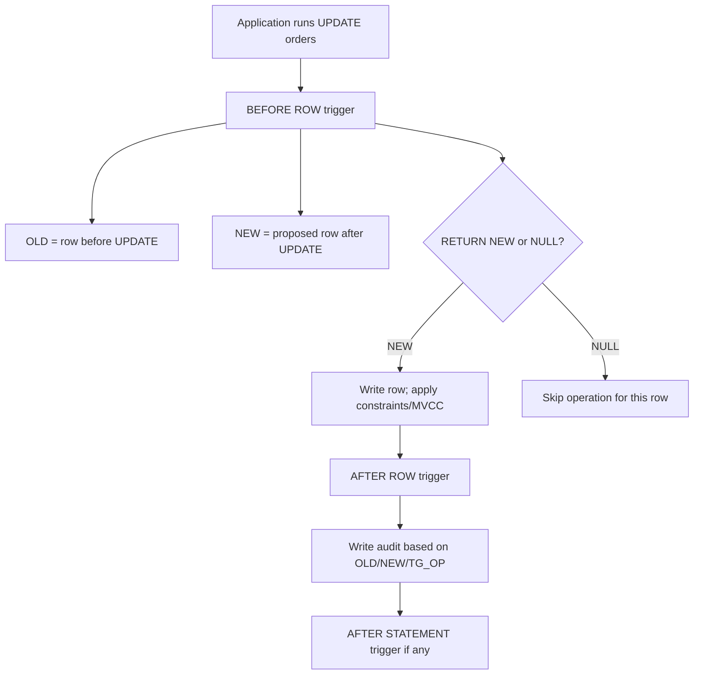

# NEW, OLD, TG_OP, and Trigger Function Context in PostgreSQL

When an order is created, updated, or deleted, PostgreSQL can automatically invoke a **trigger function**. Inside that function, developers typically need to answer three questions:

1. **What event is occurring?** `INSERT`, `UPDATE`, `DELETE`, or `TRUNCATE`?
2. **Which row is being processed?** What are the values before and after the change?
3. **Where and when is the trigger running?** Before or after the operation, per row or per statement, on a table or on a view?

The three most important identifiers are:

- **`NEW`:** the *new* row values for `INSERT` or `UPDATE` in a **row-level** trigger.
- **`OLD`:** the *old* row values for `UPDATE` or `DELETE` in a **row-level** trigger.
- **`TG_OP`:** a string describing the operation that fired the trigger, such as `'INSERT'` or `'DELETE'`.

Together with `TG_WHEN`, `TG_LEVEL`, `TG_NAME`, `TG_TABLE_NAME`, `TG_TABLE_SCHEMA`, and `TG_ARGV`, they form the **automatic execution context** of a trigger invocation.

This lesson belongs to PostgreSQL's **Triggers and Rules** chapter. We will build a small orders system covering triggers that normalize data before writing, triggers that audit after writing, statement-level triggers, transition tables, `INSTEAD OF` triggers on views, skipping operations with `RETURN NULL`, detecting real data changes with `IS DISTINCT FROM`, and common mistakes.

> **Guiding principle:** `NEW`, `OLD`, and `TG_OP` are only meaningful inside a **trigger context**. Never treat `NEW` as a physical table, never access `NEW` in a `DELETE` event, and never mistake `TG_OP` for a column holding business status.

## 1. What Is a Trigger?

A trigger connects three components:

- **Event** occurring on a table/view: `INSERT`, `UPDATE`, `DELETE`, or `TRUNCATE`.
- **Firing point**: `BEFORE`, `AFTER`, or `INSTEAD OF` depending on the target object's capabilities.
- **Execution function**: a function declared `RETURNS trigger` invoked automatically by PostgreSQL.

Example flow:



This diagram illustrates only the path of a simple `UPDATE`. Real systems also involve foreign keys, constraint triggers, multiple triggers at the same timing, partition routing, statement triggers, and event-specific rules.

### 1.1. A trigger function is not a trigger

Two distinct statements:

```sql
CREATE FUNCTION ... RETURNS trigger ...
```

creates the **function**.

```sql
CREATE TRIGGER ... ON some_table
EXECUTE FUNCTION some_function();
```

attaches the **trigger** to an object so PostgreSQL calls that function automatically.

One trigger function can be reused across multiple tables or multiple events, **provided** the function body handles the corresponding context and row structure correctly.

### 1.2. Triggers vs. CHECK constraints and defaults

| Need | Usually appropriate mechanism |
| --- | --- |
| Disallow negative amounts | `CHECK (amount >= 0)` |
| Require a status | `NOT NULL` |
| Auto-assign default creation timestamp | `DEFAULT clock_timestamp()` |
| Normalize multiple fields before writing | `BEFORE ROW` trigger |
| Store history of status changes | `AFTER ROW` trigger or appropriate audit architecture |
| Record summary statistics after a multi-row update | `AFTER STATEMENT`, optionally with transition tables |
| Intercept/transform operations on a view | `INSTEAD OF ROW` trigger |
| Enforce business rules across rows and concurrent transactions | Proper constraints, transactions, locking, and data design; not triggers alone |

Do not use triggers for every requirement when declarative constraints or standard SQL express it more clearly.

## 2. Dimensions of Context: Event, Timing, Level

### 2.1. Event: TG_OP

`TG_OP` is a `text` string taking one of:

- `'INSERT'`.
- `'UPDATE'`.
- `'DELETE'`.
- `'TRUNCATE'`.

It identifies the SQL operation that fired the trigger, **not** the value of a `status` column and not a transaction-manager operation.

### 2.2. Timing: TG_WHEN

`TG_WHEN` holds:

- `'BEFORE'`.
- `'AFTER'`.
- `'INSTEAD OF'`.

Not every combination is valid. `INSTEAD OF` triggers are for **views** at the **ROW** level. `TRUNCATE` only supports **STATEMENT**-level triggers.

### 2.3. Level: TG_LEVEL

`TG_LEVEL` holds:

- `'ROW'`: the function is called once for each affected row.
- `'STATEMENT'`: the function is called once per statement for an eligible trigger/event, even when zero rows are affected.

Row-level and statement-level triggers do not use `NEW`/`OLD` the same way. This is the single most fundamental difference when designing reusable functions.

## 3. Truth Table: When Do NEW and OLD Exist?

| Event | Level | `NEW` | `OLD` | `TG_OP` |
| --- | --- | --- | --- | --- |
| `INSERT` | ROW | **New row** | No old row | `INSERT` |
| `UPDATE` | ROW | **New row** | **Old row** | `UPDATE` |
| `DELETE` | ROW | No new row | **Old row** | `DELETE` |
| `TRUNCATE` | STATEMENT | No single row | No single row | `TRUNCATE` |
| `INSERT`/`UPDATE`/`DELETE` | STATEMENT | No single row | No single row | Corresponding event name |
| `INSERT`/`UPDATE`/`DELETE` on view | INSTEAD OF ROW | Like INSERT/UPDATE | Like UPDATE/DELETE | Corresponding event name |

According to PostgreSQL documentation, `NEW` and `OLD` are `record`-typed variables supplied in the trigger function. When inapplicable, they are unavailable/contextually NULL; **never access fields on a record that has no corresponding row**.

**Wrong** example in a DELETE trigger:

```sql
RAISE NOTICE 'Deleted order %', NEW.order_id;
```

Right:

```sql
RAISE NOTICE 'Deleted order %', OLD.order_id;
```

Likewise, an `AFTER INSERT FOR EACH STATEMENT` trigger receives no `NEW.order_id`, even if the statement inserted many rows.

## 4. Declaring a Trigger Function Properly

A PL/pgSQL data-change trigger function must:

1. Be created with `CREATE FUNCTION`.
2. Have **no ordinary declared parameters** in its signature.
3. Return the pseudo-type `trigger`.
4. Specify `LANGUAGE plpgsql`.
5. Return `NEW`, `OLD`, or `NULL` according to timing, event, and level.

Skeleton:

```sql
CREATE OR REPLACE FUNCTION my_schema.my_trigger_function()
RETURNS trigger
LANGUAGE plpgsql
AS $fn$
BEGIN
    IF TG_OP = 'INSERT' THEN
        -- Use NEW when this is a ROW trigger.
        RETURN NEW;
    ELSIF TG_OP = 'UPDATE' THEN
        -- Use OLD and NEW when this is a ROW trigger.
        RETURN NEW;
    ELSIF TG_OP = 'DELETE' THEN
        -- Use OLD when this is a ROW trigger.
        RETURN OLD;
    END IF;

    RETURN NULL;
END;
$fn$;
```

This is a **conceptual template**, not a function attached to the study table. Later sections build functions with explicit `TG_LEVEL`/`TG_WHEN` checks and concrete data.

### 4.1. Do not call a trigger function like a regular business function

Do not write:

```sql
SELECT my_schema.my_trigger_function();
```

expecting PostgreSQL to conjure a `NEW` row from an application request. Trigger functions must be invoked within a context provided by the trigger manager.

If you want to reuse normalization or query logic, extract it into a **regular function** accepting explicit parameters, then call that helper from the trigger function.

### 4.2. TG_OP is not a client-passed parameter

Do not declare:

```sql
CREATE FUNCTION fn_trigger(p_tg_op text)
RETURNS trigger ...
```

to emulate `TG_OP`. Arguments in `CREATE TRIGGER ... EXECUTE FUNCTION fn('value')` are read via `TG_ARGV`; they **do not become parameters in the function signature**.

## 5. Practice Dataset

Use schema `trigger_lab` in a study database. Object creation and initial data loading in this section should run only once on a schema that does not already contain those objects.

### 5.1. Create the orders table

```sql
CREATE SCHEMA IF NOT EXISTS trigger_lab;

CREATE TABLE trigger_lab.orders (
    order_id bigint PRIMARY KEY,
    customer_id bigint NOT NULL,
    status text NOT NULL
        CHECK (status IN ('pending', 'paid', 'cancelled')),
    amount numeric(12, 2) NOT NULL
        CHECK (amount >= 0),
    note text,
    created_at timestamptz NOT NULL DEFAULT clock_timestamp(),
    updated_at timestamptz NOT NULL DEFAULT clock_timestamp()
);
```

Valid statuses are three lowercase strings. A trigger will take `' PAID '` and normalize it to `'paid'` **before** `CHECK` is evaluated on the row being written.

### 5.2. Create the audit table

```sql
CREATE TABLE trigger_lab.order_audit (
    audit_id bigint GENERATED ALWAYS AS IDENTITY PRIMARY KEY,
    order_id bigint NOT NULL,
    operation text NOT NULL,
    old_status text,
    new_status text,
    old_amount numeric(12, 2),
    new_amount numeric(12, 2),
    source_table text NOT NULL,
    trigger_name text NOT NULL,
    recorded_at timestamptz NOT NULL DEFAULT clock_timestamp()
);
```

The audit table stores selected fields only, avoiding copying entire rows that might contain sensitive data. `order_id` is intentionally **not a foreign key** to `orders`: when an order is deleted, the audit record can still be kept for history.

`audit_id` is an identity sequence; it identifies audit rows and **does not guarantee commit order across concurrent transactions**.

## 6. BEFORE INSERT/UPDATE: Using NEW to Normalize

Create the function:

```sql
CREATE OR REPLACE FUNCTION trigger_lab.fn_prepare_order()
RETURNS trigger
LANGUAGE plpgsql
AS $fn$
BEGIN
    IF TG_LEVEL <> 'ROW' OR TG_WHEN <> 'BEFORE' THEN
        RAISE EXCEPTION
            'fn_prepare_order must run as BEFORE ROW trigger';
    END IF;

    IF TG_OP NOT IN ('INSERT', 'UPDATE') THEN
        RAISE EXCEPTION 'Unsupported TG_OP: %', TG_OP;
    END IF;

    -- NEW is meaningful in INSERT and UPDATE at ROW level.
    NEW.status := lower(btrim(NEW.status));

    IF TG_OP = 'UPDATE' THEN
        NEW.updated_at := clock_timestamp();
    END IF;

    -- Normalized row is allowed to proceed.
    RETURN NEW;
END;
$fn$;
```

Attach the function to the table:

```sql
CREATE TRIGGER trg_10_prepare_order
BEFORE INSERT OR UPDATE
ON trigger_lab.orders
FOR EACH ROW
EXECUTE FUNCTION trigger_lab.fn_prepare_order();
```

### 6.1. Why modify NEW instead of updating the table directly with UPDATE?

In a `BEFORE ROW UPDATE` trigger, `NEW` is **the row that will be written** if the operation proceeds. Editing a field:

```sql
NEW.status := lower(btrim(NEW.status));
```

and calling `RETURN NEW` is the standard way to modify proposed values.

If instead you ran:

```sql
UPDATE trigger_lab.orders
SET status = lower(status)
WHERE order_id = NEW.order_id;
```

inside a trigger on the same table, you risk **nested UPDATEs / trigger recursion**, extra locks, extra WAL, and confusing behavior. To edit the row being processed in a BEFORE ROW trigger, always modify `NEW`.

### 6.2. TG_WHEN and TG_LEVEL clarify the function contract

This function is designed strictly for:

```text
TG_WHEN = 'BEFORE'
TG_LEVEL = 'ROW'
TG_OP in ('INSERT', 'UPDATE')
```

The checks at the top of the function clarify the contract in case someone reuses the function on another trigger. Not every trigger needs all three checks, but when a function depends heavily on `NEW`, explicit guards catch misconfiguration immediately.

### 6.3. NOW vs. clock_timestamp timing

`clock_timestamp()` returns the actual time of the function call; `now()`/`transaction_timestamp()` returns the start time of the transaction. They have different semantics.

If `updated_at` should represent the transaction timestamp, use `now()`; if it should reflect when the function executed, use `clock_timestamp()`. Choose based on your data contract and do not switch arbitrarily.

## 7. AFTER INSERT/UPDATE/DELETE: Using TG_OP, OLD, and NEW to Audit

An audit trigger must handle all three events without **accessing the wrong record**.

```sql
CREATE OR REPLACE FUNCTION trigger_lab.fn_audit_order()
RETURNS trigger
LANGUAGE plpgsql
AS $fn$
BEGIN
    IF TG_LEVEL <> 'ROW' OR TG_WHEN <> 'AFTER' THEN
        RAISE EXCEPTION
            'fn_audit_order must run as AFTER ROW trigger';
    END IF;

    IF TG_OP = 'INSERT' THEN
        INSERT INTO trigger_lab.order_audit (
            order_id, operation,
            old_status, new_status,
            old_amount, new_amount,
            source_table, trigger_name
        )
        VALUES (
            NEW.order_id, TG_OP,
            NULL, NEW.status,
            NULL, NEW.amount,
            TG_TABLE_SCHEMA || '.' || TG_TABLE_NAME,
            TG_NAME
        );

    ELSIF TG_OP = 'UPDATE' THEN
        -- Log only when the two business fields actually changed.
        IF OLD.status IS DISTINCT FROM NEW.status
           OR OLD.amount IS DISTINCT FROM NEW.amount THEN

            INSERT INTO trigger_lab.order_audit (
                order_id, operation,
                old_status, new_status,
                old_amount, new_amount,
                source_table, trigger_name
            )
            VALUES (
                NEW.order_id, TG_OP,
                OLD.status, NEW.status,
                OLD.amount, NEW.amount,
                TG_TABLE_SCHEMA || '.' || TG_TABLE_NAME,
                TG_NAME
            );
        END IF;

    ELSIF TG_OP = 'DELETE' THEN
        INSERT INTO trigger_lab.order_audit (
            order_id, operation,
            old_status, new_status,
            old_amount, new_amount,
            source_table, trigger_name
        )
        VALUES (
            OLD.order_id, TG_OP,
            OLD.status, NULL,
            OLD.amount, NULL,
            TG_TABLE_SCHEMA || '.' || TG_TABLE_NAME,
            TG_NAME
        );

    ELSE
        RAISE EXCEPTION 'Unexpected TG_OP: %', TG_OP;
    END IF;

    -- Return value of AFTER ROW trigger is ignored.
    RETURN NULL;
END;
$fn$;
```

Attach the trigger:

```sql
CREATE TRIGGER trg_90_audit_order
AFTER INSERT OR UPDATE OR DELETE
ON trigger_lab.orders
FOR EACH ROW
EXECUTE FUNCTION trigger_lab.fn_audit_order();
```

### 7.1. Why must auditing branch on TG_OP?

If you wrote:

```sql
INSERT INTO audit (...old_status, new_status...)
VALUES (OLD.status, NEW.status);
```

for **every** event, you would access `OLD.status` on INSERT or `NEW.status` on DELETE. Those records are meaningless in those branches.

Branch cleanly:

- `INSERT` -> use `NEW` only.
- `UPDATE` -> use both `OLD` and `NEW`.
- `DELETE` -> use `OLD` only.

That is also why `TG_OP` is especially valuable when **one function serves multiple events**.

### 7.2. AFTER triggers can write to audit tables, but cannot modify the source row via NEW

In `AFTER ROW`, modifying `NEW.status` in memory does not change the already-processed source row. To normalize values **before writing**, use a `BEFORE ROW` trigger.

An `AFTER` trigger is well-suited for auditing, outboxes, related statistics, or transactional side effects, while weighing cost and recursion risk.

### 7.3. Why is RETURN NULL still valid?

The return value from an **AFTER ROW** trigger is ignored by PostgreSQL. Using `RETURN NULL` is a common convention.

Never copy that convention blindly to `BEFORE ROW`: in BEFORE ROW, `RETURN NULL` means **skip the operation for the current row**.

## 8. Loading Data: Seeing BEFORE and AFTER Work Together

Once both triggers are created, insert data:

```sql
INSERT INTO trigger_lab.orders
    (order_id, customer_id, status, amount, note)
VALUES
    (1001, 101, ' PAID ', 120.50, 'First order'),
    (1002, 101, 'pending', 80.00, NULL),
    (1003, 102, 'paid', 200.00, 'Gift')
RETURNING
    order_id, customer_id, status, amount;
```

**Expected:**

- Order 1001 is stored with `status='paid'`, even though input was `' PAID '`.
- The table's `CHECK` constraint accepts the normalized value.
- Each inserted row produces an audit event with `operation='INSERT'`.

Query back:

```sql
SELECT
    order_id,
    status,
    amount,
    updated_at
FROM trigger_lab.orders
ORDER BY order_id;

SELECT
    audit_id, order_id, operation,
    old_status, new_status,
    old_amount, new_amount,
    trigger_name
FROM trigger_lab.order_audit
ORDER BY audit_id;
```

Starting from an empty schema and a single insert, the audit table receives three INSERT events. Those events occur within the **same transaction** as the source INSERT statement.

### 8.1. Rollbackable UPDATE experiment

```sql
BEGIN;

UPDATE trigger_lab.orders
SET
    status = ' PAID ',
    amount = 95.00
WHERE order_id = 1002
RETURNING order_id, status, amount;

SELECT
    audit_id, order_id, operation,
    old_status, new_status,
    old_amount, new_amount
FROM trigger_lab.order_audit
WHERE order_id = 1002
ORDER BY audit_id;

ROLLBACK;
```

Before rollback, the UPDATE audit event shows:

- `OLD.status = 'pending'`.
- `NEW.status = 'paid'` after normalization by the BEFORE trigger.
- `OLD.amount = 80.00`.
- `NEW.amount = 95.00`.

After `ROLLBACK`, both the UPDATE on `orders` and the corresponding audit INSERT inside the transaction are undone. **The `audit_id` sequence may still retain a gap**, because sequence advancements do not roll back like table rows.

### 8.2. Rollbackable DELETE experiment

```sql
BEGIN;

DELETE FROM trigger_lab.orders
WHERE order_id = 1003
RETURNING order_id, status;

SELECT
    order_id, operation,
    old_status, new_status
FROM trigger_lab.order_audit
WHERE order_id = 1003
ORDER BY audit_id;

ROLLBACK;
```

In the new DELETE event, `OLD` holds the row before deletion; there is no `NEW` row after deletion.

## 9. NEW and OLD Are Records, Not Tables

In a PL/pgSQL trigger, `NEW` and `OLD` have type **`record`**. When the event provides a row, they expose fields matching the target relation's columns:

```sql
NEW.order_id
NEW.status
NEW.amount

OLD.order_id
OLD.status
OLD.amount
```

That is completely different from:

```sql
SELECT * FROM NEW;
```

There is no regular table named `NEW` just because a trigger exists. **Transition relations** created with `REFERENCING NEW TABLE AS ...` are a different mechanism covered later.

### 9.1. Records and per-field data types

`NEW.amount` holds the `amount` column's PostgreSQL type—in our example, `numeric(12,2)`. `NEW.status` is text. They do not turn into strings merely because `record` is flexible.

You can use standard SQL/PL/pgSQL operators:

```sql
IF NEW.amount > 100 THEN
    -- ...
END IF;
```

### 9.2. Do not assume every table has the same fields

A function referencing:

```sql
NEW.status
```

must only be attached to relations possessing an appropriate `status` column. If you attach that function to a table without `status`, an error will surface when the trigger executes.

`TG_TABLE_NAME` tells you which table fired the trigger; it **does not reshape NEW/OLD into the schema you wish existed**.

### 9.3. Inspecting records as JSON for controlled debugging

In a learning environment:

```sql
RAISE NOTICE 'NEW JSON: %', to_jsonb(NEW);
```

helps inspect the row shape. However, if a row contains emails, tokens, addresses, or sensitive data, logging all of `NEW`/`OLD` can leak confidential information. In production, log only authorized, necessary fields.

## 10. TG_OP on UPDATE: OLD and NEW Can Match on Many Columns

A statement:

```sql
UPDATE trigger_lab.orders
SET amount = amount
WHERE order_id = 1001;
```

is still an `UPDATE` operation if the row is processed. `TG_OP` is still `'UPDATE'`, even though the before and after amounts are identical.

Do not write:

```sql
IF TG_OP = 'UPDATE' THEN
    -- Assuming status definitely changed.
END IF;
```

to infer that a specific business column changed.

### 10.1. Use IS DISTINCT FROM instead of <>

SQL has three-valued logic with NULL. The expression:

```sql
OLD.note <> NEW.note
```

evaluates to **NULL** if either side is NULL, rather than a definitive true/false.

Use:

```sql
OLD.note IS DISTINCT FROM NEW.note
```

to test whether two values **differ, even when one side is NULL**.

Truth cases:

| OLD.note | NEW.note | `OLD.note <> NEW.note` | `OLD.note IS DISTINCT FROM NEW.note` |
| --- | --- | --- | --- |
| `'A'` | `'B'` | true | true |
| `'A'` | `'A'` | false | false |
| SQL NULL | `'A'` | SQL NULL | true |
| SQL NULL | SQL NULL | SQL NULL | false |

That is why the audit function above uses `IS DISTINCT FROM` when checking status and amount.

### 10.2. Comparing multiple columns as a row

You can consider:

```sql
IF ROW(OLD.status, OLD.amount, OLD.note)
   IS DISTINCT FROM
   ROW(NEW.status, NEW.amount, NEW.note) THEN
    -- One of the three fields changed.
END IF;
```

Select the exact set of business fields to audit. Do not necessarily compare the entire row, since `updated_at` may be modified by a BEFORE trigger on every UPDATE, flooding the audit log with trivial entries.

## 11. BEFORE ROW: How RETURN Values Affect the Operation

A `BEFORE ROW` trigger can:

- `RETURN NEW` on INSERT/UPDATE to let the operation proceed with the new row.
- `RETURN OLD` on DELETE to allow deleting the old row.
- `RETURN NULL` to **skip the operation for the current row**.

| Timing/event | Typical return | Effect |
| --- | --- | --- |
| BEFORE INSERT ROW | `NEW` | Proceeds with INSERT; edits to NEW are saved |
| BEFORE UPDATE ROW | `NEW` | Proceeds with UPDATE; edits to NEW are saved |
| BEFORE DELETE ROW | `OLD` | Proceeds with DELETE |
| Any BEFORE ROW | `NULL` | Skips processing this row; subsequent row triggers for this row do not run |
| AFTER ROW | Usually `NULL` | Return value is ignored |
| AFTER/BEFORE STATEMENT | Usually `NULL` | Return value is ignored |
| INSTEAD OF ROW on view | `NEW`/`OLD` or `NULL` per event | Non-NULL indicates row handled; NULL indicates row skipped |

### 11.1. Example: conditionally skipping an INSERT

Create a separate table so `orders` data is unaffected:

```sql
CREATE TABLE trigger_lab.inbox (
    message_id bigint PRIMARY KEY,
    state text NOT NULL,
    note text
);
```

Function:

```sql
CREATE OR REPLACE FUNCTION trigger_lab.fn_inbox_policy()
RETURNS trigger
LANGUAGE plpgsql
AS $fn$
BEGIN
    IF TG_OP <> 'INSERT' OR TG_LEVEL <> 'ROW'
       OR TG_WHEN <> 'BEFORE' THEN
        RAISE EXCEPTION 'Unsupported trigger context';
    END IF;

    IF NEW.state = 'ignored' THEN
        RETURN NULL;
    END IF;

    RETURN NEW;
END;
$fn$;
```

Trigger:

```sql
CREATE TRIGGER trg_inbox_policy
BEFORE INSERT ON trigger_lab.inbox
FOR EACH ROW
EXECUTE FUNCTION trigger_lab.fn_inbox_policy();
```

Test:

```sql
INSERT INTO trigger_lab.inbox
    (message_id, state, note)
VALUES
    (1, 'ready', 'keep'),
    (2, 'ignored', 'skip'),
    (3, 'ready', 'keep again')
RETURNING message_id, state;

SELECT * FROM trigger_lab.inbox ORDER BY message_id;
```

Only rows `1` and `3` are written. Row `2` is skipped by the trigger; no successful INSERT happens for that row.

### 11.2. RETURN NULL is not RAISE EXCEPTION

- `RETURN NULL` in BEFORE ROW **skips the row**; the statement can continue processing other rows.
- `RAISE EXCEPTION` throws an error and fails the statement/transaction under error-handling rules.

If business policy requires **the whole request to fail** upon encountering one invalid row, silently returning `NULL` can cause unnoticed input loss.

In validation scenarios, most systems should **raise an explicit error** rather than silently skipping rows.

### 11.3. DELETE needs RETURN OLD, not NEW

In a BEFORE DELETE trigger:

```sql
CREATE OR REPLACE FUNCTION trigger_lab.fn_guard_delete()
RETURNS trigger
LANGUAGE plpgsql
AS $fn$
BEGIN
    IF TG_OP <> 'DELETE' THEN
        RAISE EXCEPTION 'DELETE trigger only';
    END IF;

    IF OLD.status = 'paid' THEN
        RAISE EXCEPTION
            'Cannot delete paid order %', OLD.order_id
            USING ERRCODE = '23514';
    END IF;

    RETURN OLD;
END;
$fn$;
```

This illustrates a standalone policy. **Do not attach this function** if you still plan to run DELETE exercises on paid orders; if you deploy it, update tests accordingly. Never use `RETURN NEW`: there is no new row in a DELETE trigger.

## 12. AFTER ROW: RETURN Does Not Modify the Written Data

Consider:

```sql
-- Inside AFTER UPDATE function:
NEW.status := 'paid';
RETURN NEW;
```

In an AFTER trigger, these two lines **do not modify the updated source row**. PostgreSQL ignores the return value of an AFTER ROW trigger.

If you genuinely need to update source data after an operation, you can issue separate DML, while carefully evaluating locks, recursion, and trigger chaining. If you only want to **adjust the values being written for the same row**, put the logic in a BEFORE ROW trigger.

### 12.1. AFTER ROW triggers excel at auditing

Because `OLD`/`NEW` capture both states of a row during UPDATE, AFTER triggers fit recording history into another table.

However, trigger-based auditing has limitations:

- Runs inside the same transaction, so rollbacks also roll back audit writes.
- A failed transaction cannot leave normal audit rows in the same database transaction.
- Does not record `SELECT`s or changes outside trigger event coverage.
- If auditing must meet compliance or anti-tampering requirements, design proper permissions, storage, and governance.

## 13. Other TG_* Variables Beyond TG_OP

PostgreSQL automatically populates several context variables inside trigger functions.

| Variable | Typical type | Meaning |
| --- | --- | --- |
| `TG_NAME` | `name` | Name of the trigger that fired |
| `TG_WHEN` | `text` | `BEFORE`, `AFTER`, `INSTEAD OF` |
| `TG_LEVEL` | `text` | `ROW` or `STATEMENT` |
| `TG_OP` | `text` | `INSERT`, `UPDATE`, `DELETE`, `TRUNCATE` |
| `TG_RELID` | `oid` | OID of the relation firing the trigger |
| `TG_TABLE_NAME` | `name` | Relation name |
| `TG_TABLE_SCHEMA` | `name` | Schema name |
| `TG_NARGS` | `integer` | Number of literal arguments in `CREATE TRIGGER` |
| `TG_ARGV` | `text[]` | Array of trigger arguments, **0-indexed** |
| `NEW` | `record` | New row when applicable |
| `OLD` | `record` | Old row when applicable |

`TG_RELNAME` was once supported for the relation name but is **deprecated**; use `TG_TABLE_NAME`.

### 13.1. Reading table and event names

Inside the function:

```sql
RAISE NOTICE
    'Trigger %, op %, when %, level %, table %.%',
    TG_NAME,
    TG_OP,
    TG_WHEN,
    TG_LEVEL,
    TG_TABLE_SCHEMA,
    TG_TABLE_NAME;
```

This message is handy for learning and debugging. In high-load production, running `RAISE NOTICE` for every row generates massive log noise and degrades performance.

### 13.2. TG_RELID and object identity

`TG_RELID` is the OID in catalog `pg_class`. You can cast it to `regclass` for display:

```sql
RAISE NOTICE 'Relation: %', TG_RELID::regclass;
```

Never use an OID as an immutable business key across dump/restore or environment rebuilds. When you need schema-qualified names, use `TG_TABLE_SCHEMA` and `TG_TABLE_NAME`.

### 13.3. TG_NAME is the trigger name, not the function name

One function can be bound to multiple triggers with different names. `TG_NAME` identifies which trigger actually fired, useful for logging or intentional branching.

However, do not abuse `TG_NAME` as an unwieldy configuration system. If logic differs substantially, consider separate functions.

## 14. TG_NARGS and TG_ARGV: Passing Arguments to Triggers

Trigger functions **do not declare parameters like ordinary SQL functions**:

```sql
CREATE FUNCTION trigger_lab.fn_mark_source()
RETURNS trigger ...
```

Yet `CREATE TRIGGER` can pass literal strings:

```sql
CREATE TRIGGER trg_mark_source
BEFORE INSERT ON trigger_lab.some_table
FOR EACH ROW
EXECUTE FUNCTION trigger_lab.fn_mark_source('api', 'v1');
```

When the function runs:

- `TG_NARGS = 2`.
- `TG_ARGV[0] = 'api'`.
- `TG_ARGV[1] = 'v1'`.
- `TG_ARGV[2]` returns NULL because it is out of bounds.

**`TG_ARGV` indexing starts at 0**, unlike standard SQL arrays which default to 1-based indexing.

### 14.1. Self-contained example with the second table (inbox)

Using the `inbox` table created earlier:

```sql
CREATE OR REPLACE FUNCTION trigger_lab.fn_add_source_label()
RETURNS trigger
LANGUAGE plpgsql
AS $fn$
DECLARE
    v_label text;
BEGIN
    IF TG_LEVEL <> 'ROW' OR TG_OP <> 'INSERT' THEN
        RAISE EXCEPTION 'Expected INSERT ROW trigger';
    END IF;

    IF TG_NARGS < 1 THEN
        RAISE EXCEPTION 'Missing source label';
    END IF;

    v_label := TG_ARGV[0];

    NEW.note := concat_ws(
        ' ',
        NEW.note,
        '[' || v_label || ']'
    );

    RETURN NEW;
END;
$fn$;
```

Attach a trigger whose name **sorts alphabetically before** the filter trigger `trg_inbox_policy`:

```sql
CREATE TRIGGER trg_00_add_source_label
BEFORE INSERT ON trigger_lab.inbox
FOR EACH ROW
EXECUTE FUNCTION trigger_lab.fn_add_source_label('web-ui');
```

Test:

```sql
INSERT INTO trigger_lab.inbox (message_id, state, note)
VALUES (4, 'ready', 'incoming')
RETURNING *;
```

Expected: `note` gets `[web-ui]` appended.

**Ordering note:** triggers with the same timing/event on the same relation generally fire **in alphabetical order by trigger name**. Because `trg_00_add_source_label` precedes `trg_inbox_policy`, edits to `NEW` by the earlier trigger are visible to the later trigger.

### 14.2. TG_ARGV holds text only, not typed parameters

Even if you pass numbers in `CREATE TRIGGER`, arguments are converted to text.

If you need a number:

```sql
v_threshold := TG_ARGV[0]::numeric;
```

Handle invalid or out-of-range values explicitly. Never assume the DDL parser type-checks numeric arguments when creating the trigger.

### 14.3. Do not source TG_ARGV arbitrarily from user data

`TG_ARGV` comes from the **trigger DDL definition**; it is not a dynamic per-row request parameter. For per-row varying values, read from `NEW`/`OLD`, configuration tables, or business context.

Never interpolate `TG_ARGV` values into dynamic SQL without proper validation/quoting when used as identifiers or expressions.

## 15. ROW Triggers vs. STATEMENT Triggers

Consider:

```sql
UPDATE trigger_lab.orders
SET amount = amount + 1
WHERE customer_id = 101;
```

Suppose 2 rows are updated:

- A `FOR EACH ROW` trigger runs **2 times**, once per `OLD`/`NEW` pair.
- A `FOR EACH STATEMENT` trigger runs **1 time** for that UPDATE statement.

If the query:

```sql
UPDATE trigger_lab.orders
SET amount = amount + 1
WHERE order_id = -999;
```

affects zero rows:

- Row-level triggers do not fire because no rows matched.
- Statement-level triggers still fire **once**, despite 0 rows affected.

### 15.1. Statement triggers have no NEW.order_id

Wrong:

```sql
CREATE OR REPLACE FUNCTION trigger_lab.fn_bad_statement()
RETURNS trigger
LANGUAGE plpgsql
AS $fn$
BEGIN
    RAISE NOTICE '%', NEW.order_id;
    RETURN NULL;
END;
$fn$;
```

If attached to `FOR EACH STATEMENT`, there is no single "new row" to read. The function may compile at creation time yet fail at runtime when the trigger fires.

Use `TG_OP` and `TG_LEVEL` to describe **the statement**. If you need data for all changed rows, use **transition tables**, not `NEW` as an imagined array.

## 16. Statement Trigger Example Logging Statements

Create the table:

```sql
CREATE TABLE trigger_lab.statement_events (
    event_id bigint GENERATED ALWAYS AS IDENTITY PRIMARY KEY,
    operation text NOT NULL,
    trigger_name text NOT NULL,
    table_name text NOT NULL,
    fired_at timestamptz NOT NULL DEFAULT clock_timestamp()
);
```

Function:

```sql
CREATE OR REPLACE FUNCTION trigger_lab.fn_log_statement()
RETURNS trigger
LANGUAGE plpgsql
AS $fn$
BEGIN
    IF TG_LEVEL <> 'STATEMENT' THEN
        RAISE EXCEPTION 'Expected STATEMENT trigger';
    END IF;

    INSERT INTO trigger_lab.statement_events (
        operation, trigger_name, table_name
    )
    VALUES (
        TG_OP,
        TG_NAME,
        TG_TABLE_SCHEMA || '.' || TG_TABLE_NAME
    );

    RETURN NULL;
END;
$fn$;
```

Trigger:

```sql
CREATE TRIGGER trg_orders_statement_log
AFTER INSERT OR UPDATE OR DELETE OR TRUNCATE
ON trigger_lab.orders
FOR EACH STATEMENT
EXECUTE FUNCTION trigger_lab.fn_log_statement();
```

Run:

```sql
BEGIN;

UPDATE trigger_lab.orders
SET amount = amount
WHERE order_id = -999;

SELECT event_id, operation, table_name
FROM trigger_lab.statement_events
ORDER BY event_id;

ROLLBACK;
```

Even though zero rows were updated, the statement-level trigger still records an event inside the transaction. After rollback, that log row is also undone.

### 16.1. TG_OP = TRUNCATE

`TRUNCATE` has its own STATEMENT-level trigger event, rather than firing a series of `DELETE` row triggers.

```sql
BEGIN;

TRUNCATE TABLE trigger_lab.orders;

SELECT operation
FROM trigger_lab.statement_events
ORDER BY event_id DESC
LIMIT 1;

ROLLBACK;
```

Inside the transaction, the logged `TG_OP` is `'TRUNCATE'`. `ROLLBACK` restores the truncated data per PostgreSQL transaction semantics.

**Never run TRUNCATE outside a practice transaction** on tables holding important data; it acquires heavy locks and differs fundamentally from DELETE.

### 16.2. AFTER STATEMENT does not automatically know affected row count

`TG_OP='UPDATE'` and `TG_LEVEL='STATEMENT'` do not say how many rows were updated. To count the exact rows affected by the statement, consider **transition relations** within PostgreSQL's rules, or another appropriate design.

## 17. Transition Tables: OLD TABLE and NEW TABLE

When you need to inspect the **set of multiple rows** changed by a statement, PostgreSQL supports transition relations for eligible `AFTER` triggers.

This is a **different** mechanism from `OLD`/`NEW` records:

| Name | Meaning |
| --- | --- |
| `OLD` | One row before change inside a ROW trigger |
| `NEW` | One new row inside a ROW trigger |
| `OLD TABLE AS old_rows` | Set of rows before change, aliased as `old_rows` |
| `NEW TABLE AS new_rows` | Set of rows after change, aliased as `new_rows` |

### 17.1. Create a statement UPDATE statistics table

```sql
CREATE TABLE trigger_lab.update_batches (
    batch_id bigint GENERATED ALWAYS AS IDENTITY PRIMARY KEY,
    old_row_count bigint NOT NULL,
    new_row_count bigint NOT NULL,
    changed_status_count bigint NOT NULL,
    recorded_at timestamptz NOT NULL DEFAULT clock_timestamp()
);
```

Function:

```sql
CREATE OR REPLACE FUNCTION trigger_lab.fn_log_update_batch()
RETURNS trigger
LANGUAGE plpgsql
AS $fn$
DECLARE
    v_old_count bigint;
    v_new_count bigint;
    v_changed_status bigint;
BEGIN
    SELECT COUNT(*) INTO v_old_count FROM old_rows;
    SELECT COUNT(*) INTO v_new_count FROM new_rows;

    SELECT COUNT(*)
    INTO v_changed_status
    FROM old_rows AS o
    JOIN new_rows AS n USING (order_id)
    WHERE o.status IS DISTINCT FROM n.status;

    INSERT INTO trigger_lab.update_batches (
        old_row_count,
        new_row_count,
        changed_status_count
    )
    VALUES (
        v_old_count,
        v_new_count,
        v_changed_status
    );

    RETURN NULL;
END;
$fn$;
```

Trigger:

```sql
CREATE TRIGGER trg_orders_update_batch
AFTER UPDATE ON trigger_lab.orders
REFERENCING
    OLD TABLE AS old_rows
    NEW TABLE AS new_rows
FOR EACH STATEMENT
EXECUTE FUNCTION trigger_lab.fn_log_update_batch();
```

Test in a transaction:

```sql
BEGIN;

UPDATE trigger_lab.orders
SET status = 'paid'
WHERE customer_id = 101;

SELECT *
FROM trigger_lab.update_batches
ORDER BY batch_id DESC
LIMIT 1;

ROLLBACK;
```

Querying `old_rows` and `new_rows` is only valid **when the function executes inside a trigger declaring the corresponding REFERENCING aliases**. Do not run `SELECT * FROM old_rows` from an ordinary session expecting a permanent table.

### 17.2. Restrictions to remember

- Transition tables apply only to trigger configurations and events supported by PostgreSQL.
- They work with **AFTER** triggers, not BEFORE triggers.
- A trigger declaring transition relations cannot combine events like `INSERT OR UPDATE` in a single trigger definition as in the statement-logging example earlier.
- For `UPDATE` triggers with transition tables, **do not specify `UPDATE OF column_list`** in that trigger definition.
- Transition relations do not apply identically to all constraint triggers or all relation kinds.
- Check documentation for your exact major version when using partitioned tables, foreign tables, and advanced features.

### 17.3. Counting rows that actually changed vs. rows merely touched by UPDATE

`old_rows` and `new_rows` reflect all rows touched by the UPDATE. `UPDATE status = status` still counts toward affected rows.

In the example, `changed_status_count` compares `OLD.status` and `NEW.status` with `IS DISTINCT FROM` to count only rows whose status **truly changed**.

Joining on `order_id` assumes the primary key did not change in the statement; if a statement can update join keys, design a before/after correlation strategy instead of naively joining on a mutated key.

## 18. Trigger WHEN: Filtering Firing Conditions

Instead of calling the function on every UPDATE and checking inside, a trigger can declare `WHEN`.

Example auditing status changes only:

```sql
CREATE TABLE trigger_lab.status_change_events (
    event_id bigint GENERATED ALWAYS AS IDENTITY PRIMARY KEY,
    order_id bigint NOT NULL,
    old_status text,
    new_status text
);
```

Function:

```sql
CREATE OR REPLACE FUNCTION trigger_lab.fn_status_change()
RETURNS trigger
LANGUAGE plpgsql
AS $fn$
BEGIN
    INSERT INTO trigger_lab.status_change_events (
        order_id, old_status, new_status
    )
    VALUES (
        NEW.order_id, OLD.status, NEW.status
    );

    RETURN NULL;
END;
$fn$;
```

Attach with `WHEN`:

```sql
CREATE TRIGGER trg_status_change_only
AFTER UPDATE ON trigger_lab.orders
FOR EACH ROW
WHEN (OLD.status IS DISTINCT FROM NEW.status)
EXECUTE FUNCTION trigger_lab.fn_status_change();
```

When an UPDATE changes only `note`, this function does not need to run for rows whose status stayed identical.

### 18.1. How does WHEN differ from IF inside the function?

- `WHEN` decides **whether to invoke the trigger function for a row** when the condition holds.
- `IF` inside the function is evaluated **after the function has already been called**.

Specifically, a well-placed `AFTER ROW WHEN` can avoid queuing and executing unnecessary trigger events. Exact gains depend on workload and version; do not treat `WHEN` as a replacement for all validation inside functions.

### 18.2. Do not use OLD in INSERT WHEN

For `INSERT`, `OLD` does not exist. For `DELETE`, `NEW` does not exist. The `WHEN` condition must match the event.

### 18.3. INSTEAD OF triggers cannot have a WHEN clause

PostgreSQL does not allow `WHEN` on `INSTEAD OF` triggers. If conditional logic is needed for view operations, handle it inside the function.

## 19. UPDATE OF column Differs From Checking Whether Values Actually Changed

A trigger can be declared as:

```sql
CREATE TRIGGER trg_update_status_targeted
AFTER UPDATE OF status
ON trigger_lab.orders
FOR EACH ROW
EXECUTE FUNCTION trigger_lab.fn_status_change();
```

**However, do not run this example alongside `trg_status_change_only`** if you want to avoid recording spurious `status_change` events, because the function assumes status actually changed.

Key lesson: `UPDATE OF status` generally means **the `status` column was mentioned in the UPDATE's SET list**, without guaranteeing `OLD.status <> NEW.status`.

Example:

```sql
UPDATE trigger_lab.orders
SET status = status
WHERE order_id = 1001;
```

still lists `status` in `SET`; even though the value did not change, an `UPDATE OF status` trigger can still fire.

Conversely, if a `BEFORE UPDATE` trigger modifies `NEW.status` when the original UPDATE only listed another column, `UPDATE OF status` will not necessarily fire just because another trigger altered `status`.

**Conclusion:** if you need to check **whether a value actually changed**, use `OLD.status IS DISTINCT FROM NEW.status`, usually in `WHEN` or inside the function.

## 20. INSTEAD OF Triggers on Views

On a **view**, an `INSTEAD OF` trigger lets you define how `INSERT`, `UPDATE`, or `DELETE` is handled instead of PostgreSQL executing directly on the view.

Create a simple view for the demo:

```sql
CREATE VIEW trigger_lab.order_entry AS
SELECT
    order_id,
    customer_id,
    status,
    amount,
    note
FROM trigger_lab.orders;
```

Function for INSERT into the view:

```sql
CREATE OR REPLACE FUNCTION trigger_lab.fn_order_entry_insert()
RETURNS trigger
LANGUAGE plpgsql
AS $fn$
BEGIN
    IF TG_WHEN <> 'INSTEAD OF'
       OR TG_LEVEL <> 'ROW'
       OR TG_OP <> 'INSERT' THEN
        RAISE EXCEPTION 'Expected INSTEAD OF INSERT ROW';
    END IF;

    INSERT INTO trigger_lab.orders (
        order_id, customer_id, status, amount, note
    )
    VALUES (
        NEW.order_id,
        NEW.customer_id,
        NEW.status,
        NEW.amount,
        NEW.note
    );

    -- Non-NULL: signals view row was handled successfully.
    RETURN NEW;
END;
$fn$;
```

Attach the trigger:

```sql
CREATE TRIGGER trg_order_entry_insert
INSTEAD OF INSERT
ON trigger_lab.order_entry
FOR EACH ROW
EXECUTE FUNCTION trigger_lab.fn_order_entry_insert();
```

Test:

```sql
BEGIN;

INSERT INTO trigger_lab.order_entry (
    order_id, customer_id, status, amount, note
)
VALUES (
    2001, 201, 'pending', 55.00, 'Inserted through view'
);

SELECT *
FROM trigger_lab.orders
WHERE order_id = 2001;

ROLLBACK;
```

The function routes the view INSERT into the base table. Triggers on `orders` still fire from the INSERT executed inside the function.

### 20.1. RETURN NEW/OLD in INSTEAD OF

In an `INSTEAD OF ROW` trigger:

- Returning a non-NULL row (typically `NEW` for INSERT/UPDATE, `OLD` for DELETE) reports that the view row was handled; this affects affected-row counts and `RETURNING`.
- `RETURN NULL` reports skipping that row.

Do not apply the "AFTER trigger return ignored" rule to `INSTEAD OF`.

### 20.2. Automatically updatable views do not always need triggers

Many simple PostgreSQL views are **automatically updatable**, handling INSERT/UPDATE/DELETE without needing an `INSTEAD OF` trigger.

Here the trigger was created to **demonstrate context and RETURN values**; on a real simple view, adding a trigger just to forward every operation verbatim can be redundant.

## 21. TRUNCATE Does Not Fire Individual DELETE Triggers

This is a major auditing trap:

```sql
DELETE FROM trigger_lab.orders;
```

is a DELETE statement and fires row-level DELETE triggers for each deleted row.

By contrast:

```sql
TRUNCATE TABLE trigger_lab.orders;
```

is a `TRUNCATE` event and does not run row-level DELETE triggers for each row as if a full DELETE ran.

If you rely solely on `AFTER DELETE FOR EACH ROW` auditing, a TRUNCATE can wipe data without emitting the expected per-row DELETE audit events.

Appropriate safeguards depend on requirements:

- Restrict `TRUNCATE` privileges.
- Define `BEFORE/AFTER TRUNCATE FOR EACH STATEMENT` triggers to block or log the event if needed.
- Protect audit tables with proper permissions and operational controls.
- Never treat row-trigger auditing as complete coverage for every possible data-modification path.

## 22. Ordering of Multiple Triggers on the Same Object

When multiple triggers share the same event and timing on a relation, PostgreSQL fires them **in alphabetical order of trigger name**, not creation order.

Example used earlier:

```text
BEFORE INSERT on inbox:
  trg_00_add_source_label
  trg_inbox_policy
```

The first trigger can modify `NEW.note`; the second receives the modified row.

### 22.1. Why are naming conventions helpful?

Names like:

```text
trg_10_normalize
trg_20_validate
trg_90_audit
```

make intended order clear **among triggers sharing the same timing and event**. Remember, however, that AFTER auditing runs in a different timing phase than BEFORE, so numbering does not override execution phases.

Never assume an older trigger always runs before a newer one merely because it was created earlier.

### 22.2. RETURN NULL blocks subsequent row-level triggers for that row

In BEFORE ROW, if a trigger returns NULL to skip a row, later row-level triggers for that same row will not run. This impacts validation and auditing if you have multiple triggers and assume all of them always run.

When skipping is part of the business design, document this interaction clearly.

### 22.3. Constraint triggers and special ordering

Foreign keys and constraint triggers follow separate activation and timing rules, and some constraint triggers can be deferred. Never infer one simple global order across all user triggers, FK actions, and internal system triggers solely from your own trigger names.

## 23. BEFORE/AFTER and Constraints

### 23.1. Normalizing before CHECK

In our sample dataset:

```sql
INSERT INTO trigger_lab.orders (
    order_id, customer_id, status, amount
)
VALUES (3001, 301, ' PAID ', 10.00);
```

The `BEFORE INSERT` trigger normalizes `NEW.status` to `paid`, allowing `CHECK (status IN (...))` to pass. Without the trigger, `' PAID '` does not match the three declared strings.

### 23.2. CHECK remains the database line of defense

Never remove `CHECK` constraints just because a trigger exists. Triggers can be disabled by privileged administrators, have their definitions altered, or be bypassed on special write paths.

Declarative constraints are transparent, enforced by PostgreSQL, and ideal for simple row invariants.

### 23.3. BEFORE triggers do not see finalized generated column values

If a table uses generated columns, generated column values are computed according to PostgreSQL's timing rules; do not read a **newly computed** generated value inside a BEFORE trigger assuming it is finalized as in an AFTER trigger.

When you need values derived after row preparation, check the appropriate trigger timing and version documentation.

## 24. Trigger Functions Should Use Explicit Schemas and Privileges

Triggers execute under PostgreSQL role/privilege context based on the function and target object; functions default to **SECURITY INVOKER**, while `SECURITY DEFINER` executes with the function owner's privileges under PostgreSQL rules.

If a trigger needs to write to an audit table that the application cannot write to directly, you can design a `SECURITY DEFINER` function, provided you do so carefully:

- The function owner must hold only the minimum necessary privileges.
- `search_path` must be locked down safely for elevated-privilege functions.
- Table and function names in SQL should be schema-qualified.
- Never construct dynamic SQL from untrusted data.
- Govern `EXECUTE` permissions, trigger-attachment rights, and roles permitted to alter DDL.
- Never grant broad permissions to the application role merely to silence a permission error.

### 24.1. Pattern for SET search_path on privileged functions

```sql
-- Structural sample; do not automatically apply SECURITY DEFINER
-- without a permission model and security review.
CREATE OR REPLACE FUNCTION trigger_lab.fn_secure_example()
RETURNS trigger
LANGUAGE plpgsql
SECURITY DEFINER
SET search_path = pg_catalog, trigger_lab, pg_temp
AS $fn$
BEGIN
    RETURN NEW;
END;
$fn$;
```

This snippet illustrates only where security settings belong and why `pg_temp` matters. It is not attached as a trigger; for DELETE/AFTER/statement events, `RETURN NEW` is not a universal pattern. If privilege elevation is unnecessary, avoid `SECURITY DEFINER`.

### 24.2. Do not use triggers to mask the permission model

A trigger can validate or log, yet it does not replace ACLs, row-level security, transaction isolation, or least privilege.

In particular, the fact that a function can read `NEW` does not mean external database clients should have access to every column in the row.

## 25. Triggers and Transactions

Regular triggers execute **inside the triggering statement's transaction**.

Example:

```sql
BEGIN;

INSERT INTO trigger_lab.orders (
    order_id, customer_id, status, amount
)
VALUES (4001, 401, 'pending', 42.00);

SELECT *
FROM trigger_lab.order_audit
WHERE order_id = 4001;

ROLLBACK;
```

Inside the transaction, you see both the new order and the INSERT audit event. After rollback, both are undone.

### 25.1. Do not arbitrarily COMMIT inside a trigger function

Never attempt arbitrary `COMMIT`/`ROLLBACK` inside a PL/pgSQL trigger function to split off an audit transaction. Triggers execute inside the active statement context, not as an independent service managing its own transactions.

If audit records must survive source transaction rollbacks, use a different architecture such as database logs, external auditing, or a properly designed system with separate transaction boundaries. Nor should triggers call external services directly without considering retries, rollbacks, and at-least-once delivery.

### 25.2. RAISE NOTICE is not durable auditing

`RAISE NOTICE` may appear in logs or client messages, and lacks the semantics of "an audit row committed consistently with the business transaction."

Use `RAISE NOTICE` for learning and debugging in suitable environments; never rely on it as a trustworthy business audit record.

### 25.3. BEFORE triggers and concurrent updates

Under concurrent transactions, rows are locked and updated per PostgreSQL MVCC/isolation rules. `OLD`/`NEW` reflect the row context for that trigger invocation; do not assume they represent a global system snapshot or replace concurrency checks.

For cross-row invariants like "total bookings must not exceed capacity," use proper concurrency control, constraints, and transactions rather than an unlocked `SELECT COUNT` inside a trigger.

## 26. Triggers Can Cause Recursion

A common bug:

```sql
CREATE OR REPLACE FUNCTION trigger_lab.fn_bad_recursive()
RETURNS trigger
LANGUAGE plpgsql
AS $fn$
BEGIN
    UPDATE trigger_lab.orders
    SET updated_at = clock_timestamp()
    WHERE order_id = NEW.order_id;

    RETURN NEW;
END;
$fn$;
```

**Do not attach this function as a BEFORE/AFTER UPDATE trigger on `orders`.** It issues an UPDATE on the very table firing it, re-triggering itself and causing recursion, lock contention, or stack-depth errors.

### 26.1. Proper way to set updated_at

In BEFORE UPDATE ROW:

```sql
NEW.updated_at := clock_timestamp();
RETURN NEW;
```

just as `fn_prepare_order` did. No extra UPDATE is needed merely to change a field on the same row.

### 26.2. pg_trigger_depth()

PostgreSQL provides `pg_trigger_depth()` to inspect trigger nesting depth:

```sql
SELECT pg_trigger_depth();
```

Outside triggers it is typically 0; inside nested triggers it increases.

Still, **never treat `IF pg_trigger_depth() > 1 THEN RETURN NEW` as a universal fix**. It can skip legitimate work when a trigger is invoked via FK cascades, other triggers, or internal DML.

Prefer clean designs that avoid self-updating the relation when modifying `NEW` works, and guard with explicit change conditions.

## 27. Reusing One Function Across Multiple Tables: Benefits and Limits

`TG_TABLE_SCHEMA` and `TG_TABLE_NAME` let a function identify which relation fired it.

For instance, the statement-metadata logging function from Section 16 can be reused across multiple tables:

```sql
-- Template: use only on a table that actually exists
-- and after evaluating statement_events writes.
CREATE TRIGGER trg_orders_statement_log
AFTER INSERT OR UPDATE OR DELETE
ON another_schema.another_table
FOR EACH STATEMENT
EXECUTE FUNCTION trigger_lab.fn_log_statement();
```

This is a **template** and cannot run verbatim because `another_schema.another_table` does not exist in our sample dataset; note also that reusing the same trigger name on a different table is valid because trigger names only need to be unique per relation.

### 27.1. Generic functions must avoid assuming fixed columns on NEW

Functions relying only on `TG_OP`, `TG_TABLE_NAME`, `TG_WHEN`, and `TG_LEVEL` are far easier to share than functions accessing `NEW.amount`.

Attaching a function referencing `NEW.amount` to a table lacking `amount` will fail at runtime.

### 27.2. Difference between table name and OID

`TG_TABLE_NAME` and `TG_TABLE_SCHEMA` reflect the relation's name in context. `TG_RELID` is its OID. Renaming a table changes its displayed name; dump/restore can change OIDs.

Never persist OIDs as immutable business IDs in distributed systems.

## 28. Triggers and Partitioned Tables

With declarative partitioning, consider both parent and child partitions:

- Row-level triggers on a partitioned parent follow PostgreSQL's rules for cloning/propagating to partitions in modern versions.
- Statement-level triggers bind to the relation named in the SQL statement; do not assume parent statement triggers fire automatically when writing directly to a child partition.
- `TG_TABLE_NAME`/`TG_RELID` reflect the firing relation according to the specific mechanism; never hardcode parent names without verifying.
- Moving rows across partitions via partition-key UPDATEs has more complex trigger semantics than regular UPDATEs.
- Foreign keys, transition tables, and statement triggers have version-specific restrictions.

**Never extrapolate every single-table behavior verbatim to partitioned tables.** When adding audits to partitioned tables, test INSERT/UPDATE/DELETE both through the parent and directly on partitions on your exact major version.

## 29. Distinguishing DML Triggers and Event Triggers

This lesson covers **data-change triggers**: `INSERT`/`UPDATE`/`DELETE`/`TRUNCATE` operations on relations.

PostgreSQL also supports **event triggers** for DDL events such as creating, altering, or dropping objects. They have:

- Return type `event_trigger`, not `trigger`.
- Different functions and context variables (`TG_EVENT`, `TG_TAG` in supported scopes).
- Different privileges and operational goals.

Never try to use `NEW`/`OLD` from a DML row trigger to capture `ALTER TABLE` or `DROP TABLE`. That belongs to event triggers and DDL auditing.

## 30. Triggers vs. RULE: Not the Same Thing

PostgreSQL also includes a **rule** / query-rewrite system. A rule transforms a SQL query before execution; a trigger is a function invoked while executing data changes.

| Aspect | Trigger | Rule |
| --- | --- | --- |
| Primary mechanism | Executes a function by event/timing | Rewrites queries per definition |
| Runtime `NEW`/`OLD` records in PL/pgSQL | **Yes**, in eligible row triggers | Different variable/pseudo-relation mechanics |
| Uses `TG_OP` | **Yes** | No |
| Suited for per-row checking/editing | BEFORE ROW trigger | Not equivalent |
| Suited for business auditing | AFTER trigger or audit architecture | Typically not the primary tool |
| Risks when misunderstood | Recursion, trigger order, row vs. statement | Query rewriting can yield surprising semantics |

The chapter title "Triggers and Rules" does not mean `NEW` in triggers and `NEW` in rules are the same runtime variable. Keep the two mechanisms distinct.

## 31. Inspecting Existing Triggers

In psql, you can use the meta-command:

```text
\d trigger_lab.orders
```

Or query the SQL catalog:

```sql
SELECT
    t.tgname AS trigger_name,
    c.oid::regclass AS on_relation,
    p.oid::regprocedure AS trigger_function,
    pg_get_triggerdef(t.oid, true) AS definition,
    t.tgenabled AS enabled_state
FROM pg_trigger AS t
JOIN pg_class AS c
    ON c.oid = t.tgrelid
JOIN pg_proc AS p
    ON p.oid = t.tgfoid
WHERE t.tgrelid = 'trigger_lab.orders'::regclass
  AND NOT t.tgisinternal
ORDER BY t.tgname;
```

Columns:

- `tgname`: trigger name.
- `tgrelid`: relation the trigger is attached to.
- `tgfoid`: function invoked.
- `tgenabled`: catalog enable/disable state.
- `pg_get_triggerdef`: reconstructs the trigger definition syntax.
- `tgisinternal`: distinguishes internal system triggers.

### 31.1. Do not ignore system triggers when diagnosing FKs

The query above intentionally filters `NOT t.tgisinternal` to focus on user triggers. Yet when debugging foreign keys and constraint behavior, internal triggers matter too. Never conclude "the table has only these triggers" after excluding internal ones.

### 31.2. Enabling/disabling triggers requires privileges and planning

`ALTER TABLE ... DISABLE TRIGGER ...` can assist controlled administrative tasks, yet it drops validation and auditing while disabled.

Never disable triggers in production just to "run a fast bulk load" without assessing the impact on constraints, history, and privileges.

## 32. Debugging Trigger Functions

### 32.1. RAISE NOTICE with the right context

Example inside a function:

```sql
RAISE NOTICE
    'name=%, op=%, when=%, level=%, relation=%.%',
    TG_NAME, TG_OP, TG_WHEN, TG_LEVEL,
    TG_TABLE_SCHEMA, TG_TABLE_NAME;
```

Only print `NEW.order_id` after verifying context:

```sql
IF TG_LEVEL = 'ROW'
   AND TG_OP IN ('INSERT', 'UPDATE') THEN
    RAISE NOTICE 'NEW order id = %', NEW.order_id;
END IF;
```

Never access row-level variables in statement-level contexts.

### 32.2. Testing with BEGIN/ROLLBACK

```sql
BEGIN;

UPDATE trigger_lab.orders
SET amount = amount + 5
WHERE order_id = 1001;

SELECT *
FROM trigger_lab.order_audit
WHERE order_id = 1001
ORDER BY audit_id DESC;

ROLLBACK;
```

This is a clean way to observe trigger behavior in a study environment without persisting changes.

### 32.3. EXPLAIN ANALYZE DML actually executes the DML

```sql
BEGIN;

EXPLAIN (ANALYZE, BUFFERS)
UPDATE trigger_lab.orders
SET amount = amount + 1
WHERE order_id = 1001;

ROLLBACK;
```

`EXPLAIN ANALYZE` does not merely simulate a plan; it runs the actual UPDATE, fires triggers, and generates WAL and locks. Run it only in authorized environments, and remember rollback does not undo external side effects like network requests.

### 32.4. Inspecting trigger timing

In `EXPLAIN ANALYZE` output for DML, PostgreSQL can report execution time and call counts per trigger depending on plan structure and version. Never blame a trigger just because the overall query is slow; separate scan time, locking, constraint checks, trigger calls, and audit writes.

### 32.5. Queries matching 0 rows while STATEMENT triggers still run

When debugging a trigger that "unexpectedly logs" even though an UPDATE affected 0 rows, check `TG_LEVEL`. If it is statement-level, that behavior is completely normal.

## 33. Performance: Per-Row Triggers Have a Cost

A simple trigger may look negligible for a single INSERT. Yet for:

```sql
UPDATE trigger_lab.orders
SET amount = amount + 1
WHERE customer_id = 101;
```

if millions of rows match, a row-trigger function gets invoked just as many times. Operations inside it such as:

- Per-row audit INSERTs.
- Extra lookup queries.
- Large JSON serialization.
- Complex regex/text formatting.
- Reading/writing multiple tables.
- Nested function calls.

can sharply raise CPU, I/O, WAL, and lock overhead.

### 33.1. WHEN to avoid unnecessary calls

For auditing focused on status, `AFTER UPDATE ... WHEN (OLD.status IS DISTINCT FROM NEW.status)` reduces function invocations compared to calling the function on every UPDATE and branching inside.

### 33.2. Statement triggers with transition tables

If the goal is aggregating over the **set of changed rows**, a statement trigger using transition relations avoids row-by-row processing, though it is not always right for detailed row-by-row audits.

### 33.3. Do not perform arbitrary network I/O inside triggers

Calling APIs, sending emails, or triggering non-transactional side effects directly from a trigger causes:

- Increased transaction latency.
- Inability to roll back external side effects when the database transaction fails.
- Duplicate side effects on retries.
- Fragile database transactions coupled to external system availability.

A common integration pattern is a **transactional outbox** recording events in the same transaction, with a separate worker dispatching post-commit. That design still requires idempotency and retry handling.

### 33.4. Optimize in the right order

Before trying to make a trigger function "faster," ask:

1. Is the trigger truly needed?
2. Is ROW or STATEMENT level appropriate?
3. Can `CHECK`/DEFAULT/constraints handle it?
4. Can `WHEN` cut down invocations?
5. Is it causing N+1 queries or recursion?
6. Does the audit table have appropriate indexes and retention?
7. Are query plans inside the trigger efficient?
8. What is the impact on concurrency and WAL?

## 34. How Java/JDBC Applications See Triggers

Applications normally just send SQL. PostgreSQL invokes triggers automatically within the same transaction.

Example:

```java
import java.math.BigDecimal;
import java.sql.Connection;
import java.sql.PreparedStatement;
import java.sql.ResultSet;
import java.sql.SQLException;
import javax.sql.DataSource;

public class OrderRepository {
    private final DataSource dataSource;

    public OrderRepository(DataSource dataSource) {
        this.dataSource = dataSource;
    }

    public String updateStatus(long orderId, String requestedStatus)
            throws SQLException {
        String sql = """
            UPDATE trigger_lab.orders
            SET status = ?
            WHERE order_id = ?
            RETURNING status
            """;

        try (Connection c = dataSource.getConnection();
             PreparedStatement ps = c.prepareStatement(sql)) {

            ps.setString(1, requestedStatus);
            ps.setLong(2, orderId);

            try (ResultSet rs = ps.executeQuery()) {
                if (!rs.next()) {
                    return null;
                }
                return rs.getString("status");
            }
        }
    }

    public int updateAmount(long orderId, BigDecimal amount)
            throws SQLException {
        String sql = """
            UPDATE trigger_lab.orders
            SET amount = ?
            WHERE order_id = ?
            """;

        try (Connection c = dataSource.getConnection();
             PreparedStatement ps = c.prepareStatement(sql)) {
            ps.setBigDecimal(1, amount);
            ps.setLong(2, orderId);
            return ps.executeUpdate();
        }
    }
}
```

In this example:

- `requestedStatus=" PAID "` is bound safely without string concatenation.
- The BEFORE trigger normalizes `status`.
- `RETURNING status` returns the normalized value for the updated row.
- The AFTER trigger writes audit entries under its own semantics.
- If a BEFORE ROW trigger returns NULL, `UPDATE ... RETURNING` may omit skipped rows.
- If a trigger executes `RAISE EXCEPTION`, JDBC receives a `SQLException` with the corresponding SQLSTATE.
- The caller decides commit/rollback according to the application's transaction policy.

### 34.1. JDBC update count does not equal "intended rows"

The affected row count reported by PostgreSQL reflects rows actually processed under statement/trigger semantics. A BEFORE ROW trigger returning NULL can make the processed count lower than the number of rows initially matched by `WHERE`.

Never build billing or auditing logic assuming an "expected row count" without accounting for trigger behavior.

### 34.2. Triggers do not prevent SQL injection

Triggers run after SQL is parsed and planned. If an application concatenates raw user input into SQL text, triggers cannot fix malicious SQL.

Use `PreparedStatement` and proper database privileges.

### 34.3. Transactions encompass trigger writes

When Java disables autocommit and executes multiple SQL statements in one transaction, audit rows written by triggers are part of that transaction. Calling `rollback()` reverts those trigger writes as well.

Never emit an external "order updated successfully" notification merely because a trigger ran, before the transaction actually commits.

## 35. Common Errors and Explanations

| Symptom | Typical cause | Fix |
| --- | --- | --- |
| `NEW.order_id` fails on DELETE | DELETE has no NEW row | Use `OLD.order_id` |
| `OLD.status` fails on INSERT | INSERT has no OLD row | Use `NEW` |
| `NEW` fails in STATEMENT trigger | No row context exists | Use `TG_*` only, or eligible transition tables |
| DML trigger function cannot be called directly | Needs trigger manager context | Attach via `CREATE TRIGGER`, extract business helpers |
| `CREATE FUNCTION fn(arg) RETURNS trigger` causes confusion | Trigger arguments live in `TG_ARGV` | Declare function with empty parameter list |
| `TG_ARGV[1]` is not the first argument | `TG_ARGV` is 0-indexed | Use `TG_ARGV[0]` |
| BEFORE INSERT does not save the row | Function returned NULL | Return `NEW` when proceeding |
| BEFORE DELETE does not delete the row | Function returned NULL or wrong NEW | Return `OLD` to allow DELETE |
| AFTER UPDATE modifies NEW yet table unchanged | Return value and NEW edits do not alter source row | Edit `NEW` in BEFORE ROW |
| Missing audit rows after TRUNCATE | TRUNCATE does not fire DELETE ROW triggers | Restrict privileges, add TRUNCATE statement trigger |
| Trigger logs despite 0-row UPDATE | STATEMENT triggers still run | Check `TG_LEVEL` |
| UPDATE logged even though status unchanged | `TG_OP`/`UPDATE OF` does not prove value changed | Compare `OLD`/`NEW` with `IS DISTINCT FROM` |
| `<>` behaves wrongly with NULL | SQL NULL three-valued logic | Use `IS DISTINCT FROM` |
| Function reads field missing on another table | `NEW`/`OLD` shape follows target relation | Attach only to compatible tables; validate schema |
| Self-UPDATE loops until stack error | Trigger updates its own source table | Edit `NEW` in BEFORE; design recursion-free flows |
| Audit disappears after rollback | Audit shares transaction | Expected semantics; failure logging needs separate architecture |
| Multiple triggers do not run in creation order | Order follows name for same timing/event | Use naming conventions and check DDL |
| Trigger slow during bulk UPDATE | Runs once per row with inner SQL/IO | Use `WHEN`, statement triggers, or transition tables when suitable |
| Permission error writing audit | Insufficient role/function privileges | Design explicit privileges, review `SECURITY DEFINER` |
| Trigger appears not to fire | Trigger disabled or `WHEN` false | Query `pg_trigger` / `pg_get_triggerdef` |
| Java update count lower than expected | BEFORE ROW returned NULL or data mismatched | Check RETURN logic and SQLSTATE |
| Debugging cannot find OLD/NEW fields | Incompatible event/timing/level | Review context table in Section 3 |

## 36. Runbook When a Trigger Behaves Unexpectedly

**Step 1 — Identify relation, event, and timing.** Run `pg_get_triggerdef`, check `BEFORE/AFTER/INSTEAD OF`, `INSERT/UPDATE/DELETE/TRUNCATE`, and `ROW/STATEMENT`.

**Step 2 — Check TG_OP/TG_WHEN/TG_LEVEL.** Do not guess from trigger names. One function can be attached to multiple definitions.

**Step 3 — Inspect NEW/OLD.** Read fields only for valid events and row-level contexts.

**Step 4 — Inspect RETURN.** Is BEFORE ROW returning NULL and skipping rows? Is an AFTER ROW return mistakenly expected to update the row?

**Step 5 — Inspect trigger WHEN/UPDATE OF.** Does the condition test real value changes or only presence in the SET list?

**Step 6 — Check other triggers.** Triggers with the same timing/event run alphabetically; did an earlier trigger edit `NEW` or return NULL?

**Step 7 — Check transaction outcome.** Did a subsequent rollback or exception wipe audit rows? Did the client actually commit?

**Step 8 — Check constraints and partitioning.** CHECK/FOREIGN KEY constraints, internal triggers, and partitioned tables may be involved.

**Step 9 — Inspect SQL inside the trigger.** Look for redundant queries, recursive DML, missing indexes, or lock contention.

**Step 10 — Check privileges.** Is the function `SECURITY INVOKER` or `DEFINER`, and is `search_path` safe?

**Step 11 — Reproduce safely.** In a lab schema, use `BEGIN ... ROLLBACK`; remember `EXPLAIN ANALYZE` executes real DML.

**Step 12 — Define regression tests.** Cover INSERT, no-op UPDATE, NULL transitions, DELETE, TRUNCATE, 0 rows affected, multi-row statements, and concurrent transactions.

A correct trigger is not merely a function that throws no errors. It must have **clear semantics for affected row counts, old/new values, ordering, and transactions**.

## 37. Practice Exercises

Exercises use schema `trigger_lab`. Run data-modifying exercises inside transactions with `ROLLBACK` whenever you want to restore sample data.

### Exercise 1 — Reading the context table

Build a table for `INSERT ROW`, `UPDATE ROW`, `DELETE ROW`, and `TRUNCATE STATEMENT`:

- What is `TG_OP`?
- Can `NEW` be read?
- Can `OLD` be read?
- Which RETURN value makes sense?

Explain why `TRUNCATE` has no per-row `NEW`/`OLD`.

### Exercise 2 — Creating a BEFORE INSERT trigger

Recreate `fn_prepare_order` and `trg_10_prepare_order` in a clean schema. Insert status `' PAID '` and inspect the value in `RETURNING`.

Why does editing `NEW.status` in BEFORE affect the persisted row?

### Exercise 3 — Testing CHECK and triggers

Insert `status=' UNKNOWN '` to observe the CHECK error after trigger normalization. Why doesn't a BEFORE trigger make every input valid?

### Exercise 4 — AFTER audit for INSERT

Create `fn_audit_order` and its audit trigger. Insert a new order and inspect `old_status` and `new_status`.

Why doesn't INSERT auditing access `OLD.status`?

### Exercise 5 — UPDATE with OLD/NEW

Inside a transaction, transition order 1002 from pending to paid. Print:

```text
TG_OP
OLD.status
NEW.status
OLD.amount
NEW.amount
```

Why does `NEW` in AFTER UPDATE reflect the value after BEFORE normalization?

### Exercise 6 — UPDATE leaving business data unchanged

Run `UPDATE ... SET amount = amount`. Count UPDATE audit events before and after.

Why is `TG_OP='UPDATE'` still true even though our audit function produces no event?

### Exercise 7 — NULL-safe comparison

Change `note` from NULL to `'gift'` and compare:

```sql
OLD.note <> NEW.note
OLD.note IS DISTINCT FROM NEW.note
```

inside a practice UPDATE trigger. Why is the second operator suited for auditing?

### Exercise 8 — DELETE has OLD only

Write a BEFORE DELETE trigger allowing row deletion via `RETURN OLD`. Test `RETURN NEW` (in a sandbox) and explain why it fails.

### Exercise 9 — RETURN NULL skipping rows

Use table `inbox`. Insert three rows with one having `state='ignored'`. Check the rows in `RETURNING` and in the table after INSERT.

When is silent skipping riskier than `RAISE EXCEPTION`?

### Exercise 10 — AFTER RETURN is ignored

In an illustrative AFTER UPDATE trigger, try modifying `NEW.note` and `RETURN NEW`. Verify whether the source table's note changed due to that return value.

Why should normalization live in BEFORE?

### Exercise 11 — TG_NAME, TG_WHEN, and TG_LEVEL

Add `RAISE NOTICE` to a practice function printing all three variables. Attach it to BEFORE ROW and AFTER STATEMENT under appropriate contracts.

Compare the output across events.

### Exercise 12 — TG_NARGS and TG_ARGV

Create a trigger with:

```sql
EXECUTE FUNCTION trigger_lab.fn_add_source_label('web-ui');
```

Inside the function, print `TG_NARGS` and `TG_ARGV[0]`. Try accessing `TG_ARGV[1]`.

Why must the function signature still be `() RETURNS trigger`?

### Exercise 13 — Trigger ordering

Create two BEFORE INSERT triggers on `inbox` starting with `trg_10` and `trg_20`. Have the first modify `NEW.note` and the second observe it.

Rename/reorder them and explain why DDL creation order does not determine execution order.

### Exercise 14 — STATEMENT trigger on 0-row UPDATE

Create `statement_events` and an `AFTER UPDATE FOR EACH STATEMENT` trigger. Run an UPDATE for a non-existent ID.

Why does the statement log still record an event even when zero rows are updated?

### Exercise 15 — TRUNCATE vs. DELETE

In a test transaction, observe a DELETE row trigger and then a TRUNCATE statement trigger (reset data or use a separate demo table).

Why does auditing built solely on DELETE row triggers miss rows removed by TRUNCATE?

### Exercise 16 — Transition tables

Create an `AFTER UPDATE REFERENCING OLD TABLE AS old_rows NEW TABLE AS new_rows` trigger. Count:

- Updated rows.
- Rows whose status actually changed.

Why can't `NEW.status` be used directly inside a statement-level function?

### Exercise 17 — WHEN vs. IF

Write an AFTER UPDATE trigger firing only when:

```sql
WHEN (OLD.status IS DISTINCT FROM NEW.status)
```

Compare against a function checking `IF` internally. How do the two differ in evaluation timing and overhead?

### Exercise 18 — UPDATE OF status

Explain why:

```sql
UPDATE trigger_lab.orders
SET status = status
WHERE order_id = 1001;
```

can still fire `AFTER UPDATE OF status`, even though the status value did not change.

### Exercise 19 — View INSTEAD OF INSERT

Create the `order_entry` view and `INSTEAD OF INSERT` trigger. Insert a row and inspect `orders` inside a transaction.

If the function returns NULL, how does behavior for that view row change?

### Exercise 20 — Transaction rollback

Insert an order, verify the audit event, then ROLLBACK. Why does the audit row disappear while the identity sequence may still show gaps?

### Exercise 21 — Recursion

Read `fn_bad_recursive` without attaching it. Explain why updating the same table inside an UPDATE trigger causes recursion.

Rewrite it using `NEW.updated_at := clock_timestamp(); RETURN NEW;` in a BEFORE trigger.

### Exercise 22 — Privileges and SECURITY DEFINER

An application may only INSERT/UPDATE orders and cannot INSERT directly into audit. Propose a privilege architecture so the trigger audits safely, restricting `search_path` and owner role.

Why shouldn't you grant full privileges to the request role just to bypass a permission error?

### Exercise 23 — Java/JDBC and RETURNING

Use a `PreparedStatement` to run:

```sql
UPDATE trigger_lab.orders
SET status = ?
WHERE order_id = ?
RETURNING status;
```

Bind `' PAID '`. Verify the returned value after normalization, and explain how to handle 0 returned rows.

### Exercise 24 — Production runbook

A system with 20 million orders needs status normalization, auditing for amount/status changes, and a 100,000-row bulk UPDATE. Propose:

1. BEFORE ROW normalization.
2. AFTER ROW auditing or an appropriate set-based optimization.
3. `WHEN` on status/amount where applicable.
4. Handling INSERT/UPDATE/DELETE separately via `TG_OP`.
5. `RETURN` and skip rules.
6. Privilege, transaction, and rollback conditions.
7. A test plan covering TRUNCATE, 0-row UPDATEs, NULLs, and concurrency.
8. How to measure trigger overhead and prevent recursion.
9. Audit retention, read access, logging, and rollback mechanisms.
10. Safe rollout via migrations.

Your solution must distinguish **semantic correctness** from **batch processing speed**, and must not use triggers to replace all constraints and concurrency control.

## 38. Summary

Key takeaways on **`NEW`, `OLD`, `TG_OP`, and trigger function context**:

1. **`NEW`** holds the new row in `INSERT/UPDATE FOR EACH ROW`; **`OLD`** holds the old row in `UPDATE/DELETE FOR EACH ROW`.
2. **`TG_OP`** identifies the event: `INSERT`, `UPDATE`, `DELETE`, or `TRUNCATE`; it does **not** prove any specific column changed.
3. **`TG_WHEN`** reports `BEFORE/AFTER/INSTEAD OF`; **`TG_LEVEL`** distinguishes `ROW` from `STATEMENT`.
4. **BEFORE ROW** can modify `NEW` and `RETURN NEW`; `RETURN NULL` skips the operation for that row.
5. **BEFORE DELETE ROW** normally executes `RETURN OLD`. Never use `NEW` on DELETE.
6. **AFTER ROW** does not use its return value to modify the source row; `RETURN NULL` is a clean convention.
7. **INSTEAD OF ROW** on views has distinct return semantics: non-NULL signals the row was handled, NULL skips it.
8. **Statement-level triggers have no single NEW/OLD row**; eligible triggers can use transition tables to read before/after row sets.
9. **`TG_NAME`, `TG_TABLE_SCHEMA`, `TG_TABLE_NAME`, and `TG_RELID`** identify the firing trigger and relation; **`TG_NARGS` and `TG_ARGV[0]`** read configuration arguments from `CREATE TRIGGER`.
10. Use **`IS DISTINCT FROM`** for NULL-safe comparisons; `UPDATE OF column` does not guarantee the column's value changed.
11. **Triggers run inside the transaction** of the source operation: trigger-written audits roll back together with the source write.
12. **Avoid re-updating the same table** inside an UPDATE trigger just to adjust the current row; modify `NEW` in BEFORE ROW to prevent recursion.
13. Triggers sharing timing and event execute in **alphabetical name order**, not creation order.
14. **TRUNCATE is not a row-by-row DELETE**, so DELETE ROW audit triggers alone do not cover every data-deletion path.
15. **Performance, security, and correctness** must be evaluated together: constraints, privileges, `WHEN`, transition tables, audit retention, and concurrency.

When designing a new trigger, ask in order: **Which event? Which timing? Which level? Which records are valid? What does RETURN do? How will transactions and other triggers interact?** Answering these six questions prevents most mistakes with `NEW`, `OLD`, and `TG_OP`.

## 39. Official PostgreSQL Documentation

- [PL/pgSQL Trigger Functions — NEW, OLD, TG_OP, and TG_* variables](https://www.postgresql.org/docs/current/plpgsql-trigger.html)
- [Overview of Trigger Behavior — BEFORE/AFTER/INSTEAD OF, ROW/STATEMENT, transition tables](https://www.postgresql.org/docs/current/trigger-definition.html)
- [CREATE TRIGGER — syntax, WHEN, UPDATE OF, REFERENCING, FOR EACH](https://www.postgresql.org/docs/current/sql-createtrigger.html)
- [CREATE FUNCTION — RETURNS trigger, LANGUAGE plpgsql, and privileges](https://www.postgresql.org/docs/current/sql-createfunction.html)
- [PL/pgSQL Control Structures — IF, EXCEPTION, RETURN](https://www.postgresql.org/docs/current/plpgsql-control-structures.html)
- [PL/pgSQL Statements — assignment, SQL in functions, dynamic SQL](https://www.postgresql.org/docs/current/plpgsql-statements.html)
- [System Catalog pg_trigger — trigger metadata introspection](https://www.postgresql.org/docs/current/catalog-pg-trigger.html)
- [CREATE VIEW — auto-updatability and INSTEAD OF triggers](https://www.postgresql.org/docs/current/sql-createview.html)
- [Transaction Isolation — MVCC and concurrency semantics](https://www.postgresql.org/docs/current/transaction-iso.html)

The `current` links point to the latest PostgreSQL release documentation. Before deploying, run `SHOW server_version;` and cross-check documentation for your **exact major version** regarding partitioned table triggers, transition tables, generated columns, and advanced behavior.
