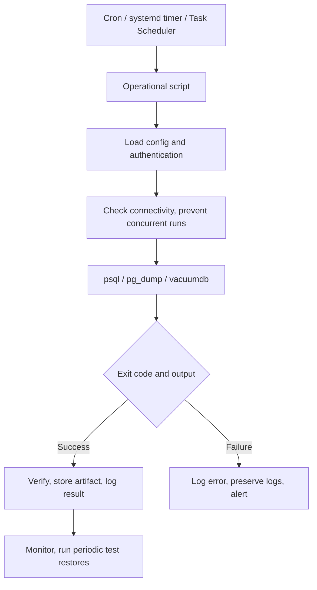

# Automating PostgreSQL Administration Tasks with Command-Line Tools

PostgreSQL administration often involves repetitive tasks: checking connectivity, running monitoring queries, backing up data, verifying backups, updating statistics, and recording operational logs. Running each command manually makes it easy to miss schedules or lose traceability when failures happen. **Command-line (CLI) automation** turns those operations into scheduled workflows with clear exit codes and verifiable outcomes.

This lesson uses the sample database `shopdb`, the PostgreSQL role `pg_automation`, and a Linux environment to build a realistic workflow. These names are examples; when applying them, substitute the names and paths of the environment you manage.

## 1. PostgreSQL tools suited for automation

PostgreSQL ships with built-in command-line programs; you do not necessarily need a Java application or custom connection library for basic operational tasks.

| Tool | Commonly automated tasks | What to keep in mind |
| --- | --- | --- |
| `psql` | Running SQL from files, collecting info, exporting reports | Use `ON_ERROR_STOP` so SQL errors fail the process |
| `pg_isready` | Checking whether the server accepts connections | Does not prove an account has query privileges or data is intact |
| `pg_dump` | Logical backup of a single database | Does not back up cluster-wide config, global roles, or WAL for point-in-time recovery |
| `pg_restore` | Inspecting contents and restoring archive backups | Test restores into an isolated database |
| `pg_dumpall` | Backing up multiple databases or global objects | Requires appropriate privileges; output data must also be protected |
| `vacuumdb` | Running VACUUM/ANALYZE within a defined scope | Autovacuum already handles most routine needs |
| `reindexdb` | Rebuilding indexes when operationally justified | Can consume heavy resources, acquire locks, or impact load |
| `createdb` / `dropdb` | Creating or dropping test databases | Exercise extreme caution with `dropdb` and target database names |
| `pg_basebackup` | Physical backup of the entire cluster | Serves physical/WAL backup strategies, distinct from `pg_dump` |
| `pg_ctl` | Managing the lifecycle of a PostgreSQL instance | Typically run by the OS service-management account |

**Scope distinction:** `pg_dump shopdb` creates a logical backup of `shopdb`; it does not replace a physical backup strategy, WAL archiving, or point-in-time recovery (PITR) testing when strict RPO/RTO targets apply.

Typical processing flow:



A solid operational script knows **where it is connecting**, **who is authorized to run it**, **what counts as success**, **how partial files are handled**, and **who receives alerts when a scheduled run fails**.

## 2. Preparing the environment and non-interactive connections

### 2.1. Installing clients and checking versions

On the host running the job, install the appropriate PostgreSQL client utilities and verify they are in `PATH`:

```bash
psql --version
pg_dump --version
pg_restore --version
pg_isready --version
command -v psql pg_dump pg_restore pg_isready
```

Use client utilities matching the PostgreSQL server's major version. In particular, an older `pg_dump` targeting a newer server major version may refuse to dump. The backup host can be a dedicated machine and does not need to run PostgreSQL server itself.

### 2.2. Configuring via environment variables

PostgreSQL clients honor `PG*` environment variables from the `libpq` library:

```bash
export PGHOST=127.0.0.1
export PGPORT=5432
export PGDATABASE=shopdb
export PGUSER=pg_automation
export PGCONNECT_TIMEOUT=10
export PGPASSFILE=/home/pgops/.pgpass
```

Choose addresses and TLS settings according to your actual deployment. Over untrusted networks, configure TLS and server certificate verification properly (e.g., `PGSSLMODE=verify-full` with a valid CA); never assume internal networks are inherently safe.

Do not place passwords in URLs, `-W <password>` arguments, or committed script files. In fact, `psql`'s `-W` option **forces a password prompt** and does not take a password argument. On Linux, `.pgpass` can contain a line formatted as:

```text
127.0.0.1:5432:shopdb:pg_automation:PASSWORD_FROM_SECRET_MANAGER
```

Replace the placeholder with securely provisioned credentials, never using the illustrative text literally. File permissions must be restricted:

```bash
chmod 600 /home/pgops/.pgpass
chmod 700 /home/pgops
```

When generating or writing passwords, avoid exposing them in shell history or logs. If a password contains `:` or backslashes, escape them per `.pgpass` rules. On Windows, point `PGPASSFILE` to a file protected by NTFS ACLs; Linux `chmod` does not apply.

Automation accounts should follow **least privilege** for each task. For example, a backup account needs read access to objects being dumped, while a maintenance account gets only privileges needed for maintenance. Never use superuser just to run `SELECT 1` or routine backups.

### 2.3. Separating network checks from SQL privilege checks

```bash
# Check whether the server is accepting connections.
pg_isready -h "$PGHOST" -p "$PGPORT" -d "$PGDATABASE"

# Actually log in and run SQL; fail if SQL encounters an error.
psql -X -w -v ON_ERROR_STOP=1 -Atqc "SELECT 1;"
```

Common flags in automation:

- `-X`: skips personal `.psqlrc` files for consistent behavior across machines.
- `-w`: never prompts interactively for a password; fails immediately if credentials are missing.
- `-v ON_ERROR_STOP=1`: halts on SQL or `psql` processing errors.
- `-A`, `-t`, `-q`: outputs compact unaligned results easy for scripts to parse; `-c` executes the supplied SQL string.

`pg_isready` is only an initial readiness probe. It can report the server is accepting connections even when your account lacks privileges or cannot authenticate. To confirm a job can run, verify the actual required command as well.

## 3. Automating SQL statements with `psql`

When checking active session counts, store the SQL in `sql/daily_health.sql`:

```sql
SELECT
    now() AS checked_at,
    current_database() AS database_name,
    count(*) AS session_count
FROM pg_stat_activity
WHERE datname = current_database();
```

Run the file from the shell:

```bash
psql -X -w -v ON_ERROR_STOP=1 \
  --dbname="$PGDATABASE" \
  --file="./sql/daily_health.sql"
```

Unlike interactive typing, this keeps change history and is easy to reuse in cron or CI. When exporting CSV data to **the client machine**, use `psql`'s `\copy` (for example, assuming a `public.orders` table exists):

```bash
psql -X -w -v ON_ERROR_STOP=1 \
  -c "\copy (SELECT id, created_at FROM public.orders WHERE created_at >= current_date - interval '1 day') TO '/srv/reports/recent_orders.csv' WITH (FORMAT csv, HEADER true)"
```

`\copy` writes files on the client side; `COPY ... TO '/path'` runs on the server side with different permission and path requirements. Ensure the target directory exists and exported files have appropriate permissions.

For **SQL changes that can run inside a transaction**, `psql` provides `--single-transaction` when used with `-f`:

```bash
psql -X -w -v ON_ERROR_STOP=1 \
  --single-transaction \
  --file="./sql/maintenance_transactional.sql"
```

Do not use this option for commands disallowed inside a transaction block, such as `VACUUM` or `CREATE INDEX CONCURRENTLY`. Schema changes should follow a version-controlled migration workflow tested in an isolated environment.

## 4. Building a daily PostgreSQL backup script

A useful backup must produce a complete file, never leave behind partial files mistaken for valid backups on mid-run failure, prevent overlapping runs, and emit clear failure signals to the scheduler.

Assume OS user `pgops` has write access to `/srv/pg-backups`, and `PGHOST`, `PGPORT`, `PGDATABASE`, `PGUSER`, and `PGPASSFILE` are set. Save the following script at `/opt/dbops/backup_pg.sh`:

```bash
#!/usr/bin/env bash
set -Eeuo pipefail
umask 077

: "${PGHOST:?Missing PGHOST}"
: "${PGPORT:?Missing PGPORT}"
: "${PGDATABASE:?Missing PGDATABASE}"
: "${PGUSER:?Missing PGUSER}"
: "${PGPASSFILE:?Missing PGPASSFILE}"

BACKUP_DIR="${BACKUP_DIR:-/srv/pg-backups}"
RETENTION_DAYS="${RETENTION_DAYS:-14}"

if [[ ! "$RETENTION_DAYS" =~ ^[1-9][0-9]*$ ]]; then
    echo "RETENTION_DAYS must be a positive integer" >&2
    exit 2
fi

mkdir -p -- "$BACKUP_DIR"

# Linux: flock holds an exclusive lock for the duration of the script.
exec 9>"$BACKUP_DIR/.backup.lock"
if ! flock -n 9; then
    echo "Another backup job is already running" >&2
    exit 75
fi

timestamp="$(date -u +%Y%m%dT%H%M%SZ)"
temp_file="$BACKUP_DIR/${PGDATABASE}_$timestamp.dump.partial"
final_file="$BACKUP_DIR/${PGDATABASE}_$timestamp.dump"

# Do not leave .partial files behind if pg_dump or verification fails.
trap 'rm -f -- "$temp_file"' EXIT

echo "[$(date -u +%FT%TZ)] Checking PostgreSQL"
pg_isready -h "$PGHOST" -p "$PGPORT" -d "$PGDATABASE" >/dev/null

echo "[$(date -u +%FT%TZ)] Starting pg_dump"
pg_dump --no-password \
    --format=custom \
    --dbname="$PGDATABASE" \
    --file="$temp_file"

# Verify the archive TOC is readable; this is not a full restore test.
pg_restore --list "$temp_file" >/dev/null

# Only completed files receive the .dump extension.
mv -- "$temp_file" "$final_file"
trap - EXIT

# Retain backups for the configured days, deleting only matching dump files.
find "$BACKUP_DIR" -maxdepth 1 -type f \
    -name "${PGDATABASE}_*.dump" \
    -mtime "+$((RETENTION_DAYS - 1))" -print -delete

echo "[$(date -u +%FT%TZ)] Succeeded: $final_file"
```

`set -e` with `pipefail` exits when critical commands fail; `set -u` catches unset variables. `umask 077` restricts permissions on newly created files. Nonzero exit codes let the scheduler mark the job as failed. `flock` requires the Linux `flock` utility; on other operating systems, use an appropriate locking mechanism.

Custom archive format `--format=custom` (`-Fc`) works with `pg_restore`, allowing selective object restoration and compression per client capabilities. Writing to `.partial` and renaming to `.dump` upon completion prevents monitoring jobs from mistaking an in-progress file for a usable backup.

**What this script does not guarantee:** `pg_restore --list` only checks that PostgreSQL can read the archive's table of contents; it does not prove every data block restores cleanly. Schedule periodic test restores and verify real data. Moreover, backups stored on the same host are lost if the host or disk fails; store off-host copies as well, with encryption, access control, and an independent retention policy.

### Run manually before scheduling

```bash
chmod 700 /opt/dbops/backup_pg.sh
/opt/dbops/backup_pg.sh
ls -lh /srv/pg-backups/*.dump
```

Run it as **the exact OS account that will run the scheduled job**. Ensure that account can read `PGPASSFILE` and write to both the backup directory and log files. Schedule it only after manual execution succeeds.

## 5. Test restores: the most important verification step

Never test restores directly onto a database serving live users. A safe approach uses a test server or a dedicated database `shopdb_restorecheck` that does not exist in the production application:

```bash
# Run in a test environment with permission to create databases.
createdb --template=template0 shopdb_restorecheck

# Restore from the newly created archive; replace with the actual file path.
pg_restore --exit-on-error \
  --no-owner \
  --no-acl \
  --dbname=shopdb_restorecheck \
  /srv/pg-backups/shopdb_20261114T020000Z.dump

# Run a basic verification query in the test database.
psql -X -w -v ON_ERROR_STOP=1 \
  -d shopdb_restorecheck \
  -c "SELECT count(*) AS public_tables
      FROM information_schema.tables
      WHERE table_schema = 'public'
        AND table_type = 'BASE TABLE';"
```

`--exit-on-error` stops if restore hits an error; `--no-owner` and `--no-acl` skip restoring original owners and privileges when the test environment uses different roles. These options do not guarantee every extension or dependency restores if required privileges are missing.

Checking table counts is only the first step. Add application-relevant checks, such as row counts on key tables, relationship integrity checks, business total reconciliations, and representative read queries. After verification, drop **only the test database** per internal procedures; never copy a `dropdb` command and accidentally substitute a production database name.

A backup is only valuable if it can **restore successfully within your recovery time objective**. If you need recovery to arbitrary timestamps between backups, design proper WAL archiving/PITR rather than simply running `pg_dump` more often.

## 6. Automating maintenance and monitoring

### 6.1. Collecting metrics with SQL

Example query listing tables with high estimated dead tuples and their latest autovacuum timestamps:

```bash
psql -X -w -v ON_ERROR_STOP=1 -d shopdb -c "
SELECT
    schemaname,
    relname,
    n_live_tup,
    n_dead_tup,
    last_autovacuum,
    last_autoanalyze
FROM pg_stat_user_tables
ORDER BY n_dead_tup DESC
LIMIT 10;"
```

`n_live_tup` and `n_dead_tup` are statistical estimates; interpret them alongside table size, write workload, statistics freshness, and autovacuum settings. Do not trigger heavy commands automatically merely because one metric crossed an arbitrary threshold.

### 6.2. Maintenance utilities

```bash
# Refresh planner statistics when specifically needed.
vacuumdb --analyze-only --verbose --dbname=shopdb

# Use only when index rebuilds are genuinely justified.
# --concurrently reduces write blocking while still consuming resources.
reindexdb --concurrently \
  --dbname=shopdb \
  --table=public.orders
```

Autovacuum usually handles dead tuple cleanup and statistics analysis. `REINDEX` is needed only with solid justification, such as index corruption, verified severe bloat, or a validated maintenance requirement. Run it during an appropriate window while watching duration, disk space, locks, and system load. Different PostgreSQL versions support slightly different concurrent options, so check `reindexdb --help` for your client/server versions.

For business data cleanup jobs, require explicit filter conditions, dry-run a `SELECT` with the same filter first, and control affected row counts. Never schedule `DELETE`/`TRUNCATE` jobs copied casually from examples.

## 7. Scheduling execution

### 7.1. Cron on Linux

Edit the `pgops` account's crontab with `crontab -e` and configure the required environment (or use your infrastructure's secure config-loading mechanism):

```cron
SHELL=/bin/bash
PATH=/usr/local/bin:/usr/bin:/bin
PGHOST=127.0.0.1
PGPORT=5432
PGDATABASE=shopdb
PGUSER=pg_automation
PGPASSFILE=/home/pgops/.pgpass
PGCONNECT_TIMEOUT=10
BACKUP_DIR=/srv/pg-backups
RETENTION_DAYS=14

# 02:00 daily in the cron host's time zone.
0 2 * * * /opt/dbops/backup_pg.sh >> /var/log/pgops/backup.log 2>&1
```

`/var/log/pgops` must exist and be writable by the scheduled account. Manage log growth with logrotate or centralized logging. Cron itself does not alert when a job fails; set up monitoring on exit codes, last successful backup timestamp, and backup age.

If two scheduled runs overlap because the previous run took too long, `flock` in the script causes the second run to exit cleanly instead of writing two files concurrently. Verify the host's clock and time zone; when migrating schedules across hosts in different time zones, never assume `02:00` corresponds to the same UTC instant.

### 7.2. Systemd timers for better status tracking

On systemd-based Linux systems, you can replace cron with a service and timer. Example `/etc/systemd/system/pg-backup.service`:

```ini
[Unit]
Description=PostgreSQL logical backup

[Service]
Type=oneshot
User=pgops
EnvironmentFile=/etc/pgops/backup.env
ExecStart=/opt/dbops/backup_pg.sh
```

`/etc/pgops/backup.env` holds `PGHOST`, `PGPORT`, `PGDATABASE`, `PGUSER`, `PGPASSFILE`, and `BACKUP_DIR` (no passwords needed). Secure file permissions per OS standards. Example `/etc/systemd/system/pg-backup.timer`:

```ini
[Unit]
Description=Daily PostgreSQL backup timer

[Timer]
OnCalendar=*-*-* 02:00:00
Persistent=true
Unit=pg-backup.service

[Install]
WantedBy=timers.target
```

After installing and validating with administrative privileges:

```bash
sudo systemctl daemon-reload
sudo systemctl enable --now pg-backup.timer
systemctl list-timers pg-backup.timer
journalctl -u pg-backup.service -n 50 --no-pager
```

`Persistent=true` lets the timer catch up if the machine was powered off during a scheduled window. Make sure catch-up runs fit system load and backup policies.

### 7.3. On Windows: PowerShell and Task Scheduler

PostgreSQL utilities run on Windows as well. PowerShell scripts must check `$LASTEXITCODE` immediately after invoking native executables:

```powershell
$ErrorActionPreference = "Stop"
$env:PGHOST = "127.0.0.1"
$env:PGPORT = "5432"
$env:PGDATABASE = "shopdb"
$env:PGUSER = "pg_automation"
$env:PGPASSFILE = "C:\dbops\pgpass.conf"

New-Item -ItemType Directory -Force -Path "C:\pgbackups" | Out-Null
$backup = "C:\pgbackups\shopdb_$(Get-Date -Format 'yyyyMMdd_HHmmss').dump"

& pg_dump.exe --no-password --format=custom --dbname=shopdb --file=$backup
if ($LASTEXITCODE -ne 0) { throw "pg_dump failed: $LASTEXITCODE" }

& pg_restore.exe --list $backup | Out-Null
if ($LASTEXITCODE -ne 0) { throw "pg_restore list failed: $LASTEXITCODE" }

Write-Output "Backup created: $backup"
```

This is a short version demonstrating exit-code checking; for real use, add concurrency locking, partial-file cleanup, retention, and monitoring like the Linux script. Configure Task Scheduler to run the `.ps1` script under a properly privileged service account in compliance with machine execution policy. Restrict `pgpass.conf` permissions using NTFS ACLs.

## 8. When jobs fail and how to troubleshoot

The essence of automation is that **failures must be visible**. Never just log `echo "success"` while ignoring exit codes from PostgreSQL commands.

| Symptom | Common cause | Where to check |
| --- | --- | --- |
| `pg_isready` reports not accepting connections | Server stopped, network blocked, wrong host/port, or starting up | Check endpoint, service status, firewall, and server logs |
| `psql` reports authentication failed | Password, `pg_hba.conf` rule, or `.pgpass` mismatch | Check host/port/db/user and authentication method |
| `pg_dump` reports permission denied | Role lacks read access on some objects | Grant scoped privileges or use a managed backup role |
| `pg_dump` rejected due to version | Client is older than server major version | Install utilities matching the server major version |
| `pg_dump` reports no space left on device | Backup host ran out of disk space | Monitor disk, dump sizes, retention, and offsite uploads |
| `pg_restore` fails on owner/extension | Target lacks matching roles, extensions, or privileges | Use an appropriate test DB; verify dependencies, grants, and restore flags |
| No new backup file appears | Timer did not fire, missing env vars, lock held, or script errored | Check schedule, journal/logs, exit codes, and last backup time |
| `.dump` exists but restore fails | Corrupted archive, missing dependency, or untested restore | Maintain scheduled test restores with business checks |

At minimum, monitor: **timestamp of last successful backup**, **file size**, **exit code**, **runtime duration**, **remaining disk space**, and **latest test-restore outcome**. Route alerts through your organization's monitoring system whenever critical thresholds fail.

Idempotency must also be designed in: check before creating objects; avoid running SQL modifications twice on rerun; never blindly auto-retry data-modifying operations when commit status is unknown. Read-only queries or backups may be retried per policy with capped attempts, backoff, and per-attempt logging.

## 9. Practice lab: completing a restorable backup workflow

Assume a Java/Spring Boot application uses PostgreSQL `shopdb`. Perform these steps sequentially in a development or test environment:

1. Create an operational role with minimal required privileges, set `PGHOST`, `PGPORT`, `PGDATABASE`, and `PGUSER`, and authenticate via `PGPASSFILE`. Run `pg_isready` and `psql -X -w -v ON_ERROR_STOP=1 -Atqc "SELECT 1"`.
2. Run `backup_pg.sh` manually; observe the exit code and created `.dump` file. Verify archive structure with `pg_restore --list`.
3. Create a separate test database, run `pg_restore --exit-on-error`, and verify several tables and rows actually required by the application.
4. Once restore is confirmed, add a cron job or systemd timer; inspect logs from at least one scheduled run and verify where failure alerts are delivered.
5. Trigger a controlled failure, such as pointing `PGPORT` to the wrong port in the test environment; confirm the script exits nonzero, no `.dump` file is treated as valid, and monitoring detects the failure.

Upon completion, you will have a repeatable, verifiable, and auditable administrative workflow. Resource-intensive or potentially destructive tasks should be scheduled only after verifying permissions, preconditions, recovery mechanisms, and observability.

## 10. Takeaways for production systems

- **Automation does not equal reliability.** Creating a file does not prove it can be restored; scheduled test restores are mandatory in any backup strategy.
- **Use the right tool for the right scope.** `pg_dump` handles per-database logical backups; `pg_basebackup`/WAL handles physical backups and PITR; `psql` runs SQL with controllable exit codes.
- **Keep secrets out of scripts and logs.** Secure PostgreSQL roles, OS accounts, `.pgpass`, backup directories, and offsite copies.
- **Keep outcomes measurable.** Tasks need clear schedules, logs, exit codes, concurrency locks, retention controls, and alerts when fresh backups are missing.
- **Perform maintenance based on measured need.** Rely on autovacuum; run manual VACUUM/ANALYZE/REINDEX only based on evidence and during suitable windows.

From this foundation, scripts can evolve into a standardized operational platform: shipping backups to off-host storage, adding checksums and encryption, centralizing monitoring, tracking RPO/RTO metrics, and conducting regular recovery drills.
