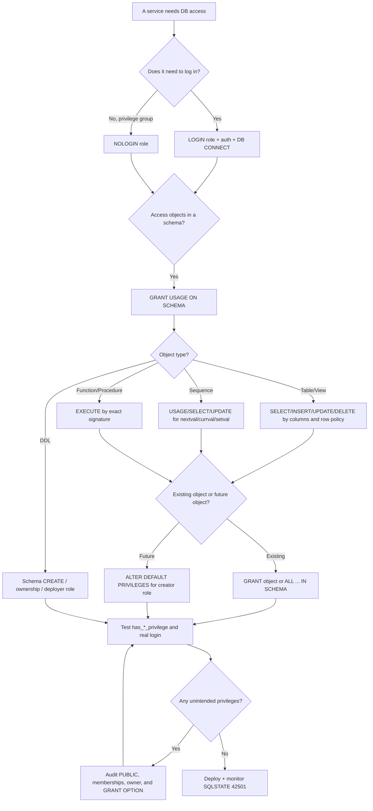

# GRANT, REVOKE, and Privileges on Databases, Schemas, Tables, Sequences, and Functions in PostgreSQL

An application that only needs to read reports does not need permission to modify data; a worker that creates orders does not need to see internal notes; and an account that deploys schemas should not be the same account the API uses every day. PostgreSQL addresses these requirements through a system of **roles, ownership, object privileges, and memberships**, centered around two core commands: **`GRANT`** and **`REVOKE`**.

For example, the following three statements act on three **distinct** security layers:

```sql
GRANT CONNECT ON DATABASE app_db TO app_reader;

GRANT USAGE ON SCHEMA sales TO app_reader;

GRANT SELECT ON TABLE sales.orders TO app_reader;
```

- `CONNECT` allows using the database during connection establishment, but does not grant permission to read any tables.
- `USAGE` on a schema allows resolving objects within that namespace; it does not automatically grant `SELECT`.
- `SELECT` on a table allows reading within the granted scope, though database, schema, and other privileges may still be required.

A `GRANT ALL` on a database **does not** mean the recipient gets every privilege on tables inside the database. Likewise, running `REVOKE` on one privilege path does not guarantee access is gone if the role still receives the privilege through `PUBLIC` or another role membership.

This lesson belongs to the **Security** chapter in the *Database Engine Relational PostgreSQL* module. We will build a layered privilege model: **database -> schema -> table/view/column -> sequence -> function/procedure**; then inspect effective privileges, perform revocations, manage default privileges for future objects, and integrate with applications.

> **Version scope:** Primary syntax targets PostgreSQL 18. Privileges such as `MAINTAIN`, membership options, and default behavior of the `public` schema must be checked against your actual major version. The lab creates new roles/databases, so run it only on a **test cluster** using an authorized administrative account. Never run `REVOKE ... FROM PUBLIC` or `DROP` statements on a production database without assessing impact.

---

## 1. Learning Objectives

After this lesson, you will be able to:

1. Distinguish object owners, login roles, `NOLOGIN` group roles, memberships, and the `PUBLIC` pseudo-role.
2. Use `GRANT`/`REVOKE` accurately by object type instead of granting privileges at the wrong layer.
3. Explain the three database privileges: `CONNECT`, `CREATE`, and `TEMPORARY`.
4. Distinguish `USAGE` and `CREATE` on schemas, including `search_path` risks.
5. Grant `SELECT`, `INSERT`, `UPDATE`, `DELETE`, `TRUNCATE`, `REFERENCES`, `TRIGGER`, and `MAINTAIN` on tables/views when appropriate.
6. Grant **column-level** privileges and understand when table-level grants override column-level restrictions.
7. Use `USAGE`, `SELECT`, and `UPDATE` on sequences for `nextval`, `currval`, and `setval`.
8. Grant `EXECUTE` separately for functions, procedures, and routines, and handle overloaded signatures.
9. Distinguish object privileges with `WITH GRANT OPTION` from role memberships with `WITH ADMIN OPTION`.
10. Understand `REVOKE ... CASCADE/RESTRICT` and why a role may still retain privileges after `REVOKE`.
11. Use `ALTER DEFAULT PRIVILEGES` properly with **object-creating roles**, global defaults, and per-schema additions.
12. Avoid confusing `GRANT ON ALL TABLES IN SCHEMA` with privileges on future tables.
13. Inspect privileges via `psql`, `has_*_privilege`, and system catalogs.
14. Apply **least privilege** across migrations, connection pools, `SECURITY DEFINER`, and Row-Level Security.
15. Build a lab with read accounts, write accounts, sequences, views, and functions, and verify allowed and denied operations.

## 2. The Right Mental Model: A Request Passes Through Multiple Gates

A SQL query:

```sql
SELECT order_id FROM sales.orders;
```

may require the following conditions:

```text
Connection capability (LOGIN role, pg_hba.conf, DB CONNECT, ...)
                        |
                        v
             USAGE privilege on schema
                        |
                        v
             SELECT privilege on table/columns
                        |
                        v
         RLS policies / view / function rules
                        |
                        v
                   Data returned
```

A privilege at an upper layer **does not replace** a lower layer. Without `USAGE` on the schema, `SELECT` on the table may still be insufficient to resolve the table name. With `SELECT`, Row-Level Security can still restrict which rows the role sees.

### 2.1. Four Mechanisms to Keep Separate

| Mechanism | What question does it answer? |
|---|---|
| **Role attributes** | Can the role `LOGIN`, `CREATEROLE`, `CREATEDB`, `BYPASSRLS`, `SUPERUSER`...? |
| **Object privileges / ACL** | Can the role `SELECT` a table, `USAGE` a sequence, `EXECUTE` a function...? |
| **Object ownership** | Who has the right to alter the definition or `DROP` the object? |
| **RLS and app policies** | Within an accessible table, **which rows** can the role read or modify? |

Never say "`GRANT SELECT` is enough to protect multi-tenant data." It is only one piece of the privilege model.

## 3. Roles: Users and Privilege Groups

PostgreSQL uses **roles** for both login accounts and permission groups.

```sql
-- Login role able to authenticate to the DB if other conditions pass.
CREATE ROLE app_user LOGIN;

-- NOLOGIN role typically acts as a privilege group.
CREATE ROLE app_read NOLOGIN;

-- Assign the privilege group to the login role.
GRANT app_read TO app_user;
```

`GRANT app_read TO app_user` is a **membership GRANT**, not a `GRANT SELECT` on an object.

### 3.1. Why Use Group Roles?

If 20 services need to read a set of tables, granting `SELECT` individually to each service makes the policy hard to audit. Instead:

```text
app_read (NOLOGIN)
    ├── service_api (LOGIN)
    ├── service_report (LOGIN)
    └── service_export (LOGIN)
```

When schemas change, the DBA grants object privileges to `app_read`. Login roles inherit them according to the applicable **membership options**.

### 3.2. LOGIN Does Not Mean Table Read Access

`CREATE ROLE app_user LOGIN` does not automatically grant access to application tables. Nor does `GRANT CONNECT` to a `NOLOGIN` role allow it to log in directly; you need a login role holding membership and passing authentication.

### 3.3. Role Attributes Are Not Object Privileges

`SUPERUSER`, `BYPASSRLS`, `CREATEDB`, `CREATEROLE`, and `REPLICATION` are not `GRANT SELECT ON TABLE` privileges. They carry different scopes and risks; never grant `SUPERUSER` just to fix an ordinary `permission denied for table` error.

## 4. Who Is PUBLIC?

`PUBLIC` is an **implicit group comprising all current and future roles**. It is neither the `public` schema nor a regular role you create with `CREATE ROLE PUBLIC`.

```sql
GRANT EXECUTE ON FUNCTION sales.calc_tax(numeric)
TO PUBLIC;
```

This means any role with a valid access path can receive that `EXECUTE` privilege.

```sql
REVOKE EXECUTE ON FUNCTION sales.calc_tax(numeric)
FROM PUBLIC;
```

revokes only the **privilege path coming from `PUBLIC`** for that function. A role granted `EXECUTE` directly or through another role can still execute it.

### 4.1. PUBLIC vs. the public Schema

| Identifier | Nature |
|---|---|
| `PUBLIC` | Set of all roles in the privilege system |
| `public` | An ordinary schema inside a database |
| `pg_catalog` | System catalog schema |
| `pg_database_owner` | Predefined role bound to the current database's owner |

A very common mistake is thinking `REVOKE CREATE ON SCHEMA public FROM PUBLIC` means "block all database access." It only revokes the **`CREATE` privilege on the `public` schema** granted through `PUBLIC`.

## 5. Owners Differ from Grantees

When an object is created, it has an **owner**. The owner is normally the role executing `CREATE`, or a role designated via an owner clause.

```sql
SELECT
    tableowner,
    schemaname,
    tablename
FROM pg_tables
WHERE schemaname = 'sales';
```

Owners hold special rights over objects:

- Can `ALTER`/`DROP` the object under ownership rules.
- Can `GRANT`/`REVOKE` privileges on the object.
- Are considered to hold **grant options** on objects they own.
- Normally hold full object privileges initially, unless policy has altered them.

### 5.1. There Is No Ordinary GRANT DROP TABLE Privilege

```sql
-- Not valid PostgreSQL syntax to transfer ownership rights:
GRANT DROP ON TABLE sales.orders TO app_user;
```

The right to change an object's definition or `DROP` it is **bound to ownership**, not a grantable `DROP` object privilege.

To transfer ownership:

```sql
ALTER TABLE sales.orders OWNER TO ddl_owner;
```

This command can only be executed by a role meeting ownership and membership/`SET ROLE` requirements, or by a superuser—never by a role holding ordinary `SELECT`.

### 5.2. An Owner Can REVOKE Their Own Ordinary Privileges

An owner can revoke `SELECT`/`UPDATE` from themselves in certain cases to prevent accidental mistakes, yet the owner **can always re-grant them** because grant options belong to ownership. It is not an absolute barrier against the owner or a superuser.

## 6. Privilege Table by Object Type

| Object | Primary privileges | Not automatically included |
|---|---|---|
| Database | `CONNECT`, `CREATE`, `TEMPORARY` | `SELECT` on any tables |
| Schema | `USAGE`, `CREATE` | DB `CONNECT` or table `SELECT` |
| Table/view | `SELECT`, `INSERT`, `UPDATE`, `DELETE`, `TRUNCATE`, `REFERENCES`, `TRIGGER`, `MAINTAIN` | Sequence `USAGE` |
| Column | `SELECT`, `INSERT`, `UPDATE`, `REFERENCES` | Privileges on all columns |
| Sequence | `USAGE`, `SELECT`, `UPDATE` | `INSERT` into tables using the sequence |
| Function | `EXECUTE` | Table read rights inside `SECURITY INVOKER` |
| Procedure | `EXECUTE` | `COMMIT` rights depending on context, or DML |
| Type/domain | `USAGE` | Privileges on tables containing the type |
| Configuration parameter | `SET`, `ALTER SYSTEM` where applicable | `SUPERUSER` |
| Tablespace | `CREATE` | DDL privileges in any database |

`ALL PRIVILEGES` means only **all privileges applicable to that specific object type**, never superuser.

**Note:** `MAINTAIN` is documented in PostgreSQL 18 for relation privileges; on older clusters, verify syntax and behavior for your version.

## 7. Structure of the GRANT Statement

Common syntax:

```sql
GRANT privilege [, privilege ...]
ON object_type object_name [, ...]
TO role_name [, ...]
[WITH GRANT OPTION];
```

Examples:

```sql
GRANT SELECT, INSERT ON TABLE sales.orders
TO order_service;

GRANT USAGE ON SCHEMA sales
TO order_service;

GRANT EXECUTE ON FUNCTION sales.calc_tax(numeric)
TO order_service;
```

### 7.1. GRANT Is Additive; It Does Not Replace the Whole ACL

If a role already has `SELECT` and you run `GRANT INSERT`, it now holds both `SELECT` and `INSERT`. `GRANT` never implicitly revokes prior privileges.

### 7.2. FROM and TO Have Clear Meanings

- `GRANT ... TO role`: adds privileges.
- `REVOKE ... FROM role`: removes privileges along the specified grant path.
- `GRANT role_a TO role_b`: grants **membership**.
- `REVOKE role_a FROM role_b`: revokes **membership**.

Never mix up the two kinds of `GRANT`, even though both use `GRANT ... TO ...` syntax.

## 8. Structure of the REVOKE Statement

```sql
REVOKE privilege [, privilege ...]
ON object_type object_name [, ...]
FROM role_name [, ...]
[CASCADE | RESTRICT];
```

Examples:

```sql
REVOKE INSERT ON TABLE sales.orders
FROM order_service;

REVOKE USAGE ON SCHEMA sales
FROM order_service;
```

`REVOKE` has no concept of an absolute "deny": if `order_service` still gets `SELECT` from `PUBLIC` or another group role, access remains in effect.

### 8.1. REVOKE Does Not Delete Objects

`REVOKE SELECT ON TABLE ...` neither deletes rows nor drops the table. It changes role access rights.

### 8.2. REVOKE Does Not Change Role Ownership

`REVOKE ALL ON TABLE ... FROM owner` can reduce the owner's ordinary privileges, yet **does not** strip ownership or the ability to alter the object definition.

### 8.3. RESTRICT and CASCADE

When no dependent grants exist, both behave identically. When grant chains exist, `RESTRICT` rejects a revocation that would break a dependent grant, whereas `CASCADE` revokes dependent grants along the chain as well.

A later section demonstrates this precisely with an intermediate role.

---

## 9. Security Lab: Preparing the Cluster and Accounts

The following lab uses a new database named `acl_lab` and schema `demo_acl` to avoid altering permissions on an active application database. You need an administrative account **permitted to `CREATE ROLE`, `CREATE DATABASE`, and `SET ROLE`**. On managed PostgreSQL, actual privileges may be restricted.

**Run once in `psql` as an administrative account on a test cluster:**

```sql
CREATE ROLE acl_owner NOLOGIN;
CREATE ROLE acl_reader NOLOGIN;
CREATE ROLE acl_writer NOLOGIN;

CREATE ROLE acl_report_login LOGIN;
CREATE ROLE acl_worker_login LOGIN;

GRANT acl_reader TO acl_report_login;
GRANT acl_writer TO acl_worker_login;

CREATE DATABASE acl_lab OWNER acl_owner;
```

> These are example role and database names. Never hardcode passwords in articles, logs, or migrations. If password login is needed, provision authentication/secrets through an approved secrets tool rather than embedding secrets in SQL source files.

### 9.1. Connecting to the Lab Database

In `psql`, use the meta-command:

```text
\connect acl_lab
```

`\connect` is a `psql` command, not a SQL statement to pass over JDBC.

If not using `psql`, configure `acl_lab` in your SQL client's connection string. The remainder assumes you are connected to this database as an administrative role.

### 9.2. Role Breakdown

| Role | LOGIN? | Purpose |
|---|---|---|
| `acl_owner` | No | Owns schemas/tables/functions |
| `acl_reader` | No | Read privilege group |
| `acl_writer` | No | Insert/update privilege group |
| `acl_report_login` | Yes | Account using `acl_reader` privileges |
| `acl_worker_login` | Yes | Account using `acl_writer` privileges |

Separating the owner from runtime accounts is a foundational principle. Never let a long-running API log in as the owner just to "avoid writing GRANTs."

## 10. Database Privileges: CONNECT, CREATE, TEMPORARY

On the test database, the owner or admin runs:

```sql
REVOKE CONNECT, TEMPORARY ON DATABASE acl_lab
FROM PUBLIC;

GRANT CONNECT ON DATABASE acl_lab
TO acl_reader, acl_writer;
```

Now roles with direct or inherited `acl_reader`/`acl_writer` membership have a `CONNECT` path, while unapproved connections via `PUBLIC` are revoked.

### 10.1. CONNECT Does Not Replace Authentication

A successful connection still requires:

- The role has `LOGIN`.
- Authentication settings in `pg_hba.conf` or provider policies allow it.
- Host, network, and TLS checks pass.
- Role/database connection limits are not exceeded.

`GRANT CONNECT` **does not open firewalls** and does not bypass authentication.

### 10.2. CONNECT Is Checked at Connection Start

Revoking `CONNECT` should not be treated as a command that "immediately terminates all active connections." For existing sessions, use explicit session-management procedures if emergency revocation is required.

### 10.3. What Does CREATE on a Database Allow?

```sql
-- Illustrative only; never grant to a runtime reader:
GRANT CREATE ON DATABASE acl_lab TO ddl_deployer;
```

`CREATE` at the **database** level relates to creating **schemas**, publications, and certain trusted extensions when eligible. It is **not** equivalent to `CREATE` on schema `demo_acl`, nor is it direct permission to create tables in every schema.

### 10.4. TEMP/TEMPORARY

```sql
GRANT TEMPORARY ON DATABASE acl_lab TO acl_writer;
```

Allows creating temporary tables in the database, but should not be granted by default if the worker does not need them. This privilege is independent of schema `CREATE`.

### 10.5. PUBLIC Defaults on Databases

In standard PostgreSQL, new databases typically grant `CONNECT` and `TEMPORARY` to `PUBLIC` by default. Thus creating a new database **does not automatically restrict which roles can connect**.

Never run `REVOKE CONNECT ... FROM PUBLIC` on a live database without auditing connection paths for all applications.

## 11. Creating a Schema Owned by the Owner

The admin creates the schema:

```sql
CREATE SCHEMA demo_acl AUTHORIZATION acl_owner;
```

Then switches the current role to the owner so objects are created under the right owner:

```sql
SET ROLE acl_owner;
```

Objects created now will have `acl_owner` as owner. In the lab, the administrator has the necessary `SET ROLE` permission; an ordinary login role cannot arbitrarily switch to any role it chooses.

### 11.1. USAGE and CREATE on a Schema

```sql
REVOKE ALL ON SCHEMA demo_acl FROM PUBLIC;

GRANT USAGE ON SCHEMA demo_acl
TO acl_reader, acl_writer;
```

`USAGE` lets a role access object names inside the schema when it also holds privileges on those objects.

**Do not** grant:

```sql
-- Do not grant loosely to runtime accounts:
GRANT CREATE ON SCHEMA demo_acl TO acl_reader;
```

`CREATE` on a schema allows creating objects in that namespace, including potentially affecting unqualified name resolution.

### 11.2. Schema USAGE Does Not Equal Table SELECT

```sql
GRANT USAGE ON SCHEMA demo_acl TO acl_reader;
```

is not enough for:

```sql
SELECT * FROM demo_acl.orders;
```

You also need `SELECT` on the table, on columns, or via an appropriately authorized view or function.

### 11.3. Schema CREATE Does Not Replace Database CREATE

A role can hold `CREATE` on an existing schema yet be unable to create a brand-new schema without database `CREATE`. The two layers do not collapse into one privilege.

## 12. Creating a Table and Sequence as the Owner

Still in the session after `SET ROLE acl_owner`:

```sql
CREATE SEQUENCE demo_acl.order_no_seq
    AS BIGINT
    START WITH 1000
    INCREMENT BY 1;

CREATE TABLE demo_acl.orders (
    order_id BIGINT PRIMARY KEY
        DEFAULT nextval('demo_acl.order_no_seq'::regclass),
    customer_name TEXT NOT NULL,
    total_cents BIGINT NOT NULL
        CHECK (total_cents >= 0),
    internal_note TEXT,
    created_at TIMESTAMPTZ NOT NULL DEFAULT now()
);

ALTER SEQUENCE demo_acl.order_no_seq
    OWNED BY demo_acl.orders.order_id;

INSERT INTO demo_acl.orders
    (customer_name, total_cents, internal_note)
VALUES
    ('An',   12000, 'Internal note: VIP'),
    ('Binh', 45000, 'Accounting use only'),
    ('Chi',   5000, NULL);
```

### 12.1. Why Create a Separate Sequence?

The `order_id` column uses `DEFAULT nextval(...)` in a `serial`-like pattern. When a role runs `INSERT` without passing `order_id`, PostgreSQL calls `nextval`. **`INSERT` privilege on the table does not automatically grant `USAGE` on the sequence.**

This is a very common deployment error: table `INSERT` is granted, yet inserts fail with `permission denied for sequence`.

### 12.2. OWNED BY Does Not Grant Privileges

`ALTER SEQUENCE ... OWNED BY ...` binds the sequence's lifecycle/drop dependency to the column. It does not transfer `USAGE`/`SELECT`/`UPDATE` privileges to runtime roles.

### 12.3. Not Every Identity Column Needs the Same GRANT as Serial

`GENERATED ... AS IDENTITY` uses an implicit sequence with different semantics from a plain `DEFAULT nextval`. With an identity column, `INSERT` does not require sequence grants along the exact same path as a `serial` default. When debugging a sequence error, check whether the column uses **serial/default nextval** or **identity** before granting extra rights.

## 13. Creating a Public View That Hides Internal Notes

`internal_note` is intended only for the owner or specifically authorized services. To let the reporting role read needed data without exposing the full table:

```sql
CREATE VIEW demo_acl.orders_public AS
SELECT
    order_id,
    customer_name,
    total_cents,
    created_at
FROM demo_acl.orders;
```

The view fixes the four exposed fields and omits `internal_note`.

### 13.1. A View Alone Does Not Guarantee Every Security Policy

An ordinary view checks base-table access using the view owner's privileges; starting in PostgreSQL 15+, a view can use `security_invoker` to evaluate base tables using the caller's privileges instead. RLS and `search_path` of functions inside the view must also be assessed.

In the lab, the owner creates a simple view and reporting only holds `SELECT` on the view. Never assume "hiding columns in a view" equals a complete multi-tenant authorization system.

## 14. Creating Functions and Procedures with Dedicated EXECUTE Privileges

Before creating routines, configure the default policy for routines **created by `acl_owner` in this database**:

```sql
ALTER DEFAULT PRIVILEGES FOR ROLE acl_owner
REVOKE EXECUTE ON FUNCTIONS FROM PUBLIC;
```

Then create a pure calculation function:

```sql
CREATE FUNCTION demo_acl.add_tax(
    p_total_cents BIGINT,
    p_rate NUMERIC
)
RETURNS NUMERIC
LANGUAGE sql
IMMUTABLE
STRICT
AS $$
    SELECT round(
        p_total_cents::numeric * (1 + p_rate),
        2
    );
$$;
```

Create a procedure:

```sql
CREATE PROCEDURE demo_acl.echo_action(
    IN p_action TEXT
)
LANGUAGE plpgsql
AS $$
BEGIN
    RAISE NOTICE 'Action: %', p_action;
END;
$$;
```

### 14.1. Why Revoke Default Function EXECUTE?

PostgreSQL typically **grants `EXECUTE` to `PUBLIC` on newly created functions/procedures** by default. If a function performs sensitive logic, even a brief window between `CREATE FUNCTION` and `REVOKE` lets other callers invoke it.

Set `ALTER DEFAULT PRIVILEGES` beforehand, or create the routine and run `REVOKE` inside the **same transaction** to avoid exposing privileges across committed statements.

### 14.2. SECURITY INVOKER Functions Reading Tables

The `add_tax` function reads no tables, so callers only need schema `USAGE` and function `EXECUTE`. However, a `SECURITY INVOKER` function that reads `demo_acl.orders` is bound by the caller's table privileges. Granting `EXECUTE` **does not automatically grant `SELECT` on base tables**.

## 15. Granting Least Privilege Across Schemas, Views, Tables, Sequences, and Routines

After creating the objects, still with current role `acl_owner`:

```sql
-- Reader sees the defined view, not internal_note.
GRANT SELECT ON TABLE demo_acl.orders_public
TO acl_reader;

-- Writer reads only the columns needed for UPDATE/RETURNING.
GRANT SELECT (order_id, customer_name, total_cents)
ON TABLE demo_acl.orders
TO acl_writer;

-- Writer can only INSERT into the two business columns.
GRANT INSERT (customer_name, total_cents)
ON TABLE demo_acl.orders
TO acl_writer;

-- Writer can only update the amount.
GRANT UPDATE (total_cents)
ON TABLE demo_acl.orders
TO acl_writer;

-- DEFAULT nextval(...) requires privilege on the sequence.
GRANT USAGE ON SEQUENCE demo_acl.order_no_seq
TO acl_writer;

-- Grant execution on the function with exact signature.
GRANT EXECUTE ON FUNCTION
    demo_acl.add_tax(BIGINT, NUMERIC)
TO acl_reader, acl_writer;

-- Procedure is only for the worker.
GRANT EXECUTE ON PROCEDURE
    demo_acl.echo_action(TEXT)
TO acl_writer;
```

End the `SET ROLE` block:

```sql
RESET ROLE;
```

### 15.1. Do Not Grant ALL for Convenience

```sql
-- Anti-pattern: opening overly broad privileges to the application:
GRANT ALL PRIVILEGES ON ALL TABLES IN SCHEMA demo_acl
TO acl_writer;
```

This command opens delete rights, `TRUNCATE`, `TRIGGER`, `REFERENCES`, `MAINTAIN`, and more beyond need—while sequence privileges **remain** a separate issue.

### 15.2. Why Grant Column-Level SELECT to the Writer?

The worker needs:

```sql
UPDATE demo_acl.orders
SET total_cents = 13000
WHERE order_id = 1000
RETURNING order_id, total_cents;
```

In addition to `UPDATE` on `total_cents`, the query reads `order_id` in `WHERE` and `RETURNING`; therefore it needs `SELECT` on the referenced columns.

If you grant only `UPDATE` without the matching `SELECT`, conditional `UPDATE`s or `RETURNING` clauses can fail with permission denied.

## 16. Testing Privileges with SET ROLE in the Lab

From an administrative session permitted to run `SET ROLE`, test:

```sql
SET ROLE acl_report_login;

SELECT
    order_id,
    customer_name,
    total_cents
FROM demo_acl.orders_public
ORDER BY order_id;

SELECT demo_acl.add_tax(10000, 0.08);

RESET ROLE;
```

Reader sees the view and calls the function. Yet it **cannot** read the source table directly without a grant:

```sql
SET ROLE acl_report_login;

-- INTENTIONALLY CAUSES AN ERROR:
-- SELECT * FROM demo_acl.orders;

RESET ROLE;
```

### 16.1. Keep Intentionally Failing Statements Out of Long Transactions

If you run a statement meant to fail inside an explicit transaction, the transaction enters an aborted state. Run each test independently or `ROLLBACK` before proceeding.

### 16.2. SET ROLE Does Not Simulate Every Aspect of Real Login

`SET ROLE` changes the current role for privilege checking, but **does not fully replace** testing real connections/authentication, `pg_hba.conf`, role-specific session defaults, connection limits, and pooling.

To verify real connection paths, include tests that actually log in with the runtime accounts using lab credentials.

## 17. Testing Writer INSERT, UPDATE, and Sequence

```sql
SET ROLE acl_worker_login;

INSERT INTO demo_acl.orders
    (customer_name, total_cents)
VALUES
    ('Dung', 25000)
RETURNING order_id, customer_name, total_cents;

UPDATE demo_acl.orders
SET total_cents = 26000
WHERE customer_name = 'Dung'
RETURNING order_id, total_cents;

RESET ROLE;
```

The writer has `INSERT` on two columns, `SELECT` on referenced/`RETURNING` columns, `UPDATE(total_cents)`, and sequence `USAGE`.

### 17.1. Testing Forbidden Operations

```sql
SET ROLE acl_worker_login;

-- INTENTIONALLY CAUSES AN ERROR:
-- DELETE FROM demo_acl.orders WHERE order_id = 1000;

-- INTENTIONALLY CAUSES AN ERROR:
-- UPDATE demo_acl.orders
-- SET internal_note = 'Not allowed'
-- WHERE order_id = 1000;

-- INTENTIONALLY CAUSES AN ERROR:
-- SELECT internal_note FROM demo_acl.orders;

RESET ROLE;
```

These commands illustrate **least privilege**: the role executes exactly its needed operations while being blocked from deleting rows or viewing/modifying sensitive fields.

### 17.2. Column-Level GRANT Is Not Row-Level Permission

The writer can still `UPDATE` any row unless RLS or other business controls are applied. A column ACL cannot express "only edit orders belonging to the current tenant's customer."

## 18. Full Table Privileges: Understanding Each One

| Privilege | Typical operations | Key notes |
|---|---|---|
| `SELECT` | Read table/view/columns, `COPY TO` | Also required when referencing old values in many DML statements |
| `INSERT` | Add rows, `COPY FROM` | Can be granted per column |
| `UPDATE` | Modify rows/columns, `SELECT FOR UPDATE` | Many `UPDATE`s also require `SELECT` |
| `DELETE` | Remove rows | `WHERE`/`RETURNING` conditions may require `SELECT` |
| `TRUNCATE` | Rapidly empty all rows | Not ordinary `DELETE`; high risk |
| `REFERENCES` | Create foreign keys referencing table/columns | Sensitive DDL/constraint privilege |
| `TRIGGER` | Create triggers on the relation | Can affect data-modification paths |
| `MAINTAIN` | `VACUUM`, `ANALYZE`, `CLUSTER`, `REINDEX`, `REFRESH MV`, `LOCK TABLE`, certain stats | Performance/locking impact; check version |

`MAINTAIN` does not grant permission to modify row contents with `UPDATE`/`DELETE`; conversely, `UPDATE` does not grant maintenance rights.

### 18.1. REFERENCES and TRIGGER Should Not Be Granted to Runtime APIs

Both privileges allow creating objects that affect constraints and execution paths, carrying security and availability risks. Reserve them for controlled migration/DDL roles.

### 18.2. MAINTAIN Is Not a "Read Security Metrics" Privilege

Running `VACUUM`/`REINDEX`/`LOCK TABLE` consumes resources and acquires locks. Reserve it for needed operations staff rather than granting it to every reader just so they can call `ANALYZE`.

### 18.3. ALL PRIVILEGES Does Not Include Ownership

Even when a role holds `ALL PRIVILEGES` on a table, owner rights such as `DROP`/`ALTER` are not transferred merely via `GRANT ALL`.

## 19. Column-Level Privileges

PostgreSQL supports:

```sql
GRANT SELECT (order_id, customer_name)
ON demo_acl.orders TO acl_reader;

GRANT UPDATE (total_cents)
ON demo_acl.orders TO acl_writer;

GRANT INSERT (customer_name, total_cents)
ON demo_acl.orders TO acl_writer;
```

These are syntax examples. **Do not run the first `GRANT SELECT` in the lab if you want to keep reader restricted to the view**, as it changes the initial policy.

### 19.1. Which Privilege Types Support Column-Level Grants?

Column-level grants on tables include `SELECT`, `INSERT`, `UPDATE`, and `REFERENCES`. There is no `GRANT DELETE(column)` because `DELETE` operates on whole rows, not single columns.

### 19.2. Table-Level SELECT Covers All Columns

Suppose a role already holds:

```sql
GRANT SELECT ON demo_acl.orders TO acl_reader;
```

then:

```sql
REVOKE SELECT (internal_note)
ON demo_acl.orders FROM acl_reader;
```

**does not** strip read access to `internal_note` if table-wide `SELECT` remains. ACLs are additive; there is no column-level `DENY` overriding table `SELECT`.

To protect sensitive fields, never grant table-wide `SELECT`; use column-level grants or a properly secured view.

### 19.3. SQL INSERT and RETURNING

`INSERT ... RETURNING order_id` can require `SELECT` on `order_id` in addition to `INSERT` on the supplied columns. Check exact error messages and policies for referenced columns.

### 19.4. MERGE and Privileges

`MERGE` contains multiple `INSERT`/`UPDATE`/`DELETE` branches. Required privileges depend on the actions that may execute and columns read in matching conditions. Never assume `GRANT UPDATE` alone covers a multi-action `MERGE`.

## 20. Sequence Privileges: Three Names Distinct from Table Privileges

PostgreSQL sequences have their own privileges:

| Sequence privilege | Related operations |
|---|---|
| `USAGE` | `nextval` and `currval` |
| `SELECT` | `currval` and reading sequence state per rules |
| `UPDATE` | `nextval` and `setval` |

A role that only needs auto-generated IDs via `nextval` is typically granted:

```sql
GRANT USAGE ON SEQUENCE demo_acl.order_no_seq
TO acl_writer;
```

You do not need to grant `UPDATE`, since `UPDATE` on a sequence includes `setval`, allowing direct manipulation of sequence state.

### 20.1. Why Does INSERT Still Fail Despite Table INSERT?

A column defined as:

```sql
order_id BIGINT DEFAULT
    nextval('demo_acl.order_no_seq'::regclass)
```

requires sequence access. If the role lacks `USAGE` or `UPDATE`, `nextval` fails with:

```text
ERROR: permission denied for sequence order_no_seq
SQLSTATE: 42501
```

The fix is not granting `ALL` on the entire database, but identifying the specific sequence and granting the **minimum** required privilege.

### 20.2. SERIAL and IDENTITY

- `serial/bigserial` is syntactic sugar creating a sequence + `DEFAULT nextval`.
- `GENERATED ... AS IDENTITY` is an identity column mechanism with different insert-time privilege rules.
- Both use an underlying sequence, yet **you must not assume the same permission fix applies identically to both**.

### 20.3. Sequences Are Independent Objects

`GRANT ALL ON ALL TABLES IN SCHEMA demo_acl` does not automatically grant sequence privileges. There is separate syntax:

```sql
GRANT USAGE ON ALL SEQUENCES IN SCHEMA demo_acl
TO acl_writer;
```

This applies to **existing sequences** in the schema at execution time. If a future migration creates a new sequence, you need default privileges or a new `GRANT`.

### 20.4. currval and Session State

`currval('...')` reads the last value obtained by `nextval` in the current session; holding `SELECT`/`USAGE` does not give `currval` a value if `nextval` has not yet run in that session. That is a session-state issue, separate from privilege checking.

## 21. Functions and Procedures Only Have the EXECUTE Privilege

Function:

```sql
GRANT EXECUTE
ON FUNCTION demo_acl.add_tax(BIGINT, NUMERIC)
TO acl_reader;
```

Procedure:

```sql
GRANT EXECUTE
ON PROCEDURE demo_acl.echo_action(TEXT)
TO acl_writer;
```

Do not use:

```sql
-- Invalid:
GRANT SELECT ON FUNCTION demo_acl.add_tax(bigint, numeric)
TO acl_reader;
```

A function may be invoked inside a `SELECT`, yet the routine privilege name is **`EXECUTE`**, not `SELECT`.

### 21.1. Parameter Signatures Are Critical

Two overloads:

```sql
CREATE FUNCTION demo_acl.echo_value(p_value INTEGER)
RETURNS TEXT
LANGUAGE sql
IMMUTABLE
AS $$ SELECT 'int:' || p_value::text $$;

CREATE FUNCTION demo_acl.echo_value(p_value TEXT)
RETURNS TEXT
LANGUAGE sql
IMMUTABLE
AS $$ SELECT 'text:' || p_value $$;
```

You can grant different permissions:

```sql
GRANT EXECUTE ON FUNCTION
    demo_acl.echo_value(INTEGER)
TO acl_reader;

REVOKE EXECUTE ON FUNCTION
    demo_acl.echo_value(TEXT)
FROM PUBLIC;
```

**However**, if default `EXECUTE` for `PUBLIC` exists on the `INTEGER` overload, a targeted `GRANT` does not remove the `PUBLIC` path; audit actual privileges before publishing.

### 21.2. Are OUT Parameters Part of the Privilege Signature?

Function identity is based on input argument types; do not include `OUT`-only parameters when writing `GRANT EXECUTE ON FUNCTION f(input_type)`. Consult `pg_get_function_identity_arguments(oid)` when determining the canonical signature.

### 21.3. GRANT ON ALL FUNCTIONS / PROCEDURES / ROUTINES

```sql
GRANT EXECUTE ON ALL FUNCTIONS IN SCHEMA demo_acl
TO acl_reader;

GRANT EXECUTE ON ALL PROCEDURES IN SCHEMA demo_acl
TO acl_writer;

GRANT EXECUTE ON ALL ROUTINES IN SCHEMA demo_acl
TO acl_writer;
```

These are **independent syntax examples**; do not run all three if you want to preserve the least-privilege lab. In modern PostgreSQL:

- `ALL FUNCTIONS` covers ordinary/aggregate/window functions, not procedures.
- `ALL PROCEDURES` targets procedures.
- `ALL ROUTINES` covers both groups.

### 21.4. EXECUTE on a Routine Does Not Bypass Internal Checks

A `SECURITY INVOKER` function reading tables still requires the caller to hold sufficient table privileges. A `SECURITY DEFINER` function runs as its owner and brings its own risk surface; see the function security section below.

## 22. GRANT OPTION: Allowing Onward Delegation

An ordinary `GRANT`:

```sql
GRANT SELECT ON TABLE demo_acl.orders_public
TO acl_reader;
```

gives the role `SELECT` without **allowing it to `GRANT SELECT` onward** to other roles.

To delegate granting authority:

```sql
GRANT SELECT ON TABLE demo_acl.orders_public
TO acl_reader WITH GRANT OPTION;
```

`acl_reader` can now grant `SELECT` to another role subject to grantor/membership rules.

### 22.1. Never Grant WITH GRANT OPTION to PUBLIC

PostgreSQL does not allow granting object privilege grant options to `PUBLIC`. To distribute permissions through a group, create a `NOLOGIN` role with controlled membership.

### 22.2. Grant Option Does Not Mean ALTER/DROP

Even when a role has `SELECT WITH GRANT OPTION`, it still lacks the owner's `ALTER TABLE` or `DROP TABLE` rights.

### 22.3. REVOKE GRANT OPTION FOR

```sql
REVOKE GRANT OPTION FOR SELECT
ON TABLE demo_acl.orders_public
FROM acl_reader;
```

Revokes only **the ability to grant onward**, without automatically removing the `SELECT` privilege itself from `acl_reader`.

## 23. CASCADE and RESTRICT with Grant Chains

Suppose privileges form a chain:

```text
acl_owner
   └── SELECT WITH GRANT OPTION ──► role_a
                                    └── SELECT ──► role_b
```

When the owner revokes the grant option from role A:

```sql
REVOKE GRANT OPTION FOR SELECT
ON TABLE demo_acl.orders_public
FROM role_a RESTRICT;
```

the command is **rejected** because role B's privilege depends on that grant option.

Using:

```sql
REVOKE GRANT OPTION FOR SELECT
ON TABLE demo_acl.orders_public
FROM role_a CASCADE;
```

revokes A's grant option along with **dependent grants** down that chain.

### 23.1. This Is an Abstract Diagram, Not Ready to Run on the Lab

You would need to create `role_a`/`role_b` and perform the `GRANT`s as the matching grantor before testing. Never run revocations in production by guesswork; inspect the actual ACL first.

### 23.2. CASCADE Does Not Erase Every Privilege Path

If role B **also** received `SELECT` directly from the owner or from role C, revoking the A->B chain does not necessarily strip B's access. PostgreSQL computes effective privileges as the **union of grant paths**.

### 23.3. Default Is RESTRICT

When dependent privileges exist, omitting `CASCADE` defaults to `RESTRICT` behavior and errors. Never add `CASCADE` blindly just to "make `REVOKE` succeed" without knowing who will be affected.

## 24. Role Membership Differs from WITH GRANT OPTION

Role membership:

```sql
GRANT acl_reader TO acl_report_login;
```

differs from an object `GRANT`:

```sql
GRANT SELECT ON demo_acl.orders_public
TO acl_reader WITH GRANT OPTION;
```

For membership, PostgreSQL provides options:

- `ADMIN`: ability to administer/re-grant membership under applicable rules.
- `INHERIT`: whether the member inherits privileges of the granted role.
- `SET`: whether the member can switch to the granted role via `SET ROLE`.

In PostgreSQL 16+, these options have explicit syntax and semantics per membership edge.

### 24.1. Example Membership with Options

```sql
GRANT acl_reader TO acl_report_login
WITH INHERIT TRUE, SET TRUE, ADMIN FALSE;
```

This states that the login receives reader privileges and can switch roles, yet cannot administer reader membership itself. On older versions, check supported syntax and the role's `INHERIT` attribute.

### 24.2. ADMIN OPTION Is Not GRANT OPTION

`WITH ADMIN OPTION` belongs to **role membership**. `WITH GRANT OPTION` belongs to **object privileges**. They govern different mechanisms and can create distinct indirect delegation paths; never swap their names.

### 24.3. Revoking Membership

```sql
REVOKE acl_reader FROM acl_report_login;
```

Removes the privilege path coming from `acl_reader`, though if direct grants or other memberships exist, effective privileges must still be checked.

## 25. SET ROLE, CURRENT_USER, SESSION_USER

In a logged-in administrative session:

```sql
SELECT
    SESSION_USER AS login_identity,
    CURRENT_USER AS active_identity,
    CURRENT_ROLE AS active_role;
```

After:

```sql
SET ROLE acl_reader;
```

`CURRENT_USER`/`CURRENT_ROLE` reflect the current role; `SESSION_USER` usually retains the initial session identity. This helps verify `GRANT`s using the exact active role in the lab.

### 25.1. SET ROLE Requires Role-Switching Permission

An ordinary user cannot simply run:

```sql
SET ROLE acl_owner;
```

just by knowing the role name. Role switching is governed by membership/`SET` options and administrative rights.

### 25.2. RESET ROLE Must Be Executed

When testing:

```sql
SET ROLE acl_reader;
-- Run test queries.
RESET ROLE;
```

If you forget to reset in a connection pool or administrative session, subsequent SQL statements may run under an unintended role. In applications, use controlled connection lifecycles and transaction-scoped settings.

## 26. GRANT ALL PRIVILEGES by Object Type

The following examples are **not equivalent**:

```sql
GRANT ALL PRIVILEGES ON DATABASE acl_lab TO acl_writer;

GRANT ALL PRIVILEGES ON SCHEMA demo_acl TO acl_writer;

GRANT ALL PRIVILEGES ON TABLE demo_acl.orders TO acl_writer;

GRANT ALL PRIVILEGES ON SEQUENCE demo_acl.order_no_seq
TO acl_writer;

GRANT ALL PRIVILEGES ON FUNCTION
    demo_acl.add_tax(BIGINT, NUMERIC)
TO acl_writer;
```

Depending on the object:

- Database `ALL` covers privileges like `CONNECT`, `CREATE`, `TEMP`.
- Schema `ALL` covers `USAGE` and `CREATE`.
- Table `ALL` covers all relation privileges applicable to that table.
- Sequence `ALL` covers `USAGE`, `SELECT`, and `UPDATE`.
- Function `ALL` effectively corresponds to `EXECUTE`.

### 26.1. There Is No Single ALL Meaning "Every Privilege in the Database"

`GRANT ALL ON DATABASE acl_lab` **does not** cascade down to schemas, tables, sequences, or functions. This is a common pitfall when beginners say "I already ran `GRANT ALL`" yet still hit permission denied on a table.

### 26.2. Prefer Named Privileges Whenever Possible

`GRANT USAGE ON SEQUENCE` expresses ID generation far more accurately than `GRANT ALL ON SEQUENCE`. A targeted `GRANT EXECUTE ON FUNCTION` is safer than `GRANT EXECUTE ON ALL FUNCTIONS IN SCHEMA` in schemas containing sensitive routines.

## 27. ALL TABLES, ALL SEQUENCES, ALL ROUTINES IN SCHEMA

PostgreSQL supports bulk `GRANT`/`REVOKE` syntax:

```sql
GRANT SELECT ON ALL TABLES IN SCHEMA demo_acl
TO acl_reader;

GRANT USAGE ON ALL SEQUENCES IN SCHEMA demo_acl
TO acl_writer;

GRANT EXECUTE ON ALL ROUTINES IN SCHEMA demo_acl
TO acl_writer;
```

**These are syntax examples only; do not run the first `GRANT` in the lab if you want to keep `internal_note` hidden.**

### 27.1. ALL TABLES Does Not Cover Every Object Type

`ALL TABLES IN SCHEMA` applies to tables and table-like relations such as views and foreign tables; it **does not** replace `GRANT ... ON ALL SEQUENCES`.

### 27.2. ALL Affects Existing Objects Only

If tomorrow's migration creates a new table, today's `GRANT SELECT ON ALL TABLES IN SCHEMA` **does not automatically grant** access on that new table. You need `ALTER DEFAULT PRIVILEGES` or an explicit `GRANT` in the migration.

### 27.3. Bulk REVOKE Requires Planning

`REVOKE ALL ON ALL TABLES IN SCHEMA demo_acl FROM acl_writer` can break every application using that group role. Before running in production, inventory affected objects, jobs, and dependent rights.

## 28. ALTER DEFAULT PRIVILEGES: Future Objects Only

`ALTER DEFAULT PRIVILEGES` defines ACLs for objects **created in the future**. It **does not** backfill privileges on existing tables, functions, or sequences.

Example:

```sql
ALTER DEFAULT PRIVILEGES FOR ROLE acl_owner
IN SCHEMA demo_acl
GRANT SELECT ON TABLES TO acl_reader;
```

After this statement, new tables **created by `acl_owner` in schema `demo_acl`** automatically receive `SELECT` for `acl_reader`.

### 28.1. Do Not Expose All New Tables to Reader If Sensitive Data May Exist

Because the lab includes `internal_note`, **do not run** the example above unless you accept readers seeing newly added tables and all their columns. Default privileges are broad policy; consider a dedicated schema for reporting tables or explicit per-migration `GRANT`s.

### 28.2. FOR ROLE Identifies the Object-Creating Role

`FOR ROLE acl_owner` **does not** mean every object in the schema automatically gets the new ACL. If a migration creates a table as `migration_user` instead of running `SET ROLE acl_owner`, `acl_owner`'s default privileges will not apply to the new object.

### 28.3. Membership Does Not Inherit Default Privileges During CREATE

At object creation time, PostgreSQL looks up default privileges for **the current role executing `CREATE`**, rather than combining default privileges across all roles of which the creator is a member.

This mechanism differs from normal object access checks, which can traverse role memberships.

## 29. Global Defaults vs. Per-Schema Defaults

If `IN SCHEMA` is omitted:

```sql
ALTER DEFAULT PRIVILEGES FOR ROLE acl_owner
REVOKE EXECUTE ON FUNCTIONS FROM PUBLIC;
```

this sets a **global default within the current database** for new routines created by that role.

If `IN SCHEMA demo_acl` is specified:

```sql
ALTER DEFAULT PRIVILEGES FOR ROLE acl_owner
IN SCHEMA demo_acl
GRANT EXECUTE ON FUNCTIONS TO acl_reader;
```

this sets **per-schema additions** for new routines.

### 29.1. Easy-to-Miss Rule: A Per-Schema REVOKE Does Not Remove a Global Default

For example:

```sql
-- NOT enough to remove the DB-wide default PUBLIC EXECUTE:
ALTER DEFAULT PRIVILEGES FOR ROLE acl_owner
IN SCHEMA demo_acl
REVOKE EXECUTE ON FUNCTIONS FROM PUBLIC;
```

Per-schema defaults are **added on top of** global defaults. A per-schema `REVOKE` removes a prior per-schema `GRANT`, **not** privileges coming from global defaults.

To block default `PUBLIC` `EXECUTE` on new routines created by `acl_owner`, use the global `ALTER DEFAULT PRIVILEGES FOR ROLE acl_owner REVOKE EXECUTE ON FUNCTIONS FROM PUBLIC` as shown in the lab.

### 29.2. There Is No ALTER DEFAULT PRIVILEGES for Database CONNECT

`ALTER DEFAULT PRIVILEGES` covers object groups such as tables, sequences, routines, types, schemas, and large objects where supported. It **is not** a command to set default `CONNECT` across all future databases.

### 29.3. Functions and Procedures in Default Privileges

In modern PostgreSQL, `ON FUNCTIONS` / `ON ROUTINES` in `ALTER DEFAULT PRIVILEGES` manages default `EXECUTE` for routines, including procedures; you cannot configure two separate default policies for functions versus procedures via this statement.

## 30. Default Privileges for Sequences

A practical example:

```sql
ALTER DEFAULT PRIVILEGES FOR ROLE acl_owner
IN SCHEMA demo_acl
GRANT USAGE ON SEQUENCES TO acl_writer;
```

When `acl_owner` creates new sequences in this schema afterward, `acl_writer` receives default `USAGE` for `nextval`.

### 30.1. Why Are Explicit GRANTs Still Needed on Old Sequences?

`demo_acl.order_no_seq` was created before this statement, so it does not retroactively receive the new grant. To cover existing objects:

```sql
GRANT USAGE ON ALL SEQUENCES IN SCHEMA demo_acl
TO acl_writer;
```

Or grant specifically on individual sequences for strict least privilege.

### 30.2. Identity Columns May Have Different Needs

Sequences backing identity columns do not necessarily follow the exact same permission path as `serial`. Avoid running a blanket `GRANT USAGE ON ALL SEQUENCES` across the entire DB without verifying which sequences the writer truly needs.

## 31. Default Privileges on Schemas and Types

PostgreSQL also lets you define default privileges for schemas and types within supported scopes.

Example:

```sql
ALTER DEFAULT PRIVILEGES FOR ROLE acl_owner
GRANT USAGE ON SCHEMAS TO acl_reader;
```

This is a **global default** for new schemas created by `acl_owner` in this database. There is no `IN SCHEMA another_schema` for schema objects, because schemas cannot be nested inside another schema.

### 31.1. Why Not Arbitrarily Grant USAGE on Every New Schema?

A new schema might hold internal routines or tables. Even though `USAGE` alone cannot read table rows, it opens the namespace to invoke objects that hold other grants—especially if default `PUBLIC` `EXECUTE` on functions still exists.

### 31.2. Default Privileges on Types

For custom composites, enums, and domains, `USAGE` can be a dependency when roles create objects using those types. However, this privilege **does not replace** table `SELECT` or function `EXECUTE`.

## 32. Inspecting Default Privileges

In `psql`:

```text
\ddp
```

You can also query the catalog:

```sql
SELECT
    pg_get_userbyid(d.defaclrole) AS creator_role,
    n.nspname AS schema_name,
    d.defaclobjtype AS object_kind,
    d.defaclacl
FROM pg_default_acl AS d
LEFT JOIN pg_namespace AS n
    ON n.oid = d.defaclnamespace
ORDER BY creator_role, schema_name, object_kind;
```

These catalog rows display **defined default ACL entries**, not a summary of effective permissions across all existing objects.

### 32.1. Inspecting Current Permissions, Not Just Defaults

Use `\dp`, `\dn+`, `\df+`, catalogs, and `has_*_privilege`. An existing object's ACL does not automatically change when `pg_default_acl` changes for future objects.

## 33. What Defaults Does PostgreSQL Assign to New Objects?

In PostgreSQL 18 by default:

- The owner retains appropriate rights.
- Tables, sequences, schemas, and many other object types **are not** granted usage rights to `PUBLIC` upon creation.
- Databases typically grant `CONNECT` and `TEMPORARY` to `PUBLIC`.
- Functions/procedures typically grant `EXECUTE` to `PUBLIC`.
- Languages and data types typically grant `USAGE` to `PUBLIC`.

Some defaults can be adjusted with `ALTER DEFAULT PRIVILEGES`, while actual behavior must be evaluated by **object type, creator role, database, and schema**.

### 33.1. Never Guess public Schema Defaults by Version Alone

Starting in PostgreSQL **15**, newly initialized databases removed `CREATE` for `PUBLIC` on the `public` schema by default; that schema is typically owned by the predefined role `pg_database_owner`.

However, upgraded or restored databases may preserve old ACLs. Therefore:

```sql
SELECT
    nspname,
    nspacl
FROM pg_namespace
WHERE nspname = 'public';
```

and `\dn+` show the real privileges.

### 33.2. Hardening the public Schema

Once evaluated and dependencies are inventoried:

```sql
REVOKE CREATE ON SCHEMA public FROM PUBLIC;
```

This is a critical step on older databases that previously allowed any role to create objects in `public`, since creating colliding functions/operators on `search_path` introduces risks.

Do not blindly revoke `USAGE` on `public` if application extensions or routines depend on it and access has not yet been reviewed.

## 34. search_path Is a Security Concern, Not Just a Convenience

```sql
SHOW search_path;
```

An unqualified query:

```sql
SELECT * FROM orders;
```

resolves schemas along `search_path`. If an untrusted role has `CREATE` on a schema in `search_path`, an attacker can create a same-named object to hijack how another role's SQL behaves.

### 34.1. Prefer Schema-Qualified Identifiers in Security-Sensitive SQL

```sql
SELECT *
FROM demo_acl.orders;
```

reduces reliance on `search_path` when locating tables. For functions, operators, and `SECURITY DEFINER`, you must also account for how other objects inside the SQL body resolve.

### 34.2. Do Not Grant CREATE on Schemas Early in search_path to Untrusted Users

`GRANT CREATE ON SCHEMA shared TO PUBLIC` is a high-risk decision. Even when table data is locked down, the right to create objects in a trusted namespace can enable hijacking.

## 35. SECURITY INVOKER and SECURITY DEFINER

By default, functions typically run as `SECURITY INVOKER`: data privileges inside the function are checked against the caller's context.

`SECURITY DEFINER` causes the function to run with the owner's privileges while executing its body.

### 35.1. EXECUTE Does Not Grant SELECT Under SECURITY INVOKER

```sql
CREATE FUNCTION demo_acl.get_order_amount(
    p_order_id BIGINT
)
RETURNS BIGINT
LANGUAGE sql
STABLE
SECURITY INVOKER
AS $$
    SELECT o.total_cents
    FROM demo_acl.orders AS o
    WHERE o.order_id = p_order_id;
$$;
```

A caller holding `EXECUTE` who **lacks `SELECT` on `demo_acl.orders`** will still be denied when the function reads the table.

### 35.2. SECURITY DEFINER Is a Sensitive Privilege Boundary

```sql
CREATE FUNCTION demo_acl.count_orders_privileged()
RETURNS BIGINT
LANGUAGE sql
STABLE
SECURITY DEFINER
SET search_path = pg_catalog, demo_acl, pg_temp
AS $$
    SELECT count(*)
    FROM demo_acl.orders;
$$;
```

Only grant `EXECUTE` to trusted roles if you genuinely intend to expose the row count without granting table read access.

### 35.3. Hardening SECURITY DEFINER

- Minimal owner, non-superuser whenever possible.
- Set `search_path` without untrusted writable schemas ahead of trusted objects.
- Use schema-qualified object names in sensitive places.
- Never concatenate raw user input into dynamic SQL.
- Verify `EXECUTE` roles, RLS, and ownership.
- Create the routine and `REVOKE PUBLIC` in the same transaction, or set defaults before `CREATE`.
- Audit side effects, tenant authorization, and any helper functions invoked inside.

`SECURITY DEFINER` is not a shortcut to "avoid granting `SELECT`" on every stored function; it can turn a function into an uncontrolled data-access bypass.

## 36. Read Privileges and Row-Level Security

`GRANT SELECT ON demo_acl.orders TO acl_reader` allows reading the table, but says nothing about **which rows** are valid for the role.

To restrict by tenant, you can use RLS:

```sql
-- Conceptual example; main lab has no tenant_id.
ALTER TABLE tenant_orders ENABLE ROW LEVEL SECURITY;

CREATE POLICY tenant_read
ON tenant_orders
FOR SELECT
USING (tenant_id = current_setting('app.tenant_id')::bigint);
```

This block is illustrative only; do not run it because `tenant_orders` was not created.

### 36.1. RLS Does Not Replace Object GRANTs

A normal role still needs the corresponding table privileges; RLS acts as an **additional filter/policy** on row operations.

### 36.2. Owners and BYPASSRLS

Table owners bypass RLS by default unless the table has `FORCE ROW LEVEL SECURITY`; roles with `BYPASSRLS` and superusers have separate exceptions. Never run a tenant runtime API as the owner role if you depend on RLS for isolation.

### 36.3. Session Settings Must Come from an Authenticated Source

If RLS reads `current_setting('app.tenant_id')` yet clients can freely set an arbitrary tenant ID, the policy cannot securely protect data. Establish a tamper-proof identity-binding and connection-pooling architecture before using custom settings for authorization.

## 37. Views and Base-Table Read Privileges

The lab view:

```sql
SELECT * FROM demo_acl.orders_public;
```

was created by the owner and exposes only four columns. With a default view, PostgreSQL checks base-table permissions against the view owner; callers can hold **`SELECT` on the view without holding `SELECT` on the base table**.

### 37.1. security_invoker Views (PostgreSQL 15+)

With `security_invoker = true`, base-table read checks are evaluated as the caller rather than the view owner.

```sql
CREATE VIEW report.v_orders
WITH (security_invoker = true)
AS
SELECT order_id, total_cents
FROM demo_acl.orders;
```

This example is not executed in the lab because schema `report` does not exist. It illustrates that **a view's security mode is part of effective authorization**.

### 37.2. Never Allow CREATE in Schemas Containing Security-Sensitive Views

If an untrusted role can create objects in a namespace referenced by a view or function definition, you must assess name-collision/`search_path` risks and dependencies.

## 38. Partitioned Tables: Parent and Child

When PostgreSQL partitioning is used, accessing through the **partitioned parent** versus accessing **an individual child partition directly** are two distinct paths:

- A `SELECT` on the parent checks privileges on the parent per PostgreSQL semantics.
- A `SELECT` targeting a partition directly by name requires matching privileges on that partition.
- Administrative/maintenance commands on parents and partitions have separate ownership/`MAINTAIN` requirements.

Never assume:

```sql
GRANT SELECT ON parent_table TO reader;
```

directly grants `SELECT` on every child when callers query child tables by name. Likewise, `GRANT SELECT ON ALL TABLES IN SCHEMA` run today does not cover future partitions automatically.

## 39. Checking Effective Privileges: has_database_privilege

Instead of inspecting only ACL strings, PostgreSQL provides functions to check effective privileges by role.

```sql
SELECT
    has_database_privilege(
        'acl_report_login',
        'acl_lab',
        'CONNECT'
    ) AS report_can_connect,

    has_database_privilege(
        'acl_worker_login',
        'acl_lab',
        'TEMP'
    ) AS worker_can_make_temp;
```

When interpreting `TRUE`/`FALSE`, remember that superusers, owners, and memberships follow special semantics. Actual connections can still be blocked by authentication, networking, or connection limits.

## 40. has_schema_privilege

```sql
SELECT
    has_schema_privilege(
        'acl_report_login',
        'demo_acl',
        'USAGE'
    ) AS reader_schema_usage,

    has_schema_privilege(
        'acl_report_login',
        'demo_acl',
        'CREATE'
    ) AS reader_schema_create;
```

In the lab:

- `USAGE` should be `TRUE` via group `acl_reader`.
- `CREATE` should be `FALSE` for reader.

Do not let this function replace end-to-end tests when RLS, function security, or driver behavior is involved.

## 41. has_table_privilege and has_column_privilege

```sql
SELECT
    has_table_privilege(
        'acl_report_login',
        'demo_acl.orders_public',
        'SELECT'
    ) AS report_can_select_view,

    has_table_privilege(
        'acl_report_login',
        'demo_acl.orders',
        'SELECT'
    ) AS report_has_table_select,

    has_column_privilege(
        'acl_worker_login',
        'demo_acl.orders',
        'total_cents',
        'UPDATE'
    ) AS worker_can_update_total,

    has_column_privilege(
        'acl_worker_login',
        'demo_acl.orders',
        'internal_note',
        'SELECT'
    ) AS worker_can_read_internal_note;
```

`has_column_privilege` accounts for privileges inherited from table-level grants as well. Thus it is well suited for confirming whether a specific column is truly readable.

### 41.1. Check Privileges for the Exact Target Role

If you run a check as a superuser and call `has_table_privilege('demo_acl.orders', 'SELECT')` without specifying a role, it checks **`current_user`**, which differs from the runtime role. Pass the explicit role argument when auditing.

### 41.2. Check Functions Do Not Replace Full SQL Access Paths

A query may require multiple privileges: schema `USAGE`, `SELECT` on columns in `WHERE`, `EXECUTE` on functions in expressions, and sequence `USAGE` on `INSERT`. Verify the entire execution path.

## 42. has_sequence_privilege and has_function_privilege

```sql
SELECT
    has_sequence_privilege(
        'acl_worker_login',
        'demo_acl.order_no_seq',
        'USAGE'
    ) AS worker_nextval_ok,

    has_function_privilege(
        'acl_report_login',
        'demo_acl.add_tax(bigint,numeric)',
        'EXECUTE'
    ) AS reader_can_call_tax;
```

Function names must match the exact signature. For overloaded functions, verify via `pg_proc` and identity arguments.

### 42.1. Do Not Parse Grant Strings by Text Matching

Catalog ACLs use compact abbreviations and grantor identifiers. For checking effective rights, `has_*_privilege` is far clearer and less error-prone than parsing raw `relacl`.

## 43. psql Commands for Auditing Privileges

In `psql`:

```text
\du
\l+
\dn+
\dp demo_acl.*
\z demo_acl.*
\df+ demo_acl.*
\ds+ demo_acl.*
\ddp
```

| Command | What it displays |
|---|---|
| `\du` | Roles, attributes, memberships |
| `\l+` | Databases and access privileges |
| `\dn+` | Schema ownership/ACLs |
| `\dp` / `\z` | Table/view/sequence ACLs |
| `\df+` | Functions and metadata/privileges where shown |
| `\ds+` | Sequence objects |
| `\ddp` | Default privileges |

These are **`psql` meta-commands**, not SQL statements to send directly in a `PreparedStatement`.

### 43.1. What Does an Empty (NULL) ACL Mean in the Catalog?

A SQL `NULL` ACL column typically indicates **the default ACL** rather than "nobody has any privileges." When inspecting `pg_class.relacl IS NULL` or `pg_proc.proacl IS NULL`, never conclude everyone is blocked; factor in default privileges and ownership.

## 44. Key Catalogs to Investigate

Useful system catalogs:

| Catalog | Data |
|---|---|
| `pg_database` | Database owner and `datacl` |
| `pg_namespace` | Schema owner and `nspacl` |
| `pg_class` | Tables, views, sequences, and `relacl` |
| `pg_attribute` | Column ACLs in `attacl` |
| `pg_proc` | Function/procedure metadata, owner, and `proacl` |
| `pg_roles` | Publicly readable role attributes |
| `pg_auth_members` | Role memberships |
| `pg_default_acl` | Declared default grants |

Example:

```sql
SELECT
    n.nspname AS schema_name,
    c.relname AS object_name,
    c.relkind,
    pg_get_userbyid(c.relowner) AS owner_name,
    c.relacl
FROM pg_class AS c
JOIN pg_namespace AS n
    ON n.oid = c.relnamespace
WHERE n.nspname = 'demo_acl'
ORDER BY c.relname;
```

### 44.1. pg_class Holds Many Relation Kinds

`relkind` distinguishes tables, views, materialized views, sequences, partitioned tables, and more. Do not treat every row in `pg_class` as a regular data table.

### 44.2. Never Edit Catalogs Directly

Never `UPDATE` `pg_class.relacl` or `pg_proc.proacl` directly. Use `GRANT`, `REVOKE`, and official commands so PostgreSQL maintains valid invariants.

## 45. Expanding ACL Entries with aclexplode

An ACL can be expanded into grantor/grantee/privilege rows:

```sql
SELECT
    c.relname AS object_name,
    x.grantor,
    x.grantee,
    x.privilege_type,
    x.is_grantable
FROM pg_class AS c
CROSS JOIN LATERAL aclexplode(
    COALESCE(c.relacl, acldefault('r', c.relowner))
) AS x
WHERE c.oid = 'demo_acl.orders'::regclass;
```

`acldefault('r', relowner)` supplies the relation-type default ACL for inspection when `relacl` is `NULL`.

### 45.1. ACL Storage Differs from Effective Privileges

A role can hold `SELECT` via `PUBLIC`, multiple grantors, inheritance, or ownership without any single ACL entry naming both that role and `SELECT`.

To answer "can runtime login run `SELECT`?", combine:

- `has_table_privilege`/`has_column_privilege`.
- `has_schema_privilege`.
- Role memberships.
- RLS/view/function semantics.
- End-to-end tests under the actual login.

### 45.2. Do Not Parse Privilege Letters with Ad-Hoc Regexes

ACL strings use codes like `r`, `a`, `w`, `X`, `*` for grant options, and grantor syntax. Prefer built-in system functions and `psql` over rolling your own parser for security decisions.

## 46. SQLSTATE 42501: insufficient_privilege

Common error messages:

```text
ERROR: permission denied for schema demo_acl
SQLSTATE: 42501
```

or:

```text
ERROR: permission denied for table orders
SQLSTATE: 42501
```

or:

```text
ERROR: permission denied for sequence order_no_seq
SQLSTATE: 42501
```

All share SQLSTATE `42501`, yet the root cause lies on a **different object**.

### 46.1. Layered Diagnostic Workflow

1. Identify the DB, username, and `CURRENT_USER`/`SESSION_USER`.
2. Identify the exact object via its schema-qualified name.
3. Check database `CONNECT`/`TEMP`/`CREATE` as applicable.
4. Check schema `USAGE`/`CREATE`.
5. Check table/column privileges, including columns in `WHERE`/`RETURNING`.
6. Check sequences for `DEFAULT nextval`.
7. Check function/procedure `EXECUTE` and `SECURITY INVOKER`/`DEFINER`.
8. Check memberships, `PUBLIC`, and RLS.
9. Check whether the app reused a pooled connection with a different role.

### 46.2. Never Fix 42501 with SUPERUSER

Granting `SUPERUSER` bypasses broad checks, hides the real cause, and introduces extreme risk. Grant minimal privileges on the exact object needed.

## 47. Schema Errors vs. Object Name Errors

If you see:

```text
ERROR: relation "orders" does not exist
```

the table was not necessarily deleted. It may happen because:

- The query used an unqualified name and `search_path` lacks the schema.
- The role lacks schema `USAGE`, preventing expected object resolution.
- You are connected to the wrong database.
- The table name was created with double quotes and mixed case.
- The migration has not run yet.

Never grant `ALL` just because an error says "does not exist." Inspect namespaces and object catalogs first.

## 48. GRANT Has No "DENY" Overriding Other Grant Paths

PostgreSQL object privileges are **additive**:

```text
Direct GRANT
     +
Membership role GRANTs
     +
PUBLIC grants
     +
Owner/superuser semantics
     =
Effective access (subject to other checks)
```

Suppose:

```sql
GRANT SELECT ON demo_acl.orders TO PUBLIC;

REVOKE SELECT ON demo_acl.orders FROM acl_reader;
```

Reader can still `SELECT` via `PUBLIC`. If the goal is protecting sensitive data, ensure first that **there is no `PUBLIC` grant** or overly broad group grant.

### 48.1. Direct Revocation May Not Be Enough

A role may belong to two different reader groups. Revoking access from group A can leave group B still providing `SELECT`.

### 48.2. For Owners, Change Ownership to Separate DDL Rights

You cannot use an object-privilege `REVOKE` to stop an owner from dropping a table. Transfer object ownership or separate owner and runtime roles.

## 49. Safe Revocation When Changing a Permission Model

A controlled migration process:

1. List existing ACLs and memberships.
2. Identify direct grants, `PUBLIC` grants, and grant-option chains.
3. Define desired privileges by role/application group.
4. Add the new `GRANT`s needed for the new path before revoking old ones.
5. Test effective privileges under runtime roles in staging.
6. Run `REVOKE` with `RESTRICT` where appropriate to avoid breaking grant chains unintentionally.
7. If `CASCADE` is required, inventory all downstream grants affected.
8. Deploy with monitoring, SQLSTATE error metrics, and a rollback migration.
9. Re-verify `has_*_privilege` and end-to-end tests.

### 49.1. Aggressive REVOKE Is Not "Safer" If It Breaks Applications

`REVOKE CONNECT ON DATABASE ... FROM PUBLIC` on a legacy database can prevent services from reconnecting. `REVOKE EXECUTE ON ALL FUNCTIONS ... FROM PUBLIC` can break function APIs that relied on default privileges.

Security requires inventory and deliberate privilege design—not blind bulk revocations.

## 50. Granting an Owner Role Creates Indirect Privileges

If group `acl_owner` owns tables and a login role is allowed to `SET ROLE acl_owner`, that login acquires owner rights whenever it switches roles.

That is why you should never run:

```sql
GRANT acl_owner TO acl_worker_login;
```

just because the worker needs `INSERT`. You would open an ownership/DDL path far exceeding its needs.

### 50.1. Runtime Should Not Hold DDL Owner Membership

Separate:

- **Migration/deployer**: can `SET ROLE` to owner under controlled conditions.
- **Application reader**: receives minimal `SELECT`/`EXECUTE` group grants.
- **Application writer**: receives minimal `INSERT`/`UPDATE`/sequence `USAGE` grants.
- **Maintenance role**: receives scoped `MAINTAIN` where needed.

### 50.2. CREATEROLE and ADMIN OPTION Are Especially Sensitive

A role that can grant memberships to others is not holding a simple table privilege. Treat membership changes as security-administrative operations requiring audit.

## 51. MAINTAIN and Predefined Maintenance Roles

PostgreSQL 18 supports `MAINTAIN` on relations:

```sql
GRANT MAINTAIN ON TABLE demo_acl.orders
TO db_maintenance;
```

In an environment where `db_maintenance` exists with a clear policy, it can run permitted maintenance commands on the relation under this privilege.

### 51.1. Covered Operations

PostgreSQL 18 documents `MAINTAIN` for `VACUUM`, `ANALYZE`, `CLUSTER`, `REFRESH MATERIALIZED VIEW`, `REINDEX`, `LOCK TABLE`, and certain database object statistics functions within applicable scope.

### 51.2. pg_maintain Is Much Broader

The predefined role `pg_maintain` grants broad cluster/database-level maintenance rights via special role semantics, not just on one specific table. Never grant `pg_maintain` to an application that merely needs to run a single `ANALYZE`.

### 51.3. Versioning

If you are running a PostgreSQL release prior to `MAINTAIN` support, `GRANT MAINTAIN` syntax will not exist. Consult documentation for your exact version before applying migrations.

## 52. Safely Executing SECURITY DEFINER Functions Requires More Than EXECUTE

For example, a service is granted:

```sql
GRANT EXECUTE ON FUNCTION
    demo_acl.count_orders_privileged()
TO acl_reader;
```

If the function was created and hardened by the owner:

```sql
SELECT demo_acl.count_orders_privileged();
```

can return the row count even when reader lacks direct `SELECT` on the table.

### 52.1. This Is Intentional Delegation, Not a GRANT Bug

`SECURITY DEFINER` grants callers a **special capability**: running predefined logic with owner privileges. Therefore reviewing the function body, inputs, and `search_path` is just as critical as `GRANT EXECUTE`.

### 52.2. Overly Broad Functions Can Leak All Data

If a `SECURITY DEFINER` function returns all orders without checking tenant identity, granting `EXECUTE` to an untrusted role is a security flaw even when schema/table grants look tight.

## 53. Function EXECUTE and Default Grants in Migrations

Suppose a migration creates a new routine:

```sql
CREATE FUNCTION demo_acl.calculate_discount(p_value numeric)
RETURNS numeric LANGUAGE sql IMMUTABLE
AS $$ SELECT p_value * 0.90 $$;
```

If default `PUBLIC` `EXECUTE` was not changed, it can be called by roles holding the necessary schema lookup rights.

### 53.1. Create and REVOKE in the Same Transaction

```sql
BEGIN;

CREATE FUNCTION demo_acl.calculate_private_value(
    p_value numeric
)
RETURNS numeric
LANGUAGE sql IMMUTABLE
AS $$ SELECT p_value * 0.9 $$;

REVOKE EXECUTE ON FUNCTION
    demo_acl.calculate_private_value(numeric)
FROM PUBLIC;

GRANT EXECUTE ON FUNCTION
    demo_acl.calculate_private_value(numeric)
TO acl_reader;

COMMIT;
```

Within this transaction, there is no committed public window between `CREATE` and `REVOKE`. Because the lab already set a global default `EXECUTE` restriction for `acl_owner`, this primarily demonstrates controlled migration hygiene.

### 53.2. If the Migration Runs Under Another Role

The rule `ALTER DEFAULT PRIVILEGES FOR ROLE acl_owner` does not apply to a function created by `deployment_service` if it has not switched current roles. Standardizing creator role and ownership is part of the release process.

## 54. Setting Privileges on Both New and Old Objects Together

A deployment often involves two tasks:

**Existing objects:**

```sql
GRANT SELECT ON ALL TABLES IN SCHEMA report
TO report_reader;
```

**Future objects created by owner:**

```sql
ALTER DEFAULT PRIVILEGES FOR ROLE report_owner
IN SCHEMA report
GRANT SELECT ON TABLES TO report_reader;
```

These are examples for a `report` schema and corresponding roles if they already exist; they are not runnable on the current lab directly.

### 54.1. The Two Statements Complement Each Other

- `GRANT ... ON ALL TABLES` covers existing objects.
- `ALTER DEFAULT PRIVILEGES` covers future objects created by a specific creator role.

Missing either one creates permission inconsistencies across generations of tables.

### 54.2. ALTER DEFAULT PRIVILEGES Scope Is the Current Database

Roles are cluster-wide, but default ACL settings are stored **per database**. Setting defaults in `acl_lab` does not apply to any other database in the cluster.

## 55. Running REVOKE on Overloaded Routines

If you have:

```text
demo_acl.echo_value(integer)
demo_acl.echo_value(text)
```

then:

```sql
REVOKE EXECUTE ON FUNCTION
    demo_acl.echo_value(TEXT)
FROM acl_reader;
```

targets only the `text` overload. The `integer` overload maintains its own ACL.

### 55.1. Do Not Assume Revocation Is Absolute

The role might still execute the `text` overload via `PUBLIC` if the routine's creation-time default was never revoked. Audit `has_function_privilege` after `REVOKE`.

### 55.2. Exact Signatures Can Be Queried from the Catalog

```sql
SELECT
    p.oid::regprocedure AS signature,
    pg_get_function_identity_arguments(p.oid)
        AS input_arguments,
    p.prokind,
    p.proacl
FROM pg_proc AS p
JOIN pg_namespace AS n
    ON n.oid = p.pronamespace
WHERE n.nspname = 'demo_acl'
ORDER BY p.proname, signature::text;
```

If an expression in `ORDER BY` cannot reference the output alias `signature` in your query context, use `ORDER BY p.proname, p.oid` instead. The goal is identifying exact overloads before running `GRANT`/`REVOKE`.

## 56. Schema USAGE Errors Can Produce Misleading Symptoms

Suppose an admin runs:

```sql
GRANT SELECT ON demo_acl.orders_public TO acl_reader;
```

but forgets:

```sql
GRANT USAGE ON SCHEMA demo_acl TO acl_reader;
```

Table/view ACLs look right, yet SQL callers are still rejected when resolving `demo_acl.orders_public`.

### 56.1. Diagnostic Order

Check:

```sql
SELECT
    has_schema_privilege(
        'acl_report_login', 'demo_acl', 'USAGE'
    ) AS schema_ok,

    has_table_privilege(
        'acl_report_login',
        'demo_acl.orders_public',
        'SELECT'
    ) AS view_ok;
```

If either is `FALSE`, fix the exact object. Never grant `CREATE ON SCHEMA` to a reader just to fix a missing `USAGE`.

## 57. Database CREATE vs. Schema CREATE

Example:

```sql
GRANT CREATE ON DATABASE acl_lab
TO acl_deployer;

GRANT CREATE ON SCHEMA demo_acl
TO acl_deployer;
```

These two privileges have different scopes:

- Database `CREATE` allows creating new schemas and permitted database-level operations.
- Schema `CREATE` allows creating new objects inside that schema.

A role needing to create **tables in an existing schema** generally needs schema `CREATE` (and any dependent rights), not database `CREATE` if it is not creating new schemas.

### 57.1. Do Not Confuse CREATEDB with CREATE ON DATABASE

The `CREATEDB` role attribute allows creating new databases under role rules; `GRANT CREATE ON DATABASE acl_lab` is a privilege **inside an already-existing database**.

## 58. REVOKE Does Not Automatically Resolve Object Dependencies

Revoking function `EXECUTE` can break applications. Revoking sequence `USAGE` can break `INSERT`s. Revoking schema `USAGE` can make tables unreachable from queries.

However, `GRANT`/`REVOKE` will not automatically refactor views, trigger functions, foreign keys, applications, or connectors to adapt to a new privilege model.

### 58.1. Privilege Migrations Should Have Contract Tests

For example, post-deployment:

```sql
SELECT
    has_table_privilege(
        'acl_report_login',
        'demo_acl.orders_public',
        'SELECT'
    ) AS reader_can_view,

    has_sequence_privilege(
        'acl_worker_login',
        'demo_acl.order_no_seq',
        'USAGE'
    ) AS writer_can_generate_id,

    has_column_privilege(
        'acl_worker_login',
        'demo_acl.orders',
        'internal_note',
        'SELECT'
    ) AS writer_cannot_read_note;
```

Expected results are `TRUE`, `TRUE`, **`FALSE`**. Naming the final column `writer_cannot_read_note` is just a label; the returned value comes from `has_column_privilege`, so **`FALSE`** confirms the note cannot be read.

## 59. Privileges in JDBC and Connection Pools

A Java application typically uses dedicated login roles:

```text
report-service -> acl_report_login
worker-service -> acl_worker_login
migration-job  -> privileged deployer (at deploy time only)
```

Example parameterized query:

```java
String sql = """
    SELECT order_id, customer_name, total_cents
    FROM demo_acl.orders_public
    WHERE order_id = ?
    """;

try (PreparedStatement ps = conn.prepareStatement(sql)) {
    ps.setLong(1, orderId);

    try (ResultSet rs = ps.executeQuery()) {
        while (rs.next()) {
            System.out.println(
                rs.getLong("order_id") + " / " +
                rs.getString("customer_name")
            );
        }
    }
}
```

### 59.1. PreparedStatement Does Not Replace Privilege Checks

Bind parameters prevent SQL injection on values, not unauthorized table access. If the JDBC login is reader and the query attempts to access `internal_note` directly on the base table, the database still rejects it.

### 59.2. Never Reuse the Owner Account Across Services

If the API logs in as `acl_owner`, all `GRANT`/`REVOKE` rules meant for runtime roles no longer constrain the API itself. The owner holds DDL and `GRANT` powers far beyond need.

### 59.3. Reset State When Using SET ROLE in a Pool

If an application uses `SET ROLE`/`SET search_path` on pooled connections, enforce explicit resets at transaction/session boundaries. Never let a subsequent request inherit the role or path of a prior request.

### 59.4. Never Hardcode Credentials in Connection Strings

Never embed passwords in source code or migration files. Use a secret manager alongside proper TLS and authentication policies.

## 60. Safety with GRANT ON ALL and Migration Privileges

A migration script creates objects owned by **`current_user`**, regardless of whether the job name claims to act "on behalf of owner." Without `SET ROLE` or proper ownership management, expected default privileges for the owner will not apply.

### 60.1. Check Owners After Migrations

```sql
SELECT
    c.relname,
    pg_get_userbyid(c.relowner) AS owner
FROM pg_class AS c
JOIN pg_namespace AS n
    ON n.oid = c.relnamespace
WHERE n.nspname = 'demo_acl'
  AND c.relkind IN ('r', 'p', 'v', 'S')
ORDER BY c.relname;
```

If multiple services create objects under different owners, administering `GRANT`s and default privileges becomes much harder.

### 60.2. DDL Roles Have Different Privileges from App Runtime

A migration role may require `CREATE`/`ALTER`/`DROP`, but only within controlled CI/CD runs. Never grant owner membership to runtime and slap `GRANT ALL` onto every table.

## 61. SQLSTATE and Errors by Layer

| Symptom | Likely cause | Check step |
|---|---|---|
| `permission denied for database` | Missing `CONNECT` or DB-level privilege | `has_database_privilege` |
| `permission denied for schema` | Missing `USAGE`/`CREATE` | `has_schema_privilege` |
| `permission denied for table` | Missing `SELECT`/`INSERT`/`UPDATE`/... | `has_table_privilege`, column ACLs |
| `permission denied for sequence` | Missing `USAGE`/`SELECT`/`UPDATE` | `has_sequence_privilege` |
| `permission denied for function` | Missing `EXECUTE` | `has_function_privilege` |
| `function ... does not exist` | Wrong schema/signature/`search_path` | `pg_proc`, casts |
| `relation ... does not exist` | Wrong DB/schema/`search_path`/DDL | Catalogs and `search_path` |
| `new row violates row-level security policy` | RLS rejects row | Policies, current role/tenant |
| `permission denied to set role` | Missing membership `SET` option | `\du`, memberships |
| DML fails despite table `INSERT` grant | `DEFAULT nextval` needs sequence privilege | `pg_get_serial_sequence`, column default |

Errors may look similar while requiring completely different targeted fixes—never apply one broad workaround.

## 62. pg_get_serial_sequence and Identity/Serial Diagnostics

When hitting a sequence error:

```sql
SELECT
    pg_get_serial_sequence(
        'demo_acl.orders',
        'order_id'
    ) AS associated_sequence;
```

When a sequence is properly `OWNED BY` a column, this function identifies the linked sequence.

Inspect the default expression via catalogs or `psql \d demo_acl.orders` to tell whether the column uses raw `nextval`, `serial`, or identity.

### 62.1. Do Not Grant All Sequences When Only One Fails

A sequence may back sensitive internal document numbers. If a worker needs only `order_no_seq`, grant `USAGE` on that specific sequence instead of `ALL SEQUENCES IN SCHEMA`.

## 63. PostgreSQL Privileges Do Not Replace Encryption, Backups, or Auditing

Restricting `SELECT` stops a role from reading a table directly, yet:

- Superusers and certain predefined roles retain broad access.
- Backup and replication systems may have separate access paths.
- Data in logs, exports, and caches is not automatically protected by table ACLs.
- Privileges on functions and views can open indirect data paths.
- Applications must manage authn/authz and secrets outside the database.

Security is layered: object ACLs are foundational, not the entirety of data protection.

## 64. Distinguishing Operational Privileges from Delegation Rights

A role holding `SELECT` can **use** `SELECT`, without automatically being able to **delegate `SELECT` to another role**.

`WITH GRANT OPTION` adds delegation power. Keep it tightly controlled because an administrator can inadvertently create hard-to-revoke privilege chains.

Example:

```sql
GRANT SELECT ON demo_acl.orders_public
TO acl_reader WITH GRANT OPTION;

REVOKE GRANT OPTION FOR SELECT
ON demo_acl.orders_public
FROM acl_reader;
```

If dependent grants already exist, you may have to handle `CASCADE`/`RESTRICT`. Do not include this pattern as default for production reader roles.

## 65. Metadata Visibility and Schema USAGE

Revoking `USAGE` on a schema prevents a role from referencing objects inside the schema by SQL name, yet **does not necessarily hide every object name from system catalogs**.

A role may still view certain metadata in `pg_catalog` or `information_schema` depending on views and permissions. Never treat `REVOKE USAGE ON SCHEMA` as complete secrecy hiding the **existence** of objects.

### 65.1. Schema USAGE Revoked While Prepared Plans Remain Active

PostgreSQL documentation notes that some sessions may continue using statements already resolved before `USAGE` was revoked. During emergency access revocation, consider session management/prepared statements and remaining privilege paths—not just ACL edits.

## 66. Never Use Object ACLs for Row-Level Permissions

Business requirement: each staff member can only view orders belonging to their own `customer_id`.

```sql
GRANT SELECT ON demo_acl.orders TO app_user;
```

grants `SELECT` at the object level, specifying nothing about which rows belong to which user. You need RLS or controlled security predicates in views/functions/application logic.

### 66.1. GRANT SELECT(column) Protects Columns, Not Rows

Even when granting only `SELECT(customer_name)`, the role can read that column across all rows permitted by RLS. There is no `GRANT SELECT WHERE customer_id = 1` syntax.

## 67. CREATE VIEW and Caller Privileges in PostgreSQL 15+

A default view normally evaluates underlying base relations using the view owner's privileges; a `security_invoker` view checks them using the invoker's privileges. Thus:

```sql
GRANT SELECT ON demo_acl.orders_public TO acl_reader;
```

suffices for an owner-based lab view, whereas if a DBA switches the view to `security_invoker=true`, reader may need `SELECT` on the underlying table and RLS will run in a different context.

Changing a view's security mode is an **authorization contract change** that must be tested like a migration.

## 68. Be Careful with TRUNCATE vs. DELETE

`DELETE` and `TRUNCATE` are two distinct privilege names.

```sql
GRANT DELETE ON demo_acl.orders TO deletion_service;
```

does not implicitly permit:

```sql
TRUNCATE demo_acl.orders;
```

which requires the `TRUNCATE` privilege. This separates conditional row deletion from rapidly emptying an entire table.

### 68.1. Nor Vice Versa

A role holding `TRUNCATE` without `DELETE` cannot run `DELETE WHERE ...`. Grant strictly according to the actual operation needed.

## 69. REFERENCES, TRIGGER, and Indirect Privileges

`REFERENCES` allows a role to create foreign keys referencing a table/column; `TRIGGER` allows creating triggers on a table/view where supported.

These two privileges are easy to overlook because they do not directly read table contents, yet they can affect:

- Locking and write workloads.
- Code executed when data changes.
- Integrity constraints.
- Availability and interactions with object-owner privileges.

Never grant them by default to application read/write roles; reserve them for migrations/DBAs or reviewed workflows.

## 70. Exercise 1 — GRANT ALL ON DATABASE

**Prompt:** A role receives:

```sql
GRANT ALL ON DATABASE acl_lab TO some_role;
```

Why does `SELECT * FROM demo_acl.orders` still raise permission denied?

**Answer:** `ALL ON DATABASE` only grants database-object privileges; it does not automatically grant schema `USAGE` or table `SELECT`. Each layer must be configured.

## 71. Exercise 2 — Schema USAGE

**Prompt:** `acl_reader` is granted `SELECT` on a view, but schema `USAGE` was forgotten.

**Answer:** Add `GRANT USAGE ON SCHEMA demo_acl TO acl_reader`; schema `CREATE` is not needed for reading.

## 72. Exercise 3 — Direct SELECT on Base Table

**Prompt:** `acl_report_login` can `SELECT` `demo_acl.orders_public` but cannot `SELECT` `demo_acl.orders` directly.

**Answer:** That is the intended behavior of an owner-based view with proper grants; the view and base table are separate objects with distinct ACLs.

## 73. Exercise 4 — UPDATE Needing Additional SELECT

**Prompt:**

```sql
UPDATE demo_acl.orders
SET total_cents = 5000
WHERE order_id = 1000
RETURNING order_id, total_cents;
```

**Answer:** Besides `UPDATE` on `total_cents`, the role needs `SELECT` on referenced columns such as `order_id` and `total_cents`. The lab granted them accordingly.

## 74. Exercise 5 — Serial/Sequence

**Prompt:** A role has table `INSERT`, yet inserting without supplying an ID raises permission denied for sequence.

**Answer:** Inspect the column's `DEFAULT nextval` and grant `USAGE ON SEQUENCE` on that exact sequence if needed; never grant `SUPERUSER`.

## 75. Exercise 6 — Does SELECT on a Sequence Allow nextval?

**Prompt:** A role holds only `GRANT SELECT ON SEQUENCE` and needs `nextval`.

**Answer:** `nextval` requires `USAGE` or `UPDATE` on the sequence, not merely `SELECT`. `SELECT` covers `currval`/reading sequence state as applicable.

## 76. Exercise 7 — Function SELECT Permission

**Prompt:**

```sql
SELECT demo_acl.add_tax(10000, 0.10);
```

Does this require `GRANT SELECT ON FUNCTION`?

**Answer:** No. Functions require the **`EXECUTE`** privilege (plus schema `USAGE`/other checks), even when called inside a `SELECT`.

## 77. Exercise 8 — Overloaded Functions

**Prompt:** Functions `f(text)` and `f(integer)` exist; `EXECUTE` is granted only on `f(text)`.

**Answer:** That grant targets only the `text` overload. Check effective privileges on the `integer` overload separately, especially if default `PUBLIC` `EXECUTE` remains.

## 78. Exercise 9 — Revoking from Role Yet SELECT Still Works

**Prompt:**

```sql
REVOKE SELECT ON demo_acl.orders_public
FROM acl_report_login;
```

Reader can still `SELECT`.

**Answer:** Likely because the privilege is inherited via group `acl_reader`. A direct `REVOKE` from the login role does not remove privileges from memberships or `PUBLIC`.

## 79. Exercise 10 — Column REVOKE Still Readable

**Prompt:** A role has table `SELECT`, and the DBA runs `REVOKE SELECT` on one column hoping to hide it.

**Answer:** Table-level `SELECT` still covers all columns. Remove the table-wide `SELECT` first, then grant only allowed columns or expose a view.

## 80. Exercise 11 — WITH GRANT OPTION

**Prompt:** `acl_reader` needs to allow another role to `SELECT` a view.

**Answer:** The owner can grant `SELECT ... WITH GRANT OPTION` to reader; however, that is a sensitive delegation power. Unless genuinely needed, managing grants via an owner/migration role is preferable.

## 81. Exercise 12 — CASCADE

**Prompt:** Owner grants A `WITH GRANT OPTION`; A grants B; owner wants to revoke A's grant option.

**Answer:** `RESTRICT` rejects the command due to B's dependent grant; `CASCADE` revokes the A->B chain. B might still retain access via another grant path.

## 82. Exercise 13 — ADMIN vs. GRANT OPTION

**Prompt:** How does `GRANT group_role TO user WITH ADMIN OPTION` differ from `GRANT SELECT ON table TO user WITH GRANT OPTION`?

**Answer:** `ADMIN` governs role membership administration, whereas `GRANT OPTION` governs onward delegation of a specific object privilege.

## 83. Exercise 14 — ALL TABLES and New Tables

**Prompt:** Today you run `GRANT SELECT ON ALL TABLES IN SCHEMA report TO analyst`. Tomorrow a new table is created.

**Answer:** Bulk `GRANT` affects existing objects only; the new table does not automatically get `SELECT` from yesterday's statement. Configure default privileges for the creator role or `GRANT` in the new migration.

## 84. Exercise 15 — ALTER DEFAULT PRIVILEGES

**Prompt:** Defaults are set for `acl_owner`, yet the deployer creates a table with current role `deploy_user`.

**Answer:** Default ACLs for `acl_owner` do not apply when the actual creator is `deploy_user`; unify the current creator role or configure matching defaults for `deploy_user`.

## 85. Exercise 16 — Per-Schema REVOKE EXECUTE

**Prompt:** A DBA runs:

```sql
ALTER DEFAULT PRIVILEGES IN SCHEMA demo_acl
REVOKE EXECUTE ON FUNCTIONS FROM PUBLIC;
```

expecting to block default `PUBLIC` `EXECUTE`.

**Answer:** Insufficient, because a per-schema revoke does not remove global default privileges. Use global `ALTER DEFAULT PRIVILEGES` for the exact creator role (or `CREATE` and `REVOKE` in the same transaction).

## 86. Exercise 17 — PUBLIC vs. public

**Prompt:** `REVOKE CREATE ON SCHEMA public FROM PUBLIC` contains "public" twice.

**Answer:** `public` is the schema name; `PUBLIC` is the set of all roles. The statement revokes schema `CREATE` privilege from the `PUBLIC` pseudo-role.

## 87. Exercise 18 — MAINTAIN Privilege

**Prompt:** A monitoring service needs to `VACUUM` all tables; should we grant `pg_maintain`?

**Answer guidance:** Grant a broad predefined role only if the operational scope truly warrants it. For a few specific tables on a supported PostgreSQL version, consider `GRANT MAINTAIN` on those exact relations and evaluate locking/availability impacts.

## 88. Exercise 19 — RLS

**Prompt:** Reader has `SELECT` yet cannot see certain tenants.

**Answer:** Beyond ACLs, inspect RLS policies, role/tenant context, view security mode, and `BYPASSRLS`/owner semantics. `GRANT SELECT` does not disable RLS.

## 89. Exercise 20 — SECURITY DEFINER

**Prompt:** A `SECURITY DEFINER` function has a broadly privileged owner, is executable by `PUBLIC`, and uses unqualified names in a writable schema.

**Answer:** Privilege escalation and data-exposure risk. Restrict `EXECUTE`, pin a safe `search_path`, schema-qualify objects, minimize owner privileges, and validate inputs/authorization.

## 90. Exercise 21 — SET ROLE

**Prompt:** A login holds role membership yet cannot run `SET ROLE some_role`.

**Answer:** Check the membership's `SET` option and privileges; in modern PostgreSQL, not every membership allows role switching.

## 91. Exercise 22 — Migration Changing Owner

**Prompt:** A team uses `GRANT ALL ON TABLE` hoping a role can `DROP` the table.

**Answer:** `DROP`/`ALTER` rights stem from ownership. Design an appropriate DDL owner/deployer role; object `GRANT ALL` does not transfer ownership.

## 92. Exercise 23 — CONNECT and pg_hba

**Prompt:** `has_database_privilege(..., 'CONNECT')` is `TRUE`, yet the application cannot connect.

**Answer:** Check `LOGIN`, password/TLS, `pg_hba.conf`, network, connection limits, and exact database/username. The `CONNECT` ACL is only one prerequisite.

## 93. Exercise 24 — Identity vs. Serial

**Prompt:** One table uses `GENERATED BY DEFAULT AS IDENTITY` and another uses `DEFAULT nextval`, both receiving `INSERT` `GRANT`s.

**Answer:** Do not conclude both tables require identical sequence grants. Identity columns have distinct privilege mechanics; check the actual DDL before troubleshooting.

## 94. Exercise 25 — Reading Catalog ACLs

**Prompt:** `pg_class.relacl` is `NULL`. Does no role have any privileges?

**Answer:** No. `NULL` in catalogs indicates default ACLs; consider the owner and default grants. Use `has_table_privilege` for effective rights.

## 95. Exercise 26 — DELETE and TRUNCATE

**Prompt:** A role holds only `DELETE` and wants to run `TRUNCATE`.

**Answer:** It needs the separate `TRUNCATE` privilege. Never grant it casually "because both delete data" without weighing whole-table risk.

## 96. Exercise 27 — Missing Schema CREATE

**Prompt:** A role has `CREATE ON DATABASE` yet lacks `CREATE ON SCHEMA` on an existing schema.

**Answer:** Those are two separate privileges. Database `CREATE` covers creating new schemas; creating objects inside an unowned schema requires schema `CREATE`.

## 97. Exercise 28 — Sensitive Columns and Views

**Prompt:** We want the report service to read `order_id, total_cents` without seeing `internal_note`.

**Answer:** Use a column-selecting view with `GRANT SELECT` on the view, or explicit column-level `SELECT` where appropriate. Never grant table-wide `SELECT` and attempt to revoke one column.

## 98. Exercise 29 — Future Functions

**Prompt:** After hardening one function, the team creates a new function and it is again publicly executable.

**Answer:** Check the creator role and global `ALTER DEFAULT PRIVILEGES ... REVOKE EXECUTE ... FROM PUBLIC`. Revoking on an existing function does not set defaults for other routines.

## 99. Exercise 30 — End-to-End Least Privilege

**Prompt:** A worker must add orders and update `total_cents`, without reading `internal_note` or running `DELETE`.

**Answer:** Grant database `CONNECT`, schema `USAGE`, table `INSERT`/`UPDATE`/`SELECT` on only the required columns, sequence `USAGE` if `DEFAULT nextval` requires it, omit `DELETE`/`TRUNCATE`, and configure RLS if multi-tenant. Verify directly under the runtime login.

---

## 100. Quick Syntax Reference

| Need | SQL |
|---|---|
| Grant DB connection | `GRANT CONNECT ON DATABASE db TO role` |
| Allow schema creation | `GRANT CREATE ON DATABASE db TO role` |
| Allow temp tables | `GRANT TEMP ON DATABASE db TO role` |
| Allow schema lookup | `GRANT USAGE ON SCHEMA s TO role` |
| Allow creating objects in schema | `GRANT CREATE ON SCHEMA s TO role` |
| Grant table `SELECT` | `GRANT SELECT ON TABLE s.t TO role` |
| Grant table `INSERT` | `GRANT INSERT ON TABLE s.t TO role` |
| Grant single-column `UPDATE` | `GRANT UPDATE (c) ON s.t TO role` |
| Grant two-column `SELECT` | `GRANT SELECT (a,b) ON s.t TO role` |
| Grant `DELETE` | `GRANT DELETE ON s.t TO role` |
| Grant `TRUNCATE` | `GRANT TRUNCATE ON s.t TO role` |
| Grant FK reference right | `GRANT REFERENCES ON s.t TO role` |
| Grant trigger right | `GRANT TRIGGER ON s.t TO role` |
| Grant maintenance | `GRANT MAINTAIN ON s.t TO role` |
| Grant sequence `nextval` | `GRANT USAGE ON SEQUENCE s.seq TO role` |
| Grant sequence `SELECT` | `GRANT SELECT ON SEQUENCE s.seq TO role` |
| Grant sequence `setval` | `GRANT UPDATE ON SEQUENCE s.seq TO role` |
| Grant calling function | `GRANT EXECUTE ON FUNCTION s.f(int) TO role` |
| Grant calling procedure | `GRANT EXECUTE ON PROCEDURE s.p(text) TO role` |
| Grant all existing routines | `GRANT EXECUTE ON ALL ROUTINES IN SCHEMA s TO role` |
| Grant role membership | `GRANT group_role TO login_role` |
| Allow onward object grant | `GRANT SELECT ON s.t TO role WITH GRANT OPTION` |
| Revoke a privilege | `REVOKE SELECT ON s.t FROM role` |
| Revoke onward grant right | `REVOKE GRANT OPTION FOR SELECT ON s.t FROM role` |
| Revoke grant chains | `REVOKE SELECT ON s.t FROM role CASCADE` |
| Privileges for future objects | `ALTER DEFAULT PRIVILEGES FOR ROLE owner IN SCHEMA s GRANT SELECT ON TABLES TO role` |
| Block future `PUBLIC` `EXECUTE` | `ALTER DEFAULT PRIVILEGES FOR ROLE owner REVOKE EXECUTE ON FUNCTIONS FROM PUBLIC` |
| Check table rights | `has_table_privilege('role','s.t','SELECT')` |
| Check column rights | `has_column_privilege('role','s.t','c','UPDATE')` |
| Check sequence rights | `has_sequence_privilege('role','s.seq','USAGE')` |
| Check function rights | `has_function_privilege('role','s.f(int)','EXECUTE')` |
| Check DB rights | `has_database_privilege('role','db','CONNECT')` |
| Check schema rights | `has_schema_privilege('role','s','USAGE')` |
| View ACLs in `psql` | `\dp`, `\dn+`, `\l+`, `\ddp` |

## 101. Privilege Grant Decision Flowchart



## 102. Safe Implementation Checklist

1. Are runtime accounts separated from owner/deployer?
2. Does each service have an appropriate role and `LOGIN` policy?
3. Are `NOLOGIN` group roles used to bundle privileges?
4. Do you know which privileges currently come from `PUBLIC`?
5. Are the `PUBLIC` pseudo-role and the `public` schema clearly distinguished?
6. Is database `CONNECT` granted too broadly by default?
7. Are authentication and network controls verified beyond ACLs?
8. Are database-level `CREATE` and schema-level `CREATE` distinguished?
9. Does runtime genuinely need `TEMPORARY`?
10. Is schema `USAGE` granted while avoiding schema `CREATE` for untrusted roles?
11. Are schema-qualified names used in security-sensitive SQL?
12. Are `search_path` and `pg_temp` evaluated for `SECURITY DEFINER`?
13. Is `SELECT` granted only on required tables, views, and columns?
14. Are you avoiding granting table-wide `SELECT` and trying to `REVOKE` one column?
15. Do `INSERT`/`UPDATE`/`DELETE` roles also have `SELECT` for `WHERE`/`RETURNING`?
16. Have you verified whether tables use `serial`/`DEFAULT nextval` or identity?
17. Is sequence `USAGE` scoped properly for writers?
18. Is sequence `UPDATE`/`setval` avoided unless needed?
19. Is `EXECUTE` granted only on permitted routines?
20. Is default `PUBLIC` `EXECUTE` on functions/procedures accounted for?
21. Are exact overload signatures specified?
22. Are `SECURITY INVOKER` and `SECURITY DEFINER` distinguished?
23. Are RLS and tenant authorization protected separately?
24. Is it accounted for that table owners bypass RLS by default?
25. Are view security modes and underlying privileges checked?
26. Are table-level `GRANT`s distinguished from column-level grants?
27. Are `DELETE`/`TRUNCATE`/`MAINTAIN`/`TRIGGER`/`REFERENCES` avoided unless needed?
28. Are least-privilege grants set on partitioned parents and children?
29. Are effective privileges verified via `has_*_privilege`?
30. Are paths via memberships and `PUBLIC` checked?
31. Is object `GRANT OPTION` distinguished from membership `ADMIN`/`INHERIT`/`SET`?
32. Are dependent privileges mapped before running `REVOKE CASCADE`?
33. Is it clear that `ALL TABLES IN SCHEMA` applies only to current objects?
34. Is `ALTER DEFAULT PRIVILEGES` configured for the exact current creating role?
35. Is it clear that per-schema defaults cannot revoke global grants?
36. Is the default routine `EXECUTE` policy set before creating sensitive functions?
37. Are existing objects migrated separately from future objects?
38. Is the per-database scope of default privileges documented?
39. Are objects created under a consistent owner role in migrations?
40. Is `SET ROLE` state cleaned up in connection pools?
41. Are both allowed operations and permission denied cases tested under runtime logins?
42. Are `42501` errors logged/audited without leaking secrets?
43. Is there a rollback/roll-forward plan for bulk privilege changes?
44. Is `SUPERUSER` avoided when fixing an ACL error?
45. Are grant chains, owner changes, and security-sensitive DDL monitored?

## 103. Official Documentation References

- [PostgreSQL 18 — GRANT](https://www.postgresql.org/docs/18/sql-grant.html): syntax and object privilege types.
- [PostgreSQL 18 — REVOKE](https://www.postgresql.org/docs/18/sql-revoke.html): grant options, `RESTRICT`/`CASCADE`, and parallel privilege paths.
- [PostgreSQL 18 — Privileges](https://www.postgresql.org/docs/18/ddl-priv.html): meanings of `SELECT`/`INSERT`/`UPDATE`/`DELETE`/`TRUNCATE`/`REFERENCES`/`TRIGGER`/`MAINTAIN` and `PUBLIC` defaults.
- [PostgreSQL 18 — ALTER DEFAULT PRIVILEGES](https://www.postgresql.org/docs/18/sql-alterdefaultprivileges.html): creator role, future objects, global vs. per-schema.
- [PostgreSQL 18 — Database Roles](https://www.postgresql.org/docs/18/user-manag.html) and [Role Membership](https://www.postgresql.org/docs/18/role-membership.html): `LOGIN`/`NOLOGIN`, inheritance, and `SET ROLE`.
- [PostgreSQL 18 — Schemas](https://www.postgresql.org/docs/18/ddl-schemas.html): `USAGE`/`CREATE`, `public` schema, and `search_path` security.
- [PostgreSQL 18 — Row Security Policies](https://www.postgresql.org/docs/18/ddl-rowsecurity.html): row-level authorization alongside object ACLs.
- [PostgreSQL 18 — Function Security](https://www.postgresql.org/docs/18/perm-functions.html): `SECURITY DEFINER` and `search_path` risks.
- [PostgreSQL 18 — Predefined Roles](https://www.postgresql.org/docs/18/predefined-roles.html): `pg_database_owner`, `pg_maintain`, `pg_monitor`, and privileged roles.
- [PostgreSQL 18 — Information Functions](https://www.postgresql.org/docs/18/functions-info.html): `has_*_privilege` and inspection functions.
- [PostgreSQL 18 — Identity Columns](https://www.postgresql.org/docs/18/ddl-identity-columns.html): differences between `IDENTITY` and `DEFAULT nextval`.
- [PostgreSQL 18 — CREATE VIEW](https://www.postgresql.org/docs/18/sql-createview.html): view owner/`security_invoker` privileges.

Always consult documentation **matching your actual major version**: an upgraded PostgreSQL 14 cluster may preserve older `public` schema ACLs; membership syntax and `MAINTAIN` also differ across versions. Never copy security migrations from newer documentation onto older servers without verification.

## 104. Summary

In PostgreSQL, object security is a chain of **additive grants and explicit boundaries**, not a single master switch.

1. **`GRANT`** adds object privileges to a role; **`REVOKE`** removes a specific grant path. `PUBLIC` and role memberships can continue granting access, so always check **effective privileges** rather than one `GRANT` line.
2. **Database:** `CONNECT`, `CREATE`, `TEMPORARY`. These do not automatically grant `SELECT` on tables.
3. **Schema:** `USAGE` allows resolving objects, `CREATE` allows creating objects. Schema `CREATE` for untrusted users on `search_path` is a risk; inspect the actual ACL of the `public` schema.
4. **Tables and columns:** grant exact `SELECT`, `INSERT`, `UPDATE`, `DELETE`, and powerful rights like `TRUNCATE`/`REFERENCES`/`TRIGGER`/`MAINTAIN` by use case. Table-level `SELECT` is not overridden by a column-level `REVOKE`.
5. **Sequences:** hold separate `USAGE`, `SELECT`, `UPDATE` ACLs. Table `INSERT` with `DEFAULT nextval` can fail without sequence privileges; identity columns must be evaluated separately.
6. **Functions/procedures:** use `EXECUTE` with exact signatures. Default `PUBLIC` `EXECUTE` must be controlled for sensitive routines. With `SECURITY DEFINER`, review owner, `search_path`, RLS, and input authorization.
7. **Delegation:** `WITH GRANT OPTION` allows onward object grants; `WITH ADMIN OPTION` governs role membership. `REVOKE CASCADE` can affect downstream grant chains.
8. **Future privileges:** `ALTER DEFAULT PRIVILEGES` does not edit old ACLs—it affects only new objects created by the specified creator role in the current database. Per-schema defaults add to global defaults and cannot revoke global `PUBLIC` `EXECUTE`.
9. **Least privilege:** separate owner, deployer, reader, writer, and maintenance roles; use schema-qualified names, controlled views/column grants/RLS; verify with `psql` and `has_*_privilege` from actual runtime roles.

**Practical rule:** before every `GRANT`, ask *"which role needs which operation on which object, and does any broader path already exist?"*; before every `REVOKE`, ask *"who still receives access through `PUBLIC`/membership, and who will lose access along grant chains?"*. Answering these two questions accurately is the foundation of an operable, auditable PostgreSQL permission model.
