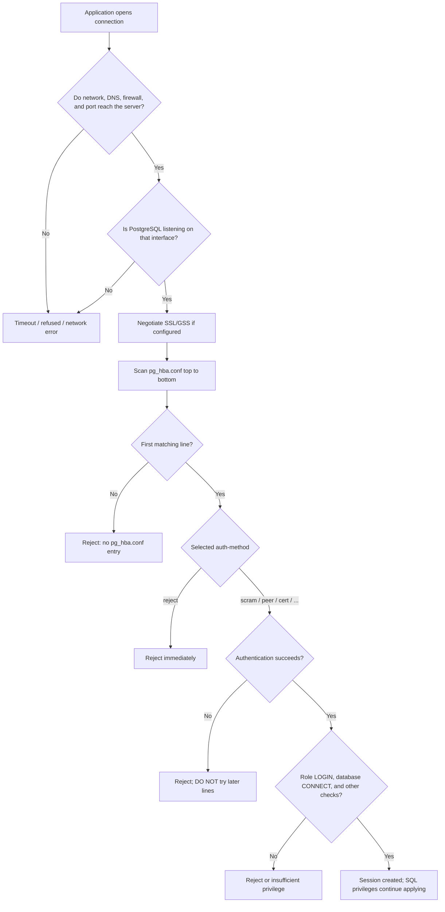

# pg_hba.conf, Rule Ordering, and Restricting Connection Sources in PostgreSQL

An application has a valid PostgreSQL account and the exact right password, yet still fails to connect from a new host. Meanwhile, another machine accesses the same database without issue. The cause may lie not in SQL queries or `SELECT` privileges, but in **`pg_hba.conf`**: PostgreSQL has not permitted that combination of **connection type – database – role – client address – authentication method**.

In PostgreSQL security, understanding `pg_hba.conf` properly is the foundation for building a policy that **allows only required connection sources to authenticate**, avoiding exposing the database to every host, and diagnosing messages such as:

```text
FATAL: no pg_hba.conf entry for host "...",
       user "...", database "...", ...
```

This lesson belongs to the **Security** chapter and focuses on three main axes:

1. **Syntax and control surface of `pg_hba.conf`:** connection types, databases, roles, IP/CIDR addresses, authentication methods, and options.
2. **Rule ordering:** PostgreSQL uses **first-match wins**, with no fallback to later rules if authentication under the matched rule fails.
3. **Restricting connection sources:** designing allowlists per application and network; distinguishing `pg_hba.conf` from `listen_addresses`, firewalls, TLS, role privileges, and maximum connection limits.

After this lesson, you will be able to design HBA policies for multi-service environments, manually trace which rule matches, validate the file with `pg_hba_file_rules`, reload safely, test connections from different sources, and build a production troubleshooting runbook.

> **Safety:** `pg_hba.conf` is a **PostgreSQL server** security file, not a configuration file placed inside a Java repository to take effect automatically. The IPs and database names below are illustrative examples. Never modify production configurations without authorization, backups, a fallback administrative access path, and a rollback plan.

## 1. Where Does pg_hba.conf Fit in the Connection Flow?

HBA stands for **Host-Based Authentication**. This file controls whether PostgreSQL will **select an authentication method or reject** a connection request based on connection attributes.

Simplified flow:



**`pg_hba.conf` does not replace all other security layers**:

- It does not open network ports if a firewall blocks them.
- It does not make the server listen on an unconfigured interface.
- It does not create roles, databases, passwords, or `CONNECT` privileges.
- It does not replace `GRANT`/`REVOKE` on schemas, tables, functions, or Row-Level Security.
- It does not enforce a requests-per-second quota.
- It does not prevent users from viewing sensitive data if SQL privileges were granted too broadly.

A successful connection must pass **multiple layers**, and each layer must be diagnosed separately.

## 2. Identifying the Exact HBA File Used by the Server

Depending on installation, `pg_hba.conf` typically resides in PostgreSQL's data directory, though the `hba_file` parameter can point elsewhere.

In a session permitted to read configuration:

```sql
SHOW hba_file;
SHOW config_file;
SHOW data_directory;
SHOW server_version;
```

Or:

```sql
SELECT
    current_setting('hba_file') AS hba_file,
    current_setting('config_file') AS postgres_conf,
    current_setting('server_version') AS version;
```

Never assume a path like `/var/lib/postgresql/data/pg_hba.conf` holds true on every system:

- Linux packages, Docker, and Kubernetes may mount the file elsewhere.
- Managed database services may disallow editing the file directly.
- Windows manages services and configuration paths differently.
- A single PostgreSQL host can run **multiple clusters** on different ports.

**Read `SHOW hba_file` from the exact instance you are working on** before editing a single line.

### 2.1. A Text File, Not SQL Statements

An HBA line typically follows:

```text
TYPE  DATABASE  USER  ADDRESS  METHOD  [OPTIONS]
```

It is a **configuration file**, not executed in `psql` as SQL statements.

Example:

```text
hostssl  ordersdb  orders_api  10.42.10.0/24  scram-sha-256
```

This line states:

> A TCP/IP connection using SSL, requesting database `ordersdb` with role `orders_api`, originating from IPv4 network `10.42.10.0/24`, will authenticate using SCRAM-SHA-256.

It **does not** set passwords and **does not** grant table access privileges.

## 3. Record Structure in pg_hba.conf

Common formats:

```text
local       DATABASE  USER            METHOD  [OPTIONS]
host        DATABASE  USER  ADDRESS   METHOD  [OPTIONS]
hostssl     DATABASE  USER  ADDRESS   METHOD  [OPTIONS]
hostnossl   DATABASE  USER  ADDRESS   METHOD  [OPTIONS]
hostgssenc  DATABASE  USER  ADDRESS   METHOD  [OPTIONS]
hostnogssenc DATABASE USER  ADDRESS   METHOD  [OPTIONS]
```

Network addresses can be written as `IP/mask-length` or as two columns `IP-address IP-mask`.

Blank lines and comments after `#` are ignored per file rules. Fields containing whitespace can be double-quoted. Line continuation and include syntax must match the documentation of your running PostgreSQL version.

| Field | Meaning | Example |
| --- | --- | --- |
| `TYPE` | Unix socket, TCP, SSL, or GSS variant | `local`, `hostssl` |
| `DATABASE` | Requested database or matching keyword | `ordersdb`, `all` |
| `USER` | Requested PostgreSQL role or list/group | `orders_api`, `+app_users` |
| `ADDRESS` | **Client source IP** or CIDR/hostname | `10.42.10.0/24` |
| `METHOD` | Authentication method or reject | `scram-sha-256`, `peer`, `reject` |
| `OPTIONS` | Method-specific options | E.g. `clientcert=verify-full` where applicable |

### 3.1. Fields Are Not Always "Plain Arbitrary Names"

For instance, unquoted `all` acts as a **keyword** in allowed positions. When quoted in applicable database/user/address fields, keywords can lose their special meaning and match literal names instead.

Similarly, `replication` in the database field carries special meaning when unquoted; do not treat every token in the file as simple literal string matching.

## 4. local and host Are Two Different Connection Paths

### 4.1. local — Unix-Domain Socket

```text
local  all  postgres  peer
```

`local` lines match only connections over a **Unix-domain socket** (on OSes supporting such sockets).

A client on the same host running:

```bash
psql -U postgres -d postgres
```

may use a Unix socket if no host is specified and the environment/`libpq` defaults to it.

**Not every "same-machine" connection is `local`.**

### 4.2. host — TCP/IP, Including Localhost

```bash
psql -h 127.0.0.1 -U orders_api -d ordersdb
```

is a **TCP/IP** connection. It is matched against `host`, `hostssl`, `hostnossl`, etc., **not** against `local`.

A client running:

```bash
psql -h localhost -U orders_api -d ordersdb
```

may connect over IPv4 `127.0.0.1` or IPv6 `::1` depending on DNS/resolver and OS configuration.

Ensure matching rules exist for the address actually used. Never assume a `127.0.0.1/32` rule also covers `::1/128`.

### 4.3. Diagnostic Clue

If `psql` succeeds without `-h` yet fails when adding `-h 127.0.0.1`, it may indicate:

- Unix socket and TCP hit **two different HBA rules**.
- The server is not listening on TCP or a firewall blocks it.
- `peer` authentication on the socket differs from `scram-sha-256` on TCP.
- The role or password does not match the TCP rule.

Never check only the password while ignoring the **connection type**.

## 5. host, hostssl, hostnossl, and GSS

| TYPE | When it matches | Notes |
| --- | --- | --- |
| `host` | TCP/IP connections | Matches both SSL and non-SSL, plus GSS variants as applicable |
| `hostssl` | TCP with SSL/TLS | Server must have SSL support enabled |
| `hostnossl` | TCP **without** SSL | Does not automatically mean "plaintext TCP only" across all GSS combinations |
| `hostgssenc` | TCP with GSSAPI encryption | Server must support GSS |
| `hostnogssenc` | TCP without GSSAPI encryption | May still be an SSL connection |
| `local` | Unix-domain socket | Does not evaluate IP/CIDR |

### 5.1. hostssl Does Not Match If the Client Skips TLS

```text
hostssl  ordersdb  orders_api  10.42.10.0/24  scram-sha-256
```

A client from `10.42.10.25` matches this rule when a TLS connection is established. The same client making an **unencrypted non-SSL** connection **does not match the `hostssl` line**, and PostgreSQL continues scanning subsequent rules.

**Requirement:** the server must have `ssl=on` with valid certificate/key configured. If SSL is disabled, `hostssl` does not fall back to acting as a plain TCP rule.

### 5.2. host Is Broader Than hostssl

```text
host     all       all         0.0.0.0/0       trust
hostssl  ordersdb  orders_api  10.42.10.0/24  scram-sha-256
```

This is an **extremely dangerous configuration**: the `host ... trust` line above matches every IPv4 TCP connection, including SSL connections. The `hostssl` line below is **never reached** for those requests.

Never use `trust` for untrusted network sources. The snippet above illustrates only the ordering trap.

### 5.3. Client Configuration Matters Too

In `libpq`/`psql`:

- `sslmode=disable`: do not use SSL.
- `sslmode=require`: require an SSL connection, without fully verifying server hostname/certificate identity.
- `sslmode=verify-ca`: verify the CA certificate chain.
- `sslmode=verify-full`: verify both the CA **and the server hostname**.

For network connections needing server impersonation protection, use `verify-full` with properly managed CAs/certificates. Server-side `hostssl` only requires that **an SSL channel was established**; it does not ensure the client verified the server's identity.

## 6. DATABASE: Which Databases Match?

The `DATABASE` field can be a specific database name, a list, or PostgreSQL keywords.

Example:

```text
hostssl  ordersdb     orders_api  10.42.10.0/24  scram-sha-256
hostssl  reportingdb  report_ro   10.42.20.0/24  scram-sha-256
```

Role `orders_api` connecting to `reportingdb` does not match the first line because **the database differs**, even if client IP and role match other fields.

Common values:

| Value | Meaning |
| --- | --- |
| `all` | Any database per field semantics |
| `ordersdb` | Only the named database |
| `ordersdb,reportingdb` | Any of the listed names |
| `sameuser` | Database matching the requested role name |
| `samerole` | Requested role is a member of a role matching the database name |
| `samegroup` | Legacy spelling of `samerole`; avoid in new configs |
| `replication` | Matches **physical replication** connections, not ordinary logical replication |

### 6.1. Physical Replication Differs from Logical Replication

Example rule for physical streaming replication:

```text
hostssl  replication  repl_user  10.42.30.0/24  scram-sha-256
```

This is not a rule for ordinary clients reading data from a database literally named `replication`.

For **logical replication**, connections target a concrete database and therefore typically need a rule matching **the actual database name**, rather than blindly using the `replication` keyword.

Both also require appropriate replication role privileges and server settings; HBA is only one prerequisite.

### 6.2. Do Not Let all Replace Intentional Scoping

```text
hostssl  all  orders_api  10.42.10.0/24  scram-sha-256
```

opens the **HBA database scope** for `orders_api` across all databases (if authentication and other privileges allow). If the app needs only `ordersdb`, writing `ordersdb` explicitly limits misconfiguration blast radius.

## 7. USER: Which Roles Are Evaluated?

`USER` in HBA is the **PostgreSQL role name the client requests**, not the OS username or an application name sent in an HTTP header.

```text
hostssl  ordersdb  orders_api  10.42.10.0/24  scram-sha-256
```

This line does not match `orders_admin` merely because both start with `orders_`.

### 7.1. Role Lists

```text
hostssl  ordersdb  orders_api,orders_worker  10.42.10.0/24  scram-sha-256
```

Can be used when two roles genuinely share the same connection policy. However, a read-only role and a write role often have different network requirements; separate them for least privilege.

### 7.2. Role Membership with +

```text
hostssl  ordersdb  +orders_app_group  10.42.10.0/24  scram-sha-256
```

`+orders_app_group` matches roles that are valid members of `orders_app_group` per membership rules. Without `+`, the name matches only that exact role.

Using group roles can reduce HBA clutter, but adding a new member **expands HBA scope** unintentionally if unchecked. Review memberships during privilege provisioning.

### 7.3. LOGIN and CONNECT Privileges Are Still Required

HBA letting an attempt reach authentication **does not turn a role into a login role**:

```sql
-- Example for a DBA in a learning environment.
CREATE ROLE orders_api LOGIN;
CREATE ROLE orders_report LOGIN;
```

The role also needs a valid authentication method and `CONNECT` privilege on the target database.

```sql
-- Apply only after database ordersdb exists and
-- default access policies have been reviewed.
REVOKE CONNECT ON DATABASE ordersdb FROM PUBLIC;
GRANT CONNECT ON DATABASE ordersdb TO orders_api, orders_report;
```

`REVOKE CONNECT ... FROM PUBLIC` must be planned carefully since it can affect other roles. Schema, table, sequence, and function privileges form separate layers once inside the database.

## 8. ADDRESS: Restricting Source IPs with CIDR

This is the primary field for restricting **connection sources**.

```text
hostssl  ordersdb  orders_api  10.42.10.25/32  scram-sha-256
```

`10.42.10.25/32` represents **a single IPv4 address**.

```text
hostssl  ordersdb  orders_api  10.42.10.0/24  scram-sha-256
```

`10.42.10.0/24` matches IPv4 addresses whose first 24 bits match the `10.42.10.x` network.

### 8.1. Familiar Mask Lengths

| CIDR | IP range matched |
| --- | --- |
| `10.42.10.25/32` | One IPv4 address |
| `10.42.10.0/24` | An IPv4 network of 256 addresses |
| `10.42.0.0/16` | Much broader IPv4 range |
| `0.0.0.0/0` | **All IPv4** |
| `::1/128` | Single IPv6 loopback |
| `2001:db8:abcd::/48` | Example IPv6 network using documentation prefix |
| `::/0` | **All IPv6** |

`2001:db8::/32` is reserved for documentation/examples, not a production network to copy verbatim into HBA.

### 8.2. Allowing Only One Host

```text
hostssl  ordersdb  orders_api  10.42.10.25/32  scram-sha-256
```

Suitable for a bastion or host with a stable source IP; however, if the host sits behind NAT, the IP PostgreSQL sees is the **egress/NAT IP**, not the container's private IP.

### 8.3. Allowing an Entire Subnet

```text
hostssl  ordersdb  orders_api  10.42.10.0/24  scram-sha-256
```

Any host with a source IP in that subnet satisfies the **address condition**. It still must match database, role, SSL, and pass authentication.

**CIDR is not host authentication via password or certificate.** If one host in the subnet is compromised, an IP allowlist will not stop it from attempting logins with stolen credentials.

### 8.4. IPv4 Does Not Automatically Cover IPv6

```text
host  all  all  0.0.0.0/0  reject
```

blocks matching IPv4 connections, **not IPv6 connections**.

To write an explicit rule covering all IPv6:

```text
host  all  all  ::/0  reject
```

Because HBA is deny-by-default, PostgreSQL already rejects IPv6 if no IPv6 rule matches. Still, when writing explicit deny-all rules, account for both address families.

### 8.5. Separate IP and Netmask Columns

You can write:

```text
hostssl  ordersdb  orders_api  10.42.10.0  255.255.255.0  scram-sha-256
```

Equivalent in range to `10.42.10.0/24`. CIDR notation is generally easier to read and less error-prone to maintain.

### 8.6. all, samehost, samenet

`ADDRESS` also accepts special keywords:

- `all`: any client address.
- `samehost`: IP addresses belonging to the PostgreSQL server itself.
- `samenet`: addresses on any subnet directly connected to the server.

They can be convenient in tightly controlled environments, yet `samenet` can become **broader than intended** if extra network interfaces or VPNs are attached to the host. In production needing strict allowlists, explicit CIDRs are easier to audit.

## 9. Rule Ordering: First Match Wins

This is the **core** rule:

> PostgreSQL scans HBA records **in effective order**, stopping at the first line matching **TYPE + DATABASE + USER + ADDRESS**. That line's `METHOD` is applied. If authentication fails, PostgreSQL **does not try subsequent lines**.

There is no "fallback," "backup," or "later line has higher specificity."

### 9.1. Bug Example: Broad Rule Shadows Strict Rule

```text
# WRONG: overly broad rule placed at the top.
host     all       all         0.0.0.0/0       trust
hostssl  ordersdb  orders_api  10.42.10.0/24   scram-sha-256
```

Request:

```text
TCP IPv4 + SSL
database=ordersdb
user=orders_api
client=10.42.10.25
```

matches line **1** (`host all all 0.0.0.0/0`). Under this broken configuration, PostgreSQL chooses `trust`; line 2 is **never evaluated**, even though it is more specific.

That is why you cannot author HBA with a firewall mindset assuming "more specific rules automatically take precedence over general ones."

### 9.2. Correct Example: Specific Rules Before Broad Rules

```text
hostssl  ordersdb  orders_api  10.42.10.0/24  scram-sha-256
host     all       all         0.0.0.0/0      reject
host     all       all         ::/0           reject
```

An IPv4, TLS request for the right database/role from the subnet matches the first line and requires SCRAM.

Other TCP requests hit the corresponding `reject` lines.

### 9.3. No Fallback After Wrong Password

```text
hostssl  ordersdb  orders_api  10.42.10.0/24  scram-sha-256
host     ordersdb  orders_api  10.42.10.0/24  trust
```

If a TLS client from `10.42.10.25` matches line 1 and supplies the wrong password, PostgreSQL **does not fall back to `trust`** on line 2.

However, a **client without TLS** skips `hostssl` and hits `host ... trust`! So this configuration is still **insecure**, even though no-fallback blocked the wrong-password TLS case.

Lesson: test **every connection type**, not just one TLS case.

### 9.4. Early Reject for Deny Exceptions

```text
host    all       all         10.42.10.99/32  reject
hostssl ordersdb  orders_api  10.42.10.0/24   scram-sha-256
```

Host `10.42.10.99` is rejected first, even though it lies within the subnet below. This intentionally **blocks a single host inside an allowed subnet**.

Swapping those two lines changes the policy:

```text
hostssl ordersdb  orders_api  10.42.10.0/24   scram-sha-256
host    all       all         10.42.10.99/32  reject
```

A TLS request with valid database/role from `10.42.10.99` matches line 1; the `reject` line below has no effect.

### 9.5. No Matching Line Defaults to Reject

If the file contains only:

```text
hostssl  ordersdb  orders_api  10.42.10.0/24  scram-sha-256
```

and a request from `10.42.20.17` matches no rule, PostgreSQL rejects it. **A trailing `reject` line is not mandatory**, though an explicit `reject` can aid auditing and diagnostics.

## 10. Evaluating Matching Rules Like a Decision Table

Suppose effective HBA contains:

```text
# 1
local    all       postgres     peer
# 2
hostssl  ordersdb  orders_api   10.42.10.0/24  scram-sha-256
# 3
hostssl  ordersdb  orders_ro    10.42.20.0/24  scram-sha-256
# 4
hostssl  ordersdb  db_admin     10.42.99.10/32 scram-sha-256
# 5
host     all       all          0.0.0.0/0     reject
# 6
host     all       all          ::/0          reject
```

Here:

- `orders_api` is the write application role.
- `orders_ro` is the read-only reporting role.
- `db_admin` is the admin role allowed from a bastion.
- `postgres` administers locally via Unix socket with `peer` on eligible OSes.
- SSL must be enabled and roles must have matching authentication configured.

Evaluate these requests:

| Client IP/type | Database | Role | TLS | First matching rule | HBA outcome |
| --- | --- | --- | --- | --- | --- |
| `10.42.10.25` TCP | `ordersdb` | `orders_api` | Yes | 2 | SCRAM |
| `10.42.10.25` TCP | `ordersdb` | `orders_api` | No | 5 | Reject |
| `10.42.10.25` TCP | `ordersdb` | `orders_ro` | Yes | 5 | Reject |
| `10.42.20.17` TCP | `ordersdb` | `orders_ro` | Yes | 3 | SCRAM |
| `10.42.20.17` TCP | `ordersdb` | `orders_api` | Yes | 5 | Reject |
| `10.42.10.25` TCP | `postgres` | `orders_api` | Yes | 5 | Reject |
| `10.42.99.10` TCP | `ordersdb` | `db_admin` | Yes | 4 | SCRAM |
| `::1` TCP | `ordersdb` | `orders_api` | Yes | 6 | Reject |
| Unix socket, OS user `postgres` | `postgres` | `postgres` | N/A | 1 | Peer |

**HBA outcome** means the chosen method or immediate rejection; **it does not guarantee the connection succeeds**. On SCRAM lines, the password, `LOGIN`, and `CONNECT` must still succeed.

### 10.1. Manual Evaluation Procedure

For each connection attempt:

1. Is it a Unix socket or TCP? Does TCP use SSL or GSS encryption?
2. Which database is the client requesting?
3. Which role is the client requesting?
4. What is **the source IP PostgreSQL sees**?
5. Scan rules top to bottom in order.
6. Skip any line failing **even one field**.
7. The first line matching all conditions selects the `METHOD`.
8. If authentication fails, stop; do not evaluate further lines.
9. If no line matches, reject.

Never skip step 4: the server IP, the DNS name the client dialed, or a container's internal IP is not necessarily **the source IP seen by PostgreSQL**.

## 11. Service-by-Service Allowlists

An HBA policy should be designed as a **connection matrix** before editing the file.

| Component | Role | Database | Allowed source | Connection type |
| --- | --- | --- | --- | --- |
| Backend API | `orders_api` | `ordersdb` | `10.42.10.0/24` | TLS |
| Reporting worker | `orders_ro` | `ordersdb` | `10.42.20.0/24` | TLS |
| DBA bastion | `db_admin` | `ordersdb` | `10.42.99.10/32` | TLS |
| Local DB host admin | `postgres` | `postgres` or admin DB | Unix socket | Peer (if OS supports) |

From that matrix, derive the configuration file.

### 11.1. Minimal Allowlist HBA Example

```text
# Unix socket local administration, Linux/Unix with suitable OS account.
local    all       postgres    peer

# App/backend.
hostssl  ordersdb  orders_api  10.42.10.0/24    scram-sha-256

# Read-only reporting.
hostssl  ordersdb  orders_ro   10.42.20.0/24    scram-sha-256

# DBA bastion.
hostssl  ordersdb  db_admin    10.42.99.10/32   scram-sha-256

# Explicitly reject all other TCP attempts.
host     all       all         0.0.0.0/0        reject
host     all       all         ::/0             reject
```

This is a **template**, not a drop-in file for every system. Before applying it, verify:

- Matching databases and roles actually exist.
- TLS is enabled with valid certificates.
- Real source IPs after NAT/proxies are confirmed.
- A backup admin path and rollback procedure exist.
- Management tools, replication, health checks, or monitoring connections are accounted for.
- Risk of locking yourself out is mitigated.

### 11.2. Why Separate Roles by Service?

If the API and reporting both connect as `postgres` or a shared superuser, HBA cannot cleanly isolate privilege boundaries.

Separating roles and grants lets you:

- Restrict source networks per service.
- Restrict databases per service.
- Restrict SQL privileges (read/write/schema).
- Rotate credentials and trace connections cleanly.
- Limit blast radius if one secret leaks.

## 12. Never Use trust on Untrusted Networks

`trust` lets any client matching the rule log in **without a password**. It does not mean "trust the IP address while still checking the password."

Extremely risky example:

```text
host  all  all  0.0.0.0/0  trust
```

This configuration **must never be used in production**, because any IPv4 source able to reach the port can attempt to log in as matching database roles without password authentication.

Even:

```text
host  all  all  10.42.0.0/16  trust
```

is risky if that wide subnet contains untrusted or compromised machines.

### 12.1. reject vs. trust

- `reject`: unconditionally refuses the connection when the rule matches.
- `trust`: accepts identity authentication without verifying any secret.
- `scram-sha-256`: uses SCRAM password authentication.

The method name is a critical security control, not a priority label.

### 12.2. Do Not Use the password Method Without Understanding Cleartext Transmission

The `password` HBA method transmits passwords without method-level encryption. Even though TLS protects the transport channel, prefer `scram-sha-256` for password authentication alongside TLS connection encryption.

## 13. Common Authentication Methods

| METHOD | Context | Notes |
| --- | --- | --- |
| `reject` | Block matching source/role/database | No authentication |
| `scram-sha-256` | Modern password authentication | Preferred where password auth fits |
| `md5` | Legacy compatibility | MD5 password storage is deprecated; avoid in new designs |
| `trust` | Truly isolated test lab if justified | Very dangerous on accessible networks |
| `peer` | Local Unix socket | Compares OS identity; not for TCP |
| `ident` | TCP/IP via client ident server | Rarely used; depends on external service |
| `cert` | Client certificates over SSL | Requires PKI and proper identity mapping |
| `gss` | GSSAPI/Kerberos | Suits environments with Kerberos infrastructure |
| `sspi` | Windows SSPI | Platform/environment specific |
| `ldap` | LDAP directory | Requires server parameters and TLS/credential policies |
| `pam` | OS PAM | Requires properly configured PAM modules |
| `radius` | RADIUS | Requires RADIUS server and credentials |
| `oauth` | Certain newer PostgreSQL versions | Verify support by major version and deployment requirements |

Not every method works with every `TYPE`, build, or major version. This lesson focuses on **rule selection and restricting connection sources**, rather than serving as a full deployment guide for LDAP, Kerberos, or PKI.

### 13.1. SCRAM and Password Storage

Check:

```sql
SHOW password_encryption;
```

In modern configurations, the desired value for new passwords is `scram-sha-256`.

When a DBA creates a role and sets a password:

```sql
-- Run as an administrative role in an appropriate environment.
CREATE ROLE orders_api LOGIN;
```

Then from `psql`, use an interactive method that keeps plaintext secrets out of scripts and shell history:

```text
\password orders_api
```

Never record real passwords in training docs, source repositories, terminal screenshots, or logs. Changing `password_encryption` **does not automatically convert** previously stored passwords; follow a proper password-reset process.

### 13.2. MD5 and Transitioning

On PostgreSQL versions that still support it, an `md5` HBA rule can still perform SCRAM if the role's password is stored as SCRAM, yet legacy MD5 password storage is **deprecated**.

Do not use that as an excuse to add `md5` to new systems. Plan client driver and server alignment on `scram-sha-256`, watching out for very old clients lacking SCRAM support.

## 14. TLS: HBA and Identity Verification Are Not the Same Step

Secure transport typically requires all of the following:

1. PostgreSQL server enables SSL with a valid certificate and private key.
2. HBA contains matching `hostssl` rules.
3. Clients require SSL and verify certificate/hostname per policy.
4. Roles use strong authentication methods.
5. Networks/firewalls restrict allowed sources and ports.

Example client command (addresses/certificates illustrative):

```bash
psql "host=db.internal.example port=5432 dbname=ordersdb user=orders_api sslmode=verify-full sslrootcert=/path/to/ca.crt"
```

`sslmode=verify-full` verifies the certificate chain and hostname against the server name. That is a **client-side check**, separate from the server matching a `hostssl` line.

### 14.1. hostssl Is Not Client Certificate Auth

```text
hostssl  ordersdb  orders_api  10.42.10.0/24  scram-sha-256
```

requires an SSL channel and SCRAM password; **it does not force clients to present a client certificate** merely because `TYPE` is `hostssl`.

To require client certificates, use `cert` or add `clientcert=verify-full` on compatible `hostssl` rules. That adds a PKI verification layer requiring proper CA and identity-mapping setup.

### 14.2. Why Avoid a Non-SSL Fallback?

```text
hostssl ordersdb orders_api 10.42.10.0/24 scram-sha-256
host    ordersdb orders_api 10.42.10.0/24 scram-sha-256
```

These two lines allow the same role/IP to connect over non-SSL (`host`), defeating a "TLS required" policy.

If policy mandates TLS, omit non-SSL allow rules. You can also add:

```text
hostnossl  all  all  0.0.0.0/0  reject
hostnossl  all  all  ::/0       reject
```

Still, **rule order** governs everything: if a `host ... trust` rule above matches first, those `reject` lines never run.

## 15. HBA Checks the IP Seen by PostgreSQL, Not App-Reported IPs

A deployment might look like:

```text
Java service (Pod 10.244.2.18)
     |
     +-- Kubernetes NAT / egress node (10.42.10.25)
              |
              +-- PostgreSQL server (10.42.0.5:5432)
```

In many network topologies, PostgreSQL sees the **post-NAT source IP** (`10.42.10.25`), not the pod IP `10.244.2.18`.

HBA compares against the source address of the **actual TCP connection reaching PostgreSQL**. It does not inspect:

- HTTP `X-Forwarded-For` headers.
- End-user browser IPs behind an API.
- Hostnames self-reported by an application payload.
- DNS names used to look up the database server.

### 15.1. Checking the Client IP from a Successful Connection

In an active session:

```sql
SELECT
    inet_client_addr() AS client_ip,
    inet_client_port() AS client_port,
    inet_server_addr() AS server_ip,
    inet_server_port() AS server_port,
    current_user AS role_name,
    current_database() AS db_name;
```

Over a Unix socket, `inet_client_addr()` returns SQL `NULL` because **there is no client TCP IP**.

If a connection is currently blocked by HBA, you cannot use that failed connection to run SQL. Use an authorized admin session, server logs, network diagnostics, or a test connection via an allowed path to verify.

### 15.2. Inspecting Active Sessions

With appropriate monitoring privileges:

```sql
SELECT
    pid,
    usename,
    datname,
    client_addr,
    client_port,
    application_name,
    backend_start,
    state
FROM pg_stat_activity
WHERE backend_type = 'client backend'
ORDER BY backend_start DESC;
```

`client_addr` shows the client address observed by PostgreSQL for TCP backends. Unix socket sessions show no `client_addr`.

Never treat `application_name` as security proof of identity: clients can set it arbitrarily. Roles, secrets/certificates, and network policies enforce authentication.

### 15.3. Proxies and Connection Poolers Change Source IP

If apps connect via PgBouncer or a proxy:

```text
App 10.42.10.25  ->  PgBouncer 10.42.50.8  ->  PostgreSQL
```

PostgreSQL's HBA sees the **PgBouncer** IP on the second-hop TCP connection, not individual app IPs.

Enforce policies on **both app -> pooler** and **pooler -> database** matching the topology. Do not write HBA rules pointing straight at app subnets if apps never connect directly.

## 16. Comparing pg_hba.conf, listen_addresses, and Firewalls

These three layers are frequently confused.

| Layer | Question | Scope |
| --- | --- | --- |
| `listen_addresses` | Is PostgreSQL **listening** for TCP on this interface? | **Server-side** network interfaces |
| Firewall / security group / network policy | Can packets from source X reach server:port? | Network layer, ports, protocols |
| `pg_hba.conf` | Once an attempt reaches the server, how must this DB/role/client IP/type authenticate? | Host-based authentication |
| Role `LOGIN` and `CONNECT` | Can the authenticated identity open a session in this DB? | Role/database privileges |
| `GRANT`/RLS | Once connected, which objects and rows can it read/write? | Object and row authorization |

### 16.1. listen_addresses Often Defaults to localhost

Check:

```sql
SHOW listen_addresses;
SHOW port;
SHOW ssl;
```

If `listen_addresses = 'localhost'`, PostgreSQL listens only on loopback TCP under its active config. Adding:

```text
hostssl  ordersdb  orders_api  10.42.10.0/24  scram-sha-256
```

does not automatically open a listening socket on `10.42.0.5`.

To accept remote TCP, configure `listen_addresses` for the required server interface **paired with a restrictive firewall**.

### 16.2. Why Not Rush to listen_addresses = '*'?

`*` binds all available interfaces, expanding network exposure. On multi-NIC hosts, it can listen on management, public, or unintended interfaces if firewall rules slip.

Prefer binding specific interfaces alongside security groups/firewalls and HBA allowlists. If containers force `*`, verify strict network restrictions at outer layers.

### 16.3. Changing listen_addresses Requires a Restart

`listen_addresses` takes effect only at **server start**. Running `SELECT pg_reload_conf()` will not apply a new value for a restart-required parameter.

By contrast, HBA changes take effect via **reload** on Unix-like systems without restarting the server.

## 17. HBA Is Neither a Rate Limiter Nor a Connection Pooler

"Restricting connection sources" does not mean "limiting **the number** of connections."

HBA restricts **sources, roles, databases, and authentication methods**. Quantity limits belong to separate mechanisms.

Related parameters:

```sql
SHOW max_connections;
SHOW superuser_reserved_connections;
```

On supported versions:

```sql
SHOW reserved_connections;
```

Other controls:

- `ALTER ROLE role_name CONNECTION LIMIT n`.
- `ALTER DATABASE database_name CONNECTION LIMIT n`.
- Pooling via PgBouncer or Java connection pools.
- `authentication_timeout` to bound how long authentication can take.
- Firewalls/load balancers for traffic control.
- Resource limits and rate limiting at appropriate layers.

### 17.1. Per-Role Connection Limit Example

```sql
-- Run by a DBA if approved by policy.
ALTER ROLE orders_api CONNECTION LIMIT 30;
```

This does not restrict HBA to 30 source IPs; it limits **concurrent login sessions** for that role per PostgreSQL rules.

Connection limits have exceptions and are not complete rate limiters. Never rely on them as your sole DoS defense.

### 17.2. max_connections Has Resource Cost

Raising `max_connections` increases resource demand and is not a cure-all for "too many connections" errors. With hundreds of pods each opening oversized pools, compute **total connections** hitting the instance and introduce proper pooling.

### 17.3. HBA Does Not Stop TCP Handshakes

Even with a trailing `reject` rule in HBA, connections still reach the server far enough for PostgreSQL to evaluate authentication rules. For untrusted internet sources, **firewalls/security groups** should drop packets before traffic ever hits the database.

## 18. Reading Rule Order with Include Files

PostgreSQL supports splitting HBA across multiple files using:

```text
include           'hba/common.conf'
include_if_exists 'hba/optional.conf'
include_dir       'hba.d'
```

These directives inline the included file's contents **at the directive's exact position** in the rule sequence.

### 18.1. Includes Do Not Create Separate Precedence Tiers

Suppose the main file contains:

```text
include 'hba.d/00-admin.conf'
include 'hba.d/20-app.conf'
host all all 0.0.0.0/0 reject
```

PostgreSQL evaluates rules in the admin file first, then the app file, then the trailing reject rule.

If the admin file contains:

```text
host  all  all  0.0.0.0/0  trust
```

it still shadows stricter rules in the app file. **Splitting files never changes first-match semantics.**

### 18.2. include_dir Orders Files by Name

`include_dir` loads non-hidden files ending in `.conf` sorted by **filename in C-locale order** (digits before letters, uppercase before lowercase).

Example:

```text
hba.d/
  00-admin.conf
  10-app.conf
  20-reporting.conf
  90-deny.conf
```

Numeric prefixes help operators visualize ordering, yet you must verify **effective rule order** rather than trusting filenames alone.

### 18.3. include_if_exists Silently Skips Missing Files

`include_if_exists` skips non-existent files per its rules while logging a notice. If a missing file held a **required allowlist**, applications may get blocked by later rules or default deny.

Never assume every optional file is harmless; track each file's role in the policy.

### 18.4. Include Paths

Paths may be absolute or relative per include rules. During deployment, use explicit paths rather than depending on a shell's working directory, and ensure include files are readable by the PostgreSQL OS service user.

## 19. Checking Syntax and Order with pg_hba_file_rules

PostgreSQL provides a system view:

```sql
SELECT *
FROM pg_hba_file_rules;
```

It summarizes non-empty, non-comment lines along with whether each line parsed and applies cleanly.

In newer versions, columns include:

- `rule_number`: effective evaluation order if valid.
- `file_name` and `line_number`.
- `type`, `database`, `user_name`, `address`, `netmask`.
- `auth_method`, `options`.
- `error`.

**Column availability varies across major versions.** Run `SELECT *` to inspect the actual view schema before building dashboards around it.

### 19.1. Finding Invalid Lines

```sql
SELECT *
FROM pg_hba_file_rules
WHERE error IS NOT NULL;
```

If any row has a non-NULL `error`, read the error text, file name, and line number, fix the file, and recheck.

`pg_hba_file_rules` is normally readable only by superusers (or specifically delegated roles). Never expose authentication config views to ordinary app roles.

### 19.2. Inspecting Effective Order on Modern PostgreSQL

On servers with `rule_number` and `file_name`:

```sql
SELECT
    rule_number,
    file_name,
    line_number,
    type,
    database,
    user_name,
    address,
    auth_method,
    error
FROM pg_hba_file_rules
ORDER BY rule_number NULLS LAST, file_name, line_number;
```

`rule_number` is especially helpful with includes; **`line_number` is meaningful only within its own file**, not across multiple included files.

### 19.3. Critical Caveat: This View Does Not Prove the File Was Reloaded

`pg_hba_file_rules` reads **the current file on disk**, **not the ruleset currently loaded in server memory**.

For example:

1. DBA edits the file on disk.
2. `SELECT * FROM pg_hba_file_rules` shows the new valid rule.
3. No reload has been issued on Linux.
4. New connections still evaluate the old loaded ruleset.

There is no contradiction here. You need **file validation**, **reload**, and **real connection tests**.

## 20. Applying Changes: Reload Without Restarting for Ordinary HBA Edits

On Unix-like systems, `pg_hba.conf` is read at server startup and when the postmaster receives `SIGHUP`.

You can trigger a reload via SQL (with sufficient privileges):

```sql
SELECT pg_reload_conf();
```

Or via admin tooling:

```bash
pg_ctl reload
```

### 20.1. What Does pg_reload_conf() Returning true Mean?

`true` indicates the **reload signal was sent** successfully—not proof that every new rule is valid, active as intended, or that every app can connect.

After reloading:

1. Check `pg_hba_file_rules` for any errors.
2. Read PostgreSQL server logs for config load warnings/errors.
3. Test **new connections** from both allowed and disallowed sources.
4. Confirm your fallback administrative session still works.

Never stop merely because `SELECT pg_reload_conf()` printed `t`.

### 20.2. Existing Sessions Are Not Re-Authenticated by HBA

Connections **authenticated before an HBA change** are not automatically disconnected just because a new rule now rejects their IP. The new policy governs **new connection attempts** once loaded.

If existing non-compliant sessions must be terminated, make an explicit operational decision considering active transactions—never assume an HBA reload acts as an instant session kill switch.

### 20.3. Windows Exception

Per PostgreSQL documentation, on **Microsoft Windows**, HBA changes take effect immediately for **subsequent new connections** via a mechanism different from Unix, without requiring a separate reload step for HBA edits.

Even so, always check the file, logs, and test connections. Do not generalize this Windows behavior to GUCs like `listen_addresses` that still require a restart.

## 21. Modifying HBA Safely Without Locking Yourself Out

Suppose the database is remote and only one DBA session is open. Placing a deny rule at the top of the file could lock out your next login.

Practical workflow:

1. **Locate** the exact file via `SHOW hba_file`.
2. **Maintain** a controlled fallback admin channel: console, bastion, Unix socket, or managed service admin.
3. **Back up** the file and record the prior config version.
4. **Draft the allowlist matrix**, including health checks, monitoring, and replication if used.
5. **Verify rule order** across the main file and all includes.
6. **Validate syntax** via `pg_hba_file_rules` with proper privileges.
7. **Reload** if required by your OS.
8. **Inspect server logs** right after reload.
9. **Open a new connection** from each allowed source to verify success.
10. **Open a new connection** from an unauthorized source to verify rejection.
11. **Verify no broad rule** accidentally permits non-TLS paths.
12. **Record results and rollback steps**; close the old admin session only after the new path is verified.

### 21.1. Never Test Using an Already-Open Connection

If `psql` was already connected before reload, running:

```sql
SELECT 1;
```

and succeeding **does not prove** that session's address is still permitted for new connections. Always open **a fresh session**.

### 21.2. Never Remove the Rescue Path Before Testing New Rules

A safe rollout plan always retains a way to restore the file/config even if every app-network connection gets rejected.

On managed PostgreSQL, rollbacks generally go through the provider's parameter group or access rules rather than editing files directly.

## 22. Testing Connections from Multiple Sources

Test from the actual network segments, not solely from the DB server itself.

### 22.1. From an Allowed Application Pod/Host

Example using the DB server's DNS name:

```bash
psql "host=db.internal.example port=5432 dbname=ordersdb user=orders_api sslmode=verify-full sslrootcert=/path/to/ca.crt"
```

Once connected:

```sql
SELECT
    current_user,
    current_database(),
    inet_client_addr(),
    inet_server_addr();
```

Cross-check `inet_client_addr()` against your HBA CIDRs.

### 22.2. Testing Non-SSL Rejection

In an **authorized test environment**, a connection using:

```bash
psql "host=db.internal.example port=5432 dbname=ordersdb user=orders_api sslmode=disable"
```

should be rejected if HBA allows only TLS and no non-SSL rule matches.

No real password or repeated retries are needed. Inspect the exact error message to confirm the connection reached the right server/port—never mistake a DNS or firewall error for proof that HBA blocked it.

### 22.3. Testing Wrong Role or Wrong Database

From the same app host, test different roles/databases per your matrix. If policy permits only `orders_api` into `ordersdb`, another role must not sneak in via a trailing `all all` rule.

**Rejection outcomes** must be categorized accurately:

- Rejected by HBA (`reject` rule).
- No matching HBA entry.
- Invalid password/identity.
- Missing `LOGIN`/`CONNECT` privilege.
- TLS/certificate handshake failure.
- Network refused/timeout.

These failures are not interchangeable.

## 23. Error Diagnosis: Timeout, Refused, HBA, or Password?

| Message / Symptom | Layer to inspect first |
| --- | --- |
| DNS name fails to resolve | DNS / client resolver |
| Timeout reaching server:5432 | Routing, firewall, security group, listener |
| Connection refused | Port, `listen_addresses`, service status, firewall |
| `no pg_hba.conf entry ...` | Connection type, DB, user, source IP, effective rule order |
| `pg_hba.conf rejects connection ...` | First matching `reject` rule |
| `password authentication failed` | Selected rule, password/SCRAM/role secret, and client |
| `peer authentication failed` | Unix socket, OS username, DB role, `pg_ident` map |
| TLS certificate verification failed | Client trust store, CA, hostname, certificate chain |
| Permission denied for database | `CONNECT` and database ACL |
| Permission denied for relation | `GRANT`/schema/table privileges, RLS if enabled |
| Too many connections | Server/role/database connection limits, pool sizes |

Never "fix" a firewall block by opening `0.0.0.0/0` in HBA. Nor should you "fix" a password mismatch by changing `scram-sha-256` to `trust`.

### 23.1. "no pg_hba.conf entry" Does Not Always Mean a Missing IP

An HBA line matches only when **all criteria match**:

- Matching `TYPE`.
- Matching `DATABASE`.
- Matching `USER`.
- Matching `ADDRESS`.

Even when the client IP falls inside an allowed CIDR, a wrong `dbname` or `user` skips that rule.

### 23.2. Errors May Reveal Encryption Status

Some HBA error messages state the SSL/GSS encryption status, such as an unencrypted connection. Check whether `hostssl` was skipped because the client used `sslmode=disable` or the server has `ssl=off`.

### 23.3. Password Failures Do Not Trigger Fallbacks

If HBA selects SCRAM and the password fails, PostgreSQL **does not try an MD5 or `trust` rule below**. Fix the role/password and auth setup on the matched rule rather than appending weaker rules underneath.

## 24. Hostnames Instead of IPs in HBA

`ADDRESS` can be a hostname or hostname suffix:

```text
hostssl ordersdb orders_api app1.internal.example scram-sha-256
hostssl ordersdb orders_api .apps.internal.example scram-sha-256
```

PostgreSQL checks client names via **reverse DNS lookup** of the source IP, followed by a **forward DNS lookup** of that hostname to confirm it resolves back to the source IP.

Specifically:

1. PostgreSQL receives the client IP.
2. Reverse-resolves the IP to get a hostname.
3. Matches the hostname against the rule's name/suffix.
4. If matched, forward-resolves the hostname to confirm the source IP is among the results.

### 24.1. Why Hostname Rules Often Cause Surprises

- Clients may lack PTR/reverse DNS records.
- PTR returns a different hostname from what the DBA configured.
- Forward DNS and reverse DNS are inconsistent.
- DNS lookups add latency or flakiness.
- DNS edits silently alter access policy.

If you use hostnames in HBA, manage DNS carefully and monitor auth latency. Where egress IPs are stable, a **CIDR allowlist** is usually far more predictable and testable.

### 24.2. Dot-Prefixed Suffixes

An address entry `.internal.example` matches hostnames like `app1.internal.example`, but does not match the bare string `internal.example`.

Do not treat the dot prefix like a SQL `LIKE '%...%'` wildcard; it follows PostgreSQL's specific hostname suffix rule.

### 24.3. DNS Does Not Replace User Authentication

Even when a hostname matches, SCRAM, certificates, or another real auth method is still needed. DNS signals **network origin**, not application identity secrets.

## 25. Connections from Docker and Kubernetes

### 25.1. Docker Host Networks and Bridge Networks

With Docker bridge networking, the source IP seen by the database depends on where the DB runs and NAT rules. A container's internal `172.x` IP is not guaranteed to be the source IP PostgreSQL sees across host boundaries.

Design HBA around **the actual packet path** and egress policy. Never open a massive container range just because you haven't checked the source IP.

### 25.2. Kubernetes Pod IPs Are Ephemeral

Pods get recreated with new IPs. Pinning `/32` to a transient pod IP breaks connections after rescheduling.

Architectural options:

- Stable-IP egress gateway / NAT.
- Database proxy with stable IP/identity.
- Dedicated small subnet reserved strictly for DB-accessing workloads.
- `NetworkPolicy`/security groups restricting which pods can reach the DB.
- TLS with identity verification plus least-privilege roles.

An overly broad CIDR like `10.0.0.0/8` can accidentally include thousands of unrelated workloads. **Never widen CIDR blindly to fix shifting pod IPs** when narrower network controls exist.

### 25.3. Cloud-Managed Databases

Many managed PostgreSQL services do not allow direct editing of `pg_hba.conf`, offering instead:

- Trusted sources / IP allowlists.
- VPC security groups.
- Private endpoints.
- Parameter groups or authentication policies.
- Proxies/pooling and IAM/certificate auth depending on provider.

You still must understand **rule ordering, TCP source IPs, roles, and TLS**, while applying changes through the provider's controls. Never assume shell access exists to edit HBA directly on managed services.

## 26. Using Role Groups Instead of Long Lists

When managing many application roles, you can create a group role:

```sql
-- Run by a DBA in an appropriate environment.
CREATE ROLE orders_app_group NOLOGIN;
GRANT orders_app_group TO orders_api;
```

Then in HBA:

```text
hostssl  ordersdb  +orders_app_group  10.42.10.0/24  scram-sha-256
```

This keeps HBA concise, yet adding a role to the group **changes who can authenticate from that subnet**.

Review:

1. Does the group include any administrative roles?
2. Which members are `LOGIN` roles?
3. Can provisioning systems add memberships automatically?
4. What SQL privileges are granted to the group?
5. Could inheritance/`SET ROLE` grant broader privileges separate from HBA matching?

HBA membership matching and effective SQL privileges are distinct mechanisms. Never assume all role properties are checked in one single step.

## 27. Policies for Replication and Monitoring

A real PostgreSQL deployment often requires:

- Physical replication connections.
- Logical replication subscriptions.
- Backup agents.
- Monitoring/exporters.
- Read replicas.
- Admin bastions.
- Poolers/proxies.

If you write only two API lines and reject everything else, all these supporting services break on their next new connection.

### 27.1. Physical Replication Path

```text
hostssl  replication  repl_user  10.42.30.0/24  scram-sha-256
```

Beyond HBA, configure replication privileges, `wal_level`, networking, and slot/sender settings.

### 27.2. Monitoring Roles and Databases

Monitoring agents should use dedicated low-privilege roles. Scope them tightly:

```text
hostssl  postgres  metrics_reader  10.42.40.15/32  scram-sha-256
```

This assumes monitoring queries the `postgres` database. Adjust the matrix if the agent queries another database or passes through a proxy. Never grant `SUPERUSER` to metrics agents just to skip proper grants.

### 27.3. Ordering Replication Rules Relative to Trailing Reject

Replication and monitoring rules belong **before** any catch-all `reject` rule. Never drop in `host all all 0.0.0.0/0 trust` to "rescue" replication—that opens unintended access everywhere.

## 28. Tricky Bug: Specific Rule Present, Yet Client Uses IPv6

Config:

```text
hostssl  ordersdb  orders_api  127.0.0.1/32  scram-sha-256
host     all       all         0.0.0.0/0     reject
```

Client runs:

```bash
psql -h localhost -U orders_api -d ordersdb
```

If the resolver picks `::1`, no IPv4 rule matches. The connection is rejected even though both processes live on the same host.

To allow IPv6 loopback when appropriate:

```text
hostssl  ordersdb  orders_api  ::1/128  scram-sha-256
```

Ensure server SSL and IPv6 listening are also configured accordingly.

**Never open `::/0` just to fix a `::1` failure.** Scope strictly to the required IP or subnet.

## 29. Another Tricky Bug: Reject Line Placed Above Allowlist

```text
host  all       all         0.0.0.0/0      reject
hostssl ordersdb orders_api  10.42.10.0/24 scram-sha-256
```

Here IPv4 clients are rejected by line 1 regardless of the detailed allowlist below.

The fix is **placing the specific allowlist ahead of the broad reject**:

```text
hostssl ordersdb orders_api  10.42.10.0/24 scram-sha-256
host  all       all         0.0.0.0/0      reject
```

No role privilege escalation or password reset is needed—this is purely an **HBA ordering** bug.

## 30. Another Bug: HBA Is Right, Yet SSL Is Off

File:

```text
hostssl ordersdb orders_api 10.42.10.0/24 scram-sha-256
```

Server:

```sql
SHOW ssl;
```

If `ssl` is `off`, `hostssl` cannot match valid TLS connections by design; the server logs warnings that the rule cannot be applied without SSL support.

Resolution:

1. Check server certificate and `ssl` settings.
2. Verify client TLS handshake.
3. Verify the HBA file and ordering.
4. Never silently downgrade `hostssl` to `host` if security policy requires TLS.

Do not fix missing transport security by disabling encryption requirements.

## 31. Separating HBA Errors from SQL Privileges

Suppose a client from an allowed subnet successfully logs in as `orders_ro` to `ordersdb`, runs:

```sql
DELETE FROM accounting.invoices;
```

and gets `permission denied`. That is a **good sign** for a read-only role: HBA permitted the connection, while SQL privileges blocked the unauthorized DML.

Layer responsibilities clearly:

- HBA: who can **attempt authentication** from which source.
- Role: who can **`LOGIN`**.
- Database `CONNECT`: whether the role can enter the DB.
- Schema `USAGE` and table `SELECT/INSERT/UPDATE/DELETE`: what operations are allowed.
- RLS: which rows can be seen or modified.
- TLS/certs: whether transport is encrypted and identities verified.

Never "fix" a table `permission denied` error by changing HBA; the two layers serve completely different functions.

## 32. Inspecting SSL Activity Server-Side

Once connected, inspect the current session:

```sql
SELECT
    s.ssl,
    s.version,
    s.cipher
FROM pg_stat_ssl AS s
WHERE s.pid = pg_backend_pid();
```

Seeing `ssl=true` with a modern TLS version and cipher confirms **the current session** uses SSL.

To inspect all client backends (with sufficient privileges):

```sql
SELECT
    a.pid,
    a.usename,
    a.datname,
    a.client_addr,
    s.ssl,
    s.version AS tls_version,
    a.application_name
FROM pg_stat_activity AS a
LEFT JOIN pg_stat_ssl AS s
    ON s.pid = a.pid
WHERE a.backend_type = 'client backend'
ORDER BY a.pid;
```

Never rely on `pg_stat_ssl.ssl = true` alone to prove clients verified server hostnames; `verify-full` must be verified in client configuration and trust stores.

## 33. Layered Analysis of a Real Incident

Scenario:

> The API from subnet `10.42.10.0/24` connects to `ordersdb` as `orders_api`; a reporting worker from subnet `10.42.20.0/24` using `orders_ro` receives `no pg_hba.conf entry`.

Initial HBA:

```text
hostssl  ordersdb  orders_api  10.42.10.0/24  scram-sha-256
host     all       all         0.0.0.0/0      reject
```

Analysis:

1. The server accepts TCP and SSL because the API connects fine.
2. The worker uses role `orders_ro`, so it misses line 1 even with TLS.
3. The worker is IPv4, so it hits the catch-all reject on line 2.
4. `reject` was selected; this is not a password mismatch.

Solution aligned with the approved matrix:

```text
hostssl  ordersdb  orders_api  10.42.10.0/24  scram-sha-256
hostssl  ordersdb  orders_ro   10.42.20.0/24  scram-sha-256
host     all       all         0.0.0.0/0      reject
```

Next:

- Verify `orders_ro` exists, has `LOGIN`, and has a password.
- Verify `CONNECT` and `SELECT` privileges.
- Check `pg_hba_file_rules` and reload.
- Test a **new connection** from the worker.
- Confirm unauthorized sources remain blocked.

Never open `hostssl all all 0.0.0.0/0` just to let the worker in.

## 34. Designing with pg_ident.conf and peer

For local connections:

```text
local all postgres peer
```

`peer` uses the OS user identity PostgreSQL obtains from the Unix socket. By default, the OS username must match the requested database role unless a username mapping is configured.

If an OS service account `deploy` needs to log in as PostgreSQL role `migration_admin`, configure `pg_ident.conf` with `map=...` per the documentation.

Conceptual example:

```text
local  ordersdb  migration_admin  peer  map=migration_map
```

Configuring mappings requires editing `pg_ident.conf` and managing OS permissions. Never treat `trust` as a shortcut to avoid identity mapping.

**`peer` works only for local Unix-domain sockets.** For TCP connections like `psql -h 127.0.0.1`, choose a suitable TCP auth method; never expect `peer` to work over TCP.

## 35. Common Configuration Anti-Patterns

| Anti-pattern | Why dangerous or wrong | Alternative |
| --- | --- | --- |
| `host all all 0.0.0.0/0 trust` | Disables password auth for every IPv4 host reaching the port | Narrow allowlist + SCRAM/TLS |
| `hostssl` placed below `host all all ... trust` | Broad rule shadows strict rule | Move specific allowlist above, drop `trust` |
| Configuring only `127.0.0.1/32` for `localhost` | Clients may resolve IPv6 `::1` | Verify actual address; add exact IPv6 rule |
| Adding only IPv4 reject to "block everything" | Leaves IPv6 unaddressed | Review both address families |
| `host all all 10.0.0.0/8 md5` | Overly broad range, legacy auth | Scope by role/DB/small CIDR and SCRAM |
| HBA correct while `listen_addresses=localhost` | Remote TCP never reaches listener | Bind needed interface + firewall |
| HBA open while firewall blocks | Packets never reach PG | Fix the network layer |
| Allowlisting pod IPs behind NAT | PG sees egress NAT IP instead | Inspect `inet_client_addr()` and topology |
| Shared allowlist for reporting/admin/API | Mixes privilege tiers and networks | Separate roles, databases, and subnets |
| Wrong password fixed by adding `trust` below | No fallback; also opens non-TLS | Fix credentials and secure config |
| Assuming `pg_reload_conf()=true` proves full rollout | Only means reload signal succeeded | Check view, logs, and new connections |
| Assuming `pg_hba_file_rules` shows active memory state | View reads disk file, not loaded config | Reload and test live |
| Testing on an old connection after HBA edit | Existing sessions do not re-auth | Open a fresh connection |
| Editing HBA without rollback plan | Risks DBA lockout | Backup, console/bastion, controlled rollout |
| Putting passwords in repos or shell commands | Leaks credentials | Secret manager / `psql` prompt |
| Using HBA as a request rate limiter | HBA does not limit QPS | Pooling, resource limits, network controls |
| Thinking HBA grants `SELECT` | Controls connection/auth only | Configure `GRANT`/RLS separately |
| Hostname rules with broken reverse DNS | Rule mismatch and latency | Stable CIDRs or strictly managed DNS |
| Relying on `application_name` for auth | Client-controlled string | Use roles, TLS/certs, and network identity |

## 36. HBA Policy Rollout Runbook

Production changes should follow staged phases.

### Phase A — Gather Current State

1. Record PostgreSQL major version, cluster, port, and `SHOW hba_file`.
2. Capture the current effective HBA and all included files.
3. Inventory existing client sources via `pg_stat_activity.client_addr` and authorized logs.
4. Identify proxies/NAT, replication, monitoring, backups, and DBA paths.
5. Confirm authorized roles and databases.
6. Confirm TLS, certificate, SCRAM, and network firewall requirements.

### Phase B — Design the Source Matrix

For every service, record a row:

```text
service | client egress CIDR | database | role | TLS | auth method | owner
```

Never build from a vague list of "maybe-needed IPs" without named owners.

### Phase C — Draft and Review Rule Ordering

1. Explicit deny exceptions if needed.
2. Allowlists scoped by exact role/database/IP.
3. Replication/monitoring/admin rules as needed.
4. Broad trailing `reject` or implicit default deny.
5. Verify include files in C-locale order.
6. Remove unapproved `trust`/`public`/legacy rules.

### Phase D — Safe Deployment

1. Back up current configs.
2. Keep an active admin session and a separate out-of-band rescue path open.
3. Write the file with proper permissions; ensure no required lines were dropped.
4. Query `pg_hba_file_rules` for parse errors.
5. Reload on Unix-like hosts; account for Windows behavior.
6. Read server logs for any config warnings/errors.
7. Test **new** connections for both allow and deny cases, TLS and non-TLS, IPv4 and IPv6 where supported.
8. If anything fails, roll back the file and verify recovery.

### Phase E — Post-Rollout Observation

- Authentication failures by source, role, and error type.
- Active connection counts and pool saturation.
- Client TLS status and certificate errors.
- Any egress IP shifts after deployments.
- Application error rates and connection-establishment latency.
- Unexpected rules matching unintended networks.

**Never claim production is secure merely because a reject-all sits at the bottom.** Audit every line **above it** as well as adjacent network and privilege layers.

## 37. Hands-On Exercises

These exercises can be performed on a PostgreSQL lab/VM/container you administer. Exercises modifying `pg_hba.conf` require backups and rescue admin access; avoid running them on shared instances.

### Exercise 1 — Locate Configuration Files

Run:

```sql
SHOW hba_file;
SHOW listen_addresses;
SHOW port;
SHOW ssl;
```

What does each setting control? Why do changes to `hba_file` and `listen_addresses` follow different reload/restart procedures?

### Exercise 2 — Socket vs. TCP

Compare:

```bash
psql -U postgres -d postgres
psql -h 127.0.0.1 -U postgres -d postgres
```

On a host supporting Unix sockets, how can these two commands hit different HBA records?

### Exercise 3 — /32 and /24 CIDRs

Explain which addresses match:

```text
10.42.10.25/32
10.42.10.0/24
```

Test IPs `10.42.10.25`, `10.42.10.99`, and `10.42.11.1`. Why is a `/24` range vastly broader than `/32`?

### Exercise 4 — First-Match Wins

```text
host all all 0.0.0.0/0 reject
hostssl ordersdb orders_api 10.42.10.0/24 scram-sha-256
```

Which rule applies to a TLS client with matching role/database from `10.42.10.25`? Fix the order.

### Exercise 5 — No Fallback on Wrong Password

```text
hostssl ordersdb orders_api 10.42.10.0/24 scram-sha-256
host ordersdb orders_api 10.42.10.0/24 trust
```

If the SCRAM password over TLS is wrong, does PostgreSQL try `trust`? What risk remains if a client disables SSL?

### Exercise 6 — hostssl Does Not Match Non-TLS

Configure a single `hostssl` rule for `orders_api`. Predict the outcome when the client uses `sslmode=disable` versus `verify-full` with a valid certificate.

### Exercise 7 — Both Database and Role Must Match

A rule permits only `ordersdb` and `orders_api`. Change each parameter to `reportingdb` and then `orders_ro`.

Identify which field fails to match and explain why a matching IP alone is insufficient.

### Exercise 8 — IPv4 vs. IPv6

An IPv4 rule allows only `127.0.0.1/32`. The client connects to `localhost` and resolves `::1`. What happens?

Write a rule for IPv6 loopback without opening the entire IPv6 internet.

### Exercise 9 — Blocking an Exception Inside a Subnet

Subnet `10.42.10.0/24` is allowed, yet `10.42.10.99` must be blocked. Write the HBA lines so the `/32` reject takes effect.

### Exercise 10 — include_dir

Organize files:

```text
00-admin.conf
10-api.conf
20-reporting.conf
90-deny.conf
```

Explain C-locale ordering and why placing `host all all 0.0.0.0/0 trust` inside `00-admin.conf` is a severe bug.

### Exercise 11 — pg_hba_file_rules

```sql
SELECT *
FROM pg_hba_file_rules
WHERE error IS NOT NULL;
```

If an error appears, identify the file and line to fix. Why does this view not prove the server is actively enforcing all new rules on disk?

### Exercise 12 — Verifying Reload

After an authorized change in a lab:

```sql
SELECT pg_reload_conf();
```

Design the follow-up verification steps. Why does returning `true` not finish verification?

### Exercise 13 — Existing Sessions vs. New Sessions

Suppose a DBA session was open before its subnet was denied. After reload, the old session still runs `SELECT 1`.

Why must you test a **new connection** before concluding the new rule is enforced?

### Exercise 14 — Source IP Behind NAT

App pod `10.244.2.18` exits via egress gateway `10.42.10.25`. Which IP must HBA target if PostgreSQL sees `10.42.10.25`?

Under what conditions can you use `inet_client_addr()` to verify?

### Exercise 15 — Proxies and Poolers

Apps connect to PgBouncer at `10.42.50.8`, and PgBouncer opens connections to PostgreSQL. Which source does server HBA see?

What extra security policies must be enforced at the app -> pooler tier?

### Exercise 16 — HBA vs. Firewall

A client hits a connection timeout before receiving any PostgreSQL message. Why should you inspect routing, listeners, ports, and firewalls before editing HBA?

### Exercise 17 — HBA vs. GRANT CONNECT

An HBA rule permits `orders_ro` to connect to `ordersdb` with SCRAM, yet the role lacks `CONNECT`. Will the connection succeed?

Write the least-privilege SQL to grant the required access.

### Exercise 18 — Verifying TLS

```sql
SELECT ssl, version, cipher
FROM pg_stat_ssl
WHERE pid = pg_backend_pid();
```

What does the output tell you? Why does it not prove the client used `sslmode=verify-full`?

### Exercise 19 — Peer and TCP

Rule `local all postgres peer` allows OS user `postgres` over Unix socket. Why does that not mean a TCP connection `-h 127.0.0.1` will authenticate with `peer`?

### Exercise 20 — Insecure Credentials

Compare storing passwords in version-controlled SQL scripts versus using `psql \password` and a secret manager. Identify risks across shell history, logs, CI artifacts, and secret read access.

### Exercise 21 — Limiting Connection Counts

Distinguish:

```sql
SHOW max_connections;
ALTER ROLE orders_api CONNECTION LIMIT 30;
```

from an HBA allowlist `10.42.10.0/24`. Which restricts **source IPs**? Which restricts **session counts**?

### Exercise 22 — Physical vs. Logical Replication

Rule:

```text
hostssl replication repl_user 10.42.30.0/24 scram-sha-256
```

fits which kind of replication connection? Why do logical replication connections specifying a database name require different rules per configuration?

### Exercise 23 — Diagnosing Four Errors

Classify:

1. `Connection refused`.
2. `No pg_hba.conf entry`.
3. `Password authentication failed`.
4. `Permission denied for table`.

For each error, name the layer to check first and **one misguided fix** to avoid.

### Exercise 24 — Production Runbook

A system includes:

- Backend API in `10.42.10.0/24` using role `orders_api` / database `ordersdb`.
- Reporting worker in `10.42.20.0/24` using `orders_ro` / `ordersdb`.
- DBA bastion at `10.42.99.10` using `db_admin`.
- Physical replicas in `10.42.30.0/24`.
- PostgreSQL server `10.42.0.5:5432`, requiring TLS for remote connections.
- Containerized apps behind NAT in some environments.

Build:

1. A source/role/database matrix.
2. A **first-match** HBA file ending with reject-all.
3. Network/listener and TLS checks to verify separately.
4. Procedures for SCRAM passwords and `CONNECT` privileges.
5. A method to determine true egress IPs.
6. Validation with `pg_hba_file_rules`, logs, and reload.
7. A test matrix covering allowed sources, blocked sources, and non-TLS.
8. A plan to prevent DBA lockout.
9. Post-rollout monitoring and rollback steps.
10. Connection pooling/limit controls independent of HBA.

Solutions are complete only when they explain **why each specific HBA line matches ahead of others**, rather than merely copying a sample configuration.

## 38. Summary

**`pg_hba.conf` determines which connections may proceed to which authentication method**, based on connection type, database, PostgreSQL role, and client source. Key points:

1. **First matching rule wins; there is no fallback** to subsequent lines if authentication fails.
2. `local` is Unix sockets; `host` is TCP (with or without SSL); `hostssl` matches only SSL-encrypted TCP.
3. **Specific before broad:** allowlists and deny exceptions must be ordered carefully.
4. `ADDRESS` checks **the source IP PostgreSQL actually sees**, which may be a NAT or pooler IP rather than the application's internal IP.
5. Use **narrow CIDRs** and account for both IPv4 and IPv6. `0.0.0.0/0` does not cover IPv6.
6. `hostssl` does not force clients to verify server hostnames; configure TLS and certificate validation on both ends.
7. Prefer **SCRAM-SHA-256** for password authentication, avoid `trust` on untrusted networks, and never build new systems on deprecated MD5 password storage.
8. `pg_hba_file_rules` checks file syntax and rule order, yet **does not prove the server has loaded that config**.
9. HBA on Unix-like systems loads via reload; **existing sessions do not re-authenticate**. Windows behaves differently for new connections.
10. `listen_addresses`, firewalls, `LOGIN`, `CONNECT`, `GRANT`, and RLS are **complementary layers**; HBA does not replace them.
11. HBA governs **sources and authentication methods**, not rate limits; use pooling, connection limits, and resource controls where needed.
12. Every production change requires **backups, a fallback DBA path, fresh connection tests, log inspection, and a rollback plan**.

When troubleshooting a connection error, separate four questions: **do packets reach the server, is the server listening, which HBA line matches first, and are authentication and privileges valid?** That is the fastest way to pinpoint the root cause without accidentally widening your attack surface.

## 39. Official PostgreSQL Documentation

- [The pg_hba.conf File — format, rule ordering, connection types, addresses, and includes](https://www.postgresql.org/docs/current/auth-pg-hba-conf.html)
- [Client Authentication — authentication methods](https://www.postgresql.org/docs/current/client-authentication.html)
- [Password Authentication — SCRAM and MD5](https://www.postgresql.org/docs/current/auth-password.html)
- [pg_hba_file_rules — inspecting on-disk configuration, errors, and rule order](https://www.postgresql.org/docs/current/view-pg-hba-file-rules.html)
- [Connections and Authentication Settings — listen_addresses, port, max_connections](https://www.postgresql.org/docs/current/runtime-config-connection.html)
- [SSL Support — TLS configuration and certificate verification](https://www.postgresql.org/docs/current/ssl-tcp.html)
- [libpq Connection Strings / SSL Mode](https://www.postgresql.org/docs/current/libpq-connect.html)
- [Database Roles — LOGIN, CONNECTION LIMIT, membership](https://www.postgresql.org/docs/current/user-manag.html)
- [Database Privileges — CONNECT and GRANT](https://www.postgresql.org/docs/current/ddl-priv.html)
- [Monitoring Database Activity — pg_stat_activity and pg_stat_ssl](https://www.postgresql.org/docs/current/monitoring-stats.html)

Links using `current` point to the current PostgreSQL documentation. Before applying settings, run `SHOW server_version;` and consult **documentation for your exact major version**—for example, `oauth`, include directives, the `rule_number` column in `pg_hba_file_rules`, and connection reservation parameters vary across versions.
