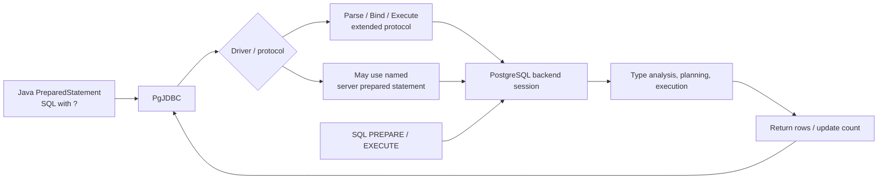
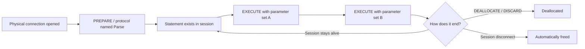

# Prepared Statements, Query Parameters, and Server-Side Lifecycle in PostgreSQL

A Java application repeatedly issues a query to fetch orders by customer:

```sql
SELECT order_id, status, total_amount
FROM orders
WHERE tenant_id = 7 AND status = 'paid';
```

If every request constructs a SQL string by concatenating user-supplied values, the application is both vulnerable to **SQL injection** and unable to reuse a consistent query pattern cleanly. PostgreSQL supports **prepared statements** to separate **statement structure** from **parameter values**. However, the concept of "prepare" appears at multiple layers: PostgreSQL's SQL `PREPARE` command, the extended wire protocol (`Parse`/`Bind`/`Execute`), JDBC's `java.sql.PreparedStatement`, and driver or connection pool caching mechanisms.

In particular, a named prepared statement on the server has a **lifecycle tied to a single PostgreSQL session (backend)**. It does not exist as a database-wide object shared across all connections, does not automatically cache query results, and does not guarantee every execution always uses the same execution plan.

This lesson belongs to the **Application Connections** chapter and centers on three questions:

1. **What is a prepared statement?** How to declare, pass parameters, execute, and deallocate it.
2. **How are parameters handled?** Data types, `NULL`, security, limits on where placeholders are allowed, and plan reuse.
3. **What is the server-side lifecycle?** Sessions, transactions, JDBC drivers, poolers, invalidation, generic/custom plans, and operations.

After this lesson, you will be able to write runnable `PREPARE`/`EXECUTE` examples, call them from Java using `PreparedStatement`, diagnose parameter mismatch errors, inspect `pg_prepared_statements`, and design applications without relying on false assumptions about connection sessions.

## 1. The Big Picture

A prepared statement is **a SQL statement prepared so that it can be executed with different sets of parameters**. Simply put, the application sends the **query template** once via a preparation mechanism, then supplies values for each corresponding execution.

Example SQL template:

```sql
SELECT order_id, total_amount
FROM ps_lab.orders
WHERE tenant_id = $1
  AND status = $2
ORDER BY placed_at DESC
LIMIT $3;
```

Three parameters hold places for **values**:

- `$1`: tenant ID, integer type.
- `$2`: status, text type.
- `$3`: maximum row count, integer type.

The application can run the same structure with:

```text
(tenant_id=2, status='paid', limit=10)
(tenant_id=5, status='pending', limit=20)
(tenant_id=2, status='cancelled', limit=5)
```

There is no need to use string concatenation to inject those values into SQL syntax.

### 1.1. Layer Diagram



**Important distinction:** a `PreparedStatement` object in Java does not always mean a **named prepared statement** already exists in `pg_prepared_statements`. A driver may use the extended protocol with an unnamed statement first, then switch to a server-side named statement depending on caching policies and prepare thresholds.

### 1.2. What Prepared Statements Do Not Do

A prepared statement **does not**:

- Automatically cache `SELECT` results like a materialized view or result cache.
- Make execution, table scans, JOINs, or sorts free.
- Guarantee every query uses a B-tree index.
- Allow passing arbitrary table or column names in place of SQL identifiers.
- Automatically grant database or table privileges.
- Protect against multi-tenant authorization logic bugs by itself.
- Persist across server restarts or new physical connections.
- Automatically solve a pool opening too many connections.

It is a mechanism for managing **SQL structure, parameter binding, and reusing parts of query processing** in appropriate contexts.

## 2. SQL `PREPARE`, `EXECUTE`, and `DEALLOCATE`

The three core PostgreSQL commands:

```sql
PREPARE statement_name (parameter_type, ...)
AS sql_statement;

EXECUTE statement_name(parameter_value, ...);

DEALLOCATE statement_name;
```

The statement name exists within the **session** that created it, unless explicitly deallocated or the session ends.

An example you can try directly without any tables:

```sql
PREPARE ps_sum(integer, integer)
AS SELECT $1 + $2 AS total;

EXECUTE ps_sum(10, 20);
EXECUTE ps_sum(7, 8);

DEALLOCATE ps_sum;
```

The results are 30 and 15, respectively.

After `DEALLOCATE`, calling:

```sql
EXECUTE ps_sum(1, 2);
```

will fail because the statement named `ps_sum` no longer exists in the current session.

### 2.1. Statement Name and Scope

```sql
PREPARE ps_hello(text)
AS SELECT 'Hello, ' || $1 AS greeting;

EXECUTE ps_hello('PostgreSQL');
```

The name `ps_hello` is the **name of the prepared statement**, not a table, index, or stored procedure name. It must be unique within the **same session**. Another session can independently create a statement with the same name.

### 2.2. `PREPARE` Does Not Run the Query Immediately Like `EXECUTE`

`PREPARE` creates a prepared statement based on the supplied syntax/query. Actually reading data or executing DML happens at `EXECUTE`.

Example:

```sql
PREPARE ps_current_time AS
SELECT clock_timestamp() AS observed_at;

EXECUTE ps_current_time;
EXECUTE ps_current_time;

DEALLOCATE ps_current_time;
```

Each execution calls `clock_timestamp()` and can return a different timestamp. A prepared statement does not "freeze" the first run's result.

### 2.3. Which Statement Types Can `PREPARE` Be Used For?

SQL `PREPARE` is commonly used for:

- `SELECT`.
- `INSERT`.
- `UPDATE`.
- `DELETE`.
- `MERGE` when supported by the major version.
- `VALUES`.

Do not use `PREPARE` as a general mechanism to prepare arbitrary DDL/utility commands such as `CREATE TABLE`. For schema deployment, use migrations with controlled SQL, not parameter binding to substitute object names.

## 3. Practice Dataset

Examples from here on use the `ps_lab` schema in a **learning database**. Only create/load this in a fresh schema; do not run verbatim in production.

### 3.1. Create the Table

```sql
CREATE SCHEMA IF NOT EXISTS ps_lab;

CREATE TABLE ps_lab.orders (
    order_id bigint GENERATED BY DEFAULT AS IDENTITY PRIMARY KEY,
    tenant_id integer NOT NULL,
    customer_id bigint NOT NULL,
    status text NOT NULL
        CHECK (status IN ('paid', 'pending', 'cancelled')),
    total_amount numeric(12, 2) NOT NULL
        CHECK (total_amount >= 0),
    placed_at timestamptz NOT NULL,
    note text
);
```

Meaning:

- `order_id`: identifying key of each order.
- `tenant_id`: data isolation boundary per tenant.
- `status`: one of three statuses.
- `total_amount`: exact monetary amount of type `numeric`.
- `placed_at`: timestamp with time zone.
- `note`: nullable column, used to practice binding missing values.

### 3.2. Load 60,000 Skewed Rows

```sql
INSERT INTO ps_lab.orders
    (tenant_id, customer_id, status, total_amount, placed_at, note)
SELECT
    CASE
        WHEN g <= 54000 THEN 1
        ELSE 2 + (g % 60)
    END AS tenant_id,
    1000 + (g % 2000) AS customer_id,
    CASE
        WHEN g % 11 = 0 THEN 'cancelled'
        WHEN g % 4 = 0 THEN 'pending'
        ELSE 'paid'
    END AS status,
    ((g % 25000)::numeric / 100)::numeric(12, 2)
        AS total_amount,
    TIMESTAMPTZ '2026-01-01 00:00:00+00'
        + (g % 180) * INTERVAL '1 day'
        + (g % 86400) * INTERVAL '1 second'
        AS placed_at,
    CASE WHEN g % 5 = 0 THEN NULL ELSE 'sample' END AS note
FROM generate_series(1, 60000) AS s(g);
```

The dataset has **a very large tenant 1**, while the remaining tenants are much smaller. This skewed distribution is an opportunity to observe how a **generic plan** and a **custom plan** can differ in performance.

### 3.3. Create Sample Indexes

```sql
CREATE INDEX idx_ps_orders_tenant_status_time
ON ps_lab.orders (
    tenant_id,
    status,
    placed_at DESC,
    order_id DESC
)
INCLUDE (total_amount);

CREATE INDEX idx_ps_orders_customer
ON ps_lab.orders (customer_id);

ANALYZE ps_lab.orders;
```

The first index supports queries filtering by `tenant_id`/`status` and requesting the newest rows by time. The `ORDER BY` clause must be compatible to exploit index ordering. `INCLUDE` stores extra payload data, though it does not guarantee an `Index Only Scan` will never need heap fetches.

This is **demo data**; the planner may choose a Seq Scan when it estimates that to be cheaper. Never create indexes solely because an example has them while ignoring your actual workload.

### 3.4. Check Row Counts by Tenant

```sql
SELECT
    tenant_id,
    COUNT(*) AS order_count
FROM ps_lab.orders
GROUP BY tenant_id
ORDER BY order_count DESC, tenant_id
LIMIT 10;
```

You will see tenant 1 holds the vast majority of rows. The remaining tenants are spread across much smaller counts.

## 4. `PREPARE` a `SELECT` With Typed Parameters

```sql
PREPARE ps_recent_orders(integer, text, integer) AS
SELECT
    order_id,
    tenant_id,
    customer_id,
    status,
    total_amount,
    placed_at
FROM ps_lab.orders
WHERE tenant_id = $1
  AND status = $2
ORDER BY placed_at DESC, order_id DESC
LIMIT $3;
```

This statement explicitly declares three parameter types:

| Position | Type in `PREPARE` | Meaning |
| --- | --- | --- |
| `$1` | `integer` | Tenant ID |
| `$2` | `text` | Status |
| `$3` | `integer` | Row limit |

Execute:

```sql
EXECUTE ps_recent_orders(2, 'paid', 10);
EXECUTE ps_recent_orders(1, 'pending', 5);
EXECUTE ps_recent_orders(5, 'cancelled', 20);
```

You can change the **values**, but you cannot change the `SELECT` structure or parameter count of the prepared statement.

### 4.1. `EXECUTE` Accepts Value Expressions

```sql
EXECUTE ps_recent_orders(2 + 1, upper('paid'), 10);
```

This is a syntax example. Because `upper('paid')` produces `'PAID'`, and statuses in the sample table are stored in lowercase, the query may return no rows. Parameter binding does not automatically transform statuses for business rules.

### 4.2. `EXECUTE` Does Not Use `$` Signs in the Value List

Correct:

```sql
EXECUTE ps_recent_orders(2, 'paid', 10);
```

Conceptually wrong:

```text
EXECUTE ps_recent_orders($1, $2, $3);
```

In SQL `EXECUTE` calling an existing prepared statement, you pass **values or expressions**. `$1`, `$2`, and `$3` belong to the **defining SQL statement** in `PREPARE`; they have no values of their own in an `EXECUTE` statement outside a corresponding parameter context.

### 4.3. Parameters Are Not String Interpolation

`$2` represents a typed **text value**, not a SQL fragment replaced by arbitrary content. If an application passes the string:

```text
paid' OR '1'='1
```

it is treated as **a single text value**, and does not turn the query into an `OR` condition. The query simply looks for a status equal to that exact string (and normally matches nothing).

## 5. Inspecting Active Prepared Statements in a Session

PostgreSQL provides the `pg_prepared_statements` view:

```sql
SELECT
    name,
    statement,
    prepare_time,
    parameter_types,
    from_sql,
    generic_plans,
    custom_plans
FROM pg_prepared_statements
ORDER BY prepare_time;
```

Key columns:

- `name`: prepared statement name.
- `statement`: the prepared statement text.
- `prepare_time`: time when it was prepared.
- `parameter_types`: array of parameter types.
- `from_sql`: `true` if created via SQL `PREPARE`; `false` if created via protocol.
- `generic_plans` / `custom_plans`: number of times each plan kind was chosen.

Some columns depend on PostgreSQL major version. On older servers, inspect the view schema with `SELECT *` before depending on a particular column.

### 5.1. This View Only Describes the Current Session

Important: `pg_prepared_statements` shows **prepared statements of the current session**, not an inventory of all statements from all applications.

You can run:

```sql
SELECT name, parameter_types, from_sql
FROM pg_prepared_statements
WHERE name = 'ps_recent_orders';
```

in the exact connection where you just ran `PREPARE`. If you open `psql` in another terminal, the new session will not see a statement by that name.

### 5.2. A Statement Name Has No Global Scope

Suppose there are 100 physical connections from 100 pods. Each connection may have a prepared statement named `ps_recent_orders`, but those are **100 session-local entities**, not a single shared server object.

This matters when estimating memory footprint and when restarting a pooler or server.

### 5.3. Cleaning Up the Practice Statement

```sql
DEALLOCATE ps_recent_orders;
```

Afterward:

```sql
SELECT name
FROM pg_prepared_statements
WHERE name = 'ps_recent_orders';
```

in the same session will no longer return that row.

## 6. Parameter Types: Explicit Declaration or Inference?

You can supply the type list:

```sql
PREPARE ps_find_id(bigint) AS
SELECT order_id, status
FROM ps_lab.orders
WHERE order_id = $1;
```

Or let PostgreSQL infer the type from context when enough information is present:

```sql
PREPARE ps_find_id_inferred AS
SELECT order_id, status
FROM ps_lab.orders
WHERE order_id = $1;
```

The `order_id` column has type `bigint`, so the parser has context to infer the parameter type.

Verify:

```sql
SELECT name, parameter_types
FROM pg_prepared_statements
WHERE name IN ('ps_find_id', 'ps_find_id_inferred');

EXECUTE ps_find_id(1);
EXECUTE ps_find_id_inferred(1);
```

### 6.1. When Context Is Insufficient, Specify the Type

For example:

```sql
PREPARE ps_untyped AS SELECT $1;
```

may be rejected because PostgreSQL cannot determine the type of parameter `$1`.

Explicit form:

```sql
PREPARE ps_typed(text) AS
SELECT $1 AS supplied_text;

EXECUTE ps_typed('hello');
```

Or cast in SQL:

```sql
PREPARE ps_cast AS
SELECT $1::integer + 10 AS result;

EXECUTE ps_cast(5);
```

### 6.2. Why Types Matter

PostgreSQL selects operators and functions based on **data types**, for example:

- `bigint = bigint`.
- `uuid = uuid`.
- `numeric + numeric`.
- `jsonb @> jsonb`.
- `timestamptz >= timestamptz`.

If the driver sends `varchar` when the expression requires `uuid` or `jsonb`, you can hit operator/cast errors. Do not convert every input into text merely because user input arrives over HTTP.

## 7. NULL Parameters and Type Inference

SQL NULL is not the string `'NULL'`.

Example:

```sql
PREPARE ps_nullable_note(bigint, text) AS
SELECT order_id, note
FROM ps_lab.orders
WHERE order_id = $1
  AND note IS NOT DISTINCT FROM $2;

EXECUTE ps_nullable_note(1, NULL);
EXECUTE ps_nullable_note(1, 'sample');
```

The `IS NOT DISTINCT FROM` condition treats NULL as a comparable value with clear semantics:

- Both sides NULL → true.
- One side NULL, one side non-NULL → false.
- Both sides non-NULL → standard equality comparison.

### 7.1. `= NULL` Does Not Work Like Regular Equality

Logically wrong when trying to match rows where `note` is NULL:

```sql
WHERE note = $2
```

with `$2 = NULL` does not evaluate to true for rows where `note IS NULL`. Use `IS NULL` or a NULL-safe operator as required.

### 7.2. Nullable Filter Differs From NULL Equality

A common pattern:

```sql
PREPARE ps_optional_status(integer, text) AS
SELECT order_id, status
FROM ps_lab.orders
WHERE tenant_id = $1
  AND ($2 IS NULL OR status = $2)
ORDER BY order_id
LIMIT 30;
```

Here `$2 = NULL` means **do not filter by status**, not "find rows with NULL status". The two contracts are different and should be named clearly.

**Performance:** an `OR` condition with an optional parameter can hurt selectivity estimation and generic plans. For performance-sensitive workloads, two fixed query shapes—one filtered and one unfiltered—are sometimes better than one catch-all `OR` query.

## 8. Passing Properly Typed Values From Java

Common PostgreSQL ↔ JDBC pairs:

| PostgreSQL | Java/PgJDBC | Binding Suggestion |
| --- | --- | --- |
| `bigint` | `long`/`Long` | `setLong` |
| `integer` | `int`/`Integer` | `setInt` |
| `numeric` | `BigDecimal` | `setBigDecimal` |
| `text`/`varchar` | `String` | `setString` |
| `boolean` | `boolean`/`Boolean` | `setBoolean` or `setNull` |
| `date` | `LocalDate` | `setObject` per JDBC 4.2 |
| `timestamptz` | `OffsetDateTime` | `setObject` per PgJDBC support |
| `uuid` | `UUID` | `setObject` |
| `jsonb` | `PGobject` or explicit cast | See typed JSON example |

Actual choices depend on the driver version and API used. Do not assume every JDBC driver supports `jsonb`, UUID, or arrays identically to PgJDBC.

### 8.1. Java `setNull` Requires a SQL Type

Example binding a nullable text value:

```java
if (note == null) {
    statement.setNull(2, java.sql.Types.VARCHAR);
} else {
    statement.setString(2, note);
}
```

A NULL parameter still needs to be understood in its SQL type context. In complex structures, an explicit cast in SQL can help avoid type inference errors.

## 9. You Cannot Bind Table Names, Column Names, or SQL Keywords

A parameter placeholder represents a **data value**, not a SQL syntax node.

Wrong in intent:

```sql
PREPARE ps_wrong(text) AS
SELECT * FROM $1;
```

`$1` cannot become an arbitrary table name.

Similarly:

```sql
SELECT *
FROM ps_lab.orders
ORDER BY $1;
```

does not interpret a passed string `'placed_at'` as the **column name to `ORDER BY`**. Even if valid SQL, it is treated as sorting by a constant value/expression and **will not produce the expected ordering**.

### 9.1. Safe Dynamic Sorting Using an Allowlist

In Java, you can map an API choice to **one of a fixed set of application-controlled SQL fragments**:

```java
String orderExpression = switch (sortKey) {
    case "date" -> "placed_at DESC, order_id DESC";
    case "amount" -> "total_amount DESC, order_id DESC";
    default -> throw new IllegalArgumentException("Unsupported sort");
};

String sql = """
    SELECT order_id, total_amount, placed_at
    FROM ps_lab.orders
    WHERE tenant_id = ?
    ORDER BY
    """ + orderExpression + """
    LIMIT ?
    """;
```

This example uses an **allowlist**, never concatenating a client-supplied `sortKey` directly into SQL. The **values** `tenant_id` and `LIMIT` must still be bound via placeholders.

### 9.2. Dynamic Identifiers in PL/pgSQL

When server-side code genuinely needs dynamic table/column access, you can use `EXECUTE format('%I', identifier)` with validation/allowlisting and `USING` for values.

That is **dynamic SQL** with different privilege and injection risks, not a pure SQL `PREPARE` parameterization case.

### 9.3. Do Not Parameterize Arbitrary Predicates

Do not accept a string like `"tenant_id = 1 OR true"` from a client and append it to `WHERE`. Represent filters as typed fields in your API and construct one of a controlled set of query shapes.

## 10. SQL Injection: What Prepared Statements Actually Protect Against

Dangerous pattern:

```java
String sql =
    "SELECT order_id FROM ps_lab.orders WHERE status = '"
    + rawStatus
    + "'";
```

If `rawStatus` comes from a request, it can alter SQL syntax when concatenated into text.

Correct pattern:

```java
String sql =
    "SELECT order_id FROM ps_lab.orders WHERE status = ?";

try (PreparedStatement ps = connection.prepareStatement(sql)) {
    ps.setString(1, rawStatus);
    try (ResultSet rs = ps.executeQuery()) {
        // Read rows.
    }
}
```

User input is passed via a **bind parameter**. Quotes, semicolons, comment markers, and keywords inside the value **never become SQL structure**.

### 10.1. Prepared Statements Do Not Replace Business Validation

A string `rawStatus="unexpected"` cannot inject SQL via binding, yet it can still be an **invalid domain value**.

You still need:

- Allowlisting status values.
- Input length controls.
- `LIMIT`/pagination bounds.
- User/tenant authorization checks.
- SQL error handling.
- Query timeouts and safe logging when needed.

### 10.2. Do Not Leak Secrets Through Parameter Logs

A framework might log:

```text
SQL: SELECT ... WHERE email = ?
params: secret@example.test
```

Parameterization prevents injection; it **does not automatically hide sensitive data in logs**. For passwords, tokens, personal data, or sensitive values, configure proper logging/redaction across the app, driver, and database.

## 11. Java JDBC `PreparedStatement`: Complete Repository Example

Here is an example using a `DataSource` and a prepared query returning recent orders.

```java
import java.math.BigDecimal;
import java.sql.Connection;
import java.sql.PreparedStatement;
import java.sql.ResultSet;
import java.sql.SQLException;
import java.time.Instant;
import java.util.ArrayList;
import java.util.List;
import javax.sql.DataSource;

public final class OrderRepository {
    private final DataSource dataSource;

    public OrderRepository(DataSource dataSource) {
        this.dataSource = dataSource;
    }

    public record OrderSummary(
            long orderId,
            int tenantId,
            String status,
            BigDecimal amount,
            Instant placedAt
    ) {}

    public List<OrderSummary> findRecent(
            int authorizedTenantId,
            String status,
            int requestedLimit
    ) throws SQLException {
        if (!List.of("paid", "pending", "cancelled").contains(status)) {
            throw new IllegalArgumentException("Unsupported status");
        }

        int limit = Math.max(1, Math.min(requestedLimit, 50));

        String sql = """
            SELECT
                order_id, tenant_id, status,
                total_amount, placed_at
            FROM ps_lab.orders
            WHERE tenant_id = ?
              AND status = ?
            ORDER BY placed_at DESC, order_id DESC
            LIMIT ?
            """;

        List<OrderSummary> result = new ArrayList<>();

        try (Connection connection = dataSource.getConnection();
             PreparedStatement statement =
                 connection.prepareStatement(sql)) {

            statement.setInt(1, authorizedTenantId);
            statement.setString(2, status);
            statement.setInt(3, limit);

            try (ResultSet rs = statement.executeQuery()) {
                while (rs.next()) {
                    result.add(new OrderSummary(
                        rs.getLong("order_id"),
                        rs.getInt("tenant_id"),
                        rs.getString("status"),
                        rs.getBigDecimal("total_amount"),
                        rs.getTimestamp("placed_at").toInstant()
                    ));
                }
            }
        }

        return result;
    }
}
```

Key highlights:

- `?` is a **JDBC** placeholder, indexed starting at **1**.
- `setInt(1, ...)` binds tenant; `setString(2, ...)` binds status.
- `setInt(3, ...)` binds `LIMIT` after clamping to the product's maximum cap.
- `try-with-resources` closes `ResultSet`, `PreparedStatement`, and `Connection` per the JDBC contract.
- `BigDecimal` is used for `numeric` instead of `double` to avoid precision loss on money.
- `authorizedTenantId` must come from **server-side authentication/authorization context**, never trusting an arbitrary tenant ID in the request.

### 11.1. JDBC `?` Differs From SQL `PREPARE` `$1`

JDBC:

```sql
SELECT * FROM ps_lab.orders WHERE order_id = ?
```

SQL `PREPARE` in PostgreSQL:

```sql
PREPARE ps_one(bigint) AS
SELECT * FROM ps_lab.orders WHERE order_id = $1;
```

Do not write `$1` directly inside Java `PreparedStatement` strings out of SQL `PREPARE` habit unless using a specifically defined driver interface. `?` is the standard `PreparedStatement` placeholder.

### 11.2. JDBC `PreparedStatement` Does Not Guarantee Immediate Server `PREPARE`

`Connection.prepareStatement(sql)` creates a **JDBC `PreparedStatement` object**. PgJDBC can use the extended query protocol, parse/bind/execute, and caching; it does not necessarily issue SQL `PREPARE name(...) AS ...` immediately when that method is called.

When the application runs the query repeatedly, PgJDBC may promote it to **named server-side prepared statements** depending on `prepareThreshold`, query mode, cache, and driver version.

### 11.3. `Connection.close` in a Pool Does Not Always Close the TCP Session

When `dataSource` is a connection pool, `connection.close()` usually **returns the logical connection to the pool** instead of closing the physical socket immediately.

This is good for connection reuse, but has a consequence: the server session stays alive and may retain prepared statements, session settings, or cached state depending on how the pool/driver manages them.

## 12. Extended Query Protocol: `Parse`, `Bind`, `Execute`

Besides sending SQL `PREPARE`/`EXECUTE` via the simple query protocol, PostgreSQL has the **extended query protocol**.

Core messages:

1. **`Parse`**: sends SQL text and can attach a statement name.
2. **`Bind`**: supplies parameter values, creating a portal.
3. **`Describe`**: fetches parameter/result descriptions when needed.
4. **`Execute`**: executes the portal.
5. **`Sync`**: completes the protocol cycle and synchronizes state.

A conceptual sequence:

```text
Client                         PostgreSQL backend
  | -- Parse SQL with $1,$2 -> |
  | <-- ParseComplete -------- |
  | -- Bind values --------->  |
  | <-- BindComplete --------- |
  | -- Execute --------------> |
  | <-- RowDescription/DataRow |
  | <-- CommandComplete ------ |
  | -- Sync -----------------> |
  | <-- ReadyForQuery -------- |
```

This is a simplified model; exact ordering and pipelining optimizations depend on the driver/client.

### 12.1. Unnamed and Named Prepared Statements

The extended protocol can create:

- **Unnamed statement**: typically used for queries that do not need a long-lived name; subject to protocol replacement/destruction rules.
- **Named statement**: has a name and can be reused within the session across multiple `Bind`/`Execute` cycles.

This explains why you can use `PreparedStatement` in Java without seeing a corresponding named statement persist in `pg_prepared_statements`.

### 12.2. Portals Differ From Prepared Statements

`Parse` prepares the statement; `Bind` creates a **portal** with parameter values and result formats; `Execute` runs the portal.

Do not equate a portal (an execution context) with a named prepared statement (a prepared query template). They have different lifecycle rules within the protocol and transaction.

### 12.3. Driver Statement Caching Is Not Result Caching

PgJDBC may cache parsed queries/statements to reduce parse/prepare work. Yet every `executeQuery()` still executes the SQL and reads matching rows under the current snapshot.

If an order changes `status` and a new transaction reads the data, the prepared statement **does not return stale results** just because the statement name is cached.

## 13. Server-Side Lifecycle: Session, Transaction, and Deallocation

A **named prepared statement** belongs to **a single PostgreSQL session**.

Basic lifecycle:



### 13.1. Prepared Statements Persist Across Transaction Boundaries

Within the same connection:

```sql
PREPARE ps_session_demo(integer)
AS SELECT $1 * 10 AS result;

BEGIN;
EXECUTE ps_session_demo(2);
COMMIT;

BEGIN;
EXECUTE ps_session_demo(3);
ROLLBACK;

EXECUTE ps_session_demo(4);

DEALLOCATE ps_session_demo;
```

The last statement can still run after COMMIT and ROLLBACK because the statement **was created in the session before the two transactions started**.

This **does not mean** a prepared statement escapes transaction rules: if a transaction is in an aborted state due to an error, you must roll back or recover transaction state before running valid statements again.

### 13.2. Session Disconnect Destroys Statements

If the physical connection is closed and the client reconnects:

```sql
EXECUTE ps_session_demo(5);
```

cannot use the statement from the old session, even if the old session created one with the same name.

A connection pool must handle reconnect/failover per driver lifecycle and never assume the server retains all prepared statements indefinitely.

### 13.3. `PREPARE` Can Be Affected by Rollback During Creation

Preparation happens within a session/transaction context; the behavior of `PREPARE` issued inside a failed transaction should be verified against server/protocol behavior and client handling. **Do not design a system around trying to use a statement just created inside a failed transaction**.

A clean practice is preparing on a connection in a valid state, following the driver lifecycle, and retrying/repreparing after reconnect.

## 14. `DEALLOCATE`, `DEALLOCATE ALL`, and `DISCARD ALL`

Deallocate one statement:

```sql
DEALLOCATE ps_find_id;
```

Deallocate statements managed by SQL commands in the session scope:

```sql
DEALLOCATE ALL;
```

`DISCARD ALL` is broader: it resets/releases many session resources and state per PostgreSQL rules, including prepared statements.

### 14.1. Do Not Arbitrarily Run `DEALLOCATE ALL` in a Connection Pool

A JDBC driver may be caching prepared statement names and expecting them to still exist. If the application manually runs:

```sql
DEALLOCATE ALL;
```

on that connection, client/driver cache can go **out of sync** with server state; subsequent `Execute` calls may fail with "prepared statement does not exist" or force the driver to recover.

Only use session-reset commands when supported and properly configured by your connection pool/driver.

### 14.2. `DISCARD ALL` Is Not a Business Query

`DISCARD ALL` has broad session-reset effects and cannot be executed inside a transaction block per PostgreSQL rules. It should be orchestrated as an administrative/connection-reset operation, not embedded into individual requests.

### 14.3. A Name Can Be Reused After `DEALLOCATE`

```sql
PREPARE ps_x(integer) AS SELECT $1 + 1;
EXECUTE ps_x(1);
DEALLOCATE ps_x;

PREPARE ps_x(text) AS SELECT upper($1);
EXECUTE ps_x('abc');
DEALLOCATE ps_x;
```

The second `PREPARE` with the same name is allowed because the old statement was deallocated. However, **the two statements have different parameter contracts**; the driver/application must manage names and expected types properly.

## 15. One Run Does Not Mean an Immutable Plan

PostgreSQL prepares a statement and can generate an **execution plan** upon execution. For a parameterized prepared statement, the planner can choose:

- **Custom plan:** optimized for the specific parameter values of that execution.
- **Generic plan:** a plan reusable across different parameter sets of the same prepared statement.

This has a major impact when data distribution is skewed.

### 15.1. Custom Plan

Suppose tenant 1 has 54,000 rows while tenant 2 has only around 100 rows. A query:

```sql
WHERE tenant_id = $1
```

might be best served by:

- A Seq Scan or index access depending on selectivity when `$1=1`.
- An Index Scan when `$1=2` returns very few rows.

A custom plan can use the **actual parameter values** and statistics to pick the access path.

### 15.2. Generic Plan

A generic plan is not specialized for `$1=1` or `$1=2` each time. It saves some planning overhead when a query runs repeatedly, yet can be **poorly suited** to highly skewed values.

A generic plan **does not mean the query ignores parameters**. Parameters are still bound and the query filters accurately. The difference lies in **plan choice**, not SQL semantics.

### 15.3. When Does PostgreSQL Choose Generic vs. Custom?

With `plan_cache_mode=auto`, PostgreSQL compares estimated costs between generic and custom plans. For parameterized prepared statements, it typically executes **five custom plans** initially, then considers a generic plan based on estimated cost comparison.

Exact rule details can evolve across major versions and query types. **Do not treat the number "5" as a hard SLA** across all drivers, plans, or statements.

A statement with no parameters naturally tends to use a generic plan, since there are no varying parameter values.

## 16. Controlling `plan_cache_mode` to Learn

Inspect:

```sql
SHOW plan_cache_mode;
```

Common values:

- `auto`: PostgreSQL decides automatically.
- `force_custom_plan`: requests custom plans for prepared queries that can use custom plans.
- `force_generic_plan`: requests generic plans for prepared queries that can use generic plans.

Example in a learning session:

```sql
PREPARE ps_tenant_count(integer) AS
SELECT COUNT(*)
FROM ps_lab.orders
WHERE tenant_id = $1;

SET plan_cache_mode = force_custom_plan;

EXPLAIN EXECUTE ps_tenant_count(1);
EXPLAIN EXECUTE ps_tenant_count(2);

SET plan_cache_mode = force_generic_plan;

EXPLAIN EXECUTE ps_tenant_count(1);
EXPLAIN EXECUTE ps_tenant_count(2);

SET plan_cache_mode = auto;
DEALLOCATE ps_tenant_count;
```

In the plan output, a generic plan may show the placeholder `$1` in predicates, while a custom plan may show concrete values. Still, **observing the actual plan** matters more than guessing from printed text formatting alone.

### 16.1. Using `SET LOCAL` to Limit Scope

```sql
BEGIN;

SET LOCAL plan_cache_mode = force_custom_plan;

PREPARE ps_local_plan(integer) AS
SELECT COUNT(*)
FROM ps_lab.orders
WHERE tenant_id = $1;

EXPLAIN EXECUTE ps_local_plan(2);

DEALLOCATE ps_local_plan;

COMMIT;
```

`SET LOCAL` applies the choice only for the current transaction per PostgreSQL semantics. It avoids mutating the GUC for the entire session reused by a connection pool.

### 16.2. Do Not Force Generic or Custom Out of Habit

`force_custom_plan` can increase planning overhead if a query is called very frequently. `force_generic_plan` can make queries with rare/selective parameters very slow.

Override only after measuring representative queries; prefer `auto` unless a proven problem exists.

## 17. `EXPLAIN EXECUTE`: Inspecting a Prepared Statement's Plan

You do not need to copy query text and manually substitute parameters to inspect a plan.

```sql
PREPARE ps_explain(integer, text) AS
SELECT order_id, total_amount, placed_at
FROM ps_lab.orders
WHERE tenant_id = $1
  AND status = $2
ORDER BY placed_at DESC, order_id DESC
LIMIT 20;

EXPLAIN EXECUTE ps_explain(2, 'paid');

EXPLAIN (ANALYZE, BUFFERS)
EXECUTE ps_explain(2, 'paid');

DEALLOCATE ps_explain;
```

- `EXPLAIN EXECUTE` shows the estimated plan.
- `EXPLAIN (ANALYZE, BUFFERS) EXECUTE` **actually executes** the statement and measures actual time/rows/buffers.

Because the example above is a `SELECT`, it does not modify data. **If the prepared statement is an `UPDATE`/`DELETE`/`INSERT`, `EXPLAIN ANALYZE` executes the real DML**; wrap it in an appropriate transaction and rollback in learning environments.

### 17.1. Why Might a Plan Choose Seq Scan?

Even with an index on `tenant_id`, PostgreSQL may pick a Seq Scan when:

- Tenant 1 holds most of the table.
- The query returns many rows.
- Statistics indicate index access is costlier than scanning.
- The table is small or cache/load conditions differ.
- A generic plan must compromise across varying parameter values.

**An index's existence does not force the planner to use it.** Prepared statements do not change cost-based optimization rules.

### 17.2. Key Metrics to Read

| Field | Meaning |
| --- | --- |
| `cost` | Planner cost estimate, not milliseconds |
| `rows` / `actual rows` | Estimated / actual row counts |
| `Index Cond` | Condition actually pushed into the index |
| `Filter` | Remaining filter condition |
| `Sort` | Sort cost if the index does not provide ordering |
| `Buffers: shared hit/read` | PostgreSQL buffer cache activity |
| `Planning Time` | Measured planning duration |
| `Execution Time` | Executor duration per instrumentation |

A single measurement after caches are warm is inconclusive. Test common, rare, and edge-case parameter values repeatedly.

## 18. Observing `generic_plans` and `custom_plans`

After creating a prepared statement:

```sql
PREPARE ps_plan_counter(integer) AS
SELECT COUNT(*)
FROM ps_lab.orders
WHERE tenant_id = $1;

EXECUTE ps_plan_counter(1);
EXECUTE ps_plan_counter(2);
EXECUTE ps_plan_counter(3);

SELECT
    name,
    generic_plans,
    custom_plans
FROM pg_prepared_statements
WHERE name = 'ps_plan_counter';

DEALLOCATE ps_plan_counter;
```

These counters show **how many times the server chose each plan type** in the session.

### 18.1. Do Not Extrapolate Session Counters to the Whole Cluster

`pg_prepared_statements` is session-local. Reading counters once in `psql` **does not tell you** the state of prepared queries across 200 other connections.

For system-wide insight, use proper observability (driver logs, metrics, `pg_stat_statements` where available and authorized) instead of extrapolating from session-local data.

### 18.2. `from_sql` Shows the Creation Path

If `from_sql=true`, the statement was prepared via SQL `PREPARE`. Named statements created via the protocol typically have `from_sql=false`.

This signal helps distinguish statements you ran in `psql` from driver-managed statements, though drivers also keep client-side caches that do not necessarily appear in the view.

## 19. pgJDBC `prepareThreshold` and Server-Side Named Statement Thresholds

PgJDBC uses `prepareThreshold` to decide when a query has been executed repeatedly enough to create/switch to a named server-side prepared statement, depending on protocol mode and caching.

In many PgJDBC versions, the default is `prepareThreshold=5`. Before relying on a fixed number, however:

- Check your actual PgJDBC version.
- Check `preferQueryMode` and related driver properties.
- Check statement caching.
- Check whether the query repeats on the **same physical connection**.
- Check whether the driver meets the conditions to retain server-side prepared statements.

### 19.1. Five Requests Do Not Necessarily Equal Five Runs on One Session

Suppose a Java app has a pool of 20 connections and receives 100 requests. They may be distributed across multiple physical sessions.

Therefore, running a query 100 times **across the application** does not guarantee each individual connection has hit the threshold to switch to server-side prepare.

### 19.2. Threshold 0 and Query Modes

Drivers may allow disabling server-side prepared statements via settings such as `prepareThreshold=0`, or using simple-query mode via `preferQueryMode`. These options affect protocol and caching and must be verified against the exact driver version.

Do not change production settings just to "feel more prepared". Benchmark latency, CPU, parse/plan overhead, and pooler impact.

### 19.3. Drivers May Cache SQL After the Java Object Closes

Calling `PreparedStatement.close()` in JDBC does not guarantee the driver/server immediately executed `DEALLOCATE`. Depending on driver caching and physical connection lifecycle, prepared state may be retained for reuse.

Conversely, when the physical session is destroyed, that session's named server statements disappear.

## 20. Connection Pools: Prepared Statements Belong to Physical Connections

Suppose HikariCP or another pool has a maximum of 10 physical connections. Each physical connection corresponds to one PostgreSQL backend session when connected directly.

```text
HTTP Request 1  -> Pool -> Connection A -> PostgreSQL Session A
HTTP Request 2  -> Pool -> Connection B -> PostgreSQL Session B
HTTP Request 3  -> Pool -> Connection A -> PostgreSQL Session A
```

If Session A has `PREPARE ps_report` but Session B does not:

```sql
EXECUTE ps_report(...);
```

will work on A but **fail on B**.

### 20.1. Do Not SQL-Prepare Once at Startup and Use Across the Pool

An anti-pattern:

1. App startup borrows one connection.
2. Runs SQL `PREPARE ps_report(...)`.
3. Returns the connection to the pool.
4. Later requests borrow other connections and run `EXECUTE ps_report(...)`.

The result will intermittently succeed or fail depending on which connection is leased. That is a **session affinity issue**, not database instability.

A better solution for Java apps: use `PreparedStatement` and let the driver manage preparation/caching **per physical connection**.

### 20.2. Connection Pool Lifecycle

A pool may replace physical connections due to:

- Idle timeout.
- Max lifetime.
- Network reset.
- Database restart.
- Failover.
- Credentials rotation.
- Failed health check.

When a new connection is created, server-side named statements from the old connection **do not exist**. The driver must prepare as needed rather than relying on a statement created in a different session.

### 20.3. Resetting Session State Must Coordinate With the Driver

A pooler may run a reset query when returning a connection to the pool. If it executes `DISCARD ALL` or `DEALLOCATE ALL` while the driver still assumes named statements exist, the app can hit repeated errors or retries.

Consult pooler and driver documentation and reset settings instead of running an arbitrary "clean everything" SQL snippet.

## 21. PgBouncer: Session Pooling and Transaction Pooling

PgBouncer adds a layer between client and PostgreSQL:

```text
Java app ----> PgBouncer ----> PostgreSQL backend
```

Different pool modes impact session state differently.

### 21.1. Session Pooling

In **session pooling**, a client connection generally stays bound to one PostgreSQL backend connection for as long as the client session is held.

Backend-bound prepared statements are more likely to behave like direct PostgreSQL connections, though resets and disconnects still require attention.

### 21.2. Transaction Pooling

In **transaction pooling**, a backend server connection may be assigned to a client only for a transaction and then returned to the pool. The next request/transaction may go to a different backend.

Because SQL `PREPARE` creates named statements per backend session, an application **cannot assume** a SQL `PREPARE` in one transaction will exist when running `EXECUTE` in a later transaction.

### 21.3. Protocol-Level Prepared Statement Support Varies by Version

Modern PgBouncer versions support **protocol-level named prepared statements** in transaction pooling when features like `max_prepared_statements` are properly enabled and configured.

However:

- **SQL text `PREPARE`/`EXECUTE`** is not the same protocol-level path that the pooler can manage.
- Support depends on PgBouncer version, configuration, driver behavior, and query mode.
- Never assume every PgBouncer version or mode supports every form of preparation.
- Test failover, resets, DDL invalidation, and transaction boundaries.

**Do not conclude "transaction pooling can never use `PreparedStatement`"**, nor conclude "any new PgBouncer lets all SQL `PREPARE` work". Identify the **preparation mechanism** and the **actual versions and settings**.

### 21.4. Random Errors Under Transaction Pooling

Related error messages may include:

```text
prepared statement "..." does not exist
prepared statement "..." already exists
cached plan must not change result type
```

Do not rush to disable connection pooling altogether. Check:

1. Pool mode.
2. PgBouncer version and `max_prepared_statements`.
3. PgJDBC query mode / `prepareThreshold`.
4. Whether the driver uses unnamed or named extended protocol statements.
5. Reset queries / session state.
6. Recent schema migrations.
7. Connection failover or reconnects.

Each error can have multiple causes rather than stemming from a single bug.

## 22. Generic Plans Can Regress When Data Is Skewed

Using the tenant distribution in `ps_lab.orders`:

- Tenant 1: roughly 90% of the data.
- Tenants 2–61: each has a very small share.

Prepared query:

```sql
PREPARE ps_skew(integer) AS
SELECT order_id, status, total_amount
FROM ps_lab.orders
WHERE tenant_id = $1;
```

Test:

```sql
SET plan_cache_mode = force_custom_plan;

EXPLAIN EXECUTE ps_skew(1);
EXPLAIN EXECUTE ps_skew(2);

SET plan_cache_mode = force_generic_plan;

EXPLAIN EXECUTE ps_skew(1);
EXPLAIN EXECUTE ps_skew(2);

SET plan_cache_mode = auto;
DEALLOCATE ps_skew;
```

Observe:

- How many `rows` does the planner estimate?
- Is there an index serving `tenant_id`?
- Does the custom plan for a small tenant differ from the large tenant?
- Does the generic plan use the same access path for both parameters?

### 22.1. Returning Many Rows May Favor Seq Scan

For tenant 1, fetching 54,000 rows out of a 60,000-row table via an index can be more expensive than a Seq Scan. Not every query with `WHERE tenant_id = 1` benefits from an index.

### 22.2. Measure Planning Time Alongside Execution Time

A custom plan can pick the optimal index for a small tenant while paying planning cost on every run. A generic plan reduces planning cost while potentially increasing execution time.

Optimize total latency:

```text
request latency ≈ connection wait + parse/plan + execute + fetch + network
```

Do not measure only `Execution Time` of a single `SELECT` after all caches are warm.

## 23. Invalidation When Schema or Statistics Change

A prepared statement can outlive a migration that modifies a table. PostgreSQL has **re-analysis/re-planning/invalidation** mechanisms when dependent object definitions or planner statistics change appropriately.

However, **not every migration is transparent to prepared statements**.

### 23.1. Index Changes

If you create or drop a relevant index, PostgreSQL can rebuild the plan to take advantage of the new access path. A prepared statement is not permanently locked into an old access path merely because it was prepared earlier.

### 23.2. Result Type or Output Structure Changes

A tricky case:

1. A client prepared `SELECT * FROM some_table WHERE id = $1`.
2. A migration adds/alters columns, changing the **result type**.
3. The client reuses the old named prepared statement.

You may hit the error:

```text
cached plan must not change result type
```

Because the prepared query/driver depends on a previously established result descriptor, changing output shape cannot always transition safely on the fly.

### 23.3. Avoid `SELECT *` in Stable Interfaces

Replace:

```sql
SELECT *
FROM ps_lab.orders
WHERE order_id = $1;
```

with:

```sql
SELECT order_id, tenant_id, status, total_amount
FROM ps_lab.orders
WHERE order_id = $1;
```

when the API only needs those four fields. This reduces the impact of migrations adding unrelated columns.

### 23.4. `search_path` Changes Can Also Affect Statements

PostgreSQL re-analyzes prepared statements when `search_path` changes under certain conditions. An unqualified query can depend on object resolution.

In critical code, prefer:

```sql
FROM ps_lab.orders
```

over `FROM orders` if a session can change `search_path` across tenants, roles, or pools.

### 23.5. Do Not Use Reconnects as a Cure-All

Reconnecting or re-preparing can help after a migration alters a result descriptor, yet if the SQL itself is no longer valid (a column was dropped, parameter types are incompatible), the error remains.

Use **backward-compatible migration workflows**, update query/client contracts, and test multi-version app rollouts.

## 24. Prepared DML: `INSERT`, `UPDATE`, and `RETURNING`

Prepared statements are not limited to `SELECT`.

### 24.1. Parameterized `INSERT`

```sql
PREPARE ps_insert_order(integer, bigint, text, numeric, timestamptz)
AS
INSERT INTO ps_lab.orders (
    tenant_id, customer_id, status, total_amount, placed_at
)
VALUES ($1, $2, $3, $4, $5)
RETURNING order_id, tenant_id, status, total_amount;
```

Inside a learning transaction:

```sql
BEGIN;

EXECUTE ps_insert_order(
    2, 1200, 'paid', 42.50,
    TIMESTAMPTZ '2026-07-01 10:00:00+00'
);

ROLLBACK;

DEALLOCATE ps_insert_order;
```

`RETURNING` returns values after DML just like normal SQL. `ROLLBACK` undoes the row change, though identity sequences can leave gaps because sequence allocations are not rolled back like rows.

### 24.2. Multi-Condition `UPDATE`

```sql
PREPARE ps_update_status(text, integer, bigint) AS
UPDATE ps_lab.orders
SET status = $1
WHERE tenant_id = $2
  AND order_id = $3
RETURNING order_id, tenant_id, status;
```

Run safely in a transaction:

```sql
BEGIN;

EXECUTE ps_update_status('paid', 2, 1);

ROLLBACK;

DEALLOCATE ps_update_status;
```

This example may return 0 rows because order ID 1 belongs to tenant 1; that is intentional: **the tenant condition is in `WHERE`** rather than filtering solely by `order_id`.

### 24.3. Prepared Statements Do Not Replace Transactions

If updating a balance and writing a ledger entry must be atomic, you still need a proper transaction. A prepared statement is a **statement-preparation** mechanism, not a `COMMIT` mechanism or automatic rollback when business logic fails.

## 25. JDBC `UPDATE RETURNING` Example With Tenant Check

```java
import java.sql.Connection;
import java.sql.PreparedStatement;
import java.sql.ResultSet;
import java.sql.SQLException;
import javax.sql.DataSource;

public class OrderStatusService {
    private final DataSource dataSource;

    public OrderStatusService(DataSource dataSource) {
        this.dataSource = dataSource;
    }

    public boolean setStatus(
            int authorizedTenantId,
            long orderId,
            String newStatus
    ) throws SQLException {
        if (!java.util.Set.of(
                "paid", "pending", "cancelled").contains(newStatus)) {
            throw new IllegalArgumentException("Invalid status");
        }

        String sql = """
            UPDATE ps_lab.orders
            SET status = ?
            WHERE tenant_id = ?
              AND order_id = ?
            RETURNING order_id
            """;

        try (Connection c = dataSource.getConnection();
             PreparedStatement ps = c.prepareStatement(sql)) {
            ps.setString(1, newStatus);
            ps.setInt(2, authorizedTenantId);
            ps.setLong(3, orderId);

            try (ResultSet rs = ps.executeQuery()) {
                return rs.next();
            }
        }
    }
}
```

**Multi-tenant security:** `authorizedTenantId` must come from a server-verified identity. If the app binds an arbitrary client-supplied tenant ID without checking authorization, a prepared statement **will not stop cross-tenant data exposure or tampering**.

### 25.1. Do Not Conflate "Not Found" With "Unauthorized" Casually

The method returns `false` when no row matches both `tenant_id` and `order_id`. Depending on the product, this may be intentional to avoid leaking whether an ID exists in another tenant.

If your business logic needs to distinguish 404 vs. 403, design a controlled authorization layer; never drop the tenant predicate just for friendlier error messages.

## 26. Be Careful With `IN` Lists and Parameter Counts

A query looking up multiple IDs is sometimes written as:

```sql
WHERE order_id IN (?, ?, ?, ...)
```

The number of `?` placeholders varies with the ID count, causing the app to generate **many distinct query shapes**. That hurts caching and increases complexity.

PostgreSQL supports array parameters:

```sql
PREPARE ps_ids(bigint[]) AS
SELECT order_id, status
FROM ps_lab.orders
WHERE order_id = ANY($1);

EXECUTE ps_ids(ARRAY[1, 2, 3]::bigint[]);
DEALLOCATE ps_ids;
```

### 26.1. JDBC Binding SQL Arrays

```java
Long[] ids = {1L, 2L, 3L};

String sql = """
    SELECT order_id, status
    FROM ps_lab.orders
    WHERE order_id = ANY (?::bigint[])
    """;

try (PreparedStatement ps = connection.prepareStatement(sql)) {
    java.sql.Array array = connection.createArrayOf("int8", ids);
    try {
        ps.setArray(1, array);
        try (ResultSet rs = ps.executeQuery()) {
            while (rs.next()) {
                // Read rows.
            }
        }
    } finally {
        array.free();
    }
}
```

This is a PgJDBC/JDBC example; SQL `Array` handling and type name syntax should be verified for your driver. Large arrays still carry transfer/comparison overhead; an unbounded `ANY` array is not automatically better than a `JOIN` or temporary table.

### 26.2. Empty Arrays and NULL Arrays Differ

`order_id = ANY('{}'::bigint[])` matches no rows by semantics. `ANY(NULL::bigint[])` can evaluate to NULL. API design must distinguish "no IDs selected" from "match all IDs".

Never silently turn an empty list into omitting the `WHERE` condition unless that is explicitly part of the business contract.

## 27. `LIKE`, Patterns, and Parameters

You can bind a pattern:

```sql
PREPARE ps_note_search(text) AS
SELECT order_id, note
FROM ps_lab.orders
WHERE note ILIKE $1
ORDER BY order_id
LIMIT 20;

EXECUTE ps_note_search('%sample%');
DEALLOCATE ps_note_search;
```

From a SQL injection perspective, the pattern is still **a single value**. However, `%` and `_` are wildcards in `LIKE`/`ILIKE`.

If the UI intends to search for a **literal string**, you must escape wildcards per `LIKE` semantics or use another search mechanism. Parameterization prevents altering SQL structure; it **does not disable wildcard semantics**.

### 27.1. Performance and Leading Wildcards

`ILIKE '%term%'` generally cannot leverage a standard B-tree index like equality or prefix queries. If the workload requires heavy substring search, consider `pg_trgm` and appropriate indexes per environment policy.

Do not blame prepared statements when the root cause is a non-selective predicate or a missing index.

## 28. Bounding Statement Reuse and Memory Footprint

A session can hold many named prepared statements. Each statement requires metadata/cached state management, even though PostgreSQL handles invalidation and memory release.

If an application generates a new name on every request:

```text
ps_search_0001
ps_search_0002
ps_search_0003
...
```

and fails to `DEALLOCATE` on long-lived sessions, it can accumulate prepared statements and increase overhead.

### 28.1. Reuse Query Shapes

Use one parameterized query template instead of generating new names per data value.

Bad cache design:

```text
PREPARE order_42 AS SELECT ... WHERE order_id = 42;
PREPARE order_43 AS SELECT ... WHERE order_id = 43;
```

Better:

```sql
PREPARE ps_order(bigint) AS
SELECT order_id, status
FROM ps_lab.orders
WHERE order_id = $1;

EXECUTE ps_order(42);
EXECUTE ps_order(43);

DEALLOCATE ps_order;
```

### 28.2. Different SQL Text Creates Different Cache Entries

Differences in SQL text, result types, or driver query identity can cause the driver to treat statements as distinct.

For example, if an app dynamically generates SQL with dozens of filter combinations, aliases, and comments, cache hit rates may fall short of expectations.

Design query builders to emit a **finite set of query shapes** and bind values as parameters. Never sacrifice semantic correctness just to force a single query shape for every case.

### 28.3. Observe at the Right Layer

- PgJDBC metrics/logs: prepared-cache hits and server-side prepare behavior where exposed by the driver.
- PostgreSQL `pg_prepared_statements`: current state **on one backend session**.
- `pg_stat_statements`: cluster/instance-wide normalized query statistics when the extension is enabled, not a catalog of all named statements across all sessions.
- Connection pool metrics: active/idle/waiting/total connections.
- PostgreSQL `pg_stat_activity`: activity and session states.

Each tool answers a different question.

## 29. Prepared Statements and `pg_stat_statements`

`pg_stat_statements` is an extension for tracking execution statistics of query patterns as supported by PostgreSQL; it must be installed/enabled and granted appropriately.

It can show which queries consume the most total execution time, call counts, and mean time, yet it:

- Is not a view listing every per-session named prepared statement.
- Is not a detailed trace of every bound parameter value.
- Does not always tell you how many times a specific statement used custom vs. generic plans per backend.
- Carries collection overhead and privilege/version constraints to consider.

To inspect **which prepared statements are alive in a session**, use `pg_prepared_statements`. To optimize **repeated queries system-wide**, combine `pg_stat_statements`, `EXPLAIN`, and application metrics.

### 29.1. Avoid Logging Sensitive Literals

Query capture, `EXPLAIN`, and client tracing can expose query text, parameters, or business data. Enable debug logging only under security policies, keep it brief, and protect logs.

## 30. Distinguishing SQL `PREPARE` From `PREPARE TRANSACTION`

PostgreSQL also has:

```sql
PREPARE TRANSACTION 'some_gtrid';
```

This is **two-phase commit (2PC)**, **not** preparing a statement for parameter reuse.

Comparison:

| Aspect | `PREPARE name(...) AS SELECT ...` | `PREPARE TRANSACTION 'gid'` |
| --- | --- | --- |
| Purpose | Prepare a SQL statement to execute with parameters | Prepare a transaction for 2PC |
| Scope | Backend session | Prepared transaction in 2PC machinery |
| Execution | `EXECUTE name(values)` | `COMMIT PREPARED` / `ROLLBACK PREPARED` |
| Cleanup | `DEALLOCATE` or session end | Completing the prepared transaction |
| Related config | Plan cache/driver/pool behavior | `max_prepared_transactions` |
| Related to SQL injection binding? | Yes, at the parameter binding layer | Not its primary purpose |

**`max_prepared_transactions` is not the maximum number of normal SQL prepared statements.** Do not raise this parameter to "hold more Java `PreparedStatement`s".

### 30.1. Two Mechanisms Sharing the Word "Prepared" With Different Semantics

A JDBC `PreparedStatement` does not create a distributed transaction. A 2PC `PREPARE TRANSACTION` does not help a `SELECT` query reuse a generic plan.

## 31. When Is `PREPARE` Beneficial, and When Is It Less Useful?

### Beneficial in Many Scenarios

- A SQL statement is called repeatedly with different values.
- The app needs safe binding of typed values.
- The query's parse/plan cost is non-trivial relative to execution.
- The driver/pool reuses physical sessions long enough.
- The query shape is stable and changes infrequently.
- Schema migrations rarely alter result descriptors during rollouts.

### Less or Not Clearly Beneficial

- Running a SQL statement once and closing the connection immediately.
- Query execution takes seconds while planning takes microseconds/milliseconds.
- Data skew causes generic plans to regress.
- Every request generates completely different SQL text.
- A transaction pooler does not support the form of server prepare being used.
- Trying to use placeholders for identifiers or DDL.
- The query still returns millions of rows over the network or blocks on locks.

**Even when performance gains are small, parameter binding remains crucial for SQL safety.** Never abandon `PreparedStatement` just because a query cannot reuse a server-side plan.

## 32. Handling `JSONB`, `UUID`, and Array Types in `PreparedStatement`

PostgreSQL-specific types require proper handling.

### 32.1. `UUID`

```sql
PREPARE ps_uuid(uuid) AS
SELECT $1::uuid AS id;

EXECUTE ps_uuid('123e4567-e89b-12d3-a456-426614174000');
DEALLOCATE ps_uuid;
```

In Java, you can use `java.util.UUID` and `setObject` per PgJDBC.

### 32.2. `JSONB`

```sql
PREPARE ps_json(jsonb) AS
SELECT $1 @> '{"active": true}'::jsonb
       AS contains_active;

EXECUTE ps_json('{"active": true, "name": "A"}'::jsonb);
DEALLOCATE ps_json;
```

With JDBC, you can explicitly cast `?::jsonb` in SQL and bind serialized JSON text as supported by the driver, or use `org.postgresql.util.PGobject` with type `jsonb`.

Concatenating JSON payloads into SQL text forfeits SQL binding benefits and invites quoting bugs.

### 32.3. Beware of Question Marks in PostgreSQL Operators

PostgreSQL has JSONB operators containing `?` (for instance, key existence checks). In PgJDBC, `?` is also the parameter placeholder; the driver defines rules for escaping literal question marks in JDBC SQL, typically `??` to represent a literal `?` operator.

Example:

```java
// PgJDBC-specific: ?? is sent as the actual ? operator.
String sql = "SELECT ?::jsonb ?? 'active'";
```

Bind the first parameter as appropriate JSONB. In other languages or drivers, escape syntax may differ. Do not apply this mechanically to every JDBC implementation.

## 33. Plan Cache and Transaction Isolation

Keeping a prepared statement across multiple transactions **does not mean it preserves an old data snapshot**.

Example:

1. Session A prepares a `SELECT`.
2. Session B updates a row and commits.
3. Session A starts a new transaction at `READ COMMITTED`.
4. Session A executes the prepared `SELECT`.

The query still obeys the snapshot/isolation rules of that execution, rather than returning "data as of `PREPARE` time".

### 33.1. Prepared Statements Do Not Bypass MVCC

If Session A is in a `REPEATABLE READ` transaction, multiple `EXECUTE`s inside that same transaction see the same snapshot per isolation level semantics. That is **transaction isolation** behavior, not a prepared-statement result cache.

### 33.2. Prepared DML Still Acquires Locks

`EXECUTE ps_update_status(...)` can still wait on row locks, participate in deadlocks under appropriate conditions, or hit `statement_timeout`. Preparing a query does not bypass PostgreSQL concurrency control.

### 33.3. Aborted Transactions and Statement Lifecycle

When a SQL statement inside a transaction errors and puts the transaction into an aborted state, subsequent commands can receive:

```text
current transaction is aborted,
commands ignored until end of transaction block
```

The fix is proper `ROLLBACK` or savepoint handling. Do not try to fix this by running `DEALLOCATE` or re-running `PREPARE` on another query inside the failed transaction.

## 34. Server Restarts, Failover, and Driver Reconnects

Prepared statements live inside a backend session, so:

- Restarting PostgreSQL terminates sessions and clears prepared statement state.
- Failing over to another primary creates new sessions; named statements from the old backend do not carry over.
- When a network connection drops, the old session can no longer be used.
- The driver may reconnect or the pool may open a new connection, which must re-prepare needed statements.

### 34.1. Do Not Pass Server Statement Names Across Requests or Services

An API passing `statementName="ps_recent_orders"` from server A to server B is insufficient to run `EXECUTE`. The name only has meaning inside the specific session that prepared it.

### 34.2. Retrying After Reconnect Requires DML Idempotency

If the connection drops between `EXECUTE INSERT` and the application receiving the response, you may not know whether the transaction committed.

Reconnecting and re-executing is not just a matter of losing the prepared statement; it is an **unknown commit outcome** and idempotency problem.

For financial writes or order creation, design business idempotency keys, unique constraints, and reconciliation workflows. Never retry unconditionally solely because of a "connection reset" error.

## 35. Schema Migrations: Preparing Without Breaking Live Clients

A production migration can run while live Java sessions still hold prepared statements.

A safe rollout plan should:

1. Avoid abruptly changing the output shape of `SELECT`s used by older clients.
2. Prefer **expand-and-contract**: add new structures first, keep compatibility, migrate clients, then remove old structures.
3. Use explicit column lists instead of `SELECT *` whenever possible.
4. Test with a connection pool and "warm" prepared statements.
5. Watch for type mismatch errors and `cached plan must not change result type`.
6. Have a controlled way to recycle physical connections if needed.
7. Avoid draining/resetting every pool simultaneously if that triggers a reconnect storm.
8. Monitor query latency, error rates, and rollback plans.

### 35.1. Changing a DB Parameter Type Does Not Auto-Update Java Mapping

If `order_id` changes from `bigint` to `UUID`:

- Old `PREPARE ps_order(bigint)` is no longer equivalent.
- JDBC `setLong` no longer matches `UUID`.
- Indexes, constraints, foreign keys, and DTOs may require migration.
- Server replanning cannot invent a business-meaningful `bigint -> UUID` conversion.

Prepared statements can surface certain mismatches early, but they are not a magical compatibility layer.

## 36. Roles, Database Security, and Prepared Statements

A prepared statement is prepared and executed within PostgreSQL's privilege context. It **grants no extra privileges**.

For example, a read-only role cannot use:

```sql
PREPARE ps_delete(bigint) AS
DELETE FROM ps_lab.orders
WHERE order_id = $1;
```

to bypass `DELETE` privilege checks if the role lacks permission for that operation.

### 36.1. Tenant Isolation

A statement:

```sql
SELECT *
FROM ps_lab.orders
WHERE tenant_id = $1;
```

does not by itself guarantee `$1` is an authorized tenant. A malicious client can try another ID if the app trusts raw input.

Fix this at the proper layers:

- Derive the tenant from authenticated identity.
- Bind that tenant ID into SQL.
- Enforce database role separation and RLS when architecture requires it.
- Never use a single superuser role for all requests.
- Audit accesses and mutations per policy.

### 36.2. `SET ROLE` and `search_path` Are Not Universal Cache Tricks

If a pool reuses one backend session across multiple tenants and switches `SET ROLE`/`search_path`, carefully evaluate prepared statement dependencies, permission checks, and session resets. Never allow unqualified SQL text to accidentally target another tenant's table.

A simpler and safer approach in many systems is **schema-qualified SQL and controlled tenant predicates**, paired with appropriate database policies.

### 36.3. App-Logged SQL May Contain Sensitive Parameters

`PreparedStatement` does not eliminate statement-logging risk. Avoid dynamically logging all parameter values in production when protected data is involved.

## 37. Diagnosing Common Errors

| Symptom | Possible Cause | Remediation |
| --- | --- | --- |
| `prepared statement "x" does not exist` | Already deallocated, different session, reconnect, pooler reset | Inspect session/pooler/driver lifecycle |
| `prepared statement "x" already exists` | Name collision within the same session | Manage names, deallocate, or check driver cache |
| `there is no parameter $2` | Mismatch in placeholder count/SQL | Check `PREPARE` and parameter positions |
| `could not determine data type of parameter $1` | Insufficient context for type inference | Specify `parameter_types` or cast |
| `operator does not exist: uuid = character varying` | Wrong type bound | Use `UUID` or explicit cast |
| `invalid input syntax for type ...` | Value cannot convert to target type | Validate and bind properly |
| `cached plan must not change result type` | Migration altered result descriptor | Update query contract / reprepare / rollout |
| Pooled query succeeds intermittently | Statement only exists on one backend session | Use JDBC driver-managed preparation |
| Transaction pooling prepared errors | SQL `PREPARE` not session-affine; protocol support/config | Check PgBouncer mode/version |
| Query slows down after several calls | Generic plan suboptimal for skewed params, or other causes | `EXPLAIN EXECUTE`, plan counters, stats |
| Query slow despite being prepared | Execution/I/O/locks/network is the real bottleneck | `EXPLAIN`, `pg_stat_activity`, tracing |
| `COUNT(*)` changes across executions | Data/transaction snapshot changed | Do not confuse prepare with result cache |
| `DEALLOCATE ALL` breaks driver | Client/server cache out of sync | Let driver/pooler manage resets |
| SQL injection still possible | Fragments/identifiers still concatenated outside bind | Allowlist query shapes, bind values |
| Excessively large `LIMIT` passed | Safely bound, yet missing business bounds | Clamp/validate pagination |
| Duplicate `INSERT` after retry | Unknown commit outcome | Idempotency keys and transaction design |
| High server memory from statements | Generating new statement names without freeing | Bound query shapes, size caches |
| No rows despite matching filter | NULL semantics, type/collation, or tenant mismatch | Inspect values/`WHERE` and data |
| Java `setString` for JSONB fails | Typed binding mismatch | Cast `?::jsonb` or use `PGobject` |

## 38. Runbook for Investigating Prepared Statements and Query Latency

When an application reports slowness or errors related to prepared statements, proceed in order:

**Step 1 — Identify the connection path.** Direct Java → PostgreSQL or Java → PgBouncer → PostgreSQL? What are the pool mode and driver version?

**Step 2 — Distinguish the preparation mechanism.** Application SQL `PREPARE`, JDBC `PreparedStatement`, or extended protocol named/unnamed?

**Step 3 — Identify the physical session.** Did the query run on the same connection that prepared it? Were there reconnects, failovers, `maxLifetime` expirations, or session resets?

**Step 4 — Inspect SQL shape and parameter types.** Are there UUID/JSONB/array/NULL type mismatches? Are any identifiers concatenated directly from input?

**Step 5 — Check `pg_prepared_statements` in the right session.** Inspect `name`, `parameter_types`, `from_sql`, `generic_plans`, and `custom_plans`.

**Step 6 — Capture `EXPLAIN EXECUTE`.** Compare custom vs. generic with representative parameters; avoid testing only an easy value and missing data skew.

**Step 7 — Verify statistics and indexes.** `ANALYZE`, tenant/status distribution, `Index Cond`, and actual rows.

**Step 8 — Separate planning from execution and network.** Preparing can reduce planning, but cannot shrink result transfers or lock waits.

**Step 9 — Review the migration timeline.** Were columns added/dropped, types changed, or `search_path`/role/session settings altered?

**Step 10 — Inspect server and pooler logs.** Distinguish "does not exist", "already exists", "cached plan result type", and "aborted transaction".

**Step 11 — Test controlled fixes.** For instance, adjust query shapes or driver thresholds in staging; never enable `force_custom_plan` cluster-wide for a single case.

**Step 12 — Protect business integrity.** DML retries must be idempotent, tenants must come from verified identity, and sensitive parameters must not be logged.

**Step 13 — Rollout and rollback.** Monitor p95/p99, error rates, pool active/idle, DB CPU, planning time, and prepared cache behavior.

### 38.1. Useful Metrics to Track

- SQL frequency by query shape.
- p50/p95/p99 query latency.
- Planning time vs. execution time when instrumented.
- Custom/generic plan usage in sample sessions.
- Database CPU, I/O, buffer hits/reads.
- Pool active/idle/waiting/timeout counts.
- Number of physical reconnects/failovers.
- Prepared statement not-found/duplicate errors.
- PgJDBC cache hits/misses if metrics are exposed.
- Number of unique query shapes.
- Timing of data distribution shifts and DDL migrations.

Do not rely on a single metric such as "number of prepared statements" to judge whether the system is well tuned.

## 39. Practice Exercises

Use the `ps_lab` schema from Section 3 unless an exercise uses a standalone table-free `SELECT`. Predict the output/behavior before running, then explain why.

### Exercise 1 — Basic `PREPARE`

```sql
PREPARE ps_add(integer, integer) AS
SELECT $1 + $2 AS sum;

EXECUTE ps_add(5, 8);
EXECUTE ps_add(100, 20);
DEALLOCATE ps_add;
```

Why does the query structure stay unchanged when parameters differ?

### Exercise 2 — `EXECUTE` After `DEALLOCATE`

After `DEALLOCATE ps_add`, try running `EXECUTE ps_add(1, 2)`.

Explain the error and the scope of a statement name.

### Exercise 3 — Reading `pg_prepared_statements`

Create `ps_recent_orders` with 3 parameters. Run:

```sql
SELECT name, parameter_types, from_sql
FROM pg_prepared_statements
WHERE name = 'ps_recent_orders';
```

Why is `from_sql` usually `true` in this case?

### Exercise 4 — Two Sessions, Same Name

Open two separate `psql`/SQL connections:

- Session A prepares `ps_a`.
- Session B tries `EXECUTE ps_a` without preparing it.

Explain why the statement from A does not automatically appear in B.

### Exercise 5 — Session and Transaction

Create `ps_tx` before `BEGIN`, run it inside a transaction, `COMMIT`, then run it again.

Why does `COMMIT` not automatically deallocate a statement that already exists in the session?

### Exercise 6 — Parameter Types

```sql
PREPARE ps_typed(bigint) AS
SELECT order_id
FROM ps_lab.orders
WHERE order_id = $1;
```

Try a numeric value and a string that cannot be converted to `bigint`. Why is a type error unrelated to SQL injection?

### Exercise 7 — Inferred Type

Try creating a `PREPARE` with `WHERE order_id = $1` without declaring types. Check `parameter_types`. Then try `SELECT $1` with no context.

When should types be declared explicitly?

### Exercise 8 — NULL Semantics

Compare two queries:

```sql
WHERE note = $1
```

and:

```sql
WHERE note IS NOT DISTINCT FROM $1
```

when `$1=NULL`. Why are they not equivalent?

### Exercise 9 — Optional Filter

Use `($2 IS NULL OR status = $2)`. When does `NULL` mean "skip filter", and why can a generic plan perform poorly for this `OR` shape?

### Exercise 10 — Parameters Are Not Column Names

Verify why `ORDER BY $1` with `$1='placed_at'` is not a way to sort by column `placed_at`. Design an allowlist with 2 sort options.

### Exercise 11 — SQL Injection

Implement the same status lookup two ways: string concatenation and JDBC parameter binding. Explain why only the second approach is safe when input contains quotes or SQL keywords.

### Exercise 12 — JDBC 1-Based Indexes

Write a `PreparedStatement` for:

```sql
SELECT order_id
FROM ps_lab.orders
WHERE tenant_id = ?
  AND status = ?
LIMIT ?;
```

Bind `2`, `'paid'`, and `20` in order. What happens if you forget to bind the 3rd parameter?

### Exercise 13 — Java `numeric`

Write a method reading `total_amount numeric(12,2)` using `BigDecimal`. Why should monetary amounts not be converted to `double` if exact decimal digits must be preserved?

### Exercise 14 — `prepareThreshold` and Pool

An app has a pool of 10 physical connections and receives 20 HTTP requests running the same SQL. Why can't you conclude every session has reached the server-side prepare threshold?

### Exercise 15 — Generic/Custom Plans

Create `ps_skew`, then run:

```sql
SET plan_cache_mode = force_custom_plan;
EXPLAIN EXECUTE ps_skew(1);
EXPLAIN EXECUTE ps_skew(2);

SET plan_cache_mode = force_generic_plan;
EXPLAIN EXECUTE ps_skew(1);
EXPLAIN EXECUTE ps_skew(2);
```

Compare estimates and access paths. Restore `auto` afterward.

### Exercise 16 — Counters

Execute a prepared statement a few times and inspect `generic_plans`/`custom_plans`. Why do these counters belong only to the current session?

### Exercise 17 — `EXPLAIN ANALYZE` DML

Prepare an `UPDATE` statement, then run `EXPLAIN (ANALYZE, BUFFERS) EXECUTE ...` inside a transaction and roll back.

Why is `ROLLBACK` necessary even though the statement starts with `EXPLAIN`?

### Exercise 18 — Invalidation After Migration

Suppose a Java client already prepared `SELECT * FROM orders` and a migration adds a column. State the result-type risk and how to reduce impact via explicit column lists and controlled rollouts.

### Exercise 19 — PgBouncer Transaction Pooling

Session A runs SQL `PREPARE` on backend X, then a later transaction runs `EXECUTE` on backend Y. What can happen? How does this differ from protocol-level prepared statements supported by newer PgBouncer depending on configuration?

### Exercise 20 — `DISCARD ALL` and Driver Cache

Why should an application not arbitrarily execute `DISCARD ALL`/`DEALLOCATE ALL` on a connection where PgJDBC still caches server-side statement names?

### Exercise 21 — `ARRAY` and `ANY`

```sql
PREPARE ps_ids(bigint[]) AS
SELECT order_id
FROM ps_lab.orders
WHERE order_id = ANY($1);
```

Test array `{1,2,3}` and an empty array. Use JDBC `createArrayOf` to bind.

### Exercise 22 — Parameterized DML and Tenant

Write an `UPDATE` with `WHERE tenant_id = ? AND order_id = ?`. Why does a prepared statement prevent injection yet not verify which tenant ID the user is authorized to use?

### Exercise 23 — Restart and Reconnect

Simulate closing connection A, opening connection B, and looking for A's prepared statement. Explain why statements cannot be shared across sessions.

### Exercise 24 — Avoid Confusing `PREPARE TRANSACTION`

Distinguish two commands:

```sql
PREPARE ps_x(integer) AS SELECT $1;
PREPARE TRANSACTION 'transaction-id';
```

What two problems do they solve? Which mechanism does `max_prepared_transactions` belong to?

### Exercise 25 — Combined Performance Lab

With 60,000 orders and a huge tenant 1:

1. Test `WHERE tenant_id=1` and `WHERE tenant_id=2`.
2. Measure `EXPLAIN (ANALYZE, BUFFERS) EXECUTE`.
3. Compare `force_custom_plan` with `force_generic_plan`.
4. Read index usage and row estimates.
5. Conclude which conditions are **likely** to benefit from each plan.
6. Document the planning vs. execution trade-off without generalizing from a single run.

### Exercise 26 — Production Service Design

A Java service runs 40 pods, HikariCP max 15 connections/pod, with PgBouncer transaction pooling in front of PostgreSQL. Multi-tenant data is heavily skewed, and the app deploys migrations weekly.

Design a plan covering:

1. JDBC parameter binding and validation.
2. How to avoid leaking other tenants' data.
3. Plan for using/not using server-side prepared statements based on PgJDBC/PgBouncer versions.
4. Calculating total connections to the pooler/database.
5. Prepared statement cache/threshold strategy.
6. How to test for generic/custom plan regressions.
7. How to handle reconnect/failover and unknown commit outcomes.
8. Safe migration plan regarding result descriptors.
9. Monitoring `pg_stat_statements`, pool metrics, and `EXPLAIN`.
10. Rollback strategy if a deployment increases `cached plan` or `statement does not exist` errors.

A strong answer distinguishes **JDBC object, protocol-level prepared statement, session-local server statement, and transaction pooling**, rather than lumping them into one concept.

## 40. Checklist for Java/PostgreSQL Projects

Before introducing a frequently executed query:

1. **Is the SQL shape fixed?** If so, use `PreparedStatement` with `?`.
2. **Are parameter types accurate?** Avoid converting UUID/JSONB/timestamps to strings unnecessarily.
3. **Is input used as an identifier or SQL fragment?** If so, build an allowlist.
4. **Is tenant authorization enforced?** Bind the tenant obtained from authenticated context.
5. **What does `NULL` mean?** Match NULL, skip filter, or invalid input?
6. **Does the query have an appropriate index?** Read `EXPLAIN`; do not guess.
7. **Is the data skewed?** Test generic vs. custom across common and rare values.
8. **How does the driver prepare statements?** Check PgJDBC version, threshold, and query mode.
9. **Does the connection pool keep physical sessions?** Are there resets, reconnects, or failovers?
10. **Is PgBouncer transaction pooling used?** Confirm supported protocol-level prepare behavior.
11. **Do migrations alter result types?** Avoid `SELECT *` on stable APIs.
12. **Are DML operations retried?** Require idempotency for unknown commit outcomes.
13. **Does logging expose secrets?** Redact parameters where needed.
14. **What is the real server load?** Measure parse/plan/execute/fetch/network.
15. **Is there a diagnostic plan?** Use `pg_prepared_statements` in the right session plus system-wide metrics.

## 41. Summary

Core takeaways on **prepared statements, query parameters, and server-side lifecycle** in PostgreSQL:

- **SQL `PREPARE name(types) AS statement`** creates a statement runnable multiple times via **`EXECUTE name(values)`**.
- **`$1`, `$2`, ...** are placeholders inside prepared SQL statements; **`?`** are placeholders in JDBC `PreparedStatement`.
- Bind parameters are the right way to pass **data values** into SQL and prevent string-concatenation SQL injection. They do **not** turn values into table/column names or fix authorization flaws.
- **Named server prepared statements are session-scoped**, not database-wide; `DEALLOCATE` or physical connection termination frees them according to lifecycle rules.
- **A Java `PreparedStatement` does not always mean an immediate SQL `PREPARE` on the server**. PgJDBC uses the extended protocol, caching, and thresholds for server-side named prepares.
- **Connection pooling** routes requests across multiple backend sessions; never prepare once on one connection and `EXECUTE` from all connections.
- **PgBouncer transaction pooling** has distinct session-state semantics; protocol-level prepared statement support depends on version/config and differs from SQL text `PREPARE`.
- **Generic vs. custom plans** trade off planning overhead against parameter-specific plans. With skewed data, measure and inspect with `EXPLAIN EXECUTE`.
- Prepared statements **do not cache results**, do not freeze old data snapshots across executions, and do not bypass MVCC or locks.
- **Schema migrations, reconnects, and failovers** can invalidate statements, drop names, or break result descriptors; design backward-compatible query contracts and safe rollouts.
- **`PREPARE TRANSACTION`** is a 2PC mechanism completely separate from SQL statement preparation.

When an application hits "prepared statement does not exist" or slows down after repeated calls, the first question is not "how do I add `PREPARE`?", but rather: **at which layer was the statement prepared, on which physical session, with which parameter types, using which plan type, and is the connection routed through a pooler?**

## 42. PostgreSQL and PgJDBC References

- [PostgreSQL PREPARE — syntax, generic/custom plans, and session lifecycle](https://www.postgresql.org/docs/current/sql-prepare.html)
- [PostgreSQL EXECUTE — running prepared statements and EXPLAIN](https://www.postgresql.org/docs/current/sql-execute.html)
- [PostgreSQL DEALLOCATE — freeing prepared statements](https://www.postgresql.org/docs/current/sql-deallocate.html)
- [PostgreSQL pg_prepared_statements — metadata and plan counters](https://www.postgresql.org/docs/current/view-pg-prepared-statements.html)
- [PostgreSQL Protocol Message Flow — extended query Parse/Bind/Execute](https://www.postgresql.org/docs/current/protocol-flow.html)
- [PostgreSQL plan_cache_mode — auto, force_generic_plan, force_custom_plan](https://www.postgresql.org/docs/current/runtime-config-query.html)
- [PostgreSQL EXPLAIN — query plans and execution](https://www.postgresql.org/docs/current/sql-explain.html)
- [PostgreSQL DISCARD — resetting session state](https://www.postgresql.org/docs/current/sql-discard.html)
- [PostgreSQL pg_stat_statements](https://www.postgresql.org/docs/current/pgstatstatements.html)
- [PgJDBC Documentation](https://jdbc.postgresql.org/documentation/)
- [PgJDBC Statement Caching / Server Prepare](https://jdbc.postgresql.org/documentation/server-prepare/)
- [PgBouncer Features](https://www.pgbouncer.org/features.html)
- [PgBouncer Configuration](https://www.pgbouncer.org/config.html)

`/current/` links may point to a newer major PostgreSQL version than your server. Before applying specifics about `plan_cache_mode`, `pg_prepared_statements`, PgJDBC `prepareThreshold`, or PgBouncer transaction-pooling prepared statement support, verify the **PostgreSQL, PgJDBC, and PgBouncer versions actually running**.
