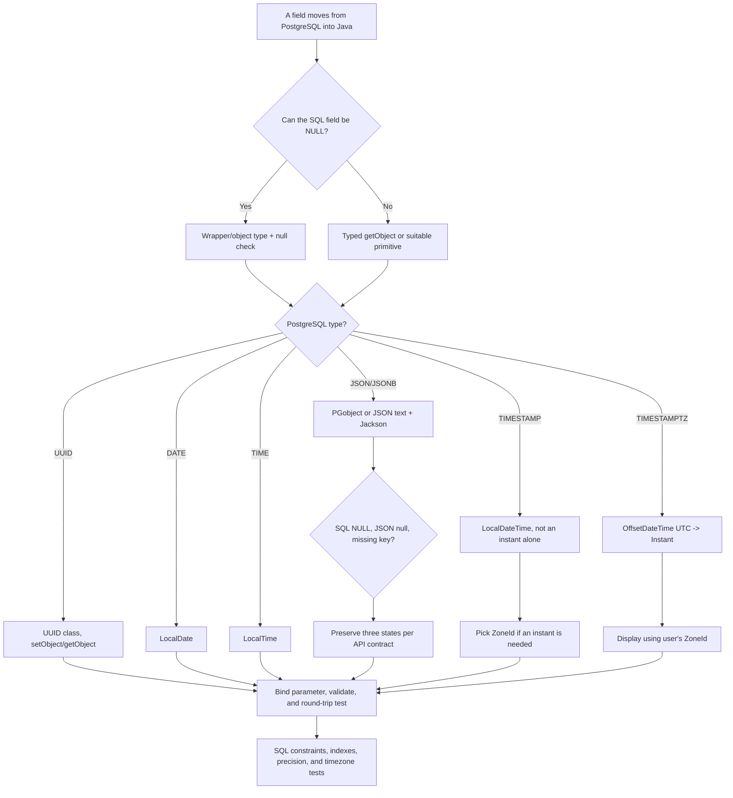

# Mapping NULL, UUID, JSON, and Temporal Types Between PostgreSQL and Java Applications

A PostgreSQL table can store a `NULL` value, a `UUID` key, a `JSONB` document, a calendar `DATE`, and a `TIMESTAMPTZ` instant very naturally. Yet when a Java application reads and writes that data via JDBC, **SQL data types and Java data types do not always map one-to-one**.

Common mistakes include:

- SQL `NULL` turns into `0` because `ResultSet.getInt()` is called without checking `wasNull()`.
- `payload IS NULL` gets conflated with a JSON document containing `null`.
- A UUID string is passed as `VARCHAR` and the driver does not implicitly cast it to `uuid`.
- `LocalDateTime` is used for an event that needs a **global instant**, causing time zone drift.
- `TIMESTAMPTZ` is assumed to store the time zone name `Asia/Ho_Chi_Minh`, whereas the value itself does not retain that zone name.
- Displayed times on the server, in the JVM, and in a JSON API look different even when everyone is referring to the **same instant**.
- Java timestamps carry nanosecond precision whereas PostgreSQL stores timestamps typically with microsecond resolution, causing overly strict round-trip comparisons to fail.

This lesson belongs to the **Application Connections** chapter of the *Database Engine Relational PostgreSQL* module. The focus is choosing the right types, reading/writing via **pgJDBC**, preserving the boundary between **SQL NULL, JSON null, and missing values**, handling UUIDs as `java.util.UUID`, and modeling time with `java.time`.

> **Principle:** Data mapping is not just coercing types so statements compile and run. It must preserve the **business meaning** of missing data, identifiers, JSON structure, and points in time. Both SQL and Java sides follow one shared contract for types, NULLs, and time zones.

Examples use modern PostgreSQL, JDBC 4.2, and pgJDBC supporting the Java 8+ time API. Features such as core PostgreSQL `gen_random_uuid()` or `uuidv7()` depend on major version; verify against your actual server. The lesson uses schema `demo_mapping` in a test database.

---

## 1. Learning Objectives

After this lesson, you will be able to:

1. Choose Java types for `uuid`, `jsonb`, `date`, `time`, `timestamp`, and `timestamptz`.
2. Distinguish SQL NULL, JSON null, a missing JSON key, and default values.
3. Understand that `getInt`/`getBoolean` return primitive defaults for SQL NULL and require checking `wasNull()`.
4. Use `getObject(..., Integer.class)` and wrapper types to preserve nullability where appropriate.
5. Pass SQL NULL using `PreparedStatement.setNull`/`setObject` with explicit types.
6. Read/write PostgreSQL `uuid` using `java.util.UUID` instead of treating it casually as text.
7. Read/write `jsonb` via `PGobject`, cast JSON text, or a JSON library such as Jackson.
8. Query JSON keys with `->`, `->>`, `?`, and `@>` without conflating missing with null.
9. Distinguish **wall-clock time without a time zone** from an **absolute instant**.
10. Map `DATE → LocalDate`, `TIME → LocalTime`, `TIMESTAMP → LocalDateTime`, and `TIMESTAMPTZ → OffsetDateTime`.
11. Convert `OffsetDateTime` to `Instant` and format for display with an explicit `ZoneId`.
12. Recognize the effects of PostgreSQL `TimeZone`, JVM timezone, DST, and microsecond resolution.
13. Design models/DTOs, PATCH updates, and JSON serialization without breaking missing/null semantics.
14. Debug using `SQLSTATE`, `pg_typeof`, JDBC metadata, and round-trip tests.

## 2. Quick Mapping Table

| PostgreSQL | Common Java Type | How NULL Is Preserved | Notes |
|---|---|---|---|
| `integer` | `Integer` | `null` | Avoid primitive `int` if nullable |
| `bigint` | `Long` | `null` | `getLong` + `wasNull` when using primitive |
| `boolean` | `Boolean` | `null` | Never turn unknown state into `false` |
| `numeric` | `BigDecimal` | `null` | Never use `double` for money |
| `text`/`varchar` | `String` | `null` | Empty string differs from SQL NULL |
| `uuid` | `java.util.UUID` | `null` | `setObject`/`getObject(..., UUID.class)` |
| `jsonb`/`json` | JSON text, `PGobject`, `JsonNode` | Must distinguish SQL NULL from JSON null | Driver does not auto-map every DTO |
| `date` | `LocalDate` | `null` | Calendar date, no timezone |
| `time` | `LocalTime` | `null` | Time of day, no date or zone |
| `timestamp without time zone` | `LocalDateTime` | `null` | Does not represent an instant without a zone |
| `timestamp with time zone` / `timestamptz` | `OffsetDateTime` | `null` | pgJDBC returns UTC offset; convertible to `Instant` |
| `interval` | Driver-specific `PGInterval` or custom mapping | `null` | Months/days/time are not always equivalent to `Duration` |

This is the **recommended JDBC mapping**. ORMs, JSON serializers, and service-layer models may use other domain types, provided conversions are deliberate at boundaries.

### 2.1. Three Data-Type Layers

```text
Database                JDBC boundary               Application
──────────────────────  ──────────────────────────  ───────────────────────
uuid                    java.util.UUID               EventId / UUID
jsonb                   PGobject / String            JsonNode / DTO
date                    LocalDate                    BusinessDate
timestamp               LocalDateTime                Local appointment
timestamptz             OffsetDateTime (UTC)         Instant / event timestamp
nullable integer        Integer or wasNull           Integer / Optional policy
```

Never pick a Java type just because column names look similar ("date/time"). Know whether the value stores a **calendar date**, **local wall-clock time**, or a **global point in time**.

## 3. NULL Concepts to Distinguish From the Start

At least four states are frequently confused:

1. **SQL NULL:** a table cell with no SQL value.
2. **JSON null:** a valid value **inside JSON**.
3. **JSON key missing:** a JSON object lacking the queried field.
4. **Java null:** a Java reference pointing to no object.

In addition, there are:

- Empty string `''`.
- Empty JSON object `{}`.
- Empty JSON array `[]`.
- Default values computed by PostgreSQL on `INSERT`.
- Fields omitted in an HTTP `PATCH`.

A correct system must never collapse these states indiscriminately.

### 3.1. SQL NULL Is Not the String `"null"`

```sql
SELECT
    NULL::text IS NULL AS sql_null,
    'null'::text IS NULL AS string_is_null,
    ''::text IS NULL AS empty_string_is_null;
```

Logical results:

| Expression | Result |
|---|---|
| `NULL::text IS NULL` | TRUE |
| `'null'::text IS NULL` | FALSE |
| `''::text IS NULL` | FALSE |

`'null'` is just the four characters n-u-l-l, not SQL NULL.

## 4. SQL NULL and Three-Valued Logic

A SQL predicate can evaluate to `TRUE`, `FALSE`, or `UNKNOWN` when NULL is involved.

```sql
SELECT
    NULL::integer = NULL::integer AS equality,
    NULL::integer IS NULL AS is_null,
    NULL::integer IS NOT DISTINCT FROM NULL::integer
        AS null_safe_equality;
```

`equality` yields SQL NULL (unknown). The other two expressions evaluate to TRUE.

### 4.1. Do Not Use `= NULL`

Wrong:

```sql
WHERE retry_count = NULL
```

Right:

```sql
WHERE retry_count IS NULL
```

### 4.2. Comparing a Nullable Parameter

To match rows where both column and parameter may be NULL:

```sql
WHERE retry_count IS NOT DISTINCT FROM ?
```

`IS NOT DISTINCT FROM` treats two NULLs as equal under *null-safe equality*. Do not blindly replace every `=` with this operator if business logic intends to skip filtering when the parameter is null.

### 4.3. `NULL` Inside `NOT IN`

`NOT IN` against a list containing NULL can evaluate to `UNKNOWN`, causing rows not to be returned as expected.

```sql
SELECT 5 NOT IN (1, 2, NULL);
```

The result is SQL NULL. When filtering against a subquery that may contain NULLs, consider `NOT EXISTS` with explicit predicates.

## 5. Java Primitives and NULL: The `getInt`, `getLong`, `getBoolean` Trap

Example:

```java
int retryCount = rs.getInt("retry_count");
```

When the SQL column is NULL, `getInt` returns the primitive value **0**, and only `rs.wasNull()` reveals it was SQL NULL.

Similarly:

```java
long count = rs.getLong("some_bigint");    // NULL -> 0L
boolean approved = rs.getBoolean("approved"); // NULL -> false
```

If the domain distinguishes "unknown" from "zero" or "false", this mapping **loses information**.

### 5.1. Proper `wasNull()` Pattern

```java
int rawRetry = rs.getInt("retry_count");
Integer retryCount = rs.wasNull() ? null : rawRetry;

boolean rawApproved = rs.getBoolean("approved");
Boolean approved = rs.wasNull() ? null : rawApproved;
```

`wasNull()` always refers to the **most recently read column getter**. Never call another getter before checking it:

```java
int n = rs.getInt("retry_count");
String description = rs.getString("description");

// DO NOT do this:
// boolean wasRetryNull = rs.wasNull();
// wasNull() now reflects description, not retry_count.
```

### 5.2. Typed `getObject`

In pgJDBC versions supporting the corresponding types, nullability can be preserved directly:

```java
Integer retry = rs.getObject("retry_count", Integer.class);
Boolean approved = rs.getObject("approved", Boolean.class);
Long total = rs.getObject("some_bigint", Long.class);
```

Wrapper types let Java `null` represent SQL NULL. Verify which typed overloads are supported on your specific driver version.

### 5.3. `Optional` Is an API-Layer Decision

`Optional<Integer>` can be useful for method return values, though it is not a universal default for every DTO/JPA entity field. Do not put `Optional.empty()` into a mapper and accidentally lose the distinction between **field absent in PATCH** and **field present with null**.

## 6. `PreparedStatement.setNull` and Parameter Types

An `INSERT`:

```sql
INSERT INTO demo_mapping.app_event
    (event_id, description, retry_count)
VALUES (?, ?, ?);
```

SQL placeholders must have the right types.

```java
ps.setObject(1, eventId);              // UUID
ps.setNull(2, java.sql.Types.VARCHAR); // SQL NULL for text/varchar
ps.setNull(3, java.sql.Types.INTEGER); // SQL NULL for integer
```

### 6.1. `setObject(index, null)` Can Leave Types Ambiguous

In many statements PostgreSQL infers the type from the target column. However, polymorphic queries, comparisons, overloaded functions, or `SELECT ? IS NULL` may lack enough context to infer parameter types.

Error-prone example:

```sql
SELECT ? IS NULL;
```

Solution: add a cast in SQL:

```sql
SELECT ?::integer IS NULL;
```

or bind a typed NULL appropriate to the driver and SQL context.

### 6.2. `setNull(Types.OTHER)`

PostgreSQL-specific types such as `uuid` and `jsonb` can be handled by pgJDBC via `Types.OTHER`. When SQL needs an exact type, place an explicit cast:

```sql
SELECT ?::uuid;
SELECT ?::jsonb;
```

This gives the server an unambiguous target type and prevents the driver from binding strings as `varchar` in contexts without implicit casts.

### 6.3. Do Not Use `"null"` Instead of SQL NULL

```java
ps.setString(1, "null"); // Four characters: NOT SQL NULL.
```

For a `jsonb` column, the string `"null"` cast to JSONB becomes **JSON null**, which is even more distinct from SQL NULL.

## 7. Missing Fields vs. Explicit NULL on `INSERT`

Suppose a table has:

```sql
created_at TIMESTAMPTZ NOT NULL DEFAULT now()
```

Three different `INSERT`s:

```sql
-- A: omit column -> PostgreSQL evaluates DEFAULT.
INSERT INTO t(other_col) VALUES ('A');

-- B: explicitly write DEFAULT.
INSERT INTO t(other_col, created_at)
VALUES ('B', DEFAULT);

-- C: write SQL NULL -> NOT NULL constraint can fail.
INSERT INTO t(other_col, created_at)
VALUES ('C', NULL);
```

`DEFAULT` does not automatically replace explicit `NULL`s. When mapping HTTP requests, distinguish "client omitted the field" from "client sent null".

### 7.1. Three-State `PATCH`

For a nullable field in a `PATCH` API:

| JSON HTTP Input | Possible Intent |
|---|---|
| Key `description` absent | Do not modify value |
| `"description": null` | Clear value, write SQL NULL |
| `"description": ""` | Write empty string |

A DTO holding only `String description` cannot tell a missing key apart from explicit null unless the serializer/deserializer tracks presence. Design `PATCH` models with explicit **present/absent** state.

---

## 8. Lab: Creating a Table Simulating Application Events

Create schema:

```sql
CREATE SCHEMA IF NOT EXISTS demo_mapping;
```

Create a table covering all the target types:

```sql
CREATE TABLE demo_mapping.app_event (
    event_id UUID PRIMARY KEY,

    description TEXT NULL,
    retry_count INTEGER NULL
        CHECK (retry_count IS NULL OR retry_count >= 0),
    approved BOOLEAN NULL,

    payload JSONB NULL,

    event_date DATE NULL,
    scheduled_local TIMESTAMP WITHOUT TIME ZONE NULL,
    occurred_at TIMESTAMP WITH TIME ZONE NULL,

    created_at TIMESTAMPTZ NOT NULL
        DEFAULT transaction_timestamp()
);
```

Intentional design choices:

- `event_id`: UUID, non-nullable.
- `description`: nullable text; empty string differs from NULL.
- `retry_count`: NULL means unknown/unrecorded, not 0.
- `approved`: `TRUE`/`FALSE`/`NULL` are three distinct states.
- `payload`: nullable `jsonb`, to demonstrate differences from JSON null.
- `event_date`: calendar date without time zone.
- `scheduled_local`: local calendar date-time, **no zone attached**.
- `occurred_at`: absolute instant.
- `created_at`: server timestamp when row was created, non-NULL.

### 8.1. Loading Data Covering NULL/JSON/Time Cases

```sql
INSERT INTO demo_mapping.app_event
(event_id, description, retry_count, approved,
 payload, event_date, scheduled_local, occurred_at)
VALUES
(
    '11111111-1111-4111-8111-111111111111',
    NULL, NULL, NULL,
    NULL, NULL, NULL, NULL
),
(
    '22222222-2222-4222-8222-222222222222',
    'Event with JSON object', 0, FALSE,
    '{"source":"web","status":null,"count":0}'::jsonb,
    DATE '2026-11-14',
    TIMESTAMP '2026-11-14 09:30:00',
    TIMESTAMPTZ '2026-11-14 09:30:00+07'
),
(
    '33333333-3333-4333-8333-333333333333',
    'JSON null, not SQL NULL', 2, TRUE,
    'null'::jsonb,
    DATE '2026-11-15',
    TIMESTAMP '2026-11-15 10:00:00',
    TIMESTAMPTZ '2026-11-15 10:00:00+07'
),
(
    '44444444-4444-4444-8444-444444444444',
    '', NULL, NULL,
    '{}'::jsonb,
    NULL, NULL, NULL
),
(
    '55555555-5555-4555-8555-555555555555',
    'Payload with array', 5, TRUE,
    '{"roles":["ops","qa"],"active":true}'::jsonb,
    DATE '2026-11-16',
    TIMESTAMP '2026-11-16 18:45:00',
    TIMESTAMPTZ '2026-11-16 18:45:00+07'
);
```

### 8.2. Inspect All Rows

```sql
SELECT
    event_id,
    description,
    retry_count,
    approved,
    payload,
    event_date,
    scheduled_local,
    occurred_at
FROM demo_mapping.app_event
ORDER BY event_id;
```

After loading:

- Row 1 has `payload IS NULL`.
- Row 2 has an object whose `"status"` key holds **JSON null**.
- Row 3 has a **root JSON null** payload.
- Row 4 has an empty object `{}`.
- Row 5 has a `roles` array and a JSON boolean.

For `occurred_at`, formatted display strings depend on session `TimeZone`; **never compare formatted display strings to decide whether instants differ**.

## 9. `UUID` in PostgreSQL

`uuid` represents a 128-bit identifier; canonical text form:

```text
550e8400-e29b-41d4-a716-446655440000
```

PostgreSQL validates input against `uuid` rules, accepts several valid textual formats, and normally displays canonical hyphenated form.

### 9.1. `UUID` Is Not `VARCHAR(36)`

These two columns:

```sql
event_id UUID
event_id VARCHAR(36)
```

differ in type checking, storage, operators, indexes, and driver mapping. If a field is truly a UUID, prefer native `uuid` instead of storing text and parsing in every query.

### 9.2. A `UUID` Does Not Carry a Time Zone

A UUID is not a timestamp and does not inherently tell you creation time. With random UUID v4, creation time cannot be inferred from the ID.

Some UUID versions like v7 embed a timestamp component, yet that depends on the generator/spec and does not turn a UUID into a replacement for `created_at`.

### 9.3. Comparing and Indexing `UUID`

`uuid` supports equality, ordering, and B-tree indexes:

```sql
SELECT *
FROM demo_mapping.app_event
WHERE event_id =
    '22222222-2222-4222-8222-222222222222'::uuid;
```

With primary key `event_id UUID`, PostgreSQL automatically creates an index for uniqueness and lookups.

## 10. Java `UUID`: `setObject` and `getObject`

In Java:

```java
import java.util.UUID;

UUID id = UUID.fromString(
    "22222222-2222-4222-8222-222222222222"
);
```

Binding and reading with pgJDBC:

```java
String sql = """
    SELECT event_id, description
    FROM demo_mapping.app_event
    WHERE event_id = ?
    """;

try (PreparedStatement ps = conn.prepareStatement(sql)) {
    ps.setObject(1, id);

    try (ResultSet rs = ps.executeQuery()) {
        while (rs.next()) {
            UUID dbId = rs.getObject("event_id", UUID.class);
            String description = rs.getString("description");
            System.out.println(dbId + " / " + description);
        }
    }
}
```

`UUID` is supported by the driver as a PostgreSQL `uuid` type without converting through strings for comparison.

### 10.1. Reading a Nullable `UUID`

```java
UUID maybeId = rs.getObject("optional_uuid", UUID.class);
```

If the SQL column is NULL, the result is Java `null`. On the lab's `event_id` primary key, values cannot be NULL due to the constraint.

### 10.2. Generating a `UUID` in Java

```java
UUID newId = UUID.randomUUID();
```

This normally generates a random v4 UUID. Do not assume chronological ordering; for time-ordered pagination, use `created_at` with an ID tie-breaker.

### 10.3. Malformed `UUID`s

```java
UUID.fromString(userInput);
```

can throw `IllegalArgumentException` on invalid strings. If a strict format contract is needed, validate upfront per API policy while still letting the database enforce native `uuid`.

Never fabricate a UUID by stripping hyphens and forcing arbitrary hex strings if business validation requires standard formatting.

## 11. Binding `UUID` as a `String`: When Must You Cast?

Suppose:

```java
ps.setString(1,
    "22222222-2222-4222-8222-222222222222");
```

If the query is:

```sql
SELECT *
FROM demo_mapping.app_event
WHERE event_id = ?;
```

the driver may declare the parameter type as `varchar`. PostgreSQL is not obligated to implicitly resolve `uuid = varchar` as you expect; it can raise "operator does not exist".

Standard approach: use `setObject(index, UUID)`.

If input is constrained to a string at a boundary and an explicit cast is desired:

```sql
SELECT *
FROM demo_mapping.app_event
WHERE event_id = ?::uuid;
```

with matching `setString`. PostgreSQL parses the UUID; invalid inputs raise a data-type error.

### 11.1. Do Not Rely Globally on `stringtype=unspecified`

pgJDBC has a setting affecting how strings are typed on the wire, yet flipping it app-wide just to work around UUID/JSON casts can cause side effects for overloaded functions and query planning. Prefer native JDBC types or explicit SQL casts.

### 11.2. `UUID` in JSON APIs

A JSON field:

```json
{"eventId":"22222222-2222-4222-8222-222222222222"}
```

is a **JSON string** at the HTTP boundary. Once parsed into the Java model, convert it to `UUID` to preserve validation and type safety before writing to PostgreSQL `uuid`.

## 12. Generating `UUID` in PostgreSQL

Modern PostgreSQL includes:

```sql
SELECT gen_random_uuid();
```

`gen_random_uuid()` generates random v4 UUIDs. Older PostgreSQL versions relied on the `pgcrypto` extension for this function; newer core PostgreSQL provides it built-in.

Example adding a default:

```sql
ALTER TABLE demo_mapping.app_event
ALTER COLUMN event_id
SET DEFAULT gen_random_uuid();
```

When the application omits `event_id`, the database generates a UUID automatically.

### 12.1. Generate in Java or in the DB?

| Criterion | Generate in Java | Generate in PostgreSQL |
|---|---|---|
| Know ID before `INSERT` | Yes | No, unless via `RETURNING` |
| Easy to link events/outbox before write | Yes | Must receive ID from `INSERT` |
| Uniform logic across multiple clients | Must share generator | DB is the single generator |
| Offline ID generation | Yes | Not directly |
| Extension/version privileges | Less DB-dependent | Depends on PG function/version |

If DB-generated:

```sql
INSERT INTO demo_mapping.app_event(description)
VALUES ('Generated UUID in database')
RETURNING event_id;
```

The application retrieves the new UUID via `RETURNING`. Never assume `getGeneratedKeys()` returns all desired columns identically across SQL/driver configurations; explicit `RETURNING` is clear and reliable.

### 12.2. UUID v7 and Sortability

PostgreSQL 18 adds support for generating UUID v7 via `uuidv7()`. It helps when roughly time-ordered UUIDs are desirable, though it is not available on every server version. A roughly time-ordered ID **does not replace** `created_at` when exact timestamps are needed, and can expose creation-time signals.

## 13. `UUID` and `NULL`

`UUID.fromString(null)` is not a null-safe conversion from SQL NULL to `UUID`. Handle Java `null` **before** parsing:

```java
UUID parseNullableUuid(String input) {
    return input == null ? null : UUID.fromString(input);
}
```

If the schema allows a nullable UUID:

```java
ps.setNull(1, java.sql.Types.OTHER);
```

with the SQL type established by the target column or `?::uuid` when type inference lacks context.

### 13.1. The Zero UUID Is Not NULL

`00000000-0000-0000-0000-000000000000` is a real UUID value, not SQL NULL. If an application uses it as a sentinel for "no ID yet", that is a **custom contract** that can cause data collisions; prefer proper nullability or explicit business states.

---

## 14. `JSON` and `JSONB`: Both Are Distinct PostgreSQL Types

PostgreSQL provides `json` and `jsonb`:

- `json` stores a textual representation preserving input formatting, key order, and duplicate keys (per current rules).
- `jsonb` stores a parsed/normalized binary representation, convenient for querying/indexing and typically preferred for application data.
- Both validate that input is well-formed JSON.
- `jsonb` is **not** `text` merely because queries print it as text.

Example:

```sql
SELECT
    '{"b":2,"a":1}'::json AS as_json,
    '{"b":2,"a":1}'::jsonb AS as_jsonb;
```

With `jsonb`, never expect input key ordering or whitespace to be preserved.

### 14.1. Duplicate Keys

```sql
SELECT
    '{"status":"old","status":"new"}'::jsonb;
```

`jsonb` does not keep two keys with the same name; typically the last value wins. If an application depends on exact characters, key order, or duplicate keys from the original document, evaluate `json` or store the raw source separately.

### 14.2. JSON Numbers Are Not Java `double` by Default

A JSON number like `0.1` may require exact decimal preservation if it represents money. Deserializing into Java `double` and re-serializing can lose fidelity. Use `BigDecimal` or domain-appropriate JSON tree numeric handling.

### 14.3. A JSON Object Is Not a Relational Row

`{"status":"OK"}` inside a `jsonb` column is a single SQL value. It does not automatically enforce `NOT NULL` per key, foreign keys to other tables, or indexes on every nested JSON path.

## 15. Three Kinds of NULL With `JSONB`

Try:

```sql
SELECT
    NULL::jsonb IS NULL AS sql_null_is_null,
    'null'::jsonb IS NULL AS json_null_is_sql_null,
    jsonb_typeof('null'::jsonb) AS json_null_type,
    jsonb_typeof(NULL::jsonb) AS sql_null_type;
```

Expected:

| Field | Result |
|---|---|
| `sql_null_is_null` | TRUE |
| `json_null_is_sql_null` | FALSE |
| `json_null_type` | Text `null` |
| `sql_null_type` | SQL NULL |

### 15.1. JSON `null` Is a Valid JSON Value

In JSON:

```json
null
```

is a JSON scalar. The `jsonb` column still holds a non-null SQL value when storing `'null'::jsonb`.

### 15.2. SQL NULL Means No JSON Document Exists

When the column contains SQL NULL, there is no JSON value to inspect keys or traverse arrays on.

### 15.3. Missing JSON Key Is the Third Case

In:

```json
{"source":"web"}
```

the `status` key does not exist. In:

```json
{"source":"web","status":null}
```

the `status` key exists, with value JSON `null`.

## 16. JSONB Field Extraction: `->` and `->>`

`->` returns `jsonb`; `->>` returns `text`.

```sql
SELECT
    payload -> 'status' AS status_json,
    payload ->> 'status' AS status_text
FROM demo_mapping.app_event
WHERE event_id =
    '22222222-2222-4222-8222-222222222222'::uuid;
```

With `"status": null`:

- `payload -> 'status'` is **JSONB `null`** (a JSON value).
- `payload ->> 'status'` is **SQL NULL**, because coercing JSON `null` to SQL `text` yields no text value.

### 16.1. What If the Key Is Missing?

`->` and `->>` normally return SQL NULL when the key/path is not found. Therefore:

```sql
payload ->> 'status' IS NULL
```

**does not distinguish** a missing key from JSON `null`.

### 16.2. The `?` Operator Checks Key Presence

```sql
SELECT
    payload ? 'status' AS has_status_key,
    jsonb_typeof(payload -> 'status') AS status_json_type
FROM demo_mapping.app_event
WHERE event_id =
    '22222222-2222-4222-8222-222222222222'::uuid;
```

`has_status_key` is `TRUE`, and `status_json_type` returns text `null`.

### 16.3. Condition: JSON Key Present With Value `null`

```sql
SELECT event_id
FROM demo_mapping.app_event
WHERE payload ? 'status'
  AND jsonb_typeof(payload -> 'status') = 'null';
```

Returns row 2. Does not match row 1 (SQL NULL) or row 4 (empty object).

## 17. JSONB Containment and Checking JSON `null`

`@>` checks containment:

```sql
SELECT event_id
FROM demo_mapping.app_event
WHERE payload @> '{"status":null}'::jsonb;
```

This predicate requires a JSON object containing key `status` with value JSON `null`.

```sql
SELECT event_id
FROM demo_mapping.app_event
WHERE payload @> '{"source":"web"}'::jsonb;
```

matches objects containing that key/value at the corresponding structural level.

### 17.1. `@>` Differs From `LIKE` on JSON Text

`payload::text LIKE '%web%'` searches raw serialized text, can accidentally match keys or unrelated values, and lacks proper semantics or index support. `@>` understands JSON structure.

### 17.2. `?` Only Checks Top-Level Keys/Elements

`payload ? 'status'` does not automatically search deeply inside nested objects. For nested data, use path operators or JSONPath matching the real structure.

### 17.3. SQL NULL Under Containment

When `payload` is SQL NULL, `payload @> ...` evaluates to SQL NULL/`UNKNOWN` in the predicate, and a standard `WHERE` skips the row.

## 18. Query Classifying All JSON States

A practical query:

```sql
SELECT
    event_id,
    CASE
        WHEN payload IS NULL
            THEN 'SQL_NULL'
        WHEN jsonb_typeof(payload) = 'null'
            THEN 'JSON_NULL_ROOT'
        WHEN jsonb_typeof(payload) = 'object'
             AND NOT (payload ? 'status')
            THEN 'OBJECT_MISSING_STATUS'
        WHEN jsonb_typeof(payload) = 'object'
             AND jsonb_typeof(payload -> 'status') = 'null'
            THEN 'OBJECT_STATUS_JSON_NULL'
        ELSE 'OTHER_JSON'
    END AS payload_state
FROM demo_mapping.app_event
ORDER BY event_id;
```

This displays **domain states** clearly instead of collapsing every case into Java `null`.

### 18.1. A Root JSON Array Is Also a Valid JSON Value

`jsonb_typeof(payload)` can return `array`, `object`, `string`, `number`, `boolean`, or `null`. Never assume every `JSONB` column holds a JSON object.

### 18.2. An Empty JSON Object Is Not NULL

`'{}'::jsonb IS NULL` is FALSE. Define your data contract: does an empty object differ from "no payload"? If so, the API must preserve that difference.

## 19. Writing `JSONB` From Java: `PGobject`

pgJDBC does not automatically serialize arbitrary Java `Map`s or DTOs into PostgreSQL `jsonb`. One explicit approach uses `org.postgresql.util.PGobject`:

```java
import org.postgresql.util.PGobject;
import java.sql.PreparedStatement;

PGobject jsonb = new PGobject();
jsonb.setType("jsonb");
jsonb.setValue(
    "{\"source\":\"mobile\",\"status\":null}"
);

String sql = """
    UPDATE demo_mapping.app_event
    SET payload = ?
    WHERE event_id = ?
    """;

try (PreparedStatement ps = conn.prepareStatement(sql)) {
    ps.setObject(1, jsonb);
    ps.setObject(2, eventId);

    ps.executeUpdate();
}
```

`PGobject` gives the driver PostgreSQL-specific type metadata. Only pass JSON serialized by a trusted library (or a valid constant in a lab); never build JSON by concatenating fields manually.

### 19.1. Another Path: SQL Cast With `setString`

```java
String sql = """
    UPDATE demo_mapping.app_event
    SET payload = ?::jsonb
    WHERE event_id = ?
    """;

try (PreparedStatement ps = conn.prepareStatement(sql)) {
    ps.setString(1, jsonText);
    ps.setObject(2, eventId);
    ps.executeUpdate();
}
```

The `?::jsonb` cast instructs the server to parse the input as `JSONB`. If `jsonText` is invalid, PostgreSQL rejects it with an error rather than storing malformed JSON.

### 19.2. Do Not Use Uncast `setString` on `JSONB` and Guess Behavior

Depending on pgJDBC typing/settings, the server may receive `varchar` and reject direct assignment to `jsonb`. Use a cast or `PGobject` for an explicit contract.

### 19.3. SQL NULL vs. JSON `null` in JDBC

```java
// A: SQL NULL, no JSON document.
ps.setNull(1, java.sql.Types.OTHER);

// B: JSON null: a JSON document whose root value is null.
PGobject jsonNull = new PGobject();
jsonNull.setType("jsonb");
jsonNull.setValue("null");
ps.setObject(1, jsonNull);
```

**A and B are not equivalent**; `WHERE payload IS NULL` only matches A.

## 20. Using Jackson to Convert DTOs Into JSON

A JSON mapper should handle Unicode escaping, quotes, numeric policy, and nested structures.

```java
import com.fasterxml.jackson.databind.ObjectMapper;
import org.postgresql.util.PGobject;

ObjectMapper mapper = new ObjectMapper();

record EventPayload(
    String source,
    String status,
    Integer count
) {}

EventPayload payload =
    new EventPayload("mobile", null, 3);

String jsonText = mapper.writeValueAsString(payload);

PGobject dbJson = new PGobject();
dbJson.setType("jsonb");
dbJson.setValue(jsonText);

ps.setObject(1, dbJson);
```

### 20.1. Serializer Settings Alter the Null Contract

Jackson can be configured to omit null fields (`NON_NULL`), turning:

```json
{"source":"mobile","status":null,"count":3}
```

into:

```json
{"source":"mobile","count":3}
```

These two documents **differ** in key existence. Choose whether to serialize or omit nulls based on your API/domain contract, not as a harmless detail.

### 20.2. Do Not Map JSON Blindly to Raw `Object`

If business logic needs schema validation, use a DTO/`JsonNode` and verify field types, ranges, and allowed keys. `JSONB` does not guarantee `count` is a non-negative integer just because a Java record declares `Integer`.

### 20.3. Versioning JSON Schemas

If the app changes `status` from a string to an object or renames `source`, older rows still hold the prior schema. Consider `schemaVersion` in the payload or clear migration/enrichment policies.

## 21. Reading `JSONB` From JDBC

Simple approach:

```java
String rawJson = rs.getString("payload");
if (rawJson == null) {
    // SQL NULL.
} else {
    // Textual JSON: could be "null", "{}", "[]", ...
}
```

With pgJDBC, `rs.getObject("payload")` typically returns a `PGobject` of type `jsonb`; it **does not automatically become** a Java `Map`, `JsonNode`, or domain DTO.

```java
Object raw = rs.getObject("payload");

if (raw == null) {
    // SQL NULL
} else if (raw instanceof PGobject pg) {
    System.out.println(pg.getType());  // jsonb
    System.out.println(pg.getValue()); // JSON text
}
```

### 21.1. Why `getString` Suffices in Many Cases

You can pass the text directly to a JSON library: the driver handles transport encoding/bytes cleanly, while Jackson handles schema and deserialization.

### 21.2. Root JSON `null` With `getString`

`rs.getString("payload")` returns the Java `String` `"null"` (four characters) for root JSONB `null`, **not** Java `null`. For SQL NULL, it returns Java `null`.

### 21.3. Never Parse JSON With Regex

JSON has escaped quotes, Unicode, nesting, and arrays. Use a real parser. Never `split(",")` to turn `{"a":"x,y"}` into fields.

## 22. Jackson `JsonNode`: Missing, Null Node, and Java `null`

Suppose:

```java
import com.fasterxml.jackson.databind.JsonNode;
import com.fasterxml.jackson.databind.ObjectMapper;

ObjectMapper mapper = new ObjectMapper();
String json = rs.getString("payload");

if (json == null) {
    // SQL NULL: no payload.
} else {
    JsonNode root = mapper.readTree(json);

    if (root.isNull()) {
        // JSON root null.
    } else if (root.isObject()) {
        JsonNode status = root.get("status");

        if (status == null) {
            // JSON object lacks key status.
        } else if (status.isNull()) {
            // Key status exists, value is JSON null.
        } else {
            // Key exists, value is non-null JSON.
        }
    }
}
```

### 22.1. `get()` and `path()` Differ

In Jackson:

- `root.get("status")` returns Java `null` when a field is missing.
- `root.path("status")` returns `MissingNode` when missing, avoiding null dereferences.
- `NullNode` represents **JSON `null`**, not Java `null`.

### 22.2. Do Not Conflate Missing and `null` on `PATCH`

If an API follows JSON Merge Patch, explicit `null` can mean *delete key*, whereas a missing key means *leave key untouched*. Preserve these semantics from Jackson → service → SQL update.

### 22.3. Not Every Root JSON Value Is an Object

`mapper.readTree("null")` returns `NullNode`; `mapper.readTree("[]")` returns `ArrayNode`. Never call `root.get("status")` assuming the result is meaningful for every root type.

## 23. `JSONB` Arrays and Element Types

Data:

```json
{"roles":["ops","qa"],"active":true}
```

Query:

```sql
SELECT
    payload -> 'roles' AS roles_json,
    payload ->> 'active' AS active_as_text,
    jsonb_typeof(payload -> 'roles') AS roles_type
FROM demo_mapping.app_event
WHERE event_id =
    '55555555-5555-4555-8555-555555555555'::uuid;
```

`roles_json` is a JSONB array, `active_as_text` is SQL text `true`, and `roles_type` is `array`.

### 23.1. Do Not Call `getBoolean` Directly on `->>` Output

`payload ->> 'active'` returns SQL `text`, even when the content is `true`/`false`. If you want SQL `boolean`:

```sql
SELECT (payload ->> 'active')::boolean AS active
FROM demo_mapping.app_event
WHERE event_id =
    '55555555-5555-4555-8555-555555555555'::uuid;
```

The cast can fail if the value holds a non-boolean string. JSON schema/contract validation is required.

### 23.2. JSON Array Subscripts Are 0-Based

```sql
SELECT
    payload -> 'roles' -> 0 AS first_role
FROM demo_mapping.app_event
WHERE event_id =
    '55555555-5555-4555-8555-555555555555'::uuid;
```

JSONB array subscripts start at **0**, unlike standard PostgreSQL SQL arrays which normally start at **1**.

## 24. Filtering `JSONB`: Indexes and Operator Classes

For suitable workloads, you can create:

```sql
CREATE INDEX idx_app_event_payload_gin
ON demo_mapping.app_event
USING GIN (payload);
```

The default `jsonb_ops` supports operators such as:

- `@>` containment.
- `?` key existence.
- `?|`, `?&` for multiple keys.
- JSONPath matching where supported.

### 24.1. `jsonb_path_ops` Differs From `jsonb_ops`

`jsonb_path_ops` often optimizes containment and JSONPath queries, yet **does not support key-existence `?`** like the default `jsonb_ops`.

Choose the operator class based on real queries rather than switching everything after benchmarking a single case.

### 24.2. Expression Index for a Specific Field

If you frequently query `source`:

```sql
CREATE INDEX idx_app_event_payload_source
ON demo_mapping.app_event
((payload ->> 'source'));
```

Query:

```sql
SELECT event_id
FROM demo_mapping.app_event
WHERE payload ->> 'source' = 'web';
```

This can leverage the expression index. On the 5-row lab table, the planner may still choose a Seq Scan because the table is tiny.

### 24.3. Avoid Indexing Every Key Indiscriminately

GIN indexes increase storage and write overhead and do not automatically make every JSON query fast. If a field is used heavily for JOINs or filtering, consider promoting it to a typed relational column with constraints.

## 25. `JSONB` and SQL Injection

Querying with client data:

```java
String sql = """
    SELECT event_id
    FROM demo_mapping.app_event
    WHERE payload @> ?::jsonb
    """;

try (PreparedStatement ps = conn.prepareStatement(sql)) {
    ps.setString(1, "{\"source\":\"web\"}");
    ...
}
```

Binding values is far safer than concatenating SQL strings. Still, clients can send oversized or deeply nested JSON causing resource pressure; enforce size limits, depth caps, and validation.

### 25.1. `?` Key-Existence Operator and JDBC Placeholders

PostgreSQL has the JSONB `?` operator, which collides with JDBC's placeholder character. In pgJDBC `PreparedStatement` SQL, you can escape a literal operator question mark as `??` where needed.

Example:

```java
String sql = """
    SELECT event_id
    FROM demo_mapping.app_event
    WHERE payload ?? 'status'
    """;
```

pgJDBC treats `??` as the literal `?` operator rather than a bind parameter. In a plain `Statement`, `?` can be used directly. Verify driver version/query parsing when using `?|`/`?&`.

### 25.2. Never Let Untrusted JSON Key Names Become SQL Identifiers

If you need to query by a dynamic key name, use JSON operators/functions where the key is a **bound value** per the API, never concatenating key names into SQL or path expressions arbitrarily.

## 26. `JSONB` Is Flexible, Not Free Validation

PostgreSQL ensures `JSONB` is valid JSON. It **does not** automatically guarantee:

- The root is an object.
- Key `status` exists.
- Key `count` is a positive integer.
- Key `eventId` is a valid UUID string.
- Timestamp fields inside JSON follow ISO 8601.
- No sensitive out-of-schema keys are present.

You still need JSON Schema, appropriate `CHECK` constraints, Java validation, or relational columns for critical fields.

### 26.1. Example `CHECK` for Root Object Type

```sql
ALTER TABLE demo_mapping.app_event
ADD CONSTRAINT payload_object_or_null
CHECK (
    payload IS NULL
    OR jsonb_typeof(payload) IN ('object', 'null')
);
```

**Note:** the constraint above **allows root JSON `null`**, while rejecting JSON arrays and other scalars. Since row 5 is an object and row 3 is JSON `null`, the current lab data satisfies it.

If the domain truly accepts only objects, remove `'null'` from the list and migrate/clean up row 3 before applying the constraint.

## 27. `JSONB` With `UPDATE` and Missing Keys

Suppose a client wants to set `status`:

```sql
UPDATE demo_mapping.app_event
SET payload = jsonb_set(
    COALESCE(payload, '{}'::jsonb),
    '{status}',
    '"DONE"'::jsonb,
    true
)
WHERE event_id =
    '44444444-4444-4444-8444-444444444444'::uuid;
```

`jsonb_set` updates the path and can create the target key when appropriate.

### 27.1. SQL NULL Needs a Policy Before Updating

`COALESCE(payload, '{}'::jsonb)` turns SQL NULL into an empty object before setting the key. That is a business decision, not automatic behavior of every JSON operation.

### 27.2. Root JSON `null` Is Not an Object

When `payload = 'null'::jsonb`, `COALESCE` does not replace it with `{}`. If you want root JSON `null` treated like an empty object, branch explicitly on `jsonb_typeof(payload)`.

### 27.3. Removing a Key Differs From Setting JSON `null`

```sql
-- Remove key status from a JSON object:
payload - 'status'

-- Keep key status present with value JSON null:
jsonb_set(payload, '{status}', 'null'::jsonb, true)
```

Never swap these two operations when the API must distinguish missing keys from explicit `null`.

## 28. JSON Serialization and Timezone Fields

If JSON contains:

```json
{
  "eventId": "22222222-2222-4222-8222-222222222222",
  "occurredAt": "2026-11-14T09:30:00+07:00"
}
```

then `occurredAt` is **merely a JSON string** in a format agreed upon by the application. PostgreSQL does not automatically treat nested JSON strings as `timestamptz` or enforce timezone semantics.

If you need to sort or filter by event time, consider a separate `occurred_at TIMESTAMPTZ` column kept in sync with JSON under clear rules.

### 28.1. Do Not Strip the Offset When Parsing

`2026-11-14T09:30:00+07:00` identifies an unambiguous instant. If you only take `2026-11-14T09:30:00` as a `LocalDateTime`, you discard the offset and can no longer determine the instant independently.

### 28.2. A UUID Inside JSON Is Also Just a String

An `"eventId"` field inside JSON has no native `uuid` type; Java must parse/validate it when required by the domain. Do not assume `JSONB` enforces foreign-key references to `app_event.event_id`.

---

## 29. Distinguishing Four Temporal Type Groups

| PostgreSQL | Has Date? | Has Time? | Represents an Instant? | Java |
|---|---:|---:|---|---|
| `date` | Yes | No | No | `LocalDate` |
| `time without time zone` | No | Yes | No | `LocalTime` |
| `timestamp without time zone` | Yes | Yes | No, unless zone/offset is known | `LocalDateTime` |
| `timestamp with time zone` | Yes | Yes | **Yes**, an absolute point in time | `OffsetDateTime` via pgJDBC |

Distinguish "calendar clock time" from "when an event occurred".

### 29.1. Calendar Dates

Birthdays, contract dates, and holidays on a calendar are `DATE`/`LocalDate`, not necessarily instants.

### 29.2. Time of Day

Store opens at `08:00`: `TIME`/`LocalTime` is the usual choice, yet to determine the exact opening instant on a given date you also need the date, time zone, and DST policy.

### 29.3. Local Appointments

`2026-11-14 09:30` at a specific location is `LocalDateTime`. To determine an instant, you must know the region such as `Asia/Ho_Chi_Minh`.

### 29.4. Events That Occurred

An API receiving a payment at `2026-11-14T02:30:00Z` is an unambiguous instant: `TIMESTAMPTZ`.

## 30. `TIMESTAMP WITHOUT TIME ZONE`

PostgreSQL:

```sql
SELECT TIMESTAMP '2026-11-14 09:30:00'
    AS local_clock_value;
```

This is a date-time value **without any offset or zone identifier**.

Java:

```java
LocalDateTime local =
    LocalDateTime.of(2026, 11, 14, 9, 30);
```

### 30.1. The Same `LocalDateTime` Can Mean Two Different Instants

`2026-11-14 09:30` in Hanoi and in London are not the same instant. If an app attaches the JVM's default timezone to this value without domain context, timestamps drift.

### 30.2. Timezone Suffixes Can Be Ignored When Casting to `timestamp`

```sql
SELECT TIMESTAMP '2026-11-14 09:30:00+07'
    AS timestamp_without_zone;
```

With a literal typed explicitly as `TIMESTAMP WITHOUT TIME ZONE`, an offset in the text **does not turn the column into `timestamptz`**. This is a classic bug when authors assume the server stored `+07`.

### 30.3. Converting to an Instant Requires a Zone

```java
ZoneId zone = ZoneId.of("Asia/Ho_Chi_Minh");
Instant instant = local.atZone(zone).toInstant();
```

Attaching a zone is a **business decision**. If the date-time falls in a DST-observing zone, the local value may be ambiguous or non-existent; see the DST section.

## 31. `TIMESTAMP WITH TIME ZONE` / `TIMESTAMPTZ`

`TIMESTAMPTZ` stores an absolute instant under PostgreSQL's time model, effectively normalizing the point in time and formatting it according to the session's current `TimeZone`. It **does not store the original time zone name for each value**.

```sql
SELECT TIMESTAMPTZ '2026-11-14 09:30:00+07'
    AS event_instant;
```

This instant equals `2026-11-14T02:30:00Z`.

### 31.1. Why Can Displayed Hours Differ?

```sql
SHOW TimeZone;

SELECT TIMESTAMPTZ '2026-11-14 09:30:00+07';
```

If the session timezone is UTC, output may show `2026-11-14 02:30:00+00`. If the session timezone is `Asia/Ho_Chi_Minh`, output may show `09:30:00+07`.

**It is the exact same instant**, not data having hours wrongly added or subtracted in storage.

### 31.2. PostgreSQL Does Not Retain the Original `ZoneId`

Whether input used `America/New_York` or offset `-05:00`, the `timestamptz` column does not tell you which timezone name the source originally used.

To reconstruct local schedules, you may need an extra column:

```sql
timezone_id TEXT NOT NULL
```

holding a validated IANA zone name. Use a zone name rather than a fixed offset whenever multi-year DST rules apply.

## 32. `SET TIME ZONE` and Changing Display Formatting

In a test transaction:

```sql
BEGIN;

SET LOCAL TIME ZONE 'UTC';

SELECT
    occurred_at,
    occurred_at AT TIME ZONE 'Asia/Ho_Chi_Minh'
        AS local_time_vn
FROM demo_mapping.app_event
WHERE event_id =
    '22222222-2222-4222-8222-222222222222'::uuid;

ROLLBACK;
```

`SET LOCAL` applies only within the current transaction. `occurred_at` displays in UTC; `AT TIME ZONE 'Asia/Ho_Chi_Minh'` returns a `timestamp` **without time zone** representing local wall-clock time in Vietnam.

### 32.1. `SET TIME ZONE` Does Not Shift Stored Instants

Changing the session `TimeZone` primarily affects interpreting inputs that omit an offset, conversions, and formatting of certain types/expressions. It does not rewrite any `timestamptz` values in tables.

### 32.2. Connection Pools Require Consistency

A connection reused after a session-level `SET TIME ZONE` can retain the previous request's timezone setting. Use fixed pool initialization or transaction-scoped settings with explicit cleanup. Never rely on the JVM default timezone to guess the PostgreSQL session timezone.

## 33. `AT TIME ZONE` Works in Two Directions

PostgreSQL overloads `AT TIME ZONE` based on the input type.

**From local timestamp to instant:**

```sql
SELECT
    TIMESTAMP '2026-11-14 09:30:00'
        AT TIME ZONE 'Asia/Ho_Chi_Minh'
        AS absolute_instant;
```

Result type is `timestamptz`. PostgreSQL interprets the local wall-clock time as Vietnam time and converts it to an absolute instant.

**From instant to local timestamp:**

```sql
SELECT
    TIMESTAMPTZ '2026-11-14 02:30:00+00'
        AT TIME ZONE 'Asia/Ho_Chi_Minh'
        AS vietnam_local_time;
```

Result type is `timestamp without time zone`, displaying `2026-11-14 09:30:00`.

### 33.1. Do Not Apply `AT TIME ZONE` Twice Carelessly

If a value is already `timestamptz`, applying a timezone as though it were a local timestamp and casting back and forth can cause **double conversion**.

### 33.2. Inspect Types With `pg_typeof`

```sql
SELECT
    pg_typeof(
        TIMESTAMP '2026-11-14 09:30:00'
            AT TIME ZONE 'Asia/Ho_Chi_Minh'
    ) AS from_local_type,

    pg_typeof(
        TIMESTAMPTZ '2026-11-14 02:30:00+00'
            AT TIME ZONE 'Asia/Ho_Chi_Minh'
    ) AS from_instant_type;
```

This is a great way to verify which type your expression produces.

## 34. `java.time` JDBC Mappings Supported by pgJDBC

Per pgJDBC documentation on JDBC 4.2:

| PostgreSQL | `ResultSet.getObject(column, Class)` | `PreparedStatement.setObject` |
|---|---|---|
| `date` | `LocalDate.class` | `LocalDate` |
| `time without time zone` | `LocalTime.class` | `LocalTime` |
| `timestamp without time zone` | `LocalDateTime.class` | `LocalDateTime` |
| `timestamp with time zone` | `OffsetDateTime.class` | `OffsetDateTime` |

`Instant`, `ZonedDateTime`, and `OffsetTime` **are not documented by pgJDBC as directly supported mappings like the four types above**. Convert through the driver-supported types.

### 34.1. Typed Reading Example

```java
LocalDate eventDate =
    rs.getObject("event_date", LocalDate.class);

LocalDateTime scheduledLocal =
    rs.getObject(
        "scheduled_local",
        LocalDateTime.class
    );

OffsetDateTime occurred =
    rs.getObject(
        "occurred_at",
        OffsetDateTime.class
    );
```

If SQL NULL, these object references are Java `null`.

### 34.2. `OffsetDateTime` Is Returned With UTC Offset

pgJDBC returns `TIMESTAMPTZ` values as `OffsetDateTime` with UTC offset (offset 0) per driver documentation, even if the written input had `+07:00`.

Therefore, do not assert:

```java
assertEquals("+07:00", occurred.getOffset().toString());
```

to verify a round-trip. Compare the **instant**:

```java
Instant instant = occurred.toInstant();
```

### 34.3. Do Not Blindly Call `getObject(..., Instant.class)`

`Instant` is ideal for "when did it occur" in the domain, yet pgJDBC does not list it as a direct mapping for `TIMESTAMPTZ`. Read `OffsetDateTime.class` and call `toInstant()`.

## 35. Writing `LocalDate`, `LocalDateTime`, and `OffsetDateTime`

```java
import java.time.LocalDate;
import java.time.LocalDateTime;
import java.time.OffsetDateTime;

String sql = """
    UPDATE demo_mapping.app_event
    SET event_date = ?,
        scheduled_local = ?,
        occurred_at = ?
    WHERE event_id = ?
    """;

try (PreparedStatement ps = conn.prepareStatement(sql)) {
    ps.setObject(1, LocalDate.of(2026, 11, 14));

    ps.setObject(
        2,
        LocalDateTime.of(2026, 11, 14, 9, 30)
    );

    ps.setObject(
        3,
        OffsetDateTime.parse(
            "2026-11-14T09:30:00+07:00"
        )
    );

    ps.setObject(4, eventId);

    ps.executeUpdate();
}
```

These typed Java objects align with the three SQL columns, avoiding ambiguous timestamp string formatting.

### 35.1. Using `Instant` at the Service Layer

If your application model uses `Instant`:

```java
Instant instant = Instant.parse(
    "2026-11-14T02:30:00Z"
);

OffsetDateTime jdbcValue =
    instant.atOffset(ZoneOffset.UTC);

ps.setObject(1, jdbcValue);
```

When reading:

```java
OffsetDateTime jdbcValue =
    rs.getObject("occurred_at", OffsetDateTime.class);

Instant instant =
    jdbcValue == null ? null : jdbcValue.toInstant();
```

This conversion is explicit and avoids relying on implicit driver handling of `Instant`.

### 35.2. Never Derive `LocalDateTime` From `Instant` Without an Explicit Zone

`LocalDateTime.ofInstant(instant, ZoneId.systemDefault())` depends on the JVM host's timezone. If one deployment runs in a UTC container and another in `+07`, local values diverge for the same instant.

Pick `ZoneId` from the domain, or use UTC if that is the established convention.

## 36. Displaying an Instant in the User's Timezone

An event timestamp stored as `TIMESTAMPTZ`:

```java
Instant eventInstant = occurred.toInstant();

ZonedDateTime vietnamTime =
    eventInstant.atZone(
        ZoneId.of("Asia/Ho_Chi_Minh")
    );

ZonedDateTime newYorkTime =
    eventInstant.atZone(
        ZoneId.of("America/New_York")
    );
```

Both objects represent the **exact same instant**, while displaying different local clock times and offsets.

### 36.1. An Offset Is Not a Timezone Region

`+07:00` is a fixed offset; `Asia/Ho_Chi_Minh` is an IANA region name with historical time rules. In regions with DST, the offset changes across dates.

### 36.2. Do Not Store Only an Offset When Business Logic Needs Zone Rules

A recurring appointment at 09:00 on Mondays in New York requires **`ZoneId`** so DST applies automatically, not always `-05:00`.

If you store only the instant and the offset at creation time, you cannot accurately recalculate future local recurrences.

## 37. DST: `LocalDateTime` Can Be Ambiguous

In a DST-observing timezone like `America/New_York`, some local times:

- Do not exist when clocks spring forward.
- Occur **twice** when clocks fall back.

Example on a fall-back transition date:

```java
LocalDateTime appointment =
    LocalDateTime.of(2026, 11, 1, 1, 30);

ZoneId zone = ZoneId.of("America/New_York");
```

The wall-clock time `01:30` on the transition from daylight time to standard time corresponds to two distinct instants.

### 37.1. `atZone` Has a Default Resolution Policy

`appointment.atZone(zone)` does not throw an ambiguity error; Java follows default rules to pick an offset during overlaps and gaps. If a booking must not be ambiguous, inspect valid offsets from zone rules and ask the user to confirm when necessary.

### 37.2. Using `ZonedDateTime` Does Not Mean the Driver Stores `ZoneId`

To write PostgreSQL `timestamptz`, convert `ZonedDateTime` to `OffsetDateTime` or `Instant` via supported JDBC mappings. The original zone name must still be stored in a separate column if required by the business.

### 37.3. `Asia/Ho_Chi_Minh` Currently Has No DST

Although Vietnam examples avoid seasonal transitions, global applications must never model timelines assuming fixed `+07` behavior. As soon as users in other regions are added, DST bugs surface.

## 38. Timestamp Precision: Microseconds vs. Nanoseconds

`java.time` supports nanoseconds (9 fractional digits). PostgreSQL timestamps typically store up to **microsecond precision** (6 fractional digits).

Example:

```java
OffsetDateTime input = OffsetDateTime.parse(
    "2026-11-14T09:30:00.123456789+07:00"
);
```

After writing and reading back, the trailing 789 nanoseconds **are not preserved intact**. Driver/PostgreSQL precision conversion rounds according to its rules; never rely on exact nanosecond round-trip strings.

### 38.1. Do Not Test Full Nanosecond Equality Unconditionally

Flawed expectation:

```java
assertEquals(input, roundTripped);
```

when input has higher precision than the database and the returned offset is normalized to UTC.

Instead:

- Convert to `Instant` before comparing.
- Normalize precision to microseconds per a defined test/domain policy.
- Test rounding boundaries.

### 38.2. Column `typmod` Also Affects Precision

PostgreSQL allows:

```sql
TIMESTAMPTZ(3)
TIMESTAMP(0)
```

to restrict fractional second digits. If a schema defines `TIMESTAMPTZ(3)`, that column has millisecond precision rather than the default 6.

### 38.3. Avoid Strict Equality on Resolution-Converted Data

When the server receives timestamps from systems with different resolutions, exact nanosecond comparison creates false mismatches. Choose precision in the domain schema and normalize consistently.

## 39. `DATE` and Timezones: Risk of Day Shift

`DATE '2026-11-14'` is a **calendar date**, carrying no intrinsic instant.

When extracting a date from `timestamptz`:

```sql
SELECT
    TIMESTAMPTZ '2026-11-14 00:30:00+07'
        AT TIME ZONE 'UTC' AS utc_local,
    (
        TIMESTAMPTZ '2026-11-14 00:30:00+07'
        AT TIME ZONE 'UTC'
    )::date AS utc_date;
```

This instant equals `2026-11-13 17:30Z`. In UTC, the date is **Nov 13**, whereas in Vietnam it is **Nov 14**.

### 39.1. Casting `timestamptz::date` Depends on Session `TimeZone`

```sql
SELECT occurred_at::date
FROM demo_mapping.app_event;
```

If the session timezone changes, the extracted date can change. If business logic requires Vietnam date, specify it explicitly:

```sql
SELECT
    (occurred_at AT TIME ZONE 'Asia/Ho_Chi_Minh')::date
        AS vietnam_business_date
FROM demo_mapping.app_event;
```

### 39.2. Never Derive a Business Date by Taking an Arbitrary UTC Date

If an invoice belongs to a Vietnam store's "business day", its date differs from the UTC date around midnight. Store an explicit `event_date DATE` following the business rule if needed.

## 40. `TIME WITHOUT TIME ZONE` and `LocalTime`

`TIME` has no date or zone:

```sql
SELECT TIME '09:15:30' AS local_time;
```

In Java:

```java
LocalTime t = LocalTime.of(9, 15, 30);
```

Used for "opens at 09:15" or "job runs at local calendar hour". To convert to an instant, you need:

1. A concrete `LocalDate`.
2. A `ZoneId`.
3. A DST resolution policy.

### 40.1. `TIME WITH TIME ZONE`

PostgreSQL has `time with time zone` (`timetz`), yet it is rarely suitable for DST-aware schedules because it lacks a date to determine seasonal offsets. pgJDBC also does not list `OffsetTime` as a directly supported `java.time` mapping.

If the domain needs local wall-clock time plus a region name, store `LocalTime` + `ZoneId`/schedule metadata, then compute the instant for each concrete date.

## 41. Watch Out for Timestamp `infinity`

PostgreSQL supports special temporal values `infinity` and `-infinity` for certain date/time types.

```sql
SELECT
    'infinity'::timestamptz AS future_unbounded,
    '-infinity'::date AS past_unbounded;
```

They are **not** SQL NULL and are not finite instants.

### 41.1. Do Not Silently Map `infinity` to `null`

pgJDBC has specific conventions for sentinel values in Java time classes that vary across API/driver versions. If your system uses `infinity` to mean "no end date", write dedicated mappings and tests rather than assuming every library and serializer supports it.

### 41.2. Nullable Timestamps Are Often Clearer Than Magic Sentinels

If `expires_at = NULL` means "no expiration date", that contract is often clearer to multi-language clients than `'infinity'::timestamptz`. Conversely, if the domain needs open-ended intervals with clean range comparisons, `infinity` has valid use cases. Keep the convention consistent.

## 42. `now()`, `transaction_timestamp()`, `statement_timestamp()`, `clock_timestamp()`

PostgreSQL provides multiple clock functions:

| Function | Meaning |
|---|---|
| `now()` | Start time of the current transaction |
| `transaction_timestamp()` | Equivalent to `now()` |
| `statement_timestamp()` | Start time of the current statement |
| `clock_timestamp()` | Real-time clock; can advance within the same statement |

Example:

```sql
SELECT
    now(),
    transaction_timestamp(),
    statement_timestamp(),
    clock_timestamp();
```

### 42.1. `DEFAULT now()` in Multi-Statement Transactions

If a transaction runs for 10 minutes and inserts at the end, `now()` still reflects **transaction start**, not the exact wall-clock moment of the final `INSERT`.

If you need "wall-clock time when the function runs", consider `clock_timestamp()`; if you need transaction-consistent timestamps, `now()` is appropriate.

### 42.2. `created_at` and `updated_at` Need Explicit Policies

Do not assume `DEFAULT now()` updates `updated_at`. `DEFAULT` applies on `INSERT` (or explicit `DEFAULT` writes), not automatically on every `UPDATE`. Use application logic, triggers, or SQL update policies.

### 42.3. DB Clock and JVM Clock Can Skew

If a service uses `Instant.now()` while the DB uses `clock_timestamp()`, the two hosts can have clock skew. Never compare them as one unified physical clock without NTP and ordering guarantees.

## 43. JDBC Driver Timezone and Legacy `java.sql.Timestamp`

Legacy Java JDBC provides `java.sql.Date`, `java.sql.Time`, and `java.sql.Timestamp`. They carry historical behaviors and overloads tied to default timezones and `Calendar`.

For example:

```java
java.sql.Timestamp ts =
    rs.getTimestamp("occurred_at");
```

can work in legacy systems, yet is easy to misinterpret when calling `ts.toString()` or relying on the JVM default timezone.

### 43.1. Prefer `java.time`

A cleaner, verifiable path:

```java
OffsetDateTime odt =
    rs.getObject("occurred_at", OffsetDateTime.class);

Instant instant =
    odt == null ? null : odt.toInstant();
```

For business instants, this is far clearer than parsing `Timestamp.toString()`.

### 43.2. Converting From Legacy `Timestamp`

If a codebase already uses `Timestamp`:

```java
Instant instant = timestamp.toInstant();
```

Then pass `instant.atOffset(ZoneOffset.UTC)` when binding `TIMESTAMPTZ` per pgJDBC mapping. Never bounce through `LocalDateTime` without preserving zone semantics.

## 44. `LocalDateTime` Is Not `Instant`

These two Java values:

```java
LocalDateTime a = LocalDateTime.of(2026, 11, 14, 9, 30);
Instant b = Instant.parse("2026-11-14T02:30:00Z");
```

represent the same instant only under the explicit rule that `a` is interpreted in `Asia/Ho_Chi_Minh`.

### 44.1. When to Use `LocalDateTime`

- A local appointment at `09:30` before a zone is resolved or attached.
- Opening hours defined by local calendar/location.
- Legacy source data genuinely storing local wall-clock time.
- A PostgreSQL `timestamp without time zone` column properly modeled in the domain.

### 44.2. When to Use `Instant`

- Timestamp when a payment completed.
- Logged event occurrence time.
- `created`/`updated` audit timestamps.
- Token expiration times.
- Deadlines defined as an absolute point in time.

With JDBC, convert `Instant` to UTC `OffsetDateTime` before binding.

## 45. Mapping Time in JSON APIs

An API might use ISO 8601:

```json
{
  "eventDate": "2026-11-14",
  "scheduledLocal": "2026-11-14T09:30:00",
  "occurredAt": "2026-11-14T02:30:00Z",
  "timeZoneId": "Asia/Ho_Chi_Minh"
}
```

These are four distinct concepts:

- `eventDate`: calendar date.
- `scheduledLocal`: local date-time.
- `occurredAt`: instant.
- `timeZoneId`: region name for timezone rules.

### 45.1. Do Not Serialize `LocalDateTime` With a Fake `Z`

`2026-11-14T09:30:00Z` represents a UTC instant, **not** `LocalDateTime` `09:30` in Vietnam time.

Appending `'Z'` to a `LocalDateTime` via string concatenation changes semantics, not merely formatting.

### 45.2. Date-Only Values Do Not Imply Midnight UTC

`2026-11-14` is a calendar date. Converting it to `2026-11-14T00:00:00Z` assumes a timezone and can break local deadlines.

### 45.3. Document the Client Contract Explicitly

Specify in OpenAPI/schemas:

- Which fields are date-only.
- Which fields carry offset/UTC instants.
- Which fields are local date-time.
- Which fields allow `null`.
- Which fields are optional/missing.
- Expected precision.

## 46. Domain Model: A Record With Nullable Fields

An illustrative Java record:

```java
import java.math.BigDecimal;
import java.time.Instant;
import java.time.LocalDate;
import java.time.LocalDateTime;
import java.util.UUID;
import com.fasterxml.jackson.databind.JsonNode;

record EventDto(
    UUID eventId,
    String description,
    Integer retryCount,
    Boolean approved,
    JsonNode payload,
    LocalDate eventDate,
    LocalDateTime scheduledLocal,
    Instant occurredAt
) {}
```

### 46.1. `JsonNode payload` Does Not Automatically Distinguish SQL NULL

If the mapper uses `payload = null` for SQL NULL and `NullNode` for root JSON `null`, the two states stay distinct. If a mapper collapses both SQL NULL and `NullNode` into Java `null`, meaning is lost.

### 46.2. `retryCount` Must Be `Integer`

If a nullable integer goes into primitive `int`, the application can accidentally fabricate `0`. Use a wrapper and validate as needed.

### 46.3. `Instant` and `LocalDateTime` Have Different Roles

`occurredAt` is an instant; `scheduledLocal` is wall-clock time. Never make every field `Instant` merely to simplify JSON serialization.

## 47. JDBC Mapper From `ResultSet` to DTO

Complete example, assuming an `ObjectMapper mapper`:

```java
EventDto mapEvent(
    ResultSet rs,
    ObjectMapper mapper
) throws SQLException, java.io.IOException {

    UUID id = rs.getObject("event_id", UUID.class);

    String description = rs.getString("description");
    Integer retry = rs.getObject("retry_count", Integer.class);
    Boolean approved = rs.getObject("approved", Boolean.class);

    String jsonText = rs.getString("payload");
    JsonNode payload =
        jsonText == null ? null : mapper.readTree(jsonText);

    LocalDate eventDate =
        rs.getObject("event_date", LocalDate.class);

    LocalDateTime scheduledLocal =
        rs.getObject(
            "scheduled_local",
            LocalDateTime.class
        );

    OffsetDateTime odt =
        rs.getObject(
            "occurred_at",
            OffsetDateTime.class
        );

    Instant occurredAt =
        odt == null ? null : odt.toInstant();

    return new EventDto(
        id,
        description,
        retry,
        approved,
        payload,
        eventDate,
        scheduledLocal,
        occurredAt
    );
}
```

### 47.1. Every Nullable Field Has a Clear Path

Never call `odt.toInstant()` before checking for `null`. Never pass SQL NULL payload into `mapper.readTree("null")`, as that turns it into a JSON `NullNode`.

### 47.2. DTO Mapping Still Needs Validation

A mapper only converts types. A `retryCount = -10` may be blocked by a `CHECK` constraint, yet DTOs arriving from other sources still need validation. A JSON `{"count":"3"}` may violate domain type expectations.

### 47.3. Distinct Exceptions

`SQLException` signals JDBC/SQL failures; Jackson parsing can throw `IOException` or subclasses. In production services, translate/wrap into domain errors with safe logging and without leaking database internals to clients.

## 48. `INSERT` From Java With `UUID`, `JSONB`, and `java.time`

Example inserting a full event:

```java
import java.sql.*;
import java.time.*;
import java.util.UUID;
import com.fasterxml.jackson.databind.ObjectMapper;
import com.fasterxml.jackson.databind.JsonNode;
import org.postgresql.util.PGobject;

void insertEvent(
    Connection conn,
    EventDto event,
    ObjectMapper mapper
) throws Exception {

    String sql = """
        INSERT INTO demo_mapping.app_event (
            event_id, description, retry_count, approved,
            payload, event_date, scheduled_local, occurred_at
        )
        VALUES (?, ?, ?, ?, ?, ?, ?, ?)
        """;

    try (PreparedStatement ps = conn.prepareStatement(sql)) {
        ps.setObject(1, event.eventId());

        if (event.description() == null) {
            ps.setNull(2, Types.VARCHAR);
        } else {
            ps.setString(2, event.description());
        }

        if (event.retryCount() == null) {
            ps.setNull(3, Types.INTEGER);
        } else {
            ps.setInt(3, event.retryCount());
        }

        if (event.approved() == null) {
            ps.setNull(4, Types.BOOLEAN);
        } else {
            ps.setBoolean(4, event.approved());
        }

        if (event.payload() == null) {
            ps.setNull(5, Types.OTHER); // SQL NULL
        } else {
            PGobject jsonb = new PGobject();
            jsonb.setType("jsonb");
            jsonb.setValue(mapper.writeValueAsString(
                event.payload()
            ));
            ps.setObject(5, jsonb);
        }

        if (event.eventDate() == null) {
            ps.setNull(6, Types.DATE);
        } else {
            ps.setObject(6, event.eventDate());
        }

        if (event.scheduledLocal() == null) {
            ps.setNull(7, Types.TIMESTAMP);
        } else {
            ps.setObject(7, event.scheduledLocal());
        }

        if (event.occurredAt() == null) {
            ps.setNull(8, Types.TIMESTAMP_WITH_TIMEZONE);
        } else {
            ps.setObject(
                8,
                event.occurredAt().atOffset(ZoneOffset.UTC)
            );
        }

        ps.executeUpdate();
    }
}
```

### 48.1. `UUID eventId` Is Non-Nullable

Because the table defines it as primary key without a default, `event.eventId()` must be non-null. If you want the server to generate the UUID, omit `event_id` from the `INSERT` and use `RETURNING`; do not bind SQL NULL expecting a default to fire.

### 48.2. Do Not Put `"null"` Into `description` When Null

Using type-appropriate `setNull` ensures missing text never becomes the literal string `n-u-l-l`.

### 48.3. JSON `NullNode` Still Serializes to JSON `null`

If `event.payload()` is Jackson's `NullNode` (not Java `null`), `mapper.writeValueAsString` emits `"null"` and `PGobject(jsonb)` stores a root JSON `null`.

## 49. `UPDATE PATCH`: Missing, Explicit NULL, and New Value

An HTTP `PATCH`:

```json
{"description":null}
```

differs from:

```json
{}
```

and:

```json
{"description":""}
```

If a Java DTO has only `String description`, you cannot easily tell which request actually sent the key.

### 49.1. Three-State Model

This can be modeled using:

```java
sealed interface PatchValue<T>
    permits PatchAbsent, PatchPresent {}

record PatchAbsent<T>()
    implements PatchValue<T> {}

record PatchPresent<T>(T value)
    implements PatchValue<T> {}
```

`PatchAbsent` means "do not update". `PatchPresent<>(null)` means "update to SQL NULL". `PatchPresent<>("abc")` means update to that text.

### 49.2. SQL `UPDATE` Requires a Deliberate Strategy

If a field is absent, omit it from `SET` (or use a presence flag). If present with null, bind SQL NULL.

Do not use:

```sql
SET description = COALESCE(?, description)
```

when the `PATCH` contract requires **explicit `null` to clear the field**, because `COALESCE` preserves the old value when the parameter is NULL.

### 49.3. Single SQL Statement Using a Presence Flag

```sql
UPDATE demo_mapping.app_event
SET description =
    CASE WHEN ?::boolean THEN ?::text ELSE description END
WHERE event_id = ?::uuid;
```

Parameter 1: `true` if the key is present. Parameter 2: text value or SQL NULL. Parameter 3: UUID. This cleanly separates missing from explicit null.

## 50. `RETURNING` and Mapping ID/Time After `INSERT`

When the DB generates values:

```sql
INSERT INTO demo_mapping.app_event(description)
VALUES ('Created by DB')
RETURNING event_id, created_at;
```

Java:

```java
String sql = """
    INSERT INTO demo_mapping.app_event(description)
    VALUES (?)
    RETURNING event_id, created_at
    """;

try (PreparedStatement ps = conn.prepareStatement(sql)) {
    ps.setString(1, "Created by DB");

    try (ResultSet rs = ps.executeQuery()) {
        if (rs.next()) {
            UUID id = rs.getObject("event_id", UUID.class);
            OffsetDateTime created =
                rs.getObject(
                    "created_at",
                    OffsetDateTime.class
                );
            Instant createdInstant = created.toInstant();
        }
    }
}
```

This example assumes `DEFAULT gen_random_uuid()` was added to `event_id` earlier.

### 50.1. `RETURNING` Captures the Exact Timestamp Recorded by the DB

If a client sends `Instant.now()` as an estimated timestamp, it will not necessarily match the DB's `created_at DEFAULT now()`. Use `RETURNING created_at` when you need the exact persisted timestamp.

### 50.2. Zero Returned Rows Is Not a NULL Row

`INSERT ... RETURNING` only returns rows actually inserted/updated per statement semantics. With `ON CONFLICT DO NOTHING RETURNING`, zero rows may return. Never access columns after `rs.next()` without checking its boolean return value.

## 51. Round-Trip Tests: What to Assert

When testing applications, verify:

1. SQL NULL → Java `null`.
2. Java `null` → SQL NULL.
3. Integer `0` differs from SQL NULL.
4. Boolean `false` differs from SQL NULL.
5. Empty string differs from SQL NULL.
6. Java `UUID` → PostgreSQL `uuid` → Java `UUID`.
7. JSON `null` differs from SQL NULL.
8. Missing JSON key differs from present key with `null`.
9. JSON objects/arrays preserve expected semantics.
10. `DATE` preserves calendar date.
11. `LocalDateTime` preserves local fields.
12. `OffsetDateTime` preserves the **instant**, without demanding identical offset strings.
13. Timestamp precision is normalized to the database's precision.
14. Values near day boundaries across different time zones.
15. DST gap/overlap cases.
16. Empty result sets and rows with all nullable fields set to NULL.
17. SQL type mismatches and malformed UUID/JSON inputs.
18. Nullability constraints and defaults behave properly.

### 51.1. `println` Alone Is Not a Sufficient Test

Especially for timestamps, a value printed in UTC and one printed in `+07` look different yet can represent the same instant. Tests must assert typed values.

## 52. SQL Verification of UUID and JSON With `pg_typeof`

```sql
SELECT
    pg_typeof(event_id) AS uuid_type,
    pg_typeof(payload) AS payload_type,
    pg_typeof(event_date) AS date_type,
    pg_typeof(scheduled_local) AS local_ts_type,
    pg_typeof(occurred_at) AS instant_type
FROM demo_mapping.app_event
LIMIT 1;
```

This confirms the SQL column types; useful when a migration accidentally created `varchar` instead of `uuid` or `timestamp` instead of `timestamptz`.

### 52.1. `pg_typeof(NULL)` Differs From a Typed NULL

An untyped `NULL` literal resolves its type from context. With `NULL::uuid` or `NULL::jsonb`, PostgreSQL knows the target type even when the value is NULL.

```sql
SELECT
    pg_typeof(NULL::uuid),
    pg_typeof(NULL::jsonb),
    pg_typeof(NULL::timestamptz);
```

Never infer a column is `text` simply because `ResultSet.getString` can read it.

## 53. JDBC `ResultSetMetaData`

When an application sees unexpected mapping behavior:

```java
ResultSetMetaData md = rs.getMetaData();

for (int i = 1; i <= md.getColumnCount(); i++) {
    System.out.println(
        md.getColumnName(i)
        + " / SQL type=" + md.getColumnType(i)
        + " / DB type=" + md.getColumnTypeName(i)
        + " / Java class=" + md.getColumnClassName(i)
    );
}
```

### 53.1. SQL Type Name Differs From `java.sql.Types` Enum

PostgreSQL `uuid`/`jsonb` may be reported by the driver under JDBC `Types.OTHER`, while `getColumnTypeName` returns the real name `uuid`/`jsonb`.

Do not assume `Types.OTHER` means "the driver doesn't know the type"; it can indicate a PostgreSQL-specific type handled via custom mapping.

### 53.2. Metadata Does Not Replace Value Semantics

Metadata tells you a column is `jsonb`, yet cannot tell whether a given row holds SQL NULL, root JSON `null`, or a JSON object missing a key. You must still inspect the value.

## 54. `SQLSTATE` on Mapping Errors

| SQLSTATE | Typical Error Class | Related Case |
|---|---|---|
| `22P02` | `invalid_text_representation` | Invalid UUID string or malformed JSON text |
| `22007` | `invalid_datetime_format` | Malformed date/time input |
| `22008` | `datetime_field_overflow` | Date/time fields out of valid range |
| `23502` | `not_null_violation` | Binding SQL NULL into a `NOT NULL` column |
| `23505` | `unique_violation` | Duplicate UUID PK |
| `23514` | `check_violation` | Negative `retry_count` |
| `42804` | `datatype_mismatch` | Incompatible parameter type |
| `42P18` | `indeterminate_datatype` | Could not infer parameter type from context |
| `42501` | `insufficient_privilege` | JDBC role lacks `INSERT`/`SELECT` permission |

These are common codes; the **same bad input** can produce different codes depending on SQL/cast context and driver.

### 54.1. Reading `SQLSTATE` in Java

```java
try {
    ps.executeUpdate();
} catch (SQLException ex) {
    String sqlState = ex.getSQLState();

    if ("23505".equals(sqlState)) {
        // Duplicate identifier.
    } else if ("23502".equals(sqlState)) {
        // Required field absent/NULL.
    } else {
        throw ex;
    }
}
```

### 54.2. Do Not Rely Solely on Parsing Error Message Text

English phrasing, locale, and server version can vary. Use `SQLSTATE` for classification; use constraint/table/column details from driver error messages only when safe.

### 54.3. Do Not Log Raw JSON Secrets

Payloads can contain private data. When logging mapping errors, record request ID, `SQLSTATE`, field name, and sanitized diagnostics; avoid dumping full JSON containing secrets or PII.

## 55. `22P02` Errors With `UUID`

Test in the lab:

```sql
-- INTENTIONALLY ERRORS:
-- SELECT 'not-a-uuid'::uuid;
```

PostgreSQL rejects invalid strings.

### 55.1. Validate at the API Boundary

If HTTP accepts a UUID string, parse `UUID.fromString` in the controller/service, return HTTP 400 for invalid values, and still use native SQL `uuid`. Do not force every query to cast strings and throw DB errors for obviously invalid user input.

### 55.2. Avoid Arbitrary `"000...0"` Fallbacks

If a UUID is missing, represent it as absent/null per contract or reject the request; never substitute a sentinel UUID that could be persisted as a real row.

## 56. Invalid JSON Input Errors

```sql
-- INTENTIONALLY ERRORS:
-- SELECT '{missing-quote:1}'::jsonb;
```

JSON object keys must use double quotes per JSON syntax.

### 56.1. Use a JSON Parser Before Binding When Appropriate

Jackson `readTree` catches syntax errors at the application boundary. PostgreSQL still enforces the `JSONB` type, so double validation does not replace DB constraints.

### 56.2. Do Not Fix Bad JSON With String `replace`

Never take raw user input and replace single quotes with double quotes; that can corrupt string contents and introduce security bugs. Require clients to send valid JSON.

## 57. `NULL` in Aggregates and JSON

`COUNT(*)` counts all rows; `COUNT(payload)` skips SQL NULL payloads, yet **still counts root JSON `null`** because it is a non-NULL SQL value.

```sql
SELECT
    COUNT(*) AS all_events,
    COUNT(payload) AS sql_nonnull_payloads,
    COUNT(*) FILTER (
        WHERE jsonb_typeof(payload) = 'null'
    ) AS json_null_root_count
FROM demo_mapping.app_event;
```

With the initial 5 rows:

- `all_events = 5`.
- `sql_nonnull_payloads = 4`.
- `json_null_root_count = 1`.

If you already inserted extra rows in the DB-generated ID example, counts will differ; run before additional inserts to see those exact numbers.

### 57.1. `NULL` in `SUM`

`SUM(retry_count)` skips NULLs while including zeros. Over an empty set or all-NULL inputs, `SUM` returns SQL NULL rather than 0.

### 57.2. `COUNT(payload->>'status')`

`->>` returns SQL NULL for both JSON `null` and missing keys. Thus `COUNT(payload->>'status')` does not count JSON `null`, even when the JSON object has a `status` key. To count key presence, use `FILTER (WHERE payload ? 'status')`.

## 58. `NULL` in `INSERT` vs. `UPDATE` and `ON CONFLICT`

`ON CONFLICT` does not decide payload null semantics on its own.

```sql
INSERT INTO demo_mapping.app_event(event_id, payload)
VALUES (
    '22222222-2222-4222-8222-222222222222',
    '{"source":"api"}'::jsonb
)
ON CONFLICT (event_id)
DO UPDATE SET payload = EXCLUDED.payload;
```

On conflict, the old payload is completely replaced by the new `JSONB`.

### 58.1. SQL NULL Overwrites When Assigned

If `EXCLUDED.payload` is SQL NULL, `DO UPDATE SET payload = EXCLUDED.payload` clears the old payload to SQL NULL. It **does not** mean "ignore field if client omitted it".

### 58.2. `PATCH` Needs Presence Flags or Separate SQL

Use `CASE` on a presence flag rather than `COALESCE` if explicit `null` must clear the field.

### 58.3. JSON Object Merging Is Another Explicit Choice

`old.payload || new.payload` in `JSONB` concatenates top-level keys/values. It is not an arbitrary deep merge. For nested payloads, define the exact patch strategy and test null/missing cases.

## 59. Queries With a Nullable Parameter in `WHERE`

Suppose a UI has an optional `retry_count` filter:

```sql
SELECT event_id
FROM demo_mapping.app_event
WHERE (?::integer IS NULL OR retry_count = ?::integer);
```

This expresses: a NULL parameter means "do not filter", and requires binding the same value to both placeholders.

### 59.1. Filtering for "Only NULL Rows" Is Different

To find rows where `retry_count` is NULL:

```sql
WHERE retry_count IS NULL
```

For null-safe equality against a nullable value:

```sql
WHERE retry_count IS NOT DISTINCT FROM ?::integer
```

### 59.2. One Nullable Value Cannot Express Every Intent at Once

An API filter may need three modes:

- Do not filter.
- Match integer `N`.
- Match only `NULL` rows.

Design the request model and SQL with an **explicit filter mode** instead of overloading one nullable parameter whose meaning is ambiguous.

## 60. Temporal Queries With Ranges and Indexes

To find all events on a given day **in Vietnam time**:

```sql
SELECT event_id, occurred_at
FROM demo_mapping.app_event
WHERE occurred_at >=
    (TIMESTAMP '2026-11-14 00:00:00'
     AT TIME ZONE 'Asia/Ho_Chi_Minh')
  AND occurred_at <
    (TIMESTAMP '2026-11-15 00:00:00'
     AT TIME ZONE 'Asia/Ho_Chi_Minh')
ORDER BY occurred_at, event_id;
```

Use a half-open interval **`[start, next_day)`**.

### 60.1. Avoid `::date` on Columns in Hot-Path Predicates

```sql
-- Can prevent using a plain index on occurred_at:
WHERE occurred_at::date = DATE '2026-11-14'
```

Besides depending on session timezone, wrapping the column in an expression typically prevents direct use of a B-tree index on `occurred_at` the way a range predicate does.

### 60.2. Index for Range Queries

```sql
CREATE INDEX idx_app_event_occurred_id
ON demo_mapping.app_event(occurred_at, event_id);
```

On large tables, `timestamptz` range queries can use this index. On the small lab table, Seq Scan may still be chosen.

### 60.3. Do Not Add Exactly 24 Hours for Every DST Local Day

A local calendar day in a DST zone can be **23 or 25 hours** long. Compute start/end from **two local midnights in the zone** (the target day and the next day) and convert each to an instant; never take UTC start and blindly add 24 hours across all regions.

## 61. Building a Day Range by `ZoneId` in Java

```java
LocalDate day = LocalDate.of(2026, 11, 14);
ZoneId zone = ZoneId.of("Asia/Ho_Chi_Minh");

Instant start = day
    .atStartOfDay(zone)
    .toInstant();

Instant end = day.plusDays(1)
    .atStartOfDay(zone)
    .toInstant();

String sql = """
    SELECT event_id, occurred_at
    FROM demo_mapping.app_event
    WHERE occurred_at >= ?
      AND occurred_at < ?
    ORDER BY occurred_at, event_id
    """;

try (PreparedStatement ps = conn.prepareStatement(sql)) {
    ps.setObject(1, start.atOffset(ZoneOffset.UTC));
    ps.setObject(2, end.atOffset(ZoneOffset.UTC));
    ...
}
```

### 61.1. Why `atStartOfDay(zone)`?

It converts a business date into an instant using the region's timezone rules, handling offset transitions per Java's policy. In some historical/regional cases midnight itself has transitions, so it is not always simply "00:00 plus fixed offset".

### 61.2. Comparing on the Same Instant Axis in the DB

When binding UTC `OffsetDateTime` against a `timestamptz` column, PostgreSQL compares instants directly; the UI can switch display time zones without changing stored data.

## 62. Java Date/Time Parsing: Pick the Right Parser

Examples:

```java
LocalDate d =
    LocalDate.parse("2026-11-14");

LocalDateTime local =
    LocalDateTime.parse("2026-11-14T09:30:00");

OffsetDateTime offsetTime =
    OffsetDateTime.parse("2026-11-14T09:30:00+07:00");

Instant instant =
    Instant.parse("2026-11-14T02:30:00Z");
```

### 62.1. Do Not Use `LocalDateTime.parse` on ISO Strings With Offsets and Drop the Offset

`LocalDateTime.parse("...+07:00")` with the default formatter does not share the contract of `OffsetDateTime.parse`; never "slice off the last 6 characters" just to make it parse.

### 62.2. JSON Schemas Should Pin the Format

An API field `occurredAt` requiring an offset/UTC should mandate RFC 3339 / ISO offset date-time explicitly; never accept zone-less inputs and silently fall back to the JVM timezone.

### 62.3. Consistency Across Services

Java, JavaScript, Go, and Python parse dates and times differently. Clear JSON separation between offset instants, date-only values, and local date-times minimizes cross-service bugs.

## 63. What to Watch When Integrating ORM/JPA

Some ORM mappings:

```java
@Column(name = "event_id")
UUID eventId;

@Column(name = "event_date")
LocalDate eventDate;

@Column(name = "scheduled_local")
LocalDateTime scheduledLocal;

@Column(name = "occurred_at")
OffsetDateTime occurredAt;
```

may work out of the box depending on Hibernate/JPA version. Yet for `Instant`, `JsonNode`, or `Map` mapped to `jsonb`, behavior depends on ORM dialect, type mappings, and version.

### 63.1. Working JDBC Does Not Guarantee Your ORM Is Configured Right

Hibernate may require explicit JSON annotations (`@JdbcTypeCode(SqlTypes.JSON)` in supporting versions), custom types, or converters. Inspect generated DDL and SQL bind types; never assume a Java annotation on `JsonNode` guarantees the DB column is `jsonb`.

### 63.2. Optional Columns and Dirty Checking

If an ORM hydrates `payload` as Java `null` when root JSON `null` should be `NullNode`, dirty checking may miss necessary updates. Define JSON mappings cleanly and write integration tests.

### 63.3. Lazy Loading and Transactions

Rowset mapping must never depend on an already-closed `ResultSet`. If a serializer touches a lazy association outside a transaction, errors arise independently of NULL/UUID/time mapping.

## 64. Designing Indexes and Constraints for Mappings

Domain constraints keep application and database aligned:

```sql
ALTER TABLE demo_mapping.app_event
ADD CONSTRAINT retry_count_nonnegative
CHECK (retry_count IS NULL OR retry_count >= 0);
```

**Note:** the lab already defined this constraint at `CREATE TABLE` time; the block above is a schema migration example and **does not need to be run** if you created the lab table as written.

### 64.1. `CHECK` Does Not Block SQL NULL by Itself

`CHECK (retry_count >= 0)` allows NULL because SQL `CHECK` passes on `TRUE` or `UNKNOWN`. If a value is mandatory, combine it with `NOT NULL`.

### 64.2. `UUID PRIMARY KEY` Is Both `UNIQUE` and `NOT NULL`

`event_id UUID PRIMARY KEY` protects entity identity. Java's `UUID` type only prevents format errors on the client; it does not replace DB uniqueness.

### 64.3. `JSONB` `CHECK` on Root Type

If `payload` must be an object, add a `CHECK` with `jsonb_typeof(payload) = 'object'` and explicitly define NULL policy. Never rely on the application's JSON parser as the sole constraint.

## 65. Distinguishing NULL and Default Values in Schema Migrations

When migrating a column from nullable to `NOT NULL`:

1. Clarify what legacy NULLs meant.
2. Backfill with **business-accurate** values, never arbitrarily `0`/`false`.
3. Update application writers and `PATCH` semantics.
4. Add the `NOT NULL` constraint once all rows are valid.
5. Test rollback and rolling compatibility.

### 65.1. Do Not Turn NULL `retry_count` Into `0` If Meanings Differ

`NULL` might mean "never ran yet or unrecorded" in a system, distinct from `0` meaning "confirmed zero retries". Merging them corrupts analytics and alerting.

### 65.2. `NOT NULL` on `jsonb` Does Not Forbid JSON `null`

`payload JSONB NOT NULL` forbids SQL NULL while still permitting `'null'::jsonb`. If the domain forbids root JSON `null`, add a `CHECK` on `jsonb_typeof`.

## 66. `JSONB` and Application-Level Enums

If a payload contains:

```json
{"status":"PENDING"}
```

the application may map it to an enum:

```java
enum Status {
    PENDING, DONE, FAILED
}
```

You must decide:

- How is a missing `status` handled?
- How is JSON `null` `status` handled?
- Are unknown enum values rejected or mapped to `"unknown"`?
- When a new enum value is added, can older services still read it?
- What happens if the JSON field has the wrong type (object/array instead of string)?

### 66.1. Never Call `valueOf` Directly on `null`

`Status.valueOf(null)` is not null-safe. Always check presence and nullness first.

### 66.2. Do Not Treat `JSONB` as Schema-Free

`JSONB` is more flexible than rigid columns, yet the application still needs an explicit schema contract to avoid "valid JSON" that violates business rules.

## 67. JSON Key Ordering and Equality Tests

`jsonb` can reorder keys when formatted:

```sql
SELECT '{"b":2,"a":1}'::jsonb;
```

Never compare raw JSON text from the DB against the exact original input string:

```java
assertEquals("{\"b\":2,\"a\":1}", dbJsonString);
```

Instead, parse both into JSON trees and compare **structure** when key order is not part of the domain contract.

### 67.1. When Digital Signatures Cover the Original Payload

If an HMAC or digital signature covers exact input JSON bytes, `jsonb` will not retain original whitespace or key order. Store an explicit canonical representation or the raw signed bytes separately per security design.

### 67.2. Canonical `UUID` Text Formatting

Java `UUID.toString()` outputs standard lowercase canonical form. Even so, never use string concatenation as a substitute for native `uuid` equality in the database.

## 68. Storing Dates/Times Inside `JSONB` and Querying

If you need fast filtering by `occurredAt` while storing it only as a JSON string inside `payload`:

```sql
WHERE (payload ->> 'occurredAt')::timestamptz
      >= TIMESTAMPTZ '2026-11-14 00:00:00+07'
```

This query carries risks:

- Missing or null keys.
- Malformed strings causing cast failures.
- Per-row parsing cost.
- More complex indexing.
- Session timezone dependence when strings omit offsets.

### 68.1. Prefer Typed Columns for Core Query Fields

For timestamps used in filtering, indexing, or partitioning, store a dedicated `occurred_at TIMESTAMPTZ` column. JSON may carry a copy for transport if kept synchronized by clear rules.

### 68.2. Avoid Offset-Less Timestamp Strings

`"2026-11-14 09:30:00"` does not specify an instant. When cast to `timestamptz`, PostgreSQL uses the session `TimeZone`, yielding different instants across environments.

## 69. `EXPLAIN` for JSON and Timestamp Predicates

```sql
EXPLAIN (ANALYZE, BUFFERS)
SELECT event_id
FROM demo_mapping.app_event
WHERE payload @> '{"source":"web"}'::jsonb;
```

```sql
EXPLAIN (ANALYZE, BUFFERS)
SELECT event_id
FROM demo_mapping.app_event
WHERE occurred_at >=
    TIMESTAMPTZ '2026-11-14 00:00:00+07'
  AND occurred_at <
    TIMESTAMPTZ '2026-11-15 00:00:00+07';
```

### 69.1. Planner May Pick Seq Scan in the Lab

A 5-row table is tiny; even with GIN and B-tree indexes created, Seq Scan can be cheaper. Do not conclude "the JSONB index is broken" when the planner skips it on a demo dataset.

### 69.2. Measure Read/Write Costs on Realistic Data

JSONB GIN indexes add storage, WAL, and payload update costs. A B-tree on `timestamptz` is normally efficient for range queries, subject to selectivity and sorting.

### 69.3. `EXPLAIN ANALYZE` Executes the Query

Here it is a `SELECT`, suitable for the lab. With `INSERT`/`UPDATE`/`DELETE`, `EXPLAIN ANALYZE` executes the DML; never run it in production without transaction/rollback safeguards.

## 70. Database, Session, and Application Timezones

There are at least three settings:

1. PostgreSQL cluster/database default `TimeZone`.
2. Session-specific `SET TIME ZONE` (which drivers or pools might modify).
3. JVM/application `ZoneId.systemDefault()`.

They **do not have to match**. The goal is typed values with clear semantics and explicit conversions, rather than forcing everything into ambiguous UTC strings at every layer.

### 70.1. UTC Convention Reduces Ambiguity

Storing instants in `timestamptz` and handling domain timestamps via UTC `Instant`/`OffsetDateTime` is generally clean and consistent. Render in the user's timezone at the UI layer.

### 70.2. UTC Does Not Replace Local Business Dates

A Vietnam settlement date remains a Vietnam business date. Using UTC `DATE` alone will shift events at `00:30` Vietnam time back to the previous day.

### 70.3. Do Not Force Every User Time Into `Instant` Without a Zone

A local appointment lacking a zone is incomplete for conversion to an instant. The domain model must store `ZoneId`/location or require the user to choose one.

## 71. Connection Pools and Timezone Leaks

Suppose one request runs:

```sql
SET TIME ZONE 'Asia/Ho_Chi_Minh';
```

and returns the connection to the pool without resetting. The next request may receive a session still set to `+07`.

### 71.1. Avoid Unmanaged Session State

If timezone/session settings are needed, choose one of these strategies:

- Pool initializes every connection to a fixed timezone.
- `SET LOCAL` inside an explicit transaction that finishes cleanly.
- Reset session state before returning connections to the pool.
- Pass typed `OffsetDateTime` rather than offset-less timestamp text.

### 71.2. `SET LOCAL` Does Not Share Session-Level Lifetime

`SET LOCAL` expires when the transaction ends, ideal for transaction-scoped overrides. Never run it outside an explicit transaction expecting a lasting session change.

## 72. Batch `INSERT` and Nullability

With JDBC batches:

```java
String sql = """
    INSERT INTO demo_mapping.app_event(
        event_id, description, retry_count,
        approved, payload, occurred_at
    )
    VALUES (?, ?, ?, ?, ?::jsonb, ?)
    """;

try (PreparedStatement ps = conn.prepareStatement(sql)) {
    for (EventDto e : events) {
        ps.setObject(1, e.eventId());
        ps.setString(2, e.description());

        if (e.retryCount() == null) {
            ps.setNull(3, Types.INTEGER);
        } else {
            ps.setInt(3, e.retryCount());
        }

        if (e.approved() == null) {
            ps.setNull(4, Types.BOOLEAN);
        } else {
            ps.setBoolean(4, e.approved());
        }

        String jsonText = e.payload() == null
            ? null
            : mapper.writeValueAsString(e.payload());

        if (jsonText == null) {
            ps.setNull(5, Types.VARCHAR);
        } else {
            ps.setString(5, jsonText);
        }

        if (e.occurredAt() == null) {
            ps.setNull(6, Types.TIMESTAMP_WITH_TIMEZONE);
        } else {
            ps.setObject(
                6,
                e.occurredAt().atOffset(ZoneOffset.UTC)
            );
        }

        ps.addBatch();
    }

    ps.executeBatch();
}
```

### 72.1. Bind Every Placeholder on Every Iteration

Never rely on `PreparedStatement` retaining values from the previous row in a batch. Skipping `setNull`/`setObject` for a missing field in a new row can fail or reuse stale values unexpectedly.

### 72.2. Use Transactions for Needed Atomicity

A batch can fail partway through. Manage commit/rollback and retry/idempotency per business rules; never assume every row committed or none did just because `executeBatch` threw after partial updates.

### 72.3. Unique `UUID`s Across Retries

If an event ID is generated once and reused across retries, the primary key prevents duplicates. If every retry generates a new UUID, it is no longer the same idempotency identity.

## 73. ORMs and SQL NULL vs. Defaults

When an ORM emits:

```sql
INSERT INTO event(created_at) VALUES (NULL);
```

DB `DEFAULT now()` **does not run**, and `NOT NULL` can fail. If the ORM omits the column from `INSERT`:

```sql
INSERT INTO event DEFAULT VALUES;
```

DB defaults apply.

### 73.1. `@GeneratedValue` and `UUID`

An ORM may generate UUIDs on the client or use a DB function. Inspect generated DDL and `RETURNING` paths to verify the source of identity rather than guessing from annotations.

### 73.2. `@Column(nullable=false)` Does Not Guarantee a Migrated DB Constraint

Code annotations and actual database schemas can drift if migrations were missed. Verify against catalogs/DDL rather than relying on annotations alone.

## 74. Controlled Lab Cleanup

When you want to remove practice data:

```sql
-- Run ONLY in a test database:
DROP SCHEMA IF EXISTS demo_mapping CASCADE;
```

This drops all tables, indexes, and dependent objects inside the schema. Never run `CASCADE` on production schemas, as it can drop unexpected dependencies.

### 74.1. Do Not Clean Up While Exercises Remain

The exercises below use `demo_mapping.app_event`. Run cleanup only after finishing the entire lab.

---

## 75. Exercise 1 — Nullable Integer

**Prompt:** Column `retry_count` is SQL NULL; Java reads:

```java
int retries = rs.getInt("retry_count");
```

**Answer:** `retries` is `0`, losing information unless `rs.wasNull()` is checked. Use `Integer` or `getObject(..., Integer.class)` to distinguish NULL from 0.

## 76. Exercise 2 — Nullable Boolean

**Prompt:** Column `approved` has three states: `TRUE`/`FALSE`/`NULL`. Is primitive `boolean` sufficient?

**Answer:** No. Use `Boolean`/`getObject(Boolean.class)` or `getBoolean` + `wasNull`.

## 77. Exercise 3 — `getString("payload")`

**Prompt:** `payload` is SQL NULL in row 1 and root JSON `null` in row 3.

**Answer:** `getString` returns Java `null` for row 1, but the string `"null"` for row 3. Do not collapse the two values.

## 78. Exercise 4 — Missing JSON Key

**Prompt:** Are `{"source":"web"}` and `{"source":"web","status":null}` identical?

**Answer:** No. `payload ? 'status'` distinguishes key presence, whereas `payload ->> 'status' IS NULL` cannot tell the two cases apart.

## 79. Exercise 5 — `UUID` Value

**Prompt:** Should an event ID be stored as `varchar(36)` or `uuid` when it is genuinely a UUID?

**Answer:** Prefer `uuid` and Java `UUID`; native validation, indexing, and typed binding carry clearer semantics than strings.

## 80. Exercise 6 — `UUID` From `String`

**Prompt:** Can `ps.setString(1, uuidString)` with predicate `event_id = ?` fail?

**Answer:** Yes, because the driver may send `varchar` while PostgreSQL expects a `uuid` comparison. Use `setObject(UUID)` or `?::uuid` with explicit validation.

## 81. Exercise 7 — `JSONB` From Java

**Prompt:** A DTO needs to be stored in `jsonb`. Is `ps.setObject(1, someMap)` a standard mapping?

**Answer:** You cannot assume pgJDBC automatically serializes a `Map` to `JSONB`. Serialize with Jackson and bind via `PGobject(type="jsonb")` or bind JSON text with `?::jsonb`.

## 82. Exercise 8 — SQL NULL vs. JSON `null` on Write

**Prompt:** Two calls:

```java
ps.setNull(1, Types.OTHER);
ps.setString(1, "null");
```

**Answer:** The first call means SQL NULL; the second is the string `"null"`, which when cast to `jsonb` becomes JSON `null`. They are not equivalent.

## 83. Exercise 9 — `DATE` in Java

**Prompt:** Column `event_date DATE` represents a business date.

**Answer:** Use `LocalDate`; do not convert it to an `Instant` at midnight UTC unless the domain explicitly defines that rule.

## 84. Exercise 10 — `LocalDateTime`

**Prompt:** `2026-11-14 09:30` without offset or zone.

**Answer:** `LocalDateTime`/`TIMESTAMP WITHOUT TIME ZONE`; a unique instant cannot be determined without knowing the time zone.

## 85. Exercise 11 — `TIMESTAMPTZ`

**Prompt:** DB stores `2026-11-14 09:30+07`; pgJDBC returns `2026-11-14T02:30Z`.

**Answer:** No data corruption occurred. Both represent the same instant. Compare `toInstant()` instead of offset strings.

## 86. Exercise 12 — `OffsetDateTime` vs. `Instant`

**Prompt:** The service layer wants to use `Instant`, yet pgJDBC does not list `Instant.class` as a direct mapping for `timestamptz`.

**Answer:** Read `OffsetDateTime.class` then call `toInstant()`; write using `instant.atOffset(UTC)`.

## 87. Exercise 13 — Session `TimeZone`

**Prompt:** The same `timestamptz` row displays `02:30+00` in one session and `09:30+07` in another.

**Answer:** Session `TimeZone` differs; the stored instant is unchanged.

## 88. Exercise 14 — Two Directions of `AT TIME ZONE`

**Prompt:** What type does `timestamp AT TIME ZONE zone` return, and what type does `timestamptz AT TIME ZONE zone` return?

**Answer:** From local `timestamp` to a `timestamptz` instant; from `timestamptz` to a `timestamp without time zone` local wall-clock time.

## 89. Exercise 15 — Date Boundary

**Prompt:** An event at `2026-11-14 00:30+07` falls on which date in UTC?

**Answer:** `2026-11-13`, because the instant is `2026-11-13 17:30Z`. The Vietnam business date remains `2026-11-14`.

## 90. Exercise 16 — DST

**Prompt:** A local appointment at `01:30` in New York on a DST fall-back day.

**Answer:** It can correspond to two instants. Use `ZoneId` and valid offsets / explicit offset selection per booking policy.

## 91. Exercise 17 — Precision

**Prompt:** Java input has `.123456789` seconds; PostgreSQL stores microseconds.

**Answer:** Full 9 fractional digits are not guaranteed to round-trip. Normalize precision and compare instants accordingly.

## 92. Exercise 18 — Querying One Local Day

**Prompt:** Find events on Nov 14 in Vietnam time.

**Answer:** Compute start/end from two local midnights in `Asia/Ho_Chi_Minh`, convert to `timestamptz`, and query `occurred_at >= start AND occurred_at < end`.

## 93. Exercise 19 — `PATCH` Explicit Null

**Prompt:** API `PATCH` `{"description":null}` must clear the description, while `{}` must leave it unchanged.

**Answer:** Use a presence flag / tri-state model. `COALESCE(?, description)` is insufficient when explicit `null` must clear the value.

## 94. Exercise 20 — `JSONB` GIN Operator Class

**Prompt:** Queries frequently use `payload ? 'status'`. Should you use `jsonb_ops` or `jsonb_path_ops`?

**Answer:** Default `jsonb_ops` supports key-existence `?`. `jsonb_path_ops` does not support `?` per the operator table; choose based on workload.

## 95. Exercise 21 — `PGobject` and Malformed JSON

**Prompt:** Text `{x:1}` is sent via a `jsonb` `PGobject`.

**Answer:** PostgreSQL rejects invalid JSON syntax; use a standard JSON serializer and validate before binding.

## 96. Exercise 22 — `SQLSTATE`

**Prompt:** A `UUID` column receives an invalid string.

**Answer:** Can trigger `22P02`; in JDBC inspect `SQLException.getSQLState()` to handle errors rather than parsing raw message text.

## 97. Exercise 23 — `NOT NULL JSONB`

**Prompt:** Does `payload JSONB NOT NULL` allow `'null'::jsonb`?

**Answer:** Yes, because JSON `null` is a non-null SQL value. If business rules forbid root JSON `null`, add a `CHECK` on `jsonb_typeof`.

## 98. Exercise 24 — `COUNT(payload)`

**Prompt:** 5 rows; one SQL NULL payload, one root JSON `null`.

**Answer:** `COUNT(payload) = 4`, because root JSON `null` is a non-null SQL value. `COUNT(*) = 5`.

## 99. Exercise 25 — UUID v4 and Pagination

**Prompt:** Is `ORDER BY event_id` with UUID v4 equivalent to creation order?

**Answer:** No. v4 is random and carries no reliable creation timestamp; use `created_at, event_id` or explicit business ordering.

## 100. Exercise 26 — `JsonNode` Null

**Prompt:** Does Jackson `root.get("status")` differ between a missing key and a present JSON `null`?

**Answer:** Missing returns Java `null`; present JSON `null` returns `NullNode`. If `root` itself is `NullNode`, handle the root type before accessing fields.

## 101. Exercise 27 — Timestamp Text in JSON

**Prompt:** Payload stores `"2026-11-14 09:30:00"`, and the backend casts it to `timestamptz`.

**Answer:** Missing offset; PostgreSQL can use the session `TimeZone` to interpret it. The API contract should require ISO strings with offsets for instants.

## 102. Exercise 28 — `DEFAULT now()`

**Prompt:** An ORM sends explicit `NULL` into `created_at NOT NULL DEFAULT now()`.

**Answer:** `DEFAULT` is not triggered by explicit `NULL`; it fails `NOT NULL`. Omit the column from `INSERT` or write `DEFAULT` explicitly.

## 103. Exercise 29 — Server-Generated `UUID`

**Prompt:** Have the DB generate the UUID and return it to the app.

**Answer:** Set `DEFAULT gen_random_uuid()` when supported by the version; use `INSERT ... RETURNING event_id` and map via `rs.getObject("event_id", UUID.class)`.

## 104. Exercise 30 — JDBC Result Metadata

**Prompt:** `getColumnType` reports `Types.OTHER` for `jsonb`. Is the data untyped?

**Answer:** No. It is a PostgreSQL-specific type under JDBC's abstraction; `getColumnTypeName` returns `jsonb`, and the driver uses `PGobject`/text paths.

---

## 105. Common Error and Fix Table

| Symptom | Root Cause | Remediation |
|---|---|---|
| NULL integer becomes `0` | Using `getInt` without `wasNull` | `Integer` / typed `getObject` |
| NULL boolean becomes `false` | Using `getBoolean` | `Boolean` / `wasNull` |
| `INSERT` default never runs | Client sends explicit `NULL` | Omit column or use `DEFAULT` |
| UUID query fails operator mismatch | String bound as `VARCHAR` | `setObject(UUID)` or `?::uuid` |
| UUID invalid syntax | Bad input string | Validate/parse `UUID` |
| `JSONB` `INSERT` fails type mismatch | Uncast text bind | `PGobject(jsonb)` or `?::jsonb` |
| SQL NULL becomes JSON `null` | Mapper serializes null wrongly | Distinguish Java `null` vs. `NullNode` |
| JSON key `null` looks missing | Relying on `->>` alone | `?` + `->` + `jsonb_typeof` |
| JSON keys change order | `jsonb` normalizes representation | Compare JSON structure, not raw text |
| Event time off by 7 hours on display | Session/JVM `TimeZone` | Compare instants, explicit `ZoneId` |
| Zone ID lost after saving `TIMESTAMPTZ` | DB stores only instant | Store `zone_id` separately if needed |
| `LocalDateTime` treated as UTC | Wrong default timezone applied | Choose zone from domain |
| Business date shifts back a day | Extracting UTC date instead of local date | Range by business zone |
| Timestamp round-trip off by microseconds | Precision mismatch | Normalize precision |
| JSON text timestamp filter slow | Runtime parse/cast, no index | Typed `timestamptz` column |
| `PATCH` `null` fails to clear field | `COALESCE` treats NULL as skip | Presence flag / tri-state |
| `22P02` from JDBC | Invalid text representation | Validate and handle `SQLSTATE` |
| `getObject(Instant.class)` unsupported | Driver mapping | `OffsetDateTime` → `Instant` |

## 106. Mapping Decision Diagram



## 107. Pre-Deployment Checklist

1. Does the actual schema use `uuid` or store IDs as text?
2. Are UUIDs generated on the client or in the DB?
3. Is the UUID version/generator verified for the PostgreSQL version?
4. Does the table have appropriate primary key/unique constraints?
5. Does JDBC use typed `UUID` binding instead of free-form text?
6. Do nullable integers use `Integer` or `wasNull()`?
7. Do nullable booleans preserve `NULL` separately from `FALSE`?
8. Is SQL NULL used instead of the string `"null"`?
9. Does missing input differ from explicit null per contract?
10. Does `PATCH` have a three-state representation?
11. Is it clear that `DEFAULT` only fires when omitting the column or writing `DEFAULT`?
12. Is JSON stored as `json` or `jsonb` intentionally?
13. Is SQL NULL kept distinct from root JSON `null`?
14. Are missing JSON object keys kept distinct from keys whose value is `null`?
15. Could JSON serializer settings strip null fields unexpectedly?
16. Is a JSON library used instead of string concatenation?
17. Are `PGobject` or `?::jsonb` used when binding JSON?
18. Are JSON schema and domain fields validated?
19. Is it understood that `jsonb` drops key order, whitespace, and duplicate keys?
20. Do `JSONB` indexes use the right operator class for `?`/`@>`?
21. Do temporal columns choose `DATE`, `TIMESTAMP`, or `TIMESTAMPTZ` with proper semantics?
22. Is `LocalDate` used for calendar dates?
23. Is `LocalDateTime` used for local wall-clock times?
24. Are instant events stored in `TIMESTAMPTZ`?
25. Does Java pgJDBC use `OffsetDateTime` for `timestamptz`?
26. Are unverified assumptions about `getObject(Instant.class)`/`ZonedDateTime.class` avoided?
27. When comparing timestamps, are instants compared?
28. Is it clear pgJDBC returns UTC `OffsetDateTime`?
29. Is `ZoneId` stored separately when the domain needs regional timezones?
30. Are DST overlaps/gaps handled for global scheduling?
31. Are session `TimeZone` and JVM timezone policies defined?
32. Does the connection pool reset session timezone state?
33. Are microsecond precision and `typmod` handled properly?
34. Are `+07` and UTC tested around midnight boundaries?
35. Are half-open date ranges used for local business days?
36. Are session-dependent `occurred_at::date` casts avoided on query hot paths?
37. Are typed temporal columns indexed properly?
38. Are typed nulls/explicit casts used for ambiguous SQL parameters?
39. Are `SQLSTATE` `22P02`, `23502`, `23505`, and temporal errors tested?
40. Is raw JSON containing secrets/PII excluded from error logs?
41. Are JDBC/ORM driver versions and generated SQL tested?
42. Are query plans measured on a sufficiently large dataset?
43. Are server-generated UUIDs/timestamps retrieved via `RETURNING`?
44. Is the serialization contract aligned between Java and the frontend?
45. Are there integration tests for SQL NULL, JSON null, missing, empty, zero, and false?

## 108. References

- [PostgreSQL 18 — UUID Type](https://www.postgresql.org/docs/18/datatype-uuid.html).
- [PostgreSQL 18 — UUID Functions](https://www.postgresql.org/docs/18/functions-uuid.html).
- [PostgreSQL 18 — JSON Types](https://www.postgresql.org/docs/18/datatype-json.html).
- [PostgreSQL 18 — JSON Functions and Operators](https://www.postgresql.org/docs/18/functions-json.html).
- [PostgreSQL 18 — Date/Time Types](https://www.postgresql.org/docs/18/datatype-datetime.html).
- [PostgreSQL 18 — Date/Time Functions and Operators](https://www.postgresql.org/docs/18/functions-datetime.html).
- [PostgreSQL 18 — Conditional Expressions: COALESCE, NULLIF](https://www.postgresql.org/docs/18/functions-conditional.html).
- [PostgreSQL 18 — Comparison Functions and Operators](https://www.postgresql.org/docs/18/functions-comparison.html).
- [pgJDBC — Issuing a Query and Processing the Result](https://jdbc.postgresql.org/documentation/query/) — includes the Java 8 date/time mapping table.
- [pgJDBC — PostgreSQL Extensions to the JDBC API](https://jdbc.postgresql.org/documentation/ext/).
- [pgJDBC — Data Type Support](https://jdbc.postgresql.org/documentation/server-prepare/#data-type-support).
- [Oracle Java — java.time API](https://docs.oracle.com/en/java/javase/21/docs/api/java.base/java/time/package-summary.html).
- [Jackson Databind — JsonNode API](https://javadoc.io/doc/com.fasterxml.jackson.core/jackson-databind/latest/com/fasterxml/jackson/databind/JsonNode.html).

Features and type mappings depend on **pgJDBC, PostgreSQL server, Java, and ORM versions**. Verify against your running stack, especially for `java.time` types, PostgreSQL-specific JSON mappings, and available UUID generators.

## 109. Summary

Mapping between PostgreSQL and Java must preserve critical data distinctions rather than merely converting text into objects:

1. **NULL:** SQL NULL differs from `0`, `false`, empty strings, and JSON `null`. For nullable primitive columns, use wrappers/typed `getObject` or check `wasNull()` right after the getter. `setNull` needs the right type when binding.
2. **UUID:** use native PostgreSQL `uuid` and Java `UUID`. Write with `PreparedStatement.setObject(uuid)` and read with `getObject(..., UUID.class)`. When binding strings, cast `?::uuid` and validate; avoid defaulting to `VARCHAR(36)` when the field is truly a UUID.
3. **JSONB:** `jsonb` is a structured SQL value. Distinguish SQL NULL, root JSON `null`, missing keys, and present keys holding JSON `null`. Use `PGobject(jsonb)` or `?::jsonb` and a JSON parser like Jackson; `->`, `->>`, `?`, and `@>` have distinct semantics.
4. **DATE/TIME/TIMESTAMP:** `DATE → LocalDate`, `TIME → LocalTime`, `TIMESTAMP WITHOUT TIME ZONE → LocalDateTime`. None of these represent an instant on their own.
5. **TIMESTAMPTZ:** represents an instant. pgJDBC reads it as UTC `OffsetDateTime`; if your domain uses `Instant`, convert via `toInstant()`. Do not expect PostgreSQL to retain the original region name or input offset.
6. **Timezones and precision:** display using a business-selected `ZoneId`; test DST and midnight boundaries. PostgreSQL timestamps typically have microsecond precision while Java has nanoseconds; round-trip tests must account for this difference.
7. **API boundaries:** distinguish missing vs. explicit `null` on `PATCH`, use ISO 8601 with offsets for instants, and never serialize `LocalDateTime` as UTC by appending `'Z'`.
8. **Operations:** use constraints, index typed fields, parameterized SQL, `SQLSTATE`, and integration tests. `JSONB` is flexible, yet does not replace schemas/validation; connection pool timezones and ORM type mappings must also be managed.

A quick sanity check for every field is: **"Can this value be missing, what is its true data type, and after passing through Java and back to PostgreSQL, does it preserve its exact meaning?"** Answer all three, and you will prevent most silent bugs around NULLs, UUIDs, JSON, and temporal types in applications.
