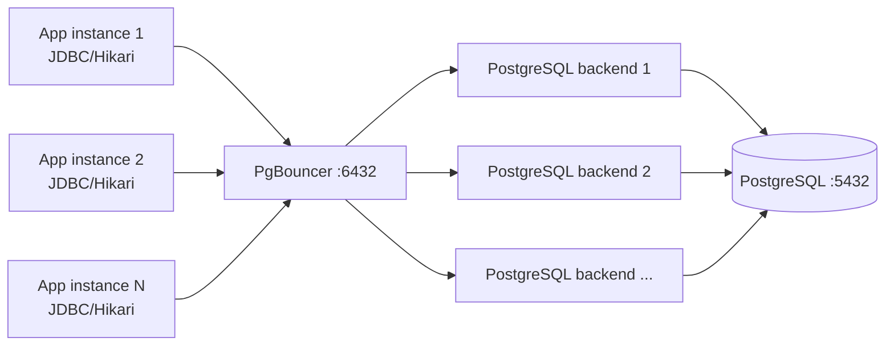

# PgBouncer With Session Pooling and Transaction Pooling in PostgreSQL

A Java application using PostgreSQL can open hundreds or thousands of connections as traffic scales: each instance has a connection pool, many instances run side by side, and multiple background workers query concurrently. PostgreSQL handles each client connection with a backend process; too many connections consume RAM, startup overhead, and management resources even when many connections sit idle.

**PgBouncer** is a lightweight *connection pooler* placed between applications and PostgreSQL. Instead of letting every application connection pin its own PostgreSQL backend for its entire lifetime, PgBouncer manages a pool of server connections and assigns them according to a **pooling mode**.

The two most important modes are:

- **Session pooling:** a PostgreSQL server connection is held for a client for the **entire session** and released only when the client disconnects or the session ends.
- **Transaction pooling:** a PostgreSQL server connection is held for a client only for the **duration of one transaction**; once the transaction finishes, the server connection can serve another client.

This difference sounds simple, yet directly impacts **session variables, temporary tables, prepared statements, cursors, advisory locks, `LISTEN`/`NOTIFY`, JDBC transactions, tenant RLS, migrations, and data safety**.

Example configuration:

```ini
[databases]
appdb_tx = host=127.0.0.1 port=5432 dbname=appdb pool_mode=transaction
appdb_session = host=127.0.0.1 port=5432 dbname=appdb pool_mode=session

[pgbouncer]
listen_addr = 127.0.0.1
listen_port = 6432
auth_type = scram-sha-256
auth_file = /etc/pgbouncer/userlist.txt
default_pool_size = 20
max_client_conn = 500
```

The two names `appdb_tx` and `appdb_session` are **PgBouncer-side aliases** pointing to the same PostgreSQL database `appdb`. This example illustrates choosing modes per workload; it is not yet a complete production configuration because TLS, authentication, credentials, permissions, logging, file permissions, timeouts, redundancy, and connection limits must still be managed.

## 1. Learning Objectives

After this lesson, you will be able to:

1. Explain PgBouncer's place in PostgreSQL architecture and why it lowers connection overhead.
2. Distinguish **client connections** from **server/backend connections**.
3. Understand the differences among `session`, `transaction`, and `statement` pooling.
4. Predict when PgBouncer assigns and returns a PostgreSQL connection to the pool.
5. Choose a mode based on application behavior, SQL features, and transaction boundaries.
6. Understand key differences with `SET`, `SET LOCAL`, session state, and transaction state.
7. Identify patterns unsuitable for transaction pooling: session-level advisory locks, long-lived `LISTEN`, temp tables surviving across transactions, and holdable cursors across commits.
8. Explain the difference between SQL `PREPARE` and extended-query-protocol prepared statements, plus the role of `max_prepared_statements` in supporting PgBouncer versions.
9. Configure basic PgBouncer settings, per-database aliases, and secure connection paths.
10. Size pools per database/user, PostgreSQL limits, and concurrent workloads.
11. Integrate cleanly with JDBC/pgJDBC, HikariCP, or transaction managers.
12. Use `SHOW POOLS`, `SHOW STATS`, `SHOW CLIENTS`, and `SHOW SERVERS` for observability.
13. Diagnose `cl_waiting`, long transactions, backend churn, prepared-statement errors, and session-state bugs.
14. Plan migrations, RLS, failovers, load tests, and safe rollouts.
15. Build runbooks and checklists when migrating applications from direct connections or session pooling to transaction pooling.

## 2. Why Is External Connection Pooling Needed Outside the Application?

A typical deployment:

```text
         20 application instances
               each with
           HikariCP max 30
                   |
                   v
         Up to 600 connections
                   |
                   v
              PostgreSQL
```

Without an intermediary tier, total backends can approach the sum of connections maintained across all app instances, even when many clients sit idle. This increases:

- Memory and resource overhead for PostgreSQL backends.
- Pressure on `max_connections` and reserved connection slots.
- Risk of connection storms during deploys or scale-outs.
- Overhead managing sessions that are not actively running queries.

PgBouncer introduces a multiplexing tier:



**Note:** PostgreSQL still runs one backend process per PgBouncer **server** connection. What PgBouncer saves is the number of backends required to serve many **client** connections, especially when clients are not all running transactions simultaneously.

### 2.1. JDBC Pools and PgBouncer Pools Are Not Identical

HikariCP reuses **JDBC connection objects** within one application instance. PgBouncer reuses **network connections to PostgreSQL backends** across many connected clients.

Both tiers can coexist, provided you budget **combined limits**. If HikariCP holds 100 client connections while PgBouncer holds only 20 server connections, transaction pooling can serve them smoothly whenever clients spend most of their time outside active transactions.

### 2.2. PgBouncer Does Not Automatically Make a SQL Query Run Faster

If a query lacks an index and takes 20 seconds, placing PgBouncer in front of the database does not change its SQL execution plan. PgBouncer relieves connection pressure; pool wait times can actually **increase** if the server pool is too small or transactions are too long.

### 2.3. PgBouncer Is Not a Table-Aware SQL Router

PgBouncer does not inspect a `SELECT` to route it to a read replica and an `UPDATE` to the primary like a query router. Splitting reads and writes requires the application or a dedicated routing layer to choose the right endpoint/pool.

## 3. Concepts: Client, Server, Pool, and Transaction

| Term | Meaning |
| --- | --- |
| **Client connection** | Connection from Java/`psql`/app to PgBouncer |
| **Server connection** | Connection from PgBouncer to a PostgreSQL backend |
| **Pool** | Group of server connections usable for a configured database/user pair |
| **Session** | Logical client session from connect until disconnect |
| **Transaction** | Transaction unit from `BEGIN` to `COMMIT`/`ROLLBACK`, or an implicit single-statement transaction under autocommit |
| **Idle client** | Connected client not currently executing work |
| **Idle in transaction** | Open transaction not finished yet; pins a server connection and potentially locks |
| **Pool waiting** | Client waiting for PgBouncer to assign an available server connection |

A client connection to PgBouncer **is not equivalent** to a fixed PostgreSQL backend under transaction pooling.

## 4. Quick Comparison of the Three Pooling Modes

| Attribute | Session Pooling | Transaction Pooling | Statement Pooling |
| --- | --- | --- | --- |
| How long a backend is held for a client | Entire session | Duration of one transaction | Duration of one statement |
| Reuse backend while client stays connected | Generally no | Yes, after transaction ends | Yes, after statement ends |
| Preserve session state across transactions | Possible, per pool-return reset policy | **Must not be relied upon** | Must not be relied upon |
| Multi-statement transaction `BEGIN ... COMMIT` | Supported | Supported | Unsuitable; usually rejected |
| Temporary table surviving past commit | Usable within session | Unsafe to rely upon | Unsuitable |
| Session-level advisory lock | Usable if release is managed | Unsafe | Unsuitable |
| Long-lived `LISTEN` | Usable | Unsafe | Unsuitable |
| Backend sharing efficiency | Lower | High for short transactions | Highest sharing granularity |
| Legacy application compatibility | Higher | Requires auditing session assumptions | Most restrictive |

This lesson focuses on session and transaction modes; statement mode is included to prevent confusion.

## 5. How Does Session Pooling Work?

In session pooling, once a client is assigned a server connection, PgBouncer keeps that binding **until the client session ends**.

```text
Client A: CONNECT ─────────────────────────── DISCONNECT
                 |                              |
Server 1:        [bound to A for full session]──+

Client B: CONNECT ─────────────────────────── DISCONNECT
                 |                              |
Server 2:        [bound to B for full session]──+
```

### 5.1. Key Characteristic

If Client A opens a connection and sits idle for minutes, the server connection bound to Client A stays occupied even though A runs no SQL. This lowers backend sharing compared to transaction pooling.

### 5.2. Advantages

- Closer compatibility with standard PostgreSQL session behavior.
- Preserves session-level `SET`, temp tables, SQL prepared statements, cursors, and session state over the client's lifetime within supported protocol/feature bounds.
- Fits legacy applications that are hard to modify or specialized connections needing long-lived state.

### 5.3. Limitations

- Server connection count tracks closely with actively bound client connections.
- Idle clients pin backends; pools can hit limits quickly.
- Less effective when the goal is serving hundreds of mostly idle clients with a few dozen PostgreSQL backends.

### 5.4. Resetting State on Client Disconnect

PgBouncer provides server reset mechanisms for session pooling, typically via `server_reset_query` such as `DISCARD ALL`. This prevents an old client's session state from leaking to the next client.

**Never assume Client A's state survives after A disconnects.** Session state is valid only within one connected session lifetime, never after the backend returns for someone else.

## 6. How Does Transaction Pooling Work?

In transaction pooling, PgBouncer assigns a backend when a client executes a transaction and returns it to the pool once the transaction **actually ends**.

```text
Time ---------->

Client A:  BEGIN ── SELECT ── UPDATE ── COMMIT       BEGIN ── SELECT ── COMMIT
Server 1: [         bound to A            ]          [may be a different server]

Client B:                                    BEGIN ── INSERT ── COMMIT
Server 1:                                   [    bound to B     ]
```

### 6.1. Reusability

Clients A and B can **both stay** connected over TCP to PgBouncer while sharing PostgreSQL backends **turn by turn per transaction**.

### 6.2. Advantages

- High backend utilization for apps with many client connections and short transactions.
- Reduces required PostgreSQL backend connections whenever active transaction concurrency is lower than client connection count.
- Well-suited to web/API services, especially across many horizontally scaled instances.

### 6.3. Trade-Off

Between two transactions of the **same client**, PgBouncer can assign **two different PostgreSQL backends**. Therefore, any state tied solely to the previous backend must not be assumed present or valid on the next backend.

### 6.4. Not "Stateless" Within a Transaction

**Inside one transaction**, the client stays on the same backend to preserve PostgreSQL semantics. You can still:

- Run `BEGIN`, `UPDATE`, `SELECT`, and `COMMIT`.
- Use row locks and `SELECT ... FOR UPDATE`.
- Set `SET LOCAL` for the current transaction.
- Use transaction-level advisory locks.

Problems arise when an application **relies on state surviving across `COMMIT`/`ROLLBACK` boundaries**.

## 7. One Client Using Multiple PostgreSQL Backend PIDs

PostgreSQL provides:

```sql
SELECT pg_backend_pid();
```

In session pooling, the PID normally stays constant once a client is assigned a backend until disconnect/reconnect/failover.

In transaction pooling, running:

```sql
SELECT pg_backend_pid();
SELECT pg_backend_pid();
```

as two separate autocommit statements **may** return different PIDs; they may also **happen to match** if PgBouncer happens to pick the same backend again.

### 7.1. Never Use Matching PIDs as Proof of Session Pooling

Seeing the same PID twice only proves two statements happened to land on the same backend; it does not prove PgBouncer locked that backend to your session.

### 7.2. More Reliable Verification

Inspect pool mode via the PgBouncer admin console, watch `SHOW POOLS`/`SHOW SERVERS` under load, and test multiple clients competing for the same pool.

### 7.3. Never Use `pg_backend_pid` as an Application User/Session ID

Under transaction pooling, one PID serves different clients over time. Maintain separate application session/request IDs instead of using backend PID as a business identifier.

## 8. Implicit Transactions and JDBC Autocommit

When PostgreSQL executes a regular statement outside `BEGIN ... COMMIT`, it runs in an **implicit transaction**.

Example:

```sql
SELECT COUNT(*) FROM orders;
```

With JDBC `autoCommit=true`, each SQL operation normally acts as its own committed unit per JDBC/driver semantics. Under transaction pooling, the backend can return to the pool **after each such transaction**.

### 8.1. Autocommit Does Not Pin a Backend

The client keeps its JDBC/PgBouncer connection open, yet no PostgreSQL server connection stays bound to that client between standalone statements.

### 8.2. Explicit Transactions Hold a Backend

```sql
BEGIN;

SELECT balance
FROM accounts
WHERE account_id = 101
FOR UPDATE;

UPDATE accounts
SET balance = balance - 100
WHERE account_id = 101;

COMMIT;
```

All statements inside the transaction execute on the same PostgreSQL backend to preserve locks, snapshots, and uncommitted changes.

### 8.3. Keep Transactions Short

Never open a transaction and then:

- Call an external REST API.
- Wait for user confirmation.
- Sleep for seconds while debugging.
- Run heavy CPU processing in Java before `COMMIT`.

As long as the transaction remains open, PgBouncer cannot safely hand that backend to another client.

## 9. Lab: Configuring PgBouncer With Two Aliases

Assume PostgreSQL listens on `127.0.0.1:5432` for database `appdb`. This is a lab configuration for a machine/container you control.

```ini
; /etc/pgbouncer/pgbouncer.ini

[databases]
appdb_tx = host=127.0.0.1 port=5432 dbname=appdb pool_mode=transaction
appdb_session = host=127.0.0.1 port=5432 dbname=appdb pool_mode=session

[pgbouncer]
listen_addr = 127.0.0.1
listen_port = 6432
unix_socket_dir = /var/run/postgresql
auth_type = scram-sha-256
auth_file = /etc/pgbouncer/userlist.txt

admin_users = pool_admin
stats_users = pool_metrics

max_client_conn = 500
default_pool_size = 20
min_pool_size = 0
reserve_pool_size = 5
reserve_pool_timeout = 5

query_wait_timeout = 30
server_idle_timeout = 600
```

**Do not copy this verbatim to production.** Sizing numbers, socket paths, auth, TLS, DNS, logging, and server specs depend on your environment.

### 9.1. Why Aliases Matter

Applications can choose an endpoint matching their needs:

```text
jdbc:postgresql://pool.example.internal:6432/appdb_tx
jdbc:postgresql://pool.example.internal:6432/appdb_session
```

Both aliases point to the same underlying database while enforcing different pooling modes. Note that each alias maintains separate pool resources and contributes to total server connections.

### 9.2. Choose Clear Names

Names like `appdb_tx` and `appdb_session` keep operations clear. Avoid ambiguous aliases that might send migrations through transaction pooling when scripts rely on session state.

### 9.3. TCP or Unix Socket?

PgBouncer can listen on TCP and/or Unix sockets per config. In containers and clusters, plan bind addresses, filesystem permissions, network policies, and service discovery.

### 9.4. Never Expose PgBouncer to the Public Internet Unnecessarily

If only internal services need access, keep it on a private network with strict source filtering. PgBouncer is a database entry point and must be guarded like the database itself.

## 10. Authentication and Two Connection Hops

There are **two hops**:

1. Application/JDBC → PgBouncer.
2. PgBouncer → PostgreSQL.

They can have distinct authentication, TLS, and credential requirements.

### 10.1. `auth_type` and `auth_file`

For example, `auth_type = scram-sha-256` configures client auth for supported mechanisms, and `auth_file` points to credentials formatted for PgBouncer.

Never put real passwords in documentation or commit `userlist.txt` containing secrets to a repository.

### 10.2. `auth_query` and `auth_user`

When dynamic user lookup is needed, PgBouncer can authenticate via `auth_query` using a dedicated role. Check version docs, least privilege, and query security carefully.

### 10.3. Two-Sided TLS

`client_tls_*` and `server_tls_*` settings secure each hop when configured properly. Verify certificates, hostnames, trust roots, and rotation procedures.

### 10.4. Do Not Conflate JDBC SSL Mode With the Server Hop

JDBC using TLS to PgBouncer does not prove PgBouncer uses TLS to PostgreSQL. Verify **both hops**.

### 10.5. Version Details for TLS and SCRAM

SCRAM credential support, auth passthrough, and password format requirements depend on PgBouncer and PostgreSQL versions/configs. Always test real logins with a test role on deployment rather than assuming one `auth_type` line secures everything.

## 11. Calculating Pool Size: Total Clients ≠ Total Backends

Example:

- 10 app instances.
- Each instance has max 40 JDBC connections.
- Up to 400 client connections to PgBouncer.
- PostgreSQL supports a bounded number of backends per RAM/workload budget.

With transaction pooling, if active concurrent transactions need around 25 connections, benchmark near that level instead of opening 400 server connections.

### 11.1. Mental Formula

```text
Desired total client slots
    ≈ number of instances × maximumPoolSize
      + psql / CLI / background jobs / bursts

Actual server connections
    ≈ sum of active pools per
      database × user, pool/reserve limits,
      and other server/database/user limits
```

**Never treat `default_pool_size` as a global cap for all of PgBouncer.**

### 11.2. Pools Are Typically Keyed by Database and User

Suppose:

- 3 database aliases.
- Each alias has 4 distinct PostgreSQL users.
- `default_pool_size = 20`.

When each database/user pair gets its own pool, theoretical server slots can approach:

```text
3 × 4 × 20 = 240
```

not counting reserve pools, alias config differences, or other limits.

### 11.3. Yet the Total Is Not Always That Simple Product

If a database entry forces a fixed server user, or `max_db_connections`/`max_user_connections` caps apply, pooling and total server connections behave differently.

Inspect `SHOW POOLS`, `SHOW DATABASES`, and actual server stats.

### 11.4. Leave Headroom for PostgreSQL

Never size total PgBouncer pool slots right up to PostgreSQL's `max_connections` forgetting:

- Reserved/superuser connections.
- Monitoring and admin access.
- Migrations and maintenance.
- Replication or direct-connecting clients.
- Per-backend memory and workload demand.

### 11.5. The Goal Is Sustainable Throughput

Too small a pool builds queues. Too large a pool overloads PostgreSQL CPU, memory, and I/O. Benchmark to find the sweet spot—there is no universal pool size for all systems.

## 12. Key PgBouncer Parameters

| Parameter | Role |
| --- | --- |
| `pool_mode` | `session`, `transaction`, or `statement` |
| `max_client_conn` | Max client connections accepted by PgBouncer |
| `default_pool_size` | Default server connections per pool |
| `min_pool_size` | Minimum server connections maintained per operating rules |
| `reserve_pool_size` | Extra emergency server connections granted when queue wait triggers |
| `reserve_pool_timeout` | Wait threshold before engaging reserve slots |
| `max_db_connections` | Max server connections per database when configured |
| `max_user_connections` | Max server connections per user when configured |
| `query_wait_timeout` | Max time a client waits for a server connection |
| `server_idle_timeout` | Closes idle server connections after timeout |
| `server_lifetime` | Max lifetime of a server connection per policy |
| `server_connect_timeout` | Timeout opening a server connection |
| `idle_transaction_timeout` | Drops clients left idle inside a transaction per config |
| `server_reset_query` | Resets server state when appropriate for session pooling |
| `max_prepared_statements` | Enables protocol-level named prepared statement tracking in supporting PgBouncer versions |

Exact parameter names and behavior vary by version. Run `SHOW CONFIG` in your running PgBouncer console to verify.

### 12.1. `max_client_conn` Differs From PostgreSQL `max_connections`

`max_client_conn` belongs to PgBouncer: client sockets entering the pooler. `max_connections` belongs to PostgreSQL: server backend connections accepted by PostgreSQL.

### 12.2. File Descriptors and OS Limits

PgBouncer needs file descriptors for both client sockets and server sockets. Raising `max_client_conn` steeply without checking `ulimit`, systemd unit, or container FD limits still causes resource failures.

### 12.3. `reserve_pool` Is Not Free Capacity

Reserve connections become real PostgreSQL backends when active. Include them in your `max_connections` and memory budgets.

## 13. What Is Session State?

Session state is state stored in a **PostgreSQL backend session**, rather than in a table row or single transaction.

Examples:

```sql
SET search_path = tenant_10, public;
SET TIME ZONE 'Asia/Ho_Chi_Minh';
SET ROLE reporting_role;
CREATE TEMP TABLE selected_ids (id bigint);
PREPARE q(bigint) AS SELECT * FROM orders WHERE id = $1;
LISTEN order_events;
SELECT pg_advisory_lock(12345);
```

These are standalone illustrations; do not run the whole block if schemas, roles, or tables do not exist. Exact impact depends on the feature and version.

### 13.1. Why Does Transaction Pooling Struggle With It?

After `COMMIT`, PgBouncer may move the client to another backend. The new backend:

- May lack the just-created temp table.
- May lack the SQL prepared statement by that name.
- May lack the `LISTEN` subscription.
- Might carry a session-level advisory lock from another context if cleanup failed.
- Might have different session settings if the app created them carelessly.

### 13.2. Some Startup Parameters Are Tracked by PgBouncer

PgBouncer tracks and forwards several common parameters—such as `client_encoding`, `DateStyle`, `TimeZone`, `standard_conforming_strings`, and `application_name` depending on version and config. Supporting versions also expose settings like `track_extra_parameters` and `ignore_startup_parameters`.

Thus claiming "**every** `SET` breaks in transaction pooling" is overly simplistic. The safe rule is **never rely casually on session state across transaction boundaries** except for features explicitly supported, tracked, verified, and tested in your PgBouncer setup.

## 14. `SET LOCAL`: Transaction-Scoped Configuration

When an option only needs to apply **within the current transaction**, use `SET LOCAL`:

```sql
BEGIN;

SET LOCAL statement_timeout = '3s';
SET LOCAL search_path = reporting, public;

SELECT COUNT(*) FROM sales;

COMMIT;
```

### 14.1. Why Does This Fit Transaction Pooling?

PgBouncer keeps the same backend for the transaction's duration. `SET LOCAL` applies to subsequent SQL **in that transaction** and reverts when the transaction ends per PostgreSQL semantics.

### 14.2. Session-Level `SET` Differs From `SET LOCAL`

```sql
SET statement_timeout = '3s';
```

is a session-level change. If executed under transaction pooling and the backend returns to the pool, the client has no guarantee later SQL runs with that state. That differs from `SET LOCAL`.

### 14.3. Put `SET LOCAL` Before the Target Query

```sql
BEGIN;
SET LOCAL statement_timeout = '3s';
SELECT expensive_operation();
COMMIT;
```

Placing `SET LOCAL` **after** the slow query has no retroactive effect.

### 14.4. Do Not Trust `SET LOCAL` Outside an Explicit Transaction

A standalone `SET LOCAL` under autocommit does not carry into the next `SELECT`. Always open an explicit transaction or use pool-supported configuration mechanisms.

## 15. RLS and Tenant Variables Under Transaction Pooling

A multi-tenant architecture may use PostgreSQL Row-Level Security paired with a session setting for tenant context.

Illustrative predicate:

```sql
-- Assumes table has tenant_id and RLS is enabled.
-- CREATE POLICY tenant_isolation ON app.orders
-- USING (
--     tenant_id = current_setting('app.tenant_id', true)::integer
-- )
-- WITH CHECK (
--     tenant_id = current_setting('app.tenant_id', true)::integer
-- );
```

### 15.1. Setting Context Properly per Transaction

```sql
BEGIN;

SELECT set_config('app.tenant_id', '10', true);

SELECT *
FROM app.orders
WHERE order_id = 101;

COMMIT;
```

Passing `true` as the third argument to `set_config(name, value, is_local)` sets it **transaction-local**, matching `SET LOCAL`.

### 15.2. Never Set a Session-Level Tenant Once at Startup

With transaction pooling, running:

```sql
SET app.tenant_id = '10';
```

and assuming every subsequent query on that JDBC connection carries tenant 10 is **unsafe**. The next query can land on another backend, and stale backend state can leak data if cleanup/scoping fails.

### 15.3. Set Verified Tenant Context Inside Each Required Transaction

Service pattern:

```text
BEGIN
  set_config('app.tenant_id', verifiedTenant, true)
  SELECT/INSERT/UPDATE/DELETE for tenant
COMMIT / ROLLBACK
```

### 15.4. Security Warning About Custom GUCs

If untrusted clients can arbitrarily run `SET app.tenant_id` under the same database role, an RLS policy trusting that variable **does not prove the user belongs to tenant 10**. The application must authenticate the tenant, enforce permissions, and guard SQL paths; stricter threat models may require separate database roles or signed/trusted contexts.

### 15.5. RLS Policies Also Depend on Owner/Bypass Roles

Testing as a superuser or table owner may bypass RLS and misrepresent application role behavior. Never treat PgBouncer as a replacement for RLS or authorization.

## 16. Temporary Tables: Mind `ON COMMIT` Lifetimes

A temporary table in PostgreSQL belongs to a session, for example:

```sql
CREATE TEMP TABLE session_cart (
    sku text,
    quantity integer
);
```

If a transaction ends while the table stays on that backend, a transaction-pooled client is not guaranteed to see that table in the next transaction.

### 16.1. Pattern Incompatible With Transaction Pooling

```sql
-- Transaction 1
BEGIN;
CREATE TEMP TABLE session_cart (sku text);
INSERT INTO session_cart VALUES ('A-001');
COMMIT;

-- Transaction 2, may execute on a different backend:
SELECT * FROM session_cart;
```

The `SELECT` can fail with relation-does-not-exist or hit unexpected backend state. This is an anti-pattern.

### 16.2. Single-Transaction Pattern

```sql
BEGIN;

CREATE TEMP TABLE work_ids (
    id bigint
) ON COMMIT DROP;

INSERT INTO work_ids VALUES (10), (20), (30);

SELECT COUNT(*) FROM work_ids;

COMMIT;
```

`ON COMMIT DROP` drops both definition and data at `COMMIT`, requiring no cross-transaction temp table retention.

### 16.3. `ON COMMIT DELETE ROWS` Differs From `ON COMMIT DROP`

`ON COMMIT DELETE ROWS` empties rows while **the temporary table definition remains in the backend session**. If PgBouncer reuses that backend for another client, do not assume session object state is clean.

### 16.4. Better Alternatives When Possible

- Use CTEs, `VALUES`, or single-query temp relations.
- Use a regular staging table keyed by request/job ID with scheduled cleanup.
- Use session pooling or dedicated connections for workflows truly needing cross-transaction temp state.

## 17. Prepared Statements: Version-Dependent Compatibility

PostgreSQL has **two mechanisms** often casually called "prepared statements":

1. **SQL-level** `PREPARE name(...) AS ...` and `EXECUTE name(...)`.
2. **Protocol-level** named prepared statements created by client drivers via the extended query protocol.

PgBouncer does not handle them identically.

### 17.1. SQL `PREPARE` Stores Backend State

```sql
PREPARE get_order(bigint) AS
SELECT order_id, amount
FROM orders
WHERE order_id = $1;

EXECUTE get_order(101);
```

If `PREPARE` runs in transaction 1 and `EXECUTE` runs in transaction 2 through transaction pooling, `EXECUTE` may hit a backend **lacking** that named prepared statement.

### 17.2. Protocol-Level Prepared Statements

Modern PgBouncer versions support managing **protocol-level named prepared statements** in transaction pooling when `max_prepared_statements` is configured above 0. This capability was introduced in the PgBouncer 1.21 line; verify your exact running version and settings.

### 17.3. `max_prepared_statements` Does Not Fix SQL `PREPARE`

Never assume that setting:

```ini
max_prepared_statements = 100
```

makes `PREPARE ...; COMMIT; EXECUTE ...` sent as raw SQL text session-independent. That feature tracks **wire-protocol** named prepared statements, not SQL-level session `PREPARE` objects.

### 17.4. Driver Threshold Surprises

Some JDBC drivers promote queries to server-side named prepares only after N executions. The first few queries can pass while the Nth fails with errors like:

```text
prepared statement "S_1" does not exist
prepared statement "S_1" already exists
```

Exact messages depend on driver, PgBouncer, and PostgreSQL. Never run a single query once and declare compatibility proven.

## 18. pgJDBC: `prepareThreshold` and Choosing a Strategy

In Java/pgJDBC, relevant pieces include:

- `PreparedStatement` in JDBC.
- Driver threshold for server-side prepares, such as `prepareThreshold`.
- PgBouncer version and `max_prepared_statements`.
- Whether the app issues SQL-level `PREPARE` directly.

### 18.1. Option A: PgBouncer Supports Protocol Prepared Statements

With a supporting PgBouncer version, configure:

```ini
[pgbouncer]
max_prepared_statements = 100
```

and run integration tests exceeding the driver's prepare threshold. Size the cache for memory overhead, distinct query shapes, and actual workload.

### 18.2. Option B: Disable Driver Server-Side Named Prepares

In some setups you can configure the matching JDBC property:

```text
jdbc:postgresql://pool.example.internal:6432/appdb_tx?prepareThreshold=0
```

In pgJDBC, `prepareThreshold=0` disables threshold-based server-side named preparation. That does **not** mean abandoning `PreparedStatement` with bind parameters in Java; parameter binding remains essential to prevent SQL injection.

### 18.3. Do Not Disable Prepare Unnecessarily

Turning off server-side preparation can forfeit parse/plan caching benefits. Check PgBouncer version support and benchmark before changing defaults.

### 18.4. Long-Lifecycle Testing

A thorough test should:

1. Repeat a `PreparedStatement` many times on the same JDBC connection.
2. Execute across many separate transactions.
3. Introduce concurrency so backends get reassigned.
4. Verify bound parameter results, latency, and error absence.
5. Run with the exact driver and PgBouncer versions used in production.

## 19. Cursors and Streaming Result Sets

PostgreSQL cursors are normally bound to a transaction or backend.

### 19.1. Cursor Within One Transaction

```sql
BEGIN;

DECLARE c_orders CURSOR FOR
SELECT order_id
FROM orders
ORDER BY order_id;

FETCH 100 FROM c_orders;
FETCH 100 FROM c_orders;

CLOSE c_orders;
COMMIT;
```

In transaction pooling, all commands stay **within one transaction** on the same backend, so transaction-scoped cursors work per semantics.

### 19.2. Holdable Cursors Across `COMMIT` Are Unsafe

`DECLARE ... CURSOR WITH HOLD` creates a cursor surviving `COMMIT` on the backend. Under transaction pooling, the client is not guaranteed to keep that backend, so multi-transaction fetch protocols built on held cursors are unsafe.

### 19.3. JDBC Streaming

pgJDBC cursor-based fetching typically requires `autoCommit=false` and a positive fetch size. Keeping a transaction open during huge streams **pins a PgBouncer backend** for the entire duration.

### 19.4. Large-Dataset Strategies

- Use keyset pagination to keep transactions short.
- Stream inside a bounded transaction with timeouts.
- Route long reports through a session or dedicated pool if needed.

Never treat PgBouncer as making long-lived cursors free.

## 20. Advisory Locks: Session-Level vs. Transaction-Level

PostgreSQL advisory locks come in two key scopes:

| Function | Lock Lifetime | In Transaction Pooling |
| --- | --- | --- |
| `pg_advisory_lock(key)` | Session-level; requires unlock or session end | **Unsafe to rely upon** |
| `pg_advisory_unlock(key)` | Unlocks session lock on current backend | May execute on a different backend in a later transaction |
| `pg_advisory_xact_lock(key)` | Automatically released when transaction ends | Suitable when lock and protected work share one transaction |

### 20.1. Dangerous Example

```sql
SELECT pg_advisory_lock(12345);
-- Implicit COMMIT; PgBouncer returns the backend.

SELECT pg_advisory_unlock(12345);
-- May execute on a different backend.
```

You have no guarantee the unlock reaches the backend holding the lock.

### 20.2. Transaction-Level Pattern

```sql
BEGIN;

SELECT pg_advisory_xact_lock(12345);

UPDATE jobs
SET processed = true
WHERE job_id = 12345;

COMMIT;
```

The lock stays active for the transaction and releases automatically at `COMMIT`/`ROLLBACK`.

### 20.3. Do Not Replace Row Locks Indiscriminately

If you only need to protect a specific row, `SELECT ... FOR UPDATE` or a conditional `UPDATE` is often clearer and safer than manually keyed advisory locks.

## 21. `LISTEN`/`NOTIFY` and Long-Lived Subscribers

`LISTEN` registers a backend session for notifications:

```sql
LISTEN order_changed;
```

Subscriptions attach to the backend session. If a client uses transaction pooling and its server connection returns to the pool, **the client cannot reliably receive notifications from the old backend**.

### 21.1. Use Session or Dedicated Connections for Listeners

A long-lived listener should use:

- A direct PostgreSQL connection, or
- A properly managed session-pooling alias.

### 21.2. Distinguish Publishers From Listeners

Any transaction can execute:

```sql
NOTIFY order_changed, '101';
```

and notifications dispatch per PostgreSQL semantics upon commit. **Sending `NOTIFY`** is very different from **holding a long-lived `LISTEN` subscription** on a backend.

### 21.3. `LISTEN`/`NOTIFY` Is Not a Durable Message Queue

Never rely on it as the sole guarantee of once-only delivery or post-downtime replay; applications may need an outbox, job queue, or event store.

## 22. Sequence State: `currval` and `lastval`

These functions:

```sql
SELECT currval('order_id_seq');
SELECT lastval();
```

rely on PostgreSQL backend **session state**. Under transaction pooling, if `INSERT` and `currval` run in two separate transactions, they are not guaranteed to hit the same backend.

### 22.1. Error-Prone Pattern

```sql
INSERT INTO orders(customer_id) VALUES (10);
SELECT currval('orders_order_id_seq');
```

If each statement autocommits separately, the second backend may never have called `nextval`, or may hold another client's sequence state.

### 22.2. Use `INSERT ... RETURNING`

```sql
INSERT INTO orders(customer_id)
VALUES (10)
RETURNING order_id;
```

This is cleaner and safer for retrieving the newly generated ID in the same statement.

### 22.3. `nextval` Still Works With Proper Privileges

`nextval` performs real sequence allocation; the issue here is **re-querying session state in a separate statement**, not PgBouncer forbidding sequences.

## 23. Reset Queries and Backend State

PgBouncer provides settings such as:

```ini
server_reset_query = DISCARD ALL
```

to clean server sessions when connections return to the pool in **session pooling** per configuration.

### 23.1. Transaction Pooling Follows Different Rules

In transaction pooling, backends return after every transaction. By default, PgBouncer does not run `server_reset_query` on every backend return the same way as session pooling.

### 23.2. Why Not Just Run Heavy Resets Every Transaction?

Running full resets constantly adds overhead and still cannot make every session feature transaction-safe. Features like `LISTEN` or session advisory locks still have mismatched lifetimes when backends swap between clients.

### 23.3. Never Build on Session `SET` That "Happened Not to Reset"

If code runs `SET search_path = tenant_10` and a few tests happen to pass, that does not make transaction pooling safe. Migrate to transaction-scoped designs or session endpoints for stateful workloads.

## 24. DDL Operations and Migrations Through PgBouncer

Many DDL statements such as:

```sql
BEGIN;
CREATE TABLE migration_sample (id bigint PRIMARY KEY);
CREATE INDEX idx_migration_sample_id ON migration_sample(id);
COMMIT;
```

can run inside a PostgreSQL transaction, and PgBouncer transaction pooling holds the same backend for that transaction.

### 24.1. Yet Migration Tools Often Rely on Session State

Tools may depend on:

- **Session** advisory locks to prevent concurrent migrations.
- `SET search_path` persisting across multiple transactions.
- Cross-transaction temp tables.
- SQL-level `PREPARE`/transaction behavior.
- Certain DDL commands prohibited inside transaction blocks.

### 24.2. Practical Recommendation

For migrations, `pg_dump`/`pg_restore`, maintenance, and long-lived admin sessions, prefer a **direct PostgreSQL connection** or a **session-pooling endpoint** as required by the tool.

### 24.3. Give Migrations Their Own Connection Budget

Running heavy migrations through the web-traffic transaction pool pits migrations against runtime requests for server slots. Provision controlled endpoints and budgets.

### 24.4. Transaction Pooling Does Not Split One Transaction Across Backends

If a migration opens a long transaction, it **pins one backend until the transaction finishes**. The key concern is session state *between* transactions plus pool contention.

## 25. Java/JDBC: Transaction-Safe Pattern With PgBouncer

Suppose the JDBC URL points to alias `appdb_tx`. Framework-independent example:

```java
String url =
    "jdbc:postgresql://pool.example.internal:6432/appdb_tx";

try (Connection c = DriverManager.getConnection(
        url, dbUser, dbPassword)) {
    boolean priorAutoCommit = c.getAutoCommit();
    c.setAutoCommit(false);

    try {
        // Context lives only for the current transaction.
        try (PreparedStatement ctx = c.prepareStatement(
                "SELECT set_config('app.tenant_id', ?, true)")) {
            ctx.setString(1, verifiedTenantId);
            ctx.executeQuery().close();
        }

        try (PreparedStatement ps = c.prepareStatement("""
                INSERT INTO app.orders(tenant_id, customer_id, amount)
                VALUES (?, ?, ?)
                RETURNING order_id
                """)) {
            ps.setInt(1, Integer.parseInt(verifiedTenantId));
            ps.setLong(2, customerId);
            ps.setBigDecimal(3, amount);

            try (ResultSet rs = ps.executeQuery()) {
                if (!rs.next()) {
                    throw new SQLException("No order_id returned");
                }
                long orderId = rs.getLong(1);
                // Use orderId within the same transaction if needed.
            }
        }

        c.commit();
    } catch (SQLException | RuntimeException e) {
        c.rollback();
        throw e;
    } finally {
        c.setAutoCommit(priorAutoCommit);
    }
}
```

This is an **illustrative pattern**: it assumes `app.orders`, credentials, and Java variables exist, and that the enclosing method handles checked exceptions properly. In Spring/JTA apps, use the framework transaction manager rather than toggling `autoCommit` outside the pool contract.

### 25.1. Why Set Context Inside the Transaction?

`set_config(..., true)` applies only to the open transaction. All queries in that transaction execute on the backend assigned by PgBouncer.

### 25.2. Why `INSERT RETURNING`?

It retrieves `order_id` without depending on `currval` on a backend that might change between statements.

### 25.3. `PreparedStatement` Remains Essential

Never drop bind parameters to "work around PgBouncer". Keep parameterized queries to prevent SQL injection; address server-side named prepares via driver and PgBouncer settings.

### 25.4. Never Interpolate Arbitrary User Input Into Schema Names

For schema-per-tenant designs, never build `search_path` from unvalidated input. Enforce routing/allowlists and separate privileges; transaction pooling does not enforce multi-tenancy on its own.

## 26. HikariCP + PgBouncer: Two Pool Layers

HikariCP still adds value by:

- Reusing JDBC connections inside the application.
- Bounding concurrent requests acquiring connections.
- Checking connection liveness.
- Enforcing checkout timeouts for client connections.

PgBouncer serves a distinct purpose: reducing PostgreSQL backend connections and multiplexing at transaction boundaries.

### 26.1. Conceptual Configuration Example

```properties
spring.datasource.url=jdbc:postgresql://pool.example.internal:6432/appdb_tx
spring.datasource.hikari.maximum-pool-size=20
spring.datasource.hikari.minimum-idle=2
spring.datasource.hikari.connection-timeout=3000
```

Values are for illustration; benchmark against instance count and load.

### 26.2. Do Not Multiply Pool Sizes Blindly

50 pods × 20 Hikari connections can send up to 1,000 clients to PgBouncer. Size `max_client_conn`, file descriptor budgets, connection churn, and server pool sizes accordingly.

### 26.3. Connection Init SQL and Session State

Hikari/JDBC `connectionInitSql` runs only when a JDBC client connection is created. Under transaction pooling, session state set at client init **is not guaranteed** to exist on whichever PostgreSQL backend is assigned later.

If per-tenant or per-request context is required, set it **inside every transaction** per application rules.

### 26.4. Keep Transaction Manager Boundaries Clear

Spring `@Transactional` groups statements onto one transaction/connection, yet async threads, different propagation modes, or self-invocation can break expectations. Test transaction boundaries against real SQL and objects.

### 26.5. A Small HikariCP Pool Does Not Mean Short Transactions

A service that holds an open transaction during an external HTTP call still pins a PgBouncer backend. Measure **transaction duration**, not only Hikari pool size.

## 27. Read/Write Databases and PgBouncer

If the topology has a primary and replicas:

```text
API write ──> PgBouncer write ──> PostgreSQL primary
API read  ──> PgBouncer read  ──> PostgreSQL replica
```

### 27.1. Applications Must Pick the Right Endpoint

PgBouncer does not parse SQL text to send `SELECT`s to replicas automatically. Read/write splitting usually needs separate DSNs or a routing-capable proxy layer.

### 27.2. Read-After-Write Consistency

A request that updates the primary and immediately reads a replica can see stale data due to replication lag. Neither session pooling nor transaction pooling **eliminates replication lag**.

### 27.3. Failover Breaks Server Connections

When PostgreSQL fails over, old server connections drop. PgBouncer must reconnect to the new target via network/DNS/service discovery; applications must handle retries and transaction errors properly.

### 27.4. Never Retry Write Transactions Without Idempotency

If the network drops right at `COMMIT`, the client may not know whether the database committed. Blindly retrying an `INSERT` or payment can create duplicates. Enforce business request IDs and unique constraints.

## 28. Connecting to the PgBouncer Admin Console

PgBouncer exposes a special administrative database named `pgbouncer`.

Example command:

```bash
psql "host=pool.example.internal port=6432 dbname=pgbouncer user=pool_admin sslmode=verify-full"
```

Configure TLS certificates, trust roots, and accounts properly; never place passwords on the command line or in docs.

### 28.1. Common `SHOW` Commands

```sql
SHOW VERSION;
SHOW CONFIG;
SHOW DATABASES;
SHOW USERS;
SHOW POOLS;
SHOW CLIENTS;
SHOW SERVERS;
SHOW STATS;
SHOW LISTS;
```

These `SHOW` commands run in the **PgBouncer admin console**, not on a normal PostgreSQL backend.

### 28.2. `admin_users` and `stats_users`

Admin roles can inspect and control PgBouncer operations; stats roles typically have read-only access to statistics within a narrower scope. Never grant admin console access to runtime application roles.

### 28.3. Permissions and Sensitive Output

`SHOW CLIENTS` and `SHOW SERVERS` can reveal connection metadata, users, IP addresses, timestamps, or query metadata. Restrict access and handle logs/exports carefully.

## 29. Reading `SHOW POOLS`

Common columns:

| Column | Meaning |
| --- | --- |
| `database` | Database alias/pool |
| `user` | Associated user/server pool |
| `cl_active` | Active client connections in pool state |
| `cl_waiting` | Clients waiting for a server connection |
| `sv_active` | Server connections currently serving clients |
| `sv_idle` | Idle server connections available for use |
| `sv_used` | Recently used server connections in PgBouncer's intermediate state |
| `sv_tested` | Server connections currently being tested |
| `sv_login` | Server connections currently logging in |
| `maxwait` | Longest queue wait time; format/columns vary by version |

Exact column names and formats vary across PgBouncer versions. Always check the output schema of your running server.

### 29.1. What Does High `cl_waiting` Mean?

Many clients are waiting for a backend. Possible reasons:

- All server connections in the pool are busy in transactions.
- Pool size is too small for active concurrency.
- Transactions are held open too long.
- PostgreSQL is slow due to locks, I/O, or CPU.
- Server connections errored or are reconnecting.
- Another per-db or per-user limit is throttling.

### 29.2. Do Not Just Raise Pool Size

If PostgreSQL backends are already at 100% CPU, adding 100 more connections slows the DB further. Check transaction durations and wait events first.

### 29.3. High `sv_idle` Yet Clients Still Waiting?

Waiting clients may belong to a **different database/user pool**, hit a specific limit, or wait on server states not yet usable. Never sum `sv_idle` across all pools and assume every client has free servers.

## 30. `SHOW STATS` and Performance Metrics

`SHOW STATS` provides aggregated counters per database/pool—transactions, queries, bytes, and timings depending on version.

### 30.1. Metrics to Track

- Transactions and queries processed.
- Client wait time for server connections.
- Transaction duration.
- Query execution time.
- Ingress/egress bytes and throughput.
- Active/waiting client counts.
- Active/idle server connection counts.

### 30.2. Correlate With PostgreSQL Statistics

PgBouncer sees **clients waiting on server pools**, while PostgreSQL sees **what backends are running or waiting on**.

To inspect:

```sql
SELECT
    pid,
    usename,
    application_name,
    state,
    wait_event_type,
    wait_event,
    now() - xact_start AS transaction_age,
    query
FROM pg_stat_activity
WHERE datname = current_database()
ORDER BY xact_start NULLS LAST;
```

Run this on PostgreSQL, not the PgBouncer admin database.

### 30.3. Tie Metrics to Time Intervals

Cumulative totals since reset do not directly equal queries/s. Compute throughput from timed deltas and handle counter resets on stats reset or restart.

### 30.4. Brief Client Waiting Is Not Always an Error

A short queue can be a healthy trade-off to cap DB load. Focus on **p95/p99 wait times, request timeouts, and meeting throughput SLAs**.

## 31. Diagnosing `idle in transaction`

Under transaction pooling, an open transaction where the app does nothing still **pins a backend**.

Java example:

```text
connection.setAutoCommit(false)
SELECT ...;
call external API for 30 seconds
connection.commit()
```

A 30-second API call pins a PostgreSQL backend even though zero SQL is executing.

### 31.1. Inspect in PostgreSQL

```sql
SELECT
    pid,
    application_name,
    state,
    now() - xact_start AS xact_age,
    wait_event_type,
    wait_event
FROM pg_stat_activity
WHERE state = 'idle in transaction'
ORDER BY xact_start;
```

### 31.2. Remediation

- Open transactions right before the SQL statements requiring atomicity.
- Keep network calls outside open transactions whenever possible.
- Ensure commit/rollback on every branch, including exceptions.
- Consider PostgreSQL `idle_in_transaction_session_timeout` and PgBouncer `idle_transaction_timeout` per policy.

### 31.3. Timeouts Do Not Fix Application Logic

Killing idle transactions frees backends yet fails in-flight requests. Fix the application code holding transactions open.

## 32. Query Wait Timeout and Timeout Chains

A request can traverse multiple timeout layers:

```text
HTTP request timeout
        |
Hikari connectionTimeout (waiting for client JDBC connection)
        |
PgBouncer query_wait_timeout (waiting for server backend)
        |
PostgreSQL statement_timeout / lock_timeout
        |
pgJDBC socketTimeout / network timeout
```

### 32.1. Do Not Conflate Wait Layers

If Hikari times out acquiring a connection, the query may **never have reached PgBouncer**.

If PgBouncer hits `query_wait_timeout`, the client connected to the pooler yet waited too long for a server connection.

If PostgreSQL hits `statement_timeout`, the statement actually started on a backend and was canceled by the server.

### 32.2. Size Timeouts Against the Request Budget

For example, a 2-second API SLA must budget across pool wait, DB query, network, and app processing. Never set PostgreSQL `statement_timeout` to 60 seconds behind a 2-second HTTP timeout expecting backends to vanish the moment the HTTP client gives up.

### 32.3. Cancel and Retry Semantics

A timeout can abort a transaction, requiring rollback. Retry only retryable errors, and keep writes idempotent or reconciled.

## 33. Lab Demonstrating Backend Reuse

Prepare a database `appdb` and connect:

```bash
psql "host=127.0.0.1 port=6432 dbname=appdb_tx user=lab_user"
```

In one `psql` session:

```sql
SELECT pg_backend_pid() AS first_pid;
SELECT pg_backend_pid() AS second_pid;
```

The two PIDs may differ or match.

### 33.1. Run Two Competing Clients

Open a second `psql` client to the same alias and user. With `default_pool_size=1` in the lab:

- Client A opens a transaction and runs `SELECT pg_sleep(3)`.
- Client B runs a query while A holds the backend.
- B waits in the pool queue until A commits.

### 33.2. Never Sleep Inside Open Transactions in Production

Intentional backend-pinning experiments belong only in local/staging labs. In production, inspect existing metrics rather than injecting artificial locks or queues.

### 33.3. Compare With Session Pooling

With one server slot and session pooling:

- Client A stays bound to the backend.
- Client B must wait **until A disconnects**, not merely until `COMMIT`.

This contrast shows why session pooling scales poorly when many clients remain connected while idle.

## 34. Controlled Session-State Experiments

An experiment:

```sql
-- Connected via appdb_tx
BEGIN;
SET LOCAL application_name = 'tx-lab';
SELECT current_setting('application_name');
COMMIT;

BEGIN;
SELECT current_setting('application_name');
COMMIT;
```

### 34.1. Why Use `application_name`?

It illustrates local vs. session settings. However, `application_name` belongs to the parameters PgBouncer may track/forward in some configurations; **do not use this experiment to claim all custom GUCs behave identically**.

### 34.2. With Custom Settings

```sql
BEGIN;
SELECT set_config('app.demo_context', 'A', true);
SELECT current_setting('app.demo_context', true);
COMMIT;
```

Never rely on `current_setting` in the next transaction, because the backend may differ and local scope has expired.

### 34.3. Matching Output Does Not Prove Session Stickiness

PgBouncer might have happened to pick the same backend, or driver/PgBouncer tracking synced a parameter. Base conclusions on architecture and configuration, not one lucky run.

## 35. PgBouncer Versions and Feature Compatibility

PgBouncer evolves across versions. Features present in newer releases may not exist in older ones.

### 35.1. Always Check Running Versions

In the console:

```sql
SHOW VERSION;
SHOW CONFIG;
```

On the PostgreSQL backend:

```sql
SHOW server_version;
```

These are two separate software components with independent upgrade lifecycles.

### 35.2. What to Verify Before Migrating

- Does `max_prepared_statements` exist and is it configured?
- Does the driver use protocol-level named prepared statements?
- Have parameter-tracking or server-reset behaviors changed?
- Are authentication, TLS, and SCRAM configurations compatible?
- Do console columns/metrics differ from older documentation?

### 35.3. Avoid Blanket Rules Across All Versions

Claiming "transaction pooling never supports prepared statements" is overly broad for modern PgBouncer versions supporting protocol-level prepared statements. Conversely, claiming "enabling one setting makes all SQL `PREPARE` work" is also false.

## 36. When Is Session Pooling Appropriate?

Prefer session pooling or direct connections when a workflow needs:

- Full compatibility with PostgreSQL session state.
- Long-lived `LISTEN` subscriptions.
- Session-level advisory locks.
- Temporary tables persisting across multiple transactions.
- SQL `PREPARE` followed by `EXECUTE` across transactions.
- Holdable cursors / session resources surviving `COMMIT`.
- Migration or admin tools tied to backend sessions.
- Legacy apps whose session-state assumptions cannot easily be refactored.

### 36.1. Session Pooling Is Not Always "Better"

With 2,000 mostly idle client connections and only 50 active transactions, session pooling demands far more server connections than transaction pooling.

### 36.2. Isolate Stateful Workloads

Use a separate session-mode alias with bounded pool limits instead of forcing every API onto session mode just because one listener or migration tool needs it.

## 37. When Is Transaction Pooling Appropriate?

Well-suited for workloads where:

- Web/API requests run short transactions.
- Requests do not depend on server state after `COMMIT`.
- Standard parameterized SQL works with compatible driver/PgBouncer versions.
- Transaction context uses `SET LOCAL`.
- Workflows do not rely on session advisory locks, `LISTEN`, or multi-transaction temp tables.
- Client connection count exceeds active transaction concurrency.

### 37.1. Validate Assumptions With Tests

Never switch modes simply by changing one line:

```ini
pool_mode = transaction
```

If code stores state in the session, switching modes breaks correctness, not just performance.

### 37.2. Long Transactions Undermine Multiplexing

If every request holds a transaction open for 30 seconds, transaction pooling cannot share backends effectively.

### 37.3. Keep Long Reports Out of Web Pools

A 10-minute analytical query pins a slot for the entire run. Route it to a dedicated pool/endpoint, read replica, or scheduled batch job.

## 38. Decision Table for PostgreSQL Features

| Feature | Session Pooling | Transaction Pooling | Recommendation |
| --- | --- | --- | --- |
| Standard SELECT/INSERT/UPDATE | Yes | Yes | Short transactions, bind parameters |
| Multi-statement BEGIN/COMMIT | Yes | Yes | Single backend during transaction |
| Session `SET` reused across COMMITs | Possible | Not recommended | Use `SET LOCAL` per transaction |
| Temp table `ON COMMIT DROP` in one tx | Yes | Can work | Create/use/drop within one transaction |
| Temp table across two transactions | Possible | Unsafe | Session or dedicated connection |
| SQL `PREPARE` across transactions | Possible | Not recommended | Change prepare strategy or pool mode |
| Protocol named prepared statements | Yes | Depends on version/`max_prepared_statements` | Test actual pgJDBC/PgBouncer |
| Long-lived `LISTEN` | Possible | Unsafe | Dedicated listener connection |
| Single `NOTIFY` | Yes | Yes | Distinct from holding subscription |
| Session advisory lock | Possible | Unsafe | `xact` lock or session pool |
| Transaction advisory lock | Yes | Yes | Keep inside `BEGIN`/`COMMIT` |
| Transaction-scoped cursor | Yes | Yes | Fetch before `COMMIT` |
| Holdable cursor across `COMMIT` | Possible | Unsafe | Session or dedicated connection |
| `currval`/`lastval` across transactions | Possible | Unsafe | Use `INSERT ... RETURNING` |
| `SET LOCAL` RLS tenant context | Yes | Yes | Verify auth and transaction scope |
| `pg_dump`/maintenance/migrations | Usually fits | Check tool behavior | Direct/session is usually clearer |

## 39. Benchmarking: Throughput, Waits, and Database Load

Benchmark goals:

1. How many concurrent clients?
2. How many truly concurrent transactions?
3. How many PostgreSQL backends open?
4. When do p95/p99 latency and pool waits spike?
5. Where do PostgreSQL CPU, I/O, or locks saturate?

### 39.1. Representative Data

Never size production pools on a 5-row table. Use a realistic staging dataset and query/transaction mix reflecting read/write ratios, transaction durations, and data skew.

### 39.2. `pgbench`

`pgbench` is PostgreSQL's built-in benchmark tool. Where a `pgbench` dataset exists and benchmarking is permitted:

```bash
pgbench -h pool.example.internal -p 6432 -U bench_user -d appdb_tx -c 50 -j 4 -T 60 -P 5
```

This executes **real write/read load**; default scripts `UPDATE`/`INSERT` `pgbench` tables—run only against dedicated benchmark databases, never production. Never run `pgbench -i` against a business database.

### 39.3. Compare Configurations

Compare:

- Direct PostgreSQL.
- PgBouncer session pooling.
- PgBouncer transaction pooling.
- Various pool sizes and instance counts.

Measure throughput **alongside latency and saturation**. Higher TPS with 10× worse p99 is rarely a win.

### 39.4. Account for Environmental Factors

TLS, network latency, PgBouncer host sizing, transaction length, prepared statements, caching, and app instance differences all affect results.

## 40. Operations: `RELOAD`, `PAUSE`, `RESUME`

The PgBouncer console provides admin commands such as:

```sql
RELOAD;
PAUSE;
RESUME;
```

They carry significant operational impact.

### 40.1. `RELOAD`

Reloads supported settings from config files when appropriate. Not every setting takes effect non-disruptively in the same way.

### 40.2. `PAUSE`/`RESUME`

Useful during maintenance or switchovers. `PAUSE` causes clients to wait, so understand scope, timeouts, and version behavior before invoking it.

### 40.3. Never Experiment With Admin Commands in Production

Never run `PAUSE`, `KILL`, or `RECONNECT` on all pools just to see what happens. Read docs and test in staging first with an approved runbook and authorization.

### 40.4. Configuration Changes Need Rollback Plans

When changing `pool_mode`, auth, or server endpoints, test beforehand, roll out gradually, watch errors/queues, and keep a quick rollback path.

## 41. High Availability of PgBouncer Itself

PgBouncer introduces a service hop; running only a single instance creates a **single point of failure**.

### 41.1. Common Deployment Topologies

- PgBouncer sidecar/local service co-located with the app.
- Shared pooler cluster with multiple instances behind load balancing.
- PgBouncer co-located near the database per ops architecture.

No single topology fits all cases; evaluate latency, credential management, failover, connection balancing, and observability.

### 41.2. Pool Budgets Across Multiple PgBouncer Instances

With three PgBouncer instances, **each maintains its own pool size**. Total PostgreSQL server connections can reach the sum across all three.

For instance, three instances × `default_pool_size=30` for the same user/database can open up to ~90 server connections, before reserve and other pools.

### 41.3. Load Balancers and Connection Affinity

A client TCP connection stays bound to one PgBouncer instance for its lifetime. Pooler failover drops client connections; apps must handle reconnects and transaction uncertainty.

### 41.4. DNS and PostgreSQL Failover

When the primary changes, do not assume every server connection switches targets instantaneously. Account for DNS caching, connection lifetimes, service discovery, and pooler reconnect behavior.

## 42. Security and Least Privilege

PgBouncer does not replace PostgreSQL authorization. Protect:

- **Network:** restrict port 6432 strictly to authorized services.
- **TLS:** authenticate and encrypt both hops where appropriate.
- **Credentials:** secret managers, strict file permissions, and rotation.
- **Admin console:** separate admin and stats roles.
- **Database roles:** least-privilege reader/writer/maintenance roles.
- **RLS:** enforce tenant/row isolation inside the database.
- **Logs:** never dump passwords or sensitive SQL parameters.

### 42.1. Never Consolidate All Apps Under Superuser

Using one PostgreSQL superuser "for convenience" widens blast radius and bypasses RLS and privilege checks.

### 42.2. Forced Users Affect Pooling and Security

A PgBouncer database entry can force a fixed server user. Multiple client identities then share one server role per auth rules, altering both security boundaries and pool grouping.

Never configure forced users just to shrink pool count without verifying **which database role actually executes SQL on PostgreSQL**.

### 42.3. Custom GUCs Are Not Proof of Tenant Rights

Pairing PgBouncer transaction pooling with `SET LOCAL app.tenant_id` requires strict control over trusted tenant identity sources; any caller allowed to run arbitrary SQL could try overwriting the GUC.

## 43. Troubleshooting: Common Errors

| Symptom | Possible Cause | Investigation / Fix |
| --- | --- | --- |
| `prepared statement ... does not exist` | Protocol/SQL `PREPARE` incompatibility across backend transactions | Check version, `max_prepared_statements`, pgJDBC `prepareThreshold`, SQL `PREPARE` |
| Temp table vanishes | Different backend after `COMMIT` | Use `ON COMMIT DROP` in one transaction, or session mode |
| `SET search_path` "doesn't stick" | Session state not guaranteed in tx pool | Use `SET LOCAL` per transaction; redesign scope |
| `currval ... not yet defined` | Query landed on another backend without `nextval` | Use `INSERT ... RETURNING` |
| `LISTEN` misses events | Subscription lives on another backend session | Dedicated/session listener connection |
| Advisory unlock finds no lock | Session lock held on another backend | Use `pg_advisory_xact_lock` or session pool |
| High `cl_waiting` | High concurrency, long tx, small pool, slow DB | Check `SHOW POOLS` + `pg_stat_activity`, measure waits |
| `too many clients already` in PgBouncer | `max_client_conn` / FD budget exceeded | Sum Hikari clients, adjust limits |
| PostgreSQL `too many connections` | Total server pools exceed budget | Audit pool cardinality, reserves, instances, direct clients |
| API times out while DB queries are fast | Waiting in Hikari or PgBouncer | Separate connection wait, pooler wait, and execution |
| Read-after-write sees stale data | Replica lag or endpoint routing | Read from primary when strict consistency is needed |
| JDBC passes a few times then fails later | Driver prepare threshold + backend reassignment | Integration test across many concurrent transactions |
| Migration loses advisory lock | Tool uses session lock in tx pool | Use session or direct endpoint |
| Role permission errors | User mapping, forced user, or RLS | Check effective server role and grants |
| Backend PID keeps changing | Normal in transaction pooling | Never use PID as session identity |
| Pooler failover drops connections | Client socket closed | Reconnect and retry with idempotency |
| `pg_stat_activity` shows `idle in transaction` | App leaves transactions open | Fix transaction scope and add timeouts |

## 44. Runbook: PgBouncer Queue Spikes Suddenly

1. **Scope it:** which database/user pool has waiters, how high is `cl_waiting`, and how long are waits?
2. **Check server state:** `sv_active`, `sv_idle`, and pool limits.
3. **Correlate with PostgreSQL:** are backends actively working or blocked on locks/I/O/CPU? Look for `idle in transaction`.
4. **Check recent deploys:** did pod count, Hikari `maximumPoolSize`, or workload just jump?
5. **Check timeout/retry storms:** are clients retrying aggressively and swelling the queue?
6. **Shrink transactions:** remove remote calls from transactions and ensure commit/rollback.
7. **Tune slow queries:** run `EXPLAIN` on slow SQL; check indexes and locks.
8. **Consider pool resizing** only if PostgreSQL has headroom and benchmarks justify it.
9. **Shed load or rate limit** if the DB is saturated.
10. **Verify recovery:** monitor p95 wait, error rates, CPU, TPS, and client queues.

Never raise pool sizes reflexively when the database is already overloaded.

## 45. Runbook: Session-State Errors After Switching to Transaction Pooling

1. Capture `SQLSTATE`, error messages, query sequences, and transaction boundaries.
2. Verify `SHOW VERSION`, `pool_mode`, aliases, and `SHOW CONFIG`.
3. Identify state carried across statements: temp tables, `PREPARE`, `SET`, `LISTEN`, cursors, advisory locks, `currval`.
4. Determine whether those statements run within one transaction.
5. If state is only needed within one transaction, switch to `SET LOCAL`, `xact` locks, `ON COMMIT DROP`, or `RETURNING`.
6. For protocol prepared statements, verify PgBouncer version/`max_prepared_statements` and pgJDBC settings.
7. For genuinely long-lived session features, route that workload to a session or dedicated connection.
8. Build regression tests with multiple concurrent clients and transactions—never test against only 1 backend.
9. Canary deploy, monitor errors, and keep a rollback plan.

## 46. Runbook: Failures During PostgreSQL/PgBouncer Failover

1. Identify which server endpoint changed, when, and the scope of dropped connections.
2. Verify PgBouncer reachability, connections, authentication, and TLS.
3. Cross-check `SHOW SERVERS`, `SHOW POOLS`, and PostgreSQL primary/standby role.
4. Identify in-flight transactions with **unknown commit outcomes**.
5. Ensure applications reconnect, roll back failed connections, and retry only eligible errors.
6. For writes, enforce idempotency keys and unique constraints to prevent duplicates.
7. Verify replica routing and read-after-write behavior.
8. Re-verify connectivity across reader/writer roles and transaction pools.
9. Monitor queue recovery, error rates, server slots, and latency.
10. Document root cause and update runbooks and deployment automation.

## 47. Checklist Before Choosing Transaction Pooling

Verify each item:

- [ ] Application does not require session affinity after `COMMIT`.
- [ ] Does not rely on SQL `PREPARE`/`EXECUTE` across transactions, or migrated appropriately.
- [ ] pgJDBC server-side prepares verified compatible with PgBouncer version/config.
- [ ] Does not retain temporary tables across multiple transactions.
- [ ] Does not use session-level advisory locks for normal workflows.
- [ ] Does not run `LISTEN` subscriptions on transaction-pooled connections.
- [ ] Cursors/streaming stay within appropriate bounded transactions.
- [ ] Does not use `currval`/`lastval` across transactions; switched to `RETURNING`.
- [ ] Tenant/request context uses `SET LOCAL` inside each transaction.
- [ ] Does not assume session-level `SET`/`search_path`/`ROLE` persists across transactions.
- [ ] Java/Spring/JDBC transaction boundaries are verified.
- [ ] No long remote calls inside open transactions.
- [ ] HikariCP `maximumPoolSize` × app replicas fits within `max_client_conn`.
- [ ] PgBouncer pool counts per database/user fit within PostgreSQL's connection budget.
- [ ] Metrics in place for `cl_waiting`, wait times, `sv_active`/`sv_idle`, and PostgreSQL wait events.
- [ ] TLS, authentication, secrets, and admin access reviewed.
- [ ] Dedicated session/direct endpoint available for migrations and listeners.
- [ ] Integration tests exercise multiple concurrent transactions and connections.
- [ ] Canary/rollback plan and retry/idempotency policies defined.

## 48. PostgreSQL and PgBouncer Practice Exercises

Use a test database and pool you manage. Never alter configs or run lock/transaction-holding tests on production.

1. **Architecture:** diagram the three tiers—application, PgBouncer, and PostgreSQL.
2. **Concepts:** distinguish a client connection from a server connection.
3. **Cost:** explain why 500 direct JDBC connections can strain PostgreSQL.
4. **Session mode:** trace backend lifetime from `CONNECT` to `DISCONNECT`.
5. **Transaction mode:** trace backend lifetime from `BEGIN` to `COMMIT`.
6. **Statement mode:** why are multi-statement transactions incompatible with statement pooling?
7. **Comparison:** tabulate three workloads needing session mode vs. transaction mode.
8. **Aliases:** configure `appdb_tx` and `appdb_session` pointing to the same database.
9. **Ports:** distinguish port `6432` (pooler) from `5432` (server) in the example.
10. **Authentication:** explain the two authentication and TLS hops.
11. **Secrets:** propose how to protect `auth_file` and passwords.
12. **Sizing:** with 12 pods × 25 connections, how many minimum client slots are needed before headroom?
13. **Pool cardinality:** with 3 aliases × 4 users × size 20, explain the server connection budget.
14. **`max_client_conn`:** why should it not simply equal PostgreSQL `max_connections`?
15. **`default_pool_size`:** explain why this is not a global cap across all pools.
16. **Reserve:** factor `reserve_pool_size` slots into the connection budget.
17. **`SHOW CONFIG`:** connect to the PgBouncer admin database and run `SHOW VERSION`/`SHOW CONFIG`.
18. **`SHOW POOLS`:** locate `cl_waiting`, `sv_active`, and `sv_idle` for a pool.
19. **`SHOW STATS`:** distinguish cumulative query count from queries per second.
20. **PID:** run `pg_backend_pid()` in two statements and explain why identical PIDs do not prove session mode.
21. **Two clients:** test two `psql` clients competing for one server slot in a transaction pool lab.
22. **Session comparison:** repeat Exercise 21 under session mode.
23. **Autocommit:** explain why two `autoCommit=true` JDBC statements can hit two different backends.
24. **Explicit tx:** write `BEGIN`/`SELECT ... FOR UPDATE`/`UPDATE`/`COMMIT` through a transaction pool.
25. **Idle in tx:** write a Java outline holding a transaction open during an external API call and describe the harm.
26. **`SET LOCAL`:** set `statement_timeout` for one transaction only and end it.
27. **Session `SET`:** why is `SET search_path` followed by a query after `COMMIT` unreliable in tx mode?
28. **Tracked parameters:** identify settings PgBouncer tracks and contrast them with custom GUCs.
29. **Tenant RLS:** use `set_config(..., true)` and explain why the tenant ID must be verified.
30. **Tenant security:** if a user can arbitrarily run `SET app.tenant_id`, is RLS still secure?
31. **Temp table:** create a temp table in tx 1 and try `SELECT` in tx 2; predict the error/behavior.
32. **`ON COMMIT DROP`:** create, use, and drop a temp table within a single transaction.
33. **`ON COMMIT DELETE ROWS`:** why does deleting rows not mean the session object was dropped?
34. **SQL `PREPARE`:** explain why `PREPARE` in tx 1 and `EXECUTE` in tx 2 is unreliable.
35. **Protocol prepare:** contrast with SQL `PREPARE` and state conditions for support in modern PgBouncer.
36. **`max_prepared_statements`:** check your config and run an integration test with named prepares across multiple backends.
37. **pgJDBC:** inspect `prepareThreshold` and analyze its effect.
38. **`PreparedStatement`:** why should you never drop bind parameters to work around prepare errors?
39. **Cursor:** use `DECLARE`/`FETCH`/`CLOSE` within one transaction.
40. **Hold cursor:** why is `CURSOR WITH HOLD` unsuitable for a tx pool?
41. **Streaming:** measure the impact of JDBC fetch size and transaction duration.
42. **Advisory lock:** compare `pg_advisory_lock` and `pg_advisory_xact_lock`.
43. **Unlock:** why might a session-level unlock hit the wrong backend?
44. **`LISTEN`:** explain why a notification subscriber needs a session connection.
45. **`NOTIFY`:** distinguish publishing a notification from holding a subscription.
46. **Sequence:** why can `currval` after an `INSERT` in a separate transaction fail?
47. **`RETURNING`:** switch ID retrieval to `INSERT ... RETURNING`.
48. **Reset:** inspect `server_reset_query` and explain how it relates to session mode.
49. **Migrations:** describe what happens to a migration tool using session advisory locks under tx pooling.
50. **Read replica:** why doesn't PgBouncer route `SELECT`s to replicas automatically?
51. **Consistency:** propose how to handle read-after-write under replica lag.
52. **HikariCP:** compute 20 pods × `maximumPoolSize=30` and its impact on client slots.
53. **Connection init:** why is setting tenant in `connectionInitSql` insufficient for a tx pool?
54. **JDBC transaction:** write a `PreparedStatement` flow calling local `set_config` and `INSERT ... RETURNING`.
55. **Timeout chain:** distinguish Hikari wait, PgBouncer wait, and PostgreSQL `statement_timeout`.
56. **`cl_waiting`:** list three causes when `cl_waiting` rises.
57. **Postgres stats:** query `pg_stat_activity` for `idle in transaction` and locks.
58. **Pool exhausted:** why can increasing pool size slow down the database?
59. **Many-user pools:** how does role-per-tenant increase pool cardinality?
60. **Forced user:** why can reducing pools via a fixed server user affect security boundaries?
61. **Failover:** describe retrying a transaction when `COMMIT` status is unknown.
62. **Idempotency:** design a request key for an order-creation workflow.
63. **TLS:** verify encryption configuration on both hops.
64. **Admin:** distinguish `admin_users` from `stats_users`.
65. **Canary:** plan shifting a fraction of traffic from session mode to tx mode.
66. **Rollback:** state which signals force rolling back to session mode.
67. **Benchmark:** build a load matrix at 10/30/100 clients measuring throughput and p95.
68. **`pgbench`:** explain why default write workloads must never run on production.
69. **Metrics:** design a dashboard with `cl_waiting`, avg wait, `sv_active`/`sv_idle`, and PostgreSQL CPU/I/O.
70. **SLO:** pick reasonable wait/timeout thresholds for a hypothetical request SLA.
71. **Long query:** how does a 10-minute report affect a shared web pool?
72. **Shared PgBouncer:** two pooler instances with `default_pool_size=30` each can open how many backend slots for the same pool?
73. **Session listener:** design a dedicated `LISTEN`/`NOTIFY` connection without impacting the API transaction pool.
74. **RLS integration test:** run multiple tenants across concurrent transactions and verify zero data leakage.
75. **Prepared threshold test:** repeat `PreparedStatement` past the threshold under concurrent clients.
76. **Error catalog:** build an error reference table for temp tables, `PREPARE`, `currval`, permissions, and timeouts.
77. **Connection storm:** explain how PgBouncer shields PostgreSQL and where its limits lie.
78. **Operations:** write a runbook for `cl_waiting` spiking after a deployment.
79. **Modes:** design `tx`/`session` aliases for a system with APIs, migrations, listeners, and batch jobs.
80. **Comprehensive design:** size pools, define transaction boundaries, security, observability, canary, rollback, and test suite for a Java app running PostgreSQL behind PgBouncer.

## 49. Misconceptions to Avoid

| Misconception | Reality |
| --- | --- |
| PgBouncer is a SQL result cache | It is a connection pooler, not a query-result cache |
| Transaction pooling swaps backends mid-way between `BEGIN` and `COMMIT` | Backends stay bound to the client for the transaction |
| Client JDBC connection = fixed PostgreSQL backend | False under transaction pooling |
| `default_pool_size=20` means max 20 server connections cluster-wide | Pools split per database/user and per PgBouncer instance |
| Increasing pool size always speeds things up | Can overload PostgreSQL |
| Every `SET` breaks in tx mode | Some parameters are tracked; still avoid relying casually on session state |
| `SET LOCAL` equals session `SET` | `SET LOCAL` lives only within the transaction |
| Hikari `connectionInitSql` guarantees every backend has tenant context | False under transaction backend reassignment |
| Temp table `ON COMMIT DELETE ROWS` drops the session object | The session table object can still remain |
| Java `PreparedStatement` always fails in tx pooling | Depends on wire protocol, PgBouncer version, and settings |
| `max_prepared_statements` fixes all SQL `PREPARE`/`EXECUTE` | No; protocol-level and SQL-level differ |
| Same backend PID across two queries proves session pooling | May simply have reused the same backend by chance |
| `LISTEN` and `NOTIFY` have identical needs | Long-lived listeners differ from publishers |
| Session advisory locks match transaction advisory locks | Lifetimes and compatibility differ |
| `currval` is safe across any transactions | Depends on backend session state |
| PgBouncer routes `SELECT`s to replicas automatically | Not an automatic feature of a connection pooler |
| PgBouncer makes long open transactions cheap | `idle in transaction` still pins backends |
| PgBouncer replaces RLS | No; authorization belongs in PostgreSQL and the app |
| One PgBouncer instance gives HA | It can become a single point of failure |
| Every timeout means a slow database query | May be waiting in Hikari or PgBouncer queues |
| Retrying writes on failover is always safe | Commit outcome may be unknown; requires idempotency |
| Read replicas always see the latest writes | Replication lag applies |

## 50. Summary

The core distinction:

```text
SESSION POOLING
    Client CONNECT
       -> holds PostgreSQL backend
       -> multiple transactions
       -> client DISCONNECT
       -> backend returned to pool / reset per config

TRANSACTION POOLING
    Client CONNECT (holds PgBouncer client connection)
       -> BEGIN -> backend assigned
       -> SQL ...
       -> COMMIT/ROLLBACK -> backend returned to pool
       -> next transaction may get a different backend
       -> client DISCONNECT
```

Key operational principles:

- **Session pooling prioritizes session-state compatibility; transaction pooling prioritizes backend reuse at transaction boundaries.**
- **There is no "pinned PostgreSQL session" behind a transaction-pooled PgBouncer client.** Never carry session assumptions past `COMMIT`.
- **Inside a single transaction, full PostgreSQL semantics hold.** Locks, sequential statements, and `SET LOCAL` work as expected.
- **Distinguish SQL-level from protocol-level prepared statements.** Modern PgBouncer versions support protocol named prepared statements when configured properly; integration testing with your exact driver is mandatory.
- **Temporary tables, `LISTEN`, session advisory locks, holdable cursors, and cross-transaction `currval`** must be refactored or moved to session/dedicated endpoints.
- **Java/JDBC must define clean transaction scopes**; Hikari pool sizes and app instance counts must be budgeted alongside PgBouncer and PostgreSQL limits.
- **Correlate `SHOW POOLS`/`SHOW STATS` with PostgreSQL `pg_stat_activity`** to separate client queues, long transactions, slow queries, and lock contention.
- **PgBouncer does not replace database security, replica routing, retry/idempotency, or HA.** Each must be designed intentionally.
- **Pick modes per workload**, not solely for hoped-for speed. Short-transaction APIs suit transaction pooling, while listeners, migrations, and session-state-heavy workloads suit session pooling or direct connections.

Understanding both pooling modes lets you shrink PostgreSQL backend counts while preserving **transaction correctness, tenant boundaries, access controls, and JDBC behavior**. The goal is not setting huge pool sizes, but matching server connection supply to **actual transaction hold times** and verifying every session-state assumption before production rollout.
