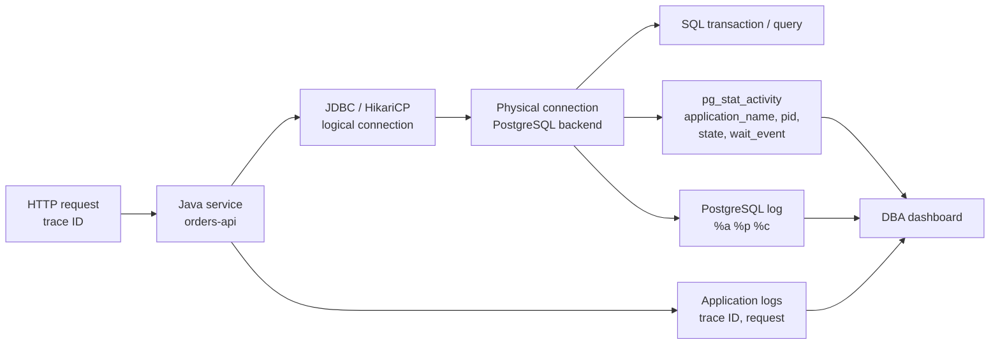

# Application Observability via `application_name` and Session Metadata in PostgreSQL

A PostgreSQL cluster serves an orders API, a payment worker, a reporting service, and administrative tasks. At peak load, connection counts rise and some requests turn unusually slow. When the DBA queries `pg_stat_activity`, all sessions are logged in with similar role names, many sit `idle`, a few wait on locks, and SQL queries are truncated. How can you tell **which application** opened which connections, **which session** is running a query, and **which session** is blocking another operation?

PostgreSQL provides a simple yet practical mechanism: the **`application_name`** runtime parameter. An application can declare a name at connection startup or update it during a session. PostgreSQL exposes this label in `pg_stat_activity` and can emit it to server logs via `log_line_prefix` using `%a`.

For example:

```text
application_name = orders-api/prod/writer
application_name = payment-worker/prod
application_name = reporting/prod/reader
application_name = dba-psql/maintenance
```

With consistent, stable names, operations teams can answer real questions:

- Which service holds the most connections?
- Are `orders-api` sessions executing SQL or sitting idle in the pool?
- Is a forgotten transaction stuck `idle in transaction`?
- Is a slow query spending time on I/O, CPU, or **waiting on a lock**?
- Can a PostgreSQL log line be correlated with the exact backend session?
- With PgBouncer in the path, does PostgreSQL see the original app name or the pooler's label?
- Why can `application_name` **never** replace authentication, historical metrics, or distributed tracing?

This lesson belongs to the **Application Connections** chapter in PostgreSQL, moving from label configuration, reading session metadata, and incident triage to Java/PgJDBC examples and production operations. It contains standalone practice SQL; steps requiring two or three sessions are clearly marked.

> **Security note:** `application_name` is **client-supplied/mutable metadata**, not an authenticated identity. Never use it to grant privileges, identify tenants, or decide whether a client may access a database.

## 1. The Big Picture: From Request to Backend Session

An HTTP request travels across multiple layers:



**Three distinct identifiers:**

1. **Application:** the `application_name` label naming the source or workload group, such as `orders-api/prod`.
2. **Database session:** backend `pid` along with `backend_start` and the log session ID.
3. **Request/trace:** identifier for a single business operation or HTTP request, managed by application logging and tracing.

One application can hold **many backend sessions**. One pooled backend session can serve **many consecutive requests**. Thus, `application_name` excels at grouping by **application**, yet **cannot alone prove** which HTTP request issued a specific SQL line.

### 1.1. Terms to Distinguish

| Term | Meaning in This Lesson |
| --- | --- |
| `application_name` | String runtime parameter labeling a session, visible in activity views and logs |
| `session/backend` | Server-side connection serving a client, backed by a backend process in standard PostgreSQL architecture |
| `pid` | Process ID of the current backend; the OS may reuse it after the process exits |
| `pg_stat_activity` | Live view showing point-in-time session/process activity |
| `connection pool` | Set of physical connections reused by an application |
| `transaction` | Unit of work bounded by `BEGIN`/`COMMIT`/`ROLLBACK`, typically shorter than a session |
| `query` | An SQL statement currently running or most recently processed by the backend |
| `wait_event` | Specific condition the backend is waiting on, if any |
| `log_line_prefix` | Format string adding metadata prefixes to PostgreSQL log lines |

Never treat these concepts as 1-to-1 equivalents.

## 2. What Is `application_name`?

`application_name` is a PostgreSQL runtime parameter that a client can provide at connect time or update later.

Check inside an open session:

```sql
SHOW application_name;
```

Or:

```sql
SELECT current_setting('application_name') AS application_name;
```

Example output:

```text
application_name
-------------------------
orders-api/prod/writer
```

PostgreSQL surfaces this label in:

- Column `pg_stat_activity.application_name`.
- Server log lines when `log_line_prefix` includes `%a`.
- Monitoring tools built on session/backend statistics.

### 2.1. A Label Is Not a Role Name

Compare:

```sql
SELECT
    current_user AS sql_role,
    session_user AS login_role,
    current_setting('application_name') AS app_label;
```

`current_user` and `session_user` reflect SQL identity/roles, which may change via `SET ROLE` or `SECURITY DEFINER` contexts. `application_name` is a **separate label**.

For instance, several services might log in as the same technical role `app_runtime`:

```text
role=app_runtime, application_name=orders-api/prod
role=app_runtime, application_name=payment-worker/prod
role=app_runtime, application_name=reporting/prod
```

Labels aid observability, yet whenever access privileges genuinely differ, **separate roles and privileges** instead of relying solely on different labels.

### 2.2. A Label Is Not a Hostname or IP

`application_name = 'orders-api/prod'` does not tell you which host or pod runs the service. Network addresses appear in other fields such as `client_addr`.

If traffic traverses NAT or a proxy, PostgreSQL sees the **NAT/proxy IP**. Application labels can also be overwritten or dropped by proxies if not forwarded properly.

### 2.3. A Label Is Not an Authorization Parameter

Never write rules like:

```text
If application_name = "trusted-admin", allow DELETE.
```

Clients can freely set `application_name` to anything they want. PostgreSQL relies on roles, authentication, `GRANT`s, policies, and transaction rules for access control; the application must also enforce authorization independently.

## 3. How to Name Applications Usefully

An operationally practical naming scheme is:

```text
<service>/<environment>/<pool-or-role>
```

Examples:

```text
orders-api/prod/writer
orders-api/prod/reader
payment-worker/prod
reporting/staging/reader
migration/prod
ops-psql/prod
```

You can pick another delimiter; what matters is **consistency, brevity, clarity, and keeping sensitive data out**.

### 3.1. What Should It Contain?

- **Service:** API, worker, batch, scheduler, or CLI.
- **Environment:** `prod`/`staging`/`dev`, preventing confusion if clusters are shared.
- **Workload pool/role:** `reader`/`writer`, or `batch`/`realtime` where helpful.
- **A short version tag** only when rollout tracking requires it and without creating unbounded distinct names.

### 3.2. What Should It Never Contain?

- Passwords, JWTs, API keys, session cookies.
- Emails, phone numbers, full names, or sensitive query values.
- Customer/tenant IDs restricted from monitoring views.
- Full HTTP URLs, query strings, or request bodies.
- Per-request random IDs if they generate unbounded cardinality.
- Raw, untrusted user input.

Labels show up in logs and DBA dashboards. Ensure they comply with your **data protection policies**.

### 3.3. Length Limit

In standard PostgreSQL builds, `application_name` is capped at `NAMEDATALEN - 1` bytes (typically **63 bytes** max). Longer strings are silently truncated, and multi-byte UTF-8 characters consume multiple bytes each.

Thus, two long strings sharing a prefix and differing only near the end **collapse into the same truncated label**.

Prefer concise names with the most important parts first:

```text
orders-api/prod/writer
```

rather than cramming hostname, pod UID, release SHA, tenant, and request ID into one long string.

## 4. Setting `application_name` at Connection Time

The cleanest way to set a **stable default label for a pool** is at physical connection establishment so PostgreSQL observes the label from the start of the session's lifecycle.

### 4.1. Via `libpq`/`psql` Using `PGAPPNAME`

In bash or compatible shells:

```bash
PGAPPNAME='ops-psql/staging' \
psql "host=db.internal.example port=5432 dbname=ordersdb user=report_ro"
```

`PGAPPNAME` is a `libpq` environment variable supplying `application_name` when connecting.

Verify after logging in:

```sql
SHOW application_name;
```

Host, database, and role names above are illustrative; you need a reachable PostgreSQL server, valid role, and proper authentication.

### 4.2. Via `libpq` Connection Strings

In keyword/value `libpq` syntax, pass the plain string directly without URL-encoding `/`:

```bash
psql "host=db.internal.example port=5432 dbname=ordersdb user=report_ro application_name=ops-psql/staging"
```

When using a **URI** instead of keyword/value syntax, URL-encode special characters:

```text
postgresql://db.internal.example:5432/ordersdb?application_name=ops-psql%2Fstaging
```

Never pass real passwords on the command line where they leak into process lists and shell history.

### 4.3. Via JDBC Connection Properties

PgJDBC supports the `ApplicationName` property.

```java
import java.sql.Connection;
import java.sql.DriverManager;
import java.sql.PreparedStatement;
import java.sql.ResultSet;
import java.sql.SQLException;
import java.util.Properties;

public class JdbcApplicationNameDemo {
    public static void main(String[] args) throws SQLException {
        Properties properties = new Properties();
        properties.setProperty("user", System.getenv("DB_USER"));
        properties.setProperty("password", System.getenv("DB_PASSWORD"));
        properties.setProperty(
            "ApplicationName",
            "orders-api/staging/writer"
        );

        String url =
            "jdbc:postgresql://db.internal.example:5432/ordersdb";

        try (Connection connection =
                 DriverManager.getConnection(url, properties);
             PreparedStatement statement = connection.prepareStatement(
                 "SELECT current_setting('application_name'), pg_backend_pid()"
             );
             ResultSet rs = statement.executeQuery()) {

            if (rs.next()) {
                System.out.println("Application: " + rs.getString(1));
                System.out.println("Backend PID: " + rs.getInt(2));
            }
        }
    }
}
```

This illustrates connection wiring and will not run without a real database, role, and secrets. In production, fetch credentials via a secret manager rather than hardcoding them.

### 4.4. Via JDBC URL

You can also pass it in the JDBC URL query string per PgJDBC syntax:

```text
jdbc:postgresql://db.internal.example:5432/ordersdb?ApplicationName=orders-api%2Fstaging%2Fwriter
```

Characters requiring URL-encoding in query parameters must be encoded properly. For real services, pick **one authoritative config source** (URL, `Properties`, or `DataSource` properties) rather than stacking overrides inconsistently.

## 5. HikariCP: Labeling Physical Connections

Java services typically use HikariCP or a similar pool. Set the label when the pool creates physical connections:

```java
import com.zaxxer.hikari.HikariConfig;
import com.zaxxer.hikari.HikariDataSource;

public final class DataSources {
    public static HikariDataSource createWriterPool() {
        HikariConfig config = new HikariConfig();

        config.setJdbcUrl(
            "jdbc:postgresql://db.internal.example:5432/ordersdb"
        );
        config.setUsername(System.getenv("DB_USER"));
        config.setPassword(System.getenv("DB_PASSWORD"));

        config.setMaximumPoolSize(12);
        config.setPoolName("orders-writer-pool");

        config.addDataSourceProperty(
            "ApplicationName",
            "orders-api/prod/writer"
        );

        return new HikariDataSource(config);
    }
}
```

These two properties are **distinct**:

| Property | Where Observed | Meaning |
| --- | --- | --- |
| `config.setPoolName(...)` | HikariCP metrics/logs | Pool name inside the application |
| PgJDBC `ApplicationName` | `pg_stat_activity.application_name`, PostgreSQL logs | Session label on the server |

HikariCP's `PoolName` **does not automatically become PostgreSQL's `application_name`**. Always set the PgJDBC `ApplicationName` connection property to label server sessions.

### 5.1. Separating Reader and Writer Pools

When an architecture defines two `DataSource`s:

```text
orders-api/prod/reader
orders-api/prod/writer
```

DBAs can inspect connections and queries for both workload classes separately. In the application, reader and writer pools may carry separate JDBC URLs, credentials, and routing endpoints.

Merely **setting different labels** does not enforce read-only access. Roles, `GRANT`s, replica routing, and transaction semantics must be configured separately.

### 5.2. `Connection.close()` Does Not Always Close the Backend

With a pool:

```java
try (Connection connection = dataSource.getConnection()) {
    // Query...
}
```

`connection.close()` normally **returns the logical connection to the pool**. The physical connection to PostgreSQL stays alive, appearing as `idle` in `pg_stat_activity`.

That is not automatically a connection leak. Always correlate with **active/idle/waiting** metrics inside the pool.

### 5.3. Connection Counts Multiply Across App Instances

Suppose 20 pods each allow up to 12 physical connections:

```text
20 pods × 12 connections/pod = up to 240 connections to the DB
```

This represents a **theoretical pool-side ceiling**, not a claim that 240 sessions are always open. Actual counts depend on `minimumIdle`, traffic demand, networking, PgBouncer, and PostgreSQL limits.

Labels identify which service owns sessions; they do not shrink connection counts. If server capacity is exceeded, revisit pool sizing and connection architecture.

## 6. Changing `application_name` Inside an SQL Session

An open session can update its label:

```sql
SET application_name = 'ops-psql/staging';

SHOW application_name;
```

The new value takes effect in session activity and logs from that point onward.

### 6.1. Session-Level Values Persist in Pooled Connections

If a request runs:

```sql
SET application_name = 'checkout-request';
```

and returns the physical connection to the pool **without resetting**, the next request inherits a backend still tagged `checkout-request`.

That is a classic **session state leak** in connection pooling, misattributing subsequent workloads on dashboards and logs.

Set a **stable label at connection startup**. Only override per request when transaction scoping and resets are strictly controlled.

### 6.2. `RESET application_name`

```sql
RESET application_name;
```

restores the parameter to the session's configured startup/default context; do not assume it always restores an arbitrary **initial pool label** if multiple configuration layers interact.

If you need deterministic defaults, keep them in pool startup settings and rely on controlled pool/driver resets. Prefer avoiding session-level `SET application_name` in ordinary requests.

### 6.3. Setting via `set_config`

PostgreSQL provides:

```sql
SELECT set_config(
    'application_name',
    'ops-psql/staging',
    false
);
```

The final boolean parameter controls scope:

- `false`: **session-scoped**, like `SET`.
- `true`: **transaction-local**, like `SET LOCAL`.

Using `set_config` allows clean parameter binding from JDBC instead of string-concatenating `SET ... 'user_value'`.

## 7. `SET LOCAL`: Tagging a Single Transaction

When temporarily tagging a batch job or specific operation, use:

```sql
BEGIN;

SET LOCAL application_name = 'orders-api/prod/reconcile';

-- Statements below run inside this same transaction.
SELECT COUNT(*)
FROM pg_catalog.pg_class;

COMMIT;
```

`SET LOCAL` lasts strictly for the active transaction and automatically reverts when the transaction ends per PostgreSQL semantics.

### 7.1. `SET LOCAL` Does Not Tag an Entire HTTP Request

A single HTTP request can span **multiple transactions** or borrow different connections. `SET LOCAL` applies strictly to **that one transaction**, not across sessions for a request.

For example:

```text
HTTP request
   |
   +-- Transaction A -> backend 101 -> SET LOCAL -> query A
   |
   +-- Transaction B -> backend 205 -> does not automatically inherit label A
```

For end-to-end request correlation, rely on **trace IDs in application tracing and logs**. `application_name` enriches DB session visibility rather than replacing tracing.

### 7.2. Never Issue Standalone `SET LOCAL` Outside an Explicit Transaction

When `autoCommit` is enabled, sending `SET LOCAL` by itself resets as soon as that single statement's implicit transaction finishes, leaving the next query untagged.

In JDBC, transaction-local tagging requires managing explicit transaction boundaries.

### 7.3. Tagging via JDBC with Parameter Binding

```java
import java.sql.Connection;
import java.sql.PreparedStatement;
import java.sql.ResultSet;
import java.sql.SQLException;
import javax.sql.DataSource;

public class ReconcileRepository {
    private final DataSource dataSource;

    public ReconcileRepository(DataSource dataSource) {
        this.dataSource = dataSource;
    }

    public long countOrders() throws SQLException {
        try (Connection connection = dataSource.getConnection()) {
            boolean previousAutoCommit = connection.getAutoCommit();
            connection.setAutoCommit(false);

            try {
                try (PreparedStatement tag = connection.prepareStatement(
                         "SELECT set_config('application_name', ?, true)"
                     )) {
                    tag.setString(1, "orders-api/prod/reconcile");
                    try (ResultSet ignored = tag.executeQuery()) {
                        ignored.next();
                    }
                }

                long count;
                try (PreparedStatement query = connection.prepareStatement(
                         "SELECT COUNT(*) FROM pg_catalog.pg_class"
                     );
                     ResultSet rs = query.executeQuery()) {
                    rs.next();
                    count = rs.getLong(1);
                }

                connection.commit();
                return count;
            } catch (SQLException | RuntimeException error) {
                connection.rollback();
                throw error;
            } finally {
                connection.setAutoCommit(previousAutoCommit);
            }
        }
    }
}
```

This shows **`set_config(..., true)` and the target query sharing the exact same transaction and connection**. `SELECT COUNT(*) FROM pg_catalog.pg_class` is purely illustrative, not a real order report.

Production code must still integrate timeouts, business transaction management, and retry policies. Never override framework-managed transactions (Spring/JTA) with ad-hoc `setAutoCommit`/`commit` calls.

## 8. How Does PostgreSQL Inspect the Current Connection?

Inside an **open session**, run:

```sql
SELECT
    pg_backend_pid() AS backend_pid,
    current_database() AS database_name,
    current_user AS current_role,
    session_user AS login_role,
    current_setting('application_name') AS application_name,
    inet_client_addr() AS client_ip,
    inet_client_port() AS client_port,
    inet_server_addr() AS server_ip,
    inet_server_port() AS server_port,
    pg_postmaster_start_time() AS server_started_at;
```

Columns:

- `pg_backend_pid()`: PID of the backend serving this session.
- `current_database()`: connected database.
- `current_user`: active role for SQL permission checks.
- `session_user`: authenticated session role.
- `inet_client_addr()` / `inet_client_port()`: TCP client IP and port, when applicable.
- `inet_server_addr()` / `inet_server_port()`: TCP server endpoint, when applicable.
- `pg_postmaster_start_time()`: server instance start timestamp, **not** connection start time.

### 8.1. Unix Sockets Have No Client IP

Over a Unix-domain socket, `inet_client_addr()` returns SQL `NULL`. That does not mean “unknown client” or “hidden by TLS”; local domain sockets simply lack TCP addresses.

`client_port` in `pg_stat_activity` also carries special values for Unix sockets and internal backends; never treat it as an HTTP or public app port.

### 8.2. Source IPs Behind NAT or Proxies

In a topology like:

```text
orders-api pod -> PgBouncer / NAT -> PostgreSQL
```

`inet_client_addr()` and `pg_stat_activity.client_addr` display the **PgBouncer or egress IP**, not the pod IP or end-user browser IP.

Attribution across NAT/proxies requires reconciling network topology and multi-layer logs rather than treating DB client IPs as end-user identities.

## 9. `pg_stat_activity`: Central View for Session Observability

General inspection query:

```sql
SELECT
    a.pid,
    a.application_name,
    a.usename,
    a.datname,
    a.client_addr,
    a.backend_start,
    a.xact_start,
    a.query_start,
    a.state_change,
    a.state,
    a.wait_event_type,
    a.wait_event,
    left(a.query, 160) AS query_preview
FROM pg_stat_activity AS a
WHERE a.backend_type = 'client backend'
ORDER BY a.backend_start DESC, a.pid;
```

This is a **point-in-time snapshot**, not a historical log of every SQL statement run since startup.

### 9.1. Identity Columns

| Column | Meaning |
| --- | --- |
| `pid` | Backend process PID |
| `datname` | Database the backend is attached to |
| `usename` | Authenticated database role for the session |
| `application_name` | Client/session-declared label |
| `client_addr` | Client connection IP seen by PostgreSQL; may be `NULL` |
| `client_hostname` | Client hostname if reverse DNS resolves and is configured |
| `client_port` | Client TCP port or special indicator |
| `backend_type` | Process type, e.g., `client backend` vs. background worker |
| `backend_start` | Timestamp when the backend process started |

### 9.2. Activity Columns

| Column | Meaning |
| --- | --- |
| `state` | Session/backend activity state |
| `query` | Running query or last query when idle, subject to visibility privileges |
| `query_start` | When current query started; when idle, usually the last executed query |
| `xact_start` | When current transaction started, or `NULL` |
| `state_change` | When the backend entered its current `state` |
| `wait_event_type` | Category of current wait, if waiting |
| `wait_event` | Specific wait event, if waiting |
| `backend_xid` | Assigned transaction ID, if any |
| `backend_xmin` | Backend's `xmin` horizon if active, relevant for vacuum retention |
| `query_id` | Query identifier when computed/enabled |

Exact columns and availability vary by PostgreSQL **major version**. Always verify view definitions against your running version's documentation.

### 9.3. Truncated or Restricted Query Text

`a.query` can be:

- Truncated per `track_activity_query_size`.
- Hidden/restricted by observer role permissions.
- The active SQL when `state = 'active'`.
- The **previous SQL** when `state = 'idle'`.

Never treat `query_preview` as complete SQL; `left(..., 160)` truncates it even further for readability.

## 10. Creating Practice Data

To simulate application queries safely, create a lab schema `obs_lab` in a practice database.

```sql
CREATE SCHEMA IF NOT EXISTS obs_lab;

CREATE TABLE obs_lab.orders (
    order_id bigint GENERATED ALWAYS AS IDENTITY PRIMARY KEY,
    tenant_id integer NOT NULL,
    status text NOT NULL CHECK (status IN ('paid', 'pending')),
    amount numeric(12, 2) NOT NULL CHECK (amount >= 0),
    created_at timestamptz NOT NULL
);

INSERT INTO obs_lab.orders (
    tenant_id, status, amount, created_at
)
SELECT
    (g % 4) + 1,
    CASE WHEN g % 3 = 0 THEN 'pending' ELSE 'paid' END,
    (g % 5000)::numeric / 100,
    TIMESTAMPTZ '2026-01-01 00:00:00+00'
        + (g % 60) * INTERVAL '1 day'
FROM generate_series(1, 1200) AS s(g);

CREATE INDEX idx_obs_orders_tenant_status
ON obs_lab.orders (tenant_id, status, created_at DESC);

ANALYZE obs_lab.orders;
```

This creates 1,200 synthetic rows across 4 tenants strictly for practicing session and lock observability—**not a production-scale benchmark**.

### 10.1. An API Query

```sql
SELECT
    order_id, amount, created_at
FROM obs_lab.orders
WHERE tenant_id = 2
  AND status = 'paid'
ORDER BY created_at DESC, order_id DESC
LIMIT 20;
```

### 10.2. A Reporting Worker Query

```sql
SELECT
    tenant_id,
    status,
    COUNT(*) AS order_count,
    SUM(amount) AS total_amount
FROM obs_lab.orders
GROUP BY tenant_id, status
ORDER BY tenant_id, status;
```

In live activity views, identical SQL templates can show up under multiple `application_name` values depending on which connections issue them.

## 11. Two Sessions Observing `application_name`

Open **two terminal or SQL connections** to the same practice database.

### Session A — API

```sql
SET application_name = 'orders-api/lab';

SELECT
    pg_backend_pid() AS pid,
    current_setting('application_name') AS app;

SELECT pg_sleep(15);
```

### Session B — Observer

```sql
SET application_name = 'ops-observer/lab';

SELECT
    pid,
    application_name,
    state,
    wait_event_type,
    wait_event,
    query_start,
    query
FROM pg_stat_activity
WHERE application_name = 'orders-api/lab';
```

Running Session B **while Session A is sleeping** shows:

- `application_name = 'orders-api/lab'`.
- `state = 'active'`.
- `query` as `SELECT pg_sleep(15)`.
- `wait_event_type = 'Timeout'` and `wait_event = 'PgSleep'`.

Once `pg_sleep` finishes, Session A returns to `idle`. Its `query` column **continues displaying `SELECT pg_sleep(15)` as its last query**—which does not mean it is still executing.

### 11.1. Why Use `pg_sleep`?

`pg_sleep` keeps a statement active long enough to observe comfortably from another session. It does not simulate CPU-bound or disk-I/O-bound workloads since it simply sleeps on a timer.

Use short sleeps only in practice labs; never launch hundreds of `pg_sleep` sessions in production.

### 11.2. Do Not Inspect Session A from Inside A Expecting `idle`

Whenever a session queries `pg_stat_activity` for `pid = pg_backend_pid()`, its own backend is **active** executing that very query.

Use a second observer connection to check A's state **between client queries**.

## 12. Key Session States

Common `pg_stat_activity.state` values:

| State | Practical Interpretation |
| --- | --- |
| `active` | Backend is actively executing a query |
| `idle` | Backend finished the last command and is awaiting the next client command |
| `idle in transaction` | Transaction is open while the backend waits for the client's next command |
| `idle in transaction (aborted)` | Transaction failed with an error and awaits client rollback/end |
| `fastpath function call` | Backend is executing a fast-path function call |
| `disabled` | Activity tracking is disabled for this backend |

### 12.1. `idle` Is Not Automatically an Error

If a Java pool holds 8 physical connections with 2 actively handling requests, seeing 6 `idle` backends is **completely normal**. Pools keep warm connections ready so upcoming requests skip TCP/TLS/auth setup.

To diagnose connection leaks, combine:

- Pool metrics: active, idle, pending, and acquire timeouts.
- Total backend count per `application_name`.
- `backend_start` and `state_change`.
- Transaction age and held locks/resources.
- Lifecycle logs and retry patterns.

Never kill `idle` sessions arbitrarily simply because they appear “inactive.”

### 12.2. `idle in transaction` Is Far More Dangerous

`idle in transaction` means an open transaction sits idle without running SQL. It can:

- Hold locks longer than necessary.
- Pin snapshots/`xmin`, blocking vacuum dead-tuple cleanup.
- Drive table bloat and stall other sessions on locks.
- Reveal code that forgot `commit`/`rollback` or called slow external APIs mid-transaction.

Prioritize investigating transactions **with high age and real blocking/vacuum impact**, rather than merely counting state labels.

### 12.3. Aborted Transactions Require Rollback

`idle in transaction (aborted)` means an error failed the open transaction and the client never rolled back.

This is not a slow query; application error handling must clean up the transaction. Changing `application_name` will never clear an aborted transaction.

## 13. `query_start`, `xact_start`, and `state_change` Differ

Three frequently confused timestamps:

- `query_start`: when the current query started if `active`, or when the previous query started if `idle`.
- `xact_start`: when the current open transaction began, or `NULL` outside any transaction.
- `state_change`: when the backend transitioned into its current `state`.

Timeline example:

```text
10:00:00 BEGIN
10:00:01 UPDATE orders ...
10:00:02 UPDATE finishes; session sits idle in transaction
10:07:00 DBA checks pg_stat_activity

xact_start    ~ 10:00:00
query_start   ~ 10:00:01 (most recent prior query)
state_change  ~ 10:00:02
state         = idle in transaction
```

Here the transaction has stayed open for 7 minutes even though the `UPDATE` itself took only 1 second.

### 13.1. Long-Running Active Queries

```sql
SELECT
    pid,
    application_name,
    usename,
    datname,
    clock_timestamp() - query_start AS query_age,
    wait_event_type,
    wait_event,
    left(query, 240) AS query_preview
FROM pg_stat_activity
WHERE state = 'active'
  AND pid <> pg_backend_pid()
  AND query_start IS NOT NULL
ORDER BY query_age DESC;
```

**Filtering `state = 'active'` is critical.** Omitting it turns every `idle` session from 2 hours ago into a fake “2-hour running query.”

### 13.2. Long-Open Transactions

```sql
SELECT
    pid,
    application_name,
    usename,
    datname,
    state,
    clock_timestamp() - xact_start AS transaction_age,
    clock_timestamp() - state_change AS state_age,
    left(query, 160) AS last_or_current_query
FROM pg_stat_activity
WHERE xact_start IS NOT NULL
  AND pid <> pg_backend_pid()
ORDER BY xact_start;
```

Treat this as an **investigation list**, not a blind kill list. A long read-only report still requires examining isolation, snapshots, and locks before intervening.

### 13.3. Idle Duration

```sql
SELECT
    pid,
    application_name,
    state,
    clock_timestamp() - state_change AS idle_duration,
    backend_start
FROM pg_stat_activity
WHERE state = 'idle'
  AND backend_type = 'client backend'
ORDER BY state_change;
```

`idle_duration` differs from `connection_age`. A pooled connection alive for hours that finished work 2 seconds ago is normal.

### 13.4. `clock_timestamp()` vs. `now()`

In PostgreSQL:

- `now()` / `transaction_timestamp()` stays frozen at the start of the current transaction.
- `clock_timestamp()` reads the wall-clock time at each call.

If monitoring queries run inside a longer transaction, `clock_timestamp()` yields accurate elapsed durations. Even better, keep real-time dashboard monitoring queries in short transactions.

## 14. Grouping Connection Counts by `application_name`

A practical operational summary query:

```sql
SELECT
    COALESCE(
        NULLIF(application_name, ''),
        '<unset>'
    ) AS app,
    datname,
    usename,
    COUNT(*) AS total_connections,
    COUNT(*) FILTER (
        WHERE state = 'active'
    ) AS active_connections,
    COUNT(*) FILTER (
        WHERE state = 'idle'
    ) AS idle_connections,
    COUNT(*) FILTER (
        WHERE state LIKE 'idle in transaction%'
    ) AS idle_in_transaction_connections
FROM pg_stat_activity
WHERE backend_type = 'client backend'
GROUP BY
    COALESCE(NULLIF(application_name, ''), '<unset>'),
    datname,
    usename
ORDER BY total_connections DESC, app;
```

**Illustrative** sample output (not fixed lab numbers):

| app | database | role | total | active | idle | idle in transaction |
| --- | --- | --- | ---: | ---: | ---: | ---: |
| `orders-api/prod/writer` | `ordersdb` | `orders_api` | 40 | 5 | 34 | 1 |
| `reporting/prod` | `ordersdb` | `report_ro` | 12 | 3 | 9 | 0 |
| `payment-worker/prod` | `ordersdb` | `payment_worker` | 8 | 1 | 6 | 1 |

### 14.1. Why Group by Database and Role Too?

One `application_name` string could appear across multiple databases or roles. Grouping solely by app hides key distinctions:

- Reader pools on replicas vs. writer pools on primary.
- Write roles vs. read-only roles.
- Staging and production sharing a cluster.
- Batch jobs touching multiple databases.

Choose grouping dimensions matching your operational question.

### 14.2. Empty Labels or Missing Conventions

Not every client sets a name; `application_name` may be empty or hold a generic tool default.

`COALESCE(NULLIF(application_name, ''), '<unset>')` only normalizes display; it **does not fix the underlying session label**.

If many sessions fall under `<unset>`, fix client/pool configuration and verify new connections rather than papering over it with dashboard guesswork.

## 15. Correlating Pool Saturation with PostgreSQL Data

Suppose HikariCP metrics report:

```text
active=12
idle=0
pending=27
max=12
```

And PostgreSQL shows 12 sessions labeled `orders-api/prod/writer`.

Interpretation:

- The pool has maxed out its physical connection capacity.
- 27 logical requests are queued **waiting to borrow a connection**.
- The DB might be running slow queries, waiting on locks, or simply holding transactions open too long.
- `pg_stat_activity` reveals what those 12 backends are doing, yet **cannot see the 27 queued threads waiting inside Java**.

Key takeaway: **the pool wait queue lives in the application**, invisible as rows in PostgreSQL.

### 15.1. Combining Two Telemetry Layers

| Question | Observation Source |
| --- | --- |
| How many Java threads/requests are waiting for a connection? | HikariCP / pool metrics |
| How many backends are connected? | `pg_stat_activity` |
| What are those backends doing? | `state` / `wait_event` / `query` |
| Which queries consume the most total DB time? | `pg_stat_statements` when enabled |
| Which HTTP requests are slow? | Application tracing / logs |
| Is a query blocked by locks? | `pg_blocking_pids()`, `pg_locks` |
| Where do connections originate? | `client_addr`, network topology, pooler logs |

No single view answers every question.

### 15.2. Larger Pools Are Not Always Better

When threads queue on the pool, bumping max pool size from 12 to 80 can overload PostgreSQL if the bottleneck is CPU, I/O, or lock contention. Measure first:

- Useful concurrent transactions.
- Query latency and lock waits.
- DB CPU, memory, and I/O saturation.
- `pods × maxPoolSize`.
- `max_connections` and superuser reserved slots.
- Pool acquisition timeouts.

`application_name` **assigns ownership to connection consumers**; it does not replace capacity planning.

## 16. What Do `wait_event_type` and `wait_event` Show?

`state = 'active'` does not automatically mean burning CPU. An active backend can be **blocked waiting**.

Fields:

- `wait_event_type`: wait category such as `Lock`, `IO`, `Client`, `Timeout`, `LWLock`, depending on version and event.
- `wait_event`: exact wait condition inside that category.

During `pg_sleep`, for example, you typically observe `Timeout/PgSleep`.

### 16.1. Active Yet Waiting on a Lock

```text
state=active
wait_event_type=Lock
wait_event=transactionid
```

frequently appears when an `UPDATE` waits on another transaction holding a row lock. Exact lock types and wait events vary by SQL and object.

### 16.2. Active with `wait_event_type IS NULL`

`wait_event_type IS NULL` does not prove 100% CPU burn—only that the backend was not paused at an instrumented wait event at that snapshot instant.

Analyzing CPU, disk I/O, or network bottlenecks requires OS metrics, PostgreSQL statistics, and query plans.

### 16.3. What Is a `Client` Wait?

A backend may wait for the client to send the next command or flush socket reads/writes. Not every `Client` wait signals a DB bug; it could be normal result streaming, a slow client network, or an idle connection.

Always read **`state` alongside `wait_event`** rather than inspecting either field in isolation.

## 17. Three-Session Lock-Wait Experiment

To practice linking `application_name` to blockers and waiters, open two writer sessions and one observer session.

### Session A — Hold a Transaction and Row Lock

```sql
SET application_name = 'orders-api/lab/blocker';

BEGIN;

UPDATE obs_lab.orders
SET amount = amount + 1
WHERE order_id = 1;

-- Keep transaction open to reproduce a lock wait.
-- DO NOT COMMIT until Session B starts its UPDATE.
```

Updating `order_id = 1` holds the row lock until `COMMIT` or `ROLLBACK`.

### Session B — Attempt to Update the Same Row

```sql
SET application_name = 'payment-worker/lab/waiter';

SET lock_timeout = '20s';

UPDATE obs_lab.orders
SET amount = amount + 2
WHERE order_id = 1;
```

While A remains open, B waits. After 20 seconds, `lock_timeout` aborts B cleanly so the lab session never hangs forever.

### Session C — Observe

```sql
SET application_name = 'ops-observer/lab';

SELECT
    pid,
    application_name,
    state,
    wait_event_type,
    wait_event,
    pg_blocking_pids(pid) AS blocking_pids,
    left(query, 180) AS query_preview
FROM pg_stat_activity
WHERE application_name LIKE '%/lab/%'
ORDER BY application_name, pid;
```

You will see `payment-worker/lab/waiter` waiting, with `pg_blocking_pids(pid)` listing Session A's PID.

### 17.1. Cleanly Ending the Experiment

In Session A:

```sql
ROLLBACK;
```

Session B then finishes its `UPDATE` if it has not timed out yet. If you prefer keeping lab data unmodified, run B inside a transaction and `ROLLBACK` (above, default autocommit commits B once unblocked). You can always reset or recreate the lab schema afterward.

In Session B:

```sql
RESET lock_timeout;
```

Never leave practice sessions holding open transactions after finishing an exercise.

## 18. Listing Blocking Sessions with `application_name`

Practical diagnostic query:

```sql
SELECT
    waiting.pid AS waiting_pid,
    waiting.application_name AS waiting_app,
    waiting.usename AS waiting_role,
    waiting.state AS waiting_state,
    waiting.wait_event_type,
    waiting.wait_event,
    blocker.pid AS blocking_pid,
    blocker.application_name AS blocking_app,
    blocker.usename AS blocking_role,
    blocker.state AS blocking_state,
    blocker.xact_start AS blocking_xact_start,
    left(waiting.query, 180) AS waiting_sql,
    left(blocker.query, 180) AS blocking_last_or_current_sql
FROM pg_stat_activity AS waiting
CROSS JOIN LATERAL
    unnest(pg_blocking_pids(waiting.pid)) AS b(blocking_pid)
JOIN pg_stat_activity AS blocker
    ON blocker.pid = b.blocking_pid
ORDER BY waiting.pid, blocker.pid;
```

This shows **who is blocking whom**, labeled with the application names on both sides.

### 18.1. Blockers Are Often `idle in transaction`

Common observation:

```text
waiting_app=payment-worker/lab/waiter, waiting_state=active
blocking_app=orders-api/lab/blocker, blocking_state=idle in transaction
```

When the observer inspects, the blocker already finished its `UPDATE` and sits waiting for its client to send `COMMIT` or `ROLLBACK`. **The blocking `UPDATE` is no longer `active`**, yet its transaction still holds the lock.

Never filter strictly for `state = 'active'` and wrongly conclude “nobody is blocking anything.”

### 18.2. `pg_blocking_pids()` Beats Guessing Manually from `pg_locks`

Writing custom self-joins over `pg_locks` easily misses lock wait queues or soft blockers.

`pg_blocking_pids()` reports blocking PIDs accurately per PostgreSQL's internal lock logic; use it as your starting point for blocking chains.

Special cases such as prepared transactions report special values (like PID `0`), so an `INNER JOIN` on `pg_stat_activity` can omit non-backend blockers. When rows seem missing, inspect `pg_locks` and `pg_prepared_xacts` directly.

## 19. What Does `pg_locks` Add?

`pg_stat_activity` describes backends; `pg_locks` lists held and awaited locks.

```sql
SELECT
    a.pid,
    a.application_name,
    a.state,
    l.locktype,
    l.mode,
    l.granted,
    l.relation::regclass AS relation_name,
    l.transactionid
FROM pg_locks AS l
JOIN pg_stat_activity AS a
    ON a.pid = l.pid
WHERE a.application_name LIKE '%/lab/%'
ORDER BY a.pid, l.granted, l.locktype, l.mode;
```

Columns:

- `locktype`: category of locked object/identifier.
- `mode`: lock mode.
- `granted`: whether acquired (`true`) or awaiting acquisition (`false`).
- `relation`: target relation OID when applicable, otherwise `NULL`.
- `transactionid`: transaction ID when relevant.

One `UPDATE` acquires multiple locks, and modified rows do not each appear as individual persistent rows inside `pg_locks`.

### 19.1. Do Not Rashly Kill the First Blocker You Spot

A blocker may belong to a critical accounting transaction. Terminating it forces a rollback and may trigger blind application retries or double submissions if idempotency is missing.

Follow a disciplined runbook:

1. Check query and transaction age.
2. Check `application_name`, role, and origin.
3. Identify the business operation and owner.
4. Assess the lock chain and blast radius.
5. Check whether the application can finish or roll back cleanly itself.
6. Only if warranted, cancel/terminate per authorization and operational procedure.

## 20. Inspecting `idle in transaction` Sessions by Application

Quick triage query:

```sql
SELECT
    pid,
    application_name,
    usename,
    datname,
    client_addr,
    clock_timestamp() - xact_start AS xact_age,
    clock_timestamp() - state_change AS idle_state_age,
    backend_xmin,
    left(query, 220) AS last_query
FROM pg_stat_activity
WHERE state LIKE 'idle in transaction%'
  AND xact_start IS NOT NULL
ORDER BY xact_start;
```

Questions to answer:

- Which session holds the oldest transaction?
- Which service and pool owns it?
- Does it pin a low `backend_xmin` hindering vacuum?
- Is it blocking other backends?
- What was its last `query`, and do app logs show it stalled on network/HTTP work inside the transaction?

### 20.1. `backend_xmin` and Vacuum

Long-lived transactions/snapshots keep old row versions visible, blocking MVCC dead-tuple reclamation. Inspect `backend_xmin` alongside replication slots and prepared transactions.

**Not every `idle in transaction` session pins the same `backend_xmin`**, and not every vacuum delay stems from user sessions. Check vacuum/bloat stats and snapshot retention broadly during deep investigations.

### 20.2. Configure Appropriate Timeouts

PostgreSQL parameters help guard against abandoned transactions:

- `idle_in_transaction_session_timeout`: terminates sessions idle inside transactions past the limit.
- `statement_timeout`: bounds statement execution time.
- `lock_timeout`: bounds lock wait time.
- `idle_session_timeout`: terminates sessions idle outside transactions (coordinate carefully with poolers).

Example **for a lab session only**:

```sql
SET idle_in_transaction_session_timeout = '30s';
SET statement_timeout = '20s';
SET lock_timeout = '5s';
```

Tuning production timeouts must factor in SLOs, valid long transactions, and driver/pool retry behavior. Setting `idle_session_timeout` too low often disrupts normal pooled idle connections.

## 21. `pg_stat_activity` Is Not Query History

Running:

```sql
SELECT * FROM pg_stat_activity;
```

captures only **current instantaneous state**. A 3 ms query may never appear to a dashboard polling every 5 seconds.

### 21.1. What `pg_stat_activity` Does Well

- Shows who is connected right now.
- Shows queries active at observation time.
- Groups workload by `application_name`.
- Surfaces abnormally long transactions.
- Shows current wait events and blockers.
- Identifies connection origin, role, and database.

### 21.2. What It Does Not Provide

- Complete history of all executed SQL.
- Per-API p95/p99 latency distributions.
- Bind parameter values of every `PreparedStatement`.
- Count of HTTP requests served by a backend.
- Past SQL errors once sessions close.
- Prior query result sets.
- Application-level user permissions.

Longitudinal visibility requires logs, metrics, traces, or specialized extensions.

### 21.3. The Observer Sees Itself

`pg_stat_activity` includes your own observer session, showing `active` while running the monitoring query.

To exclude yourself:

```sql
WHERE pid <> pg_backend_pid()
```

For cluster-wide aggregation, exclude dedicated observer connections via distinct `application_name` and monitoring roles.

## 22. `query_id` and `pg_stat_statements`: Not Application Labels

In supported PostgreSQL versions, `pg_stat_activity.query_id` exposes a normalized query identifier when enabled/computed.

```sql
SELECT
    pid,
    application_name,
    query_id,
    state,
    left(query, 120) AS query_preview
FROM pg_stat_activity
WHERE backend_type = 'client backend';
```

`query_id` may be `NULL` or unavailable depending on version and configuration.

### 22.1. What Is `pg_stat_statements` For?

The `pg_stat_statements` extension aggregates metrics per normalized query pattern grouped by database, user, and query ID:

- Execution call count.
- Total and mean execution time.
- Total rows.
- Buffer and I/O stats where supported.
- Planning statistics depending on configuration.

It excels at finding expensive SQL families and performance regressions.

### 22.2. Do Not Assume `pg_stat_statements` Groups by `application_name`

**`pg_stat_statements` has no standard `application_name` column to slice cumulative calls directly by app label.**

One query fingerprint can be executed by multiple services. Attributing query cost per service typically requires:

- Application-layer metrics and distributed tracing.
- PostgreSQL logs including `%a` with query duration.
- Distinct roles or databases per service.
- External observability correlation.

Never join `pg_stat_statements` to `pg_stat_activity` on `query_id` assuming you recover **complete historical app attribution**. `pg_stat_activity` holds only live instantaneous sessions whereas `pg_stat_statements` aggregates across time.

### 22.3. `query_id` Is Not a Business Trace ID

`query_id` identifies a **query template**, not an individual request. Two unrelated requests share the same `query_id`. Keep request/trace IDs in application tracing.

## 23. PostgreSQL Logs: Including `application_name` with `%a`

Example `log_line_prefix`:

```text
log_line_prefix = '%m [%p] %c %u@%d app=%a client=%h '
```

Token meanings:

| Token | Content |
| --- | --- |
| `%m` | Log timestamp with milliseconds |
| `%p` | Process ID |
| `%c` | Log session ID (disambiguates reused PIDs) |
| `%u` | User/role name |
| `%d` | Database name |
| `%a` | `application_name` |
| `%h` | Client host/IP when available |
| `%r` | Remote host/IP and remote port |

**Illustrative** log line:

```text
2026-11-14 10:30:00.123 +07 [24567] 6736abc0.5ff7 orders_api@ordersdb app=orders-api/prod/writer client=10.42.10.5 LOG: duration: 613.442 ms statement: SELECT ...
```

Never assume PID `24567` is globally unique forever. OSes recycle PIDs after backends exit; `%c`/`backend_start` and timestamps make correlation far more reliable.

### 23.1. Related Log Settings

Depending on observability needs:

```text
log_connections = on
log_disconnections = on
log_min_duration_statement = 500ms
log_lock_waits = on
```

These are **DBA configuration parameters**, not SQL run inside application queries; apply them via config files, `ALTER SYSTEM`, or managed DB parameter groups with reload/restart as required.

- `log_connections`/`log_disconnections` trace connection churn at higher log volume.
- `log_min_duration_statement` records slow statements; watch sensitive literals.
- `log_lock_waits` pairs with `deadlock_timeout` to log prolonged lock waits.
- `log_line_prefix` lets you filter logs by `app=...` and session ID.

Never enable `log_statement = 'all'` in production casually just to “see every query” without evaluating I/O overhead, log volume, access control, and data exposure.

### 23.2. `application_name` Is Client-Mutable

If an app misconfigures its name, logs carry the wrong label. Treat `%a` as **observational metadata**, not cryptographic proof of origin or authorization input.

Combine roles, client IP, TLS certificates, and application logs whenever high-confidence attribution is needed.

### 23.3. Log Lines and SQL Text Can Contain Sensitive Data

Logs can record SQL literals, parameters, and error details. Never paste raw production logs into public tickets. Enforce retention, redaction, and strict log access control.

## 24. Correlating PostgreSQL Logs with Java Tracing

Example application log entry:

```text
trace_id=4ac8... service=orders-api action=checkout
db_pool=writer db_backend_pid=24567 db_duration_ms=612
```

And PostgreSQL log entry:

```text
[24567] ... app=orders-api/prod/writer duration: 610 ms ...
```

Correlating the two helps debugging, bearing in mind:

- Backend PIDs get recycled after sessions close.
- One connection serves **multiple sequential** HTTP requests.
- One request can borrow multiple connections.
- Host clocks can drift if unsynchronized.
- Sampling and query truncation omit details.
- `application_name` does not carry trace IDs automatically.

### 24.1. How to Improve Correlation

- Enable distributed tracing across Java services and JDBC instrumentation.
- Log pool name, operation name, duration, and trace ID in the application layer.
- When needed, read `pg_backend_pid()` **on the exact physical connection** performing the work to correlate.
- Include `%a`, `%p`, and `%c` in PostgreSQL logs for session tracking.
- Keep `application_name` steady per service/pool instead of stuffing per-request data into a 63-byte field.

### 24.2. Why Not Put Every Request ID into `application_name`?

Changing the label per request like:

```text
orders-api/prod/trace=...random...
```

causes:

- Truncation at the 63-byte cap.
- Extreme high-cardinality explosions in dashboards.
- Session-level `SET` leaks to subsequent pooled requests.
- Unaggregatable logs.
- Mismatched behavior across transaction poolers.

When a specific workflow genuinely needs tagging, use **`SET LOCAL` inside the transaction** with a low-cardinality stable name such as `orders-api/prod/checkout` rather than a per-request UUID.

## 25. `pg_stat_ssl`: Is the Session Encrypted with TLS?

When transport encryption is required, inspect:

```sql
SELECT
    a.pid,
    a.application_name,
    a.usename,
    a.datname,
    a.client_addr,
    s.ssl,
    s.version AS tls_version,
    s.cipher
FROM pg_stat_activity AS a
LEFT JOIN pg_stat_ssl AS s
    ON s.pid = a.pid
WHERE a.backend_type = 'client backend'
ORDER BY a.application_name, a.pid;
```

In the current session:

```sql
SELECT
    ssl,
    version AS tls_version,
    cipher
FROM pg_stat_ssl
WHERE pid = pg_backend_pid();
```

`ssl = true` shows the backend connection is using SSL/TLS from the server's viewpoint.

### 25.1. TLS Does Not Make `application_name` Trustworthy

A TLS-encrypted client can still set:

```text
application_name = trusted-admin
```

The label proves zero identity. Roles, client certificates, and passwords are enforced by authentication/`pg_hba.conf`.

### 25.2. Server-Side TLS Does Not Prove Client Hostname Verification

`pg_stat_ssl.ssl = true` does not confirm the client used `sslmode=verify-full` or validated server identity. Verify client TLS config, trust stores, and certificate chains directly.

### 25.3. GSSAPI Encryption Is a Separate Path

Deployments using GSSAPI expose `pg_stat_gssapi` depending on version and config. Do not equate `ssl = false` with unencrypted traffic if GSSAPI encryption is active.

## 26. Permissions to View Other Sessions' Details

Not every database role can read full `query` text and details of other sessions.

For ordinary roles, PostgreSQL redacts sensitive columns for backends owned by other roles: general counts appear, while `query` and wait details show placeholders like `<insufficient privilege>`.

### 26.1. Dedicated Monitoring Roles

Relevant predefined roles:

- `pg_read_all_stats`: grants read access to restricted activity and statistics columns.
- `pg_monitor`: bundles broader monitoring roles beyond what narrow dashboards may require.

Where justified, a DBA can grant:

```sql
-- Executed only by an authorized DBA after reviewing need.
GRANT pg_read_all_stats TO observability_reader;
```

**This is a sensitive privilege grant:** query text and states can leak SQL literals, object names, or business payloads. Never grant `pg_monitor` broadly to application roles just for dashboards.

### 26.2. Do Not Monitor as Superuser Unnecessarily

A monitoring collector checking connection counts and lock waits rarely needs superuser credentials. Create a dedicated least-privilege monitoring role.

### 26.3. When `query` Text Appears Empty or Hidden

Never assume a backend is idle just because `query` appears blank/redacted. Reasons include:

- Different owning role lacking stats privileges.
- Activity tracking disabled.
- Truncation or unavailable text.
- Backend already exited.
- Observing the wrong server or replica.
- Short query finished between snapshots.

Distinguish permission limits from runtime behavior before diagnosing.

## 27. `track_activities` and Query Text Size

`pg_stat_activity` relies on PostgreSQL's activity collector. Two key settings:

```sql
SHOW track_activities;
SHOW track_activity_query_size;
```

- `track_activities` toggles per-session activity tracking.
- `track_activity_query_size` caps bytes stored for **query text** in activity views; changing it typically requires a server restart.

### 27.1. Long Query Text Gets Truncated

A multi-kilobyte SQL query shows only its leading prefix in `pg_stat_activity.query`, and `left(query, 160)` trims it further.

Never rely on activity views as an archive for full SQL text. Keep queries in versioned source/migrations and correlate via query IDs or tracing.

### 27.2. Stats Snapshots Can Look Stale in Long Transactions

Within a long monitoring transaction, stats views can cache a consistent snapshot depending on `stats_fetch_consistency` and version.

PostgreSQL provides `pg_stat_clear_snapshot()` to refresh stats snapshots mid-transaction, though dashboards should simply use **short transactions** instead of holding monitoring sessions open for minutes.

## 28. How Does PgBouncer Affect `application_name`?

Topology:

```text
orders-api A  --\
orders-api B  --- PgBouncer ---> PostgreSQL backend 12345
reporting C   --/
```

In transaction pooling, one PostgreSQL backend sequentially executes transactions belonging to different client connections.

### 28.1. Session Pooling

In session pooling, each client connection maps to one server connection for its lifetime. `application_name` usually forwards cleanly, though you should verify pooler config.

### 28.2. Transaction Pooling

In transaction pooling, clients do not remain pinned to fixed server sessions across transactions. PgBouncer tracks and syncs selected startup parameters—including `application_name` depending on version and settings.

Therefore:

- Never assume PostgreSQL always sees the original client label under every setting.
- Never assume every `SET application_name` behaves identically to direct connections.
- Never assume an unchanging backend PID across app transactions.
- Test `application_name`, role, `client_addr`, and logs directly under your **exact pooling mode**.

### 28.3. The Server Typically Sees the Pooler's IP

`pg_stat_activity.client_addr` displays PgBouncer's IP rather than the application pod's IP.

To observe per-client queues and connections, inspect **PgBouncer admin views (`SHOW CLIENTS`, `SHOW POOLS`, `SHOW SERVERS`)** and app pool metrics alongside PostgreSQL stats.

### 28.4. Transaction-Scoped Tagging with Pooling

`SET LOCAL application_name` is transaction-scoped. To label properly, both `SET LOCAL` and the query must run **inside the same explicit transaction** on the assigned backend, compatible with how the pooler manages startup parameters.

Never send `SET LOCAL` standalone under autocommit expecting the next transaction on another backend to keep the tag.

## 29. Multiple Replicas of the Same Application

Suppose `orders-api` runs 50 replicas, each configured with:

```text
application_name=orders-api/prod/writer
```

Grouping `pg_stat_activity` sums connections across the whole service—usually exactly what operators want.

If you ever need to tell individual pods apart:

- Check `client_addr` when pods hold distinct network IPs.
- Use application metrics/logs tagged with pod/instance IDs.
- Only if strictly needed in DB views, append a **short instance ID** while keeping the service name first.
- Avoid thousands of ephemeral per-request labels.

### 29.1. Example Session Breakdown by Application

A system might display:

```text
orders-api/prod/writer: 150 sessions
payment-worker/prod: 20 sessions
reporting/prod: 8 sessions
```

From there, verify:

1. Replica count and max pool size per service.
2. Active vs. idle ratio.
3. Count of open transactions.
4. Connection churn rate.
5. Whether stale release labels lingered post-rollout.

Never jump to “`orders-api` leaked 150 connections” if 50 replicas legitimately hold 3 idle connections each per configuration. Always compare against expected fleet sizing.

### 29.2. Spotting Old Release Labels After Deployment

```sql
SELECT
    application_name,
    MIN(backend_start) AS oldest_connection,
    MAX(backend_start) AS newest_connection,
    COUNT(*) AS connections
FROM pg_stat_activity
WHERE backend_type = 'client backend'
  AND application_name LIKE 'orders-api/%'
GROUP BY application_name
ORDER BY oldest_connection;
```

If labels include a brief release tag, lingering sessions from older releases stand out—though self-declared labels never replace proper deployment inventory or readiness probes.

## 30. Diagnosing Connection Storms

A classic incident sequence:

1. Database restarts or fails over.
2. Hundreds of app pods reconnect simultaneously.
3. Every pool rushes to open its maximum physical connections.
4. PostgreSQL spawns backends rapidly.
5. CPU, TLS handshakes, authentication, and `max_connections` saturate.

`application_name` quickly identifies who is flooding connections:

```sql
SELECT
    COALESCE(NULLIF(application_name,''), '<unset>') AS app,
    COUNT(*) AS sessions,
    MIN(backend_start) AS oldest,
    MAX(backend_start) AS newest
FROM pg_stat_activity
WHERE backend_type = 'client backend'
GROUP BY COALESCE(NULLIF(application_name,''), '<unset>')
ORDER BY sessions DESC;
```

### 30.1. Look Beyond Raw Backend Counts

Also inspect:

- Hikari acquisition waits and connection creation metrics.
- App retry backoff, jitter, and reconnect storms.
- PostgreSQL `max_connections` and server limits.
- PgBouncer pool configuration if deployed.
- Network/TLS/SSL handshake overhead.
- Pool `maxLifetime` staggering vs. synchronized churn.
- Overly aggressive health checks opening fresh connections.

Blindly raising `max_connections` without controlling backend concurrency worsens CPU and memory thrashing.

### 30.2. `ApplicationName` Identifies Workloads; It Does Not Block Connections

To control who may connect, enforce `pg_hba.conf`, network policies, database roles/`CONNECT` grants, and authentication.

To cap **connection counts**, enforce role/database `CONNECTION LIMIT`, pool sizing, and `max_connections`. PostgreSQL does not enforce connection quotas per `application_name`.

## 31. Reading Session Metadata in Java for Debugging

An application can query the backend PID of its active physical connection:

```java
import java.sql.Connection;
import java.sql.PreparedStatement;
import java.sql.ResultSet;

public class DbSessionMetadata {
    public static void print(Connection connection) throws Exception {
        String sql = """
            SELECT
                pg_backend_pid() AS pid,
                current_setting('application_name') AS app,
                inet_client_addr() AS client_ip,
                current_database() AS db_name
            """;

        try (PreparedStatement ps = connection.prepareStatement(sql);
             ResultSet rs = ps.executeQuery()) {
            rs.next();

            System.out.println("DB PID: " + rs.getInt("pid"));
            System.out.println("DB app: " + rs.getString("app"));
            System.out.println("DB name: " + rs.getString("db_name"));
            System.out.println("Client IP: " + rs.getString("client_ip"));
        }
    }
}
```

This only works when executed on the **exact `Connection`** running the statement under investigation.

### 31.1. Never Borrow a Second Connection to Ask for the First's PID

If a request executes an `UPDATE` on Connection A and borrows Connection B to run `SELECT pg_backend_pid()`, the PID belongs to **B**, not the session that executed the `UPDATE`.

This correlation bug frequently occurs in code with multiple `DataSource`s or separate helper calls.

### 31.2. Weigh Query Overhead Before Calling Metadata Every Request

Every metadata `SELECT` costs an extra round trip and statement execution. Avoid running it unconditionally on every production request.

Capture backend PID only under debug sampling or via driver/tracing instrumentation, minding log I/O, storage, and access controls under high request rates.

### 31.3. Keep Request IDs in Tracing

Even with an accurate backend PID logged, request IDs still belong in application logs and trace spans because one backend PID handles many sequential requests over time.

## 32. Canceling and Terminating Backends: Intervene with Care

PostgreSQL provides:

```sql
SELECT pg_cancel_backend(<pid>);
SELECT pg_terminate_backend(<pid>);
```

**These are templates**—replace `<pid>` with a verified PID after diagnosis and approval. Never run them casually in production.

Differences:

- `pg_cancel_backend` asks the backend to cancel its **currently executing query**; the session remains open.
- `pg_terminate_backend` terminates the **entire backend session**; uncommitted transactions roll back per PostgreSQL rules.
- Required privileges depend on role ownership and PostgreSQL version; unprivileged roles cannot signal other users or superusers.

### 32.1. Inspect Candidates Before Acting

```sql
SELECT
    pid,
    application_name,
    usename,
    datname,
    state,
    xact_start,
    query_start,
    pg_blocking_pids(pid) AS blocked_by
FROM pg_stat_activity
WHERE application_name = 'orders-api/prod/writer'
ORDER BY xact_start NULLS LAST, pid;
```

This is **read-only inspection**. Never blindly pipe all returned PIDs into `pg_terminate_backend`.

### 32.2. Why PID Alone Is Not Enough

Once a backend exits, the OS can recycle its PID. Between inspecting a dashboard and running a terminate command, the PID may belong to a different session.

Re-verify right before intervening:

- PID.
- Application, role, and database.
- `backend_start` and current `state`.
- Business operation and downstream impact.
- Logs and service owners where needed.

### 32.3. Terminating Does Not Fix Application Bugs

If the root cause is a code path forgetting `COMMIT`, terminating sessions only offers temporary relief before newly reconnected requests repeat the leak.

Fix the code's transaction boundaries, timeouts, and connection cleanup.

## 33. End-to-End Incident Walkthrough

**Simulated incident:** right after a deploy, checkout endpoint p95 jumps from 100 ms to 8 seconds. HikariCP pending threads spike while PostgreSQL CPU stays low.

### Step 1 — Check Pool Metrics

```text
orders-writer-pool:
  active=12
  idle=0
  pending=43
```

Many requests are queued awaiting connections, though we do not yet know why backends stay checked out.

### Step 2 — Group `pg_stat_activity`

```sql
SELECT
    application_name,
    state,
    COUNT(*) AS sessions
FROM pg_stat_activity
WHERE backend_type = 'client backend'
GROUP BY application_name, state
ORDER BY application_name, state;
```

Suppose `orders-api/prod/writer` shows 12 sessions:

- 2 `active`.
- 10 `idle in transaction`.

A clear red flag requiring closer verification of live metrics and behavior.

### Step 3 — Check Transaction Age

```sql
SELECT
    pid,
    application_name,
    state,
    clock_timestamp() - xact_start AS xact_age,
    clock_timestamp() - state_change AS state_age,
    left(query, 160) AS query_preview
FROM pg_stat_activity
WHERE application_name = 'orders-api/prod/writer'
ORDER BY xact_start NULLS LAST;
```

Old open transactions point to code holding transactions open across external API calls or failing to close transactions on exceptions.

### Step 4 — Check Blockers

```sql
SELECT
    a.pid,
    a.application_name,
    a.wait_event_type,
    a.wait_event,
    pg_blocking_pids(a.pid) AS blocked_by
FROM pg_stat_activity AS a
WHERE a.application_name LIKE 'orders-api/%';
```

If waiting queries pile behind one blocker, trace that blocker's transaction owner first.

### Step 5 — Correlate Logs with Sessions

Combine `application_name`, PostgreSQL PID/session IDs (`%p`, `%c`), and Java trace IDs to pinpoint whether the latest deploy introduced a network call inside `@Transactional`.

### Step 6 — Fix Root Cause

Typical remedies:

- Ensure `commit`/`rollback` in `finally` or proper transaction manager boundaries.
- Narrow transaction scope around DB writes only.
- Move external service calls outside database transactions where architecture allows.
- Enforce appropriate statement, lock, and idle-in-transaction timeouts.
- Add tracing/alerts on transaction hold times.
- Re-evaluate pool sizing and retries separately.

Merely enlarging the pool or killing 10 sessions without fixing the code treats **only symptoms**.

## 34. Pooled Session Metadata and Session Affinity

The distinction between **logical** and **physical** connections affects everything observed:

```text
t0: Request A -> logical connection LA -> physical backend PID 1001
t1: LA.close() -> physical backend 1001 returns to pool
t2: Request B -> logical connection LB -> same physical backend PID 1001
```

At `t2`:

- `backend_start` remains unchanged when Request B starts.
- Default `application_name` stays whatever the pool configured.
- `query_start` updates to B's current or last query.
- Unreset session-level settings from A leak onto B.
- Unrolled-back aborted transactions break B.

### 34.1. `backend_start` Is Not Request Start Time

`backend_start` records when the physical backend process started—potentially hours ago for a 20 ms request.

Never compute API latency using `clock_timestamp() - backend_start`.

### 34.2. `query_start` Is Not Connection Hold Time

A single request might borrow a connection across multiple steps:

```text
BEGIN
SELECT ...
call external HTTP API in Java
UPDATE ...
COMMIT
```

While awaiting the HTTP API, the backend sits `idle in transaction` even though the connection remains checked out. `query_start` only marks the previous query, missing the HTTP wait. Track pool checkout hold time in Java.

### 34.3. `SET LOCAL` Cuts State-Leak Risk

Whenever tagging specific operations, `SET LOCAL` inside a transaction beats session-level `SET` because it automatically reverts at transaction end.

Still, it **does not fix** forgotten open transactions; the transaction manager must still finish transactions reliably.

## 35. Evaluating Whether Your Naming Convention Works

A strong naming convention clearly answers:

- Which sessions are production vs. staging vs. dev?
- Which service is API vs. worker vs. reporting vs. migration?
- Which pool is reader vs. writer?
- Is `<unset>` nearly zero?
- Are services sharing one DB role cleanly distinguished?
- Are any labels truncated?
- Are all labels free of PII and secrets?
- Do labels remain consistent through PgBouncer?
- After deployments, do old version labels drain cleanly per `maxLifetime`?

If dashboards explode into thousands of labels from per-request suffixes, the convention is **too granular to be useful**.

### 35.1. Operational Clarity Goal

Clean, actionable aggregates like:

```text
orders-api/prod/writer holding 180/240 app sessions
payment-worker/prod waiting on locks
reporting/prod/reader running long aggregates
```

are infinitely more useful than 180 ungrouped pod or UUID strings.

### 35.2. Never Treat Labels as Infallible

Client-supplied labels can be misconfigured, stale, or spoofed. Cross-check roles, IPs, TLS state, and application metrics whenever anomalies appear.

## 36. DBA Dashboard Quick-Query Cheat Sheet

Run read-only queries below using an appropriately privileged monitoring role.

### 36.1. All Applications Holding Connections

```sql
SELECT
    COALESCE(NULLIF(application_name,''), '<unset>') AS app,
    COUNT(*) AS sessions
FROM pg_stat_activity
WHERE backend_type = 'client backend'
GROUP BY COALESCE(NULLIF(application_name,''), '<unset>')
ORDER BY sessions DESC, app;
```

### 36.2. Long-Running Active Queries

```sql
SELECT
    pid,
    application_name,
    usename,
    clock_timestamp() - query_start AS running_for,
    wait_event_type,
    wait_event,
    left(query, 300) AS sql_preview
FROM pg_stat_activity
WHERE state = 'active'
  AND pid <> pg_backend_pid()
ORDER BY query_start;
```

### 36.3. Long `idle in transaction` Sessions

```sql
SELECT
    pid,
    application_name,
    client_addr,
    clock_timestamp() - xact_start AS transaction_age,
    clock_timestamp() - state_change AS idle_state_age
FROM pg_stat_activity
WHERE state LIKE 'idle in transaction%'
ORDER BY xact_start;
```

### 36.4. Waiters and Blockers

```sql
SELECT
    w.pid AS waiting_pid,
    w.application_name AS waiting_app,
    b.pid AS blocking_pid,
    b.application_name AS blocking_app,
    w.wait_event_type,
    w.wait_event
FROM pg_stat_activity AS w
CROSS JOIN LATERAL unnest(pg_blocking_pids(w.pid))
    AS x(blocking_pid)
JOIN pg_stat_activity AS b
    ON b.pid = x.blocking_pid
ORDER BY w.pid;
```

### 36.5. Sessions Without TLS

```sql
SELECT
    a.pid,
    a.application_name,
    a.usename,
    a.client_addr,
    s.ssl
FROM pg_stat_activity AS a
JOIN pg_stat_ssl AS s ON s.pid = a.pid
WHERE a.backend_type = 'client backend'
  AND s.ssl = false
ORDER BY a.application_name, a.pid;
```

Results **do not automatically prove** unencrypted internet exposure; local Unix sockets or GSSAPI encryption follow different paths. Always inspect topology and security policy.

### 36.6. Connection Age Statistics

```sql
SELECT
    application_name,
    COUNT(*) AS sessions,
    MIN(backend_start) AS oldest_backend_start,
    MAX(backend_start) AS newest_backend_start
FROM pg_stat_activity
WHERE backend_type = 'client backend'
GROUP BY application_name
ORDER BY sessions DESC;
```

Remember: this tracks connection lifetime, not request age.

## 37. Common Misconceptions

| Misconception | Why It Is Wrong | Accurate Understanding |
| --- | --- | --- |
| `application_name` proves a client is admin | Clients can freely pick labels | Enforce authentication, roles, and privileges |
| Setting Hikari `PoolName` is enough | `PoolName` is local Hikari metadata | Set PgJDBC `ApplicationName` explicitly |
| `client_addr` is always the app pod IP | NAT/PgBouncer masks client IP | Trace the actual TCP hop |
| One PID = one HTTP request | Pools reuse sessions sequentially | Use application tracing and logs |
| `backend_start` is request start time | Measures backend process age | Track request latency in the app |
| Old `query_start` means query still runs | Idle sessions retain last query time | Filter `state = 'active'` |
| `state = 'active'` means busy on CPU | Backend may be waiting on I/O or lock | Inspect wait events and OS/DB metrics |
| `state = 'idle'` always means a leak | Healthy pools keep warm idle connections | Pair with pool metrics and lifecycle |
| `idle in transaction` equals `idle` | Transaction stays open holding locks/snapshots | Inspect `xact_start` and locks |
| `application_name` can hold full trace IDs | Capped at ~63 bytes, blows up cardinality | Keep trace IDs in tracing systems |
| Per-request `SET application_name` auto-resets | It is session-scoped | Use `SET LOCAL` or controlled reset |
| Standalone `SET LOCAL` carries to next query | Scoped strictly to one transaction | Wrap query and `SET LOCAL` in one txn |
| `pg_stat_activity` is query history | Live point-in-time snapshot only | Use logs, `pg_stat_statements`, and traces |
| `pg_stat_statements` groups by app natively | Aggregates by query, user, and DB | Needs external instrumentation for per-app slicing |
| `query_id` is a request ID | Identifies query shape, not requests | Keep trace IDs in app logs |
| Empty query text means idle backend | Permissions, config, or truncation hide text | Check stats privileges and config |
| `pg_stat_ssl.ssl = true` proves `verify-full` | Shows server TLS only | Inspect client config and certificates |
| PostgreSQL log PIDs stay globally unique | OS recycles PIDs after exit | Correlate using `%c`, timestamps, `backend_start` |
| Cancel and terminate do the same thing | Cancel query vs. terminate session | Choose based on impact and authority |
| Enlarging the pool always cures timeouts | Can overload DB under contention | Find transaction holds and locks |
| `ApplicationName` caps connection count | It is purely an observation tag | Tune pool sizing and role/DB limits |
| `SET application_name` stays sticky on transaction poolers | Server backend swaps across txns | Test pool mode and tagging carefully |
| Monitoring roles require `SUPERUSER` | Dedicated stats roles exist | Grant least privilege (`pg_read_all_stats`) |
| `pg_stat_activity.query` holds complete SQL | Truncated at `track_activity_query_size` | Check settings, source code, and logs |
| One dashboard answers every incident | Spans app, pool, network, and DB | Correlate traces, pool metrics, and DB stats |

## 38. Incident Runbook Using `application_name`

When a service reports spiking DB latency or timeouts, follow this order:

**Step 1 — Identify the exact database instance.** Primary or replica? Which cluster/port? Does traffic go through PgBouncer?

**Step 2 — Verify the application label.** Run `SHOW application_name` on a physical connection from the service; compare against `pg_stat_activity`, role, and database.

**Step 3 — Count total sessions.** Group by app, role, database, and state; compare against `pods × maxPoolSize` and pool active/idle/pending counts.

**Step 4 — Inspect long-active queries.** Compute query age only where `state = 'active'`; inspect `wait_event` and query previews.

**Step 5 — Inspect long-open transactions.** Examine `xact_start`, `state_change`, `idle in transaction`, and `backend_xmin`.

**Step 6 — Find blockers.** Run `pg_blocking_pids()` before manually joining `pg_locks`. Distinguish active blockers from `idle in transaction` blockers.

**Step 7 — Correlate app logs and traces.** Match request IDs, JDBC borrow durations, business operations, and DB backend PIDs where logged.

**Step 8 — Check PostgreSQL logs.** Search `%a`/`%p`/`%c`, slow statement logs, lock waits, and connection churn.

**Step 9 — Separate plan/I/O/CPU/network factors.** `pg_stat_activity` is only one lens. Use `EXPLAIN (ANALYZE, BUFFERS)` cautiously, remembering `ANALYZE` runs statements live.

**Step 10 — Check the connection pooler.** Verify PgBouncer session vs. transaction mode, parameter forwarding, waiting clients, server connections, and resets.

**Step 11 — Choose remediation.** Fix transaction scopes, optimize query plans, apply layered timeouts, or resize pools based on evidence.

**Step 12 — Verify identity before signaling any session.** Never terminate on ambiguous labels; confirm `pid`, `backend_start`, role, impact, and authorization.

**Step 13 — Monitor post-fix recovery.** Watch p95/p99 latency, pending pool threads, idle transactions, lock waits, DB CPU/I/O, and app error rates.

**Step 14 — Harden observability.** Standardize `ApplicationName` across all pools, log correlation, and alerting on transaction age and connection counts.

A strong runbook never treats `application_name` as sole truth; it triangulates across telemetry layers.

## 39. Practice Exercises

Exercises use a multi-connection PostgreSQL lab and the `obs_lab` schema from Section 10. Configuration or transaction experiments belong strictly in an authorized learning environment.

### Exercise 1 — Current Session Label

```sql
SHOW application_name;

SELECT
    current_setting('application_name') AS app,
    pg_backend_pid() AS pid;
```

Distinguish the app label from the backend PID.

### Exercise 2 — Setting via `SET`

```sql
SET application_name = 'my-service/lab';

SELECT current_setting('application_name');
```

Change it to another value. Why can this value persist when a pool reuses the physical connection?

### Exercise 3 — `PGAPPNAME` in `psql`

Start a new `psql` session with `PGAPPNAME='ops-psql/lab'`. Verify `SHOW application_name` and locate your session in `pg_stat_activity`.

Why do startup labels suit pool/service naming so well?

### Exercise 4 — Role vs. Application Name

```sql
SELECT
    current_user,
    session_user,
    current_setting('application_name');
```

Set `application_name` to `'dba-superuser'`. Does that elevate your role to superuser? Why not?

### Exercise 5 — Two Sessions Observing Each Other

In Session A, set `orders-api/lab` and run `SELECT pg_sleep(15)`. From B, find A by `application_name`.

Record `state`, `query_start`, `wait_event_type`, and `wait_event` while A is still sleeping.

### Exercise 6 — Active vs. Idle

After A's `pg_sleep` ends, observe A again from B.

Why does `query` still show `pg_sleep` while `state = 'idle'`?

### Exercise 7 — Grouping by Application

Write a query counting sessions per `application_name` and `state`, also grouping by `datname` and `usename`.

Why is grouping solely by app insufficient on multi-database clusters?

### Exercise 8 — Backend Age

```sql
SELECT
    pid,
    application_name,
    clock_timestamp() - backend_start AS backend_age
FROM pg_stat_activity
WHERE backend_type = 'client backend';
```

Why does this not measure API request latency?

### Exercise 9 — Transaction Age

Open a transaction in A, run a short query, and pause. From B, compare `xact_start` and `state_change`.

Explain the difference between transaction age, query age, and idle state age.

### Exercise 10 — Idle in Transaction

In Session A:

```sql
BEGIN;
SELECT * FROM obs_lab.orders WHERE order_id = 1;
```

Without committing, inspect A from B. Why must you close the transaction afterward? Finish with `ROLLBACK`.

### Exercise 11 — Counting Pooled Sessions

Suppose a pool reports `max = 12` and `idle = 8`, while PostgreSQL shows 10 sessions for that app. Does this prove a pool leak?

List additional HikariCP metrics to inspect.

### Exercise 12 — HikariCP `PoolName` vs. `ApplicationName`

In Java `HikariConfig`, set:

```java
config.setPoolName("writer-pool");
config.addDataSourceProperty(
    "ApplicationName", "orders-api/lab/writer"
);
```

Which appears in Hikari metrics, and which appears in `pg_stat_activity`?

### Exercise 13 — `SET LOCAL`

Inside a transaction:

```sql
BEGIN;
SET LOCAL application_name = 'orders-api/lab/batch';
SHOW application_name;
COMMIT;
SHOW application_name;
```

Why does the label revert afterward? Explain what differs if you used `SET` instead of `SET LOCAL`.

### Exercise 14 — `pg_backend_pid` and Connection Pools

Borrow Connection A and call `pg_backend_pid()`. Return it to the pool, borrow Connection B, and call it again.

If both return the same PID, is it valid to conclude they belong to the same HTTP request?

### Exercise 15 — Source IP Behind PgBouncer

An app connects via PgBouncer. Inside PostgreSQL, run:

```sql
SELECT inet_client_addr();
```

If that IP belongs to PgBouncer, which layer holds the true application pod IP?

### Exercise 16 — Lock Wait Across Three Sessions

Repeat Section 17: A holds an uncommitted `UPDATE`, B updates the same row, and C inspects `pg_blocking_pids`.

Why can A sit `idle in transaction` and still block B?

### Exercise 17 — `pg_locks`

```sql
SELECT
    a.application_name,
    l.locktype,
    l.mode,
    l.granted
FROM pg_locks AS l
JOIN pg_stat_activity AS a ON a.pid = l.pid
WHERE a.application_name LIKE '%/lab/%';
```

What is the difference between `granted = true` and `granted = false`?

### Exercise 18 — Inspecting TLS

```sql
SELECT ssl, version, cipher
FROM pg_stat_ssl
WHERE pid = pg_backend_pid();
```

Can you prove from this query alone that the client enforced `sslmode=verify-full`?

### Exercise 19 — Privileges to Inspect Other Sessions

Compare `pg_stat_activity` output under a regular role vs. an authorized monitoring role.

Which columns can be hidden? Why does granting `pg_read_all_stats` require security review?

### Exercise 20 — Query Text Truncation

Run a query containing a very long SQL comment in the lab and check `pg_stat_activity.query` while active.

Compare visible length against `SHOW track_activity_query_size`. Why shouldn't this view serve as a complete SQL history archive?

### Exercise 21 — `log_line_prefix`

Propose a log prefix containing `%m`, `%p`, `%c`, `%a`, and role/database.

Explain why the session ID helps more than PID alone when searching logs spanning days.

### Exercise 22 — Never Put Per-Request IDs in `application_name`

A service plans to set `application_name = orders-api/prod/<trace UUID>` on every request.

Analyze the 63-byte cap, high-cardinality impact, pool state leaks, and why distributed tracing fits better.

### Exercise 23 — Risks of `SET` in Pools

Request A runs `SET application_name = 'checkout'` without resetting. Request B later borrows the same physical connection.

What label appears in database views? Rewrite this safely using either a stable pool startup name or `SET LOCAL` inside a transaction.

### Exercise 24 — `query_id` vs. `application_name`

Can `pg_stat_activity.query_id` identify a single HTTP request? Can `pg_stat_statements` natively break down total query time by `application_name`?

Suggest what extra fields Java logs/traces need to answer per-service latency.

### Exercise 25 — Diagnosing a Connection Storm

An app runs 30 pods, each with HikariCP max 20 connections, and all pods reconnect simultaneously after failover. Provide:

1. Total pool-side connection ceiling.
2. SQL grouping sessions by app.
3. Pool wait and connection creation metrics to watch.
4. Why not to immediately hike `max_connections`.
5. Appropriate backoff/retry and pooling remediations.

### Exercise 26 — Post-Deployment Observations

An app updates its label from `orders-api/prod/v1` to `orders-api/prod/v2`. `pg_stat_activity` shows both labels active.

List possibilities: rolling rollout still underway, surviving old pods, long `maxLifetime`, or pooler holding old sessions. How do `backend_start` and deployment inventory distinguish them?

### Exercise 27 — Long Transaction Incident

A `payment-worker/prod` backend has held a transaction open for 20 minutes blocking several `UPDATE`s. Outline the investigation sequence across:

- `pg_stat_activity`.
- `pg_blocking_pids`.
- App logs/traces.
- Query/transaction age.
- Assessing whether to cancel or terminate.
- Code fixes and timeouts.

### Exercise 28 — Multi-Source Dashboard

Design a dashboard with four panels:

1. **Connection inventory** by `application_name`/role/database.
2. **Long transactions** and `idle in transaction`.
3. **Lock waiters/blockers** showing labels on both sides.
4. **Application metrics/traces** for pool queue depth and HTTP p95.

Explain why `pg_stat_activity` alone falls short.

### Exercise 29 — Distributed Workload Observability

A platform runs `orders-api`, `payment-worker`, `reporting`, and `db-migration`, where the API connects via PgBouncer transaction pooling and workers connect directly.

Propose naming conventions and test checks covering:

- Physical connection labels.
- Session vs. transaction-scoped tagging.
- PgBouncer mode and parameter forwarding.
- Source IP, role, and database.
- Log correlation (`%a`/`%c`).
- `query_id` and tracing.
- Monitoring role privileges.
- Handling `<unset>` or mislabeled connections.

### Exercise 30 — Production Runbook

A cluster holds 1,000 client connections across three services with many long-idle transactions. The DBA has `pg_stat_activity`, `pg_locks`, Hikari metrics, and PostgreSQL logs.

Draft a runbook covering:

1. Verifying the right cluster.
2. Grouping sessions by app and state.
3. Separating normal `idle` from `idle in transaction`.
4. Locating waiters and blockers.
5. Measuring transaction age vs. current query age.
6. Correlating logs via backend PID and session ID.
7. Accounting for PgBouncer observability limits.
8. Protecting sensitive information.
9. Criteria before terminating any backend.
10. Metrics confirming recovery.

The goal is not memorizing column names, but **accurately interpreting relationships across applications, pools, backends, transactions, queries, and logs**.

## 40. Key Takeaways to Remember

1. **`application_name` is client/session-supplied observability metadata**, never an authenticated identity.
2. Set labels at physical connection startup via `PGAPPNAME`, `libpq` connection strings, or PgJDBC `ApplicationName`.
3. In Java/HikariCP, `PoolName` and PostgreSQL `ApplicationName` are **two separate pieces of metadata**.
4. Choose **short, stable, low-cardinality labels free of PII/secrets**; `<service>/<environment>/<pool>` works well operationally.
5. `SET application_name` mutates session-level state and risks leaking across pooled requests; `SET LOCAL` scopes cleanly to a transaction.
6. `pg_stat_activity` is a **live snapshot** of current sessions, not a historical SQL audit log.
7. **`pid` is a backend process ID**, not a request ID, and can be recycled. `backend_start` reflects connection age, not API latency.
8. Read **`state` alongside `query_start`**: an `idle` session keeps showing its last SQL query.
9. `xact_start`, `state_change`, and `query_start` answer **three distinct timing questions**.
10. `idle` is usually normal for pools; **`idle in transaction`** requires investigation because it can hold locks and snapshots.
11. `wait_event_type`/`wait_event` show what a backend waits on at snapshot time; `active` does not automatically mean busy CPU.
12. Use `pg_blocking_pids()` and `pg_locks` to identify **who blocks whom**, displaying app labels for both sides.
13. `client_addr` reflects the direct TCP hop into PostgreSQL, which may be a NAT gateway or PgBouncer IP.
14. Emit `application_name` into PostgreSQL logs via **`%a`**, paired with `%p` and `%c` for reliable session correlation.
15. `pg_stat_ssl` exposes server-side TLS status; it never verifies client hostname validation.
16. Reading statistics of other roles is privilege-gated; use a dedicated least-privilege monitoring role.
17. **`pg_stat_statements` does not natively group calls by `application_name`**, and `query_id` is not a trace/request ID.
18. Under PgBouncer transaction pooling, never assume fixed session/backend affinity; verify `application_name` forwarding and transaction-scoped settings.
19. Canceling and terminating carry operational risk and should never execute blindly on a label alone.
20. End-to-end observability requires **combining application traces, pool metrics, `pg_stat_activity`, and PostgreSQL logs**.

## 41. PostgreSQL and PgJDBC Reference Documentation

- [PostgreSQL: Reporting and Logging — `application_name`, `log_line_prefix`](https://www.postgresql.org/docs/current/runtime-config-logging.html)
- [PostgreSQL: `pg_stat_activity` — per-backend session activity](https://www.postgresql.org/docs/current/monitoring-stats.html#MONITORING-PG-STAT-ACTIVITY-VIEW)
- [PostgreSQL: System Information Functions — `pg_backend_pid`, `pg_postmaster_start_time`](https://www.postgresql.org/docs/current/functions-info.html)
- [PostgreSQL: Network Address Functions — `inet_client_addr`/port](https://www.postgresql.org/docs/current/functions-info.html)
- [PostgreSQL: Runtime Configuration — `application_name`](https://www.postgresql.org/docs/current/runtime-config-logging.html#RUNTIME-CONFIG-LOGGING-WHAT)
- [PostgreSQL: Lock Monitoring — `pg_locks`](https://www.postgresql.org/docs/current/view-pg-locks.html)
- [PostgreSQL: Explicit Locking — lock waits and deadlocks](https://www.postgresql.org/docs/current/explicit-locking.html)
- [PostgreSQL: Server Signaling Functions — cancel/terminate backend](https://www.postgresql.org/docs/current/functions-admin.html)
- [PostgreSQL: Statistics and Permissions](https://www.postgresql.org/docs/current/monitoring-stats.html)
- [PostgreSQL: Client Connection Defaults — `application_name`](https://www.postgresql.org/docs/current/runtime-config-client.html)
- [PostgreSQL: libpq Connection Strings, `PGAPPNAME`](https://www.postgresql.org/docs/current/libpq-connect.html)
- [PostgreSQL: `pg_stat_statements`](https://www.postgresql.org/docs/current/pgstatstatements.html)
- [PgJDBC Connection Parameters — `ApplicationName`](https://jdbc.postgresql.org/documentation/use/)
- [HikariCP — Connection Pool Configuration](https://github.com/brettwooldridge/HikariCP)
- [PgBouncer — Features and Pool Modes](https://www.pgbouncer.org/features.html)

Links using `current` point to the latest PostgreSQL documentation. In real projects, verify against your exact running **PostgreSQL major version**, **PgJDBC**, **HikariCP**, and **PgBouncer** versions—especially statistics columns, `query_id` behavior, monitoring privileges, protocol handling, and how the pooler forwards or syncs `application_name`.
