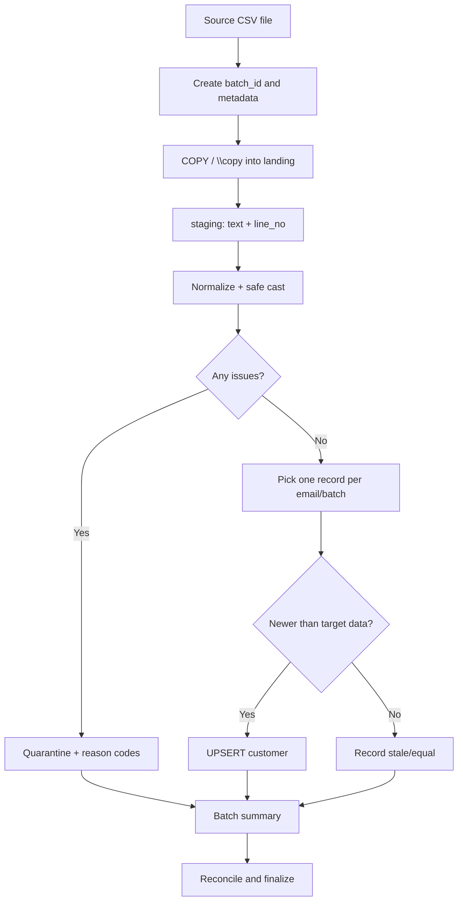

# Loading into Staging Tables to Validate and Normalize Data in PostgreSQL

A CSV file can look deceptive in its simplicity:

```csv
email,full_name,country,birth_date,active,credit_limit,updated_at
alice@example.com,Alice Nguyen,VN,1995-06-12,true,1000.00,2026-10-01T08:00:00Z
BOB@example.com,Bob Tran,vn,,yes,500,2026-10-02T09:00:00Z
not-an-email,Someone,VN,2026-02-30,true,"1,000",unknown
```

Yet if you load it directly into a business table with `date`, `boolean`, and `numeric` columns and `NOT NULL`/`UNIQUE` constraints, a single bad row can abort the entire import. Even when PostgreSQL accepts every value's type, the data may still contain **duplicate emails differing by case, extra whitespace, non-standard country codes, inconsistent boolean spellings, or stale records overwriting newer ones**.

The practical solution is a **staging table**, where data is ingested with minimal assumptions before moving into the main table.

```text
CSV / JSON / API / S3 / Java Application
               |
               v
       RAW LANDING TABLE
       (staging / landing)
       all fields as text
               |
               v
     NORMALIZATION + VALIDATION
     format, types, business rules
               |
       +-------+--------+
       |                |
       v                v
     VALID            INVALID
       |                |
  Deduplicate       Quarantine
  Pick latest       + error reasons
       |
       v
   INSERT / UPSERT
   into business table
       |
       v
  Batch summary, metrics,
  reconciliation, and provenance
```

**Core idea:** **ingesting raw data** does not mean **accepting it as valid business data**. A staging table maintains a clear boundary between these two steps so your pipeline can inspect, explain, repair, and re-run imports.

In this lesson, we build a compact yet complete PostgreSQL ETL pipeline: `COPY`/`\\copy` → `text` staging → normalization → type/business validation → error capture → deduplication → `INSERT ... ON CONFLICT` → idempotency, concurrency, transactions, and data quality metrics.

## 1. Learning Objectives

After this lesson, you will be able to:

1. Explain why staging is needed instead of loading external data directly into business tables.
2. Distinguish **landing/raw**, **validated/normalized**, **rejected/quarantine**, and target zones.
3. Design a staging table that preserves `batch_id`, row position, import provenance, and original values.
4. Use `COPY FROM STDIN`, `psql \\copy`, and `INSERT` to ingest CSV data.
5. Distinguish CSV/structural parse errors from data-type errors and business-rule failures.
6. Normalize whitespace, letter case, phone numbers, booleans, dates, and timestamps using testable rules.
7. Avoid type casts that abort an entire batch; catch nonexistent calendar dates, numeric overflows, and blanks.
8. Record multiple rejection reasons for a single row and isolate bad rows without polluting the main table.
9. Distinguish invalid rows, in-batch duplicates, valid rows, and stale rows relative to target data.
10. Use `ROW_NUMBER()` or equivalent techniques to select the winning record per business key.
11. Use `INSERT ... ON CONFLICT DO UPDATE` safely without overwriting newer records with stale data.
12. Structure re-runnable batch processing, track batch states, and reconcile row counts.
13. Use transactions, constraints, and appropriate locking to maintain consistency.
14. Understand differences between server-side `COPY`, client-side `\\copy`, and pgJDBC `CopyManager`.
15. Apply security measures when ingesting untrusted files and protecting PII in staging.
16. Optimize large loads with set-based SQL, targeted indexes, `ANALYZE`, chunking, and proper transaction sizing.
17. Design error observability, metrics, reprocessing, cleanup/retention, and a production deployment checklist.

## 2. Why Loading Directly into Main Tables Is Usually a Mistake

Consider this table:

```sql
CREATE TABLE customers (
    customer_id bigint GENERATED ALWAYS AS IDENTITY PRIMARY KEY,
    email text NOT NULL UNIQUE,
    full_name text NOT NULL,
    birth_date date,
    credit_limit numeric(12,2) NOT NULL CHECK (credit_limit >= 0)
);
```

With unclean CSVs, direct ingestion runs into these issues:

| Issue | Example | Consequence |
| --- | --- | --- |
| Invalid type | `birth_date = 2026-02-30` | Cast to `date` fails |
| Locale number syntax | `1,000.00` | Cannot cast to `numeric` under expected rules |
| Blank values | `email = ''` | Can pass `NOT NULL` if length is unchecked |
| Business violation | `credit_limit = -5` | Violates `CHECK` constraint |
| Duplicate keys | `Alice@EXAMPLE.com` and `alice@example.com` | Collide after normalization |
| Re-sent file | Same data sent a second time | Double-applied/counted without idempotency keys |
| Stale data | Yesterday's snapshot arrives after today's | Overwrites newer record |
| Missing provenance | No batch, line, or filename | Cannot trace where a row came from |
| Massive file | One huge transaction | Heavy WAL, locks, disk pressure, hard recovery |
| Sensitive data | Emails, phones in raw text | Risk of uncontrolled storage/logging |

### 2.1. Why Doesn't Direct `COPY` Solve Everything?

`COPY` is optimized for bulk loading, **not for defining business rules** such as "emails must be unique after lowercasing" or "each customer only keeps the latest update".

When `COPY` targets strongly typed/constrained columns directly, a single bad row aborts the entire load statement. Staging lets you preserve raw values first, inspect them with observable queries, and route bad rows to quarantine.

### 2.2. Yet Staging Does Not Mean Dropping All Rules

A staging table still needs:

- A unique identifier for each raw record.
- A batch ID.
- Ingestion lifecycle/state tracking.
- Access permissions and retention policies.
- Resource limits.

"Easy to load" staging **does not mean** unbounded, ungoverned storage holding raw data forever.

## 3. Four Data Zones and Their Distinct Responsibilities

| Zone | Purpose | Data Form | Direct Edits Allowed? |
| --- | --- | --- | --- |
| **Landing/raw** | Preserve original ingested values | Usually `text` + source metadata | Ingestion job only, avoid updates |
| **Normalized/validated** | Convert types and record validation outcomes | Typed columns, reason codes | Pipeline processing |
| **Rejected/quarantine** | Hold rows requiring review | Source row + reasons | Controlled remediation workflow |
| **Target/business** | Serve applications | Constraints, indexes, RLS, business data | Appropriate application roles |

### 3.1. Separate Raw and Normalized Data

If you immediately overwrite `" Alice@Example.COM "` with `"alice@example.com"` at load time, you lose the audit trail explaining why two records merged.

Keeping **raw** immutable and storing **normalized** values separately enables auditing, rule-version replay, and root-cause debugging.

### 3.2. Quarantine Is Not Only for Type-Conversion Errors

A row can be syntactically valid yet fail because:

- Its business key is duplicated.
- It references a nonexistent customer or lookup entry.
- It conflicts with existing values.
- A date falls outside allowed business bounds.
- It fails a freshness guard against newer target data.

Pipelines should distinguish **invalid**, **duplicate/superseded** (duplicates safely skipped), and **stale** (outdated), because each requires different handling.

## 4. Reconcilable Batch Architecture

In this example, a batch represents one customer data import from a specific source.



Steps can execute inside **one transaction** or across phase/batch transactions depending on atomicity needs and data volume. With multi-transaction phases, intermediate states, idempotency, and recovery plans are essential.

### 4.1. Recommended Metadata

- `batch_id` or ingestion job ID.
- `source_system`/filename, checksum, or object storage key.
- File arrival timestamp.
- Raw row count.
- Rejected, duplicate, and accepted row counts.
- Normalization rule version.
- Completion timestamp and batch error details if failed.

### 4.2. Never Use Timestamps as Unique IDs

Two jobs can start within the same millisecond. Use a sequence/identity/UUID with a uniqueness constraint or managed job registry—never rely on `now()` for uniqueness.

## 5. Creating the Lab Schema

All DDL/DML examples from here on run in an isolated test database; never run them against real customer tables.

```sql
CREATE SCHEMA IF NOT EXISTS import_lab;
```

The examples use `batch_id = 1001` for clarity. In production, generate IDs via a sequence/identity/UUID and job registry.

## 6. Batch Tracking Table

```sql
CREATE TABLE import_lab.import_batches (
    batch_id bigint PRIMARY KEY,
    source_system text NOT NULL,
    source_file text NOT NULL,
    source_sha256 text,
    rule_version integer NOT NULL DEFAULT 1,
    status text NOT NULL DEFAULT 'LOADED'
        CHECK (status IN (
            'LOADED',
            'PROCESSING',
            'COMPLETED',
            'COMPLETED_WITH_REJECTIONS',
            'FAILED'
        )),
    raw_count bigint NOT NULL DEFAULT 0,
    rejected_count bigint NOT NULL DEFAULT 0,
    superseded_count bigint NOT NULL DEFAULT 0,
    applied_count bigint NOT NULL DEFAULT 0,
    skipped_count bigint NOT NULL DEFAULT 0,
    created_at timestamptz NOT NULL DEFAULT clock_timestamp(),
    finished_at timestamptz
);

INSERT INTO import_lab.import_batches (
    batch_id, source_system, source_file, rule_version
)
VALUES (
    1001, 'crm_export', 'customers_2026_11.csv', 1
);
```

### 6.1. Why Track rule_version?

If email or phone normalization rules change next month, a previously rejected row might become valid. Tracking `rule_version` tells you **which rule set** processed each batch.

### 6.2. What Does SHA-256 Do?

A file fingerprint detects duplicate submissions of identical file content. It is only **one layer** of idempotency; define clear policies for:

- Same file content from a different source.
- Same filename with different content.
- Same business records ordered differently.
- Identical file content intentionally reprocessed under a new rule version.

### 6.3. Batch Status Differs from Row Status

A batch can reach `COMPLETED_WITH_REJECTIONS`, meaning the pipeline finished processing while leaving invalid rows requiring review. Never mark a batch `COMPLETED` right after `COPY` finishes.

## 7. Staging Table Preserving Raw Values

All source columns in the example are stored as `text`; metadata is managed separately.

```sql
CREATE TABLE import_lab.stage_customers (
    batch_id bigint NOT NULL
        REFERENCES import_lab.import_batches(batch_id),
    line_no bigint NOT NULL,
    email_raw text,
    full_name_raw text,
    phone_raw text,
    country_raw text,
    birth_date_raw text,
    active_raw text,
    credit_limit_raw text,
    source_updated_at_raw text,
    loaded_at timestamptz NOT NULL DEFAULT clock_timestamp(),
    PRIMARY KEY (batch_id, line_no),
    CHECK (line_no > 0)
);
```

### 7.1. Why Are Source Fields Initially text?

If `birth_date_raw='2026-02-30'`, a `text` column accepts the string instead of aborting `COPY` with a date cast error. Downstream validation can tag that exact line with `INVALID_BIRTH_DATE` and continue processing the rest of the batch.

### 7.2. Why Keep batch_id and line_no Strongly Typed?

They are **system-controlled ingestion metadata**, not arbitrary file fields. They must be reliable for reconciliation and provenance. If a file supplies unreliable line numbers, let your ingestion tool assign `line_no`.

### 7.3. Primary Key (batch_id, line_no)

A batch cannot contain two records with the same source line number. This also lets a row-loading step handle retries deterministically instead of accidentally duplicating lines.

Never confuse `line_no` with the customer's business key: two different lines can share the same email.

## 8. Normalized and Validated Results Table

```sql
CREATE TABLE import_lab.normalized_customers (
    batch_id bigint NOT NULL,
    line_no bigint NOT NULL,
    email text,
    full_name text,
    phone_e164 text,
    country_code text,
    birth_date date,
    is_active boolean,
    credit_limit numeric(12,2),
    source_updated_at timestamptz,
    issues text[] NOT NULL DEFAULT '{}'::text[],
    state text NOT NULL CHECK (state IN (
        'READY',
        'REJECTED',
        'SUPERSEDED',
        'APPLIED',
        'SKIPPED_STALE_OR_EQUAL'
    )),
    checked_at timestamptz NOT NULL DEFAULT clock_timestamp(),
    PRIMARY KEY (batch_id, line_no),
    FOREIGN KEY (batch_id, line_no)
        REFERENCES import_lab.stage_customers(batch_id, line_no)
);

CREATE INDEX idx_normalized_customers_batch_state
ON import_lab.normalized_customers (batch_id, state);
```

**Design note:** typed columns in the normalized table can store `NULL` when a row is rejected. Only rows with `state='READY'` proceed to the target table.

### 8.1. Why Is issues a text[]?

A single row might have both an invalid email and an invalid birth date. Capturing multiple reason codes is far better than reporting only the first error encountered.

### 8.2. Reason Codes vs. Free-Text Error Messages

Codes like `INVALID_EMAIL`, `INVALID_DATE`, and `INVALID_CREDIT_LIMIT` support aggregation and UI localization. Detailed human-readable messages can be rendered in the reporting layer while keeping reason codes stable.

## 9. Quarantine Table

```sql
CREATE TABLE import_lab.rejected_customers (
    batch_id bigint NOT NULL,
    line_no bigint NOT NULL,
    issues text[] NOT NULL,
    reviewed boolean NOT NULL DEFAULT false,
    rejected_at timestamptz NOT NULL DEFAULT clock_timestamp(),
    PRIMARY KEY (batch_id, line_no),
    FOREIGN KEY (batch_id, line_no)
        REFERENCES import_lab.stage_customers(batch_id, line_no)
);
```

We avoid duplicating all raw PII into quarantine in the lab: the rejection table links back to staging by key. In production, duplicating raw PII increases security scope and retention costs.

### 9.1. SUPERSEDED Rows Can Also Be Recorded

They are not necessarily invalid data. For instance, if two rows share an email and the newer one wins, the older row can be tracked for reconciliation with reason `DUPLICATE_EMAIL_IN_BATCH`.

### 9.2. Do Not Let Reviewers Patch Target Tables Ad Hoc

When operators fix invalid raw records, use a formal correction batch, keep audit logs, bump rule versions, or create a provenance-tracked record—avoid losing reproducibility of the original source data.

## 10. Target Table with Strict Constraints

```sql
CREATE TABLE import_lab.customers (
    customer_id bigint GENERATED ALWAYS AS IDENTITY PRIMARY KEY,
    email text NOT NULL UNIQUE,
    full_name text NOT NULL
        CHECK (length(btrim(full_name)) BETWEEN 1 AND 120),
    phone_e164 text,
    country_code text NOT NULL
        CHECK (country_code ~ '^[A-Z]{2}$'),
    birth_date date,
    is_active boolean NOT NULL,
    credit_limit numeric(12,2) NOT NULL
        CHECK (credit_limit >= 0),
    source_updated_at timestamptz NOT NULL,
    updated_at timestamptz NOT NULL DEFAULT clock_timestamp(),
    CHECK (
        phone_e164 IS NULL
        OR phone_e164 ~ '^\+[1-9][0-9]{7,14}$'
    )
);
```

### 10.1. Constraints Are the Last Line of Defense

Staging validation reduces load errors, yet the database must still enforce `NOT NULL`, `CHECK`, `UNIQUE`, and foreign keys on business data.

A pipeline bug must never silently insert `credit_limit=-10` or `email=NULL` into the target table.

### 10.2. Using Email as a Business Key Is a Lab Simplification

In many real systems, emails **change, are shared, support aliases, and have nuanced case rules**. Never assume email is a globally unique user identifier unless business rules dictate it. This lesson uses `email` as the conflict key solely to focus on import mechanics.

### 10.3. Country and Phone Still Need Deeper Validation

A two-letter regex **does not prove** an ISO 3166-1 alpha-2 code exists. An E.164 regex checks basic syntax, not whether a number is assigned or reachable. Production often needs reference tables, normalization libraries, and external verification.

## 11. Sample Dataset Mixing Valid and Invalid Rows

Let's load sample rows using `INSERT VALUES` so the lab runs even without an external CSV file:

```sql
INSERT INTO import_lab.stage_customers (
    batch_id, line_no,
    email_raw, full_name_raw, phone_raw,
    country_raw, birth_date_raw, active_raw,
    credit_limit_raw, source_updated_at_raw
)
VALUES
    (1001, 1,
     'alice@example.com', 'Alice', '+84901234567',
     'VN', '1995-05-11', 'true',
     '100.00', '2026-10-01T08:00:00Z'),

    (1001, 2,
     ' bob@example.com ', ' Bob Tran ', NULL,
     'vn', '', 'yes',
     '500', '2026-10-02T09:00:00Z'),

    (1001, 3,
     ' ALICE@EXAMPLE.COM ', 'Alice Nguyen', '+84 901 234 567',
     'vn', '1995-05-11', '1',
     '250.50', '2026-10-05T08:00:00Z'),

    (1001, 4,
     'not-an-email', 'Bad Email', NULL,
     'VN', '2001-01-01', 'true',
     '100', '2026-10-06T08:00:00Z'),

    (1001, 5,
     'empty-name@example.com', '  ', NULL,
     'VN', '2001-01-01', 'true',
     '100', '2026-10-06T08:00:00Z'),

    (1001, 6,
     'bad-date@example.com', 'Bad Date', NULL,
     'VN', '2026-02-30', 'true',
     '100', '2026-10-06T08:00:00Z'),

    (1001, 7,
     'bad-money@example.com', 'Bad Money', NULL,
     'VN', NULL, 'true',
     '1,000.00', '2026-10-06T08:00:00Z'),

    (1001, 8,
     'bad-phone@example.com', 'Bad Phone', 'abc',
     'VN', NULL, 'true',
     '100', '2026-10-06T08:00:00Z'),

    (1001, 9,
     'bad-bool@example.com', 'Bad Boolean', NULL,
     'VN', NULL, 'unknown',
     '100', '2026-10-06T08:00:00Z'),

    (1001, 10,
     'bad-time@example.com', 'Bad Timestamp', NULL,
     'VN', NULL, 'true',
     '100', '2026-99-06T08:00:00Z'),

    (1001, 11,
     'carol@example.com', 'Carol Le', '+84987654321',
     'SG', '1990-01-15', 'no',
     '750.00', '2026-10-07T08:00:00Z'),

    (1001, 12,
     'missing-country@example.com', 'Missing Country', NULL,
     '', NULL, 'true',
     '50', '2026-10-08T08:00:00Z');
```

Across these 12 rows:

- Rows **1** and **3** share the same email after normalization; row 3 has a newer timestamp.
- Row **2** has surrounding whitespace, a lowercase country code, and boolean `yes`.
- Rows **4–10 and 12** contain errors requiring quarantine.
- Row **11** is valid.

After processing, we expect **3 valid candidate emails** (Alice, Bob, Carol), with the older Alice row marked `SUPERSEDED`, yielding **3 rows applied to target** and **9 rows not applied** (8 input rejections + 1 superseded row). Always verify counts with SQL rather than assuming from prose.

## 12. Starting with Raw Text: NULL, Empty Strings, and Whitespace

These three values differ:

```text
NULL       -> No SQL value.
''         -> Empty string, length 0.
'   '      -> String containing spaces.
```

In PostgreSQL:

```sql
SELECT
    NULLIF(BTRIM('    '), '') AS empty_to_null,
    BTRIM('  Alice  ') AS trimmed_name,
    LOWER(BTRIM('  ALICE@EXAMPLE.COM ')) AS normalized_email;
```

### 12.1. A Basic Cleaning Idiom

```sql
NULLIF(BTRIM(raw_value), '')
```

Steps:

1. Trim leading and trailing whitespace using `BTRIM`.
2. If the result is an empty string, convert it to SQL `NULL`.

### 12.2. Do Not Blindly TRIM Every Field

Passwords, signatures, codes with meaningful spacing, or legal text may require preserving exact whitespace. Cleaning rules must follow each **field's data contract**.

### 12.3. Unicode and Non-ASCII Whitespace

Default `BTRIM` does not strip all Unicode whitespace characters the way users may expect. For international datasets, define Unicode normalization rules and test characters such as non-breaking spaces.

## 13. Email Normalization: Illustrative Example, Not Full RFC Rules

In the lab:

```sql
SELECT
    LOWER(NULLIF(BTRIM(email_raw), '')) AS email_normalized
FROM import_lab.stage_customers
WHERE batch_id = 1001
ORDER BY line_no;
```

### 13.1. What Is Handled

- Stripping leading and trailing spaces.
- Lowercasing so `Alice@Example.com` and `alice@example.com` unify per application rules.

### 13.2. What Is Not Handled

- Full RFC local-part rules and provider-specific email semantics.
- Unicode normalization.
- Internationalized domains / IDNA.
- `+tag` aliases or provider dot-insensitivity.
- Whether the mailbox actually exists and accepts mail.

**Never automatically strip dots, plus signs, or `+tag` suffixes from emails** to "deduplicate"; those rules do not hold across all mail providers.

### 13.3. Basic Format Check Is Only One Layer

The lab uses a simple regex:

```sql
email ~ '^[^[:space:]@]+@[^[:space:]@]+\.[^[:space:]@]+$'
```

It catches common typos, yet does not verify mailbox existence or full RFC compliance.

## 14. Phone Number Normalization

We define a sample policy: allow `+` and common separators, then require an E.164-like shape.

```sql
SELECT
    regexp_replace(
        '+84 901 234 567',
        '[[:space:]().-]',
        '',
        'g'
    ) AS phone_e164;
```

Result: `+84901234567`.

### 14.1. Never Blindly Strip All Non-Digit Characters

Writing:

```sql
regexp_replace(raw_phone, '[^0-9]', '', 'g')
```

loses the leading `+`, extensions, warning characters, or dialing-code structure. Input `'abc'` would collapse to an empty string, obscuring errors.

### 14.2. Handling Local Phone Formats

Real normalization needs **country context**, domestic trunk-prefix rules, length checks, extensions, and numbering-plan updates. For international products, dedicated phone-parsing libraries are far more reliable than custom regexes.

### 14.3. NULL Phones Can Be Valid

In this lab, `phone_e164` is optional. Thus, NULL or blank raw phones produce no error, while non-empty phones failing the format check are rejected.

## 15. Boolean Normalization

Source data may contain:

```text
true, TRUE, t, yes, y, 1
false, FALSE, f, no, n, 0
```

Rather than relying on PostgreSQL's implicit boolean parser for unexpected variants, specify explicitly:

```sql
CASE
    WHEN LOWER(BTRIM(active_raw))
         IN ('true','t','yes','y','1') THEN true
    WHEN LOWER(BTRIM(active_raw))
         IN ('false','f','no','n','0') THEN false
    ELSE NULL
END
```

### 15.1. Why Not Default `unknown` to FALSE?

If a customer's status is unknown, coercing it to `false` can represent an unauthorized business state change. This lab **rejects** rows when a required boolean cannot be recognized.

### 15.2. Separating Unknown and Blank

If a source has three states (`true`/`false`/`unknown`), a `boolean NOT NULL` target column cannot represent all three. Use a dedicated enum/status code or nullable column as business rules require rather than forcing everything into boolean.

## 16. Monetary and Credit Limit Normalization

In this lab, `credit_limit` must be:

- Non-negative.
- At most 10 digits before the decimal point.
- At most 2 digits after the decimal point.
- Dot-decimal only, no thousands grouping separators.

Check:

```sql
credit_limit_text ~ '^[0-9]{1,10}(\.[0-9]{1,2})?$'
```

Once matched:

```sql
credit_limit_text::numeric(12,2)
```

### 16.1. Why Check Format Before Casting?

```sql
SELECT '1,000.00'::numeric;
```

raises an exception that aborts a multi-row statement instead of isolating just the bad row. Batch pipelines should **validate format first** or use safe-cast helpers with controlled exception handling.

### 16.2. Regex Is Not a Universal Financial Parser

It rejects `+12.00`, `1e3`, locale-specific comma decimals, negatives, and out-of-contract formats. That is the **lab policy**, not a PostgreSQL limitation.

### 16.3. Handling Very Large Numbers

`numeric(12,2)` bounds precision and scale. The regex limits integer digits to prevent range errors, while target constraints still guard invariants. For large accounting data, choose precision and rounding rules to fit business requirements.

## 17. Dates: Regex Does Not Prove Calendar Validity

The string:

```text
2026-02-30
```

matches `YYYY-MM-DD`, yet February 30 does not exist.

Do not write:

```sql
CASE
    WHEN raw_date ~ '^[0-9]{4}-[0-9]{2}-[0-9]{2}$'
    THEN raw_date::date
END
```

because `::date` will still throw an error.

### 17.1. Safe-Cast Helper for ISO Dates

```sql
CREATE FUNCTION import_lab.try_iso_date(p_text text)
RETURNS date
LANGUAGE plpgsql
STABLE
STRICT
AS $$
BEGIN
    IF BTRIM(p_text) !~
       '^[0-9]{4}-[0-9]{2}-[0-9]{2}$'
    THEN
        RETURN NULL;
    END IF;

    RETURN BTRIM(p_text)::date;

EXCEPTION
    WHEN invalid_datetime_format
      OR datetime_field_overflow
      OR invalid_text_representation
    THEN
        RETURN NULL;
END;
$$;
```

Test it:

```sql
SELECT
    import_lab.try_iso_date('2026-02-28') AS valid_date,
    import_lab.try_iso_date('2026-02-30') AS invalid_date,
    import_lab.try_iso_date('not-a-date') AS invalid_text,
    import_lab.try_iso_date('') AS blank;
```

The function returns a `date` when valid and `NULL` when format or calendar date is invalid.

### 17.2. What Does STRICT Mean?

When the input is SQL `NULL`, PostgreSQL returns `NULL` without even invoking the function body. An empty string `''` is not SQL `NULL`, yet the function returns `NULL` because it fails the format check.

### 17.3. Never Catch `WHEN OTHERS` Broadly

Catch only the expected conversion error classes. Swallowing every exception into `NULL` hides real bugs, missing objects, or permission errors.

### 17.4. Why Not Use to_date Arbitrarily?

Certain date-parsing approaches can **normalize or roll over out-of-range values** instead of rejecting invalid dates. When strict validation is required, verify parsed output against the contract or use safe-cast helpers with explicit exception handlers.

## 18. Timestamps: Require Offsets from Distributed Sources

If a source sends:

```text
2026-10-01T08:00:00Z
2026-10-01T15:00:00+07:00
```

both strings represent **the exact same UTC instant**.

### 18.1. Why Use timestamptz?

`timestamptz` stores the exact instant rather than storing the input timezone string as a separate attribute. On `SELECT`, values display according to the session's `TimeZone`.

### 18.2. Safe-Cast Helper for Timezone-Aware Timestamps

```sql
CREATE FUNCTION import_lab.try_source_timestamp(p_text text)
RETURNS timestamptz
LANGUAGE plpgsql
STABLE
STRICT
AS $$
BEGIN
    IF BTRIM(p_text) !~
       '^[0-9]{4}-[0-9]{2}-[0-9]{2}[T ][0-9]{2}:[0-9]{2}:[0-9]{2}(Z|[+-][0-9]{2}:[0-9]{2})$'
    THEN
        RETURN NULL;
    END IF;

    RETURN BTRIM(p_text)::timestamptz;

EXCEPTION
    WHEN invalid_datetime_format
      OR datetime_field_overflow
      OR invalid_text_representation
    THEN
        RETURN NULL;
END;
$$;
```

Test:

```sql
SELECT
    import_lab.try_source_timestamp(
        '2026-10-01T08:00:00Z'
    ) AS valid_utc,
    import_lab.try_source_timestamp(
        '2026-10-01T15:00:00+07:00'
    ) AS same_instant,
    import_lab.try_source_timestamp(
        '2026-99-01T08:00:00Z'
    ) AS invalid_time;
```

### 18.3. This Is the Lab Format Contract

The function intentionally rejects fractional seconds, named timezone abbreviations, and offset-less timestamps. If a source uses another format, update the contract and test suite.

### 18.4. Source Update Time Is Not Ingestion Time

- `source_updated_at`: when the record **was updated in the source system**.
- `loaded_at`: when our system **loaded it into staging**.

Never use `loaded_at` to judge freshness at the source: an old file re-sent today still carries last month's data.

## 19. Normalizing the Entire Batch with Set-Based SQL

This is the key step: use `WITH`/`INSERT ... SELECT` instead of looping row by row with individual INSERTs.

```sql
WITH cleaned AS (
    SELECT
        s.batch_id,
        s.line_no,
        LOWER(NULLIF(BTRIM(s.email_raw), '')) AS email,
        NULLIF(BTRIM(s.full_name_raw), '') AS full_name,
        CASE
            WHEN NULLIF(BTRIM(s.phone_raw), '') IS NULL
            THEN NULL
            ELSE regexp_replace(
                BTRIM(s.phone_raw),
                '[[:space:]().-]',
                '',
                'g'
            )
        END AS phone_e164,
        UPPER(NULLIF(BTRIM(s.country_raw), '')) AS country_code,
        NULLIF(BTRIM(s.birth_date_raw), '') AS birth_date_text,
        NULLIF(BTRIM(s.active_raw), '') AS active_text,
        NULLIF(BTRIM(s.credit_limit_raw), '') AS credit_limit_text,
        NULLIF(BTRIM(s.source_updated_at_raw), '')
            AS updated_text
    FROM import_lab.stage_customers AS s
    WHERE s.batch_id = 1001
),
typed AS (
    SELECT
        c.*,
        import_lab.try_iso_date(c.birth_date_text) AS birth_date,
        CASE
            WHEN LOWER(c.active_text)
                 IN ('true','t','yes','y','1') THEN true
            WHEN LOWER(c.active_text)
                 IN ('false','f','no','n','0') THEN false
            ELSE NULL
        END AS is_active,
        CASE
            WHEN c.credit_limit_text ~
                 '^[0-9]{1,10}(\.[0-9]{1,2})?$'
            THEN c.credit_limit_text::numeric(12,2)
            ELSE NULL
        END AS credit_limit,
        import_lab.try_source_timestamp(c.updated_text)
            AS source_updated_at
    FROM cleaned AS c
),
validated AS (
    SELECT
        t.*,
        ARRAY_REMOVE(
            ARRAY[
                CASE
                    WHEN t.email IS NULL
                         OR t.email !~
                           '^[^[:space:]@]+@[^[:space:]@]+\.[^[:space:]@]+$'
                    THEN 'INVALID_EMAIL'
                END,
                CASE
                    WHEN t.full_name IS NULL
                         OR LENGTH(t.full_name) > 120
                    THEN 'INVALID_FULL_NAME'
                END,
                CASE
                    WHEN t.country_code IS NULL
                         OR t.country_code !~ '^[A-Z]{2}$'
                    THEN 'INVALID_COUNTRY'
                END,
                CASE
                    WHEN t.phone_e164 IS NOT NULL
                         AND t.phone_e164 !~
                             '^\+[1-9][0-9]{7,14}$'
                    THEN 'INVALID_PHONE'
                END,
                CASE
                    WHEN t.birth_date_text IS NOT NULL
                         AND t.birth_date IS NULL
                    THEN 'INVALID_BIRTH_DATE'
                END,
                CASE
                    WHEN t.is_active IS NULL
                    THEN 'INVALID_ACTIVE'
                END,
                CASE
                    WHEN t.credit_limit IS NULL
                    THEN 'INVALID_CREDIT_LIMIT'
                END,
                CASE
                    WHEN t.source_updated_at IS NULL
                    THEN 'INVALID_SOURCE_TIMESTAMP'
                END
            ]::text[],
            NULL
        ) AS validation_issues
    FROM typed AS t
)
INSERT INTO import_lab.normalized_customers (
    batch_id, line_no, email, full_name, phone_e164,
    country_code, birth_date, is_active,
    credit_limit, source_updated_at, issues, state
)
SELECT
    batch_id, line_no, email, full_name, phone_e164,
    country_code, birth_date, is_active,
    credit_limit, source_updated_at,
    validation_issues,
    CASE
        WHEN CARDINALITY(validation_issues) = 0 THEN 'READY'
        ELSE 'REJECTED'
    END
FROM validated
ON CONFLICT (batch_id, line_no) DO NOTHING;
```

### 19.1. Why Separate cleaned, typed, and validated?

- `cleaned`: normalizes formatting.
- `typed`: converts strings into PostgreSQL types.
- `validated`: applies business rules and collects reason codes.

Clear phases make queries easier to read, test, and evolve step by step.

### 19.2. Why Guard Casts with CASE?

`CASE WHEN text ~ format THEN text::numeric END` avoids casting strings that obviously fail format rules. For dates and timestamps, invalid calendar dates still exist, so use exception-handling safe-cast helpers.

### 19.3. Why Add ON CONFLICT DO NOTHING?

The `(batch_id, line_no)` primary key lets you re-run **normalization insertion** without duplicating rows. However, if raw data or `rule_version` changes, `DO NOTHING` will **not re-evaluate** existing rows; reprocessing workflows must manage rule versions, perform deliberate delete/rebuild, or create a new batch.

### 19.4. Why Not Auto-Assign READY Whenever Types Parse?

A `typed` row that parses cleanly yet lacks `full_name` or violates a business rule must still be `REJECTED`. Valid syntax does not mean valid business data.

## 20. Inspecting Validation Results

```sql
SELECT
    line_no,
    email,
    full_name,
    country_code,
    birth_date,
    is_active,
    credit_limit,
    source_updated_at,
    state,
    issues
FROM import_lab.normalized_customers
WHERE batch_id = 1001
ORDER BY line_no;
```

### 20.1. Breakdown by State Counts

```sql
SELECT
    state,
    COUNT(*) AS row_count
FROM import_lab.normalized_customers
WHERE batch_id = 1001
GROUP BY state
ORDER BY state;
```

### 20.2. One Row Can Have Multiple Errors

If email is invalid, country is missing, and birth date is invalid on the same row, `issues` holds all three reason codes. This is a major advantage for batch remediation: the data provider receives a **complete error report** rather than fixing one error only to hit the next on re-upload.

### 20.3. Do Not Over-Interpret Array Order

The order of reasons in `issues` reflects evaluation order in SQL, not an automatic business severity ranking unless explicitly designed that way.

## 21. Business Validation: Adding Additional Rules as Needed

Current lab rules cover:

- Required email and full name.
- Two-letter A–Z country code.
- Optional phone in near-E.164 format.
- Optional birth date that must be valid when provided.
- Required `active` flag.
- Non-negative, well-formatted `credit_limit`.
- Required source timestamp.

Production often also needs:

### 21.1. Referential Integrity

`country_code` may need to exist in `reference_countries`:

```sql
SELECT n.batch_id, n.line_no, n.country_code
FROM import_lab.normalized_customers AS n
LEFT JOIN import_lab.reference_countries AS c
  ON c.country_code = n.country_code
WHERE c.country_code IS NULL;
```

This is an **illustrative example**, runnable only after creating `reference_countries`. Never assume every two-letter code is a valid country.

### 21.2. Age and Birth Date

If customers must be at least 18 years old, compute age relative to current/source date and applicable legal rules. Never treat a time-dependent property like age as immutable.

### 21.3. Cross-Field Consistency

If `is_active=false` combined with `credit_limit>0` is disallowed, enforce it as an explicit rule. Never classify unusual combinations as errors unless business requirements specify them.

### 21.4. PII and Consent

Importing emails and phones may require consent tracking, lawful source checks, processing rights, and retention policies. Format validation does not satisfy data-protection obligations.

## 22. Detecting Post-Normalization Duplicates

Before upserting, find duplicate emails among `READY` rows:

```sql
SELECT
    email,
    COUNT(*) AS duplicates,
    ARRAY_AGG(line_no ORDER BY source_updated_at DESC, line_no DESC)
        AS source_lines
FROM import_lab.normalized_customers
WHERE batch_id = 1001
  AND state = 'READY'
GROUP BY email
HAVING COUNT(*) > 1;
```

You will see `alice@example.com` appears on lines 3 and 1.

### 22.1. Why Deduplicate Before UPSERT?

PostgreSQL `INSERT ... ON CONFLICT DO UPDATE` does not allow a single statement to affect the same target row multiple times. If the `INSERT` source produces **two rows with the same conflict key**, you will hit:

```text
ON CONFLICT DO UPDATE command cannot affect row a second time
```

That is why you cannot feed both Alice rows into the same `INSERT ... ON CONFLICT` without deduplicating first.

### 22.2. How Is the "Latest Record" Chosen?

Lab policy:

1. Higher `source_updated_at` wins.
2. On timestamp ties, higher `line_no` wins.

Tie-breaking rules must be **deterministic and documented**, never left to physical heap order or arbitrary `SELECT` order.

## 23. Using ROW_NUMBER to Select One Record per Email

```sql
WITH ranked AS (
    SELECT
        batch_id,
        line_no,
        email,
        ROW_NUMBER() OVER (
            PARTITION BY email
            ORDER BY source_updated_at DESC NULLS LAST,
                     line_no DESC
        ) AS rn
    FROM import_lab.normalized_customers
    WHERE batch_id = 1001
      AND state = 'READY'
)
SELECT *
FROM ranked
ORDER BY email, rn;
```

### 23.1. PARTITION BY Condition

`PARTITION BY email` groups rows by business key after `LOWER`/`BTRIM`. Never partition by raw email, or `' ALICE@...'` and `'alice@...'` would remain separate.

### 23.2. Deterministic ORDER BY

Without a tie-breaker, two records sharing a timestamp could flip winners across different query plans.

### 23.3. When No Reliable Source Timestamp Exists

Never treat `line_no` as "newest" if the file has arbitrary row order. Agree with the source on a version number, event sequence, reliable modified timestamp, or a rule that keeps one record and quarantines conflicts.

## 24. Marking Duplicates as SUPERSEDED

```sql
WITH ranked AS (
    SELECT
        batch_id,
        line_no,
        ROW_NUMBER() OVER (
            PARTITION BY email
            ORDER BY source_updated_at DESC NULLS LAST,
                     line_no DESC
        ) AS rn
    FROM import_lab.normalized_customers
    WHERE batch_id = 1001
      AND state = 'READY'
)
UPDATE import_lab.normalized_customers AS n
SET
    state = 'SUPERSEDED',
    issues = ARRAY_APPEND(
        n.issues,
        'DUPLICATE_EMAIL_IN_BATCH'
    )
FROM ranked AS r
WHERE n.batch_id = r.batch_id
  AND n.line_no = r.line_no
  AND r.rn > 1;
```

After this step, the older Alice row (line 1) becomes `SUPERSEDED`, while line 3 stays `READY`.

### 24.1. SUPERSEDED Is Not Necessarily a User Error

If a file acts as an event stream, multiple updates for the same business key are valid, with only the final state applied to the snapshot. Reflect this distinction in reports rather than lumping "duplicate" together with "invalid" without explanation.

### 24.2. First-Wins, Last-Wins, Newest-Wins Policies

Three common policies:

| Strategy | Picks | Risk |
| --- | --- | --- |
| First wins | First row encountered | Ignores newer updates |
| Last wins | Last row in file | Depends on file ordering |
| Newest source timestamp wins | Record with latest version/timestamp | Requires reliable source clocks/versions |

In this example, we use newest source timestamp wins with `line_no` as the tie-breaker.

## 25. Recording Rejected Rows

```sql
INSERT INTO import_lab.rejected_customers (
    batch_id, line_no, issues
)
SELECT
    batch_id, line_no, issues
FROM import_lab.normalized_customers
WHERE batch_id = 1001
  AND state IN ('REJECTED', 'SUPERSEDED')
ON CONFLICT (batch_id, line_no)
DO UPDATE SET
    issues = EXCLUDED.issues,
    rejected_at = clock_timestamp();
```

### 25.1. Why Use ON CONFLICT?

If the quarantine step is re-run, `(batch_id, line_no)` prevents duplicate quarantine entries and updates `issues` to match the latest validation/dedupe outcome.

### 25.2. What Else Should Be Stored Besides issues?

Real systems often store:

- Rule code and version.
- Detection timestamp.
- Reviewer/remediation owner.
- Correction/retry status.
- Hash or reference to the raw row.
- Error category for source reporting.

### 25.3. Never Throw Exceptions for Every Bad Row

Expressing validation in set-based SQL routes 1,000 bad rows into the rejection table in a single pass instead of raising 1,000 exceptions that waste resources and obscure real system faults.

## 26. Aggregating Errors by Reason Code

```sql
SELECT
    problem.issue_code,
    COUNT(*) AS affected_rows
FROM import_lab.rejected_customers AS r
CROSS JOIN LATERAL UNNEST(r.issues) AS problem(issue_code)
WHERE r.batch_id = 1001
GROUP BY problem.issue_code
ORDER BY affected_rows DESC, problem.issue_code;
```

A row with two errors is counted under **both reason codes**, so total issue occurrences can exceed rejected row counts.

### 26.1. Reconciling Both Totals

```sql
SELECT
    COUNT(*) AS rejected_rows,
    SUM(CARDINALITY(issues)) AS total_issue_occurrences
FROM import_lab.rejected_customers
WHERE batch_id = 1001;
```

These numbers mean different things; never divide `SUM(issue_occurrences)` by total rows when reporting the rejected-row rate.

### 26.2. Actionable Error Grouping

For example:

- `INVALID_EMAIL` → return to source for email verification.
- `INVALID_BIRTH_DATE` → fix calendar date.
- `INVALID_CREDIT_LIMIT` → check locale/grouping separators.
- `DUPLICATE_EMAIL_IN_BATCH` → verify winner-selection rule.

Never silently "fix" invalid values in ways that alter business meaning.

## 27. Preparing the Target Table and Conditional UPSERT

At this point, `READY` rows have passed:

1. Normalization.
2. Validation.
3. In-batch deduplication.

However, the target table might **already hold a newer version** from an earlier batch.

### 27.1. Updating Based on Source Timestamp

The guard:

```sql
WHERE target.source_updated_at
      < EXCLUDED.source_updated_at
```

ensures incoming records overwrite existing ones only when **strictly newer**.

### 27.2. What If Timestamps Are Equal?

Our lab skips updates on equal timestamps so replaying identical data leaves `updated_at` untouched. In some systems, same-version + different-payload indicates a conflict requiring an alert—never skip silently without checking requirements.

### 27.3. Why Rely on a Unique Business Key?

`ON CONFLICT (email)` requires a matching unique constraint or unique index on the target. The lab defined `email text NOT NULL UNIQUE`.

## 28. Safe UPSERT and Recording APPLIED State

```sql
WITH applied AS (
    INSERT INTO import_lab.customers AS dest (
        email,
        full_name,
        phone_e164,
        country_code,
        birth_date,
        is_active,
        credit_limit,
        source_updated_at
    )
    SELECT
        n.email,
        n.full_name,
        n.phone_e164,
        n.country_code,
        n.birth_date,
        n.is_active,
        n.credit_limit,
        n.source_updated_at
    FROM import_lab.normalized_customers AS n
    WHERE n.batch_id = 1001
      AND n.state = 'READY'
    ON CONFLICT (email)
    DO UPDATE SET
        full_name = EXCLUDED.full_name,
        phone_e164 = EXCLUDED.phone_e164,
        country_code = EXCLUDED.country_code,
        birth_date = EXCLUDED.birth_date,
        is_active = EXCLUDED.is_active,
        credit_limit = EXCLUDED.credit_limit,
        source_updated_at = EXCLUDED.source_updated_at,
        updated_at = clock_timestamp()
    WHERE dest.source_updated_at
          < EXCLUDED.source_updated_at
    RETURNING email
)
UPDATE import_lab.normalized_customers AS n
SET state = 'APPLIED'
FROM applied AS a
WHERE n.batch_id = 1001
  AND n.state = 'READY'
  AND n.email = a.email;
```

**Important point:** `INSERT ... ON CONFLICT DO UPDATE ... WHERE ...` does **not return rows via `RETURNING`** when a conflict occurs and the `WHERE` predicate evaluates to FALSE. Thus, rows skipped as stale or equal remain non-APPLIED for the next step.

### 28.1. Why Is the applied CTE Useful?

It returns only the emails that were actually inserted or updated, letting you mark those normalized rows **in the same statement**.

### 28.2. Why Avoid Unconditional DO UPDATE?

Replaying identical batches with unconditional updates will:

- Bump `updated_at` unnecessarily.
- Generate extra WAL, dead tuples, and bloat.
- Fire `UPDATE` triggers and audit trails.
- Create lock contention on existing rows.

A freshness guard eliminates unnecessary writes.

### 28.3. No Guarantee of Exactly-Once External Side Effects

If the target table has a trigger sending external HTTP events, even transaction retries can cause unexpected side effects. Use an outbox pattern, idempotency keys, and proper transactional design.

## 29. Marking Valid Rows That Were Not Applied

After the UPSERT, any rows still in `READY` were neither inserted nor updated, typically because the target already had an equal or newer `source_updated_at`.

```sql
UPDATE import_lab.normalized_customers
SET state = 'SKIPPED_STALE_OR_EQUAL'
WHERE batch_id = 1001
  AND state = 'READY';
```

### 29.1. The State Name Reflects Exact Scope

`SKIPPED_STALE_OR_EQUAL` intentionally avoids claiming whether a row was an exact duplicate or strictly older, since separating them requires an extra comparison if detailed reporting is needed.

### 29.2. Distinguishing Stale from Equal

Join against the target table:

```sql
SELECT
    n.line_no,
    n.email,
    n.source_updated_at AS incoming_timestamp,
    c.source_updated_at AS target_timestamp,
    CASE
        WHEN n.source_updated_at < c.source_updated_at THEN 'STALE'
        WHEN n.source_updated_at = c.source_updated_at THEN 'EQUAL_VERSION'
        ELSE 'UNEXPECTED'
    END AS comparison
FROM import_lab.normalized_customers AS n
JOIN import_lab.customers AS c
  ON c.email = n.email
WHERE n.batch_id = 1001
  AND n.state = 'SKIPPED_STALE_OR_EQUAL';
```

In systems with concurrent import writers, account for transaction snapshots so reports stay consistent.

## 30. Inspecting the Target Customers Table After Processing

```sql
SELECT
    customer_id,
    email,
    full_name,
    phone_e164,
    country_code,
    birth_date,
    is_active,
    credit_limit,
    source_updated_at
FROM import_lab.customers
ORDER BY email;
```

Starting from a clean lab schema with all prior steps succeeding, the target contains:

| Normalized Email | Name | Credit Limit | Winning Source Line |
| --- | --- | ---: | --- |
| `alice@example.com` | Alice Nguyen | 250.50 | 3 |
| `bob@example.com` | Bob Tran | 500.00 | 2 |
| `carol@example.com` | Carol Le | 750.00 | 11 |

### 30.1. Where Did the Other Rows Go?

- Line 1: `SUPERSEDED` because line 3 had the same email with a newer timestamp.
- Lines 4–10, 12: `REJECTED` due to format/validation errors.

Neither `not-an-email` nor `bad-date@example.com` can ever enter the target table.

### 30.2. Verifying Final State Breakdown in Normalized

```sql
SELECT state, COUNT(*) AS rows
FROM import_lab.normalized_customers
WHERE batch_id = 1001
GROUP BY state
ORDER BY state;
```

On a clean run, expect:

- `APPLIED`: 3.
- `REJECTED`: 8.
- `SUPERSEDED`: 1.
- `SKIPPED_STALE_OR_EQUAL`: 0.

Total: 12 rows. That gives a clean reconciliation.

## 31. Summarizing Batch Metrics

```sql
UPDATE import_lab.import_batches AS b
SET
    raw_count = (
        SELECT COUNT(*)
        FROM import_lab.stage_customers AS s
        WHERE s.batch_id = b.batch_id
    ),
    rejected_count = (
        SELECT COUNT(*)
        FROM import_lab.normalized_customers AS n
        WHERE n.batch_id = b.batch_id
          AND n.state = 'REJECTED'
    ),
    superseded_count = (
        SELECT COUNT(*)
        FROM import_lab.normalized_customers AS n
        WHERE n.batch_id = b.batch_id
          AND n.state = 'SUPERSEDED'
    ),
    applied_count = (
        SELECT COUNT(*)
        FROM import_lab.normalized_customers AS n
        WHERE n.batch_id = b.batch_id
          AND n.state = 'APPLIED'
    ),
    skipped_count = (
        SELECT COUNT(*)
        FROM import_lab.normalized_customers AS n
        WHERE n.batch_id = b.batch_id
          AND n.state = 'SKIPPED_STALE_OR_EQUAL'
    ),
    status = CASE
        WHEN EXISTS (
            SELECT 1
            FROM import_lab.normalized_customers AS n
            WHERE n.batch_id = b.batch_id
              AND n.state = 'REJECTED'
        )
        THEN 'COMPLETED_WITH_REJECTIONS'
        ELSE 'COMPLETED'
    END,
    finished_at = clock_timestamp()
WHERE b.batch_id = 1001;
```

### 31.1. Reconciling Totals

```sql
SELECT
    batch_id,
    raw_count,
    rejected_count,
    superseded_count,
    applied_count,
    skipped_count,
    rejected_count + superseded_count
        + applied_count + skipped_count
        AS accounted_count,
    raw_count =
      rejected_count + superseded_count
      + applied_count + skipped_count
        AS counts_balance,
    status
FROM import_lab.import_batches
WHERE batch_id = 1001;
```

Expect `counts_balance = true`.

### 31.2. What If Counts Do Not Balance?

Never mark the batch `COMPLETED`. A normalization step may have been missed, `READY` rows may remain, a mid-run retry occurred, or a phase was skipped. Batch status transitions should be driven by a controller enforcing completion invariants.

### 31.3. Lab Simplifies State Transitions

In production, never allow arbitrary sessions to overwrite batch status. Use a job coordinator, transaction boundaries, enforced state transitions, and ownership/locking so two workers never process the same batch concurrently.

## 32. CSV: COPY Runs on Server, \\copy Runs on Client

PostgreSQL provides the SQL command:

```sql
COPY import_lab.stage_customers (
    batch_id,
    line_no,
    email_raw,
    full_name_raw,
    phone_raw,
    country_raw,
    birth_date_raw,
    active_raw,
    credit_limit_raw,
    source_updated_at_raw
)
FROM '/server/path/customers_with_batch.csv'
WITH (
    FORMAT csv,
    HEADER true,
    ENCODING 'UTF8'
);
```

**The path belongs to the PostgreSQL server's filesystem**; the executing role needs server-file permissions. This command cannot read a file on a user's laptop simply because the user can see that path locally.

In `psql`, there is the meta-command:

```text
\copy import_lab.stage_customers (batch_id,line_no,email_raw,full_name_raw,phone_raw,country_raw,birth_date_raw,active_raw,credit_limit_raw,source_updated_at_raw) FROM '/client/path/customers_with_batch.csv' WITH (FORMAT csv, HEADER true, ENCODING 'UTF8')
```

`\\copy` reads the file from the **machine running psql** and streams data over the PostgreSQL connection without requiring the server to access client paths directly.

### 32.1. Why Prefer \\copy in Many Manual Workflows?

- No need to place files onto the database server filesystem.
- Convenient when files sit on the machine running psql.
- Avoids granting broad server-file privileges.

### 32.2. \\copy Is Not SQL for JDBC

`\\copy` is a `psql` meta-command. Passing a backslash command to a JDBC `PreparedStatement` fails with a syntax error. In Java applications, use `CopyManager` or the `COPY FROM STDIN` protocol.

### 32.3. COPY FROM PROGRAM Carries High Risk

Variants using `PROGRAM` invoke OS commands on the server under the database service's OS account and require elevated privileges. Never use `COPY FROM PROGRAM` as a "convenient file reader" in multi-user systems without rigorous security review.

## 33. Importing Files Without batch_id: Using Temporary Landing

In practice, partner CSVs rarely include `batch_id` or `line_no`. Use a **temporary landing table** to receive raw columns and attach metadata when inserting into persistent staging.

```sql
BEGIN;

CREATE TEMP TABLE landing_customers (
    arrival_no bigint GENERATED ALWAYS AS IDENTITY,
    email_raw text,
    full_name_raw text,
    phone_raw text,
    country_raw text,
    birth_date_raw text,
    active_raw text,
    credit_limit_raw text,
    source_updated_at_raw text
) ON COMMIT DROP;
```

In the **same psql session and transaction**, run:

```text
\copy landing_customers (email_raw,full_name_raw,phone_raw,country_raw,birth_date_raw,active_raw,credit_limit_raw,source_updated_at_raw) FROM '/client/path/customers.csv' WITH (FORMAT csv, HEADER true, ENCODING 'UTF8')
```

Then run SQL:

```sql
INSERT INTO import_lab.stage_customers (
    batch_id, line_no, email_raw, full_name_raw,
    phone_raw, country_raw, birth_date_raw,
    active_raw, credit_limit_raw, source_updated_at_raw
)
SELECT
    1001,
    arrival_no,
    email_raw, full_name_raw,
    phone_raw, country_raw, birth_date_raw,
    active_raw, credit_limit_raw, source_updated_at_raw
FROM landing_customers
ORDER BY arrival_no;

COMMIT;
```

### 33.1. Watch the Ordering of Steps

These three blocks form **one continuous workflow** inside the same psql connection; if you `COMMIT` before transferring out of the temp table, `ON COMMIT DROP` drops `landing_customers`.

### 33.2. Note on PgBouncer Transaction Pooling

When connecting through PgBouncer in transaction pooling mode, keep temp table creation, `\\copy`, and `INSERT` inside **a single transaction**. Never rely on session-scoped temp tables across multiple COMMITs; use session pooling or a dedicated connection for large batch uploads.

### 33.3. What Does arrival_no Do?

The identity column in landing assigns a sequential ID to each loaded row, used as our logical line number. It does not necessarily match **physical line numbers in the CSV** due to headers, multiline quoted fields, or parser behavior. When exact byte/line offsets are needed, the ingestion tool must capture them explicitly.

### 33.4. Re-Importing the Same Batch

The `(batch_id, line_no)` primary key catches duplicate lines; avoid using `ON CONFLICT DO UPDATE` to blindly overwrite audited raw records without a formal correction workflow. Issue a new batch ID or control retries via source fingerprints.

## 34. CSV NULL vs. Empty String

Consider CSV cases:

```csv
email,full_name,birth_date
alice@example.com,Alice,
bob@example.com,Bob,""
carol@example.com,Carol,"2026-01-01"
```

In PostgreSQL CSV mode, default NULLs and empty strings can be distinguished by quoting:

- An **unquoted** empty field is normally parsed as NULL under default CSV rules.
- A **quoted** empty field `""` is parsed as an empty string.
- `NULL`, `FORCE_NULL`, and `FORCE_NOT_NULL` options adjust this behavior where needed.

### 34.1. Be Careful When Changing the NULL Marker

If using `NULL 'NULL'`, real data containing the literal string `NULL` can turn into SQL NULL unless quoting/options prevent it. Treat this as part of the **file contract**, never changing it silently.

### 34.2. Why Normalize Both NULL and ''?

In our lab, a blank birth date means "not provided". Normalizing via:

```sql
NULLIF(BTRIM(birth_date_raw), '')
```

maps NULL, empty strings, and whitespace-only strings to a single optional state.

### 34.3. Do Not Apply This to Every Field

A field where an empty string has distinct business meaning must preserve the difference between empty and missing. Enforce contracts per column.

## 35. CSV Structural Errors vs. Field Value Errors

When landing uses all `text` columns, many type and business errors pass `COPY` and are caught cleanly during validation. However, not **every** file can be loaded.

### 35.1. Structural Errors

Examples:

- Unterminated quoted field.
- Wrong column count in a row for the `COPY` statement.
- File truncated mid-quote.
- Invalid byte encoding.
- Wrong delimiter or header.
- Missing file or dropped client connection.

These errors abort the **entire COPY statement**.

### 35.2. Field Content Errors

Examples:

- Date `2026-02-30`.
- Out-of-contract number `1,000.00`.
- Boolean `unknown`.
- Email missing `@`.

Because landing accepts `text`, these cases pass into staging and route cleanly to the per-row rejection table.

### 35.3. ON_ERROR ignore Is Not Magic

Newer PostgreSQL releases support certain `COPY` error-handling options—for example `ON_ERROR ignore` introduced in PostgreSQL 17 for column type-conversion errors in text/csv `COPY FROM`. Yet exact capabilities, scope, and reporting **depend on version**, and it never catches structural CSV errors, constraints, or business rules.

For pipelines that must **retain every raw row and detailed rejection reasons**, controlled staging + validation remains the clearer architecture over simply "skipping bad rows".

## 36. PgJDBC CopyManager: Loading from a Java Application

The PostgreSQL JDBC driver exposes a dedicated API for the COPY protocol.

```java
import java.io.Reader;
import java.nio.charset.StandardCharsets;
import java.nio.file.Files;
import java.nio.file.Path;
import java.sql.Connection;
import java.sql.SQLException;
import org.postgresql.PGConnection;
import org.postgresql.copy.CopyManager;

public final class CsvLoader {
    public static long loadStage(
            Connection connection,
            Path csvWithBatchAndLine
    ) throws Exception {
        PGConnection pg = connection.unwrap(PGConnection.class);
        CopyManager copy = pg.getCopyAPI();

        String sql = """
            COPY import_lab.stage_customers (
                batch_id, line_no, email_raw, full_name_raw,
                phone_raw, country_raw, birth_date_raw,
                active_raw, credit_limit_raw, source_updated_at_raw
            )
            FROM STDIN WITH (FORMAT csv, HEADER true)
            """;

        try (Reader reader = Files.newBufferedReader(
                csvWithBatchAndLine, StandardCharsets.UTF_8)) {
            return copy.copyIn(sql, reader);
        }
    }
}
```

This snippet illustrates loading a CSV **that already includes `batch_id` and `line_no`** via `COPY FROM STDIN`. Never run `\\copy` in JDBC, as it is psql-only.

### 36.1. Transaction Management

If your workflow requires atomicity across load and transform, manage transactions explicitly:

```java
connection.setAutoCommit(false);
try {
    long loaded = CsvLoader.loadStage(connection, csvPath);
    // Invoke validation and promotion steps.
    connection.commit();
} catch (Exception e) {
    connection.rollback();
    throw e;
}
```

This snippet assumes an active connection and variables. In production, manage connections via a pool/framework and avoid holding transactions open across slow remote file downloads.

### 36.2. Use PreparedStatement for Metadata

Record batch ID, filename, source system, checksum, and status using bound parameters. Never concatenate filenames or user input directly into SQL text.

### 36.3. Do Not Rely Solely on CopyManager's Row Count

The loaded row count is helpful, yet always reconcile:

- Staged row count for the batch.
- Normalized row count.
- Applied, rejected, and superseded counts.
- Batch checksum and provenance.

## 37. Single Transaction vs. Multi-Phase Processing

Two architectures:

| Strategy | Benefits | Trade-offs |
| --- | --- | --- |
| **Single transaction** load+validate+upsert | Atomic, easy rollback, simple | Long transaction, heavy WAL/locks, holds DB connection |
| **Multi-transaction phases/batches** | Shorter lock durations; easy checkpointing | Needs state tracking, idempotency, mid-crash recovery |

### 37.1. Single Transaction

```sql
BEGIN;
-- Load staging.
-- Normalize.
-- Quarantine and dedupe.
-- UPSERT target.
-- Summarize batch.
COMMIT;
```

If any step fails before `COMMIT`, all writes roll back together. Well-suited for moderate batch sizes.

### 37.2. Phased Commits

```text
Phase A: ingest file -> COMMIT staging
Phase B: validate -> COMMIT normalized/quarantine
Phase C: upsert -> COMMIT target + status
Phase D: report -> COMMIT batch
```

Design recovery so a crash between Phase B and C resumes safely without two workers applying the same batch.

### 37.3. Match Business Atomicity Requirements

If the rule is "either all valid customers load or none do", wrap the batch upsert in one transaction. For tens of millions of rows, evaluate chunked commits and explicit partial-success criteria.

## 38. Idempotency: Re-Importing the Same File Without Duplicates

**Idempotent** means running the same logical operation again produces no unintended changes beyond the defined result.

Layers:

1. Unique job key / file fingerprint.
2. Unique `(batch_id, line_no)` in staging.
3. Unique `(batch_id, line_no)` in normalized and quarantine.
4. Unique business key in target.
5. UPSERT freshness guard preventing stale overwrites or redundant same-version updates.

### 38.1. What If a Completed Batch Arrives Again?

Never let workers restart all phases blindly without checking status. Return the existing outcome for an identical fingerprint, or create an explicit reprocessing job tied to a new `rule_version`.

### 38.2. Idempotency Does Not Mean Zero Statement Side Effects

An unconditional `INSERT ... ON CONFLICT DO UPDATE` still rewrites rows on replay. Prevent redundant writes using freshness guards, version checks, or payload comparisons.

### 38.3. Same Version, Different Payload

Never "pick randomly". Instead:

- Quarantine with reason `CONFLICT_SAME_VERSION`.
- Raise an alert/incident for the source team.
- Require monotonic source versions.
- Accept corrections only through an audited correction workflow.

## 39. Safe Concurrent Batch Processing

Two forms of concurrency:

- **The same batch** picked up by two workers.
- **Two different batches** updating the same customer email.

### 39.1. Preventing Double Processing of One Batch

Claim a batch atomically with a conditional `UPDATE`:

```sql
UPDATE import_lab.import_batches
SET status = 'PROCESSING'
WHERE batch_id = 1001
  AND status = 'LOADED'
RETURNING batch_id;
```

A worker proceeds only if it receives one row back. Zero rows means another worker already claimed it or the state is ineligible.

### 39.2. Handling Dead Workers

`PROCESSING` can remain stuck if a worker crashes. Production systems need heartbeats, leases, timeouts, and requeue/reconciliation logic—not just a bare status update.

### 39.3. Two Batches Sharing an Email

Unique indexes and `ON CONFLICT` serialize updates to the same target row; the freshness guard decides whether incoming data is newer or stale.

### 39.4. Locks and Deadlocks

If concurrent batches upsert overlapping business keys in different orders, transactions can deadlock. Sort keys consistently before upserting, keep transactions concise, and implement transaction-level retries with backoff for concurrency errors.

### 39.5. Never Use `ON CONFLICT DO NOTHING` to Mask Business Conflicts

It makes imports appear "successful" while silently dropping rows that should have updated or raised conflicts. Always distinguish duplicate ingestion from business conflicts.

## 40. Limitations of Source-Timestamp UPSERT Guards

The pattern:

```sql
WHERE dest.source_updated_at < EXCLUDED.source_updated_at
```

prevents old snapshots from overwriting newer ones.

### 40.1. Source Clocks Can Drift

If two source servers have clock skew or manual timestamp edits, the "highest timestamp" may not be the newest event. Some systems require:

- Monotonic source version numbers.
- Incrementing event sequence IDs.
- Database LSN / CDC offsets.
- Per-entity version counters.

### 40.2. Full Snapshot Sources

Know the snapshot version and key scope. Never delete customers absent from a file unless guaranteed the file is a **complete snapshot** at a known point in time.

### 40.3. Supporting Deletes

Use explicit tombstone records, `is_deleted` flags, or change events. Never infer `DELETE` from key absence when the source might send incremental feeds.

## 41. Deletes, Soft Deletes, and Staging Tables

Real-world requirement: a new file is a complete snapshot of an org's customers, and anyone missing should be deactivated.

### 41.1. Never Delete Directly Until the Batch Is Validated

If a file is truncated, has widespread validation failures, or is only a partial extract, running:

```sql
DELETE FROM customers
WHERE email NOT IN (SELECT email FROM staging);
```

can wipe out huge amounts of valid data.

### 41.2. Prerequisites

- Source guarantees a **full snapshot**.
- Batch passes validation thresholds.
- Clear source/tenant scoping.
- Transaction, backup, and rollback strategy.
- Auditing and guards against cross-tenant deletions.

### 41.3. Soft Delete

One pattern sets `is_active=false` or `source_deleted_at` per policy. Never make deletion an implicit default across all import types.

## 42. Using Constraints and Foreign Keys to Block Dirty Data

The target can reference a country lookup table:

```sql
CREATE TABLE import_lab.country_codes (
    code text PRIMARY KEY,
    name text NOT NULL,
    CHECK (code ~ '^[A-Z]{2}$')
);

INSERT INTO import_lab.country_codes (code, name)
VALUES ('VN','Viet Nam'), ('SG','Singapore');
```

To enforce it:

```sql
ALTER TABLE import_lab.customers
ADD CONSTRAINT fk_customers_country
FOREIGN KEY (country_code)
REFERENCES import_lab.country_codes(code);
```

### 42.1. Why Not Rely Solely on Regex?

`^[A-Z]{2}$` accepts `ZZ` even though it is not a valid country in your system. A foreign key enforces membership in reference data.

### 42.2. FK Violations During UPSERT

If the pipeline skips reference checks beforehand, an `INSERT` fails on the foreign key. Validate against the reference table during staging to quarantine rows with clear reason codes, while keeping the FK as a final safeguard.

### 42.3. Reference Data Has Its Own Lifecycle

Country lists, currencies, products, and tenants evolve over time. Maintain an authoritative source and versioning rather than hardcoding lists across queries when a reference table exists.

## 43. Indexing Staging: Enough, Not Excess

Useful indexes:

```sql
-- Primary key (batch_id,line_no) already exists on stage.
-- Index supporting status reporting:
CREATE INDEX idx_rejected_customers_batch
ON import_lab.rejected_customers (batch_id);

-- If frequently looking up email within normalized:
CREATE INDEX idx_normalized_customers_batch_email
ON import_lab.normalized_customers (batch_id, email);
```

### 43.1. Indexes Slow Down COPY and INSERT

Every index incurs write maintenance. When loading large staging batches to process once, excessive indexes slow ingestion and increase disk and WAL usage.

### 43.2. Index for Real Query Patterns

If a job scans every row of a batch once, a sequential scan on a large batch may be ideal. If queries repeatedly filter `(batch_id, state)`, an index on normalized helps.

### 43.3. ANALYZE After Large Loads

```sql
ANALYZE import_lab.stage_customers;
ANALYZE import_lab.normalized_customers;
```

After loading large batches or shifting distributions, the planner needs fresh statistics. Autovacuum/autoanalyze runs automatically, yet pipelines should not assume stats are already fresh immediately after load.

## 44. Optimizing Set-Based Processing

Avoid this application anti-pattern:

```text
for each CSV row:
    SELECT to check if email exists
    UPDATE or INSERT one row
    write one log row
```

For one million rows, that produces millions of network round trips and lock contention.

### 44.1. Better Pattern

- One or a few `COPY FROM STDIN` streams.
- Set-based `INSERT ... SELECT` transforms.
- Window functions/aggregates for deduplication.
- Set-based `UPSERT`.
- `GROUP BY` summaries.

### 44.2. Not Everything Belongs in One Query

Splitting phases into clear SQL steps improves observability, retryability, and testing. Set-based does not mean "an unmaintainable 800-line monolithic query".

### 44.3. Very Large Datasets

For tens of millions of rows, plan for:

- Staging tables partitioned by date or batch.
- Chunking and commit strategy.
- `VACUUM`/`ANALYZE`.
- WAL generation and replication lag.
- Memory (`work_mem`) for sorts and deduplication.
- Disk capacity for raw + normalized + quarantine.

## 45. Partitioning Staging by Batch or Time

Staging tables grow rapidly when retaining multiple batches.

### 45.1. Partitioning by Load Date

When retention is day- or month-based, partitioning by `loaded_at` or batch date lets you drop old partitions cleanly instead of `DELETE`-ing millions of rows.

### 45.2. Partitioning per Batch Can Create Too Many Partitions

If 50,000 batches arrive per day, creating one partition per batch is counterproductive—planner, catalog, and DDL overhead become significant.

### 45.3. Choose Based on Lifecycle

- Monthly retention → monthly partitions.
- Large tenant batches → consider hash/list partitioning after benchmarking.
- Small labs → a plain table as in our example suffices.

### 45.4. Raw Retention and Legal Holds

Never `DROP` a partition holding data subject to regulatory retention, active investigations, or legal holds. Enforce clear retention windows and deletion privileges.

## 46. Data Constraints vs. COPY Errors: Strategy for Large Batches

There is an inherent trade-off:

- Overly permissive raw tables accept bad data cleanly, requiring downstream validation.
- Overly strict raw tables fail `COPY` before telling you which rows need fixing.

### 46.1. What Should the Raw Table Enforce?

Typically:

- Pipeline-controlled metadata.
- Uniqueness of row position within the batch.
- Foreign key to the batch registry.
- Maximum field sizes/lengths if unbounded source input is risky.
- Ingestion state.

### 46.2. What Should the Target Table Enforce?

- Exact data types.
- `NOT NULL`/`UNIQUE`/`PK`/`FK`.
- Core business `CHECK` constraints.
- RLS and role privileges.
- Invariants that would be costly to repair if violated.

### 46.3. Validation Complements Rather Than Replaces Constraints

If the target forbids negative `credit_limit`, pipeline validation should catch it and quarantine the row with a clear error code. Still, the target constraint remains essential in case another writer bypasses the pipeline.

## 47. Untrusted CSV Data: Security Risks

### 47.1. CSV Values Are Not Automatic SQL Injection

When `COPY` loads `'; DROP TABLE...'` into a `text` column, it is treated as **literal data**, not executed as SQL.

Danger arises when application code **concatenates raw values into dynamic SQL** or uses CSV values unvalidated as table/schema identifiers in DDL.

### 47.2. Dynamic SQL Must Bind and Quote Properly

Data values → use bind parameters or `EXECUTE ... USING`.

Identifiers → enforce allowlists and safe identifier quoting such as `format('%I', identifier)` in PL/pgSQL—never concatenate raw user text.

### 47.3. File Paths and COPY PROGRAM

Server-side `COPY` requires privileged filesystem access; never allow untrusted inputs to specify server paths or execute OS commands.

### 47.4. CSV Formula Injection on Error Exports

When returning rejected-row CSVs for users to open in spreadsheets, values starting with `=`, `+`, `-`, or `@` may be evaluated as formulas by some spreadsheet software. This is an **export and client-opening risk**, not PostgreSQL executing CSV formulas.

Apply escaping/sanitization policies appropriate to the consuming spreadsheet tool when exporting.

## 48. Staging Permissions and RLS

Staging often contains raw PII that runtime application roles should never access.

Role model:

```text
ingest_loader
    INSERT into stage, write batch metadata

etl_processor
    SELECT raw, INSERT/UPDATE normalized,
    write rejections and UPSERT target per approved privileges

data_quality_reviewer
    Minimal SELECT on quarantine,
    remediate via audited workflow

application_runtime
    Access only required business tables
```

### 48.1. Never Grant PUBLIC SELECT on Staging

Never casually run `GRANT SELECT ON ALL TABLES IN SCHEMA import_lab TO PUBLIC` when the schema holds raw emails, phone numbers, or source payloads.

### 48.2. Service Accounts Do Not Need Superuser

Grant least-privilege permissions only on the tables, schemas, sequences, and functions actually used. `COPY FROM STDIN` does not require server-file read privileges like server-path `COPY FROM`.

### 48.3. Multi-Tenant RLS

When loading multi-tenant data, isolate tenant scope across staging and target via schemas, roles, or RLS. Never trust an arbitrary client-supplied `batch_id` as proof the caller is authorized for that tenant.

### 48.4. Masking and Log Retention

Prefer logging batch IDs, line numbers, and reason codes over printing raw phone numbers or emails in server logs. Quarantine tables may need encryption at rest, short retention, and strict access controls.

## 49. Mid-Pipeline Failures

Example:

```text
COPY to stage succeeded.
Normalization succeeded.
Quarantine succeeded.
UPSERT to target failed due to CHECK/FK/permission error.
```

### 49.1. If All Steps Share One Transaction

The failing statement aborts the transaction; writes roll back to the pre-transaction state (aside from non-transactional side effects). Retrying can reload the file cleanly, provided duplicate `batch_id` collisions are avoided.

### 49.2. If Each Phase Commits Independently

Staging and quarantine persist while the target remains un-updated. The batch is not `COMPLETED`. Recovery workers must detect **which phases already committed** and re-run `UPSERT` safely without duplication.

### 49.3. Never Swallow Everything with EXCEPTION WHEN OTHERS

Permission denials, disk full, deadlocks, network drops, and broken migrations are not "bad CSV rows". Separate:

- **Invalid data** → per-row reason codes.
- **System failures** → batch `FAILED` / retry / alert.

### 49.4. Quarantine Does Not Replace Alerting

If 99% of rows fail because a partner changed the schema, the pipeline must trigger an alert rather than silently marking complete and generating a massive error file.

## 50. Batch Quality Thresholds

Policies can enforce:

- Rejection rate at or below X%.
- All required columns present.
- Row count within expected bounds compared to prior batches.
- No excessive spike in duplicate business keys.
- Source timestamps within expected ranges.
- No schema or contract version mismatch.

### 50.1. Example Rejection Rate Calculation

```sql
SELECT
    batch_id,
    raw_count,
    rejected_count,
    CASE
        WHEN raw_count = 0 THEN NULL
        ELSE ROUND(
            rejected_count::numeric * 100 / raw_count, 2
        )
    END AS rejected_pct
FROM import_lab.import_batches
WHERE batch_id = 1001;
```

### 50.2. Do Not Apply One Fixed Threshold to Every Source

A manual-entry spreadsheet feed naturally has a higher error rate than an automated system export. Establish baselines and SLOs per `source_system`, dataset, and business criticality.

### 50.3. Fail Fast on Structural Contract Breaks

If headers or file schemas are wrong, do not mark every row as an invalid email and return line-by-line errors. Reject the entire batch at ingestion as a **file contract violation**.

## 51. Batch Replay and Rule Versioning

Suppose the team updates phone normalization rules to accept a new format. Two options:

### 51.1. Preserve Historical Batches

Create a new batch referencing the original raw source/file under the new `rule_version`, keeping the old batch intact for auditability.

### 51.2. Controlled Reprocessing

If business needs require reprocessing an older batch:

- Record the reprocess attempt and rule version.
- Regenerate normalized/quarantine rows deterministically.
- Guard target updates against newer records already applied.
- Audit who triggered the replay and when.
- Never overwrite raw values without history.

### 51.3. Avoid Manual Batch Status Resets

Running:

```sql
UPDATE import_lab.import_batches
SET status = 'LOADED'
WHERE batch_id = 1001;
```

does not clear `APPLIED` states or undo downstream side effects. That is **not** a proper reprocessing workflow.

## 52. Timestamps and Timezones: Testing by Instant

PostgreSQL stores `timestamptz` as an absolute instant and displays it in the session timezone.

```sql
SET TIME ZONE 'UTC';

SELECT
    '2026-10-01T08:00:00Z'::timestamptz
        AS utc_time,
    '2026-10-01T15:00:00+07:00'::timestamptz
        AS hcm_time;
```

Both compare equal.

### 52.1. Never Compare Raw Strings for Freshness

Comparing:

```sql
'2026-10-01T08:00:00Z' > '2026-10-01T15:00:00+07:00'
```

as text does not compare chronological instants. Always parse to `timestamptz` first.

### 52.2. When Source Omits Timezones

If a CSV sends `2026-10-01 08:00:00` without an offset, enforce an explicit source timezone contract. Never silently apply the database session's `TimeZone` without agreement.

### 52.3. Separate source_updated_at from batch_received_at

Delayed feeds can deliver old updates today. Freshness must rely on source timestamps/versions, never ingestion time.

## 53. Multi-Tenant Imports: Business Keys Must Include Tenant

In our lab, `email` is globally unique. In a multi-tenant SaaS, the same email may belong to users across multiple tenants.

### 53.1. Correct Key Scope

Example:

```sql
CREATE UNIQUE INDEX uq_customers_tenant_email
ON app.customers (tenant_id, normalized_email);
```

This illustrates a hypothetical table containing both columns.

### 53.2. Deduplicate Using the Same Key

```sql
ROW_NUMBER() OVER (
    PARTITION BY tenant_id, normalized_email
    ORDER BY source_updated_at DESC, line_no DESC
)
```

### 53.3. Consistent UPSERT Conflict Target

```sql
ON CONFLICT (tenant_id, normalized_email) DO UPDATE ...
```

If validation scopes by tenant while the target unique constraint only covers email, the pipeline will merge records across unrelated tenants.

### 53.4. Authenticate Tenant IDs

Never trust an arbitrary `tenant_id` inside an untrusted CSV to write across tenants. Job metadata, roles, and RLS must enforce that the caller is authorized for that tenant.

## 54. Import Updates vs. Inserts: Business Semantics

If a source provides:

```text
alice@example.com, credit_limit=250.50, updated_at=2026-10-05
```

`UPSERT` can:

- `INSERT` new customers.
- `UPDATE` existing customers when the source record is newer.
- `SKIP` when equal or stale.

### 54.1. Some Fields Should Never Be Overwritten

Suppose the application maintains an `internal_note` edited by staff; the CRM feed does not own that field. `UPSERT` **must not** overwrite the entire row when the source only owns a subset of attributes.

### 54.2. Define Field Ownership

| Field | Owning System | Handling |
| --- | --- | --- |
| `email`, `full_name` | CRM in example | Update when source version is newer |
| `phone` | CRM if verified | Follow normalization policy |
| `internal_note` | Internal application | Never overwrite from CSV |
| `created_at` | Database | Preserve on `UPDATE` |
| `updated_at` | Database | Update on actual changes |
| `source_updated_at` | Source system | Used for freshness guard |

### 54.3. Never Run `UPDATE SET col=NULL` When NULL Means "Not Provided"

If NULL in a file means "unchanged", the `UPSERT` policy differs from when NULL means "clear this value". State partial-update vs. full-snapshot semantics clearly in the contract.

## 55. Evaluating SQL Plans on Large Datasets

```sql
EXPLAIN (ANALYZE, BUFFERS)
SELECT email, COUNT(*)
FROM import_lab.normalized_customers
WHERE batch_id = 1001
  AND state = 'READY'
GROUP BY email
HAVING COUNT(*) > 1;
```

On 12 lab rows, sequential scan + hash aggregate runs instantaneously.

### 55.1. At Millions of Rows

Watch for:

- Estimated vs. actual rows.
- Sort vs. HashAggregate choices.
- Temp disk spills during large sorts/groups.
- Shared buffer hits vs. reads.
- Filtered rows.
- Total execution time and I/O.

### 55.2. EXPLAIN ANALYZE on DML Actually Modifies Data

`EXPLAIN (ANALYZE) INSERT/UPDATE/DELETE` **executes the DML**. Run it only in test environments or wrapped inside an explicit `BEGIN ... ROLLBACK`, remembering that sequences and triggers may still have side effects.

### 55.3. Do Not Over-Index at Any Cost

Loading 1 million rows and scanning the batch once often works well with sequential scans. Extra indexes slow down ingestion; let benchmarks guide you.

## 56. Detecting Files That Violate the Data Contract

An import file typically has a contract:

```text
version: 1
format: CSV UTF-8
delimiter: comma
header: required
columns:
    email
    full_name
    phone
    country
    birth_date
    active
    credit_limit
    updated_at
timestamp: ISO-8601 with explicit offset
credit_limit: non-negative decimal dot, max 2 decimals
```

This is a **conceptual specification**, not a YAML file automatically parsed by the database.

### 56.1. Pre-COPY Checks

- Column names and counts match?
- Encoding matches?
- Delimiter matches?
- Quote/escape rules match?
- File size within bounds?
- Checksum/source signature valid per policy?

### 56.2. Right Header Names, Swapped Column Positions

`COPY ... HEADER true` skips the header line as configured; it does not map columns by file header name in standard modes. The ingestion step must verify header order/structure against the column list passed to `COPY`.

### 56.3. Schema Evolution

When a source adds a column, explicitly decide whether to ignore, reject, or bump the contract version. Never silently load misaligned columns, turning phone numbers into country codes.

## 57. Recovery When Servers or Jobs Crash

With multiple phases, you can encounter:

```text
Batch LOADED
  -> Normalize committed
  -> Job crash
  -> UPSERT not yet run
```

A recovery worker must determine:

- What state is the batch currently in?
- Which rows are already normalized?
- Were quarantine rows already written?
- Which emails have already been applied to target?
- Is retry safe?
- Is another worker actively holding a lease?

### 57.1. States Must Have Operational Meaning

If `PROCESSING` simply means "started" with no lease or heartbeat, a batch can stay stuck forever. Production tables need `processing_started_at`, attempt counts, lease owner, and recovery logic.

### 57.2. Do Not Resubmit a Batch Under a New ID If It Triggers Side Effects

Unique target keys prevent duplicate customer rows, yet audit triggers, downstream events, fees, or workflows might still fire twice. Replay design must account for all side effects.

### 57.3. "COMPLETED" Must Follow Reconciliation

Mark a batch complete only when:

- Zero `READY` rows remain unprocessed.
- Normalized state counts equal `raw_count`.
- Target writes committed cleanly.
- Quality gates passed or rejections were formally accepted.

## 58. Monitoring the Import Pipeline

Key metrics to track:

| Metric | Meaning |
| --- | --- |
| `batches_started/completed/failed` | Pipeline health |
| `rows_loaded` | Raw ingestion throughput |
| `rows_normalized` | Processing throughput |
| `rows_rejected` | Data quality |
| `rows_superseded` | Source duplication rate |
| `rows_applied` | Actual INSERT/UPDATE count |
| `rows_skipped_stale` | Stale/unchanged rows |
| `copy_duration_ms` | Ingestion cost |
| `validate_duration_ms` | Normalization cost |
| `upsert_duration_ms` | Target write cost |
| `batch_age_seconds` | Queue wait time |
| `retry_count` | Pipeline stability |
| `disk_staging_bytes` | Staging/quarantine footprint |

### 58.1. Measure per Source

If one source suddenly produces 20% `INVALID_DATE`, alert on that source specifically rather than letting nine healthy sources mask the average.

### 58.2. Structured Logging

Example log metadata:

```text
batch_id=1001
source=crm_export
phase=normalize
duration_ms=...
rows_input=12
rows_rejected=8
rule_version=1
```

Avoid dumping raw PII per row when aggregate diagnostics suffice.

### 58.3. Post-Publish Reconciliation

If ingested data flows onward to downstream systems, compare record counts, source versions, or checksums within scope. Never treat PostgreSQL `COMMIT` as proof that all downstream consumers received the data.

## 59. Optimizing Storage and Retention

Staging + normalized + quarantine store multiple copies of data. Account for:

- Disk space.
- WAL volume.
- Replication lag.
- Backup size.
- PII retention windows.
- Time-to-delete compliance requirements.

### 59.1. Set Retention by Purpose

An internal policy might:

- Retain raw files in object storage under a defined lifecycle.
- Retain PostgreSQL staging for 14 or 30 days.
- Retain summary metrics/reason codes longer if permitted.
- Purge sensitive data promptly once processing/legal basis expires.

These numbers are **illustrative examples**, not universal legal advice.

### 59.2. Cleaning Up Across Foreign Keys

Our lab links normalized/rejected → stage → batch. Deleting staging before normalized/rejected fails on foreign keys. Delete in dependency order or design partitioned/retention-friendly layouts.

### 59.3. TRUNCATE Is Not a Per-Batch DELETE

`TRUNCATE import_lab.stage_customers` wipes the entire table with no `WHERE` clause. When staging holds multiple batches, delete only expired batches or drop expired partitions.

## 60. Runbook: COPY Fails

1. Identify whether the command is server-path `COPY`, client-path `\\copy`, or `COPY FROM STDIN`.
2. Verify the file exists on the **right machine** with proper OS permissions.
3. Check encoding, delimiter, quote/escape, header, and column count.
4. Inspect staging column types—is a column accidentally being cast to date/numeric right inside `COPY`?
5. Read PostgreSQL's `SQLSTATE`, line number, and field details.
6. Never mark the batch `COMPLETED` if `COPY` failed.
7. Fix the contract, file, or landing schema and retry in isolated staging.
8. Verify loaded row counts and avoid duplicate `batch_id`s on retry.

### 60.1. Never Enable Error-Skipping to Hide Truncated Files

If half the file was cut off, ignoring parse errors will not restore a complete snapshot. Diagnose file transport and schema issues first.

## 61. Runbook: Too Many Rejected Rows

1. Pull `batch_id`, `source_system`, and `rule_version`.
2. Compute `rejected_pct` and group by reason codes.
3. Inspect **PII-masked** raw samples.
4. Check if the source changed delimiter, timezone, numeric locale, or column names.
5. Check if validation rules became overly strict after a deployment.
6. Compare against the previous batch from the same source.
7. Coordinate with the source team if the contract changed.
8. Update pipeline/test fixtures—never patch raw data silently.
9. Reprocess with versioning and check target freshness.

### 61.1. Never Guess Ambiguous Formats

`'1,000'` means one thousand in one locale and `1.000` in another. Only convert to `1000` when explicitly confirmed by the source contract.

## 62. Runbook: Stale Data Appearing in Target

1. Retrieve target email/business key, current payload, and `source_updated_at`.
2. Locate the most recent source batch and line that wrote it.
3. Check whether the job used ingestion time instead of source time.
4. Check source server clocks or event ordering.
5. Verify the `ON CONFLICT WHERE` freshness guard is present.
6. Check whether two concurrent batches updated the same key.
7. Check for same-version, different-payload conflicts.
8. Write a regression test sending two batches out of order.
9. Restore/correct via an audited workflow if needed.

### 62.1. Do Not Fix Only the Target Data

If the pipeline still carries the same bug, the next batch will overwrite the row again. Fix both the rule and the test suite.

## 63. Runbook: Slow Imports

1. Break down time across upload, `COPY`, normalization, deduplication, `UPSERT`, and commit.
2. Measure disk/WAL/replication lag, CPU, I/O, and network.
3. Inspect indexes, triggers, and foreign keys on staging and target.
4. Run `EXPLAIN` on representative `SELECT`/`DELETE`/`UPDATE` statements in test.
5. Check row counts and sort/hash temp-disk spills.
6. Check lock contention on target unique keys.
7. Check long-running transactions and autovacuum/analyze activity.
8. Consider chunking, partitioning, or trimming unnecessary staging indexes.
9. Re-measure throughput and latency after changes.

### 63.1. Never Disable Safety Constraints for Speed Without a Plan

Temporarily disabling constraints/triggers or elevating roles risks letting dirty data in. Any special bulk-load mode needs explicit validation and recovery steps.

## 64. Common Anti-Patterns

| Anti-Pattern | Consequence | Right Approach |
| --- | --- | --- |
| `COPY` straight into target table | One bad row aborts load or pollutes data | Raw staging → validation |
| Treating load success as publish success | Unvalidated rows treated as live | Phased batch statuses |
| Overwriting raw email during load | Loses source audit trail | Store raw and derived separately |
| Direct `text::date` cast | Invalid date aborts entire statement | Safe cast + reason code |
| Blind `to_date` without semantic checks | Dates roll over silently | Strict ISO validation |
| Lowercasing every field | Corrupts codes or semantics | Per-field rules |
| Stripping dots/`+tag` from emails | Merges distinct mailboxes wrongly | Normalize per contract |
| Coercing unknown boolean to `false` | Loses unknown state | Reject or tri-state |
| Guessing locale numeric formats | Wrong monetary amounts | Explicit numeric contract |
| Storing only first error per row | Source team needs multiple fix rounds | Array of reason codes |
| Skipping dedupe before `ON CONFLICT` | Cardinality violation | `ROW_NUMBER` / `DISTINCT ON` |
| Picking random row on duplicate | Non-deterministic results | `ORDER BY` + tie-breaker |
| Using load time for freshness | Delayed old batch overwrites newer row | Source version/timestamp |
| Unconditional `ON CONFLICT DO UPDATE` | Write amplification and replay side effects | Freshness/payload guard |
| Snapshot `NOT IN` delete unverified | Mass accidental deletion | Verified full-snapshot scope |
| Omitting batch/line metadata | Impossible to audit or retry cleanly | Provenance metadata |
| Re-running batches with plain `INSERT` | Duplicate records | Unique keys / idempotency |
| Two workers claiming one batch | Races and duplicate work | Atomic claim / lease / locking |
| Quarantine without retention | PII exposure, disk bloat | Retention & access controls |
| Granting staging to `PUBLIC` | Exposes raw PII | Least privilege |
| Server-path `COPY` from user input | Dangerous filesystem access | Controlled `STDIN` / `\\copy` |
| Running `\\copy` in JDBC as SQL | Syntax error | `CopyManager` / COPY protocol |
| Conflating CSV NULL and empty string | Lost data semantics | Explicit NULL marker contract |
| Treating email regex as deliverability | Accepts unreachable emails | Multi-layer validation |
| Global email uniqueness in multi-tenant | Collisions across tenants | Unique `(tenant_id, email)` |
| Stuffing millions of rows in one tx | WAL, locks, recovery pain | Benchmark and chunk |
| `EXPLAIN ANALYZE` UPSERT on prod "to look" | Modifies live data | Test transactions + rollback |
| Marking `COMPLETED` with `READY` left | Broken reconciliation | Quality gates + balanced counts |
| Ignoring checksum/filename versions | Misses duplicate loads | Batch identity + fingerprint |
| Patching raw via ad-hoc `UPDATE` | Non-reproducible source | Immutable raw + correction batch |

## 65. PostgreSQL Practice Exercises

Run in the `import_lab` schema on a test database. Never run schema changes, rollback/replay drills, or large loads on production.

1. **Architecture:** Explain the four zones: raw, normalized, quarantine, and target.
2. **Comparison:** Why does `COPY` directly into `customers.birth_date date` fail on `2026-02-30`?
3. **Schema:** Create `import_lab` and the batch registry table.
4. **Provenance:** Explain the difference among `batch_id`, `line_no`, and business key `email`.
5. **Staging:** Create `stage_customers` with raw text fields and typed metadata.
6. **Constraints:** Why still enforce `PRIMARY KEY(batch_id, line_no)` on staging?
7. **Normalized:** Create the table storing typed values and the `issues` array.
8. **Quarantine:** Create `rejected_customers` referencing staging.
9. **Target:** Create `customers` with `NOT NULL`/`UNIQUE`/`CHECK`.
10. **Fixture:** Load the 12 sample rows for batch 1001.
11. **Nulls:** Compare SQL `NULL`, empty string, and whitespace-only string.
12. **BTRIM:** Normalize `' Bob Tran '` to `'Bob Tran'`.
13. **Email:** Normalize `' ALICE@EXAMPLE.COM '` to `alice@example.com`.
14. **Email caveat:** Why shouldn't dots and `+tag` be stripped from all emails?
15. **Regex:** Test the basic email regex and explain its limits.
16. **Phone:** Normalize `'+84 901 234 567'` to `'+84901234567'`.
17. **E.164:** Explain why a simple regex does not prove a phone number exists.
18. **Country:** Normalize `'vn'` to `'VN'`; why does `'ZZ'` still pass the regex?
19. **Boolean:** Build a `CASE` mapping `yes`/`no`/`1`/`0`/`true`/`false`.
20. **Unknown bool:** Why shouldn't `'unknown'` default to `FALSE`?
21. **Numeric:** Test `100.00`, `500`, `1,000.00`, and `-5` against the lab contract.
22. **Precision:** Explain `numeric(12,2)` limits.
23. **Date:** Write `try_iso_date` returning `NULL` for `2026-02-30`.
24. **Cast error:** Why isn't regex + direct date cast safe enough?
25. **Timestamp:** Create `try_source_timestamp` requiring an offset.
26. **TimeZone:** Prove `Z` and `+07:00` can represent the same instant.
27. **Source vs. ingestion:** Distinguish `source_updated_at` from `loaded_at`.
28. **Cleaned CTE:** Write the CTE normalizing text fields.
29. **Typed CTE:** Convert valid date/numeric/boolean fields.
30. **Validation:** Build an `issues` array collecting multiple codes.
31. **Invalid row:** Verify line 4 gets `INVALID_EMAIL`.
32. **Empty name:** Verify line 5 gets `INVALID_FULL_NAME`.
33. **Bad date:** Verify line 6 gets `INVALID_BIRTH_DATE`.
34. **Bad money:** Verify line 7 gets `INVALID_CREDIT_LIMIT`.
35. **Bad phone:** Verify line 8 gets `INVALID_PHONE`.
36. **Bad boolean:** Verify line 9 gets `INVALID_ACTIVE`.
37. **Bad timestamp:** Verify line 10 gets `INVALID_SOURCE_TIMESTAMP`.
38. **Country missing:** Verify line 12 gets `INVALID_COUNTRY`.
39. **READY count:** Count rows passing validation.
40. **Duplicates:** Group by normalized email and find the duplicate Alice rows.
41. **Ranking:** Use `ROW_NUMBER` partitioned by `email` ordered by `source_updated_at`.
42. **Tie-break:** Why is `line_no` needed when timestamps tie?
43. **Cardinality violation:** Explain why upserting two rows with the same email in one statement fails.
44. **SUPERSEDED:** Update the older Alice row and append `DUPLICATE_EMAIL_IN_BATCH`.
45. **Quarantine:** Insert `REJECTED`/`SUPERSEDED` rows into `rejected_customers`.
46. **Reason stats:** Use `UNNEST` to count each issue code.
47. **Row counts:** Distinguish rejected row count from total issue occurrences.
48. **UPSERT:** `INSERT` valid customers with `ON CONFLICT(email) DO UPDATE`.
49. **Freshness:** Add a guard updating only when the source timestamp is newer.
50. **APPLIED:** Use `RETURNING` in a CTE to mark rows actually written.
51. **Skipped:** Mark valid rows skipped as older or equal.
52. **Target:** Verify the three emails (Alice, Bob, Carol) after import.
53. **Batch summary:** Update raw/rejected/superseded/applied/skipped counts.
54. **Reconciliation:** Assert state counts sum to `raw_count`.
55. **Idempotency:** Re-run normalization and explain `ON CONFLICT DO NOTHING`.
56. **Replay:** Re-run upsert and observe `source_updated_at`/`updated_at` stay unchanged when already current.
57. **Same-version conflict:** Design handling for differing payloads with equal timestamps.
58. **CSV:** Distinguish server-side `COPY` from client-side `psql \\copy`.
59. **Path:** On which machine does `'/client/path/data.csv'` reside when using `\\copy`?
60. **STDIN:** Explain why `CopyManager` avoids server access to client files.
61. **CSV NULL:** Test unquoted empty vs. quoted `""` CSV fields.
62. **Header:** Design header/schema version verification prior to `COPY`.
63. **Malformed CSV:** Describe an unclosed quote error and why text staging cannot fix it automatically.
64. **Temp landing:** Create a temp landing table `ON COMMIT DROP` for files lacking batch IDs.
65. **COPY within transaction:** Explain considerations for temp landing under PgBouncer transaction pooling.
66. **JDBC:** Write `CopyManager.copyIn` reading from a UTF-8 `Reader`.
67. **JDBC transaction:** Manage commit/rollback when COPY or transform fails.
68. **Security:** Why never concatenate untrusted file paths or identifiers into dynamic SQL?
69. **CSV export:** State the formula injection risk when exporting error files for spreadsheets.
70. **FK:** Create `country_codes` and an FK validating real countries.
71. **Index:** Measure when `idx_normalized_customers_batch_state` helps.
72. **ANALYZE:** Explain why statistics should be refreshed after large bulk loads.
73. **Performance:** Compare one million Java `INSERT`s with `COPY` + set-based SQL.
74. **Chunking:** Design checkpointing/transactions for massive batches.
75. **Concurrency:** Two workers race to claim a batch; solve with `UPDATE ... RETURNING`.
76. **Upsert race:** Two batches share an email with different `source_updated_at`; how is the newer record protected?
77. **Tenant:** Change the business key from `email` to `(tenant_id, email)`.
78. **Full vs. incremental:** When can an absent key in a file mean deletion?
79. **PII:** Design permissions and retention for raw and quarantine tables.
80. **Capstone design:** Build a secure customer CSV import pipeline with schema contracts, batch IDs, normalization, quarantine, UPSERT, idempotency, concurrency, metrics, rollback, and reprocessing.

## 66. Pre-Production Deployment Checklist

### Sources and Data Contracts

- [ ] `source_system`, batch ID, checksum, and schema version tracked.
- [ ] Header, format, encoding, delimiter, and NULL semantics defined.
- [ ] File size, row count, and ingestion duration limits enforced.
- [ ] Timestamps carry explicit timezone/offset and reliable source versions.
- [ ] Clear distinction between full snapshot vs. incremental feed.
- [ ] Clear ownership defining which fields a source may update.

### Validation and Normalization

- [ ] Raw values preserved unchanged for reconciliation.
- [ ] Trim, case, and Unicode rules defined per field.
- [ ] Safe casts prevent single bad rows from aborting whole batches.
- [ ] Format, datatype, and business-rule errors separated cleanly.
- [ ] Multiple reason codes recorded per row.
- [ ] Deterministic deduplication and tie-breaking policy enforced.
- [ ] Quality thresholds detect corrupted source files early.

### Writing to Target Tables

- [ ] Target enforces core constraints and foreign keys.
- [ ] Business key/unique index scoped accurately (including tenant where needed).
- [ ] Only `READY` rows are upserted.
- [ ] `ON CONFLICT` enforces source freshness/version guards.
- [ ] Handling defined for same-version, different-payload conflicts.
- [ ] Non-source-owned columns never overwritten.
- [ ] Deletes/soft deletes limited to verified full snapshots.

### Reliability and Operations

- [ ] Batch states follow well-defined transition rules.
- [ ] Idempotency enforced across file, batch, row, and business key.
- [ ] Claim/lease mechanism protects multi-worker processing.
- [ ] Retry logic handles transient system and concurrency errors.
- [ ] Rule-versioned reprocessing available without altering raw history.
- [ ] Row count reconciliation and error reporting implemented.
- [ ] Metrics and alerts segmented by source and batch.
- [ ] Transaction sizing, WAL, disk, indexes, `ANALYZE`, and retention planned.

### Security

- [ ] Ingestion roles follow least privilege.
- [ ] PII in staging/quarantine restricted by access controls and retention.
- [ ] No arbitrary `COPY FROM PROGRAM` or broad server-file privileges.
- [ ] Java/COPY connections use TLS and proper secret management.
- [ ] Raw PII kept out of logs.
- [ ] Multi-tenant imports enforce authorization, RLS, and partition scope.
- [ ] Exported error CSVs protected against spreadsheet formula injection.

## 67. Summary

Decision flow:

```text
Receive external data
        |
        v
Check file / header / encoding
        |
        +---- Structural error? -> Reject or fail entire batch
        |
        v
COPY / \\copy into RAW STAGING
        |
        v
Normalize fields + safe parse
        |
        +---- Field / business error? -> Quarantine + reason codes
        |
        v
Deduplicate by business key
        |
        +---- Older duplicate? -> SUPERSEDED
        |
        v
UPSERT into TARGET by source version
        |
        +---- Stale / equal row? -> SKIPPED
        |
        v
Write batch summary and reconcile
        |
        v
Commit / metrics / retention / audit
```

Key principles to remember:

- **Staging tables are not just for "faster COPY".** They form a safety boundary between untrusted external files and business data.
- **Store raw values first, normalize second.** Never erase provenance by mutating raw inputs in place.
- **Type validation differs from business validation.** A valid calendar date can still violate business bounds; a regex-valid email may not exist.
- **Separate CSV structural errors from per-row field errors.** Broken quotes or encodings abort `COPY`; `text` type mismatches route cleanly to quarantine with explanations.
- **Deduplicate before UPSERT.** Two rows sharing a conflict key in one `INSERT ... ON CONFLICT DO UPDATE` trigger cardinality errors; pick a deterministic winner first.
- **Freshness must rely on trusted source versions or timestamps**, not file upload time. `ON CONFLICT ... WHERE` prevents stale overwrites.
- **Idempotency requires multiple layers:** batch identity, row identity, target unique constraints, conditional updates, and side-effect awareness.
- **Target constraints remain indispensable.** Pipeline validation explains errors; database constraints protect invariants against all writers.
- **COPY, \\copy, and JDBC CopyManager differ in where files are read.** Never send `\\copy` as SQL in Java or grant unnecessary server-file privileges.
- **Size transactions for volume and atomicity**, manage leases/retries across multi-phase pipelines, and reconcile counts before marking any batch complete.
- **Protect raw and quarantine tables like production data**, especially PII, logs, credentials, retention, and tenant isolation.

When implemented well, **loading into staging tables to validate and normalize data** enables PostgreSQL to absorb imperfect external feeds while keeping business tables clean, every row traceable, rejections explainable, retries safe, and pipelines scalable to large data batches. This forms a solid foundation for CSV imports, CRM syncs, data migrations, and production PostgreSQL ETL/ELT pipelines.
