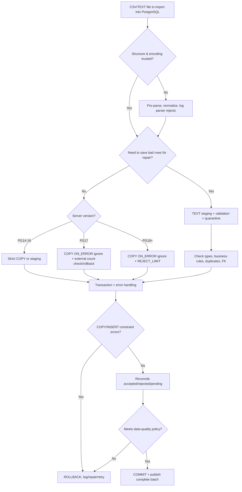

# Handling Bad Rows and Version-Specific Limits in PostgreSQL Data Import and Export

A CSV file contains 100,000 orders. Fifty rows have invalid dates, three have duplicate order IDs, two have negative amounts, and one has a broken double quote. If you use `COPY FROM` to load directly into a business table, PostgreSQL **does not treat all of these errors the same way**. Some versions can skip rows whose column values fail SQL type conversion; however, **primary-key violations, CHECK failures, triggers, and CSV syntax errors do not automatically turn into "skipped rows"**.

The core challenge when designing an ingestion pipeline is not merely "how do I keep `COPY` from throwing an error?", but rather:

1. **What defines a valid row?** Is it syntactically valid CSV, type-valid SQL, and business-valid?
2. **Which errors may be skipped, and which must abort the entire batch?**
3. **Must the exact source payload of rejected rows be preserved?**
4. **What error threshold must fail the batch?**
5. **Which PostgreSQL major version is running on the server, and do client tools support that option?**
6. **If a load fails partway through, what data was committed and how should retries behave?**

An example using the latest stable PostgreSQL features:

```sql
-- PostgreSQL 18+
COPY demo_import.orders (
    order_id, customer_code, amount, ordered_on,
    source_uuid, status
)
FROM STDIN
WITH (
    FORMAT csv,
    HEADER true,
    ON_ERROR ignore,
    REJECT_LIMIT 2,
    LOG_VERBOSITY verbose
);
```

This syntax allows skipping **up to two rows that fail input-to-column type conversion**. It is not a "skip every kind of error" mode, nor does it automatically write bad rows into an error table.

This lesson belongs to the **Data Import and Export** chapter of the *Database Engine Relational PostgreSQL* module. We will analyze `COPY` behavior across PostgreSQL 14–18, distinguish `COPY` from `\copy`, explore `ON_ERROR`, `REJECT_LIMIT`, `LOG_VERBOSITY`, format/constraint/transaction boundaries, and practice two observable, recoverable ingestion strategies.

> **Scope note:** Feature milestones follow official PostgreSQL release documentation: PostgreSQL 17 introduced `ON_ERROR ignore` and `LOG_VERBOSITY`; PostgreSQL 18 added `REJECT_LIMIT` and `LOG_VERBOSITY silent`. If you run a different major version or preview build, consult documentation for the **exact server version**. All data-manipulation commands below are strictly for test databases.

---

## 1. Learning Objectives

After this lesson, you will be able to:

- Explain the order of layers where errors occur when importing CSV/TEXT into PostgreSQL.
- Know when `COPY FROM` stops at the first error by default and fails the statement.
- Identify the exact scope of `ON_ERROR ignore` introduced in PostgreSQL 17.
- Use `REJECT_LIMIT` from PostgreSQL 18 to cap the number of skipped type-conversion rows.
- Choose `LOG_VERBOSITY default`, `verbose`, or `silent` based on version and audit requirements.
- Never confuse type-conversion errors with unique, foreign key, NOT NULL, CHECK, or trigger errors.
- Never confuse CSV parser errors (missing columns, extra columns, broken quotes) with type-conversion errors.
- Understand that `COPY count` is the number of rows copied successfully, not the total lines in the file.
- Understand that `COPY` is a transactional statement; `ON_ERROR ignore` does not perform independent per-row commits.
- Build a text staging table to isolate raw source values for faulty rows.
- Use `pg_input_is_valid` and `pg_input_error_info` from PostgreSQL 16+ where appropriate.
- Persist a quarantine/reject table with batch ID, line position, reason code, and raw source payload.
- Design deduplication and business validation before promoting into target tables.
- Distinguish server-file read rights of `COPY` from client-side files of `\copy`.
- Integrate Java/pgJDBC `CopyManager` with transactions, counts, and exception handling.
- Monitor `pg_stat_progress_copy` and distinguish succeeded, failed, and skipped imports.
- Design retries, idempotency, error thresholds, version checks, and rollback plans.

## 2. Lifecycle of a CSV Row

```text
Source file / stream
      │
      ▼
[Read bytes, ENCODING]
      │ encoding/protocol error?
      ▼
[CSV/TEXT parser: column count, quotes, delimiter, lines]
      │ structural error?
      ▼
[NULL/DEFAULT, cast text to SQL type]
      │ conversion error?
      │   ├── PG < 17 or ON_ERROR stop ───► ERROR, COPY fails
      │   └── PG 17+ ON_ERROR ignore ─────► skip row, increment skipped
      ▼
[DEFAULT / generated expressions / constraints / triggers]
      │ PK, UNIQUE, CHECK, FK, NOT NULL, trigger error?
      └────────────────────────────────────► ERROR, COPY fails
      │
      ▼
[Valid row inserted in transaction]
      │
      ▼
COMMIT or ROLLBACK per application
```

This diagram illustrates the **semantic boundaries that matter**, without promising exact internal micro-ordering across every table or trigger. Most importantly: the skip behavior of `ON_ERROR ignore` applies solely to **errors converting an input field to its target column type**, not as a blanket catch-all.

## 3. Feature Matrix by Major Version

| Feature | PG 14–15 | PG 16 | PG 17 | PG 18 |
|---|---|---|---|---|
| `COPY FROM` CSV/TEXT/BINARY | Yes | Yes | Yes | Yes |
| Aborts whole statement on error by default | Yes | Yes | Yes | Yes |
| `COPY FROM ... ON_ERROR ignore` | **No** | **No** | **Yes** | **Yes** |
| `LOG_VERBOSITY default/verbose` for ignored rows | No | No | Yes | Yes |
| `LOG_VERBOSITY silent` | No | No | No | **Yes** |
| `REJECT_LIMIT` | No | No | No | **Yes** |
| `pg_stat_progress_copy.tuples_skipped` | No | No | **Yes** | Yes |
| `pg_input_is_valid` / `pg_input_error_info` | No | **Yes** | Yes | Yes |
| Text staging + SQL validation | Yes | Yes | Yes | Yes |
| `psql \copy`, `COPY ... STDIN` | Yes | Yes | Yes | Yes |

This table compares only **features relevant to this lesson** and does not imply identical `COPY` syntax across all releases. During upgrades, also check minor versions, extensions, drivers, and managed-service limits.

### 3.1. Key Version Milestones

- **PostgreSQL 17:** adds `ON_ERROR ignore` for `text`/`csv` `COPY FROM`, plus `LOG_VERBOSITY default` and `verbose`.
- **PostgreSQL 18:** adds the `REJECT_LIMIT` threshold and `LOG_VERBOSITY silent`.
- **PostgreSQL 16:** introduces input validation helpers `pg_input_is_valid` and `pg_input_error_info` useful for staging; they do not replace business validation.
- **PostgreSQL 14–15:** still support full classification/quarantine pipelines, but require external or in-database validation rather than `COPY ON_ERROR ignore`.

### 3.2. Never Judge Support by the psql Binary Version

Connecting a brand-new `psql` client to a PostgreSQL 16 server **does not upgrade the server to PostgreSQL 18**. Options like `COPY ... ON_ERROR ignore` are parsed and executed by the server. Feature support depends on the server, not merely the `psql` binary version.

## 4. Checking the Server Version

```sql
SELECT version();

SHOW server_version;

SHOW server_version_num;
```

You can also check programmatically in SQL:

```sql
SELECT
    current_setting('server_version_num')::integer
        AS server_version_num,
    current_setting('server_version_num')::integer >= 170000
        AS has_copy_on_error,
    current_setting('server_version_num')::integer >= 180000
        AS has_reject_limit;
```

### 4.1. Never Parse Version Strings Arbitrarily

`server_version_num` makes feature gating across released major versions clean. PostgreSQL 17 starts at `170000`; PostgreSQL 18 starts at `180000`.

### 4.2. Read the Documentation for Your Exact Version

- [PostgreSQL 16 — COPY](https://www.postgresql.org/docs/16/sql-copy.html)
- [PostgreSQL 17 — COPY](https://www.postgresql.org/docs/17/sql-copy.html)
- [PostgreSQL 18 — COPY](https://www.postgresql.org/docs/18/sql-copy.html)

For production statements, verify options against the **running server version** rather than copying syntax blindly from `current` docs.

## 5. COPY FROM Stops on Error by Default

Default behavior:

```sql
COPY some_table (id, amount)
FROM '/path/on/server/input.csv'
WITH (FORMAT csv, HEADER true);
```

When a value fails conversion to its column type or a constraint fails, PostgreSQL raises an error by default and the `COPY` command **aborts**. Rows processed prior to the error **are not committed separately** as partial successes.

### 5.1. Transactional Behavior of COPY

In PostgreSQL, `COPY FROM` is a transactional statement like DML. When it fails, none of its changes become committed independent rows.

Inside an explicit transaction:

```sql
BEGIN;

-- A COPY failure here places the transaction into an aborted state.
-- You must ROLLBACK or handle via an appropriate savepoint/transaction policy.

ROLLBACK;
```

Never conclude from "10,000 rows were processed before the error" that those 10,000 rows will be visible after commit when the statement failed.

### 5.2. An Important Resource Side Effect

PostgreSQL may physically write tuples before `COPY` aborts; those tuples become invisible yet still occupy disk space until `VACUUM` reclaims them. Thus, a huge `COPY` that fails near the end both fails logically and consumes storage overhead.

### 5.3. No Automatic Per-Row Transactions

`ON_ERROR ignore` does **not** commit each valid row independently. Accepted rows still belong to the same statement and transaction. An unhandled failure at the end of the file aborts the entire `COPY`.

## 6. Four Error Categories You Must Distinguish

| Category | Examples | Ignorable via PG17/18 `ON_ERROR ignore`? |
|---|---|---|
| **Input type conversion** | `"abc"` into `integer`; invalid date; bad UUID | **Row can be skipped** |
| **CSV/TEXT structure** | Extra columns, missing columns, unclosed quote, format error | **No** |
| **Constraints** | Duplicate PK/UNIQUE; NOT NULL; CHECK; FK | **No** |
| **Triggers/routines/other execution errors** | Trigger raises exception, permission denied, connection drop | **No** |

Understanding this classification matters far more than merely knowing the `ON_ERROR` keyword.

### 6.1. Type Conversion Errors

`COPY` reads `not-a-number` and must cast it into `NUMERIC`. The column's input function fails; `ON_ERROR ignore` is designed specifically for this case.

### 6.2. Constraint Errors

An amount `-5.00` is a **type-valid** `NUMERIC` value. Yet if the table enforces `CHECK (amount >= 0)`, that is a business/constraint failure, not a conversion failure.

### 6.3. Parser Errors

A CSV row with eight fields when six are expected is a record-structure error. PostgreSQL lacks enough information to map fields to columns—never expect `ON_ERROR ignore` to fix column alignment.

### 6.4. Trigger Errors

A trigger can throw an exception after input values have already converted cleanly. `ON_ERROR ignore` is not an `EXCEPTION WHEN OTHERS` block wrapping triggers.

## 7. Preparing the Lab Database

Create an isolated schema:

```sql
CREATE SCHEMA IF NOT EXISTS demo_import;
```

Create a target table enforcing both types and business rules:

```sql
CREATE TABLE demo_import.orders (
    order_id BIGINT PRIMARY KEY,
    customer_code TEXT NOT NULL
        CHECK (btrim(customer_code) <> ''),
    amount NUMERIC(12, 2) NOT NULL
        CHECK (amount >= 0),
    ordered_on DATE NOT NULL,
    source_uuid UUID NOT NULL,
    status TEXT NOT NULL
        CHECK (status IN ('NEW', 'PAID', 'CANCELLED')),
    imported_at TIMESTAMPTZ NOT NULL
        DEFAULT clock_timestamp()
);
```

Design notes:

- `order_id` must convert to `BIGINT` and stay unique.
- `amount` must convert to `NUMERIC(12,2)` and be non-negative.
- `ordered_on` must be a valid calendar date.
- `source_uuid` must be a valid UUID.
- `status` accepts only 3 values.
- `customer_code` cannot be blank after trimming whitespace.

This setup lets us deliberately craft distinct **type errors** and **constraint errors**.

### 7.1. Inspecting the Schema

```sql
SELECT
    column_name,
    data_type,
    is_nullable
FROM information_schema.columns
WHERE table_schema = 'demo_import'
  AND table_name = 'orders'
ORDER BY ordinal_position;
```

If re-running on an existing lab database, ensure object definitions match; never run `DROP ... CASCADE` without checking what exists first.

---

## 8. PG18 Lab: Skip Two Conversion Errors, Load Three Rows

The following block is for **psql connected directly to PostgreSQL 18+** on a fresh lab database with an empty `orders` table. `COPY FROM STDIN` reads inline CSV lines immediately following the statement until `\.`.

```sql
BEGIN;

COPY demo_import.orders (
    order_id, customer_code, amount,
    ordered_on, source_uuid, status
)
FROM STDIN
WITH (
    FORMAT csv,
    HEADER true,
    ON_ERROR ignore,
    REJECT_LIMIT 2,
    LOG_VERBOSITY verbose
);
order_id,customer_code,amount,ordered_on,source_uuid,status
101,C001,120.50,2026-11-10,11111111-1111-4111-8111-111111111111,PAID
102,C002,not-money,2026-11-11,22222222-2222-4222-8222-222222222222,NEW
103,C003,90.00,not-a-date,33333333-3333-4333-8333-333333333333,PAID
104,C004,80.25,2026-11-12,44444444-4444-4444-8444-444444444444,NEW
105,C005,35.00,2026-11-13,55555555-5555-4555-8555-555555555555,PAID
\.

SELECT
    order_id, customer_code, amount, ordered_on, status
FROM demo_import.orders
ORDER BY order_id;

ROLLBACK;
```

### 8.1. What Should Happen?

| Order ID | Key Value | Outcome |
|---:|---|---|
| 101 | Valid data | Inserted |
| 102 | `amount = not-money` | Skipped (fails NUMERIC conversion) |
| 103 | `ordered_on = not-a-date` | Skipped (fails DATE conversion) |
| 104 | Valid data | Inserted |
| 105 | Valid data | Inserted |

Expected successful COPY command tag: **`COPY 3`**. `LOG_VERBOSITY verbose` emits details about the input line and column failing conversion for each skipped row, and the client displays skipped-row counts as a NOTICE.

### 8.2. Why ROLLBACK at the End?

`COPY` succeeded within the transaction; `SELECT` prior to `ROLLBACK` sees three rows. `ROLLBACK` simply **resets the lab** so subsequent drills can reuse the same order IDs on an empty table.

Replacing `ROLLBACK` with `COMMIT` persists the three valid rows permanently.

### 8.3. Never Send an Inline CSV Block via a JDBC Statement

The `COPY ... FROM STDIN; data ... \.` syntax is a **psql script convenience**. In JDBC, applications must use the COPY protocol/`CopyManager` to stream bytes rather than concatenating CSV text onto SQL in `Statement.execute()`.

### 8.4. Omit REJECT_LIMIT on PG17

If your server is PostgreSQL 17, omit `REJECT_LIMIT 2` since that option arrived in PostgreSQL 18. The remaining `ON_ERROR ignore, LOG_VERBOSITY verbose` options work on PG17.

## 9. ON_ERROR stop vs. ignore

`ON_ERROR` selects the error behavior.

```sql
-- Default: input conversion errors abort the statement.
COPY demo_import.orders
FROM STDIN
WITH (FORMAT csv, ON_ERROR stop);

-- PG17+: skip rows on conversion errors and continue.
COPY demo_import.orders
FROM STDIN
WITH (FORMAT csv, ON_ERROR ignore);
```

These illustrate syntax; when using `STDIN` in psql, follow with data ending in `\.` or stream via the COPY protocol from a client.

### 9.1. ON_ERROR stop Is Not a Recovery Option

`stop` merely states the default behavior explicitly. It does not create a reject log or roll back prior statements from separate transactions.

### 9.2. ON_ERROR ignore Is Best-Effort for One Error Class

If an input contains one million rows with conversion errors, `ON_ERROR ignore` **without `REJECT_LIMIT`** will skip all one million rows and report success if no other error class triggers.

That is why starting in PostgreSQL 18, pairing it with a rejection limit is recommended whenever input quality is uncertain.

### 9.3. Ignoring Conversion Errors Does Not Fix Data Quality

Even when `COPY` succeeds, skipped orders never enter the target table. If those orders matter, you still need counts, reconciliation, and persisted raw errors to fix and replay them.

## 10. PostgreSQL 18 REJECT_LIMIT

`REJECT_LIMIT` caps how many conversion errors may be skipped.

```sql
COPY demo_import.orders
FROM STDIN
WITH (
    FORMAT csv,
    ON_ERROR ignore,
    REJECT_LIMIT 10
);
```

Meaning: **at most 10** rows may be skipped due to input conversion errors. If conversion errors **exceed 10**, `COPY` fails.

### 10.1. REJECT_LIMIT 10 Does Not Mean "Insert Only 10 Rows"

If a file has 100,000 valid rows and 8 type-invalid rows, all 100,000 valid rows load. `REJECT_LIMIT` caps **conversion errors**, not inserted rows.

### 10.2. The Limit Must Be Positive

`REJECT_LIMIT` accepts a positive `bigint`. Never pass `REJECT_LIMIT 0` to mean "allow zero errors": to stop on the first error, use `ON_ERROR stop` (the default).

### 10.3. REJECT_LIMIT Requires ON_ERROR ignore

```sql
-- Invalid:
COPY demo_import.orders
FROM STDIN
WITH (FORMAT csv, REJECT_LIMIT 5);
```

To enforce a limit, you must enable `ON_ERROR ignore` alongside it.

### 10.4. Exceeding the Limit Aborts the Entire COPY

With a limit of 1 and two type-invalid rows in a file, the second invalid row fails the entire `COPY` statement. Valid rows from the **same statement** are not partially committed.

Notice the distinction:

- **Success: 1 conversion error skipped, remaining rows inserted.**
- **Failure: 2 conversion errors > limit 1, entire COPY statement rolled back.**

### 10.5. REJECT_LIMIT Does Not Govern Business Rule Failures

Even with a limit of 1,000, a single row with amount `-10.00` violating `CHECK` aborts `COPY`—it is not counted against conversion skips.

## 11. Log Verbosity by Version

`LOG_VERBOSITY` adjusts how much diagnostic output PostgreSQL emits for ignored conversion rows.

| Option | PG17 | PG18 | Behavior for Ignored Rows |
|---|---|---|---|
| `default` | Yes | Yes | Emits a summary notice with skipped row count when errors occur |
| `verbose` | Yes | Yes | Adds a NOTICE per skipped row/column conversion failure |
| `silent` | **No** | Yes | Suppresses notices about ignored rows |

`LOG_VERBOSITY silent` does not turn database errors into successes. Unique constraint violations or `REJECT_LIMIT` overruns still abort `COPY` and must be handled by the caller.

### 11.1. Why Use verbose When Debugging?

On small test files with errors, per-row line and column notices pinpoint bad input quickly.

```sql
WITH (
    FORMAT csv,
    HEADER true,
    ON_ERROR ignore,
    LOG_VERBOSITY verbose
)
```

### 11.2. Why Can verbose Be Expensive?

A file with 50,000 conversion errors emits 50,000 NOTICEs, flooding client and server logs, potentially exposing column positions/values, and raising observability costs. In production, prefer staging + structured reject auditing over per-row NOTICE spam.

### 11.3. Why silent Requires Independent Reconciliation

When choosing:

```sql
WITH (
    FORMAT csv,
    ON_ERROR ignore,
    REJECT_LIMIT 100,
    LOG_VERBOSITY silent
)
```

you intentionally silence ignored-row notices. That is safe only if your pipeline tracks metrics and reconciles source counts and rejections elsewhere.

### 11.4. LOG_VERBOSITY Is Not log_min_messages

Although similarly named, `LOG_VERBOSITY` is a `COPY` option, whereas `log_min_messages`/`client_min_messages` are server/session logging settings. Never alter global cluster logging just to hide warnings from one dirty batch.

## 12. Errors ON_ERROR ignore Cannot Save: CHECK

Test input:

```text
201,C201,-5.00,2026-11-10,
    11111111-1111-4111-8111-111111111111,PAID
```

`-5.00` converts cleanly to `NUMERIC(12,2)`, yet:

```sql
CHECK (amount >= 0)
```

rejects negative values. Outcome: `COPY` aborts on the `CHECK` violation; it is **not** skipped because `CHECK` runs after input conversion.

### 12.1. CHECK Enforces Business Invariants

To retain faulty rows for remediation, use text staging + validation or checkpointed row-level processing. Never drop `CHECK` constraints just to make an import succeed.

## 13. Errors ON_ERROR ignore Cannot Save: UNIQUE / PRIMARY KEY

Suppose the file contains:

```text
301,C301,20.00,2026-11-10,11111111-1111-4111-8111-111111111111,PAID
301,C302,30.00,2026-11-11,22222222-2222-4222-8222-222222222222,NEW
```

Both `order_id` values are valid `BIGINT`s. The second row collides on `PRIMARY KEY` with the first.

`ON_ERROR ignore` does **not** turn `COPY` into:

```sql
INSERT ... ON CONFLICT DO NOTHING
```

To upsert or deduplicate, load into staging and run `INSERT ... ON CONFLICT` with explicit conflict rules, or deduplicate upstream.

### 13.1. Never Drop Primary Keys to "Fix" Imports

Removing a production PK just to ingest a duplicate file destroys integrity. Move duplicate detection into the pipeline and decide explicitly which record wins or gets quarantined.

## 14. Errors ON_ERROR ignore Cannot Save: NOT NULL and FK

When default CSV represents NULL with an unquoted empty field:

```text
401,C401,,2026-11-10,11111111-1111-4111-8111-111111111111,PAID
```

`amount` is parsed as SQL NULL under default CSV rules. Because the column is `NOT NULL`, the constraint fails.

Similarly, a valid `bigint` `customer_id` absent from the parent table triggers a foreign-key violation—not a conversion failure.

### 14.1. Distinguishing EMPTY, NULL, and Invalid Numeric

| CSV Field | Default CSV NULL Option | NUMERIC Outcome |
|---|---|---|
| `12.30` | Not NULL | `12.30` |
| Unquoted empty field | Matches default empty null marker | SQL NULL |
| `""` | Quoted, not NULL by default | Empty string → conversion error |
| `abc` | Not NULL | Conversion error |

`FORCE_NULL` and `FORCE_NOT_NULL` adjust how quoted vs. unquoted null strings behave; see the dedicated rules.

## 15. Errors ON_ERROR ignore Cannot Save: CSV Structure

Cases:

- An unexpected extra comma.
- A missing column in a row.
- An unclosed quoted field.
- Field count mismatch against the column list.
- Malformed CSV violating quote/escape rules.

`COPY` raises errors like:

```text
ERROR: extra data after last expected column
ERROR: missing data for column ...
ERROR: unterminated CSV quoted field
```

These are not simple single-field type conversion failures. `ON_ERROR ignore` is not a CSV syntax repair engine.

### 15.1. Properly Quote Commas Inside Fields

Valid:

```csv
order_id,customer_code,amount
1,"Customer, VIP",100.00
```

Invalid for three intended columns when unquoted:

```csv
order_id,customer_code,amount
1,Customer, VIP,100.00
```

The second row has four fields, causing a three-column `COPY` to fail.

### 15.2. Multiline CSV Fields

CSV supports newlines inside properly quoted fields. **One CSV record does not always equal one physical text line.** Audit logs tracking line numbers must account for parser/byte offsets and source metadata rather than assuming line *k* equals row *k*.

## 16. UUID and JSON Conversion Does Not Bypass All Errors

A value:

```text
not-a-uuid
```

targeting a `uuid` column is an input conversion error and can be skipped by `ON_ERROR ignore` per documentation.

A `jsonb` field with invalid JSON syntax fails in the input function and counts as a conversion error on that path. Yet never assume **every** error arising from payload deserialization, triggers, JSON schema `CHECK`s, or encoding will be ignored.

### 16.1. Valid JSON Violating Business Schemas

`{"amount":"abc"}` is valid `jsonb`; PostgreSQL `COPY` accepts it even if business rules expect a numeric `amount`. `ON_ERROR ignore` **does not validate domain JSON schemas**.

### 16.2. VARCHAR Length and Domain Constraints

Strings exceeding column length or violating domain constraints can fail at different stages depending on type and input path. Never generalize "ignore all load errors" from simple numeric or date examples.

## 17. BINARY Format Does Not Accept ON_ERROR ignore

`COPY` supports three primary formats:

```text
text
csv
binary
```

`ON_ERROR ignore` is supported only for **`COPY FROM` with `FORMAT text` or `csv`** in PostgreSQL 17/18.

```sql
-- Invalid configuration:
COPY demo_import.orders
FROM STDIN
WITH (FORMAT binary, ON_ERROR ignore);
```

### 17.1. Why Not Force Binary to Avoid Errors?

Binary COPY uses strict internal formats, type OIDs, version assumptions, and protocol framing. It does not magically repair bad CSV encodings, quotes, or types.

### 17.2. COPY TO Does Not Use ON_ERROR ignore

`COPY TO` exports data from PostgreSQL rather than parsing text fields into SQL types. It has no conversion-skipping mode like `COPY FROM`.

## 18. HEADER true Differs from HEADER MATCH

CSV `HEADER true` **skips the header row**, without verifying that header names match the column list.

```sql
COPY demo_import.orders (
    order_id, customer_code, amount,
    ordered_on, source_uuid, status
)
FROM STDIN
WITH (FORMAT csv, HEADER true);
```

If a file swaps headers (`amount,order_id,...`) along with the data columns, `HEADER true` still reads **by positional order in the column list**—raising a conversion error or, worse, silently loading values into the wrong same-typed columns.

### 18.1. HEADER MATCH Is Stricter

On servers supporting it:

```sql
COPY demo_import.orders (
    order_id, customer_code, amount,
    ordered_on, source_uuid, status
)
FROM STDIN
WITH (FORMAT csv, HEADER MATCH);
```

`HEADER MATCH` requires header count, names, and order to match the copied columns.

### 18.2. HEADER MATCH Does Not Replace Schema Validation

Even with matching headers, data rows underneath can still have bad types, duplicate IDs, negative amounts, or invalid statuses.

### 18.3. Headers with a UTF-8 BOM

Spreadsheet exports often start with a UTF-8 BOM. Depending on the reader path, the BOM can break `HEADER MATCH` on the first column or corrupt the first cell. Inspect and normalize encoding in the pipeline rather than blindly stripping leading bytes from arbitrary data.

## 19. ENCODING: Byte Errors Differ from Type Conversion Errors

`COPY FROM` decodes bytes according to the `ENCODING` option or client encoding.

```sql
COPY demo_import.orders
FROM STDIN
WITH (
    FORMAT csv,
    HEADER true,
    ENCODING 'UTF8'
);
```

If the source is Windows-1258, Latin-1, Shift-JIS, or contains invalid UTF-8 bytes, encoding failures happen **before** valid text reaches column input conversion.

### 19.1. ON_ERROR ignore Is Not an Encoding Repair Tool

Do not expect it to drop bad bytes and keep going row by row. For broken Unicode inputs, verify source encoding or sanitize bytes during file ingestion.

### 19.2. Never Force "UTF8" Simply Because the App Uses UTF-8

If the file uses a different encoding, declaring the wrong encoding causes errors or mojibake. Verify with the producer, apply explicit transcoding in ETL, and reconcile outputs.

### 19.3. Verify Vietnamese Text Explicitly

Test names like `Nguyễn, Trần, Đặng` along with diacritics, embedded newlines, and quotes to confirm both encoding and parser behavior—never test only ASCII.

## 20. CSV NULL, Empty Strings, and Quoted Fields

In default CSV, an **unquoted empty field** matches the null string, whereas `""` is parsed as an empty string.

```csv
id,note
1,
2,""
3,"Needs callback"
```

Typical results:

- Row 1: SQL NULL.
- Row 2: empty text `''`.
- Row 3: text `Needs callback`.

### 20.1. Choosing a Custom NULL Token

```sql
COPY some_text_stage
FROM STDIN
WITH (
    FORMAT csv,
    HEADER true,
    NULL '__NULL__'
);
```

With `__NULL__`, unquoted empty fields load as empty strings (unless FORCE options apply), while `__NULL__` becomes SQL NULL.

### 20.2. FORCE_NULL

For CSV and specific columns:

```sql
WITH (
    FORMAT csv,
    FORCE_NULL (note)
)
```

causes even quoted null markers to decode as SQL NULL.

### 20.3. FORCE_NOT_NULL

`FORCE_NOT_NULL` prevents unquoted null markers on chosen columns from becoming NULL, preserving empty strings instead.

### 20.4. Agree on NULL Policy with the Exporter

If the exporter uses `NULL '__NULL__'` while the importer expects default empty nulls, data loads wrong. Document `DELIMITER`, `QUOTE`, `ESCAPE`, `NULL`, `HEADER`, and `ENCODING` in a shared data contract.

## 21. DEFAULT Values Do Not Repair Broken Rows

When COPY's column list omits `imported_at`:

```sql
COPY demo_import.orders (
    order_id, customer_code, amount,
    ordered_on, source_uuid, status
)
FROM STDIN
WITH (FORMAT csv, HEADER true);
```

`imported_at` receives its `clock_timestamp()` default.

If a column *is* listed and the CSV supplies SQL NULL, PostgreSQL **does not replace NULL with DEFAULT automatically**.

### 21.1. The COPY DEFAULT Option

PostgreSQL provides a `DEFAULT 'token'` option allowing a designated marker string to trigger column defaults during text/csv `COPY FROM` in supported versions.

This differs from `ON_ERROR ignore`: the `DEFAULT` token is an explicit, valid sentinel—it does not rescue arbitrary values like `not-a-date`.

### 21.2. Avoid Markers That Collide with Real Data

If a customer can literally be named `DEFAULT` while you configure `DEFAULT` as the sentinel, meaning collides. Pick a mutually agreed token and quote/escape properly.

## 22. COPY FROM WHERE Filters Rows Without Quarantining Errors

`COPY FROM ... WHERE` inserts only rows matching a predicate, within server syntax limits:

```sql
COPY demo_import.orders (
    order_id, customer_code, amount,
    ordered_on, source_uuid, status
)
FROM STDIN
WITH (FORMAT csv, HEADER true)
WHERE amount >= 0;
```

However:

- `WHERE` is not a quarantine table.
- Evaluating `amount >= 0` still requires converting `amount` to numeric first.
- Rows failing type conversion are not automatically saved to a lookup table.
- Constructs like subqueries or generated-column references are restricted in `COPY WHERE`.
- Any CHECK, PK, or trigger failure on passing rows still aborts the statement.

### 22.1. WHERE Cannot See Earlier Rows in the Same COPY for Deduplication

Never try `COPY WHERE NOT EXISTS(...)` as a deduplication trick; `COPY WHERE` semantics are limited and do not replace `ON CONFLICT` or staging.

## 23. COPY FROM Does Not Support ON CONFLICT Directly

`INSERT INTO ... ON CONFLICT` is DML designed to handle unique conflicts.

`COPY FROM` has **no** built-in conflict clause:

```sql
-- Invalid:
COPY demo_import.orders FROM STDIN
WITH (FORMAT csv)
ON CONFLICT DO NOTHING;
```

If sources contain duplicate IDs, split the pipeline:

```text
COPY → staging → validate/dedup → INSERT ... ON CONFLICT ...
```

or handle conflicts in an external ETL/app layer with proper transactions.

### 23.1. DO NOTHING Alone Lacks Error Auditing

`ON CONFLICT DO NOTHING` drops colliding rows without writing reasons or raw payloads to an error table. For strict reconciliation, record duplicates in quarantine before or after merging while guarding against races.

### 23.2. DO UPDATE Needs Source Precedence Rules

When duplicate keys appear within a batch and you want upserts, define which row wins, which version is newer, and whether "last write wins" is valid. Never run unconditional `DO UPDATE` if duplicates may indicate corrupt files.

---

## 24. REJECT_LIMIT Is a Guardrail, Not a Reject File

A pipeline has two distinct needs:

1. **Guardrail:** abort the load if error volume is too high.
2. **Traceability:** retain each bad row with its error reason and original payload.

`REJECT_LIMIT` satisfies need #1 for conversion errors on PG18. It **does not automatically create**:

```text
rejected_rows.csv
reject_reason_table
error_code_per_record
source_byte_offset
```

To retain faulty inputs for repair, build ETL error capture or staging/quarantine tables.

### 24.1. NOTICEs Are Not a Durable Audit Store

`LOG_VERBOSITY verbose` emits notices, yet clients may ignore them, logs rotate, and notices lack full raw records. Never rely on NOTICEs as your system of record for rejected data.

### 24.2. Raw Error Counts Alone Are Insufficient

A file with 2 bad rows passes `REJECT_LIMIT 5`, yet if those two rows are high-value invoices, business policy might still require failing the batch. Combine count guardrails with criticality checks.

## 25. Staging Strategy: Load Text First, Process Second

Architecture:

```text
Source CSV
   │
   ▼
[Staging: raw strings + batch ID + source row]
   │
   ├── [Check conversion/NULL/domain]
   │         ├── bad ──► [Quarantine: reason + raw record]
   │         └── good
   ▼
[Deduplicate + business validation]
   │
   ├── bad / duplicate ──► [Quarantine]
   └── good ────────────► [INSERT/UPSERT target table]
                              │
                              ▼
                      [Batch metrics + COMMIT]
```

Benefits:

- Works across PostgreSQL 14–18.
- Preserves raw values for remediation and reprocessing.
- Validates complex business rules and cross-table checks.
- Produces clean batch and quarantine metrics.
- Supports idempotent retries by `batch_id`.

Limitations:

- A truly **unparseable** CSV still fails `COPY` into an all-text staging table; structural syntax must be repaired or pre-parsed upstream.
- Staging does not automatically fix broken encodings or malicious payloads.
- Requires explicit transaction, idempotency, and concurrency design.
- Storing raw PII requires security controls and retention limits.

## 26. Creating Staging and Quarantine Tables

Create staging. `source_line` is a **logical record ordinal supplied by the ETL/preprocessor**, not necessarily the physical line number in CSVs with embedded newlines.

```sql
CREATE TABLE demo_import.raw_orders (
    batch_id TEXT NOT NULL,
    source_line BIGINT NOT NULL,

    order_id_text TEXT,
    customer_code_text TEXT,
    amount_text TEXT,
    ordered_on_text TEXT,
    source_uuid_text TEXT,
    status_text TEXT,

    loaded_at TIMESTAMPTZ NOT NULL
        DEFAULT clock_timestamp()
);
```

Create the quarantine table:

```sql
CREATE TABLE demo_import.rejected_rows (
    batch_id TEXT NOT NULL,
    source_line BIGINT NOT NULL,
    reason_code TEXT NOT NULL,
    raw_record JSONB NOT NULL,
    rejected_at TIMESTAMPTZ NOT NULL
        DEFAULT clock_timestamp(),

    PRIMARY KEY (batch_id, source_line)
);
```

### 26.1. Why Are Raw Fields TEXT?

We want strings like `not-money` or `wrong-date` to land safely in staging without failing `NUMERIC`/`DATE` casts during initial `COPY`.

### 26.2. Why Are Metadata Columns Not Necessarily TEXT?

`batch_id` and `source_line` are controlled by the importer. When generated reliably, use typed `TEXT`/`BIGINT` with constraints. If metadata also arrives from untrusted inputs, treat and validate it as raw input first.

### 26.3. One Reason per Raw Row in the Lab

`PRIMARY KEY (batch_id, source_line)` stores **the first failing reason** per row. To capture multiple errors per row, key on `(batch_id, source_line, reason_code)` or add a `reject_diagnostics` table.

### 26.4. Error Tables Must Not Retain Secrets Indefinitely

`raw_record` may hold names, emails, account numbers, or sensitive text. Restrict `GRANT SELECT`, encrypt storage, mask sensitive fields, enforce retention, and audit access.

## 27. Loading Staging Without Relying on ON_ERROR ignore

This block runs on PostgreSQL 14–18 inside **psql**, using CSV rows pre-tagged with `batch_id` and `source_line`.

```sql
COPY demo_import.raw_orders (
    batch_id, source_line,
    order_id_text, customer_code_text, amount_text,
    ordered_on_text, source_uuid_text, status_text
)
FROM STDIN
WITH (
    FORMAT csv,
    HEADER true,
    NULL '__NULL__'
);
batch_id,source_line,order_id_text,customer_code_text,amount_text,ordered_on_text,source_uuid_text,status_text
batch-A,2,101,C101,120.50,2026-11-10,11111111-1111-4111-8111-111111111111,PAID
batch-A,3,102,C102,not-money,2026-11-11,22222222-2222-4222-8222-222222222222,NEW
batch-A,4,103,C103,90.00,not-a-date,33333333-3333-4333-8333-333333333333,PAID
batch-A,5,104,C104,80.25,2026-11-12,not-a-uuid,NEW
batch-A,6,101,C106,77.00,2026-11-13,66666666-6666-4666-8666-666666666666,PAID
batch-A,7,106,C106,-5.00,2026-11-14,77777777-7777-4777-8777-777777777777,NEW
batch-A,8,107,C107,20.00,2026-11-15,88888888-8888-4888-8888-888888888888,UNKNOWN
batch-A,9,108,,25.00,2026-11-16,99999999-9999-4999-8999-999999999999,PAID
batch-A,10,109,C109,99.95,2026-11-17,aaaaaaaa-aaaa-4aaa-8aaa-aaaaaaaaaaaa,NEW
batch-A,11,110,C110,200.00,2026-11-18,bbbbbbbb-bbbb-4bbb-8bbb-bbbbbbbbbbbb,PAID
\.
```

### 27.1. Ten Source Records

There are **10 data records** excluding the header. Per our lab contract:

- **3 valid records**: `source_line` 2, 10, 11.
- **3 type conversion errors**: line 3 (numeric), 4 (date), 5 (uuid).
- **1 duplicate order ID**: line 6 duplicates ID 101 from line 2.
- **3 business errors**: line 7 negative amount, line 8 `UNKNOWN` status, line 9 blank `customer_code`.

After validation and deduplication, expect **3 accepted + 7 rejected = 10**.

### 27.2. Custom NULL Token Distinguishes Empty Strings

`NULL '__NULL__'` keeps the empty customer field on line 9 as text `''`, letting business validation reject it as an empty code. Under default empty CSV NULLs, it would load as SQL `NULL`; it would still be rejected by business rules, just under a different classification.

### 27.3. Staging COPY Still Fails on Malformed CSV Structure

This is a fundamental boundary: text staging absorbs **business-field type errors**, not parser column/quote/encoding errors. Production pipelines need preflight parsing or contract-compliant inputs.

## 28. Checking Staging Row Count

```sql
SELECT
    batch_id,
    COUNT(*) AS raw_count,
    MIN(source_line) AS first_line,
    MAX(source_line) AS last_line
FROM demo_import.raw_orders
GROUP BY batch_id;
```

Expect `batch-A` to show 10 records with `source_line` from 2 to 11.

### 28.1. A Stable Batch ID Simplifies Reconciliation

When splitting across files or chunks, assign a `batch_id` independent of filename to distinguish attempts and sources. In production, use a UUID/metadata registry enforcing uniqueness.

### 28.2. COUNT(*) Does Not Automatically Reveal Source CSV Record Count

If `COPY ON_ERROR` dropped rows before staging, staging `COUNT(*)` would miss them. With all-text staging and no conversion skipping, staging captures **all syntactically parsed records**, though you should still reconcile against the external file parser's count.

## 29. PostgreSQL 16+: pg_input_is_valid

`pg_input_is_valid(text, type_name)` tests whether a string is accepted by a SQL type's input function.

```sql
SELECT
    pg_input_is_valid('123.45', 'numeric(12,2)')
        AS good_amount,
    pg_input_is_valid('not-money', 'numeric(12,2)')
        AS bad_amount,
    pg_input_is_valid('2026-11-14', 'date')
        AS good_date,
    pg_input_is_valid('not-a-date', 'date')
        AS bad_date,
    pg_input_is_valid('not-a-uuid', 'uuid')
        AS bad_uuid;
```

Available from **PostgreSQL 16**. On PostgreSQL 14–15, use application/ETL validation or controlled PL/pgSQL exception handling.

### 29.1. Soft-Error Support Caveat

Per PostgreSQL documentation, `pg_input_is_valid` returns TRUE/FALSE gracefully only if the type's input function supports **soft errors**. For types lacking soft-error support, invalid input can still raise an error that aborts the statement.

Never treat it as a universal validator for arbitrary extensions or custom types without testing them first.

### 29.2. Input Validity Does Not Mean Business Validity

`pg_input_is_valid('-5.00','numeric(12,2)')` returns TRUE even though the table enforces `CHECK (amount >= 0)`. It checks type conversion, not table constraints.

### 29.3. Numeric Typmods

`numeric(12,2)` differs from unconstrained `numeric`. Testing against the exact target type declaration catches scale and overflow issues, though rounding behavior on accepted inputs must still be tested.

## 30. pg_input_error_info: Retrieving Conversion Error Details

`pg_input_error_info` returns error metadata when soft errors are supported:

```sql
SELECT *
FROM pg_input_error_info(
    'not-money',
    'numeric(12,2)'
);
```

Returned fields include:

```text
message
detail
hint
sql_error_code
```

### 30.1. Never Use Error Text as a Business Key

Messages can vary by locale and PostgreSQL version. Classify errors using stable ETL-defined `reason_code`s such as `BAD_AMOUNT`, `BAD_DATE`, and `BAD_UUID`, retaining the database message only as supplementary diagnostics.

### 30.2. Never Log Sensitive Data in Error Messages

Input error messages often echo the offending value. Mask PII before forwarding messages to logs or observability pipelines.

## 31. Materializing Type Validation Results

Create a temporary table in the current session:

```sql
CREATE TEMP TABLE checked_raw AS
SELECT
    r.*,
    COALESCE(
        pg_input_is_valid(r.order_id_text, 'bigint'),
        false
    ) AS id_ok,
    COALESCE(
        pg_input_is_valid(r.amount_text, 'numeric(12,2)'),
        false
    ) AS amount_ok,
    COALESCE(
        pg_input_is_valid(r.ordered_on_text, 'date'),
        false
    ) AS date_ok,
    COALESCE(
        pg_input_is_valid(r.source_uuid_text, 'uuid'),
        false
    ) AS uuid_ok
FROM demo_import.raw_orders AS r
WHERE r.batch_id = 'batch-A';
```

This requires PG16+ and built-in lab types.

### 31.1. Why Materialize Validation Results?

With `checked_raw` materialized, downstream queries do not re-parse every value. It also clarifies the flow: only records with all `*_ok = TRUE` flags get cast next.

### 31.2. Do Not Confuse Checked with Accepted

A row with valid numeric, date, and UUID values can still have a negative amount, bad status, or duplicate key. Business rules run in the next phase.

### 31.3. Handling Raw NULLs

`COALESCE(..., false)` treats raw NULL as invalid for required target columns. If a column is legitimately nullable, adjust the rule to allow SQL NULL explicitly.

## 32. Routing Conversion Errors to Quarantine

```sql
INSERT INTO demo_import.rejected_rows (
    batch_id, source_line, reason_code, raw_record
)
SELECT
    c.batch_id,
    c.source_line,
    CASE
        WHEN NOT c.id_ok THEN 'BAD_ORDER_ID'
        WHEN NOT c.amount_ok THEN 'BAD_AMOUNT'
        WHEN NOT c.date_ok THEN 'BAD_DATE'
        WHEN NOT c.uuid_ok THEN 'BAD_UUID'
        ELSE 'UNKNOWN_TYPE_ERROR'
    END,
    to_jsonb(c)
        - 'id_ok'
        - 'amount_ok'
        - 'date_ok'
        - 'uuid_ok'
FROM checked_raw AS c
WHERE NOT (
    c.id_ok AND c.amount_ok
    AND c.date_ok AND c.uuid_ok
);
```

Expect **3 rejected rows**: `source_line` 3, 4, and 5.

### 32.1. What If One Row Has Multiple Bad Fields?

`CASE` records the **first error in evaluation order**, not all of them. To surface every error to users, store multiple diagnostic rows or a JSON/text array of errors.

### 32.2. Raw Records in JSONB

`to_jsonb(c)` captures staged column values rather than byte-exact original CSV (quotes, escapes, and whitespace may have been normalized by the CSV parser). When byte-exact evidence is required, archive the original file with its checksum in object storage.

### 32.3. Do Not Blindly Equate reason_code with SQLSTATE

A single `BAD_DATE` category can span multiple SQLSTATEs (format vs. out-of-range); stable business reason codes are far more practical for dashboards and retry policies.

## 33. Isolating Type-Valid Raw Rows

```sql
CREATE TEMP TABLE good_raw AS
SELECT *
FROM checked_raw
WHERE id_ok
  AND amount_ok
  AND date_ok
  AND uuid_ok;
```

Only rows guaranteed to parse cleanly into `BIGINT`, `NUMERIC(12,2)`, `DATE`, and `UUID` proceed to casting.

### 33.1. Why Not Run One SELECT Casting All Raw Rows Directly?

`SELECT amount_text::numeric FROM raw_orders` aborts on `not-money` before you can record a rejection reason. Separating check and cast avoids unconditional casts on invalid rows.

### 33.2. Verify Custom Types Separately

If a custom type's input function lacks soft-error support, creating `checked_raw` itself can fail. Validate such types in external ETL or controlled PL/pgSQL.

## 34. Casting good_raw into Typed Rows

```sql
CREATE TEMP TABLE typed_rows AS
SELECT
    batch_id,
    source_line,

    order_id_text::bigint AS order_id,
    customer_code_text AS customer_code,
    amount_text::numeric(12,2) AS amount,
    ordered_on_text::date AS ordered_on,
    source_uuid_text::uuid AS source_uuid,
    status_text AS status
FROM good_raw;
```

The three conversion-failed rows were already filtered out, so the remaining lab rows cast cleanly.

### 34.1. SQL Types Are Now Enforced

`typed_rows.amount` is numeric and `typed_rows.source_uuid` is uuid; from here onward, comparisons use native SQL types rather than string regexes.

### 34.2. Business Rule Violations Remain for the Next Step

Rows with negative amounts, `UNKNOWN` status, or empty `customer_code` are **still in `typed_rows`**. That is intentional: type validation and business validation are separate layers.

## 35. Routing Business Errors to Quarantine

```sql
INSERT INTO demo_import.rejected_rows (
    batch_id, source_line, reason_code, raw_record
)
SELECT
    t.batch_id,
    t.source_line,
    CASE
        WHEN t.amount < 0 THEN 'NEGATIVE_AMOUNT'
        WHEN NULLIF(btrim(t.customer_code), '') IS NULL
            THEN 'EMPTY_CUSTOMER'
        WHEN t.status IS NULL
             OR t.status NOT IN ('NEW', 'PAID', 'CANCELLED')
            THEN 'UNKNOWN_STATUS'
        ELSE 'UNKNOWN_BUSINESS_ERROR'
    END,
    to_jsonb(t)
FROM typed_rows AS t
WHERE t.amount < 0
   OR NULLIF(btrim(t.customer_code), '') IS NULL
   OR t.status IS NULL
   OR t.status NOT IN ('NEW', 'PAID', 'CANCELLED');
```

Expect **3 more rejected rows**: `source_line` 7, 8, and 9.

### 35.1. Target CHECK Constraints Remain the Last Line of Defense

Pipeline validation produces clear rejection reasons, yet **never replaces** `NOT NULL`/`CHECK`/`UNIQUE` on target tables. If an importer bug or another writer bypasses staging, database constraints protect invariants.

### 35.2. Validating Foreign Keys

You can `LEFT JOIN` reference tables to flag missing customers. Still keep the foreign key on the target table, guarding against check-then-insert races with proper transactions, isolation, and constraint design.

## 36. Isolating Business-Eligible Rows

```sql
CREATE TEMP TABLE eligible_rows AS
SELECT *
FROM typed_rows AS t
WHERE t.amount >= 0
  AND NULLIF(btrim(t.customer_code), '') IS NOT NULL
  AND t.status IN ('NEW', 'PAID', 'CANCELLED');
```

Expect four rows remaining: `source_line` 2, 6, 10, and 11.

Notice `source_line` 2 and 6 both have `order_id = 101`. Duplicates must be resolved before inserting.

## 37. Detecting In-Batch Duplicate IDs

```sql
CREATE TEMP TABLE numbered_rows AS
SELECT
    e.*,
    row_number() OVER (
        PARTITION BY e.order_id
        ORDER BY e.source_line
    ) AS id_rank
FROM eligible_rows AS e;
```

`id_rank = 1` selects the first record by `source_line` per order ID; `id_rank > 1` marks subsequent duplicates.

### 37.1. Document the Duplicate Tie-Breaking Rule

This lab keeps "the first row by `source_line`". Other pipelines keep the newest `updated_at`, prioritize trusted sources, or reject the entire duplicate group.

Never pick an arbitrary row by omitting `ORDER BY`.

### 37.2. Duplicates Must Still Be Audited

`row_number` only ranks rows. Without writing duplicates to quarantine, your audit trail loses visibility into duplicate source keys.

## 38. Routing Duplicates to Quarantine

```sql
INSERT INTO demo_import.rejected_rows (
    batch_id, source_line, reason_code, raw_record
)
SELECT
    n.batch_id,
    n.source_line,
    'DUPLICATE_ORDER_ID_IN_BATCH',
    to_jsonb(n)
FROM numbered_rows AS n
WHERE n.id_rank > 1;
```

Expect **1 more rejected row**: `source_line` 6.

### 38.1. Collisions with Pre-Existing Target Rows

If `orders` already holds an `order_id` from an earlier batch, apply the target conflict policy: skip, update, reject, or fail. Never assume in-batch duplicate rules cover cross-batch conflicts automatically.

## 39. Inserting Valid Rows into the Target Table

On an initial lab run, `orders` is empty:

```sql
INSERT INTO demo_import.orders (
    order_id, customer_code, amount,
    ordered_on, source_uuid, status
)
SELECT
    n.order_id,
    n.customer_code,
    n.amount,
    n.ordered_on,
    n.source_uuid,
    n.status
FROM numbered_rows AS n
WHERE n.id_rank = 1
  AND NOT EXISTS (
      SELECT 1
      FROM demo_import.orders AS o
      WHERE o.order_id = n.order_id
  )
ON CONFLICT (order_id) DO NOTHING;
```

Expect **3 inserted rows**: `order_id` 101, 109, 110.

### 39.1. Why Keep ON CONFLICT DO NOTHING?

It acts as a constraint safety net against retries or concurrent inserts. It does not replace audit tracking: in this simple example, a row skipped by `DO NOTHING` due to a concurrency race would not automatically appear in quarantine.

### 39.2. Reconcile Actual Inserted IDs in Production

To avoid losing auditability under concurrency, capture inserted IDs via `RETURNING`, batch tags, proper locking, or canonical import keys so every processed row ends in an explicit final state.

### 39.3. Never Use source_line as a Business Key

`source_line` is audit metadata within one batch. The target's unique key remains `order_id` per the business contract.

## 40. Reconciling Accepted and Rejected Rows

```sql
SELECT
    order_id, customer_code, amount, ordered_on, status
FROM demo_import.orders
ORDER BY order_id;

SELECT
    batch_id, source_line, reason_code
FROM demo_import.rejected_rows
ORDER BY batch_id, source_line;
```

Expected:

- Accepted: 3 (101, 109, 110).
- Rejected: 7.
- Total: 10.

### 40.1. Summary Query

```sql
SELECT
    (SELECT COUNT(*)
     FROM demo_import.raw_orders
     WHERE batch_id = 'batch-A') AS raw_count,

    (SELECT COUNT(*)
     FROM demo_import.rejected_rows
     WHERE batch_id = 'batch-A') AS rejected_count,

    (SELECT COUNT(*)
     FROM demo_import.orders
     WHERE order_id IN (101,109,110)) AS accepted_count;
```

Use this sample `accepted_count` query only on a clean lab dataset without preexisting IDs; in production, track `batch_id` on the target or ledger to count accurately.

### 40.2. Do Not Rely Only on raw_count = accepted + rejected If Rows Can Be Pending

Pipelines can also have rows pending manual review, duplicate targets, retries in flight, or policy skips. Design the ledger so every raw row holds **one clear final or pending state**.

## 41. Creating an Import Batch Ledger

In production, add a batch ledger:

```sql
CREATE TABLE demo_import.import_batch (
    batch_id TEXT PRIMARY KEY,
    source_name TEXT NOT NULL,
    source_checksum TEXT NOT NULL,
    started_at TIMESTAMPTZ NOT NULL DEFAULT now(),
    finished_at TIMESTAMPTZ,
    status TEXT NOT NULL
        CHECK (status IN (
            'RECEIVED', 'LOADING', 'VALIDATING',
            'ACCEPTED', 'PARTIAL', 'REJECTED', 'FAILED'
        )),
    raw_count BIGINT,
    accepted_count BIGINT,
    rejected_count BIGINT
);
```

### 41.1. Pair Checksums with File Identity

A filename alone does not prove two imports share identical contents. Hashing the source file detects accidental retries on modified files.

### 41.2. Status Labels Must Have Unambiguous Semantics

`PARTIAL` means some rows were rejected while valid ones committed; `FAILED` means the batch rolled back. Never use vague labels when downstream systems depend on them to decide consumption.

### 41.3. Reconciliation Is a Business Invariant

Goal:

```text
raw_count = accepted_count + rejected_count + pending_count
```

with mutually exclusive final states per row. If versions replay or one source row fans out to multiple target rows, adjust and document the invariant accordingly.

## 42. Staging on PG14–15 Without pg_input_is_valid

You can still:

1. `COPY` CSV into text staging.
2. Parse and validate fields in trusted Java/Python/ETL code.
3. Write valid candidates via prepared statements or a second `COPY`.
4. Route rejects with reason codes into quarantine.

Alternatively, write a PL/pgSQL helper using `BEGIN ... EXCEPTION ... END` per row, keeping subtransaction costs in mind.

### 42.1. Example Row Check in PL/pgSQL with Exception Handling

```sql
CREATE FUNCTION demo_import.try_parse_amount(
    p_value TEXT
)
RETURNS NUMERIC
LANGUAGE plpgsql
AS $$
DECLARE
    v_amount NUMERIC;
BEGIN
    v_amount := p_value::numeric(12,2);
    RETURN v_amount;

EXCEPTION
    WHEN invalid_text_representation
      OR numeric_value_out_of_range THEN
        RETURN NULL;
END;
$$;
```

This illustrates the technique, though it **cannot** distinguish an actual NULL amount from a failed parse and incurs subtransaction overhead. In production pipelines, return a composite record with `is_valid` and `error_code` if NULL is allowed.

### 42.2. Beware WHEN OTHERS THEN NULL

`WHEN OTHERS` swallows programming bugs, permission/lock/constraint errors, and unexpected failures, silently dropping data. Catch only specific SQLSTATEs and log diagnostics.

### 42.3. A Conversion Pass Is Not Business Validation

Even after `amount` parses as `numeric`, you still need non-negative checks, currency policies, business rules, and uniqueness.

## 43. The Cost of Per-Row Exceptions

A PL/pgSQL `EXCEPTION` block creates a subtransaction. Across millions of rows with high error rates, subtransaction overhead becomes significant.

Consider:

- Pre-validating against the file schema in ETL.
- Using `pg_input_is_valid` when supported (PG16+).
- Running set-based SQL on pre-checked raw fields.
- Chunking into retryable batches.
- Handling malformed CSVs in external preprocessing.

Never default to `FOR row IN SELECT ... LOOP BEGIN INSERT ... EXCEPTION WHEN OTHERS ... END END LOOP` for large datasets.

## 44. Comparing the Three Ingestion Strategies

| Criterion | Strict COPY | PG17/18 COPY ignore | Staging + Validation |
|---|---|---|---|
| Type error handling | Aborts | Skips conversion-error rows | Classifies via custom rules |
| Error count control | 0 | `REJECT_LIMIT` on PG18 | Custom absolute/ratio limits |
| Preserves raw rejected records | No | No | Yes, by design |
| Unique/CHECK/trigger errors | Aborts | Aborts | Catchable upfront; DB still enforces |
| Structural CSV errors | Aborts | Aborts | Staging COPY also aborts; needs pre-parser |
| PostgreSQL 14 support | Yes | No | Yes |
| Complexity | Low | Low–medium | Medium–high |
| Audit / reprocessing | Limited | Limited | Strong when designed well |
| Potential throughput | High | High when conversion errors are rare | Multi-step overhead |
| Financial / sensitive systems | When fail-fast fits | Only with crystal-clear policy | Usually preferred when every error must be kept |

No single pattern wins everywhere. For clean trusted feeds, strict `COPY` preserves integrity simply. For external feeds of variable quality, staging pays off.

---

## 45. \copy vs. Server-File COPY

SQL:

```sql
COPY demo_import.orders
FROM '/var/lib/postgresql/import/orders.csv'
WITH (FORMAT csv, HEADER true);
```

reads the file via the **PostgreSQL server process**; the path must live on the server or server-mounted storage. Server-file access is restricted to superusers or predefined roles such as `pg_read_server_files`.

In `psql`, the meta-command:

```text
\copy demo_import.orders FROM './orders.csv' WITH (FORMAT csv, HEADER true)
```

reads the file on the **machine running psql** and streams it over `COPY ... FROM STDIN`.

### 45.1. \copy Is a psql Command

Never pass a `\copy` string into JDBC `Statement.execute()`. It is not server SQL syntax.

### 45.2. \copy Options Still Depend on Server Version

Even though psql reads the file locally, options like `ON_ERROR ignore` and `REJECT_LIMIT` are executed by the server. A PG16 server will not understand `REJECT_LIMIT` just because your psql client is newer.

### 45.3. \copy Fits Apps and Laptops Better

You do not need `pg_read_server_files` for a service uploading files from an app host. Grant server-file privileges only when architecture and security reviews truly require them.

### 45.4. \copy and Table Privileges

Even with client files, the database role needs `INSERT` on the target table, schema `USAGE`, and related grants. `\copy` does not bypass database ACLs.

## 46. psql \copy with CSV Files

PG18 example:

```text
\copy demo_import.orders (order_id, customer_code, amount, ordered_on, source_uuid, status) FROM './orders.csv' WITH (FORMAT csv, HEADER true, ON_ERROR ignore, REJECT_LIMIT 5, LOG_VERBOSITY verbose)
```

Keep the entire `\copy` meta-command on one line in psql scripts because its parser does not follow standard SQL multiline rules.

### 46.1. Never Assume Client and Server Share Paths

`./orders.csv` is relative to the **psql client process**, not the PostgreSQL backend. Inside Docker, CI, or remote hosts, "current directory" may differ from expectations.

### 46.2. \copy to stdout

`\copy ... TO STDOUT` exports CSV through the client. When redirecting to files, enforce OS permissions, encoding, and escaping. Never dump raw sensitive data to terminal logs.

## 47. psql ON_ERROR_STOP vs. COPY ON_ERROR

Similar names, distinct layers:

- `COPY ... ON_ERROR ignore`: **server** skips conversion-error rows within that `COPY`.
- `psql -v ON_ERROR_STOP=1`: **psql client** halts script execution after a SQL error.

```text
psql -v ON_ERROR_STOP=1 -d mydb -f import.sql
```

A `COPY` failing on `CHECK` or duplicate keys is still a SQL ERROR; `psql ON_ERROR_STOP` stops the script there.

### 47.1. When COPY ignore Succeeds

If conversion errors stay within `REJECT_LIMIT` and the statement succeeds, psql does not see a SQL ERROR and continues the script (though NOTICEs may print).

### 47.2. ON_ERROR_STOP Is Not a Reject Collector

It does not record bad rows or classify business errors; it solely stops script execution on errors.

## 48. COPY and pg_restore/pg_dump

`pg_dump`/`pg_restore` are backup/restore tools; many dump formats use `COPY` internally to load table data.

However:

- Backup/restore targets **exact data recovery**, not best-effort error skipping.
- `pg_restore --exit-on-error` stops the tool when a restore statement fails; it is **not** `COPY ON_ERROR ignore`.
- `--single-transaction` controls restore atomicity when appropriate, requiring workload and lock evaluation.
- Never edit a dump to skip rows for an "approximate restore" when integrity is required.

### 48.1. Failed Restores and Investigation

If restoring a trusted backup hits a `COPY` conversion error, diagnose schema mismatches, encoding, extension/version differences, or file corruption. Skipping rows breaks data and foreign keys.

### 48.2. Never Drop Constraints for Speed and Forget to Re-Enable Them

Disabling triggers or dropping FKs risks inconsistent data unless re-validated. Such steps belong in controlled DBA migration procedures, never as a routine workaround for dirty CSVs.

## 49. COPY Privileges and Row-Level Security

PostgreSQL 18 documentation notes that direct `COPY FROM` is **not supported** on tables with Row-Level Security enabled; use equivalent `INSERT` statements when policies must run, or load into staging and insert via properly scoped roles/policies.

### 49.1. COPY TO and RLS

`COPY table TO` respects `SELECT` policies. For complex RLS-scoped exports, use `COPY (SELECT ...) TO STDOUT` under authorized roles.

### 49.2. Staging Must Not Bypass RLS

Loading into staging and then inserting as a privileged owner can accidentally bypass tenant isolation if poorly designed. Define roles, `SECURITY DEFINER`/`INVOKER`, policies, and auditing clearly.

### 49.3. Never Grant Superuser to Importers

A user only reading client files and inserting into tables needs neither superuser nor `pg_read_server_files`. Least privilege is fundamental to pipeline security.

## 50. Do Triggers Run During COPY FROM?

Yes. `COPY FROM` fires applicable triggers and evaluates `CHECK` constraints per PostgreSQL rules; it does not fire SQL rewrite rules like regular `INSERT` statements.

Example trigger:

```sql
CREATE FUNCTION demo_import.validate_status_trigger()
RETURNS trigger
LANGUAGE plpgsql
AS $$
BEGIN
    IF NEW.status = 'PAID'
       AND NEW.amount = 0 THEN
        RAISE EXCEPTION
            'PAID order cannot have amount zero';
    END IF;

    RETURN NEW;
END;
$$;

CREATE TRIGGER trg_validate_status
BEFORE INSERT ON demo_import.orders
FOR EACH ROW
EXECUTE FUNCTION demo_import.validate_status_trigger();
```

### 50.1. ON_ERROR ignore Does Not Catch Trigger Exceptions

If a `PAID` row has amount `0`, numeric conversion succeeds and `CHECK (amount >= 0)` passes, yet the trigger raises an exception. `COPY` fails rather than skipping the row as a conversion error.

### 50.2. Trigger Side Effects and Transactions

In-database writes performed by a trigger roll back when the statement/transaction fails. Any external side effects (such as HTTP calls, if present) cannot be rolled back by PostgreSQL and must be designed carefully.

### 50.3. Run Trigger Tests at the End of the Lab

This example alters `INSERT` behavior; creating it before other exercises containing zero-amount `PAID` orders changes their outcome. Its purpose is demonstrating error boundaries, not prescribing a universal business rule.

## 51. Never Rely on COPY Alone for Pre-Import Uniqueness Checks

Even if a CSV is pre-validated in application code, two concurrent importers can race for the same primary key. A database `UNIQUE` constraint is the final safeguard.

Combine:

- Unique keys on source event IDs.
- Idempotency keys on batch ID + source row.
- Source-level batch claiming/serialization.
- `INSERT ... ON CONFLICT` with explicit rules.
- Per-row acceptance ledgers and reconciliation.

Never rely on bare `NOT EXISTS` checks without unique constraints against concurrency races.

## 52. Catching Errors in the Application Layer

In Java/ETL code, distinguish:

- **ValidationError:** row fails contract before `COPY`.
- **CsvParseError:** malformed file, wrong field count, broken quote, or bad encoding.
- **CopyConversionError:** input value rejected by SQL type parser.
- **DatabaseConstraintError:** SQLSTATE `23xxx` (PK/FK/CHECK).
- **OperationalError:** timeouts, disk full, permission errors, dropped connections.

### 52.1. Retry Only Recoverable Errors

- A malformed UUID **never heals itself** by retrying the same payload.
- Transient network drops can be retried, provided duplicate inserts are prevented.
- Unique violations may signal either a legitimate retry or dirty source data; check source identity.
- Constraint violations require fixing data or logic, not infinite retries.

### 52.2. SQLSTATE Is More Reliable Than Error Text

| SQLSTATE | Common Meaning |
|---|---|
| `22P02` | Invalid text representation (e.g., bad UUID/numeric) |
| `22007` | Invalid datetime format |
| `22003` | Numeric value out of range |
| `23502` | NOT NULL violation |
| `23503` | Foreign key violation |
| `23505` | Unique violation |
| `23514` | CHECK violation |
| `42501` | Insufficient privilege |

Exact SQLSTATEs and messages depend on code paths; never hardcode English error text to drive business control flow.

## 53. pgJDBC CopyManager: Streaming via STDIN

In Java, pgJDBC supports the COPY protocol via `org.postgresql.copy.CopyManager`.

```java
import java.io.Reader;
import java.nio.charset.StandardCharsets;
import java.nio.file.Files;
import java.nio.file.Path;
import java.sql.Connection;
import org.postgresql.PGConnection;
import org.postgresql.copy.CopyManager;

Connection conn = dataSource.getConnection();

try {
    conn.setAutoCommit(false);

    int serverVersionNum;
    try (var st = conn.createStatement();
         var rs = st.executeQuery(
             "SELECT current_setting('server_version_num')::integer")) {
        rs.next();
        serverVersionNum = rs.getInt(1);
    }

    if (serverVersionNum < 180000) {
        throw new IllegalStateException(
            "PG18+ required for REJECT_LIMIT");
    }

    String copySql = """
        COPY demo_import.orders (
            order_id, customer_code, amount,
            ordered_on, source_uuid, status
        )
        FROM STDIN
        WITH (
            FORMAT csv,
            HEADER true,
            ON_ERROR ignore,
            REJECT_LIMIT 20,
            LOG_VERBOSITY verbose
        )
        """;

    CopyManager copy =
        conn.unwrap(PGConnection.class).getCopyAPI();

    try (Reader input = Files.newBufferedReader(
            Path.of("orders.csv"), StandardCharsets.UTF_8)) {

        long copiedCount = copy.copyIn(copySql, input);

        System.out.println(
            "Accepted COPY rows: " + copiedCount);
    }

    conn.commit();

} catch (Exception ex) {
    conn.rollback();
    throw ex;
} finally {
    conn.close();
}
```

### 53.1. This Is a Java Component Snippet, Not a Full Application

A real project needs proper `DataSource` setup, configuration, dependency management, and transaction policies. Never run sample snippets against production databases with arbitrary files.

### 53.2. copiedCount Is Not rawCount

The returned count reflects successfully copied rows—not total source records when `ON_ERROR ignore` skips conversion errors.

### 53.3. Use the Same Physical Connection

Obtain `CopyManager` from the `PGConnection` holding the active transaction. Never copy on connection A and commit connection B.

### 53.4. Reader and Encoding

`Files.newBufferedReader(..., UTF_8)` reads UTF-8 text, which the driver streams per connection encoding. For binary COPY or other encodings, use appropriate byte APIs; never pass raw binary bytes through a `Reader` without understanding the protocol.

## 54. CopyManager on PostgreSQL 17

When the server is version 17:

```java
String copySqlPg17 = """
    COPY demo_import.orders (
        order_id, customer_code, amount,
        ordered_on, source_uuid, status
    )
    FROM STDIN
    WITH (
        FORMAT csv,
        HEADER true,
        ON_ERROR ignore,
        LOG_VERBOSITY verbose
    )
    """;
```

Do not pass `REJECT_LIMIT` or `LOG_VERBOSITY silent`.

### 54.1. Enforcing a Reject Ratio Yourself on PG17

Without server-side `REJECT_LIMIT`, the application can:

1. Count total logical records via a reliable parser.
2. Run `COPY ON_ERROR ignore` inside a transaction.
3. Compare accepted vs. skipped counts (from return count/metrics).
4. If errors exceed policy thresholds, `ROLLBACK` before committing.
5. Otherwise, `COMMIT`.

This requires **accurate count reconciliation** and format/constraint handling. Relying solely on counts without raw reject storage still limits auditability.

### 54.2. Drivers Do Not Return a List of Rejected Rows

`CopyManager.copyIn` returns a row count, not the malformed raw rows. When you need the rejected payloads, stage or pre-parse separately.

## 55. CopyManager on PostgreSQL 16 and Earlier

On PG16 and older:

```java
String copySqlOld = """
    COPY demo_import.orders (
        order_id, customer_code, amount,
        ordered_on, source_uuid, status
    )
    FROM STDIN
    WITH (FORMAT csv, HEADER true)
    """;
```

A single conversion error aborts `COPY`. For partial acceptance, use text staging + ETL or split files into chunks with explicit transaction and retry tracking.

### 55.1. Do Not Rely on Clients Silently Emulating ON_ERROR ignore

An external library can pre-filter bad rows, yet that is **client behavior**, not server `COPY`. Verify it handles quotes, Unicode, NULLs, and schemas accurately and records rejections per contract.

## 56. Batch Transactions and Error Handling in JDBC

When `COPY` fails inside a transaction:

- JDBC throws an exception.
- The transaction may be in an aborted state.
- Callers must `rollback()` or roll back to an appropriate savepoint.
- Never proceed to `commit()` on a "success" path after a `COPY` error.
- Record batch failure outcomes in an appropriate transaction/ledger.

### 56.1. Never Rely Solely on copyIn() Row Count

If `COPY` succeeds after skipping 20 conversion errors, `copiedCount` does not mean the input file only had that many rows.

### 56.2. Never Swallow SQLException

`catch (SQLException ex) { log.warn(...); conn.commit(); }` is dangerous when the transaction aborted and the pipeline falsely reports success.

### 56.3. Log Error Metadata Safely

Log `batch_id`, phase, `SQLSTATE`, elapsed time, and error category. Keep passwords, connection URIs with secrets, and sensitive CSV payloads out of shared logs.

## 57. pg_stat_progress_copy

Monitor active `COPY` backends:

```sql
SELECT
    pid,
    datname,
    command,
    type,
    bytes_processed,
    bytes_total,
    tuples_processed,
    tuples_excluded,
    tuples_skipped
FROM pg_stat_progress_copy
WHERE datname = current_database();
```

**This query targets PostgreSQL 17+**, where `tuples_skipped` was added. On older versions, select only columns present in the view (omitting `tuples_skipped`).

### 57.1. Understanding the Counters

- `bytes_processed`: bytes read/written so far.
- `bytes_total`: total bytes when known (may be unavailable for streams).
- `tuples_processed`: tuples processed per view semantics.
- `tuples_excluded`: rows filtered out by `COPY WHERE`.
- `tuples_skipped`: rows skipped due to input conversion errors (PG17+).

### 57.2. The View Only Shows Running COPY Operations

`pg_stat_progress_copy` is not a historical batch log. Once `COPY` finishes, the row disappears. To review yesterday's skipped counts, persist metrics in a table or monitoring system.

### 57.3. Never Expect an Exact Reject List from This View

`tuples_skipped` is a progress counter—it does not capture row data, column names, or error reasons. Staging or ETL reject logs are still essential for reprocessing.

## 58. Distinguishing tuples_skipped from tuples_excluded

Example:

```sql
COPY demo_import.orders (...)
FROM STDIN
WITH (FORMAT csv, ON_ERROR ignore)
WHERE amount > 0;
```

Possible outcomes:

- Numeric `abc`: skipped due to conversion error (`tuples_skipped`).
- Numeric `0`: converted validly, excluded by `WHERE` (`tuples_excluded`).
- Numeric `100`: passed, inserted if constraints succeed.

**Never lump both counts together as "bad rows" when assessing source quality.** Filtered rows can be completely valid data.

## 59. COPY Count and Reconciliation

After a successful `COPY`, PostgreSQL returns the command tag:

```text
COPY 3
```

This reports rows copied successfully. It excludes:

- Rows skipped by `ON_ERROR ignore`.
- Rows excluded by `COPY WHERE`.
- The header row.
- Unread records if a command or file failed.

### 59.1. Simple Reconciliation Formula

If a file parser counts **N logical records**, no `COPY WHERE` is present, and only conversion skips occur:

```text
N = accepted + skipped
```

When files are malformed, constraints abort, pre-COPY transforms occur, or multi-phase deduplication runs, expand the formula accordingly. Never calculate `N` from physical newline counts.

### 59.2. Never Compute Rejects as File Lines Minus COPY Count

Embedded newlines inside quoted CSV fields create extra physical lines; headers, blank lines, `COPY WHERE`, parser failures, and preprocessing also skew raw line math.

## 60. The Danger of Setting REJECT_LIMIT Too High

With `ON_ERROR ignore, REJECT_LIMIT 100000000`, a file missing almost all valid data can still report `COPY` success. That causes **syntactically legal but business-fatal data loss**.

### 60.1. Combine Absolute and Percentage Thresholds

Example policy:

```text
accepted_count > 0
skipped_count <= 50
skipped_count / total_records <= 0.001
zero unexpected constraint failures
all source checksums verified
```

`REJECT_LIMIT` only enforces part of that policy. Ratios, critical fields, and file-level integrity must be checked outside `COPY`.

### 60.2. There Is No "Magic Threshold"

A limit of 2 errors fits a 5-record lab, may be too strict for 100 million telemetry rows, and is unacceptable for an accounting ledger.

## 61. Batch Retries and Idempotency

Suppose `COPY` commits 100,000 rows, yet the client times out before receiving the ACK. Blindly re-running the exact same file causes:

- Primary-key collisions.
- Direct `COPY` failures.
- Duplicate records if unique keys are absent.
- Duplicate reject entries.

### 61.1. Idempotency Keys

Store `batch_id` and file checksum, define how many times a batch may be accepted, and enforce uniqueness in the ledger and constraints.

### 61.2. Retrying from Staging

Once raw rows and batch metadata are persisted, validation and merging can re-run without depending on the original client file path. Avoid re-applying already accepted rows or accidentally promoting rejected rows after policy edits.

### 61.3. Network Errors Do Not Reveal Commit Outcome

A connection drop during `COMMIT` leaves the client uncertain whether the server committed. Query the batch ledger on a fresh connection before retrying—never assume "no ACK means not committed".

## 62. Parallel COPY and Concurrency

Loading multiple files or chunks in parallel increases throughput, yet requires managing:

- Unique-key conflicts across chunks.
- Locks and index page contention.
- WAL, I/O, and CPU saturation.
- Batch-level atomicity.
- Rollback coordination when one chunk fails.
- Duplicate source rows spanning multiple files.
- Quarantine reconciliation.

### 62.1. ON_ERROR ignore Does Not Prevent Concurrency Failures

A unique violation caused by two parallel `COPY` streams inserting the same ID still aborts a statement.

### 62.2. Choosing Partitions and Keys

Partitioning or sharding targets by workload helps performance, yet never replaces correctness. Avoid splitting files purely by row count if records share business dependencies.

## 63. Staging and Transaction Boundaries

Two options:

**Atomic batch:**

```text
BEGIN
  COPY raw
  validate
  write rejects
  insert accepted
  write batch ledger
COMMIT
```

Pros: accepted, rejected, and metrics commit atomically. Cons: long transaction, large locks/WAL/storage footprint.

**Phased batch:**

```text
TX1: persist raw + batch metadata
TX2: validate + quarantine
TX3: merge accepted + reconcile
```

Pros: resumable and scales to huge loads. Cons: requires explicit state machines and idempotent retries.

### 63.1. No Single Transaction Strategy Fits All Cases

A 10-row load fits easily in one transaction. Loading 100 million records requires chunking and checkpoints with careful cross-chunk consistency.

### 63.2. Quarantine Must Share the Recovery Strategy

If accepted rows commit while writing to the reject table fails, auditability breaks. Group transactions carefully or use recoverable outbox/reconciliation patterns.

## 64. CSV Numbers, Dates, and Locale Strings

Spreadsheet exports often contain:

```text
1.234,56
11/14/2026
14.11.2026
14-11-2026
```

Meaning depends on locale and format. PostgreSQL accepts some formats and rejects others; dates can shift day vs. month depending on `DateStyle`.

### 64.1. Standardize Contracts Before COPY

Recommended canonical forms:

```text
numeric: 1234.56 (decimal point, no thousands separators)
date:    2026-11-14 (ISO YYYY-MM-DD)
uuid:    canonical 8-4-4-4-12 hex
timestamp: ISO 8601 with explicit offset for instants
```

### 64.2. DateStyle Affects Input and Output

```sql
SHOW DateStyle;
```

For portable imports/exports, stick to ISO dates in files or configure `DateStyle` explicitly per session/workflow; never assume dev and prod share identical defaults.

### 64.3. ON_ERROR ignore Can Mask Format Mismatches

A file full of `DD/MM/YYYY` dates loaded under a `MDY` server config causes mass conversion skips. Acceptance-rate guardrails are essential to catch this.

## 65. TIMESTAMPTZ and Timezones in CSV

For example:

```text
2026-11-14T09:30:00+07:00
```

defines an exact instant. If the source sends only:

```text
2026-11-14 09:30:00
```

into `timestamptz`, the server interprets it using the session `TimeZone`. Rows can **parse cleanly yet record the wrong instant**—and `ON_ERROR ignore` will never flag it.

### 65.1. Do Not Equate "Parses Cleanly" with "Correct Data"

Wrong timezones, currencies, tenant IDs, and units (cents vs. dollars) are all type-valid in SQL.

### 65.2. Timezone Belongs in the Source Contract

When fields represent instants, require explicit offsets/UTC in inputs or verified source timezone metadata.

## 66. Monetary Amounts and Units

`150.00` into `NUMERIC(12,2)` is type-valid—yet could mean 150 VND, 150 USD, or 150 cents.

`COPY` conversion does not verify units. Define:

- Currency code.
- Decimal scale.
- Rounding policy.
- Min/max amount bounds.
- Tax-inclusive vs. tax-exclusive semantics.

Never rely on `ON_ERROR ignore` instead of unit validation.

## 67. Identity/Sequences and Retries

When a target generates IDs via identity or `nextval` defaults, a `COPY` that fails after allocating IDs leaves **sequence gaps**, because sequence increments do not roll back like table rows.

### 67.1. Sequence Gaps Are Normal

Never treat gapless sequential IDs as a row-count reconciliation invariant.

### 67.2. Source Keys Remain Essential

If retries generate fresh surrogate IDs, duplicate business records can appear. Persist a unique source ID/idempotency key separate from surrogate sequences when business identity matters.

### 67.3. COPY with Identity Columns

When `COPY` includes an identity column in its column list, PostgreSQL handles supplied values according to identity rules, allowing explicit values where permitted. Never assume identity auto-generates new numbers if the file provides IDs—omit the column from the input list when auto-generation is desired.

## 68. Huge Files Failing Near the End

If loading 100 GB fails on a constraint in the final row:

- `COPY` commits zero rows from the failed statement.
- Table bloat/dead tuples can remain.
- The load must restart or resume from a checkpoint.
- Time, WAL, and I/O were wasted.

### 68.1. Preflight Checks Reduce Risk

- Verify encoding and CSV syntax.
- Verify headers and schema agreement.
- Verify record counts and chunk checksums.
- Validate types and constraints in staging.
- Run a pilot batch.
- Scale using chunked transactions with explicit policies.

### 68.2. Chunks Do Not Provide Whole-File Atomicity Automatically

If chunk 1 commits and chunk 2 fails, the target is in a partial state. Gate downstream consumers by batch status if partial files must stay hidden.

## 69. Handling CSV Errors Before the Database

An external CSV pre-parser should:

1. Decode using the verified encoding.
2. Respect quoted commas, doubled quotes, and embedded newlines.
3. Count logical records rather than `\n` bytes.
4. Check field count against headers.
5. Attach `batch_id` and logical source record numbers.
6. Write parser rejections separately with raw bytes/offsets where permitted.
7. Forward only structurally valid records into staging.
8. Guard against oversized files, deeply nested payloads, and downstream CSV formula injection.

### 69.1. CSV Formula Injection When Exporting to Spreadsheets

When untrusted data is exported to CSV for spreadsheet users, text starting with `=`, `+`, `-`, or `@` can be evaluated as formulas depending on the spreadsheet tool. PostgreSQL `COPY` produces syntactically valid CSV, yet **does not neutralize spreadsheet formulas automatically**.

Apply consumer-appropriate sanitization when generating user-facing spreadsheet exports without corrupting raw audit records.

### 69.2. Never Use split(",")

`line.split(",")` breaks whenever quoted fields contain commas, quotes, or newlines. Use a proper CSV library matching the file dialect.

## 70. COPY into Partitioned Tables

`COPY FROM` supports partitioned tables per PostgreSQL rules, routing rows to matching partitions. However, missing-partition routing errors, CHECK/constraint/trigger failures, and unique conflicts are never converted into ignored rows.

### 70.1. Missing Partitions Are Not Conversion Errors

If `ordered_on` parses as a valid `DATE` yet no partition covers that date, loading fails on partition routing.

### 70.2. Staging Helps Pre-Check Partition Ranges

Verify date ranges and ensure partitions exist before promoting bulk loads, especially for historical backfills.

## 71. Operational Errors Never Ignored by ON_ERROR ignore

| Error | Why It Is Not a Conversion Row Error |
|---|---|
| Disk full | Cannot write storage or WAL |
| Connection reset | Lost COPY protocol session |
| Cancel / statement timeout | Statement aborted |
| Deadlock | Transaction conflict |
| Permission denied | Lacks `INSERT` or file access |
| RLS unsupported for `COPY FROM` | Target relation/policy restriction |
| Trigger exception | Execution failure after conversion |
| Missing partition | No target partition for row |
| Invalid numeric keyword | **Belongs to skippable conversion class** |

### 71.1. Never Raise REJECT_LIMIT to "Fix" Disk Full

Infrastructure failures require operational remediation and controlled retries.

### 71.2. Never Assume Every SQLSTATE 22xxx Is Ignored

`ON_ERROR ignore` is scoped to **column input type conversion**; not every data-exception SQLSTATE occurring at any execution stage is skipped.

## 72. Error Metrics and Alerting

A batch dashboard should track:

```text
batch_id
source_file / checksum
source_logical_records
staged_records
type_conversion_rejects
business_rejects
duplicate_rejects
accepted_rows
pending_rows
duration_seconds
bytes_processed
failure_phase
SQLSTATE / reason_code
PG server_version_num
copy_options
```

### 72.1. Record Server Version in Batch Metadata

During a PG17 → PG18 upgrade, skipped counts may match while policies gain `REJECT_LIMIT` and `silent`. Recording server version and flags clarifies whether a batch ran before or after rollout.

### 72.2. Alert on Error Rate Spikes

An import accepting 50,000 of 100,000 rows is suspicious even under an unlimited `REJECT_LIMIT`. Alert on error ratios, per-source anomalies, error classes, and business impact.

### 72.3. Persist Counts Durably

CLI NOTICEs do not suffice for monthly governance reports. Persist counts in the batch ledger once the transaction reaches a final outcome.

## 73. Recommended Operational Workflow

**Step A — Pre-Import:**

- Verify file identity, size, checksum, and encoding.
- Verify server version and supported `COPY` options.
- Verify headers, field counts, and CSV parsing.
- Confirm target schema and NULL policy.
- Define error budgets and business-critical fields.

**Step B — During Import:**

- Track with transaction and `batch_id`.
- Run strict `COPY` or bounded `ON_ERROR ignore`.
- Collect counts and progress metrics.
- Verify required privileges and timeouts.
- When staging, validate and persist rejections.

**Step C — Post-Import:**

- Reconcile `source = accepted + rejected + pending`.
- Verify uniqueness, foreign keys, and RLS/tenant boundaries.
- Evaluate reject percentages and criticality.
- Commit and mark status per policy.
- Emit safe error reports and manage re-imports.

### 73.1. Never Mark a Batch ACCEPTED Before COMMIT

If a process crashes after recording accepted status in memory or externally before transaction commit, downstream consumers read false state. Persist statuses and outbox publications consistently with transaction boundaries.

## 74. Strategy Selection Flowchart



---

## 75. Exercise 1: PostgreSQL 16 and ON_ERROR ignore

**Prompt:** A PG16 server runs `COPY ... WITH (ON_ERROR ignore)`.

**Solution:** PG16 does not support this option. Use strict `COPY` or staging/text validation. Upgrading `psql` alone cannot add server support.

## 76. Exercise 2: PostgreSQL 17 and REJECT_LIMIT

**Prompt:** A PG17 server runs `ON_ERROR ignore, REJECT_LIMIT 5`.

**Solution:** `ON_ERROR ignore` exists in PG17, whereas `REJECT_LIMIT` requires PG18. Remove the option or upgrade the server; to enforce a limit on PG17, reconcile counts inside the transaction before committing.

## 77. Exercise 3: Error Counts Within Limit

**Prompt:** PG18 `COPY` processes 1,000 records with 4 numeric conversion errors, `REJECT_LIMIT 5`, and no other errors.

**Solution:** `COPY` succeeds with 996 rows accepted and 4 conversion-error rows skipped. Business policy still decides whether 4 errors are acceptable.

## 78. Exercise 4: Exceeding the Limit

**Prompt:** PG18 `REJECT_LIMIT 1` encounters two invalid dates in the same `COPY`.

**Solution:** The second error exceeds the limit and aborts the entire statement; none of the remaining rows in that `COPY` commit partially.

## 79. Exercise 5: REJECT_LIMIT 0

**Prompt:** You want to stop immediately on the first conversion error.

**Solution:** Use `ON_ERROR stop` (the default); `REJECT_LIMIT` requires a positive integer alongside `ON_ERROR ignore`.

## 80. Exercise 6: Negative Amount

**Prompt:** Value `-1.00` enters a numeric column with `CHECK (amount >= 0)` while `ON_ERROR ignore` is enabled.

**Solution:** Numeric conversion succeeds; the `CHECK` failure aborts `COPY` and is not skipped by `ON_ERROR ignore`.

## 81. Exercise 7: Unique Duplicates

**Prompt:** Two CSV records contain the same valid `order_id`.

**Solution:** PK/UNIQUE violations are not handled by `ON_ERROR ignore`. Use staging + deduplication/`INSERT ON CONFLICT` per policy.

## 82. Exercise 8: Invalid UUID

**Prompt:** `source_uuid = abc` targets a `uuid` column.

**Solution:** This is an input conversion error and can be skipped by `ON_ERROR ignore` on PG17/18 if no other errors occur.

## 83. Exercise 9: Wrong CSV Column Count

**Prompt:** A row has 7 fields when `COPY` expects 6.

**Solution:** This is a CSV structural error, not a single-field type conversion failure. `ON_ERROR ignore` will not turn it into a skipped row.

## 84. Exercise 10: CSV Quoted Comma

**Prompt:** A customer code contains a comma. How should it be written?

**Solution:** Quote it per CSV rules, `"Nguyen, VIP"`, as one field—never parse blindly with `split(",")`.

## 85. Exercise 11: Multiline CSV

**Prompt:** A note field contains a newline inside double quotes.

**Solution:** It remains one logical CSV record even though it spans multiple physical lines. Never count rejections using raw line counts.

## 86. Exercise 12: NULL vs. Empty String

**Prompt:** In default CSV, are an unquoted empty field and `""` identical?

**Solution:** Normally no; unquoted empty matches the default null marker, whereas quoted `""` is an empty text string. `FORCE_NULL`/`FORCE_NOT_NULL` and `NULL` options modify these semantics.

## 87. Exercise 13: LOG_VERBOSITY silent

**Prompt:** You try `LOG_VERBOSITY silent` on PG17.

**Solution:** `silent` was added in PG18; PG17 supports only `default` and `verbose` for `COPY ON_ERROR ignore`.

## 88. Exercise 14: Does silent Suppress CHECK Errors?

**Prompt:** PG18 `ON_ERROR ignore, LOG_VERBOSITY silent` hits a `CHECK` violation.

**Solution:** The `CHECK` violation still fails `COPY`; `silent` only suppresses notices about ignored conversion rows rather than turning errors into successes.

## 89. Exercise 15: COPY BINARY with ON_ERROR ignore

**Prompt:** `FORMAT binary, ON_ERROR ignore`.

**Solution:** Not supported for binary format. `ON_ERROR ignore` applies only to text/csv `COPY FROM`.

## 90. Exercise 16: COPY TO with REJECT_LIMIT

**Prompt:** You want to export CSV while skipping conversion-error rows using `REJECT_LIMIT`.

**Solution:** `REJECT_LIMIT` belongs to PG18 `COPY FROM ON_ERROR ignore`. Exporting uses `COPY TO`; filter exported rows using `COPY (SELECT ... WHERE ...) TO` and proper validation.

## 91. Exercise 17: \copy Paths

**Prompt:** `psql` runs on a laptop, the database server is in the cloud, and `./orders.csv` sits on the laptop.

**Solution:** Use `\copy ... FROM './orders.csv'` or `COPY STDIN` via a driver. Server-side `COPY FROM '/path'` reads the server's filesystem, not the laptop's.

## 92. Exercise 18: Does \copy Support REJECT_LIMIT on PG16?

**Solution:** No. `\copy` is only a client meta-command streaming data; a PG16 server does not support `REJECT_LIMIT`.

## 93. Exercise 19: psql ON_ERROR_STOP

**Prompt:** Does `-v ON_ERROR_STOP=1` skip conversion-error rows?

**Solution:** No. That instructs `psql` to halt script execution on any SQL error; `COPY ON_ERROR ignore` handles server-side conversion skips.

## 94. Exercise 20: TEXT Staging and Malformed CSV

**Prompt:** A record is missing a closing quote in an all-TEXT staging load.

**Solution:** Even staging `COPY` fails in the parser. Fix or pre-parse the file structure before running `COPY`.

## 95. Exercise 21: pg_input_is_valid

**Prompt:** `pg_input_is_valid('-5','numeric')` returns TRUE while business rules require `amount >= 0`.

**Solution:** The function checks only type conversion; separate `CHECK`/business rules must still be enforced.

## 96. Exercise 22: PostgreSQL 15 and pg_input_error_info

**Prompt:** You want to call `pg_input_error_info` directly on PG15.

**Solution:** This function arrived in PG16; use ETL validation or controlled PL/pgSQL exceptions on PG15, or upgrade.

## 97. Exercise 23: Soft Errors

**Prompt:** `pg_input_is_valid` is called on a custom type whose input function lacks soft-error support.

**Solution:** Bad input still raises `ERROR`. Test specific types or validate externally rather than treating the function as a universal `try_cast`.

## 98. Exercise 24: Quarantine

**Prompt:** Business users need the exact source row, error reason, and original CSV text.

**Solution:** Maintain batch metadata/source ordinals, a reject table, and archived source files/byte offsets. `LOG_VERBOSITY verbose` does not reliably retain byte-exact raw CSV.

## 99. Exercise 25: COUNT and Copy Success

**Prompt:** `COPY` returns `COPY 500`, while the source parser counted 520 records.

**Solution:** 500 is the accepted count; determine whether the 20-row gap came from conversion skips, `WHERE` exclusions, pre-filtering, or another step rather than assuming all 20 were errors.

## 100. Exercise 26: pg_stat_progress_copy

**Prompt:** You want to see how many rows are currently being skipped during a PG17 `COPY`.

**Solution:** Query `pg_stat_progress_copy.tuples_skipped` while `COPY` is running. The view does not retain history once the command finishes.

## 101. Exercise 27: 100 GB Import Fails at the End

**Prompt:** `COPY` aborts after processing nearly the entire file.

**Solution:** Zero rows from the statement commit, yet dead tuples and disk/WAL costs remain; plan `VACUUM`/disk capacity and chunk large loads appropriately.

## 102. Exercise 28: Batch Idempotency

**Prompt:** The client times out right at `COMMIT`, unsure whether the batch committed.

**Solution:** Query the batch ledger by checksum/idempotency key on a new connection before retrying—never retry blindly.

## 103. Exercise 29: RLS and COPY FROM

**Prompt:** A target table enables RLS and an importer role wants to run `COPY FROM` directly.

**Solution:** Per PostgreSQL 18 documentation, direct `COPY FROM` is unsupported on RLS-enabled tables; use policy-compliant `INSERT`s or properly scoped staging and roles.

## 104. Exercise 30: Source Timezone Bugs

**Prompt:** An offset-less timestamp parses cleanly into `TIMESTAMPTZ`, yet the source is in Vietnam while the server session is UTC.

**Solution:** It can **load without error yet store the wrong instant**. `ON_ERROR ignore` will not catch it. Fix the source contract or timezone transformation.

## 105. Exercise 31: Sequence Gaps

**Prompt:** `COPY` failed, yet sequence IDs increased.

**Solution:** Sequence state does not roll back like table rows. Never use contiguous IDs to verify committed row counts.

## 106. Exercise 32: Trigger Exceptions

**Prompt:** A trigger rejects a `PAID` order with amount `0` under `COPY ON_ERROR ignore`.

**Solution:** The statement fails on the trigger exception; it is not skipped like a numeric conversion error.

## 107. Exercise 33: HEADER MATCH

**Prompt:** A file has the right column count but swaps `amount` and `ordered_on` in the header.

**Solution:** `HEADER true` merely skips the header; use `HEADER MATCH` when name and order verification is needed, alongside data validation.

## 108. Exercise 34: Retrying Rejects

**Prompt:** Quarantine holds 7 rows; users fix 3 and resubmit them.

**Solution:** Create a new reprocess attempt/version linked back to the original batch/row without overwriting raw evidence; re-validate, mark resolution status, and guard against duplicate accepted IDs.

## 109. Exercise 35: Defining Success

**Prompt:** `COPY ON_ERROR ignore` inserts 0 rows and skips all 500 conversion-error rows without a `REJECT_LIMIT`.

**Solution:** Syntactically the statement succeeds; business policy must reject a batch with `accepted_count = 0` or excessive error rates. Separate **SQL success** from **data-quality success**.

---

## 110. Quick Reference Table

| Goal | Approach |
|---|---|
| Strict COPY | `COPY t FROM STDIN WITH (FORMAT csv, HEADER true)` |
| Skip conversion-error rows (PG17+) | `ON_ERROR ignore` |
| Abort immediately on error | `ON_ERROR stop` (default) |
| Cap conversion errors (PG18+) | `ON_ERROR ignore, REJECT_LIMIT n` |
| Report skipped row/column details (PG17+) | `LOG_VERBOSITY verbose` |
| Suppress ignored-row notices (PG18+) | `LOG_VERBOSITY silent` |
| Skip CSV header | `HEADER true` |
| Verify header matches columns | `HEADER MATCH` where supported |
| Set custom NULL token | `NULL 'token'` |
| Keep empty strings under CSV null policy | `FORCE_NOT_NULL(column)` where appropriate |
| Check input type (PG16+) | `pg_input_is_valid(value, type)` |
| Get conversion error details (PG16+) | `pg_input_error_info(value, type)` |
| Preserve raw rejected values | TEXT staging + quarantine |
| Deduplicate business keys | Stage + dedup + `INSERT ON CONFLICT` |
| Import psql client file | `\copy ... FROM 'path'` |
| Import from Java | pgJDBC `CopyManager.copyIn` |
| Monitor active COPY | `pg_stat_progress_copy` |
| Monitor skipped progress (PG17+) | `tuples_skipped` |
| Check rows inserted by COPY | Command tag `COPY count` |
| Halt psql script on SQL error | `-v ON_ERROR_STOP=1` |
| Export filtered query | `COPY (SELECT ...) TO STDOUT` |
| Stay RLS-safe | Policy-compliant `INSERT`/staging, avoid direct `COPY FROM` on RLS |
| Recover after crash | `batch_id` + checksum + durable checkpoints |

## 111. Import/Export Design Checklist

1. What major/minor version is the PostgreSQL server running?
2. Are you attempting `REJECT_LIMIT` on PG17 or older?
3. Are you attempting `ON_ERROR ignore` on PG16 or older?
4. Are you attempting `LOG_VERBOSITY silent` outside PG18+?
5. Is the input text/csv or binary?
6. Have you separated conversion errors from parser, constraint, and trigger errors?
7. Are you mistakenly relying on `ON_ERROR ignore` to skip unique conflicts?
8. Does the CSV match delimiter, quote, escape, and header rules?
9. Do quoted fields contain embedded commas or newlines?
10. Did you verify actual file encoding instead of assuming UTF-8?
11. Are BOMs and Vietnamese Unicode handled properly?
12. Do NULL and empty strings have an explicit data contract?
13. Is `HEADER MATCH` used where column swaps must be caught?
14. Are date/time formats, timezones, and numeric locales defined?
15. Are business validations separated from input type conversion?
16. Do you need a rejected-rows table for data repair?
17. Are raw sources and checksums retained securely with retention rules?
18. Are logical source rows numbered accurately instead of counting raw newlines?
19. Is the choice between strict `COPY` and staging explicit?
20. Did you verify `pg_input_is_valid` soft-error support for every target type?
21. Are both absolute and percentage error thresholds defined?
22. Do you account for `REJECT_LIMIT` overruns aborting the entire `COPY`?
23. Do you treat `COPY count` as accepted rows rather than raw input count?
24. Are `WHERE`-excluded rows tracked separately from conversion-skipped rows?
25. Do you reconcile `accepted + rejected + pending` per batch?
26. Are batch statuses persisted cleanly after transaction commit?
27. Are idempotency keys and source checksums tracked for retries?
28. Is there a strategy for unique conflicts across parallel chunks?
29. Are `pg_stat_progress_copy` and durable post-run metrics monitored?
30. Are timeouts, locks, disk, WAL, and `VACUUM` capacity planned?
31. Have you avoided granting unnecessary server-file privileges to apps?
32. Are `COPY` and `\copy` path scopes clearly distinguished?
33. Are you using `CopyManager` STDIN instead of cramming CSV into `Statement.execute()`?
34. Are JDBC transaction rollbacks, commits, and connection closes handled properly?
35. Have RLS, table privileges, and trigger impacts been evaluated?
36. Have malformed CSVs been tested, not just type-conversion errors?
37. Have `CHECK`, `FK`, `UNIQUE`, and `NOT NULL` failures been tested independently?
38. Have all-bad files yielding `accepted_count = 0` been tested?
39. Are raw PII and secrets kept out of error logs?
40. Is backup/restore integrity clearly separated from best-effort ETL?
41. Have production-scale data sizes and throughput been tested?
42. Is there a clean workflow to re-import corrected data without breaking audit trails?

## 112. Official Documentation References

- [PostgreSQL 18 — COPY](https://www.postgresql.org/docs/18/sql-copy.html): `ON_ERROR`, `REJECT_LIMIT`, `LOG_VERBOSITY`, CSV/TEXT/BINARY, and transaction/constraint notes.
- [PostgreSQL 17 — COPY](https://www.postgresql.org/docs/17/sql-copy.html): `ON_ERROR ignore` and `LOG_VERBOSITY default/verbose`.
- [PostgreSQL 16 — COPY](https://www.postgresql.org/docs/16/sql-copy.html): behavior prior to `ON_ERROR ignore`.
- [PostgreSQL 17 — Release Notes](https://www.postgresql.org/docs/17/release-17.html): introduces `COPY ON_ERROR ignore` and `tuples_skipped`.
- [PostgreSQL 18 — Release Notes](https://www.postgresql.org/docs/18/release-18.html): adds `REJECT_LIMIT` and `LOG_VERBOSITY silent`.
- [PostgreSQL 18 — COPY Progress Reporting](https://www.postgresql.org/docs/18/progress-reporting.html): `pg_stat_progress_copy` and counters.
- [PostgreSQL 18 — System Information Functions](https://www.postgresql.org/docs/18/functions-info.html): `pg_input_is_valid` and `pg_input_error_info`.
- [PostgreSQL 18 — psql](https://www.postgresql.org/docs/18/app-psql.html): `\copy`, client variables, and `ON_ERROR_STOP`.
- [PostgreSQL 18 — Constraints](https://www.postgresql.org/docs/18/ddl-constraints.html): NOT NULL/CHECK/UNIQUE/FK.
- [PostgreSQL 18 — Row Security Policies](https://www.postgresql.org/docs/18/ddl-rowsecurity.html): RLS considerations during data loading.
- [PostgreSQL 18 — pg_dump](https://www.postgresql.org/docs/18/app-pgdump.html) and [pg_restore](https://www.postgresql.org/docs/18/app-pgrestore.html): backup/restore and tool error handling.
- [pgJDBC — CopyManager](https://jdbc.postgresql.org/documentation/publicapi/org/postgresql/copy/CopyManager.html): Java COPY protocol.
- [pgJDBC — PGConnection](https://jdbc.postgresql.org/documentation/publicapi/org/postgresql/PGConnection.html): `getCopyAPI()`.

These links point to official documentation for specific major releases. For PostgreSQL development/preview builds, behavior can change prior to release; never build production migrations around unreleased features without verifying stability.

## 113. Summary

**Handling bad rows in PostgreSQL `COPY` is a layered problem covering file syntax, data types, business constraints, transactions, and recovery.** Summarize the core principles:

1. **Default COPY is strict:** any error aborts the statement. There are no per-row commits; failed copies can still leave dead tuples requiring `VACUUM`.
2. **PostgreSQL 17 added `ON_ERROR ignore`:** skips only rows failing **input-to-SQL-type conversion** in `text`/`csv` `COPY FROM`. It never skips duplicates, `CHECK`, `NOT NULL`, `FK`, triggers, or CSV parser errors.
3. **PostgreSQL 18 added `REJECT_LIMIT`:** caps skipped conversion-error rows. Exceeding the limit aborts the entire `COPY` statement. `LOG_VERBOSITY silent` also arrived in PG18; `verbose` helps debugging yet is not an audit store.
4. **A successful COPY does not guarantee complete data:** `COPY count` is accepted rows; when ignoring errors, reconcile against logical source records, `WHERE`-excluded rows, skipped rows, and business quality.
5. **Staging + quarantine:** whenever individual bad rows must be saved or older PostgreSQL versions are targeted, `COPY` into `TEXT` staging, validate types and business rules, record rejections, deduplicate, and `INSERT`/`UPSERT` into target tables. PostgreSQL 16+ adds `pg_input_is_valid` for many built-in types, without replacing constraints or CSV parsers.
6. **Server COPY, client \copy, and JDBC CopyManager:** these three paths differ in file scope and privileges, yet all remain governed by the server's PostgreSQL version and transaction semantics.
7. **Operations matter:** batch IDs, checksums, transaction boundaries, idempotency, metrics, encoding, timezones, RLS, logging, and rollback/retry design matter just as much as SQL syntax.

Before importing any file that may contain bad data, ask: **"If 1% of rows are wrong, which layer catches that error, may those rows be skipped, where is the original data stored, and can the system prove all remaining rows loaded cleanly?"** Answering those questions lets you choose confidently between fail-fast, bounded `COPY` ignore, or staging/quarantine without trading data integrity for a deceptive "COPY succeeded" message.
