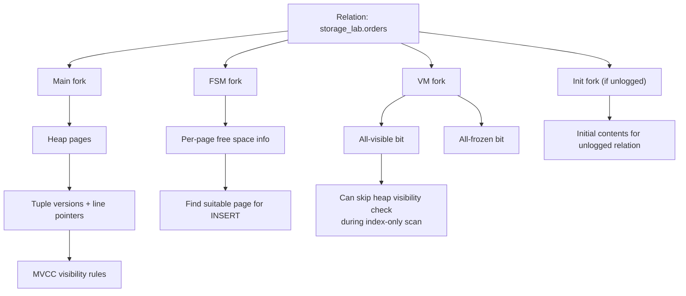
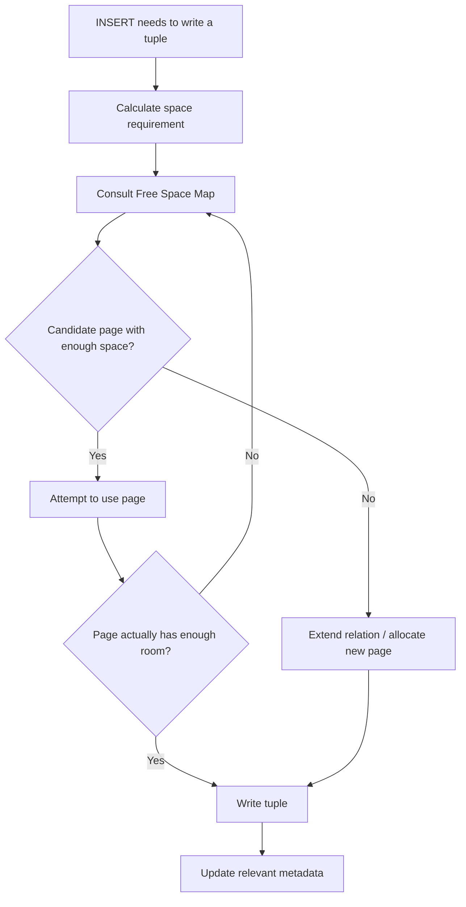
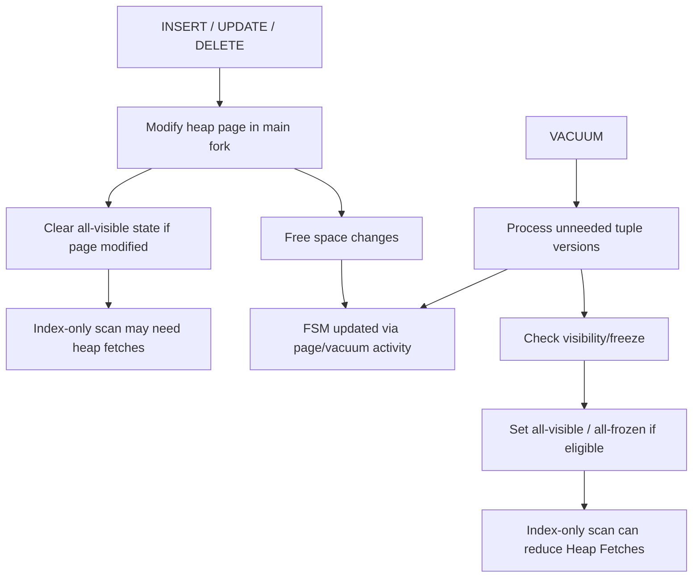

# Main Fork, Free Space Map, and Visibility Map in PostgreSQL

A PostgreSQL table is not merely a single file holding data rows. Each relation can be stored across multiple **forks** (storage branches) with distinct roles. The main fork holds the table or index content; the **Free Space Map (FSM)** helps PostgreSQL locate pages with remaining room; the **Visibility Map (VM)** tracks pages whose tuples satisfy visibility rules so PostgreSQL can skip certain checks or vacuum work.

These three components relate directly to how PostgreSQL manages pages, MVCC, INSERT/UPDATE, VACUUM, and **index-only scans**.

This lesson belongs to PostgreSQL's **Storage** chapter and focuses on:

- **Main fork:** where the primary content of a heap table or index is stored.
- **FSM:** an auxiliary structure tracking approximate reusable free space per page to aid tuple placement.
- **VM:** an auxiliary structure tracking all-visible and all-frozen state for heap pages.
- **Interaction with MVCC and VACUUM:** as data changes, vacuum cleans up old tuples, updates FSM/VM, and affects index-only scan eligibility.
- **Practical observation:** using size functions, catalogs, pg_freespacemap, pg_visibility, pg_stat_user_tables, and EXPLAIN.

> **Key takeaway:** FSM is about **where space may be available**; VM is about **where visibility checks can be skipped**. These two maps do not replace each other, nor do they store business row content.

## 1. Relations Are Stored as Forks

PostgreSQL manages tables, indexes, materialized views, and certain other storage objects as **relations**. A relation can consist of multiple storage-independent forks.

Common forks:

| Fork | Logical Name | Content |
| --- | --- | --- |
| Main | `main` | Primary data: heap pages of a table or pages of an index |
| Free Space Map | `fsm` | Information about reusable free space across pages |
| Visibility Map | `vm` | All-visible and all-frozen bits for heap pages |
| Init | `init` | Initialization fork used for unlogged relations to restore empty state after a crash |

The main fork is what we typically mean by "table data." FSM and VM are **auxiliary metadata** helping PostgreSQL execute operations more efficiently.

### 1.1. Relationship Diagram Across Forks



This diagram illustrates conceptual roles, not every internal binary layout detail inside the forks.

### 1.2. A Fork Is Not a Partition

Do not confuse:

- **Fork:** an auxiliary physical storage branch of the same relation.
- **Partition:** a child relation holding a subset of data per partition key.
- **Tablespace:** a physical storage location where a relation can be placed.
- **Segment:** a physical split file created when a relation exceeds one segment's size limit.

A partition has its own relation files and forks. A partitioned parent table normally stores no tuples directly; data resides in its partitions.

## 2. Main Fork: Primary Relation Data

The main fork holds the primary content:

- For a **heap table**, it contains heap pages and tuple versions.
- For an **index**, it contains index page structures, e.g., B-tree pages.
- For a **materialized view**, the main fork holds materialized data.
- Other specialized relations have their own storage layouts while still fitting the fork model.

When running:

```sql
SELECT *
FROM storage_lab.orders
WHERE order_id = 100;
```

PostgreSQL searches data in the heap table's main fork and may use the index's main fork if the planner selects an index access path.

### 2.1. Pages and Tuples

A heap relation is divided into **pages** of fixed size matching the cluster's block_size (typically 8 KiB in default builds, though never hard-code this assumption).

A heap page typically contains:

- Page header: page management metadata.
- Line pointer array: positions of tuple items.
- Tuple data: row versions.
- Free space: unused area between line pointers and tuple data.

Conceptual diagram:

```text
+--------------------------------------------------+
| Page Header                                      |
+--------------------------------------------------+
| Line Pointer 1 | Line Pointer 2 | ...            |
+--------------------------------------------------+
|                 Free Space                      |
|                                                  |
+--------------------------------------------------+
| Tuple data ...                                   |
| Tuple data ...                                   |
+--------------------------------------------------+
```

This diagram only illustrates region partitioning; actual layout and growth directions follow PostgreSQL's page structure.

### 2.2. A Row Can Have Multiple Tuple Versions

PostgreSQL uses MVCC. A regular UPDATE does not necessarily overwrite the old tuple in place; it can create a **new tuple version**, while the old version is retained for transactions/snapshots that still need to see it.

Example:

1. Transaction A reads a row.
2. Transaction B UPDATES the row and COMMITs.
3. A's snapshot may still need to see the old version.
4. The old version can only be cleaned up once no snapshot needs it and vacuum/pruning performs the appropriate cleanup.

Hence, "the row was UPDATED" does not mean the old version's bytes immediately become reusable free space.

### 2.3. Main Fork and Table Size

```sql
SELECT
    pg_size_pretty(
        pg_relation_size('public.some_table'::regclass)
    ) AS main_fork_size;
```

pg_relation_size() defaults to returning the main fork size. The result excludes the full cost of indexes, TOAST, and related components. To understand total storage, use the additional size functions covered later.

## 3. What Is the Free Space Map?

The **Free Space Map (FSM)** is an auxiliary structure helping PostgreSQL track roughly how much free space remains on each page. When inserting a tuple, PostgreSQL can consult the FSM to find a page with sufficient room instead of scanning every heap page from the start.

For example, if a table has millions of pages and a new INSERT needs about 300 bytes for a tuple, the FSM helps locate a page recorded as having suitable room.

### 3.1. FSM Does Not Store Tuple Data

The FSM does not contain:

- Contents of the status column.
- Values of order_id.
- Tuple versions.
- Access permissions.
- MVCC snapshots.

It only holds **estimated/quantized per-page free space** information to guide page selection.

### 3.2. How FSM Helps INSERT Find a Page

Conceptual flow:



This is a simplified model. The actual process also involves page locks, buffer management, WAL, visibility, pruning, and concurrency.

### 3.3. FSM Is Approximate Information, Not a Guarantee

Do not treat the FSM as an always-exact byte-by-byte inventory:

- Available space can change after the map was last updated.
- Dead tuples may not yet be cleaned up, so their bytes cannot yet be reused.
- A candidate page may have to be rechecked when multiple transactions write concurrently.
- FSM values are quantized into space categories, not an exact promise for every tuple request.

PostgreSQL inspects the actual page before writing. The FSM **narrows the search**; it does not replace verifying write capacity.

### 3.4. FSM Has a Tree-Like Structure

The FSM is organized into pages forming a hierarchical structure to rapidly locate a page with enough free space. Upper levels summarize capacities of lower branches; leaf entries represent free space for relation blocks.

Therefore, the FSM is not just a flat array of one integer per heap page. Layout specifics are implementation details, yet the core idea is **hierarchical search by allocatable free space**.

## 4. What Is the Visibility Map?

The **Visibility Map (VM)** is an auxiliary structure tracking the visibility state of heap pages. Each heap page is represented by two main status bits:

- **All-visible:** every tuple on the page is visible to all currently active transactions under MVCC rules.
- **All-frozen:** every tuple on the page is in an appropriate frozen state, so vacuum does not need to revisit those tuples for freezing.

All-frozen is a stronger state; an all-frozen page must also be all-visible.

### 4.1. Two Bits with Two Distinct Goals

| Bit | Meaning | Primary Effect |
| --- | --- | --- |
| All-visible | Every tuple on the heap page is visible to all active transactions | Lets index-only scans skip heap visibility checks |
| All-frozen | Every tuple on the page is frozen | Lets vacuum skip freeze work on that page |

Do not interpret all-frozen as "the page will never change again." A new INSERT/UPDATE/DELETE can modify the page and require updating the map state.

### 4.2. VM Does Not Store Per-Transaction Snapshots

The VM does not state "transaction 123 sees tuple A, transaction 456 does not see tuple B." It is a **page-level summary** strong enough for PostgreSQL to skip certain checks when the corresponding bit is set.

If a page is not all-visible, PostgreSQL can still read the heap and verify each tuple's visibility against the snapshot. The VM does not replace MVCC.

### 4.3. VM Applies to Heap Pages

The Visibility Map belongs to heap-like relations holding tuple versions. B-tree indexes have their own page/index metadata mechanisms; do not describe the VM as a bitmap for index pages.

An index-only scan uses the index to read column data, yet when it must confirm tuple visibility, it checks the VM of the **corresponding heap relation**.

## 5. Index-Only Scan and the All-Visible Bit

An index-only scan is an access method in which PostgreSQL can retrieve required columns directly from the index without reading the heap tuple for each match, **provided** the index holds enough data and the visibility map permits skipping heap visibility checks.

Example creating an index with the necessary columns:

```sql
CREATE INDEX idx_orders_tenant_status_created
ON storage_lab.orders (
    tenant_id,
    status,
    created_at DESC
)
INCLUDE (amount);
```

Query:

```sql
SELECT created_at, amount
FROM storage_lab.orders
WHERE tenant_id = 2
  AND status = 'paid'
ORDER BY created_at DESC
LIMIT 20;
```

The index can supply predicates, ordering, and output columns. If the corresponding heap pages are marked all-visible in the VM, PostgreSQL can avoid fetching heap tuples to confirm visibility.

### 5.1. Index-Only Scans Need More Than Just an Index

For an index-only scan to be effective:

1. The index must cover all columns needed for predicates/output under applicable rules.
2. The planner must judge the index path cost-effective.
3. The Visibility Map must have enough all-visible pages for the accessed heap tuples.
4. Statistics and data distribution must support that plan choice.

Even when an index covers every column, if the VM lacks all-visible bits, the executor may still have to visit the heap to check tuple visibility.

### 5.2. Heap Fetches in EXPLAIN

```sql
EXPLAIN (ANALYZE, BUFFERS)
SELECT created_at, amount
FROM storage_lab.orders
WHERE tenant_id = 2
  AND status = 'paid'
ORDER BY created_at DESC
LIMIT 20;
```

If the planner chooses Index Only Scan, the output may show:

```text
Index Only Scan using idx_orders_tenant_status_created ...
  Heap Fetches: 0
```

Heap Fetches reports how many times the executor had to visit the heap to verify visibility during that execution. A value of 0 indicates the VM supports this workload well.

There is no guarantee a query will always choose Index Only Scan or keep Heap Fetches at 0. Data changes, pending vacuums, or a different plan can change the output.

### 5.3. The All-Visible Bit Is Cleared When a Page Changes

An INSERT/UPDATE/DELETE on a heap page can cause the page to lose its all-visible status. PostgreSQL must ensure it never trusts a stale bit once tuple visibility on the page has changed.

When a page is modified, the relevant VM bit is cleared; a subsequent VACUUM can inspect the page and set it again if conditions are met.

Consequently, a continuously written table tends to have fewer all-visible pages than a mostly read table. Index-only scans on write-heavy tables may still incur many heap fetches.

## 6. All-Frozen, Freezing, and Transaction ID Wraparound

PostgreSQL uses transaction IDs to determine visibility. Transaction IDs come from a finite space, requiring tuple age management to avoid wraparound.

VACUUM is responsible for freezing sufficiently old tuples per policy so they no longer depend on aging transaction IDs in a hazardous way.

### 6.1. Frozen Does Not Mean Deleted

- **Frozen tuple:** a tuple marked so its visibility remains safe across transaction ID cycles.
- **Dead tuple:** a tuple version no longer needed by any valid snapshot and eligible for cleanup under rules.
- **Live tuple:** a version still required under visibility rules.

A frozen tuple can still be live data. Freezing does not delete rows.

### 6.2. The All-Frozen Bit Helps VACUUM

If the VM marks a page all-frozen, VACUUM can skip checking that page for freezing in appropriate cases. This reduces the number of heap pages routine vacuums must read.

A page that is all-visible but not yet all-frozen may still need vacuum inspection to freeze tuples based on transaction ID age.

### 6.3. VACUUM FREEZE

```sql
VACUUM (FREEZE, VERBOSE) storage_lab.orders;
```

This command requests aggressive freezing within the scope of VACUUM. Do not run it across production indiscriminately without understanding workload, locks, I/O, and version behavior.

Regular VACUUM also performs freezing based on age thresholds; VACUUM FREEZE is not the only command that freezes tuples.

## 7. How Does VACUUM Update FSM and VM?

Standard VACUUM performs several heap/index tasks:

- Identifies tuple versions that are no longer needed.
- Cleans/prunes or marks reusable space per rules.
- Updates the Free Space Map.
- Checks visibility and updates the Visibility Map.
- Performs index cleanup when applicable and allowed by options.
- Updates relevant statistics per VACUUM behavior; ANALYZE is a separate statistics-gathering step.

### 7.1. VACUUM Is Not Equivalent to VACUUM FULL

| Command | Primary Behavior | Disk Space |
| --- | --- | --- |
| VACUUM table_name | Reclaims eligible dead tuples, updates maps, and makes page space reusable | Typically retains relation file size; free space is reused internally |
| VACUUM (ANALYZE) table_name | VACUUM plus planner statistics collection | Does not automatically shrink the relation to minimum size |
| VACUUM FULL table_name | Rewrites the relation to reclaim space and compact storage via rewrite mechanism | Can return file space to the OS; requires a strong lock |

VACUUM FULL typically acquires an ACCESS EXCLUSIVE lock and needs extra temporary disk space during the rewrite. Never use it as an unplanned periodic cleanup job.

### 7.2. Regular VACUUM Makes Space Reusable

Suppose a table takes 10 GB and many tuples have died. Regular VACUUM can make space available on pages inside the relation for future INSERTs/UPDATEs to reuse.

The main fork file size may remain near 10 GB. That does not mean VACUUM failed; its goal is **reusing space inside the relation**, not necessarily shrinking filesystem usage immediately.

### 7.3. VACUUM Cannot Run Inside an Ordinary Transaction Block

The command:

```sql
VACUUM (ANALYZE, VERBOSE) storage_lab.orders;
```

must execute outside a transaction block. In psql/autocommit mode, it runs directly. Do not wrap it inside:

```sql
BEGIN;
VACUUM storage_lab.orders;
COMMIT;
```

because PostgreSQL rejects VACUUM inside an ordinary transaction block.

### 7.4. ANALYZE Is Not VM/FSM Maintenance

ANALYZE gathers statistics for the planner, such as value distributions and selectivity estimates. It does not replace VACUUM's tuple cleanup, FSM, and VM maintenance.

You can run:

```sql
ANALYZE storage_lab.orders;
```

independently when planner statistics need refreshing. VACUUM (ANALYZE) combines both tasks.

## 8. How INSERT, UPDATE, and DELETE Affect Forks

### 8.1. INSERT

On INSERT:

1. PostgreSQL locates a page with suitable space, usually consulting the FSM as a hint.
2. If no suitable page exists, the relation can be extended with new pages/segments.
3. The new tuple is written to the main fork per transaction/WAL semantics.
4. The page's Visibility Map all-visible bit is cleared if it was previously set.
5. Page free space changes; the FSM is updated according to page management rules.

A page with a newly inserted tuple cannot immediately be assumed all-visible to all transactions.

### 8.2. UPDATE

UPDATE can create a new tuple version and mark the old version obsolete under MVCC:

1. PostgreSQL locates the old tuple.
2. Creates a new version or performs a HOT update if eligible.
3. Source/target pages are modified.
4. Relevant VM all-visible bits may be cleared.
5. The Free Space Map is updated as space becomes available per rules.

The old tuple's space may not be immediately reusable because older snapshots might still need it.

### 8.3. DELETE

DELETE marks a tuple version as no longer visible to qualifying snapshots; it does not necessarily erase bytes immediately.

Once no active transaction needs that version, VACUUM/pruning can reclaim the space and update the FSM and VM.

### 8.4. Conceptual Impact Diagram



This is a relational model of effects; exact map updates occur at various points across the page lifecycle.

## 9. HOT Updates and Free Space

A **Heap-Only Tuple (HOT) update** is an optimization where PostgreSQL can place the new version on the same heap page without inserting new entries into every associated index.

HOT can occur when:

- Updated columns do not alter any relevant index keys per HOT rules.
- Enough free space exists on the same heap page for the new tuple version.
- Other PostgreSQL implementation conditions are met.

### 9.1. Why Does fillfactor Relate to the FSM?

fillfactor controls how full pages are packed when loading/writing data. Example:

```sql
CREATE TABLE storage_lab.orders_hot (
    order_id bigint,
    status text,
    note text
) WITH (fillfactor = 80);
```

A fillfactor of 80 intentionally leaves free room on pages when data is loaded, creating opportunities for same-page UPDATEs and HOT.

The FSM can record this free space so suitable operations can locate the pages.

### 9.2. Fillfactor Does Not Guarantee HOT

HOT can still fail to occur if:

- The new tuple exceeds remaining free space on the page.
- The update modifies an indexed column.
- No suitable page space remains.
- Other HOT conditions are not satisfied.

Fillfactor only creates an **opportunity**, not a guarantee that every UPDATE will be HOT.

### 9.3. Changing fillfactor Does Not Rewrite Existing Pages Automatically

```sql
ALTER TABLE storage_lab.orders_hot
SET (fillfactor = 80);
```

updates the storage parameter for future page writes/fills per rules; it does not automatically move existing tuples to carve out free space on every already-allocated page.

Applying the new layout to existing data may require a planned relation rewrite, such as an appropriate rewrite operation. VACUUM FULL takes a strong lock and requires temporary disk space, so evaluate carefully.

## 10. Setting Up a Lab to Observe Forks

The following examples use the storage_lab schema. Run them in a learning database where you have privileges to create extensions and tables.

### 10.1. Creating the Table

```sql
CREATE SCHEMA IF NOT EXISTS storage_lab;

DROP TABLE IF EXISTS storage_lab.orders;

CREATE TABLE storage_lab.orders (
    order_id bigint GENERATED ALWAYS AS IDENTITY PRIMARY KEY,
    tenant_id integer NOT NULL,
    status text NOT NULL,
    amount numeric(12, 2) NOT NULL,
    created_at timestamptz NOT NULL,
    note text
);
```

DROP TABLE here is strictly for a reproducible lab; never run it on tables with data you need to keep.

### 10.2. Creating an Index Supporting Index-Only Scans

```sql
CREATE INDEX idx_storage_orders_tenant_status_time
ON storage_lab.orders (
    tenant_id,
    status,
    created_at DESC
)
INCLUDE (amount);
```

This index includes the columns used in the SELECT example. The planner still decides whether to choose the index.

### 10.3. Loading Data

```sql
INSERT INTO storage_lab.orders (
    tenant_id, status, amount, created_at, note
)
SELECT
    (g % 20) + 1,
    CASE WHEN g % 5 = 0 THEN 'pending' ELSE 'paid' END,
    (g % 100000)::numeric / 100,
    TIMESTAMPTZ '2026-01-01 00:00:00+00'
        + (g % 120) * INTERVAL '1 day',
    CASE WHEN g % 7 = 0 THEN NULL ELSE 'sample' END
FROM generate_series(1, 50000) AS s(g);

ANALYZE storage_lab.orders;
```

### 10.4. Running VACUUM Separately

After creating and loading data, run VACUUM in autocommit mode, not inside a transaction:

```sql
VACUUM (ANALYZE, VERBOSE) storage_lab.orders;
```

This allows heap pages to be evaluated and the VM to be updated per visibility/freeze rules.

## 11. Measuring the Size of Each Fork

PostgreSQL provides pg_relation_size():

```sql
SELECT
    pg_size_pretty(
        pg_relation_size('storage_lab.orders'::regclass, 'main')
    ) AS main_size,
    pg_size_pretty(
        pg_relation_size('storage_lab.orders'::regclass, 'fsm')
    ) AS fsm_size,
    pg_size_pretty(
        pg_relation_size('storage_lab.orders'::regclass, 'vm')
    ) AS vm_size;
```

You can use the default form to get the main fork:

```sql
SELECT pg_relation_size('storage_lab.orders'::regclass);
```

### 11.1. Forks Can Be Small or 0 Bytes

A small relation may not yet need or have many pages for FSM/VM. Fork sizes depend on relation size and storage activity; do not expect a fixed number after every lab run.

The VM is typically tiny compared to the heap because each heap page only needs a couple of status bits. The FSM is also auxiliary metadata, taking far less space than the main fork in most workloads.

### 11.2. Comparing Size Functions

```sql
SELECT
    pg_size_pretty(
        pg_relation_size('storage_lab.orders'::regclass)
    ) AS main_fork,
    pg_size_pretty(
        pg_table_size('storage_lab.orders'::regclass)
    ) AS table_size_including_auxiliary,
    pg_size_pretty(
        pg_indexes_size('storage_lab.orders'::regclass)
    ) AS indexes_size,
    pg_size_pretty(
        pg_total_relation_size('storage_lab.orders'::regclass)
    ) AS total_size;
```

Interpretation:

- pg_relation_size: size of the requested fork; defaults to main.
- pg_table_size: size of the table plus auxiliary components such as TOAST and auxiliary forks per function definition.
- pg_indexes_size: total size of indexes attached to the table.
- pg_total_relation_size: sum of table and indexes.

These measure **logical relation storage**, not an exact accounting of all filesystem overhead, WAL, archives, or shared buffers.

### 11.3. Tablespaces and File Paths

```sql
SELECT
    'storage_lab.orders'::regclass AS relation,
    pg_relation_filepath('storage_lab.orders'::regclass)
        AS main_fork_path;
```

This function returns the relative path within the data directory/tablespace structure per PostgreSQL rules. Auxiliary forks use corresponding suffixes; never manually modify or delete those files on the filesystem while the server is running.

### 11.4. Segment Files

A large relation can be split into multiple segment files to avoid single-file size limits. Subsequent segments have numeric suffixes such as .1, .2 per physical naming rules.

Each fork can have its own segments. Never assume an entire relation is a single file.

## 12. Reading the FSM with the pg_freespacemap Extension

The pg_freespacemap extension provides functions and views to inspect the free space map.

Where permitted:

```sql
CREATE EXTENSION IF NOT EXISTS pg_freespacemap;
```

Inspect heap blocks:

```sql
SELECT
    blkno,
    avail
FROM pg_freespace('storage_lab.orders'::regclass)
ORDER BY blkno
LIMIT 30;
```

avail represents the free space recorded by the FSM for the corresponding block, in bytes.

### 12.1. Reading a Specific Page

```sql
SELECT
    pg_freespace('storage_lab.orders'::regclass, 0)
        AS page_0_available_bytes;
```

Page 0 may have little free space due to tuples/header/line pointers; other pages may have more. Values can change after INSERT, UPDATE, page pruning, and VACUUM.

### 12.2. Computing Free Space Distribution

```sql
SELECT
    CASE
        WHEN avail = 0 THEN '0 bytes'
        WHEN avail < 256 THEN '< 256 bytes'
        WHEN avail < 1024 THEN '256-1023 bytes'
        WHEN avail < 4096 THEN '1-4 KiB'
        ELSE '>= 4 KiB'
    END AS free_space_bucket,
    COUNT(*) AS pages
FROM pg_freespace('storage_lab.orders'::regclass)
GROUP BY 1
ORDER BY MIN(avail);
```

This bucket table helps observe trends. A tuple needing more room than the reported free space will not fit on that page.

### 12.3. FSM Is Not an Exact Free-Space Oracle

If pg_freespace() reports 500 bytes, do not conclude for certain a 500-byte tuple can be written there:

- Line pointer/tuple overhead is still required.
- Free space may be consumed by another concurrent transaction.
- The map is search-assisting metadata and may need refreshing.
- A candidate page must still be verified during the actual write.

Do not use the FSM to decide business correctness; use it for storage diagnostics and understanding page selection.

### 12.4. Extension Access Requires Appropriate Privileges

Installing extensions and querying their functions/views may depend on permissions, installed packages, and managed-service policies. Never grant superuser to an application merely to read free-space numbers.

## 13. Reading the VM with the pg_visibility Extension

The pg_visibility extension provides a way to inspect a relation's visibility map state.

In a lab with privileges:

```sql
CREATE EXTENSION IF NOT EXISTS pg_visibility;
```

View summary:

```sql
SELECT *
FROM pg_visibility_map_summary('storage_lab.orders'::regclass);
```

Output typically shows the counts of all-visible and all-frozen heap pages.

### 13.1. Inspecting Block by Block

```sql
SELECT
    blkno,
    all_visible,
    all_frozen
FROM pg_visibility('storage_lab.orders'::regclass)
ORDER BY blkno
LIMIT 30;
```

This function shows the status of individual heap blocks, useful when comparing before/after UPDATE and VACUUM.

Check exact function names and output columns against the extension documentation for your major version.

### 13.2. Comparing Page Count with VM Bits

```sql
SELECT
    pg_relation_size('storage_lab.orders'::regclass, 'main')
        / current_setting('block_size')::integer
        AS heap_pages,
    s.all_visible,
    s.all_frozen
FROM pg_visibility_map_summary('storage_lab.orders'::regclass) AS s;
```

heap_pages is the number of main-fork blocks at the current block size. all_visible and all_frozen are the counts of blocks with those respective bits set.

Do not expect every page to be all-visible/all-frozen. Newly written pages or pages with tuple versions still needing checks continue to require heap visibility checks.

### 13.3. Comparing Before and After UPDATE

After VACUUM, note the all-visible count:

```sql
SELECT *
FROM pg_visibility_map_summary('storage_lab.orders'::regclass);
```

Execute an UPDATE on several rows:

```sql
UPDATE storage_lab.orders
SET note = 'changed'
WHERE order_id BETWEEN 1 AND 20;
```

Observe again:

```sql
SELECT *
FROM pg_visibility_map_summary('storage_lab.orders'::regclass);
```

Modified heap pages can lose their all-visible bits. If the UPDATE affected no rows or the data/page state differed, counts may not change as expected. A subsequent VACUUM can set the bits again once visibility conditions are met.

### 13.4. Do Not Run VACUUM Inside the Demo Transaction

After testing UPDATE, run VACUUM separately:

```sql
VACUUM (VERBOSE) storage_lab.orders;
```

Then check the VM summary again. Older transactions may need to finish before old tuples become eligible for cleanup and pages return to all-visible.

## 14. HOT, FSM, and VM in the Same UPDATE

Suppose the table has an index on (tenant_id, status, created_at) and an UPDATE modifies only note.

If HOT conditions are satisfied:

- The new tuple version can reside on the same heap page.
- PostgreSQL avoids adding new index entries for unchanged index keys per HOT rules.
- The heap page is still modified.
- The page's all-visible bit can still be cleared.
- FSM/free space changes according to remaining space.

Therefore, **HOT updates benefit index maintenance, yet do not keep the VM all-visible**.

### 14.1. Observing HOT Statistics

```sql
SELECT
    relname,
    n_tup_upd,
    n_tup_hot_upd,
    n_dead_tup,
    last_autovacuum,
    last_vacuum
FROM pg_stat_user_tables
WHERE schemaname = 'storage_lab'
  AND relname = 'orders';
```

n_tup_hot_upd is the recorded number of HOT updates since the relevant statistics reset. This is a statistical metric, not an exact instantaneous counter in all situations.

### 14.2. HOT Does Not Mean "No Tuple Version Created"

HOT still creates a new version on the heap; its optimization is avoiding certain index updates. The old version still obeys MVCC and must be cleaned up once no snapshot needs it.

## 15. VACUUM, All-Visible, and Index-Only Scan: Complete Experiment

With the lab table, try in sequence:

### Step 1 — Update planner statistics and vacuum

```sql
VACUUM (ANALYZE) storage_lab.orders;
```

### Step 2 — Check VM summary

```sql
SELECT *
FROM pg_visibility_map_summary('storage_lab.orders'::regclass);
```

### Step 3 — Run a query covered by the index

```sql
EXPLAIN (ANALYZE, BUFFERS)
SELECT created_at, amount
FROM storage_lab.orders
WHERE tenant_id = 2
  AND status = 'paid'
ORDER BY created_at DESC
LIMIT 20;
```

### Step 4 — Update a subset of rows

```sql
UPDATE storage_lab.orders
SET note = 'touch'
WHERE tenant_id = 2
  AND order_id BETWEEN 1 AND 200;
```

### Step 5 — Check VM and re-run EXPLAIN

```sql
SELECT *
FROM pg_visibility_map_summary('storage_lab.orders'::regclass);

EXPLAIN (ANALYZE, BUFFERS)
SELECT created_at, amount
FROM storage_lab.orders
WHERE tenant_id = 2
  AND status = 'paid'
ORDER BY created_at DESC
LIMIT 20;
```

### Step 6 — VACUUM and re-measure

Run outside a transaction:

```sql
VACUUM (ANALYZE, VERBOSE) storage_lab.orders;
```

Then check the VM summary and re-run EXPLAIN.

**Observations to record:**

- Count of all-visible heap pages before/after.
- Heap Fetches in the index-only scan.
- Whether the plan changed.
- Whether actual time and buffers changed.
- Whether the query returns accurate results.

There is no guarantee a small UPDATE increases Heap Fetches by a fixed number: multiple rows may share the same page, the planner may pick a different plan, and page visibility depends on all tuples on the page.

## 16. Autovacuum Keeps FSM and VM Healthy

In production, VACUUM is normally performed automatically by **autovacuum** based on thresholds and configuration.

Autovacuum helps:

- Reclaim dead tuples so page space is reused.
- Update the FSM.
- Maintain the Visibility Map.
- Freeze tuples to prevent transaction ID wraparound.
- Run ANALYZE per applicable conditions/settings.

### 16.1. Monitoring Vacuum Statistics

```sql
SELECT
    schemaname,
    relname,
    n_live_tup,
    n_dead_tup,
    n_tup_ins,
    n_tup_upd,
    n_tup_del,
    n_tup_hot_upd,
    last_vacuum,
    last_autovacuum,
    last_analyze,
    last_autoanalyze
FROM pg_stat_user_tables
WHERE schemaname = 'storage_lab'
ORDER BY n_dead_tup DESC;
```

n_live_tup and n_dead_tup are **statistical estimates**, not exact live counts at every moment.

### 16.2. Checking Running Autovacuum Processes

```sql
SELECT
    p.pid,
    p.datname,
    p.relid::regclass AS relation,
    p.phase,
    p.heap_blks_total,
    p.heap_blks_scanned,
    p.heap_blks_vacuumed,
    p.index_vacuum_count
FROM pg_stat_progress_vacuum AS p;
```

This view only shows currently running VACUUMs and exact columns may vary by version. Zero rows does not mean VACUUM has never run.

### 16.3. Why Might Autovacuum Not Run Immediately?

Several reasons:

- Dead-tuple or insert thresholds have not been reached yet.
- Workers are busy or constrained by worker capacity.
- The relation has custom storage parameters.
- Long-running transactions/snapshots restrict tuple reclamation.
- I/O throttling and cost delays slow progress.
- Autovacuum is disabled or misconfigured.

Never disable autovacuum to "speed up writes" without understanding the consequences for bloat, the visibility map, and wraparound.

### 16.4. Relation-Specific Storage Parameters

```sql
ALTER TABLE storage_lab.orders
SET (
    autovacuum_vacuum_scale_factor = 0.05,
    autovacuum_analyze_scale_factor = 0.05
);
```

This is only a lab configuration example, not a blanket production recommendation. Suitable values depend on churn rate, row counts, vacuum cost, and SLAs. Changing scale factors can make vacuum/analyze run more or less frequently.

## 17. Free Space, Dead Tuples, and Bloat Are Not the Same

Concepts easily confused:

| Concept | Meaning |
| --- | --- |
| Free space | Unused space on a page available for new tuples under suitable conditions |
| Dead tuple | A tuple version no longer needed once the visibility horizon permits cleanup |
| FSM entry | Map information about a page's free space |
| Bloat | Excess storage relative to a desired efficient layout, evaluated per relation/workload |
| VM all-visible | Page eligible to skip certain heap visibility checks |
| VM all-frozen | Tuples on the page are frozen per conditions |

### 17.1. A Dead Tuple Is Not Yet Free Space

An old tuple may be dead to transactions yet not reclaimed by VACUUM/pruning. Until then, its bytes still occupy the page and are not necessarily treated as immediately reusable free space by the FSM.

### 17.2. Free Space Does Not Mean OS Disk Usage Decreased

Regular VACUUM makes pages reusable within the relation. File size does not shrink proportionally.

VACUUM FULL rewrites the relation to shrink it, requiring a strong lock. Evaluate bloat and choose tools by operational impact, not solely from n_dead_tup.

### 17.3. VM Is Not a Bloat Metric

A table with many all-visible pages may work well for index-only scans, yet that does not prove the table has no bloat. Conversely, a non-all-visible page does not necessarily hold many dead tuples; it may simply have received new writes recently.

## 18. Why Do Index-Only Scans Need the VM?

A B-tree index stores index keys and TIDs pointing to heap tuples. Under MVCC, an index entry does not by itself state whether that tuple version is visible to the current snapshot.

If an index-only scan had to verify every tuple's visibility in the heap, it would still need to read heap pages. The VM provides a safe page-level shortcut:

1. The executor obtains the TID from the index.
2. Identifies the heap block.
3. Checks the all-visible bit in the VM.
4. If the bit is set, it can trust every tuple on that page is visible and skip the heap fetch for visibility checks.
5. If the bit is not set, it must verify tuple visibility in the heap.

### 18.1. VM Helps Avoid Random Heap Reads

When an index scan matches many rows scattered across all-visible pages, avoiding heap fetches reduces random I/O and improves efficiency.

This is why VACUUM and the VM are especially vital for **write-light, read-heavy** tables such as historical records or stable reporting tables.

### 18.2. Index-Only Scans Can Still Read the Heap for Other Reasons

Not every heap visit is solely for visibility checking. Depending on plan and query, heap access may still be required for columns absent from the index, predicates not satisfied by the index, or other executor requirements.

Only when the plan is Index Only Scan and the index covers the required data does the VM allow skipping heap visibility fetches as described.

### 18.3. INCLUDE Columns Have Trade-Offs

INCLUDE appends payload columns to an index to support index-only scans, yet:

- Makes the index larger.
- Increases INSERT/UPDATE cost.
- Can reduce cache efficiency.
- Payload columns are not search keys in the same way key columns are.
- The VM still needs enough all-visible pages to reduce heap fetches.

Do not dump every column into INCLUDE merely to force a query into an index-only scan.

## 19. Reading Relation and Fork Sizes in the Catalog

You can combine pg_class and size functions:

```sql
SELECT
    c.oid::regclass AS relation,
    c.relkind,
    pg_relation_size(c.oid, 'main') AS main_bytes,
    pg_relation_size(c.oid, 'fsm') AS fsm_bytes,
    pg_relation_size(c.oid, 'vm') AS vm_bytes
FROM pg_class AS c
WHERE c.oid = 'storage_lab.orders'::regclass;
```

relkind distinguishes tables/indexes/views/partitioned relations via relation type codes. Not every relkind has identical fork/VM behavior.

### 19.1. Partitioned Parents and Partitions

For a partitioned table, the parent relation usually has no direct heap storage. Inspect leaf partitions:

```sql
SELECT
    relid::regclass AS partition,
    pg_size_pretty(pg_relation_size(relid, 'main')) AS main_size,
    pg_size_pretty(pg_relation_size(relid, 'fsm')) AS fsm_size,
    pg_size_pretty(pg_relation_size(relid, 'vm')) AS vm_size
FROM pg_partition_tree('storage_lab.partitioned_orders')
WHERE isleaf;
```

This is a template for an existing partitioned table; the table name shown is not created in the default lab. Substitute a real relation when running.

### 19.2. TOAST Relations Have Their Own Forks

A table with large columns such as text, jsonb, or bytea can use a TOAST relation. A TOAST table is a separate relation with its own main/FSM/VM forks per storage rules.

Measuring only the main fork of the parent table can overlook TOAST storage. pg_table_size() and pg_total_relation_size() are helpful for measuring totals.

## 20. Which Tools Can Inspect FSM and VM?

| Tool | Goal | Caveats |
| --- | --- | --- |
| pg_relation_size(..., 'main'/'fsm'/'vm') | Measure each fork's size | Does not show per-page bit/space contents |
| pg_freespacemap | Read the free space map | Requires extension/privileges; numbers are advisory map estimates |
| pg_visibility | Read all-visible/all-frozen | Requires extension/appropriate privileges |
| pg_stat_user_tables | Tuple/vacuum/analyze stats | Many counters are estimates or cumulative |
| pg_stat_progress_vacuum | Monitor running VACUUM | Only contains rows while a matching process is active |
| EXPLAIN (ANALYZE, BUFFERS) | Measure plan/heap fetches/buffers | Executes the real query |
| pageinspect | Inspect low-level page structure | Specialized tool, requires privileges and version awareness |

### 20.1. pageinspect Is Not an Everyday Operational Tool

The pageinspect extension can read raw pages and page headers in environments with sufficient privileges. It is a specialized storage-internals/debugging tool and should not be granted to application roles.

When reading raw pages, remember page formats are version-dependent implementation details and never write/edit bytes in relation files manually.

### 20.2. Never Edit Fork Files Directly

Never delete *_fsm, *_vm, or edit main relation files while PostgreSQL is running. PostgreSQL coordinates pages, WAL, buffers, locks, and metadata. Direct filesystem tampering can cause corruption or data loss.

If metadata corruption is suspected, use official diagnostic tools and DBA procedures; never "delete maps so PostgreSQL rebuilds them" in production based on unverified tips.

## 21. VACUUM FULL, CLUSTER, and Relation Rewrites

Certain rewrite operations create new relation storage and replace the old relation:

- VACUUM FULL.
- CLUSTER.
- Certain ALTER TABLE operations requiring a rewrite due to structural changes.
- Dump/restore or creating a new table and swapping.

When a relation is rewritten, the main fork and auxiliary forks are rebuilt/updated for the new storage. Filenodes/paths can change.

### 21.1. Never Store Filenodes as Business Identifiers

OID/relfilenode are internal metadata that can change after rewrites, tablespace moves, or administrative operations. Use relation/schema names in catalog functions for lookups; never persist filenodes in applications as immutable IDs.

### 21.2. Rewrites Carry Cost and Locks

Rewrites can:

- Read and write large volumes of data.
- Generate substantial WAL and I/O.
- Require extra temporary disk space.
- Hold locks interrupting readers/writers depending on the command.
- Impact replica lag.

Never run VACUUM FULL simply because the FSM shows substantial free space. That free space may be precisely what upcoming INSERTs need to reuse without extending files.

## 22. Practical Scenarios

### 22.1. Append-Only, Read-Heavy Tables

A historical table primarily receiving time-ordered INSERTs with rare UPDATE/DELETE:

- FSM helps place new tuples on pages with remaining space.
- VACUUM can mark settled pages all-visible/all-frozen when eligible.
- Index-only scans can reduce heap fetches.
- Older partitions often achieve higher visibility than the actively written partition.

### 22.2. Frequently Updated Tables

An order-status table receiving frequent UPDATEs:

- New tuple versions are constantly created.
- Modified pages have their all-visible bits cleared.
- HOT can reduce index churn when eligible.
- VACUUM must keep pace with dead tuples.
- Index-only scans may perform more heap fetches on hot pages.

### 22.3. Tables Experiencing Long Transactions

A long-running transaction/snapshot can prevent VACUUM from reclaiming tuple versions still needed by that transaction:

- Dead tuples persist longer.
- Free space may not recover as expected.
- VM all-visible bits cannot be set on ineligible pages.
- Index-only scans may incur higher heap fetches.
- Vacuum progress can be constrained by the visibility horizon.

Inspect pg_stat_activity.xact_start, backend_xmin, replication slots, and transaction age when vacuum cannot reclaim space as expected.

### 22.4. Newly Bulk-Loaded Tables

After a bulk load, run ANALYZE and consider VACUUM as needed. If no older transactions need to see earlier state and pages have settled, vacuuming helps initialize the VM. A bulk load does not always call for VACUUM FULL.

## 23. Limits of Observed Metrics

Several outputs are easy to over-interpret:

- n_dead_tup in stats is an estimate, not an exact dead tuple count.
- pg_freespace() reports FSM info, not a guarantee the page will accept the next tuple.
- pg_visibility reflects map/page state at read time; concurrent writes can change it immediately afterward.
- Heap Fetches depends on the plan and data during that EXPLAIN run.
- pg_relation_size measures a relation fork, not WAL, archives, or all filesystem overhead.
- VACUUM VERBOSE describes one specific vacuum run, not a system-wide historical audit.
- pg_stat_progress_vacuum only reflects currently running vacuums.

When comparing before/after, record timestamps, session context, transaction state, and recent operations.

## 24. Common Mistakes

| Misconception | Reality |
| --- | --- |
| FSM stores tuple data | FSM only stores free-space estimates |
| VM stores per-transaction snapshots | VM is a heap-page-level visibility summary |
| FSM and VM are the same | One tracks free space, the other tracks visibility/freeze state |
| Main fork is the entire table footprint | FSM, VM, TOAST, and indexes may also exist |
| UPDATE overwrites the old tuple immediately | MVCC normally creates a new tuple version |
| DELETE frees bytes immediately | Dead tuples require cleanup when eligible |
| FSM free space guarantees INSERT succeeds on that page | The map is a hint; the actual page is checked |
| All-visible means every tuple is frozen | All-visible and all-frozen are two distinct bits |
| All-frozen means data is deleted or immutable | Frozen relates to transaction IDs, not deletion or immutability |
| Index-only scan never reads the heap | Non-all-visible VM pages can force heap fetches |
| Having an INCLUDE index guarantees index-only scan | Planner, predicates, and VM also matter |
| Regular VACUUM always shrinks file size | Usually makes space reusable inside the relation |
| VACUUM FULL is like regular VACUUM | FULL rewrites and requires a strong lock |
| ANALYZE updates VM/FSM | ANALYZE collects planner statistics |
| HOT update preserves VM all-visible | Heap page is modified so all-visible can be cleared |
| Fillfactor 80 guarantees HOT | Only creates room; index/page rules still apply |
| pg_relation_size defaults to table+index total | Defaults to the relation's main fork |
| Deleting *_fsm or *_vm fixes errors | Never tamper with relation files directly |
| Every relation has a VM | VM applies to heap-like relations, not every relkind |
| n_dead_tup is an exact dead count | It is a statistical estimate |
| VACUUM inside normal BEGIN/COMMIT | VACUUM must run outside transaction blocks |
| Partitioned parent holds all heap storage | Data pages normally reside in leaf partitions |

## 25. Free Space and Visibility Investigation Runbook

When a table grows unexpectedly, INSERTs slow down, or index-only scans show high heap fetches, follow this sequence:

**Step 1 — Identify the physical relation.** Check schema, relkind, partitions, tablespace, and associated TOAST relation.

**Step 2 — Measure sizes.** Compare main, FSM, VM, table_size, indexes_size, and total_size.

**Step 3 — Check write activity.** Review INSERT/UPDATE/DELETE rates, HOT update ratio, and whether the workload is append-only or write-heavy.

**Step 4 — Check vacuum statistics.** Inspect n_dead_tup, last_autovacuum, last_vacuum, and active VACUUM progress.

**Step 5 — Check for long transactions.** Inspect xact_start, backend_xmin, replication slots, and snapshot horizons that may block cleanup.

**Step 6 — Inspect FSM.** Use pg_freespacemap to check free-space distribution; do not treat results as exact guarantees.

**Step 7 — Inspect VM.** Use pg_visibility_map_summary and block-level visibility if needed.

**Step 8 — Check index-only scans.** Run EXPLAIN (ANALYZE, BUFFERS) to inspect the plan, Heap Fetches, actual rows, and buffers.

**Step 9 — Run appropriate VACUUM/ANALYZE.** Run outside a transaction; review autovacuum settings and I/O impact.

**Step 10 — Evaluate bloat/rewrites.** Only consider VACUUM FULL/CLUSTER/rewrites with solid evidence and lock/disk/replica plans.

**Step 11 — Re-verify.** Measure the same queries and workload after changes; never draw conclusions from fork sizes alone.

**Step 12 — Note limitations.** Map/stats figures are snapshots or estimates; separate observed measurements from causal hypotheses.

## 26. Practice Exercises

These exercises use the storage_lab schema from Section 10. VACUUM commands must run outside transaction blocks. Only use a lab database or environment you are authorized to administer.

### Exercise 1 — List forks

Run:

```sql
SELECT
    pg_relation_size('storage_lab.orders'::regclass, 'main') AS main_bytes,
    pg_relation_size('storage_lab.orders'::regclass, 'fsm') AS fsm_bytes,
    pg_relation_size('storage_lab.orders'::regclass, 'vm') AS vm_bytes;
```

Explain what purpose each fork serves and why they do not have the same size.

### Exercise 2 — Block size

```sql
SHOW block_size;
```

Compute the number of main-fork blocks using pg_relation_size / block_size. Why should 8192 bytes never be hard-coded for every cluster?

### Exercise 3 — File path

```sql
SELECT pg_relation_filepath('storage_lab.orders'::regclass);
```

Explain what this path represents and why you must never open/edit the file with an editor while the server is running.

### Exercise 4 — Compare size functions

Run pg_relation_size, pg_table_size, pg_indexes_size, and pg_total_relation_size. Which components are counted by each function?

### Exercise 5 — Install pg_freespacemap

Create the extension in the lab and run:

```sql
SELECT * FROM pg_freespace('storage_lab.orders'::regclass)
ORDER BY blkno LIMIT 20;
```

Explain blkno and avail.

### Exercise 6 — Free space buckets

Group avail into buckets: 0, under 256 bytes, 256–1023 bytes, 1–4 KiB, and 4 KiB or higher. Which bucket has the most pages?

### Exercise 7 — FSM after INSERT

Record free space for several pages. Insert more rows and re-read. Why did free space decrease on some pages or the relation extend?

### Exercise 8 — FSM after DELETE

Delete a set of rows in the lab. Read the FSM immediately after DELETE and after VACUUM. Explain why dead tuples' bytes do not necessarily become free space the moment DELETE finishes.

### Exercise 9 — Create pg_visibility

Install the pg_visibility extension if permitted and read pg_visibility_map_summary. What do the two numbers all-visible/all-frozen represent?

### Exercise 10 — Block-level VM

Run pg_visibility('storage_lab.orders'::regclass). Find a page with all-visible=false. Which operations can clear that bit?

### Exercise 11 — VM after VACUUM

Run VACUUM (ANALYZE) storage_lab.orders outside a transaction and check the summary. Why might not every page be all-visible or all-frozen?

### Exercise 12 — VM after UPDATE

UPDATE a specific row and check the VM summary before/after. Why can modifying one tuple clear the all-visible bit for the entire heap page?

### Exercise 13 — Index-only scan

Create an index with INCLUDE columns and run EXPLAIN ANALYZE. Look for Index Only Scan and Heap Fetches. If the planner chose Index Scan instead, list possible reasons.

### Exercise 14 — Heap Fetches before/after VACUUM

Run the same query before and after VACUUM. Record Heap Fetches. Why does the result also depend on which pages are accessed and whether data changed?

### Exercise 15 — HOT update

Create a table with low fillfactor, index one column, and UPDATE a non-indexed column. Check n_tup_hot_upd. Why does HOT still create a tuple version and still potentially clear the VM?

### Exercise 16 — Changing fillfactor

Change fillfactor from 100 to 80 on a populated table. Why does this not automatically create free space on every existing page? What mechanism is needed to rewrite the layout?

### Exercise 17 — Long transactions

Open a long transaction in Session A, read a snapshot, and leave it open. In Session B, UPDATE/DELETE and VACUUM. Observe pg_stat_activity, backend_xmin, and cleanup ability. End transaction A and VACUUM again.

### Exercise 18 — Autovacuum statistics

Read pg_stat_user_tables. Explain why n_dead_tup is an estimate and what last_autovacuum tells you. Why does a high dead-tuple count not automatically imply running VACUUM FULL?

### Exercise 19 — VACUUM progress

While VACUUM is running on a sufficiently large table, query pg_stat_progress_vacuum. Explain phase, heap_blks_total, heap_blks_scanned, and heap_blks_vacuumed.

### Exercise 20 — VACUUM and file size

Generate many dead tuples and run VACUUM. Compare main fork size before/after. Why might file size not shrink even though internal space became reusable?

### Exercise 21 — VACUUM FULL

In a separate lab, compare VACUUM and VACUUM FULL regarding rewrite, locking, and disk space. Why can VACUUM FULL not run inside a regular transaction block?

### Exercise 22 — TOAST and total size

Create a table with a large text column and insert data large enough to trigger TOAST. Compare pg_relation_size, pg_table_size, and pg_total_relation_size. Why can measuring only the parent table's main fork miss storage?

### Exercise 23 — Partition storage

Create a simple partitioned table with two partitions. Use pg_partition_tree with size functions to compare parent and leaves. Why must you measure each partition individually to find fast-growing partitions?

### Exercise 24 — Distinguishing maps and statistics

Explain the differences among:
- FSM.
- VM.
- pg_stat_user_tables.
- Planner statistics collected by ANALYZE.

Why can none of the four replace the other three?

### Exercise 25 — Diagnosing an index-only scan regression

A query previously had Heap Fetches: 0, and after deployment shows Heap Fetches: 20000. Build an investigation sequence covering: UPDATE rate, VACUUM, VM summary, plan, index coverage, transaction horizon, and statistics.

### Exercise 26 — Production runbook

A 500 GB orders table is growing rapidly, autovacuum runs continuously, index-only scans are degrading, and some INSERTs frequently extend the relation.

Propose a workflow covering:
1. Measure main/FSM/VM/TOAST/index sizes.
2. Check dead tuples, HOT updates, and update/delete rates.
3. Inspect vacuum progress and autovacuum thresholds.
4. Locate long transactions/snapshots and backend_xmin.
5. Measure free space distribution via FSM.
6. Measure all-visible/all-frozen via VM.
7. EXPLAIN queries with Heap Fetches.
8. Evaluate fillfactor and HOT eligibility.
9. Distinguish regular VACUUM from rewrite/VACUUM FULL.
10. Check disk headroom, WAL, replica lag, locks, and rollout window.
11. Define before/after metrics and a rollback plan.

Do not propose VACUUM FULL based solely on table size. Prove bloat, evaluate lock/disk impact, and define exact target outcomes.

## 27. Summary

Key takeaways on **the main fork, Free Space Map, and Visibility Map**:

1. A relation can have multiple forks: **main**, **fsm**, **vm**, and **init** where applicable.
2. The **main fork** contains table heap pages or index pages; this is the primary stored data.
3. The **FSM** records per-page free space so PostgreSQL can locate where to place tuples on INSERT/UPDATE.
4. The FSM provides advisory/estimated information, not a guarantee a page will accept a tuple of any given size.
5. The **VM** stores two key statuses for heap pages: all-visible and all-frozen.
6. **All-visible** enables index-only scans to avoid heap visibility fetches when the index covers required columns and the planner picks that plan.
7. **All-frozen** lets VACUUM skip certain freeze checks; it does not mean tuples are deleted or pages are immutable.
8. INSERT/UPDATE/DELETE modify heap pages; affected all-visible bits may be cleared.
9. VACUUM processes dead tuples, updates FSM/VM, and supports freezing; ANALYZE collects planner statistics as a separate task.
10. Regular VACUUM makes space reusable within the relation without necessarily shrinking the file; VACUUM FULL rewrites and requires a strong lock.
11. HOT updates reduce index maintenance when eligible, yet still create tuple versions and do not preserve all-visible state on modified pages.
12. Fillfactor can leave room for HOT, but does not guarantee HOT and does not rewrite existing pages.
13. pg_relation_size, pg_freespacemap, pg_visibility, pg_stat_user_tables, and EXPLAIN answer different questions.
14. Never manually edit or delete relation fork files on the filesystem; use PostgreSQL tools and DBA procedures.
15. When investigating storage, always combine **size, free space, visibility, tuple churn, vacuum, transaction horizons, and execution plans**.

Remember two distinguishing questions: **FSM answers which page still has room to write? VM answers which page can skip visibility checks?** Mastering these two questions explains why INSERT, VACUUM, and index-only scans rely on different metadata.

## 28. Official PostgreSQL Documentation

- [Database File Layout — relation files and forks](https://www.postgresql.org/docs/current/storage-file-layout.html)
- [Database Page Layout — block/page and tuple storage](https://www.postgresql.org/docs/current/storage-page-layout.html)
- [Free Space Map — how PostgreSQL tracks free space](https://www.postgresql.org/docs/current/storage-fsm.html)
- [Visibility Map — all-visible/all-frozen](https://www.postgresql.org/docs/current/storage-vm.html)
- [Routine Vacuuming — VACUUM, ANALYZE, and autovacuum](https://www.postgresql.org/docs/current/routine-vacuuming.html)
- [VACUUM command — options and behavior](https://www.postgresql.org/docs/current/sql-vacuum.html)
- [Index-Only Scans and Covering Indexes](https://www.postgresql.org/docs/current/indexes-index-only-scans.html)
- [Heap-Only Tuples (HOT)](https://www.postgresql.org/docs/current/storage-hot.html)
- [pg_freespacemap extension](https://www.postgresql.org/docs/current/pgfreespacemap.html)
- [pg_visibility extension](https://www.postgresql.org/docs/current/pgvisibility.html)
- [Monitoring Database Activity — pg_stat_user_tables, vacuum progress](https://www.postgresql.org/docs/current/monitoring-stats.html)
- [Database Object Size Functions — pg_relation_size, pg_table_size, pg_total_relation_size](https://www.postgresql.org/docs/current/functions-admin.html)

The current links point to the latest PostgreSQL documentation. In real projects, verify against your server's exact major version, especially for catalog/statistics columns, extension functions, and page/fork storage implementation details.
