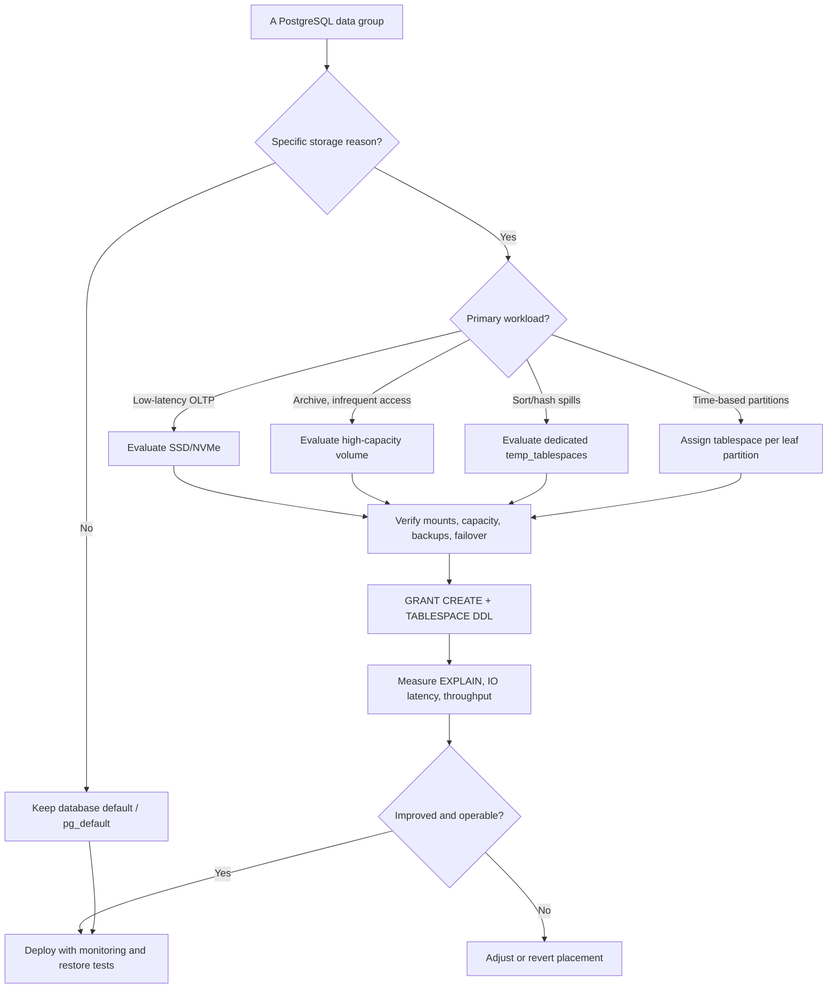

# Data Distribution Across Tablespaces and Storage Device Characteristics in PostgreSQL

As a PostgreSQL cluster grows, a database often holds groups of data with vastly different access patterns: transactional tables read and written continuously, indexes requiring fast random access, historical tables rarely modified, short-lived staging data, and temporary files generated when sorts/hashes spill beyond memory. Keeping every object on a single filesystem is simple at first, yet not always ideal for capacity, performance, or operations.

PostgreSQL provides **tablespaces** so administrators can place relation objects on different storage locations. A tablespace maps to a directory on the database server's filesystem; PostgreSQL manages data inside it through cluster-internal mechanisms. You can assign a table, an index, a materialized view, or a database's default to a chosen tablespace, and tune certain query planner I/O cost assumptions to match device characteristics.

Example:

```sql
CREATE TABLESPACE ts_fast
    OWNER storage_owner
    LOCATION '/srv/postgresql/ts_fast';

CREATE TABLE app.orders (
    order_id BIGINT PRIMARY KEY,
    customer_id BIGINT NOT NULL,
    created_at TIMESTAMPTZ NOT NULL
) TABLESPACE ts_fast;

CREATE INDEX orders_customer_created_idx
ON app.orders (customer_id, created_at)
TABLESPACE ts_fast;
```

Tables and indexes can be placed separately. This helps when multiple filesystems or storage devices fit different workloads. However, **a tablespace is not a cache layer, not a replication mechanism, and does not automatically make a device faster**. If two directories actually sit on the same underlying volume, creating two tablespaces yields no extra IOPS or throughput. If storage has high latency, misconfiguring planner costs can cause queries to pick worse execution plans.

This lesson belongs to the **Storage** chapter of the *Database Engine Relational PostgreSQL* module. We will cover tablespace architecture, creation and permissions, placement of tables/indexes/partitions/temp objects, moving data, tuning access costs, device monitoring, and handling backup/restore when data resides outside the default data directory.

> **Operational principle:** Choose tablespaces based on measured workload evidence and storage manageability. Verify mount points, OS permissions, capacity, backups, replication, and recovery plans before placing production objects in a new location.

## 1. Learning Objectives

After this lesson, you will be able to:

1. Explain a tablespace as a logical storage region mapped to a physical directory on the PostgreSQL server.
2. Distinguish `pg_default`, `pg_global`, and administrator-created tablespaces.
3. Understand the cluster-wide scope of tablespaces and database default tablespaces.
4. Create tablespaces meeting filesystem and OS permission requirements.
5. Distinguish `CREATE` privileges across databases, schemas, and tablespaces.
6. Assign separate tablespaces for tables, indexes, and materialized views.
7. Understand placement of TOAST, partitions, and newly created objects.
8. Use `default_tablespace` and `temp_tablespaces` safely.
9. Move tables, indexes, and databases across tablespaces and estimate locks, I/O, and temporary disk needs.
10. Query `pg_tablespace`, `pg_class`, `pg_database`, and relation file paths.
11. Measure tablespace, table, index, and filesystem sizes.
12. Understand planner parameters `seq_page_cost`, `random_page_cost`, and I/O concurrency.
13. Evaluate HDD, SSD, NVMe, RAID, SAN/NAS, and network filesystems against real workloads.
14. Distinguish data tablespaces from WAL in `pg_wal`.
15. Design backups/restores, physical standbys, and tablespace path mappings.
16. Handle disk full, missing mounts, wrong permissions, and inaccessible tablespaces.
17. Design a testable, monitorable, and rollback-ready data placement strategy.

## 2. What Is a Tablespace?

A **tablespace** is a logical name representing a physical storage location for database objects. PostgreSQL manages relation files inside tablespaces via OIDs and paths under the data directory.

Each tablespace has:

- A unique name within the cluster.
- An OID stored in system catalogs.
- An owning database role.
- A directory path on the server's filesystem.
- A privilege set controlling which roles can create objects there.
- Optional I/O cost settings used by the query planner.

A PostgreSQL table does not have to live inside `PGDATA/base/...`. When assigned to a custom tablespace, its relation files live under that tablespace's directory, linked internally from `PGDATA/pg_tblspc`.

### 2.1. Tablespaces Are Logical; Filesystems Store the Bytes

```text
PostgreSQL cluster
│
├── PGDATA/
│   ├── base/              ← objects in pg_default
│   ├── global/            ← shared cluster catalogs
│   ├── pg_wal/            ← write-ahead log
│   └── pg_tblspc/
│       ├── 24576 -> /srv/pg/fast
│       └── 24577 -> /srv/pg/archive
│
├── /srv/pg/fast/PG_VERSION/...
└── /srv/pg/archive/PG_VERSION/...
```

This diagram illustrates the relationship between the data directory and tablespace locations. OIDs under `pg_tblspc` are examples only; never manually create or edit these symlinks while PostgreSQL is running.

### 2.2. A Tablespace Does Not Isolate an Independent Database

One database can spread objects across multiple tablespaces. One tablespace can also hold objects belonging to **multiple databases within the same PostgreSQL cluster**. A tablespace is not a separate PostgreSQL cluster; it has no separate processes, connection pool, or transaction manager.

### 2.3. Tablespaces Are Not Partitioning

Partitioning splits logical data into child relations by key/range/list/hash. Tablespaces only decide where relations are stored. You can combine partitioning and tablespaces—for example, placing recent monthly partitions on SSD and historical partitions on high-capacity storage.

## 3. The Two System Tablespaces

PostgreSQL initializes two default tablespaces:

| Name | Role |
|---|---|
| `pg_default` | Default tablespace for database objects when a database selects no other tablespace |
| `pg_global` | Location holding cluster-wide shared system catalogs |

### 3.1. pg_default

When a database is created without specifying a tablespace, it uses `pg_default`. Tables and indexes created without an explicit tablespace inherit the database's default tablespace (unless `default_tablespace`/session policies specify otherwise).

### 3.2. pg_global

`pg_global` stores shared catalogs such as role and tablespace definitions. It is not a place for application tables or custom indexes. Never attempt to move user tables into `pg_global`.

### 3.3. Checking Each Database's Default Tablespace

Query the catalog:

```sql
SELECT
    d.datname,
    t.spcname AS default_tablespace
FROM pg_database AS d
JOIN pg_tablespace AS t
    ON t.oid = d.dattablespace
ORDER BY d.datname;
```

A database's default tablespace is not necessarily where every object in that database sits. Individual objects can be created with explicit `TABLESPACE` clauses or moved afterward.

## 4. Cluster-Wide vs. Database-Specific Scope

Tablespaces are created at the cluster level. Tablespace names must be unique across the entire cluster, not just inside one database.

```text
PostgreSQL cluster A
├── database app_db
│   ├── schema sales
│   ├── table sales.orders       → ts_fast
│   └── index orders_pk          → ts_fast
├── database report_db
│   └── table report.monthly     → ts_archive
└── database staging_db
    └── table import.raw         → pg_default
```

All databases above can use tablespaces defined in the cluster provided roles hold appropriate privileges.

### 4.1. A Tablespace Cannot Be Shared Between Two Independent Clusters

Never mount the same tablespace directory for two independent PostgreSQL servers to write simultaneously. Separate servers do not coordinate transactions, locks, WAL, or relation metadata; corruption will result.

### 4.2. Tablespaces Do Not Sync Automatically to Replicas

Physical replication streams WAL and expects matching tablespace structures on standbys. If primary and standby use different filesystem paths, configure path mappings properly when building the standby. Logical replication does not replicate tablespace placement as storage configuration.

## 5. Physical Structure in pg_tblspc

Inside `PGDATA/pg_tblspc`, PostgreSQL creates links for non-default/global tablespaces. Inspect a relation's physical path with:

```sql
SELECT
    pg_relation_filepath('public.some_table'::regclass);
```

Output is a relative path from the data directory. For objects in custom tablespaces, paths normally traverse `pg_tblspc/<tablespace_oid>/...`.

### 5.1. Never Manipulate Relation Files Directly

Never copy, rename, delete, or edit relation files while PostgreSQL is running. Doing so bypasses the buffer manager, WAL, locks, and catalog metadata, risking database corruption.

### 5.2. Never Create Symlinks Manually

Create tablespaces with `CREATE TABLESPACE`; move objects via SQL commands; migrate clusters using backup/restore or supported tools. `pg_tblspc` is an internal server-managed structure.

### 5.3. OIDs Are Not Stable Paths Across Clusters

Tablespace OIDs can differ after cluster creation or restores. Operational scripts should reference tablespace names and catalogs, never hard-coding OIDs from another environment.

## 6. Preparing the Filesystem Before CREATE TABLESPACE

Example on Linux where an OS administrator prepares a dedicated mount point and directory:

```bash
sudo mkdir -p /srv/postgresql/ts_fast
sudo chown postgres:postgres /srv/postgresql/ts_fast
sudo chmod 700 /srv/postgresql/ts_fast
```

This assumes OS account `postgres`; your OS or service manager may use another user/group.

Basic requirements for a tablespace directory:

- Absolute path.
- Directory already exists before running `CREATE TABLESPACE`.
- Directory is empty.
- Owned by the OS user running the PostgreSQL server.
- Located outside the cluster's data directory.
- Server process can access and write to the underlying filesystem/mount.

### 6.1. Why Must the Directory Be Empty?

PostgreSQL initializes its own tablespace directory layout inside it. If unrelated files exist there, the server must not accidentally take ownership of them.

### 6.2. OS Permissions and SQL Privileges Are Separate Layers

A role with `CREATE ON TABLESPACE` still fails to write if OS permissions or mount options block the PostgreSQL service user. Conversely, fixing OS permissions never grants SQL privileges to a database role.

### 6.3. Mounts Must Be Ready Before PostgreSQL Starts

If a tablespace mount is missing, PostgreSQL cannot access relations stored there. Configure systemd/mount dependencies so the database never boots before storage mounts are ready.

### 6.4. Avoid Temporary or Home Directories

Tablespace paths store durable data. Never place them under `/tmp`, auto-cleaned user directories, or ephemeral mounts lacking persistence.

## 7. Creating a Tablespace

A role with sufficient privileges runs:

```sql
CREATE TABLESPACE ts_fast
    OWNER storage_owner
    LOCATION '/srv/postgresql/ts_fast';
```

`CREATE TABLESPACE` cannot run inside a transaction block. Never place it inside migration wrappers that unconditionally wrap everything in `BEGIN`/`COMMIT` unless the tool supports non-transactional statements.

### 7.1. Privileges to Create a Tablespace

Creating a tablespace requires appropriate privileges (superuser or appropriate database/system privileges per PostgreSQL rules). The tablespace owner is a database role, whereas OS directory access belongs to the PostgreSQL server's OS account.

### 7.2. Creating a Tablespace with Storage Cost Parameters

You can specify planner/I/O parameters:

```sql
CREATE TABLESPACE ts_fast
    OWNER storage_owner
    LOCATION '/srv/postgresql/ts_fast'
    WITH (
        seq_page_cost = 1.0,
        random_page_cost = 1.2
    );
```

These numbers are illustrative examples only. Never copy them into production without measuring actual storage and workloads.

### 7.3. Tablespace Name Is Not Mount Name

`ts_fast` is the logical name in PostgreSQL; `/srv/postgresql/ts_fast` is the server path. A tablespace name can remain unchanged when underlying storage hardware is swapped during maintenance, provided paths and cluster state are managed properly.

### 7.4. CREATE TABLESPACE Does Not Format Filesystems

PostgreSQL does not format disks, partition drives, mount volumes, enforce OS quotas, or configure RAID. That belongs to the OS, cloud storage, or platform team.

## 8. Tablespace Privileges

Tablespaces have a specific `CREATE` object privilege allowing roles to create objects inside them:

```sql
GRANT CREATE ON TABLESPACE ts_fast TO app_deployer;
```

Revoke:

```sql
REVOKE CREATE ON TABLESPACE ts_fast FROM app_deployer;
```

### 8.1. Tablespace CREATE Differs from Database CREATE

- `CREATE ON DATABASE`: allows creating schemas and certain database-level objects.
- `CREATE ON SCHEMA`: allows creating tables, indexes, functions, and objects inside that namespace.
- `CREATE ON TABLESPACE`: allows placing objects inside that tablespace.

To create a table in schema `sales` inside `ts_fast`, a role generally needs **both** CREATE on the schema and CREATE on the tablespace, plus other applicable conditions.

### 8.2. Tablespace Ownership

Ownership can be reassigned by an appropriately privileged administrator:

```sql
ALTER TABLESPACE ts_fast OWNER TO storage_admin;
```

The new owner must satisfy PostgreSQL role membership/ownership rules. Changing the SQL owner does not alter OS directory ownership.

### 8.3. Do Not Grant Tablespace Privileges Broadly

Any role holding CREATE on a tablespace can consume space on that device by creating objects. On small or expensive volumes, restrict grants to controlled deployer or database-owner roles.

## 9. Creating a Database with a Default Tablespace

You can set a default tablespace for a new database:

```sql
CREATE DATABASE app_db
    OWNER app_owner
    TABLESPACE ts_fast;
```

The database default tablespace governs where new objects go when no explicit placement is specified. It does not move existing objects in any other database.

### 9.1. The Tablespace Must Already Exist

Create the tablespace before creating the database referencing it. The executing role needs appropriate privileges on both the tablespace and database creation.

### 9.2. Not Every Object Is Forced Into the Database Default

Individual tables/indexes can declare their own tablespaces upon creation; session `default_tablespace` also affects objects created without an explicit TABLESPACE clause.

### 9.3. Database Templates and Tablespaces

When creating a database from a template, PostgreSQL copies template objects per CREATE DATABASE rules; verify documentation regarding how the new database's default tablespace interacts with objects already assigned explicit tablespaces in the template. Never assume every object is relocated onto a new volume automatically if the template uses mixed tablespaces.

## 10. Placing a Table in a Tablespace

Use `TABLESPACE` in DDL:

```sql
CREATE TABLE sales.orders (
    order_id BIGINT GENERATED ALWAYS AS IDENTITY,
    customer_id BIGINT NOT NULL,
    created_at TIMESTAMPTZ NOT NULL,
    total_amount NUMERIC(14,2) NOT NULL
) TABLESPACE ts_fast;
```

If omitted, PostgreSQL uses the session's `default_tablespace` or the database default.

### 10.1. Placing Indexes Separately

```sql
CREATE INDEX orders_created_at_idx
ON sales.orders (created_at)
TABLESPACE ts_fast;
```

An index is a separate relation. Placing a table in `ts_fast` does not mean subsequently created indexes automatically land there if `default_tablespace` differs or another clause is used.

### 10.2. Primary Keys Create Indexes

Creating a PRIMARY KEY or UNIQUE constraint creates a backing index. You can specify a tablespace for the backing index via supported constraint/index DDL (`USING INDEX TABLESPACE`), or build indexes separately in controlled steps. Verify actual placement in catalogs post-migration.

### 10.3. TOAST Tablespaces

A table with large varlena columns can have a separate TOAST relation/index. When moving a table via `ALTER TABLE ... SET TABLESPACE`, its TOAST relation moves along with the table per PostgreSQL semantics. Still verify catalogs and sizes when auditing individual files.

## 11. Placing Materialized Views in a Tablespace

Materialized views store physical query results, so they can be placed independently:

```sql
CREATE MATERIALIZED VIEW report.monthly_sales
TABLESPACE ts_archive
AS
SELECT
    date_trunc('month', created_at) AS sales_month,
    count(*) AS order_count,
    sum(total_amount) AS total_amount
FROM sales.orders
GROUP BY 1;
```

Materialized views can consume large space and incur heavy refresh I/O; choose placement weighing both query reads and refresh workloads.

### 11.1. Refresh Does Not Change Tablespace

`REFRESH MATERIALIZED VIEW` refreshes contents under PostgreSQL rules; it does not move the object to another tablespace. Use `ALTER MATERIALIZED VIEW ... SET TABLESPACE` when moving it.

### 11.2. Indexes on Materialized Views Are Separate Objects

Indexes created on a materialized view have their own tablespace placement. Verify them after creation or moves.

## 12. Combining Partitioning with Tablespaces

A partitioned table stores no heap rows directly like an ordinary table; data lives in leaf partitions. Different partitions can reside on different tablespaces:

```sql
CREATE TABLE telemetry.events (
    event_id BIGINT NOT NULL,
    occurred_at TIMESTAMPTZ NOT NULL,
    payload JSONB
) PARTITION BY RANGE (occurred_at);

CREATE TABLE telemetry.events_2026_10
PARTITION OF telemetry.events
FOR VALUES FROM ('2026-10-01 00:00:00+00')
         TO   ('2026-11-01 00:00:00+00')
TABLESPACE ts_archive;

CREATE TABLE telemetry.events_2026_11
PARTITION OF telemetry.events
FOR VALUES FROM ('2026-11-01 00:00:00+00')
         TO   ('2026-12-01 00:00:00+00')
TABLESPACE ts_fast;
```

### 12.1. The Parent Has No Heap Data

Tablespace placement matters most for the leaf partition relations actually storing rows. The partitioned parent is a definition/metadata relation, not where data resides.

### 12.2. Partitioned Indexes and Index Partitions

A partitioned parent index holds metadata; physical indexes on leaf partitions are the objects whose placement must be verified. Never inspect only the parent index and assume all leaf index files sit on the right device.

### 12.3. Automating Future Partitions

When scheduled jobs create upcoming partitions, jobs must explicitly apply the target tablespace per policy. Letting a new month silently fall back to the database default breaks tiered placement.

### 12.4. Age-Based Partition Tiering Does Not Balance Devices Automatically

Moving older, rarely queried partitions onto high-capacity storage can make sense; still account for retention, backup/restore duration, vacuuming, index bloat, and historical queries.

## 13. default_tablespace

`default_tablespace` controls the default tablespace for supported newly created objects when no `TABLESPACE` clause is specified.

```sql
SHOW default_tablespace;

SET default_tablespace = 'ts_fast';

CREATE TABLE sales.import_buffer (
    id BIGINT,
    payload JSONB
);
```

When privileges permit, the new table is created in `ts_fast`.

### 13.1. SET LOCAL Within a Transaction

```sql
BEGIN;

SET LOCAL default_tablespace = 'ts_fast';

CREATE TABLE sales.batch_work (
    id BIGINT,
    raw_value TEXT
);

COMMIT;
```

`SET LOCAL` expires at transaction end, ideal when a single migration or job needs a dedicated tablespace.

### 13.2. Session-Level SET Can Leak Across Connection Pools

If you run `SET default_tablespace` and return the connection to a pool without resetting, subsequent requests may create objects in unintended locations. Use `SET LOCAL`, reset session state, or configure pool cleanup.

### 13.3. default_tablespace Does Not Move Existing Objects

Changing this setting only affects objects created afterward. Existing tables/indexes remain in their current tablespace until moved explicitly.

### 13.4. Does Not Replace Database Default

`default_tablespace` is a session/user/database GUC setting. `ALTER DATABASE ... SET TABLESPACE` actually moves database objects from the old default tablespace to a new default, with its own locking/connection rules.

## 14. temp_tablespaces for Temporary Objects and Files

`temp_tablespaces` lets you select one or more tablespaces for temporary tables and temporary files (such as sort/hash spills) per PostgreSQL rules.

```sql
SHOW temp_tablespaces;

SET temp_tablespaces = 'ts_temp';

CREATE TEMP TABLE temp_import_ids (
    id BIGINT
);
```

### 14.1. Temporary Files Are Not Just TEMP TABLEs

Large sorts or hashes exceeding `work_mem` spill to temporary files. `temp_tablespaces` directs where those temporary files land, reducing I/O contention with data files on suitable storage layouts.

### 14.2. Lists of Multiple Tablespaces

Configuring a list lets PostgreSQL pick a location per temporary object/file. This spreads load when underlying devices are genuinely independent, though it does not guarantee exact byte/IOPS balancing across devices.

### 14.3. Privileges and Fallbacks

The executing role needs privileges to create objects in the configured tablespaces. If a tablespace lacks permissions or is unavailable, temporary operations can fail; never rely on implicit fallbacks without testing on your actual version and setup.

### 14.4. temp_tablespaces Does Not Cover Ordinary Staging Tables

TEMP tables follow `temp_tablespaces`, whereas an ordinary permanent table named `staging.raw_orders` remains a regular relation governed by `default_tablespace` or DDL clauses.

### 14.5. Monitoring Temp Files

Inspect database-level statistics:

```sql
SELECT
    datname,
    temp_files,
    pg_size_pretty(temp_bytes) AS temp_written
FROM pg_stat_database
WHERE datname = current_database();
```

`log_temp_files` helps identify queries generating large temporary files; check log volume and data privacy policies before enabling broadly.

## 15. Device Characteristics: HDD, SSD, and NVMe

Storage devices differ in latency, throughput, IOPS, queue depth, endurance, and cost.

| Storage Type | Typical Characteristics | Suitable Workloads |
|---|---|---|
| HDD | Slower random access, good sequential throughput per dollar | Archives, backup staging, cold data |
| SATA SSD | Much lower random latency than HDD, lower throughput/queue than NVMe | Moderate OLTP, indexes, hot tables |
| NVMe SSD | Very low latency, high IOPS and parallelism | Hot indexes, transactional data, heavy temp spills |
| RAID array | Depends on RAID level, controller, cache, and disk count | Capacity/redundancy with measured throughput |
| SAN / block storage | Shared volumes, latency tied to fabric/provider | Enterprise workloads with QoS/HA |
| Network filesystem | Latency/locking/fsync semantics depend on implementation | Only when PostgreSQL and vendor explicitly support it |

This table reflects general tendencies. A well-provisioned HDD RAID can push high sequential throughput; an IOPS-capped cloud SSD volume can disappoint. Always benchmark on real infrastructure.

### 15.1. Random I/O vs. Sequential I/O

- Sequential scans stream pages contiguously, benefiting from sequential throughput and OS read-ahead.
- Index scans often fetch scattered heap pages randomly, making random I/O latency critical.
- Bitmap heap scans coalesce heap page visits into ordered patterns.
- Sort/hash spills generate temporary I/O.
- VACUUM, CREATE INDEX, and backups generate distinct I/O profiles.

No single device is "fastest for every query."

### 15.2. Latency and IOPS

IOPS measures I/O operations per second; latency measures duration per operation. When queries perform serial dependent random page fetches, low single-operation latency often matters more than aggregate throughput.

### 15.3. Queue Depth and Concurrency

NVMe handles deep concurrent I/O queues well. However, excessive concurrency drives contention, queueing, and degraded tail latency. Tune PostgreSQL parameters against actual device limits.

### 15.4. Endurance and Write Amplification

WAL-heavy workloads, index updates, vacuuming, and temp spills generate heavy writes. Check drive endurance, write amplification, and cloud IOPS/write billing before placing hot OLTP data on write-limited volumes.

## 16. Separating Data and Indexes: When Does It Help?

A layout often considered:

```text
ts_data  → table heap / TOAST
ts_index → B-tree / GIN / GiST indexes
ts_temp  → sort/hash temporary files
ts_cold  → historical partitions
```

There is no mandatory rule to split them. If tables and indexes sit on the same fast NVMe device, splitting into two tablespaces on the same volume gives zero I/O isolation.

### 16.1. Index-Heavy OLTP

Indexes see frequent random lookups; placing them on low-random-read-latency storage can help some queries. Yet the table heap also sees random reads/writes and WAL/index maintenance; measure both.

### 16.2. Archive-Heavy Workloads

Cold historical partitions can move to cheaper high-capacity storage. Before doing so, measure reporting queries, vacuum times, backup durations, and restore times on the slower device.

### 16.3. Temp-Heavy Workloads

Sort/hash spills can compete with OLTP I/O. Placing `temp_tablespaces` on a separate volume isolates spills, though you must size temp capacity and concurrency to avoid filling the temp filesystem.

### 16.4. Separating Indexes Does Not Replace Index Tuning

An index with poor column order, missing selective predicates, or excessive width still wastes I/O even on NVMe. Tablespaces never fix bad query or index design.

## 17. Query Planner and I/O Costs

The PostgreSQL planner estimates execution cost using CPU, I/O, and cost constants. Two key parameters:

- `seq_page_cost`: cost of reading one page sequentially.
- `random_page_cost`: cost of reading one page randomly.

Common defaults are `seq_page_cost = 1.0` and `random_page_cost = 4.0`, yet real values should reflect storage, caching, and workload.

### 17.1. Tablespace-Specific Planner Costs

You can override costs per tablespace:

```sql
ALTER TABLESPACE ts_fast
SET (random_page_cost = 1.2);

ALTER TABLESPACE ts_archive
SET (random_page_cost = 3.5);
```

When the planner prices access to relations inside that tablespace, those overrides apply instead of global defaults.

### 17.2. Relative Units Only

Planner costs are relative units, not milliseconds or IOPS. Lowering `random_page_cost` without checking other assumptions nudges the planner toward index scans; that does not automatically guarantee faster queries.

### 17.3. Caching Changes Effective Random Cost

If the active working set fits in `shared_buffers`/OS cache, many page fetches avoid physical disk entirely. Cached random lookups cost far less than uncached disk seeks. Never tune solely from raw hardware specs while ignoring cache hit ratios and working set size.

### 17.4. Never Set random_page_cost = 1.0 Just Because It Is an SSD

SSDs still have latency and queueing; sequential throughput, CPU cost, caching, virtualization, and query shape differ. Benchmark with representative query plans before changing settings.

### 17.5. Comparing EXPLAIN Before/After

```sql
EXPLAIN (ANALYZE, BUFFERS, WAL)
SELECT *
FROM sales.orders
WHERE customer_id = 42
ORDER BY created_at DESC
LIMIT 50;
```

Test on realistic dataset sizes and workloads. `EXPLAIN ANALYZE` executes the query; wrap DML tests in rollback safeguards when needed.

## 18. effective_io_concurrency and maintenance_io_concurrency

PostgreSQL provides parameters governing concurrent I/O prefetching in certain operations:

- `effective_io_concurrency`: affects certain read operations, notably bitmap heap scans.
- `maintenance_io_concurrency`: affects maintenance operations such as VACUUM and CREATE INDEX depending on version/operation.

Configurable per tablespace where supported:

```sql
ALTER TABLESPACE ts_fast
SET (effective_io_concurrency = 100);

ALTER TABLESPACE ts_archive
SET (effective_io_concurrency = 10);
```

These values are examples only, not universal SSD/HDD presets.

### 18.1. Why Might Higher Concurrency Not Run Faster?

- The device already hit its queue depth or IOPS ceiling.
- Cloud volume burst credits are exhausted.
- Storage backend suffers contention.
- Concurrent queries already flood outstanding I/O.
- CPU, locks, or memory are the true bottleneck.

### 18.2. Do Not Confuse with max_parallel_workers

Parallel query workers govern CPU/query execution parallelism, distinct from async I/O request depth. Raising one does not substitute for tuning the other.

### 18.3. Check GUCs and Tablespace Options for Your Version

Supported parameters and whether they can be set on tablespaces depend on server version. Check documentation and `pg_settings`/`pg_tablespace` on the actual cluster before deploying migrations.

## 19. Tablespaces Do Not Change WAL Placement

WAL normally lives under `PGDATA/pg_wal` and is not relocated by creating tablespaces or moving tables/indexes into custom tablespaces.

```text
PGDATA/
  base/             ← pg_default database objects
  pg_tblspc/        ← links to tablespaces
  pg_wal/           ← WAL segments
```

### 19.1. Why Does This Distinction Matter?

A write-heavy workload can become WAL-bound even when table data sits on fast dedicated NVMe. Separating data tablespaces does not separate WAL I/O.

### 19.2. WAL Has Strict Durability Requirements

WAL flush/fsync and data file writes coordinate under PostgreSQL's durability protocol. Never put WAL on unreliable storage or disable fsync guarantees just to chase benchmark numbers.

### 19.3. Tablespaces Do Not Partition shared_buffers

`shared_buffers` is a single cluster-wide memory cache; there is no separate buffer pool per tablespace, nor automatic memory isolation between hot and cold tablespaces.

## 20. Creating Tablespaces for Archive and Fast Storage

Example environment with two mount points:

```bash
sudo mkdir -p /mnt/pg-fast/ts_fast
sudo mkdir -p /mnt/pg-archive/ts_archive
sudo chown postgres:postgres /mnt/pg-fast/ts_fast
sudo chown postgres:postgres /mnt/pg-archive/ts_archive
sudo chmod 700 /mnt/pg-fast/ts_fast
sudo chmod 700 /mnt/pg-archive/ts_archive
```

SQL:

```sql
CREATE TABLESPACE ts_fast
    OWNER storage_owner
    LOCATION '/mnt/pg-fast/ts_fast';

CREATE TABLESPACE ts_archive
    OWNER storage_owner
    LOCATION '/mnt/pg-archive/ts_archive';
```

### 20.1. Verify the Actual Filesystem

`df -hT /mnt/pg-fast/ts_fast` (Linux) shows mount, filesystem type, and space. `findmnt`/`lsblk` verify underlying block devices. Never conclude two tablespaces are physically isolated purely from different directory paths.

### 20.2. Use Mount UUIDs or Cloud Volume IDs

In production, mount by UUID/volume ID and configure systemd dependencies so a reboot never silently exposes an empty directory on the root filesystem instead of the intended volume.

### 20.3. Capacity Planning

Reserve headroom for:
- Table and index growth.
- VACUUM and rewrite operations.
- CREATE INDEX and temporary files.
- WAL and checkpoints.
- Backup/restore staging.
- Emergency recovery and filesystem metadata.

Never target 100% disk utilization in normal operations.

## 21. Inspecting Tablespaces and Locations

```sql
SELECT
    oid,
    spcname,
    pg_get_userbyid(spcowner) AS owner,
    pg_tablespace_location(oid) AS location
FROM pg_tablespace
ORDER BY spcname;
```

`pg_tablespace_location` returns the directory path of a tablespace; default system tablespaces return an empty string per catalog semantics.

### 21.1. Tablespace ACLs

```sql
SELECT
    spcname,
    spcacl
FROM pg_tablespace
ORDER BY spcname;
```

`spcacl` may be NULL when default privileges apply. Reading raw ACLs does not replace checking effective privileges.

### 21.2. Checking Whether a Role Holds CREATE Privilege

```sql
SELECT
    has_tablespace_privilege(
        'app_deployer',
        'ts_fast',
        'CREATE'
    ) AS can_create_in_fast;
```

Use `has_tablespace_privilege` to verify effective privileges for a specific role.

## 22. Checking Which Tablespace Actually Holds an Object

A relation with `pg_class.reltablespace = 0` uses the default tablespace of its containing database, which is not always `pg_default`.

```sql
SELECT
    n.nspname AS schema_name,
    c.relname AS relation_name,
    c.relkind,
    pg_get_userbyid(c.relowner) AS owner,
    CASE
        WHEN c.reltablespace = 0
            THEN dbts.spcname
        ELSE relts.spcname
    END AS effective_tablespace
FROM pg_class AS c
JOIN pg_namespace AS n
    ON n.oid = c.relnamespace
JOIN pg_database AS d
    ON d.datname = current_database()
JOIN pg_tablespace AS dbts
    ON dbts.oid = d.dattablespace
LEFT JOIN pg_tablespace AS relts
    ON relts.oid = c.reltablespace
WHERE n.nspname NOT IN ('pg_catalog', 'information_schema')
ORDER BY effective_tablespace, n.nspname, c.relname;
```

This query inspects relations in the current database. Broaden filters when auditing TOAST relations, system objects, or partition index relations.

### 22.1. relkind

`pg_class.relkind` distinguishes tables, indexes, sequences, views, materialized views, foreign tables, partitioned tables/indexes, and other relation types. Do not treat every row in `pg_class` as a heap table.

### 22.2. Effective Tablespace May Not Show All Auxiliary File Paths

A table can have separate TOAST relations and indexes. Inspect those relations separately when performing an accurate storage inventory.

## 23. Measuring Tablespace Size

```sql
SELECT
    spcname,
    pg_size_pretty(pg_tablespace_size(oid)) AS total_size
FROM pg_tablespace
ORDER BY pg_tablespace_size(oid) DESC;
```

`pg_tablespace_size` returns cluster-wide space used by the tablespace, potentially spanning objects across multiple databases.

### 23.1. Measuring Relations

```sql
SELECT
    pg_size_pretty(pg_relation_size('sales.orders')) AS heap_size,
    pg_size_pretty(pg_indexes_size('sales.orders')) AS indexes_size,
    pg_size_pretty(pg_total_relation_size('sales.orders'))
        AS total_including_toast_indexes;
```

`pg_total_relation_size` helps estimate total table-related storage including TOAST and indexes.

### 23.2. Measuring at the Filesystem Level

Database catalogs do not replace `df`, cloud volume metrics, or storage provider telemetry. A tablespace filesystem can also hold non-PostgreSQL files, metadata, or leftover artifacts invisible to SQL queries.

### 23.3. Never Compare Metrics Across Different Scopes

`pg_tablespace_size` is cluster-wide tablespace usage; `pg_relation_size` is one relation; `df` is the filesystem. They rarely match exactly due to filesystem overhead, free space, non-PostgreSQL files, and other relations.

## 24. pg_relation_filepath

```sql
SELECT
    'sales.orders'::regclass AS relation,
    pg_relation_filepath('sales.orders'::regclass) AS relative_path;
```

The returned path reveals where the relation resides. In custom tablespaces, paths typically include `pg_tblspc/<tablespace_oid>/...`.

### 24.1. File Segments

Large relations split across multiple segment files; `pg_relation_filepath` returns only the base path. Never assume a table is a single file.

### 24.2. Forks

A relation can have main, FSM, VM, and (for unlogged tables) init forks. Inspecting one base path does not account for all forks and segments on disk.

### 24.3. Never Move Relation Paths Using OS Commands

Use SQL and backup/restore tools. Never run `mv` on relation files manually to "move a table to SSD."

## 25. Moving a Table to Another Tablespace

```sql
ALTER TABLE sales.orders
SET TABLESPACE ts_archive;
```

This moves the table relation to the new tablespace. It copies physical data, generates heavy I/O, and holds a strong lock on the relation for the duration.

### 25.1. Indexes Do Not Move Automatically with the Table

Indexes are independent relations. After moving a table, its indexes remain in the old tablespace. Check and move them explicitly:

```sql
ALTER INDEX sales.orders_pkey
SET TABLESPACE ts_archive;

ALTER INDEX sales.orders_created_at_idx
SET TABLESPACE ts_archive;
```

### 25.2. TOAST Relations

A table's associated TOAST relation moves alongside the table per PostgreSQL semantics. Still verify catalogs and sizes post-migration when auditing individual files.

### 25.3. Locks and Downtime

`ALTER TABLE ... SET TABLESPACE` acquires a strong lock (typically ACCESS EXCLUSIVE) and copies the data. Concurrent queries and transactions block. Duration depends on table size, storage throughput, index handling, and concurrent load.

### 25.4. Temporary Space Requirements

During the move, old and new copies coexist while copying until commit/cleanup. Ensure sufficient free space at the destination plus rollback/temporary headroom.

### 25.5. Transactional Behavior

The move DDL is transactional, yet filesystem I/O and lock hold times still impact operations heavily. Never run it in production during peak traffic just because the SQL command looks short.

## 26. Moving Indexes

```sql
ALTER INDEX sales.orders_created_at_idx
SET TABLESPACE ts_fast;
```

You can move all indexes in one tablespace using `ALTER INDEX ALL IN TABLESPACE ... SET TABLESPACE ...` per ownership and version rules:

```sql
ALTER INDEX ALL IN TABLESPACE ts_archive
SET TABLESPACE ts_fast;
```

### 26.1. Verify Scope Before Using ALL

The `ALL` form affects all qualifying objects in the current database per catalog ownership/permissions. Before executing, inventory exact index owners, databases, target paths, and sizes.

### 26.2. Partitioned Indexes

A partitioned parent index has no single physical data file like leaf indexes. Inspect physical leaf index partitions and migration behavior appropriately.

### 26.3. Index Tablespace Does Not Change Index Semantics

Moving a B-tree/GIN/GiST index leaves operator classes, uniqueness, collations, and query semantics unchanged; it alters storage location and potentially performance/space usage.

## 27. Moving Multiple Tables

PostgreSQL supports:

```sql
ALTER TABLE ALL IN TABLESPACE ts_archive
SET TABLESPACE ts_fast;
```

This affects eligible tables/materialized views in the source tablespace per ownership/permission rules.

### 27.1. NOWAIT

Certain forms support `NOWAIT` to fail immediately rather than waiting if locks cannot be acquired. Useful for maintenance automation, though verify exact syntax and version behavior.

### 27.2. Does Not Replace a Migration Plan

A single `ALL` command can move terabytes, saturate I/O, and lock many tables. Grouping moves by schema, table, and size in measured batches is much safer to control.

### 27.3. Inventory Objects Before and After

Record relation lists, sizes, owners, and tablespaces before migration. Afterward, verify every intended table/index landed in the right location rather than trusting command tags alone.

## 28. Moving a Materialized View

```sql
ALTER MATERIALIZED VIEW report.monthly_sales
SET TABLESPACE ts_archive;
```

Materialized view indexes are separate objects; inspect and move them as needed.

### 28.1. Refreshes and Storage

Refreshing a materialized view can generate heavy load and temporary spills. Choose placement considering both read queries and refresh workloads, not merely final static size.

## 29. Changing a Database's Default Tablespace

You can change a database's default tablespace:

```sql
ALTER DATABASE app_db
SET TABLESPACE ts_fast;
```

This moves objects in the database currently residing in the **old default tablespace** to the new tablespace and updates the database default. Objects explicitly placed in other tablespaces are not moved.

### 29.1. The Database Must Have No Active Connections

Changing a database's default tablespace requires no other connections to that database; terminate/drain sessions and run from another database. It cannot execute inside a transaction block.

### 29.2. Differs from Changing default_tablespace Setting

`ALTER DATABASE ... SET TABLESPACE` moves data and changes the database default. `ALTER DATABASE ... SET default_tablespace` merely configures a GUC for future sessions without moving any existing data.

### 29.3. Inspect Database-Wide Objects

Objects explicitly assigned to other tablespaces do not move automatically. Inventory before and after to account for the database's full footprint.

## 30. DROP TABLESPACE

A tablespace can only be dropped once it contains zero objects:

```sql
DROP TABLESPACE ts_archive;
```

If any relations remain, PostgreSQL rejects the command.

### 30.1. No CASCADE Option

`DROP TABLESPACE` has no CASCADE option to wipe all contained tables/indexes like `DROP SCHEMA ... CASCADE`. Intentionally move or drop all objects first.

### 30.2. Check Usage First

```sql
SELECT
    c.oid::regclass AS relation,
    n.nspname AS schema_name,
    c.relkind
FROM pg_class AS c
JOIN pg_namespace AS n
    ON n.oid = c.relnamespace
WHERE c.reltablespace = (
    SELECT oid FROM pg_tablespace WHERE spcname = 'ts_archive'
);
```

This query finds explicit relation assignments in the current database. Also check database defaults across all databases and related object types before concluding a tablespace is empty.

### 30.3. OS Directory Cleanup

After PostgreSQL drops the tablespace cleanly, inspect and clean up OS directories per operational procedures; never delete paths while PostgreSQL still manages the tablespace.

## 31. ALTER TABLESPACE Options

You can alter planner/storage options:

```sql
ALTER TABLESPACE ts_fast
SET (random_page_cost = 1.3);

ALTER TABLESPACE ts_fast
RESET (random_page_cost);
```

### 31.1. SET Differs from ALTER SYSTEM

Tablespace options apply solely to that tablespace rather than overriding cluster-wide defaults for every object. `ALTER SYSTEM` changes server-wide settings with much broader scope.

### 31.2. Inspecting the Catalog

```sql
SELECT
    spcname,
    spcoptions
FROM pg_tablespace
ORDER BY spcname;
```

`spcoptions` stores tablespace-specific overrides.

### 31.3. Do Not Constantly Tweak Planner Costs Query-by-Query

Tweaking cost constants to force a specific plan often masks underlying issues. Use EXPLAIN/ANALYZE, statistics, index design, and benchmarks first.

## 32. Storage Placement Does Not Replace Fillfactor

`fillfactor` is a table/index storage parameter controlling page fullness on creation/writes per object type. It is unrelated to tablespaces.

```sql
CREATE TABLE sales.mutable_orders (
    id BIGINT,
    status TEXT
)
WITH (fillfactor = 80)
TABLESPACE ts_fast;
```

A table can sit in `ts_fast` with fillfactor 80. Changing one does not alter the other.

### 32.1. Fillfactor and HOT Updates

On frequently updated tables, reserving room on pages increases HOT update chances when other conditions align. Yet lower fillfactor increases size; measure against workload.

### 32.2. Tablespaces Do Not Cure Bloat

If a table or index suffers bloat, moving it to NVMe does not fix update/delete churn, lagging vacuum, or index maintenance. Faster disks mask symptoms without fixing design.

## 33. Storage and Autovacuum

Autovacuum reads and writes relations across their respective tablespaces, governed by device I/O, concurrency, table size, and thresholds. Moving tables to slow archive volumes slows down vacuum and maintenance there.

### 33.1. Archive Does Not Mean Immutable

Historical partitions may still require vacuum/analyze, index maintenance, retention deletes, or refreshes. Schedule maintenance capacity for cold tablespaces too.

### 33.2. Storage Throughput Affects Vacuum Lag

When write churn outpaces vacuum, dead tuples and bloat pile up. Separating volumes can isolate workloads, yet never removes the need for proper autovacuum tuning.

### 33.3. Never Disable Autovacuum Because a Table Sits in Archive

Data age does not eliminate vacuum needs. Even append-only data with zero updates/deletes needs visibility map updates and XID freezing; verify requirements before adjusting policies.

## 34. Storage and CREATE INDEX

`CREATE INDEX` reads the table and writes the index, potentially spilling temp sort files. Placing the index in a fast tablespace reduces index write I/O, while table reads still hit the table's current location.

```sql
CREATE INDEX CONCURRENTLY orders_customer_idx
ON sales.orders (customer_id)
TABLESPACE ts_fast;
```

### 34.1. CONCURRENTLY Cannot Run Inside a Transaction Block

`CREATE INDEX CONCURRENTLY` has strict transaction restrictions. Never pass it through migration tools that wrap every statement in an automatic transaction.

### 34.2. Concurrent Builds Are Not Free

They avoid blocking writes by performing multiple table scans with extra overhead, and leave invalid indexes behind if they fail. Tablespaces do not alter this behavior.

### 34.3. Destination Must Have Enough Room

Index builds need space for both the new index and temporary sort files. Check `temp_tablespaces`, `maintenance_work_mem`, storage quotas, and free disk.

## 35. Storage and Temporary Spills

Sort/hash operations consume memory up to `work_mem` (multiplied by concurrency and plan nodes). When exceeded, PostgreSQL spills to temporary files.

### 35.1. temp_tablespaces Can Reduce Contention

Placing temp files on a dedicated volume shields data table I/O from analytical sorts. Yet if the temp volume is too small, one huge query can fill the filesystem.

### 35.2. work_mem Multiplies Across Operations and Connections

Never set `work_mem` dangerously high cluster-wide just because temp disks are slow. Concurrent sessions and multiple plan nodes allocate independently, risking OOM kills.

### 35.3. Temp Tables Differ from Temp Files

Temporary tables are relations with schema/session lifecycles; temporary files are spill/sort/hash scratch data. Both obey `temp_tablespaces` policy, yet are different objects.

## 36. Measuring Devices at the OS Layer

PostgreSQL catalogs do not expose full physical latency, queues, or IOPS. On Linux, inspect with:

```bash
iostat -xz 1
lsblk -o NAME,TYPE,SIZE,FSTYPE,MOUNTPOINT
df -hT
findmnt
```

Key metrics to monitor:

- Read/write IOPS.
- Read/write throughput.
- Average latency plus p95/p99 if provided.
- Queue depth and utilization.
- Free disk space and free inodes.
- Burst credits and IOPS caps on cloud volumes.
- Filesystem errors, mount status, and kernel I/O errors.

### 36.1. 100% Device Utilization Is Not the Whole Story

Storage may be saturated, yet query latency also stems from CPU, locks, buffer contention, network, checkpoints, or vacuum. Correlate DB and OS telemetry.

### 36.2. SSDs Do Not Eliminate fsync Cost

Commit durability still requires WAL flushes per configuration. Low-latency devices cut flush time, yet `synchronous_commit`, group commit, and storage durability guarantees still govern performance.

### 36.3. Network Storage Requires Verified Durability Semantics

NFS, SAN, and cloud block storage vary widely. Verify vendor support, fsync guarantees, caching, fencing, and recovery semantics. Never pick storage purely on advertised price/throughput.

## 37. pg_stat_io and Attribution Limits

Introduced in PostgreSQL 16, `pg_stat_io` reports I/O statistics by backend type, object, and context.

```sql
SELECT
    backend_type,
    object,
    context,
    reads,
    writes,
    extends,
    hits,
    evictions,
    read_time,
    write_time
FROM pg_stat_io
ORDER BY backend_type, object, context;
```

Exact columns vary by version; inspect `\d pg_stat_io` on your running server.

### 37.1. No Tablespace Column for Full I/O Attribution

`pg_stat_io` excels at operation/object/context granularity, yet is not a full per-tablespace I/O breakdown. Combine OS device metrics, query plans, relation placement, and workload attribution.

### 37.2. pg_stat_database

```sql
SELECT
    datname,
    blks_read,
    blks_hit,
    temp_files,
    pg_size_pretty(temp_bytes) AS temp_bytes
FROM pg_stat_database
WHERE datname = current_database();
```

Counters are database-scoped and do not map directly to tablespaces/volumes. Account for cumulative counts and stats resets in time-series analysis.

### 37.3. pg_stat_statements

When installed, `pg_stat_statements` attributes block and temp I/O per query fingerprint. It does not replace OS device telemetry or relation-level storage inventories.

## 38. Checking Files and Mounts Before Restart

A tablespace path is an operational dependency. Before restarts or upgrades:

1. Verify every mount point is mounted.
2. Verify directory owner/permissions and parent directory traversal permissions.
3. Verify filesystems are not mounted read-only.
4. Check free disk space and free inodes.
5. Verify path mappings on standbys and restore targets.
6. Confirm backups include external tablespace directories.
7. Confirm OS service ordering waits for mounts before starting PostgreSQL.

If a tablespace directory vanishes or mounts wrongly, relations inside become inaccessible and the server can hit critical errors.

## 39. Logical Backups with Tablespaces

`pg_dump` performs a logical backup of one database. It exports schema/data and can include tablespace placement clauses depending on options. However, tablespace definitions are cluster-wide globals; never assume a single database's `pg_dump` captures cluster roles and tablespace definitions.

### 39.1. Backing Up Globals

Run:

```bash
pg_dumpall --globals-only -f globals.sql
```

to save global objects like roles and tablespace definitions per tool behavior/version. Protect this file as it contains sensitive cluster role/configuration metadata.

### 39.2. --no-tablespaces

When restoring into an environment lacking the original tablespaces, `pg_dump --no-tablespaces` or matching restore flags omit placement clauses depending on dump format/tool. Verify exact flags for your version before running.

### 39.3. Logical Restores Allow Choosing a New Layout

This is a major strength of logical dumps: objects can be restored into a completely different tablespace layout via restore options/scripts. Still pre-create referenced tablespaces and privileges if the dump retains placement clauses.

## 40. Physical Backups and Tablespace Directories

Physical backups must capture every data file in the cluster, including external tablespace directories. Copying only `PGDATA` while omitting external directories produces an unusable incomplete backup.

### 40.1. pg_basebackup Tablespace Mapping

During physical backups, `pg_basebackup` maps tablespace paths to new destinations using `--tablespace-mapping` (`-T`) per docs/version:

```bash
pg_basebackup \
  -D /backup/pgdata \
  -T /srv/postgresql/ts_fast=/backup/tablespaces/ts_fast \
  -T /srv/postgresql/ts_archive=/backup/tablespaces/ts_archive
```

Paths are examples; mappings must match exact source paths on the cluster. Never write backups into active production data directories.

### 40.2. Tablespace Mapping on Restore

`pg_restore` offers options for certain logical archive workflows, whereas `pg_basebackup -T` applies to physical backups. Never confuse the two tools and their flags.

### 40.3. Test Actual Restores

After backing up, inspect manifests, tablespace maps, and perform restore drills. A backup job exiting 0 does not prove all volumes and permissions restore cleanly.

## 41. Physical Replication and Standbys

Physical standbys maintain identical cluster state via WAL. All tablespaces must exist with proper path mappings on standbys.

### 41.1. Different Tablespace Paths Between Primary and Standby

If the primary uses `/srv/pg/fast` while a standby uses `/data/pg/fast`, pass `pg_basebackup -T` or equivalent deployment mappings to establish proper path mapping.

### 41.2. Never Let Two Nodes Share One Tablespace Directory

Primary and standby cannot write simultaneously to the same directory like independent servers. A standby replays WAL against its own dedicated storage.

### 41.3. Failover Requires Ready Mounts and Permissions

A standby replaying WAL fine whose tablespace mount is broken or unready will fail to serve those relations after promotion. HA readiness checks must verify every tablespace.

## 42. PITR and Tablespaces

Point-in-time recovery requires restoring the base backup, WAL, and all tablespace locations consistently up to the recovery target.

### 42.1. Tablespace Directories Live Outside PGDATA

Backup and PITR scripts must track every external path. Never assume restoring PGDATA restores tablespace data if external directories were excluded from backups.

### 42.2. tablespace_map

Physical backup/restore workflows use `tablespace_map` metadata to map OIDs to locations. Never edit map files carelessly; rely on supported backup/restore tooling.

### 42.3. Restore Drills Must Include Real Tablespace Data

Testing restore on a tiny database using only `pg_default` proves nothing about custom tablespaces. Place test objects in every tablespace, back up, restore to alternate paths, and verify reads/writes.

## 43. Moving a Tablespace Path

Never run `mv /old/path /new/path` while PostgreSQL is running with open relations. Relocating paths must follow version-documented steps—typically a clean shutdown, copying data reliably to the new mount, updating symlinks/locations per supported procedure, OR creating a new tablespace and moving objects via SQL.

### 43.1. Safer, More Controllable Approach

- Create a new tablespace on the new mount.
- Grant required privileges.
- Move objects via `ALTER TABLE/INDEX ... SET TABLESPACE`.
- Verify data and queries.
- Confirm the old tablespace is empty.
- Run `DROP TABLESPACE` on the old one.
- Clean up the old OS directory afterward.

### 43.2. Disk Space and Rollback

During SQL moves, enough space is needed on both volumes simultaneously. If destination space runs out, the operation fails cleanly; never delete source files trying to force space.

### 43.3. Moving a Cluster Differs from Moving One Table

`pg_upgrade`, base backups, filesystem snapshots, and PITR have dedicated procedures. Never run `ALTER TABLE SET TABLESPACE` object-by-object as a substitute for full-cluster backup or migration.

## 44. Storage Failure: Missing Tablespace Mount

Typical symptoms:

- PostgreSQL fails to read relation files.
- I/O errors or file-not-found errors.
- Queries hitting tables/indexes in that tablespace fail.
- Startup or recovery fails depending on object/phase.
- OS monitoring alerts on missing or read-only mounts.

### 44.1. Never Create an Empty Directory at the Missing Path and Restart

If a mount vanishes leaving an empty mountpoint folder on root disk, restarting against that empty folder does not recover data—it masks the missing volume and risks deeper inconsistency.

### 44.2. Restore Storage Before Touching the Database

Check the underlying volume/device, filesystem health, mount options, path ownership, and snapshots/backups. Never run VACUUM, REINDEX, or DROP on objects whose storage disappeared just to "clear errors."

### 44.3. If Data Is Truly Lost

Restore from backups, PITR, or replicas per recovery plans. Never fabricate empty relation files or copy files from another cluster's tablespace with a similar OID.

## 45. Storage Full

A full tablespace fails INSERT, UPDATE, CREATE INDEX, and maintenance commands. If `pg_wal` on another volume still has room, the cluster stays up while objects on the full tablespace reject writes.

### 45.1. Do Not Check Only PGDATA with df

Monitor every mount point across tablespaces, WAL, temp storage, and backup destinations.

### 45.2. Identify Space Consumers

Combine catalog relation sizes, tablespace sizes, and OS `du`/filesystem tools. Check heap, TOAST, indexes, temp files, bloat, and stray non-PostgreSQL files.

### 45.3. Controlled Emergency Actions

Add volume capacity, move selected objects to another tablespace while storage remains healthy, or purge expired data per retention policy. Never manually delete relation files.

### 45.4. WAL and Checkpoints

If `pg_wal` itself is full, moving a table to another tablespace will not help. Investigate WAL-retaining replication slots, archive failures, checkpoints, disk size, and `max_wal_size` for the true root cause.

## 46. Planner Costs Cannot Fix an Overloaded Device

If an NVMe volume is saturated by writes, lowering `random_page_cost` will not create more IOPS. If an archive disk has high latency, raising `effective_io_concurrency` will not turn it into an SSD.

Distinguish:
- **Placement:** which volume holds an object.
- **Planner model:** how PostgreSQL estimates access costs.
- **Resource control:** IOPS, throughput, quotas, and device queues.
- **Query design:** scan, index, join, and sort strategies.
- **Workload scheduling:** concurrency, maintenance, and batch windows.

These layers interact yet cannot substitute for one another.

## 47. Tablespaces and Security

A tablespace path is an OS-level security boundary. If untrusted OS users can write inside a PostgreSQL tablespace directory, they can tamper with data or metadata outside SQL privilege models.

### 47.1. Only the PostgreSQL OS User Manages Directories

Never grant write access to application OS accounts or untrusted shell users. Database roles need no direct OS filesystem access.

### 47.2. Avoid Arbitrary Symlinks

Symlinks and mounts must be administrator-controlled adhering to PostgreSQL storage rules. Avoid paths where unprivileged users can swap targets.

### 47.3. Tablespace CREATE Allows Storage Consumption

Any role holding CREATE on a tablespace can allocate objects and fill the disk. Monitor quotas/capacity and revoke unused privileges.

### 47.4. Tablespaces Do Not Encrypt Data

Placing data on a separate volume does not encrypt it automatically. Use block/filesystem encryption at rest plus proper key management and encrypted backups per policy.

## 48. Tablespaces and Managed PostgreSQL

Managed PostgreSQL platforms often restrict users from:
- Creating arbitrary filesystem directories.
- Running `CREATE TABLESPACE` with custom host paths.
- Accessing the host OS or `pg_tblspc`.
- Assigning per-table/per-index custom volumes.
- Using all predefined roles or superuser capabilities.

### 48.1. Check Provider-Specific Storage Models

Many managed services provide storage tiers/IOPS at the instance/cluster level without exposing tablespaces like self-managed servers. In those environments, rely on partitioning, workload separation, separate instances, or provider-native storage tiers instead of assuming custom paths exist.

### 48.2. Never Bypass Restrictions via Extensions or Shell

If your provider restricts tablespaces, never attempt host filesystem writes via extensions or command execution. Use provider-supported APIs and storage options.

## 49. Lab: Creating Tablespaces on a Test Server

This section involves two layers: OS administrator creates directories; DBA creates tablespaces. Without host OS privileges, use an authorized local/container environment or skip physical path creation and study the catalog/DDL steps.

OS commands:

```bash
sudo install -d -o postgres -g postgres -m 700 /srv/pg-lab/ts_fast
sudo install -d -o postgres -g postgres -m 700 /srv/pg-lab/ts_cold
```

SQL (run outside a transaction block):

```sql
CREATE ROLE storage_owner NOLOGIN;

CREATE TABLESPACE lab_fast
    OWNER storage_owner
    LOCATION '/srv/pg-lab/ts_fast';

CREATE TABLESPACE lab_cold
    OWNER storage_owner
    LOCATION '/srv/pg-lab/ts_cold';
```

If roles/tablespaces already exist, inspect owners/paths first; never blindly drop and recreate them.

### 49.1. Grant Object Creation Privileges

```sql
GRANT CREATE ON TABLESPACE lab_fast TO app_deployer;
GRANT CREATE ON TABLESPACE lab_cold TO app_deployer;
```

Beyond tablespace privileges, the deployer also needs CREATE on the target schema and required DDL permissions.

### 49.2. Verify Metadata

```sql
SELECT
    spcname,
    pg_get_userbyid(spcowner) AS owner,
    pg_tablespace_location(oid) AS location,
    spcoptions
FROM pg_tablespace
WHERE spcname IN ('lab_fast', 'lab_cold');
```

### 49.3. Verify at the OS Layer

```bash
df -hT /srv/pg-lab/ts_fast /srv/pg-lab/ts_cold
findmnt /srv/pg-lab/ts_fast
findmnt /srv/pg-lab/ts_cold
```

If both paths map to the same filesystem, they are two logical tablespaces without physical device isolation.

## 50. Lab: Creating a Table and Indexes Across Two Tablespaces

Assuming schema `storage_lab` exists and your role has table/index creation rights plus CREATE on both tablespaces:

```sql
CREATE TABLE storage_lab.events (
    event_id BIGINT GENERATED ALWAYS AS IDENTITY,
    tenant_id BIGINT NOT NULL,
    occurred_at TIMESTAMPTZ NOT NULL,
    payload JSONB NOT NULL,
    PRIMARY KEY (event_id)
) TABLESPACE lab_fast;

CREATE INDEX events_tenant_time_idx
ON storage_lab.events (tenant_id, occurred_at DESC)
TABLESPACE lab_fast;

CREATE INDEX events_payload_gin_idx
ON storage_lab.events USING GIN (payload)
TABLESPACE lab_cold;
```

Placing the GIN index in `lab_cold` merely demonstrates independent placement. In reality, if JSONB queries sit on hot paths, cold storage can slow those queries down.

### 50.1. Verify Actual Tablespace Placement

```sql
SELECT
    c.oid::regclass AS relation,
    c.relkind,
    ts.spcname AS explicit_tablespace,
    pg_relation_filepath(c.oid) AS path
FROM pg_class AS c
LEFT JOIN pg_tablespace AS ts
    ON ts.oid = c.reltablespace
WHERE c.relnamespace = 'storage_lab'::regnamespace
ORDER BY c.relkind, relation::text;
```

When `explicit_tablespace` is NULL (`reltablespace=0`), check the database's default tablespace for the effective location.

### 50.2. Insert Test Data

```sql
INSERT INTO storage_lab.events
    (tenant_id, occurred_at, payload)
SELECT
    (g % 100)::bigint,
    now() - (g || ' seconds')::interval,
    jsonb_build_object(
        'event_no', g,
        'kind', CASE WHEN g % 2 = 0 THEN 'read' ELSE 'write' END
    )
FROM generate_series(1, 10000) AS g;
```

### 50.3. Measure Sizes

```sql
SELECT
    pg_size_pretty(pg_relation_size('storage_lab.events'))
        AS heap_size,
    pg_size_pretty(pg_indexes_size('storage_lab.events'))
        AS indexes_size,
    pg_size_pretty(pg_total_relation_size('storage_lab.events'))
        AS total_size;
```

### 50.4. EXPLAIN Representative Query

```sql
EXPLAIN (ANALYZE, BUFFERS)
SELECT event_id, occurred_at
FROM storage_lab.events
WHERE tenant_id = 42
ORDER BY occurred_at DESC
LIMIT 100;
```

Across 10,000 rows, plans vary depending on stats and caching. Never judge storage performance from a single run.

## 51. Lab: default_tablespace and temp_tablespaces

```sql
BEGIN;

SET LOCAL default_tablespace = 'lab_fast';

CREATE TABLE storage_lab.new_events (
    id BIGINT,
    payload TEXT
);

COMMIT;
```

Verify `new_events` lands in `lab_fast` or the applicable database default if session/privileges/config differ.

Temporary table:

```sql
BEGIN;

SET LOCAL temp_tablespaces = 'lab_cold';

CREATE TEMP TABLE temp_ids (
    id BIGINT
);

INSERT INTO temp_ids
SELECT generate_series(1, 1000);

SELECT count(*) FROM temp_ids;

ROLLBACK;
```

### 51.1. Testing Temp File Spills

You can test large sorts and observe `pg_stat_database.temp_files/temp_bytes`, given an appropriately sized dataset and `work_mem`. Never bloat `work_mem` or generate tens of GB of temp files on shared hosts just for a demo.

## 52. Lab: Moving Tables and Indexes

```sql
ALTER TABLE storage_lab.events
SET TABLESPACE lab_cold;

ALTER INDEX storage_lab.events_tenant_time_idx
SET TABLESPACE lab_fast;

ALTER INDEX storage_lab.events_payload_gin_idx
SET TABLESPACE lab_cold;
```

### 52.1. Verify After Moving

Re-run the catalog query from earlier, compare paths and sizes, and re-test queries. Table and indexes can cleanly reside in different tablespaces after migration.

### 52.2. Do Not Benchmark Only with Warm-Cache Single Runs

Run controlled benchmarks tracking cache states, concurrency, and representative datasets; never drop OS caches on production servers for benchmarks.

### 52.3. Layout Rollback

If a target tablespace proves unsuitable, move objects back using the same commands, accounting again for locks, disk headroom, and duration.

## 53. Lab: Reading and Verifying Tablespace Size

```sql
SELECT
    spcname,
    pg_size_pretty(pg_tablespace_size(oid)) AS size
FROM pg_tablespace
WHERE spcname LIKE 'lab_%'
ORDER BY spcname;
```

If a tablespace holds objects from multiple databases, this reflects the cluster-wide total. To attribute usage by database/schema, sum relation sizes from catalogs inside each database.

### 53.1. Tablespace Size Can Include Non-User Tables

Indexes, TOAST, materialized views, temporary objects, and system-related relations in scope all count toward disk usage. Inspect `relkind` and namespace filters when analyzing.

## 54. Lab: Cleanup

Once measurements finish, in the test database:

```sql
DROP SCHEMA storage_lab CASCADE;
```

Then confirm both tablespaces are empty before dropping them:

```sql
DROP TABLESPACE lab_fast;
DROP TABLESPACE lab_cold;
```

Never drop tablespaces if any objects remain or other databases use them. `DROP SCHEMA ... CASCADE` only cleans up the lab schema; it does not drop tablespaces.

## 55. Placement Strategy by Workload

An illustrative design:

| Data Group | Characteristics | Placement to Consider |
|---|---|---|
| Current orders | Latency-sensitive OLTP read/write | SSD/NVMe |
| Hot indexes | Frequent random access | SSD/NVMe |
| Historical partitions | Write-once/rare, infrequent queries | High-capacity storage |
| Import staging | Batch writes and cleanup | High-throughput volume |
| Temp spills | Transient sorts/hashes | Dedicated temp volume if beneficial |
| Materialized reports | Scheduled reads, periodic refreshes | Storage matching latency/refresh profile |

### 55.1. Separating Data and Indexes Is Not Mandatory by Default

Many systems run great keeping everything on one tuned NVMe RAID or cloud volume. Split only with a measurable objective: I/O isolation, capacity tiering, backup policy, or latency.

### 55.2. Avoid Proliferating Too Many Mount Points

Every extra volume adds failure modes, capacity alerts, backup mappings, failover dependencies, and operational overhead. Benefits must outweigh administrative complexity.

### 55.3. Account for Total Workload on Every Device

An archive volume still endures sequential scans, vacuums, index builds, backups, and restores. Never size it purely from OLTP queries.

## 56. Tablespaces and Cloud Volumes

Cloud block volumes offer provisioned IOPS/throughput, burst credits, or performance tiers. Placing a tablespace path on a dedicated volume establishes provider-level capacity and performance boundaries, yet verify:

- Does the volume attach reliably across reboots and failovers?
- Are IOPS/throughput capped by volume size?
- Is burst-credit depletion possible?
- How do volume snapshots stay consistent with PostgreSQL/WAL?
- Do Multi-AZ/replicas replicate equivalent mappings?
- Can restores mount onto alternate paths?
- Are encryption keys and access policies backed up?

### 56.1. A Tablespace Is Not a QoS Guarantee

PostgreSQL does not reserve IOPS per tablespace. QoS guarantees must come from the storage backend/provider.

### 56.2. Two Tablespaces on One Volume Do Not Isolate Load

They only separate logical paths/namespaces. All I/O still contends in the exact same device/volume queue.

### 56.3. Snapshots Must Be Consistent with WAL

Snapshotting a data volume without coordinating backup mode and WAL produces an invalid backup. Use supported backup tools or consistent snapshot workflows.

## 57. Network Filesystems and NFS

Tablespaces use filesystem directories. However, not every network filesystem is safe or performant for database storage. Evaluate:

- File locking semantics.
- Durability and fsync behavior.
- Cache coherence.
- Failure and fencing behavior.
- Latency and tail latency.
- Vendor support for PostgreSQL deployments.
- Restore and failover behavior.

Never mount a single shared NFS directory concurrently across multiple PostgreSQL primaries to "share data." PostgreSQL is not a shared-disk distributed filesystem database.

## 58. Tablespaces and Encryption at Rest

A separate tablespace can live on an encrypted volume. Yet SQL tablespaces do not encrypt contents themselves. If an attacker reads raw filesystem files or backups without key protections, data is exposed.

Also review:
- Block volume/filesystem encryption.
- Backup encryption.
- TLS for network connections.
- Key rotation and retention.
- OS access controls.
- Auditing access to raw database files.

## 59. Tablespaces and Logical Replication

Logical replication streams row changes via publications/subscriptions; subscribers manage their own schemas/objects deployed via admin DDL. Tablespace placement on subscribers is configured independently, not inherited automatically from publishers.

### 59.1. DDL Does Not Replicate Fully

Logical replication does not automatically replicate DDL like CREATE TABLESPACE, CREATE INDEX, or ALTER TABLE SET TABLESPACE. Manage schema and placement through migration tooling.

### 59.2. Subscriber Storage Can Differ

A reporting subscriber can use completely different tablespaces from an OLTP publisher, provided schemas and logical replication contracts align.

## 60. Tablespaces and Physical Replication

Physical replication replays WAL to keep cluster state identical. Every tablespace must exist and map properly on standbys. This differs operationally from logical subscribers.

### 60.1. Verify After Failover

After promotion, run catalog checks and test queries across relations in every tablespace. Verify mount paths, service account permissions, and storage health.

### 60.2. Never Relocate Tablespaces Independently While Standbys Replay

Path changes must coordinate primary, standbys, and backups/recovery. A change applied only on the primary can break WAL replay on standbys.

## 61. Database Defaults and Explicit Object Tablespaces During Restore

Logical dumps can contain explicit `TABLESPACE` clauses. If the target environment lacks those tablespaces, restore fails unless appropriate mapping or `--no-tablespaces` options are used.

### 61.1. Restore Global Objects First

If a dump references roles or tablespaces, create globals beforehand or adjust the dump per policy. Dumping one database with `pg_dump` does not create cluster-wide roles or tablespaces.

### 61.2. Check Ownership and Grants

Restores may require owning roles and tablespace CREATE privileges. Use `--no-owner`/`--no-acl` only under a clear permission mapping policy; never strip permissions just to force a command to succeed.

## 62. Capacity Planning for Tablespaces

Estimate required space:

```text
Required capacity
  = current relation size
  + expected growth
  + index/TOAST growth
  + maintenance/rewrite headroom
  + temporary workload
  + backup/restore overhead (if sharing volume)
  + operational safety margin
```

### 62.1. Table Size Grows Non-Linearly

Growth depends on retention, update churn, fillfactor, index cardinality, TOAST, vacuuming, and compression. Project using weekly/monthly trends rather than multiplying current size blindly.

### 62.2. Space During ALTER TABLE SET TABLESPACE

During moves/rewrites, reserve room for the new copy plus potentially index/TOAST/temp overhead. Check actual sizes and overhead before starting.

### 62.3. Do Not Alert Only at 95%

On a massive volume, 5% free might be hundreds of GB; on a small volume, 5% might not survive a single index build. Alert on free bytes, percentages, growth rates, and workload headroom.

## 63. Monitoring and Alerting

A PostgreSQL storage dashboard should combine:

**Database:**
- `pg_tablespace_size`.
- `pg_total_relation_size`.
- `pg_stat_database.temp_files/temp_bytes`.
- `pg_stat_io` (PG16+).
- Query temp blocks from `pg_stat_statements` if installed.
- Progress of VACUUM/CREATE INDEX/COPY via progress views.

**Operating system / provider:**
- Filesystem free bytes and free inodes.
- IOPS, throughput, latency, and queue depth.
- Read-only mounts and I/O errors.
- Volume burst credits.
- Disk health/SMART or provider events.
- Snapshot/backup completion.

### 63.1. Track Cluster vs. Database Scope

Tablespace size is cluster-level; database stats are database-level; relation size is object-level. Label scopes clearly on dashboards.

### 63.2. Alert on Growth Velocity

If a volume grows 2 GB/day with 100 GB left, you can project runway. When growth spikes suddenly, locate the responsible query, import, vacuum lag, or backup.

### 63.3. Do Not Monitor Capacity Alone

An NVMe drive with 80% free space can still suffer latency spikes from IOPS caps or queueing. Capacity and performance are two distinct dimensions.

## 64. Troubleshooting: Permission Denied for Tablespace

Object creation errors often stem from missing `CREATE` privilege on the tablespace:

```sql
SELECT has_tablespace_privilege(
    current_user,
    'ts_fast',
    'CREATE'
);
```

Also verify schema CREATE, current database context, role membership, and SQL ownership.

### 64.1. OS Permissions Do Not Appear in has_tablespace_privilege

If the function returns TRUE yet the server still fails to write, check OS ownership/permissions, parent directories, read-only mounts, SELinux/AppArmor, and OS logs.

### 64.2. Never Grant SUPERUSER as a Fix

Grant the exact `GRANT CREATE ON TABLESPACE ...` privilege or have an admin fix filesystem permissions. Superuser masks root causes and grants dangerous excess power.

## 65. Troubleshooting: Tablespace Location Missing

Check:

```sql
SELECT
    spcname,
    pg_tablespace_location(oid)
FROM pg_tablespace
WHERE spcname = 'ts_fast';
```

Then on the host:
- `findmnt` to verify volume mounting.
- `stat`/`namei -l` to inspect directory and parent permissions.
- `df -hT` to inspect filesystem status.
- System logs for I/O errors.

Never create dummy empty folders to trick PostgreSQL into thinking storage came back.

## 66. Troubleshooting: Tablespace Full

Steps:

1. Identify mount point and available free space.
2. Check total tablespace size.
3. Identify top consuming databases, schemas, and relations.
4. Check active temporary files and index builds.
5. Check bloat and vacuum backlog.
6. Pause or throttle runaway write workloads if needed.
7. Add capacity or move objects deliberately.
8. Reconcile backups/recovery afterward.

Never run `rm` on relation files inside a tablespace to free space; PostgreSQL catalogs still reference those relations.

## 67. Troubleshooting: Slow Queries After Moving Tablespaces

Compare:

- `EXPLAIN (ANALYZE, BUFFERS)`.
- Relation and index placement.
- Device latency, IOPS, and queue depth.
- Cache hit ratio and working set.
- Planner cost parameters.
- Query concurrency.
- Vacuum/analyze statistics.
- Network storage behavior.

A query can slow down because changed cost parameters flipped a plan to sequential scan, or because an index landed on high-latency storage. Moving objects and changing planner costs simultaneously hides the true cause; change one variable at a time and measure.

## 68. Tablespaces and Table/Index Bloat

Tablespaces only change location; they do not automatically compact relations. To reduce bloat, evaluate VACUUM, REINDEX, `pg_repack` (external extension), CLUSTER, or suitable rewrite strategies, each carrying locking, extra disk, and recovery implications.

### 68.1. VACUUM FULL

`VACUUM FULL` rewrites a table under a strong lock and temporary space, recreating the relation inside its current tablespace. Check version docs and placement before running.

### 68.2. REINDEX TABLESPACE

`REINDEX ... TABLESPACE` provides syntax to rebuild indexes into a specified tablespace depending on version. Reindexing consumes I/O and disk; obey concurrency and transaction restrictions.

### 68.3. CLUSTER

`CLUSTER` rewrites a table in index order, altering physical locality and requiring a strong lock. Never confuse it with merely moving tablespaces.

## 69. What Tablespaces Do NOT Do

| Misconception | Reality |
|---|---|
| Creating two tablespaces on the same disk boosts throughput | Same device shares identical I/O limits |
| Tablespaces replicate automatically | Physical/logical replication need separate setup |
| Tablespaces isolate WAL | WAL stays in pg_wal, a separate mechanism |
| Tablespaces have separate buffer caches | shared_buffers is cluster-wide |
| Moving a table moves all its indexes | Indexes are separate relations |
| Tablespaces encrypt data | Encryption must come from storage/OS/backups |
| default_tablespace moves existing objects | Applies only to newly created objects |
| temp_tablespaces holds only TEMP TABLEs | Also stores temporary spill files |
| Planner costs are milliseconds | They are relative cost units |
| Fast storage makes every query fast | Queries/CPU/cache/locks/devices still govern speed |
| Dropping a tablespace deletes its objects | Must be empty before dropping |
| pg_dump of one DB saves all tablespace globals | Globals/cluster setup must be backed up separately |
| Different mount paths mean different devices | Must verify underlying filesystem/block device |

## 70. Exercise 1 — Distinguishing pg_default and pg_global

**Prompt:** Should application tables be created inside `pg_global` so multiple databases can share them?

**Answer:** No. `pg_global` is reserved for shared system catalogs. Use custom tablespaces for application relations; if logical data must be shared across databases, design proper replication, services, or schemas.

## 71. Exercise 2 — Tablespace Scope

**Prompt:** `ts_fast` is created while connected to `app_db`; can `report_db` use it?

**Answer:** Yes, because tablespaces are cluster-wide; the role needs CREATE on the tablespace plus appropriate schema/DDL permissions inside `report_db`.

## 72. Exercise 3 — CREATE TABLESPACE Path

**Prompt:** The directory exists but contains a README file.

**Answer:** A tablespace directory must be empty; use a dedicated empty directory owned by the PostgreSQL OS user.

## 73. Exercise 4 — SQL CREATE Privilege

**Prompt:** A role holds CREATE on the schema but lacks CREATE on the chosen tablespace.

**Answer:** Object creation in that tablespace fails. Both schema CREATE and tablespace CREATE privileges are needed.

## 74. Exercise 5 — OS Ownership

**Prompt:** `has_tablespace_privilege` returns TRUE, yet PostgreSQL reports permission denied on write.

**Answer:** Check OS ownership/permissions, parent directories, read-only mounts, SELinux/AppArmor, and service user. SQL privileges do not override OS permissions.

## 75. Exercise 6 — Database Default

**Prompt:** Database default is `ts_archive`, while session `default_tablespace` is `ts_fast`.

**Answer:** New objects without explicit TABLESPACE clauses generally use session `default_tablespace`, subject to object type and privileges. The database's configured default remains unchanged.

## 76. Exercise 7 — SET default_tablespace

**Prompt:** Setting `default_tablespace` and expecting an existing table to move.

**Answer:** No. Only newly created objects are affected; use `ALTER TABLE ... SET TABLESPACE`.

## 77. Exercise 8 — Index Placement

**Prompt:** Table sits on SSD, index sits on HDD.

**Answer:** Technically possible, yet index scans may suffer severely from random-read latency. Benchmark real queries; never split indexes blindly.

## 78. Exercise 9 — Table Move

**Prompt:** `ALTER TABLE ... SET TABLESPACE` finished; did indexes move automatically?

**Answer:** No; inspect and move indexes separately.

## 79. Exercise 10 — TOAST

**Prompt:** A table has large JSONB values; is checking only the heap file enough to measure storage?

**Answer:** No. Include TOAST and indexes; `pg_total_relation_size` aggregates table-related storage.

## 80. Exercise 11 — Partitioned Tables

**Prompt:** A partitioned parent declares `TABLESPACE ts_fast`; are all future partitions guaranteed to land there?

**Answer:** Do not assume so. The parent holds no heap rows; specify or verify tablespaces explicitly on each child partition.

## 81. Exercise 12 — Temporary Storage

**Prompt:** Does `temp_tablespaces='ts_temp'` affect only `CREATE TEMP TABLE`?

**Answer:** No. It also controls temporary files created by sort and hash spills.

## 82. Exercise 13 — WAL Placement

**Prompt:** Does placing a table in `ts_fast` move WAL onto that SSD?

**Answer:** No. WAL remains under `pg_wal` unless managed separately at the cluster level.

## 83. Exercise 14 — Two Tablespaces on One Volume

**Prompt:** Creating `ts_data` and `ts_index` on the same mount point. Does that isolate IOPS?

**Answer:** No. They are distinct logical namespaces sharing the exact same underlying device/volume.

## 84. Exercise 15 — random_page_cost

**Prompt:** On SSD, should `random_page_cost = 1.0` always be set?

**Answer:** No. Costs are relative; caching, latency, workload, and storage virtualization all matter. Measure plans before and after.

## 85. Exercise 16 — pg_stat_io

**Prompt:** Want exact IOPS per tablespace using `pg_stat_io`.

**Answer:** `pg_stat_io` lacks full per-tablespace attribution. Combine catalog relation placement with OS/provider device metrics and query stats.

## 86. Exercise 17 — Tablespace Size

**Prompt:** Does `pg_tablespace_size('ts_fast')` measure only the current database?

**Answer:** Not necessarily; a cluster-wide tablespace can hold objects across multiple databases.

## 87. Exercise 18 — pg_relation_filepath

**Prompt:** Can you take the returned path and `mv` the table file to another directory?

**Answer:** No. Use SQL `ALTER TABLE/INDEX SET TABLESPACE` or backup/restore tools; never move managed relation files manually.

## 88. Exercise 19 — ALTER DATABASE SET TABLESPACE

**Prompt:** Does it only change the database default or also move objects?

**Answer:** It moves objects residing in the old default tablespace to the new one and updates the database default; objects explicitly placed elsewhere stay put. Requires zero active connections to that database.

## 89. Exercise 20 — DROP TABLESPACE

**Prompt:** `DROP TABLESPACE ts_archive` fails saying tablespace is not empty.

**Answer:** List and intentionally move or drop remaining objects first. There is no `DROP TABLESPACE CASCADE` to wipe data.

## 90. Exercise 21 — Logical Backup

**Prompt:** Does `pg_dump` of one database include all cluster roles and tablespaces?

**Answer:** No. Back up globals separately (e.g., `pg_dumpall --globals-only`) and verify tablespace DDL/restore mappings.

## 91. Exercise 22 — Physical Backup

**Prompt:** Copying only `PGDATA` and skipping external tablespace directories.

**Answer:** Incomplete backup. Physical backups must capture and map all tablespace locations.

## 92. Exercise 23 — Different Standby Paths

**Prompt:** Primary uses `/srv/pg/fast`, standby uses `/data/pg/fast`.

**Answer:** Configure tablespace mappings during base backup/standby provisioning and verify paths/permissions before replay or failover.

## 93. Exercise 24 — Missing Mount

**Prompt:** Creating an empty directory at the missing mount path and restarting.

**Answer:** Does not recover data and hides the missing volume. Restore the mount/device and recover data from backups or replicas.

## 94. Exercise 25 — Full Volume

**Prompt:** A tablespace is full while `pg_wal` still has room. Does increasing WAL size fix it?

**Answer:** No. Inspect the tablespace's filesystem, relation growth, temp files, or index builds, and expand capacity or relocate objects cleanly.

## 95. Exercise 26 — Temp Files

**Prompt:** Large sort queries spike `temp_bytes` even without `CREATE TEMP TABLE`.

**Answer:** Sort/hash spills create temporary files; `temp_tablespaces` directs where they are written.

## 96. Exercise 27 — Tablespaces and Encryption

**Prompt:** Is data inside a separate tablespace automatically encrypted?

**Answer:** No. Volume/filesystem/backup encryption at rest and key management are required.

## 97. Exercise 28 — Cloud IOPS

**Prompt:** Creating multiple tablespaces on one cloud volume to raise IOPS.

**Answer:** No. Volume/provider limits govern IOPS/throughput; use separate volumes or higher tiers for isolation.

## 98. Exercise 29 — Moving a Large Table

**Prompt:** Moving a 5 TB table during peak hours without checking free space or locks.

**Answer:** High risk of prolonged blocking and running out of temp disk. Schedule a maintenance window and verify sizes, headroom, backups, rollback, and query impact beforehand.

## 99. Exercise 30 — Tablespaces vs. Partitions

**Prompt:** Splitting data by month and placing older months on HDD.

**Answer:** Combine time-based partitioning with tablespace placement per leaf partition. Tablespaces alone do not split row ranges.

## 100. Quick Reference Table

| Need | Command / Tool |
|---|---|
| List tablespaces | `SELECT * FROM pg_tablespace` or `\db+` |
| View location | `pg_tablespace_location(oid)` |
| Create tablespace | `CREATE TABLESPACE name LOCATION '/absolute/path'` |
| Grant placement privilege | `GRANT CREATE ON TABLESPACE ts TO role` |
| Check privilege | `has_tablespace_privilege(role, ts, 'CREATE')` |
| Create table in location | `CREATE TABLE ... TABLESPACE ts` |
| Create index in location | `CREATE INDEX ... TABLESPACE ts` |
| Default for new objects | `SET default_tablespace = 'ts'` |
| Temp objects/files | `SET temp_tablespaces = 'ts_temp'` |
| Move table | `ALTER TABLE t SET TABLESPACE ts` |
| Move index | `ALTER INDEX i SET TABLESPACE ts` |
| Move materialized view | `ALTER MATERIALIZED VIEW v SET TABLESPACE ts` |
| Change database default | `ALTER DATABASE db SET TABLESPACE ts` |
| Move multiple tables | `ALTER TABLE ALL IN TABLESPACE old SET TABLESPACE new` |
| Move multiple indexes | `ALTER INDEX ALL IN TABLESPACE old SET TABLESPACE new` |
| Change planner cost | `ALTER TABLESPACE ts SET (random_page_cost = x)` |
| Change tablespace owner | `ALTER TABLESPACE ts OWNER TO role` |
| View relation path | `pg_relation_filepath('schema.table'::regclass)` |
| View tablespace size | `pg_tablespace_size('ts')` |
| View table total size | `pg_total_relation_size('schema.table')` |
| View database default | `pg_database.dattablespace` joined with `pg_tablespace` |
| Drop tablespace | `DROP TABLESPACE ts` when empty |
| View IO stats PG16+ | `pg_stat_io` |
| View temp stats | `pg_stat_database.temp_files/temp_bytes` |
| Inspect Linux filesystems | `df -hT`, `findmnt`, `lsblk`, `iostat -xz` |
| Back up globals | `pg_dumpall --globals-only` |
| Physical backup mapping | `pg_basebackup --tablespace-mapping=old=new` |

## 101. Tablespace Selection Flowchart



## 102. Pre-Production Checklist for Tablespaces

1. Is there a concrete goal for latency, capacity, isolation, temp I/O, or archive retention?
2. Do separate tablespaces actually reside on independent underlying devices/volumes?
3. Are mount points persistent across reboots?
4. Does the PostgreSQL service depend on mounts completing before startup?
5. Does the directory exist, empty, and owned by the PostgreSQL OS user?
6. Is the tablespace path located outside PGDATA?
7. Are OS permissions and parent directory traversal permissions valid?
8. Does the filesystem/mount provide supported durability/fsync semantics?
9. Have capacity, free inodes, and growth headroom been checked?
10. Are tablespace owner and `GRANT CREATE` roles strictly controlled?
11. Do deployer roles hold required schema/database CREATE privileges?
12. Are `default_tablespace` and `temp_tablespaces` reset cleanly in connection pools?
13. Is placement verified across tables, indexes, TOAST, partitions, and materialized views?
14. Remember that moving a table does not automatically move its indexes?
15. Have locks, copy duration, and temporary disk headroom been estimated for moves?
16. Have temp files, `work_mem`, and temp volume capacity been verified?
17. Have random/sequential latency and throughput been measured on real storage?
18. Have planner costs been benchmarked with representative query plans?
19. Have you avoided mechanically setting `random_page_cost` purely by SSD/HDD labels?
20. Have you distinguished tablespaces from WAL placement?
21. Do operators understand `shared_buffers` and memory are not split per tablespace?
22. Is monitoring active for both `pg_tablespace_size` and OS filesystems?
23. Do operators remember `pg_stat_io` lacks full per-tablespace attribution?
24. Are alerts configured on free bytes, growth rate, IOPS, latency, and queues?
25. Do backups include external tablespace directories?
26. Are globals, roles, and tablespace definitions backed up separately?
27. Do physical standbys have proper tablespace mappings and mount paths?
28. Have PITR/restore drills tested objects in every tablespace?
29. Are runbooks ready for missing mounts, read-only filesystems, and full volumes?
30. Are teams prohibited from editing or deleting relation files directly in the OS?
31. Have managed-service tablespace restrictions been verified?
32. Are raw files protected by OS access controls and encryption at rest?
33. Do retention and backup policies fit archive storage speeds?
34. Has failover been tested on the real storage topology?
35. Are layout, paths, OIDs, owners, mount IDs, and runbooks documented?

## 103. Official References

- [PostgreSQL 18 — Tablespaces](https://www.postgresql.org/docs/18/manage-ag-tablespaces.html): concepts, creating, using, moving, and dropping tablespaces.
- [PostgreSQL 18 — CREATE TABLESPACE](https://www.postgresql.org/docs/18/sql-createtablespace.html): privileges, directory rules, owner, and options.
- [PostgreSQL 18 — ALTER TABLESPACE](https://www.postgresql.org/docs/18/sql-altertablespace.html): owner and storage cost options.
- [PostgreSQL 18 — CREATE TABLE](https://www.postgresql.org/docs/18/sql-createtable.html): table storage parameters and TABLESPACE.
- [PostgreSQL 18 — CREATE INDEX](https://www.postgresql.org/docs/18/sql-createindex.html): index placement.
- [PostgreSQL 18 — ALTER TABLE](https://www.postgresql.org/docs/18/sql-altertable.html): SET TABLESPACE and move forms.
- [PostgreSQL 18 — Runtime Query Planner Configuration](https://www.postgresql.org/docs/18/runtime-config-query.html): seq/random page cost and I/O concurrency.
- [PostgreSQL 18 — Resource Consumption](https://www.postgresql.org/docs/18/runtime-config-resource.html): shared buffers, work_mem, temp_buffers.
- [PostgreSQL 18 — Monitoring Statistics](https://www.postgresql.org/docs/18/monitoring-stats.html): pg_stat_io, pg_stat_database, and statistics views.
- [PostgreSQL 18 — Backup and Restore](https://www.postgresql.org/docs/18/backup.html): physical and logical backups.
- [PostgreSQL 18 — pg_basebackup](https://www.postgresql.org/docs/18/app-pgbasebackup.html): tablespace mapping with `-T`.
- [PostgreSQL 18 — pg_dump](https://www.postgresql.org/docs/18/app-pgdump.html) and [pg_dumpall](https://www.postgresql.org/docs/18/app-pg-dumpall.html): database dumps and globals.
- [PostgreSQL 18 — CREATE DATABASE](https://www.postgresql.org/docs/18/sql-createdatabase.html) and [ALTER DATABASE](https://www.postgresql.org/docs/18/sql-alterdatabase.html): database default tablespaces.
- [PostgreSQL 18 — Progress Reporting](https://www.postgresql.org/docs/18/progress-reporting.html): monitoring long operations like COPY/VACUUM/CREATE INDEX.

Always consult the documentation for your exact running major version, especially for tablespace-specific I/O parameters, partition DDL, backup/restore, and managed PostgreSQL. Example commands use Linux paths; Windows services, containers, and cloud providers handle filesystems differently.

## 104. Summary

Tablespaces allow PostgreSQL to place relation objects on different filesystem locations and tune certain query planner I/O assumptions. They help when managing multiple storage tiers or isolating workloads, yet introduce operational responsibilities around mounts, OS permissions, backups, and failover.

1. **Scope:** tablespaces are cluster-wide; databases have a default tablespace, while tables, indexes, materialized views, and partitions can be placed individually. `pg_default` is the default and `pg_global` is reserved for shared catalogs.
2. **Creation and permissions:** `CREATE TABLESPACE` targets an empty absolute directory outside PGDATA owned by the PostgreSQL OS user. SQL `GRANT CREATE ON TABLESPACE` does not replace OS permissions; table creation also requires schema permissions.
3. **Placement:** tables and indexes are separate relations. Moving a table does not move its indexes; TOAST, partitions, and materialized views must be verified per actual object. `default_tablespace` governs new objects; `temp_tablespaces` governs temporary objects and spill files.
4. **Devices:** HDD, SSD, NVMe, SAN/NAS, and cloud volumes differ in latency, throughput, IOPS, queueing, and durability. Two tablespaces on the same volume provide no physical isolation.
5. **Planner:** `seq_page_cost`, `random_page_cost`, and I/O concurrency are planner assumptions/prefetch knobs. Benchmark with EXPLAIN and device telemetry rather than picking numbers by hardware label.
6. **WAL and memory:** tablespaces do not relocate `pg_wal`, do not partition `shared_buffers`, and do not encrypt data.
7. **Operations:** track catalog sizes alongside OS/device metrics; backups/restores and standbys must map all tablespace paths; handle missing mounts or full volumes via runbooks without editing relation files manually.
8. **Design:** add tablespaces only when backed by measurable objectives and operational readiness for backups, capacity, monitoring, permissions, and failover.

Before placing an object in a new tablespace, answer three questions: **which physical device actually holds the data, which workload improves measurably, and how does the system recover if that volume goes missing or fills up?** When all three answers have hard evidence and tested runbooks, a new tablespace becomes a reliable operational storage choice rather than just another path on disk.
