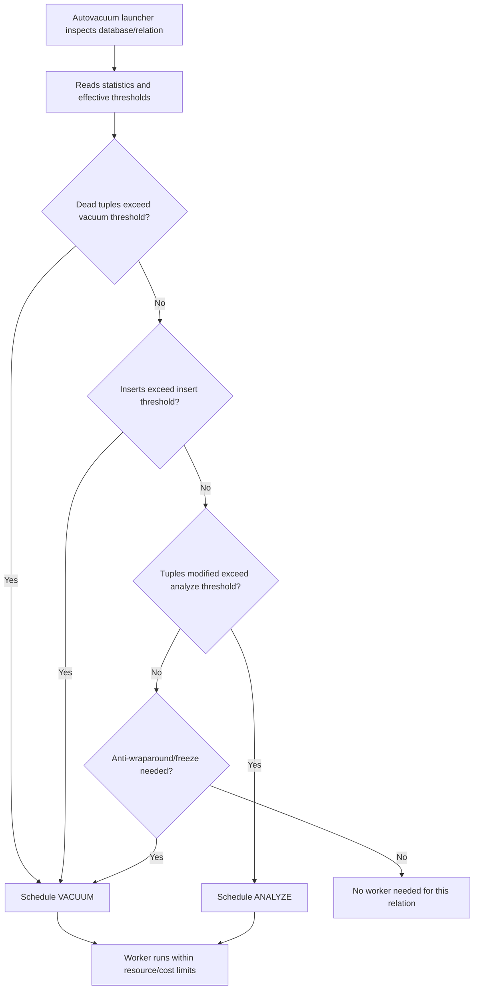

# Autovacuum Thresholds, Scale Factors, and Per-Table Configuration in PostgreSQL

A small PostgreSQL table may get vacuumed frequently without anyone noticing. Another table with hundreds of millions of rows accumulates dead tuples for long periods, increasing storage usage, reducing index-only scan efficiency, and gradually slowing queries. Both might be using the exact same cluster-level autovacuum configuration. The difference lies in data scale, rate of change, workload distribution, and **the autovacuum trigger threshold formulas**.

PostgreSQL uses autovacuum to automatically perform two key groups of tasks:

- **VACUUM:** reclaims tuple versions that are no longer needed, updates the Free Space Map (FSM) and Visibility Map (VM), and freezes tuples per policy.
- **ANALYZE:** collects statistics so the planner can estimate row counts and choose execution plans.

Autovacuum does not simply run on a fixed schedule across every table. The daemon inspects relations, monitors statistics, and decides work based on **threshold + scale factor × relation size**, along with insert/freeze conditions and resource limits.

This lesson belongs to the **VACUUM** chapter and focuses on understanding and configuring per-table autovacuum thresholds:

1. Trigger formulas for dead-tuple auto-vacuum, insert-triggered auto-vacuum, and auto-analyze.
2. Meaning of threshold, scale factor, estimated `reltuples`, and statistics counters.
3. Choosing values for small tables, large tables, write-heavy tables, and append-only tables.
4. Cluster-level configuration and per-relation overrides via `ALTER TABLE ... SET (storage_parameter = value)`.
5. Impact of worker slots, naptime, cost delay/limit, memory, long transactions, and freezing/anti-wraparound.
6. Observing, computing thresholds, checking running autovacuum, and building operational runbooks.

> **Principle:** per-table configuration should be grounded in rate of change, size, I/O headroom, and latency targets. A single scale factor shared across all tables rarely fits when a system has both thousand-row tables and hundred-million-row tables.

## 1. What Problem Does Autovacuum Solve?

PostgreSQL uses MVCC. When a transaction UPDATEs or DELETEs rows, the old tuple version does not necessarily disappear immediately. PostgreSQL must keep versions that could still be visible to other active transactions/snapshots. Once no snapshot needs an old version anymore, VACUUM can reclaim it so the space can be reused.

Autovacuum also handles:

- Updating the free space map to locate pages with room for writes.
- Updating the visibility map to enable index-only scans.
- Freezing sufficiently old tuples to prevent transaction ID wraparound.
- Collecting planner statistics via auto-analyze.
- Reducing the need for DBAs to run manual VACUUM/ANALYZE on rigid schedules.

### 1.1. VACUUM and ANALYZE Are Two Distinct Tasks

| Task | Goal | Usually Triggered By |
| --- | --- | --- |
| Dead-tuple auto-vacuum | Clean unneeded tuple versions, update maps | Dead tuples exceed threshold |
| Insert-triggered auto-vacuum | Maintain visibility/freezing on insert-heavy tables | Inserts since last vacuum exceed threshold |
| Auto-analyze | Refresh planner statistics | Rows inserted/updated/deleted since analyze exceed threshold |
| Anti-wraparound vacuum | Freeze to prevent transaction ID wraparound | XID/MultiXact age approaches safety limit |

A table can need ANALYZE even with few dead tuples. Conversely, a table with many dead tuples whose value distribution barely changed may need VACUUM before it needs ANALYZE. Never lump everything into a single "vacuum threshold" concept.

### 1.2. Conceptual Decision Flow



This is a simplified diagram. Actual behavior also depends on autovacuum enablement, relation kind, worker availability, database state, table options, transaction horizons, and XID/MultiXact safety rules.

## 2. What Do Threshold and Scale Factor Mean?

An autovacuum threshold normally consists of two parts:

- **Threshold:** a fixed minimum number of changes.
- **Scale factor:** a ratio multiplied by the relation's estimated tuple count.

General formula:

\[
\text{trigger threshold}
=
\text{threshold}
+
\text{scale factor}
\times
\text{estimated tuples}
\]

Example:

```text
threshold = 50
scale_factor = 0.20
estimated tuples = 10,000

trigger = 50 + (0.20 × 10,000)
        = 2,050
```

For a relation with 10,000 estimated tuples, a trigger of 2,050 changes adapts better than a single fixed number across every table.

### 2.1. Threshold Is the Fixed Component

If `autovacuum_vacuum_threshold = 50`, the fixed part is 50 dead tuples.

When a table is small, the fixed part dominates the threshold. When a table is large, the scale factor dominates.

### 2.2. Scale Factor Is a Ratio, Not a Whole Percentage

Examples:

| Value | Meaning |
| --- | --- |
| `0.20` | 20% of estimated tuples |
| `0.10` | 10% |
| `0.05` | 5% |
| `0.01` | 1% |
| `0.001` | 0.1% |
| `0` | No proportional component; only the fixed threshold applies |

Do not enter `20` when you mean 20%. The right value is `0.20`.

### 2.3. A Scale Factor of 0 Does Not Disable Autovacuum

Example:

```sql
ALTER TABLE public.orders
SET (
    autovacuum_vacuum_threshold = 1000,
    autovacuum_vacuum_scale_factor = 0
);
```

The normal dead-tuple threshold will rely strictly on the fixed value of 1,000 rather than growing with table size. Autovacuum still runs when that threshold is reached; a scale factor of 0 does not disable vacuum.

### 2.4. Negative Thresholds Can Disable Regular Triggers

Certain thresholds support `-1` to disable the corresponding trigger—for instance `autovacuum_vacuum_threshold = -1` for the normal dead-tuple vacuum trigger, or `autovacuum_analyze_threshold = -1` for auto-analyze.

This is a specialized setting; understand that other triggers and anti-wraparound can still require vacuuming. Do not use `-1` as a way to "reduce frequency slightly"; adjust threshold and scale factor deliberately instead.

## 3. Autovacuum Threshold for Dead Tuples

Two core parameters:

- `autovacuum_vacuum_threshold`
- `autovacuum_vacuum_scale_factor`

Formula:

\[
V = T_v + S_v \times R
\]

Where:

- \(T_v\): `autovacuum_vacuum_threshold`.
- \(S_v\): `autovacuum_vacuum_scale_factor`.
- \(R\): estimated tuple count of the relation (`reltuples`).

When estimated dead tuples exceed the effective threshold, the relation becomes eligible for regular auto-vacuum, provided other conditions permit.

### 3.1. Common Default Values

Across many PostgreSQL versions, common defaults are:

| Parameter | Common Default |
| --- | ---: |
| `autovacuum_vacuum_threshold` | `50` |
| `autovacuum_vacuum_scale_factor` | `0.2` |

Always check `pg_settings` on your actual server. Defaults can vary by version, provider configuration, or cluster administration settings.

### 3.2. Small Table Example

Suppose:

- `reltuples = 1,000`
- `autovacuum_vacuum_threshold = 50`
- `autovacuum_vacuum_scale_factor = 0.20`

Calculation:

\[
50 + 0.20 \times 1,000 = 250
\]

The threshold is roughly **250 dead tuples**.

On a small table, 250 rows can be a noticeable percentage. If the table gets frequent UPDATE/DELETEs, vacuum may run quite often; this is usually reasonable because scanning a small table is cheap.

### 3.3. Very Large Table Example

Suppose:

- `reltuples = 100,000,000`
- threshold = `50`
- scale factor = `0.20`

Calculation:

\[
50 + 0.20 \times 100,000,000
= 20,000,050
\]

A 100-million-tuple table could have to accumulate roughly 20 million dead tuples before hitting the dead-tuple vacuum threshold under the basic formula.

That is why default settings can be unsuitable for large tables with frequent UPDATE/DELETE workloads. A smaller scale factor lets vacuum run sooner.

### 3.4. Example Lowering Scale Factor for a Large Table

If set:

```sql
ALTER TABLE public.orders
SET (
    autovacuum_vacuum_threshold = 1000,
    autovacuum_vacuum_scale_factor = 0.01
);
```

With `reltuples = 100,000,000`:

\[
1,000 + 0.01 \times 100,000,000
= 1,001,000
\]

The threshold drops to around 1 million dead tuples, far lower than the ~20 million in the default example.

This is still an illustrative figure. One million dead tuples might still be too high for a latency-sensitive workload, or too low if vacuum is I/O-heavy and data changes slowly. Measure vacuum duration, dead tuple generation per second, bloat, and resource headroom.

### 3.5. Maximum Cap in Supported Versions

Some newer PostgreSQL versions provide `autovacuum_vacuum_max_threshold`, allowing an upper bound on the dead-tuple vacuum threshold. When supported and not set to `-1`, the threshold is calculated via the formula and then capped at the maximum value.

Conceptual example:

\[
V_{\text{effective}} =
\min(T_v + S_v \times R,\ V_{\max})
\]

If your version lacks this parameter, do not add it to configuration. Check with:

```sql
SELECT name, setting, unit, source
FROM pg_settings
WHERE name = 'autovacuum_vacuum_max_threshold';
```

If no row is returned, the server does not support that GUC. Never assume version support from an article or another config file.

## 4. Insert-Triggered Vacuum Threshold

An append-only table may have almost no UPDATE/DELETEs yet still need autovacuum. Newly inserted pages may need checking/freezing, and the visibility map needs updating to support subsequent reads.

Parameters:

- `autovacuum_vacuum_insert_threshold`
- `autovacuum_vacuum_insert_scale_factor`

Formula:

\[
I = T_i + S_i \times R
\]

Where:

- \(T_i\): threshold for inserts since the last relevant vacuum.
- \(S_i\): insert scale factor.
- \(R\): estimated tuple count of the relation.

### 4.1. Common Default Values

| Parameter | Common Default |
| --- | ---: |
| `autovacuum_vacuum_insert_threshold` | `1000` |
| `autovacuum_vacuum_insert_scale_factor` | `0.2` |

The insert threshold can be set to `-1` to disable the insert-only vacuum trigger; other vacuum reasons, especially anti-wraparound, still apply.

### 4.2. Append-Only Event Table Example

An insert-only `events` table with 50 million tuples:

- `T_i = 1000`
- `S_i = 0.20`
- `R = 50,000,000`

\[
I = 1,000 + 0.20 \times 50,000,000
= 10,001,000
\]

The insert-trigger threshold under common defaults is roughly 10 million inserts since vacuum.

On a very large append-only table, intervals between vacuums can grow quite long. To keep visibility map updates and freezing progressing smoothly, you can lower the insert scale factor per table.

### 4.3. Why Is Insert-Triggered Vacuum Useful?

- New heap pages may need vacuuming to be marked all-visible/all-frozen once eligible.
- Vacuum helps manage transaction ID age.
- Index-only scan queries over settled data benefit once the VM is updated.
- Insert-heavy tables without dead tuples can still require vacuuming.

Do not think of insert-triggered vacuum as "cleaning dead tuples caused by INSERT". INSERT creates new tuples; this trigger serves page visibility and freezing needs.

## 5. Auto-Analyze Threshold

ANALYZE gathers planner statistics such as value distributions, most common values, histograms, and selectivity estimates. When data changes enough, stale statistics can cause the planner to pick poor plans.

Parameters:

- `autovacuum_analyze_threshold`
- `autovacuum_analyze_scale_factor`

Formula:

\[
A = T_a + S_a \times R
\]

Where:

- \(T_a\): threshold for auto-analyze.
- \(S_a\): analyze scale factor.
- \(R\): estimated tuple count.

The trigger typically uses the number of tuples inserted, updated, or deleted since the last relevant analyze, not dead tuples alone.

### 5.1. Common Default Values

| Parameter | Common Default |
| --- | ---: |
| `autovacuum_analyze_threshold` | `50` |
| `autovacuum_analyze_scale_factor` | `0.1` |

### 5.2. One-Million-Tuple Table Example

\[
A = 50 + 0.1 \times 1,000,000
= 100,050
\]

Roughly 100,050 tuple modifications can trigger auto-analyze under the basic formula.

If a table's data distribution shifts rapidly or the query planner is sensitive to statistics, a lower scale factor can help.

### 5.3. Auto-Analyze Does Not Clean Dead Tuples

ANALYZE does not replace VACUUM. It does not reclaim tuple versions, does not update the free space map for vacuum purposes, and does not replace freezing.

If a table has both high dead tuples and stale statistics, it may need both VACUUM and ANALYZE. Manual `VACUUM (ANALYZE)` can combine both tasks, while autovacuum maintains separate triggers for each.

### 5.4. Partitioned Tables Need Special Attention

Autovacuum treats leaf partitions as separate relations, yet does not automatically ensure statistics on the partitioned parent are updated as operators might expect after partition changes. After adding/dropping partitions or major distribution shifts, you may need to run manual `ANALYZE` on the parent as planned.

## 6. Three Formulas Side by Side

| Trigger | Basic Formula | Counter to Watch |
| --- | --- | --- |
| Dead-tuple vacuum | `vacuum_threshold + vacuum_scale_factor × reltuples` | `n_dead_tup` |
| Insert-triggered vacuum | `insert_threshold + insert_scale_factor × reltuples` | `n_ins_since_vacuum` in supported versions |
| Auto-analyze | `analyze_threshold + analyze_scale_factor × reltuples` | `n_mod_since_analyze` |

Statistics counters are operational estimates and can be affected by resets, snapshots, version differences, and flush timing. They are not exact per-tuple transactional counters in every situation.

### 6.1. Combined Example

Suppose table `public.orders` has:

- `reltuples = 10,000,000`
- Estimated dead tuples: 350,000
- Inserts since vacuum: 700,000
- Modifications since analyze: 1,200,000

Using common defaults:

Dead vacuum:

\[
50 + 0.2 \times 10,000,000 = 2,000,050
\]

Insert vacuum:

\[
1000 + 0.2 \times 10,000,000 = 2,001,000
\]

Auto-analyze:

\[
50 + 0.1 \times 10,000,000 = 1,000,050
\]

Interpretation:

- 350,000 dead tuples have not reached the default dead-tuple vacuum threshold.
- 700,000 inserts have not reached the default insert-vacuum threshold.
- 1,200,000 modifications have exceeded the estimated analyze threshold.

Thus the relation can qualify for auto-analyze while not yet qualifying for either normal vacuum trigger. Anti-wraparound or other factors can still trigger vacuum independently.

## 7. `reltuples` Is an Estimate, Not an Exact COUNT(*)

In these formulas, PostgreSQL uses the catalog's estimated tuple count, commonly viewed via `pg_class.reltuples`.

```sql
SELECT
    c.oid::regclass AS relation,
    c.reltuples,
    c.relpages
FROM pg_class AS c
WHERE c.oid = 'public.orders'::regclass;
```

`reltuples` can:

- Equal `-1` if no estimate has been recorded yet.
- Become stale after heavy data changes.
- Be updated by VACUUM/ANALYZE or appropriate administrative operations.
- Differ from an exact current row count like `COUNT(*)`.

### 7.1. Do Not Run Full-Table COUNT(*) Just to Compute Thresholds

Evaluating autovacuum thresholds does not require the application to run `SELECT COUNT(*)` first. PostgreSQL uses catalog estimates and statistics counters specifically to avoid continuous full-table scans.

Running `COUNT(*)` on a table of hundreds of millions of rows "to be exact" wastes resources without making the daemon use that number instead of `reltuples`.

### 7.2. reltuples Can Be Stale After Bulk Loads

After a bulk load or major data change, statistics may not reflect the new size yet. Running planned `ANALYZE` updates planner statistics and relation estimates.

However, do not run ANALYZE mechanically too often; it also consumes I/O/CPU and samples via its own mechanism.

## 8. Checking Effective Autovacuum GUC Values

To inspect cluster/session-level parameters:

```sql
SELECT
    name,
    setting,
    unit,
    context,
    source,
    sourcefile,
    sourceline
FROM pg_settings
WHERE name LIKE 'autovacuum%'
   OR name LIKE 'vacuum_%'
ORDER BY name;
```

Useful columns:

- `setting`: current effective value.
- `unit`: unit if applicable.
- `context`: scope/conditions required to change the parameter.
- `source`: configuration source that took precedence.
- `sourcefile`, `sourceline`: config file and line if permitted to view.

Some sources or columns may be restricted by privileges or version.

### 8.1. Checking Threshold Settings Specifically

```sql
SELECT name, setting, unit, source
FROM pg_settings
WHERE name IN (
    'autovacuum',
    'autovacuum_naptime',
    'autovacuum_max_workers',
    'autovacuum_vacuum_threshold',
    'autovacuum_vacuum_scale_factor',
    'autovacuum_vacuum_insert_threshold',
    'autovacuum_vacuum_insert_scale_factor',
    'autovacuum_analyze_threshold',
    'autovacuum_analyze_scale_factor',
    'autovacuum_vacuum_cost_delay',
    'autovacuum_vacuum_cost_limit',
    'autovacuum_work_mem',
    'autovacuum_freeze_max_age'
)
ORDER BY name;
```

If a parameter does not appear, check its spelling and your major version. Never assume every PostgreSQL server or managed service supports the exact same set of GUCs.

### 8.2. SHOW Is Also Useful

```sql
SHOW autovacuum;
SHOW autovacuum_vacuum_threshold;
SHOW autovacuum_vacuum_scale_factor;
SHOW autovacuum_analyze_threshold;
SHOW autovacuum_analyze_scale_factor;
```

`SHOW` returns the current session's value, which can reflect session/role/database overrides if allowed by the parameter. `pg_settings.source` shows where the setting came from.

## 9. Checking Per-Table Settings

PostgreSQL lets you override certain autovacuum parameters at the relation level using storage parameters.

Example:

```sql
ALTER TABLE public.orders
SET (
    autovacuum_vacuum_threshold = 1000,
    autovacuum_vacuum_scale_factor = 0.01,
    autovacuum_analyze_threshold = 500,
    autovacuum_analyze_scale_factor = 0.02
);
```

This configuration applies to `public.orders`. Parameters not overridden continue inheriting the appropriate global values.

### 9.1. Reading reloptions

```sql
SELECT
    c.oid::regclass AS relation,
    c.reloptions
FROM pg_class AS c
WHERE c.oid = 'public.orders'::regclass;
```

For example, `reloptions` might contain:

```text
{autovacuum_vacuum_threshold=1000,autovacuum_vacuum_scale_factor=0.01}
```

These are the relation's overrides, not a full list of all inherited default settings.

### 9.2. Expanding reloptions into Readable Rows

```sql
SELECT
    p.option_name,
    p.option_value
FROM pg_class AS c
CROSS JOIN LATERAL pg_options_to_table(c.reloptions) AS p
WHERE c.oid = 'public.orders'::regclass
ORDER BY p.option_name;
```

This query is handy for DBA inventories or per-table configuration dashboards.

### 9.3. RESET to Revert to Global Settings

```sql
ALTER TABLE public.orders
RESET (
    autovacuum_vacuum_threshold,
    autovacuum_vacuum_scale_factor,
    autovacuum_analyze_threshold,
    autovacuum_analyze_scale_factor
);
```

`RESET` removes those overrides; the table reverts to inheriting higher-level effective settings.

### 9.4. Table Options Do Not Change Cluster-Wide GUCs

`ALTER TABLE ... SET (...)` stores storage parameters on the relation. It does not edit `postgresql.conf`, does not affect other tables, and does not alter application config.

This is ideal when only specific tables have special workloads, such as:

- An `orders` table receiving frequent UPDATEs.
- An append-only `events` table.
- A high-INSERT audit table.
- A small queue/state table changing continuously.

## 10. Computing Thresholds for a Table from Current GUCs

You can compute a reference estimate from global GUCs and `reltuples`:

```sql
SELECT
    c.oid::regclass AS relation,
    c.reltuples AS estimated_tuples,
    s.n_dead_tup,
    current_setting('autovacuum_vacuum_threshold')::numeric
      + current_setting('autovacuum_vacuum_scale_factor')::numeric
        * GREATEST(c.reltuples, 0) AS estimated_dead_tuple_threshold,
    s.n_mod_since_analyze,
    current_setting('autovacuum_analyze_threshold')::numeric
      + current_setting('autovacuum_analyze_scale_factor')::numeric
        * GREATEST(c.reltuples, 0) AS estimated_analyze_threshold
FROM pg_class AS c
JOIN pg_stat_all_tables AS s
  ON s.relid = c.oid
WHERE c.oid = 'public.orders'::regclass;
```

This calculation is **for reference only**:

- It uses global GUCs and does not automatically apply table-specific `reloptions`.
- It does not apply the cap in versions with `autovacuum_vacuum_max_threshold`.
- `reltuples` and statistics counters are estimates/accumulated counters.
- Autovacuum has additional triggers, notably insert vacuum and freeze.
- Relation type, database state, and worker availability affect actual execution timing.

Do not use this query's output to predict to the exact second when autovacuum will start.

### 10.1. Reading Vacuum/Analyze Counters Together

```sql
SELECT
    schemaname,
    relname,
    n_live_tup,
    n_dead_tup,
    n_mod_since_analyze,
    n_ins_since_vacuum,
    last_vacuum,
    last_autovacuum,
    last_analyze,
    last_autoanalyze,
    vacuum_count,
    autovacuum_count,
    analyze_count,
    autoanalyze_count
FROM pg_stat_user_tables
WHERE schemaname = 'public'
ORDER BY n_dead_tup DESC;
```

Some columns, notably `n_ins_since_vacuum`, depend on major version. If a column does not exist, inspect `pg_stat_all_tables` on your server before running this query.

### 10.2. Do Not Compare Counters Against Thresholds While Ignoring Resets

Statistics can be reset or shift across instance/database lifecycles. If `last_autovacuum` is recent and counters are low, vacuum may simply have just finished. If the server restarted or stats were reset, counters no longer share the old baseline.

Check the latest vacuum/analyze timestamps and logs to understand what baseline the counters are measuring from.

## 11. Choosing Thresholds by Size and Churn Rate

There is no single optimal scale factor for every relation. Start with workload classification.

| Table Group | Characteristics | Typical Tuning Direction |
| --- | --- | --- |
| Small, high-churn table | Few rows, high change ratio | Fixed threshold has major impact; may lower threshold |
| Large, frequent UPDATE/DELETE table | Dead tuples grow fast, default vacuum waits too long | Lower vacuum scale factor, consider max threshold if available |
| Append-only table | Few dead tuples, continuous inserts | Tune insert threshold/scale factor and watch freeze/VM |
| Low-churn historical table | Mostly reads, rare changes | Threshold can stay higher; still needs freezing and analyze when needed |
| Hot queue/state table | Heavy short-term UPDATE/DELETEs | Lower thresholds, monitor dead tuples and vacuum throughput |
| Partitioned table | Each partition has its own size/workload | Configure and monitor each leaf partition |

### 11.1. Small Table

Suppose a `job_queue` table has only 5,000 rows but continuously UPDATEs statuses. With common defaults:

\[
50 + 0.2 \times 5,000 = 1,050
\]

Roughly 1,050 dead tuples is over 20% of estimated rows. If the queue needs frequent vacuuming to keep latency steady, try lowering threshold and scale factor.

Illustrative example:

```sql
ALTER TABLE app.job_queue
SET (
    autovacuum_vacuum_threshold = 100,
    autovacuum_vacuum_scale_factor = 0.02,
    autovacuum_analyze_threshold = 100,
    autovacuum_analyze_scale_factor = 0.05
);
```

With 5,000 rows, dead threshold is roughly 200; analyze threshold is roughly 350. This is a starting point for measurement, not a universal standard for every queue.

### 11.2. Large, Update-Heavy Table

Suppose a 200-million-row table modifies millions of rows per day. Defaults could allow massive dead tuple accumulation.

Example:

```sql
ALTER TABLE app.orders
SET (
    autovacuum_vacuum_threshold = 2000,
    autovacuum_vacuum_scale_factor = 0.005,
    autovacuum_analyze_threshold = 1000,
    autovacuum_analyze_scale_factor = 0.01
);
```

Estimated dead vacuum threshold:

\[
2,000 + 0.005 \times 200,000,000
= 1,002,000
\]

Estimated analyze threshold:

\[
1,000 + 0.01 \times 200,000,000
= 2,001,000
\]

This is a calculation example, not a production recommendation. Verify whether vacuum cleans faster than dead tuples are generated.

### 11.3. Append-Only Table

An `events` table receiving tens of millions of INSERTs per day with few UPDATE/DELETEs. Do not look only at `n_dead_tup` and assume autovacuum does not need to run.

Example:

```sql
ALTER TABLE app.events
SET (
    autovacuum_vacuum_insert_threshold = 5000,
    autovacuum_vacuum_insert_scale_factor = 0.02,
    autovacuum_analyze_threshold = 1000,
    autovacuum_analyze_scale_factor = 0.02
);
```

The goal is tuning insert-triggered vacuum and auto-analyze. Monitor freeze age, VM, and partition lifecycle.

### 11.4. Read-Heavy, Nearly Immutable Table

A rarely modified product catalog table may not need frequent dead-tuple vacuuming. Still, it requires:

- Freezing by transaction ID age.
- Analyzing when data/distributions change noticeably.
- Monitoring VM/all-visible coverage if index-only scans matter.
- Never disabling autovacuum just because the table "hardly ever UPDATEs".

## 12. Dead Tuple Generation Rate Matters More Than Ratio Alone

Two tables each having 1 million dead tuples can behave very differently:

- Table A creates 1 million dead tuples over a month.
- Table B creates 1 million dead tuples in 5 minutes.

Table B may need more frequent vacuuming or higher worker throughput.

### 12.1. Estimating Churn Rate

You can sample `n_dead_tup` over time in your monitoring system. The difference between two samples gives a rough rate estimate:

\[
\text{dead tuple rate}
\approx
\frac{\Delta n\_dead\_tup}{\Delta t}
\]

This is only an approximation because counters/statistics update on their own cadence, vacuum may run between samples, and dead tuple estimates have error margins.

### 12.2. Estimating Time to Threshold

If a table is 500,000 dead tuples away from threshold and generates an average of 50,000 dead tuples/minute:

\[
500,000 / 50,000 = 10 \text{ minutes}
\]

This is a simple directional forecast for monitoring, not an exact autovacuum schedule. Launcher naptime, worker availability, stats refreshes, cost throttling, and running vacuums all affect reality.

### 12.3. Autovacuum Must Keep Pace with Workload

An essential operational condition:

\[
\text{vacuum cleanup throughput}
>
\text{dead tuple generation rate}
\]

If the workload creates dead tuples faster than vacuum can clean over the long term, lowering thresholds only causes vacuum to be requested more often; it does not increase throughput by itself. In that case examine workers, I/O, cost delay/limit, index cleanup, long transactions, and workload design.

## 13. Workers, Launcher, and Naptime

Autovacuum has a launcher managing scheduling and multiple workers executing VACUUM/ANALYZE.

Common parameters:

- `autovacuum`: enables/disables the daemon at the server level.
- `autovacuum_naptime`: interval the launcher sleeps between database check cycles.
- `autovacuum_max_workers`: maximum concurrent autovacuum workers.
- `autovacuum_work_mem`: memory per autovacuum worker per configuration rules.
- `autovacuum_vacuum_cost_delay` and `autovacuum_vacuum_cost_limit`: throttle I/O load.

### 13.1. Naptime Is Not a Fixed Per-Table Vacuum Period

If `autovacuum_naptime = 1min`, that does not mean every table is vacuumed every minute. The launcher distributes work across databases and relations, checking thresholds and worker slots.

A table that just crossed a threshold may wait for the next cycle or wait for a free worker.

### 13.2. Worker Slots Are a Shared Resource

If a cluster has `autovacuum_max_workers = 3`, at most three autovacuum workers run concurrently under that limit. If many large tables cross thresholds simultaneously, they queue up.

Increasing workers allows more tables to be processed in parallel, but also increases I/O, CPU, memory, and contention. Evaluate overall workload and host capacity before raising it.

### 13.3. Multiple Databases in One Cluster

The autovacuum launcher manages work across the entire cluster, rather than running one independent daemon per database. One database with many large tables can occupy most worker time and starve other databases.

When hosting multiple databases, track vacuum lag by database/schema/relation, not merely total running workers.

## 14. Cost Delay and Cost Limit

VACUUM uses cost-based delays to avoid saturating disk I/O and harming foreground workloads.

Parameters:

- `vacuum_cost_delay`: pause when cost limit is hit for manual VACUUM per configuration.
- `vacuum_cost_limit`: cost threshold.
- `autovacuum_vacuum_cost_delay`: delay for autovacuum.
- `autovacuum_vacuum_cost_limit`: cost limit for autovacuum; `-1` typically inherits `vacuum_cost_limit`.

### 14.1. High Cost Delay Can Slow Vacuum Down

If autovacuum is throttled too aggressively:

- Dead tuples build up faster.
- Vacuum duration increases.
- Relation bloat can grow.
- Freezing progresses slower.

Lowering delay or raising cost limit lets vacuum finish faster, at the risk of I/O competition with application queries.

### 14.2. Multiple Workers Share the Cost Budget

In autovacuum configuration, the overall cost limit can be divided across active workers per PostgreSQL rules. Do not assume each worker independently gets a full `autovacuum_vacuum_cost_limit`.

Check documentation for your exact major version and observe actual I/O before tuning.

### 14.3. Controlled Configuration Example

A server-level change you might consider after measurement:

```text
autovacuum_vacuum_cost_delay = 2ms
autovacuum_vacuum_cost_limit = 1000
autovacuum_max_workers = 5
```

These are illustrative values only, not a universal optimal config. Changing multiple parameters simultaneously makes it hard to isolate root causes if latency or I/O shifts. Change one small group at a time, measure before/after, and keep a rollback ready.

## 15. Memory and Index Cleanup

`autovacuum_work_mem` sets memory per autovacuum worker where supported by version/configuration. When set to `-1`, it typically falls back to `maintenance_work_mem`.

Vacuum must track dead tuple IDs for index cleanup. Memory that is too low can force index cleanup into multiple passes and add extra I/O.

### 15.1. Total Memory Is Not Just One Worker

If 5 workers each allocate substantial memory, total autovacuum memory scales with worker count. Factor in all of:

- `maintenance_work_mem`.
- `autovacuum_work_mem`.
- `autovacuum_max_workers`.
- Foreground query memory.
- Shared buffers and OS page cache.
- Other maintenance processes.

Do not raise `autovacuum_work_mem` to huge numbers across all workers without calculating worst-case memory.

### 15.2. Index Cleanup and Workload

Vacuum must clean up index entries pointing to dead heap tuples. Tables with many indexes can spend significant time and I/O in index cleanup.

If vacuum drags on, inspect index count/sizes, HOT update rate, dead tuple churn, and `pg_stat_progress_vacuum`. Do not skip index cleanup arbitrarily just to speed up the current vacuum; that leaves dead index entries and maintenance debt behind.

## 16. Freezing and Anti-Wraparound Are Independent of Dead-Tuple Thresholds

PostgreSQL uses finite transaction IDs. To avoid wraparound, the system must freeze sufficiently old tuples. This is a correctness and data-safety requirement, not merely a performance tuning knob.

Related parameters include:

- `autovacuum_freeze_max_age`
- `vacuum_freeze_min_age`
- `vacuum_freeze_table_age`
- `autovacuum_multixact_freeze_max_age`
- `vacuum_multixact_freeze_min_age`
- Corresponding table storage parameters if supported by your version.

### 16.1. Anti-Wraparound Vacuum Can Run Even When Autovacuum Is Disabled

Even if `autovacuum` is disabled at the server level or `autovacuum_enabled=false` on a relation, PostgreSQL must still run required vacuums to prevent transaction ID wraparound.

Do not treat `autovacuum_enabled=false` as a way to eliminate all vacuum activity on a table.

### 16.2. This Is Not a Dead-Tuple Threshold

A table can have almost zero UPDATE/DELETEs and still need vacuum freeze due to XID/MultiXact age. Conversely, a table with heavy dead tuples may need regular threshold vacuuming long before wraparound risk arises.

Do not rely solely on `n_dead_tup` to assess freeze health.

### 16.3. Checking Database Transaction ID Age

```sql
SELECT
    datname,
    age(datfrozenxid) AS xid_age,
    datallowconn
FROM pg_database
ORDER BY age(datfrozenxid) DESC;
```

This is a key database-level indicator. Pair it with server warnings, relation-level ages, MultiXact ages, and vacuum logs.

### 16.4. Freeze Age Is a Safety Limit, Not Arbitrary Tuning

Do not raise `autovacuum_freeze_max_age` simply to reduce vacuum frequency. Doing so pushes the system closer to wraparound risk and makes the eventual anti-wraparound vacuum much heavier.

Changing freeze limits requires understanding XID age, capacity, vacuum duration, replication, and whether vacuum can finish ahead of protective shutoffs.

## 17. Long Transactions Can Block Vacuum Cleanup

A transaction holding an old snapshot can prevent VACUUM from reclaiming tuple versions that the snapshot still needs.

Example:

1. Session A opens a `REPEATABLE READ` transaction and holds a snapshot.
2. Session B performs massive UPDATE/DELETEs and COMMITs.
3. Autovacuum runs on the table.
4. Some old tuple versions are still needed by A's snapshot.
5. Vacuum cannot reclaim them until transaction A finishes.

### 17.1. Finding Long Transactions

```sql
SELECT
    pid,
    datname,
    usename,
    application_name,
    state,
    xact_start,
    clock_timestamp() - xact_start AS xact_age,
    backend_xmin,
    left(query, 200) AS query_preview
FROM pg_stat_activity
WHERE xact_start IS NOT NULL
ORDER BY xact_start;
```

### 17.2. Replication Slots Can Also Pin xmin

Replication slots can hold `xmin` or `catalog_xmin`, preventing cleanup of certain tuple/catalog versions needed for replication.

```sql
SELECT
    slot_name,
    slot_type,
    active,
    xmin,
    catalog_xmin,
    restart_lsn
FROM pg_replication_slots
ORDER BY slot_name;
```

An inactive slot pinning an old horizon is an important suspect to investigate. Never drop a slot just to let vacuum run; verify the owner and replication impact first.

### 17.3. Standby Feedback

Hot standby feedback can pin xmin on the primary in certain topologies, affecting vacuum cleanup. When investigating, check replication lag, `backend_xmin`, and standby feedback settings.

### 17.4. Lowering Thresholds Does Not Fix a Pinned Horizon

If VACUUM runs yet cannot reclaim tuple versions due to a long transaction, lowering thresholds only makes it trigger more often. The root cause is the snapshot horizon and transaction lifecycle, not the trigger threshold.

## 18. Per-Table Autovacuum Configuration

A solid practice is classifying tables before configuring them:

| Table Attribute | Question to Answer |
| --- | --- |
| Estimated rows | Roughly how many tuples does the table hold? |
| Insert rate | How many rows are inserted per minute/hour? |
| Update/delete rate | How fast are dead tuples generated? |
| Row width | Are tuples wide or narrow? |
| Index count/size | How costly is index cleanup during vacuum? |
| HOT update rate | How many updates avoid index churn? |
| Query sensitivity | Are queries on this table sensitive to bloat or stale stats? |
| Long transactions | Do long snapshots retain old versions? |
| Partitioning | Does each partition have a distinct workload? |
| Maintenance window | Are there hourly I/O or CPU constraints? |

### 18.1. Example: Small Queue Table, Continuous UPDATEs

```sql
ALTER TABLE app.job_queue
SET (
    autovacuum_vacuum_threshold = 100,
    autovacuum_vacuum_scale_factor = 0.02,
    autovacuum_analyze_threshold = 100,
    autovacuum_analyze_scale_factor = 0.05,
    autovacuum_vacuum_cost_delay = 2
);
```

The goal is vacuuming earlier while absolute dead tuples remain small. Monitor vacuum frequency, query latency, and I/O to ensure it does not run excessively often.

### 18.2. Example: Large, Update-Heavy Orders Table

```sql
ALTER TABLE app.orders
SET (
    autovacuum_vacuum_threshold = 2000,
    autovacuum_vacuum_scale_factor = 0.005,
    autovacuum_analyze_threshold = 1000,
    autovacuum_analyze_scale_factor = 0.01
);
```

The goal is avoiding waiting for too large a dead-tuple percentage. Check vacuum duration and dead tuple generation rate to confirm workers keep pace with the workload.

### 18.3. Example: Append-Only Events Table

```sql
ALTER TABLE app.events
SET (
    autovacuum_vacuum_insert_threshold = 5000,
    autovacuum_vacuum_insert_scale_factor = 0.02,
    autovacuum_analyze_threshold = 2000,
    autovacuum_analyze_scale_factor = 0.02
);
```

The goal is tuning insert-triggered vacuum and auto-analyze. Monitor freeze age, VM, and partition lifecycle.

### 18.4. Example: Rarely Modified Historical Table

You can keep thresholds relatively high per workload, but do not disable freezing. After bulk loads or major distribution shifts, run scheduled ANALYZE so the planner does not rely on stale statistics.

## 19. Resetting Configuration and Change Management

Every per-table change should have an owner, rationale, and rollback plan.

Check current state:

```sql
SELECT
    c.oid::regclass AS relation,
    c.reloptions
FROM pg_class AS c
WHERE c.oid IN (
    'app.orders'::regclass,
    'app.events'::regclass,
    'app.job_queue'::regclass
)
ORDER BY c.oid::regclass::text;
```

Set an override:

```sql
ALTER TABLE app.orders
SET (autovacuum_vacuum_scale_factor = 0.005);
```

Reset to inherit global configuration:

```sql
ALTER TABLE app.orders
RESET (autovacuum_vacuum_scale_factor);
```

Multiple storage parameters can be updated in a single `ALTER TABLE` statement to manage a change atomically. Check table ownership and environment DDL permissions.

### 19.1. Effective Configuration Does Not Come Solely from postgresql.conf

The configuration precedence stack can include:

- Built-in defaults.
- `postgresql.conf` and include files.
- `ALTER SYSTEM`.
- Command-line startup options.
- `ALTER DATABASE ... SET`.
- `ALTER ROLE ... SET`.
- Session `SET`.
- Table storage parameters for relation-specific attributes.

Which sources apply depends on parameter and context. Use `pg_settings.source`/`sourcefile` along with `reloptions` to verify true effective values.

### 19.2. A Parameter May Require Reload or Restart

Check the `context` column in `pg_settings`:

- `sighup`: normally applies after reload.
- `postmaster`: requires server restart.
- `user`/`superuser`: can be changed per session depending on privileges.
- Other contexts have their own semantics.

Never claim every autovacuum GUC requires a restart. Many take effect on reload, while table storage parameters are stored on the relation and apply to operations on that relation.

## 20. Autovacuum Is Slow or Not Running: Categorizing Causes

When a table has high `n_dead_tup`, do not immediately lower thresholds. Many causes are possible:

1. Effective threshold has not been reached due to a large scale factor.
2. Table-level `reloptions` override global GUCs.
3. All worker slots are busy.
4. Launcher has not reached its next check cycle.
5. Autovacuum is disabled at the server or relation level.
6. Long transactions or replication slots are holding back xmin.
7. Cost delay is too high or I/O throughput is low.
8. VACUUM is running long due to huge table/index size.
9. The relation is not handled the way you assumed (e.g., partitioned parent).
10. Statistics/counters are stale or were reset.
11. Autovacuum worker hit an error and logged it.
12. Freeze/anti-wraparound vacuum is competing for resources.

### 20.1. Checking Running Workers

```sql
SELECT
    a.pid,
    a.datname,
    a.application_name,
    a.backend_type,
    a.state,
    a.wait_event_type,
    a.wait_event,
    a.query_start,
    a.query
FROM pg_stat_activity AS a
WHERE a.backend_type = 'autovacuum worker'
ORDER BY a.query_start;
```

Some versions/configs display activity/autovacuum queries differently. Use the progress view to see which phase a worker is in.

### 20.2. Checking Vacuum Progress

```sql
SELECT
    p.pid,
    p.datname,
    p.relid::regclass AS relation,
    p.phase,
    p.heap_blks_total,
    p.heap_blks_scanned,
    p.heap_blks_vacuumed,
    p.index_vacuum_count,
    p.num_dead_tuples,
    p.max_dead_tuples
FROM pg_stat_progress_vacuum AS p
ORDER BY p.datname, p.relid;
```

Columns of `pg_stat_progress_vacuum` depend on version. If a column is missing, inspect the view schema on your server. Some phases leave certain fields unpopulated or assign phase-specific meanings.

### 20.3. Checking Max Worker Settings

```sql
SHOW autovacuum_max_workers;
SHOW autovacuum_naptime;
SHOW autovacuum_vacuum_cost_delay;
SHOW autovacuum_vacuum_cost_limit;
```

Compare against active worker counts and vacuum durations. Continuously saturated workers can signal insufficient capacity or a few relations taking too long to vacuum.

### 20.4. Reading Autovacuum Logs

You can configure:

```text
log_autovacuum_min_duration = 1s
```

This example logs autovacuum actions lasting at least the configured threshold. `0` logs all runs; `-1` disables autovacuum logging via this parameter. Check your version's docs for exact format and detail level.

Logs can show:

- Which relation was vacuumed/analyzed.
- Pages and tuples processed.
- Duration and index cleanup work.
- Why the worker ran in certain cases, including wraparound protection.
- Warnings or errors causing runs to fail.

Enabling overly verbose logging on a huge cluster can inflate log volume; pick thresholds to match operational needs.

## 21. Partitioned Tables: Configuring Leaf Partitions

Each leaf partition is its own relation with its own size and churn rate. The current month's partition may receive millions of INSERT/UPDATEs while last year's partition is practically immutable.

You can configure partitions individually:

```sql
ALTER TABLE app.events_2026_11
SET (
    autovacuum_vacuum_insert_threshold = 5000,
    autovacuum_vacuum_insert_scale_factor = 0.02,
    autovacuum_analyze_threshold = 1000,
    autovacuum_analyze_scale_factor = 0.02
);
```

For partitioned parents, remember autovacuum does not handle the parent the same way as leaf relations. When data distribution or partition sets change noticeably, schedule parent `ANALYZE` as appropriate.

### 21.1. Do Not Copy the Same reloptions to Every Partition

Historical partitions need vacuuming far less often than active partitions. Configuring each partition to match its actual workload avoids:

- Over-vacuuming immutable data.
- Under-vacuuming hot partitions.
- Stale analyze stats when value distributions shift.
- Multiple workers needlessly churning through huge cold partitions.

### 21.2. Partition Rotation and Detach/Drop

If retention policy retires old partitions via detach/drop, that approach can be far better than deleting millions of rows. It avoids heap/index churn on the old partition, though you must evaluate locks, foreign keys, replication, and lifecycle rules.

Autovacuum does not replace a partition lifecycle strategy.

## 22. Tuning by Workload and SLO

A controlled tuning process:

1. Select critical tables based on query latency, bloat, and write rate.
2. Gather baseline metrics over a representative time window.
3. Compute current thresholds from `reltuples` and GUCs.
4. Measure dead tuple generation rate and vacuum duration.
5. Inspect vacuum workers, cost delay/limit, and I/O.
6. Check long transactions, replication slots, and freeze horizons.
7. Make one small change, preferring per-table overrides if only one relation differs.
8. Re-measure dead tuple accumulation, vacuum duration, query latency, and I/O.
9. Keep or roll back based on results.
10. Record configuration alongside rationale, owner, and review date.

### 22.1. The Goal Is Not "Vacuum as Often as Possible"

Vacuuming too frequently consumes CPU, I/O, and worker capacity. On slow-changing relations, constant vacuuming wastes resources.

The goal is vacuuming **early enough to keep dead tuples, bloat, visibility, and freezing under control** without creating unnecessary maintenance load.

### 22.2. The Goal Is Not "Wait Until Full Bloat"

If scale factors are too high, massive dead tuples accumulate before the next vacuum. Then a single huge vacuum runs long, competes for I/O, and drives up latency.

Balance trigger frequency against throughput.

### 22.3. Use Percentiles and Trends, Not One Snapshot

Track over time:

- p95/p99 query latency.
- Dead tuple estimates and trends.
- Vacuum duration and frequency.
- Index-only scan Heap Fetches where relevant.
- Relation size and index size.
- Worker saturation.
- I/O latency and throughput.
- Transaction age and xmin horizon.
- Replica lag.

A single point-in-time snapshot cannot tell you whether autovacuum is keeping up with the workload long-term.

## 23. End-to-End Example: Configuring Autovacuum for Three Tables

Suppose a system has:

| Table | Scale | Workload |
| --- | ---: | --- |
| `app.job_queue` | 5,000 rows | Continuous UPDATE/DELETE |
| `app.orders` | 200 million rows | Status UPDATEs, frequent reads |
| `app.events` | 50 million rows | Append-only INSERTs |

### 23.1. Apply Sample Overrides

```sql
ALTER TABLE app.job_queue
SET (
    autovacuum_vacuum_threshold = 100,
    autovacuum_vacuum_scale_factor = 0.02,
    autovacuum_analyze_threshold = 100,
    autovacuum_analyze_scale_factor = 0.05
);

ALTER TABLE app.orders
SET (
    autovacuum_vacuum_threshold = 2000,
    autovacuum_vacuum_scale_factor = 0.005,
    autovacuum_analyze_threshold = 1000,
    autovacuum_analyze_scale_factor = 0.01
);

ALTER TABLE app.events
SET (
    autovacuum_vacuum_insert_threshold = 5000,
    autovacuum_vacuum_insert_scale_factor = 0.02,
    autovacuum_analyze_threshold = 2000,
    autovacuum_analyze_scale_factor = 0.02
);
```

### 23.2. Calculate Expected Thresholds

`job_queue`, 5,000 rows:

\[
V = 100 + 0.02 \times 5,000 = 200
\]

`orders`, 200 million rows:

\[
V = 2,000 + 0.005 \times 200,000,000
= 1,002,000
\]

`events`, 50 million rows:

\[
I = 5,000 + 0.02 \times 50,000,000
= 1,005,000
\]

These are planning estimates; effective thresholds still depend on version, reloptions, statistics, and other factors.

### 23.3. Monitor After Rollout

```sql
SELECT
    schemaname,
    relname,
    n_live_tup,
    n_dead_tup,
    n_mod_since_analyze,
    n_ins_since_vacuum,
    last_autovacuum,
    last_autoanalyze,
    autovacuum_count,
    autoanalyze_count
FROM pg_stat_user_tables
WHERE schemaname = 'app'
  AND relname IN ('job_queue', 'orders', 'events')
ORDER BY relname;
```

Combine with `pg_stat_progress_vacuum`, `pg_stat_activity`, logs, and OS metrics. If a table still accumulates dead tuples despite a low threshold, inspect throughput and long transactions before lowering the threshold further.

## 24. Anti-Patterns to Avoid

| Anti-Pattern | Consequence | Better Approach |
| --- | --- | --- |
| Using scale factor 0.2 for every table | Large tables wait too long | Classify by scale and workload |
| Using scale factor 0 for every table | Fixed triggers become too frequent or too sparse | Use only when a fixed absolute threshold is intended |
| Disabling autovacuum on hot tables | Bloat and freeze risk escalate | Keep autovacuum enabled, tune per table |
| Raising freeze max age arbitrarily | Increases wraparound risk | Monitor XID age, preserve safety margins |
| Lowering thresholds without checking workers | Many tables trigger at once, long worker queues | Capacity planning and throughput measurement |
| Raising `max_workers` without checking I/O | Maintenance competes with foreground workload | Increase incrementally, measure I/O/latency |
| Setting cost delay too low | Vacuum may saturate disk I/O | Balance maintenance against query SLOs |
| Looking only at `n_dead_tup` | Misses insert vacuum, freezing, and analyze | Track all counters and XID age |
| Running full-table `COUNT(*)` to compute thresholds | Unnecessary scan overhead | Use `reltuples` and statistics estimates |
| Forgetting table `reloptions` | Global GUCs are not the effective values | Inspect `pg_class.reloptions` |
| Tuning only the partitioned parent | Leaf partitions have independent workloads | Configure and monitor leaf relations |
| Running manual VACUUM constantly | Raises I/O and worker contention | Investigate autovacuum and throughput |
| Using VACUUM FULL instead of tuning autovacuum | Strong locks, rewrites, disk overhead | Rewrite only with a specific goal/plan |
| Blaming thresholds when vacuum fails to clean | Long snapshots/slots retain tuples | Investigate the xmin horizon |
| Assuming autovacuum runs every `naptime` | Naptime is the launcher interval, not per-table cadence | Understand worker scheduling |
| Drawing conclusions from one snapshot | Counters/estimates have lag and variance | Watch trends and logs |

## 25. Per-Table Autovacuum Investigation Runbook

When a relation sees rising dead tuples, bloat, or overly long vacuum runs, follow this sequence:

**Step 1 — Identify the relation.** Schema, table name, leaf partition, TOAST/indexes, estimated tuples, and size.

**Step 2 — Read global GUCs.** `pg_settings` for vacuum/analyze thresholds, scale factors, workers, naptime, cost, memory, and freeze settings.

**Step 3 — Read table overrides.** `pg_class.reloptions` and `pg_options_to_table()`.

**Step 4 — Calculate estimated triggers.** Dead-tuple vacuum, insert-triggered vacuum, and auto-analyze, including any max cap if supported by version.

**Step 5 — Read statistics.** `n_dead_tup`, `n_mod_since_analyze`, `n_ins_since_vacuum`, `last_autovacuum`, `last_autoanalyze`.

**Step 6 — Check workers.** `pg_stat_activity` and `pg_stat_progress_vacuum`; check whether worker slots are saturated.

**Step 7 — Read autovacuum logs.** Determine duration, tuples/pages processed, index cleanup, warnings, and anti-wraparound activity.

**Step 8 — Check cleanup blockers.** Long transactions, `backend_xmin`, replication slots, standby feedback, and prepared transactions.

**Step 9 — Inspect workload.** Dead tuple generation rate, insert rate, update/delete patterns, indexes, HOT update rate.

**Step 10 — Tune at the right layer.** Table thresholds if one relation differs; global workers/cost/memory if cluster capacity is the bottleneck.

**Step 11 — Change incrementally.** Record baseline, one parameter group, rollout timestamp, and rollback values.

**Step 12 — Re-measure.** Vacuum duration, dead tuple trend, relation/index sizes, query latency, I/O, freeze age, and replica lag.

**Step 13 — Confirm backlog cleared.** Worker queue, tables exceeding thresholds, transaction horizons, and logs should show sustained improvement.

Never use `autovacuum_enabled=false` to silence an I/O-heavy vacuum. If temporary impact reduction is needed, design cost limits or maintenance windows suitable for your version and workload while preserving freeze/anti-wraparound safety.

## 26. Per-Table Configuration Design Checklist

Before applying an override, answer:

1. How many estimated rows (`reltuples`) does the table have?
2. How many dead tuples are generated per minute/hour?
3. Are inserts since vacuum growing rapidly?
4. Are modifications since analyze making planner statistics stale?
5. What are the computed effective thresholds right now?
6. Are table `reloptions` already overriding GUCs?
7. Does this PostgreSQL version support max vacuum threshold capping?
8. How long does vacuum take, and does it keep up with churn?
9. Are autovacuum workers saturated?
10. Are cost delay/limit settings throttling too aggressively?
11. Are long transactions or replication slots holding xmin?
12. Are there freeze or anti-wraparound warnings?
13. Is the target a leaf partition or a partitioned parent?
14. Will the change impact query latency, I/O, and replica lag?
15. Do you have a baseline, owner, review date, and rollback plan?

## 27. Practice Exercises

Use a PostgreSQL lab where you have privileges to create tables and configure storage parameters. Never apply tuning examples directly to production tables without a baseline.

### Exercise 1 — Inspect Defaults

Run:

```sql
SHOW autovacuum;
SHOW autovacuum_vacuum_threshold;
SHOW autovacuum_vacuum_scale_factor;
SHOW autovacuum_analyze_threshold;
SHOW autovacuum_analyze_scale_factor;
```

Record the values and explain how threshold differs from scale factor.

### Exercise 2 — Calculate Dead-Tuple Threshold

With `reltuples = 1,000,000`, threshold 50, and scale factor 0.2, compute the trigger. Then recompute with scale factor 0.01.

### Exercise 3 — Calculate for a Small Table

With a 5,000-row table and common defaults, calculate the vacuum threshold. What percentage of rows does that dead tuple count represent?

### Exercise 4 — Calculate for a Large Table

With a 200-million-row table, compute the default threshold and the threshold with scale factor 0.005 and threshold 2,000. Compare the dead tuples allowed to accumulate.

### Exercise 5 — Distinguish Three Triggers

Create an insert-only table, an update/delete table, and a table undergoing a distribution shift. Identify which triggers apply: dead-tuple vacuum, insert vacuum, or auto-analyze.

### Exercise 6 — Inspect pg_settings

```sql
SELECT name, setting, unit, source
FROM pg_settings
WHERE name LIKE 'autovacuum%'
ORDER BY name;
```

List the parameters present on your server. If a parameter mentioned in the lesson is missing, check version and context.

### Exercise 7 — Read reloptions

```sql
SELECT relname, reloptions
FROM pg_class
WHERE oid = 'public.your_lab_table'::regclass;
```

Apply a table override and read it again. Explain why `SHOW` for a global GUC does not reflect a table's individual storage parameter.

### Exercise 8 — Use pg_options_to_table

Expand `reloptions` into `option_name`/`option_value` rows. Build an inventory query for 3 tables with distinct overrides.

### Exercise 9 — RESET Table Options

Set threshold and scale factor on a lab table, then run `ALTER TABLE ... RESET (...)`. Check `reloptions` and explain which values are inherited after reset.

### Exercise 10 — Scale Factor of 0

Set a fixed vacuum threshold of 100 and scale factor 0. Compute the threshold for a 1,000-row table and a 100-million-row table. Why do both share the same threshold?

### Exercise 11 — Negative Threshold

Check your version's documentation for setting a threshold to `-1`. Distinguish disabling the dead-tuple vacuum trigger from disabling all vacuuming.

### Exercise 12 — Insert-Triggered Vacuum

Create an append-only table and inspect `n_ins_since_vacuum` if supported by your server. Compute the insert threshold for 10 million rows, insert threshold 1,000, and scale factor 0.02.

### Exercise 13 — Analyze Threshold

With 5 million rows, analyze threshold 50, and scale factor 0.1, calculate the threshold. Explain why auto-analyze can run even when dead tuples have not reached the vacuum threshold.

### Exercise 14 — Observe Autovacuum Timestamps

```sql
SELECT
    relname,
    n_dead_tup,
    n_mod_since_analyze,
    last_autovacuum,
    last_autoanalyze,
    autovacuum_count,
    autoanalyze_count
FROM pg_stat_user_tables
WHERE schemaname = 'public';
```

Record counters before/after a lab workload and explain the limitations of statistics estimates.

### Exercise 15 — Worker Progress

While VACUUM is running on a sufficiently large lab table, query `pg_stat_progress_vacuum`. Explain `phase`, heap blocks, and `index_vacuum_count`.

### Exercise 16 — Naptime and Worker Slots

Inspect `autovacuum_naptime` and `autovacuum_max_workers`. Design a scenario where many tables cross thresholds simultaneously. Why can you not conclude every table will start vacuuming within one minute?

### Exercise 17 — Cost Delay

Check `autovacuum_vacuum_cost_delay` and `autovacuum_vacuum_cost_limit`. Describe the effect of raising vs. lowering delay. List metrics to measure before tuning.

### Exercise 18 — Worker Memory

Check `autovacuum_work_mem` and `maintenance_work_mem`. Estimate the memory budget for 5 workers. Why must you also account for foreground queries and OS memory?

### Exercise 19 — Long Transaction

Hold a long transaction open in one session, run UPDATE/DELETE in another, then observe vacuum. Locate `backend_xmin` and explain why vacuum cannot clean up all old versions.

### Exercise 20 — Replication Slot xmin

Inspect `pg_replication_slots.xmin` and `catalog_xmin` in a lab with a replication slot. Explain why an inactive slot can still hold back the horizon. Never drop a slot without verifying owner and impact.

### Exercise 21 — Freeze Age

```sql
SELECT datname, age(datfrozenxid)
FROM pg_database
ORDER BY age(datfrozenxid) DESC;
```

Explain why XID age is an independent axis from dead-tuple thresholds.

### Exercise 22 — Autovacuum Disabled on a Table

In an isolated lab, test `ALTER TABLE ... SET (autovacuum_enabled = false)` and inspect `reloptions`. Explain why this does not disable anti-wraparound protection.

### Exercise 23 — Partitioned Table

Create a parent and two leaf partitions with different insert/update rates. Configure the active leaf individually. Explain why manual `ANALYZE` on the parent should be considered after partition changes.

### Exercise 24 — Calculate All Three Thresholds

A table has `reltuples=10,000,000`:
- Vacuum threshold 50, scale 0.2.
- Insert threshold 1,000, scale 0.05.
- Analyze threshold 50, scale 0.1.

Calculate all three and identify the corresponding counter to watch for each.

### Exercise 25 — Tuning a Queue Table

A queue table has 20,000 rows and continuously updates statuses; default vacuum runs only after too many dead tuples accumulate. Propose test threshold/scale factor settings, compute the thresholds, and describe before/after metrics.

### Exercise 26 — Tuning an Append-Only Table

An events table has 100 million rows, mostly INSERTs. Propose insert vacuum/analyze thresholds, explain VM/freezing, and explain how to track `n_ins_since_vacuum`.

### Exercise 27 — Tuning a Large Orders Table

An orders table has 300 million rows, millions of status UPDATEs per day, and many indexes. Propose a test per-table config and a plan to measure vacuum throughput, index cleanup, and I/O.

### Exercise 28 — Worker Saturation

Five large tables cross thresholds simultaneously while only 3 autovacuum workers are available. Propose how to confirm a backlog and evaluate raising workers/cost limit. Why might lowering thresholds on all 5 tables not help?

### Exercise 29 — Diagnosing Vacuum That Fails to Clean Up

Dead tuples stay high even though autovacuum runs continuously. Investigate:
- Long transactions and `backend_xmin`.
- Replication slots.
- Standby feedback.
- Vacuum progress.
- Cost throttling.
- Index cleanup.
- Dead tuple generation rate.

Identify which root causes cannot be fixed by lowering the scale factor.

### Exercise 30 — Production Runbook

A 200 GB table has rapidly rising dead tuples; autovacuum runs often yet falls behind the workload. Write a runbook covering:
1. Checking global GUCs and table `reloptions`.
2. Computing dead/insert/analyze thresholds.
3. Measuring dead tuple generation rate.
4. Checking worker slots and naptime.
5. Checking cost delay/limit and memory.
6. Reviewing vacuum progress and logs.
7. Locating transaction/replication horizons.
8. Inspecting indexes, HOT rate, and I/O.
9. Testing one small per-table adjustment.
10. Measuring query latency, bloat, vacuum duration, and freeze age.
11. Recording rollback values and owner.

## 28. Summary

Key takeaways for configuring **thresholds, scale factors, and per-table autovacuum**:

1. Autovacuum performs both VACUUM and ANALYZE; the two tasks have separate triggers.
2. The basic dead-tuple vacuum formula is `vacuum_threshold + vacuum_scale_factor × reltuples`.
3. Insert-triggered vacuum uses `insert_threshold + insert_scale_factor × reltuples`.
4. Auto-analyze uses `analyze_threshold + analyze_scale_factor × reltuples`, driven by tuple modifications.
5. Threshold is the fixed component; scale factor is a ratio of estimated tuples, not a whole-number percentage.
6. `reltuples` is an estimate, not an exact `COUNT(*)` result.
7. Small tables are more sensitive to the fixed threshold; large tables can accumulate huge dead tuple counts if scale factor is high.
8. Append-only tables can still need insert-triggered vacuum to maintain the VM and freezing.
9. Table storage parameters can override global GUCs via `ALTER TABLE ... SET (...)`; use `RESET (...)` to restore inheritance.
10. Inspect `pg_class.reloptions`, `pg_settings`, and `pg_stat_user_tables` together to understand effective values and counters.
11. Worker slots, naptime, cost delay/limit, and memory govern execution throughput, not just trigger timing.
12. Long transactions, replication slots, and standby feedback can prevent cleanup even when thresholds are low.
13. Anti-wraparound vacuum is an independent safety requirement; disabling autovacuum does not turn off this protection.
14. Leaf partitions have distinct workloads; partitioned parents need a proper ANALYZE plan.
15. Proper tuning measures dead tuple rate, vacuum throughput, I/O, query latency, freeze age, and backlog before and after changes.

When a table has high dead tuples, ask two separate questions: **has it crossed its trigger threshold yet, and once a worker runs, does it have enough cleanup throughput to keep up with the workload?** Thresholds answer the first question; worker capacity, transaction horizons, and I/O decide the second.

## 29. Official PostgreSQL Documentation

- [Routine Vacuuming — VACUUM, ANALYZE, and autovacuum](https://www.postgresql.org/docs/current/routine-vacuuming.html)
- [Automatic Vacuuming — launcher, workers, and threshold formulas](https://www.postgresql.org/docs/current/routine-vacuuming.html#AUTOVACUUM)
- [Autovacuum Configuration — runtime parameters](https://www.postgresql.org/docs/current/runtime-config-autovacuum.html)
- [VACUUM command — options and behavior](https://www.postgresql.org/docs/current/sql-vacuum.html)
- [ALTER TABLE — storage parameters per relation](https://www.postgresql.org/docs/current/sql-altertable.html)
- [pg_settings — effective configuration values](https://www.postgresql.org/docs/current/view-pg-settings.html)
- [pg_stat_all_tables / pg_stat_user_tables — tuple and vacuum statistics](https://www.postgresql.org/docs/current/monitoring-stats.html)
- [Progress Reporting — pg_stat_progress_vacuum](https://www.postgresql.org/docs/current/progress-reporting.html)
- [Transaction ID Wraparound Prevention](https://www.postgresql.org/docs/current/routine-vacuuming.html#VACUUM-FOR-WRAPAROUND)
- [Replication Slots — xmin and catalog_xmin](https://www.postgresql.org/docs/current/view-pg-replication-slots.html)
- [Database Object Size Functions](https://www.postgresql.org/docs/current/functions-admin.html)

Links with `current` point to the latest PostgreSQL documentation. Parameter names, defaults, statistics columns, and newer features like maximum vacuum threshold caps can vary by major version. Before applying changes, check `SHOW server_version`, `pg_settings`, and the docs for your exact running version.
