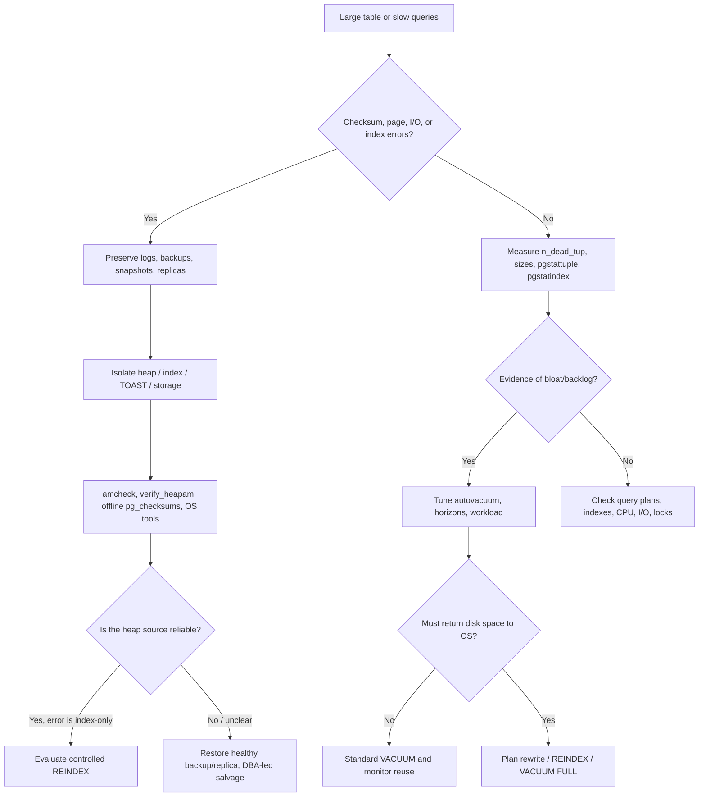

# Integrity Checks and Distinguishing Physical Corruption from Bloat in PostgreSQL

A PostgreSQL database can grow rapidly in size, experience gradually slower queries, and have VACUUM run longer after months of writes, updates, and deletes. Those symptoms often lead operators to immediately suspect **table bloat**. However, a database can also suffer from **physical data corruption** caused by storage, the filesystem, memory, software, or improper operations. Both issues can slow down queries or trigger errors, yet the ways to detect and recover from them are completely different.

VACUUM is a critical maintenance tool in PostgreSQL. It cleans up row versions no longer needed for MVCC, enables space reuse, updates the visibility map, and protects the database from transaction ID wraparound. However, **VACUUM is not a comprehensive physical integrity checker**. A successful VACUUM run does not prove that every heap page, index page, WAL segment, backup, and filesystem is free of errors.

Conversely, a table with many dead tuples, free space, or underutilized index pages does not automatically mean the data is corrupt. It may simply be bloat: the data is still readable and the database remains structurally consistent, but the relation occupies more pages than necessary or suffers from poorer locality.

This lesson belongs to the **VACUUM** chapter of the *Database Engine Relational PostgreSQL* module. We will distinguish the responsibilities of VACUUM from verification tools such as amcheck, pg_amcheck, pg_checksums, and pg_verifybackup; read statistics to identify bloat; investigate I/O/checksum/page errors; and build a safe incident response workflow.

> **Principle:** Use VACUUM for MVCC maintenance and space reuse. Use dedicated integrity tools to verify data structures. When there are signs of corruption, preserve evidence and backups before attempting repairs; never use VACUUM FULL or REINDEX as a cure-all.

## 1. Learning Objectives

After completing this lesson, you will be able to:

1. Explain how dead tuples arise from MVCC and why VACUUM is necessary.
2. Distinguish between standard VACUUM, VACUUM ANALYZE, VACUUM FULL, and autovacuum.
3. Understand free space, the visibility map, freezing, and transaction ID wraparound.
4. Explain table bloat and index bloat without confusing them with corruption.
5. Read `pg_stat_user_tables`, `pg_stat_progress_vacuum`, and relation sizes.
6. Use `pgstattuple`/`pgstattuple_approx` to estimate dead tuples and free space.
7. Use `pgstatindex` to inspect B-tree index density/fragmentation.
8. Understand the limitations of estimated statistics.
9. Recognize signs of page corruption, checksum mismatches, missing relation files, and device errors.
10. Use `amcheck`/`pg_amcheck` to verify index structures.
11. Know when to use `verify_heapam` and the limitations of heap checks.
12. Use `pg_checksums` offline to verify data page checksums.
13. Distinguish between live cluster checks, backup checks, and storage checks.
14. Interpret `VACUUM VERBOSE` output and the progress view.
15. Plan investigation, backup, failover, restore, and reindexing in the proper order.
16. Avoid accidental data loss from dangerous recovery switches.
17. Safely practice simulating bloat, observing VACUUM, and measuring before/after metrics.
18. Build an integrity/bloat monitoring checklist for production.

## 2. Why Does PostgreSQL Need VACUUM?

PostgreSQL uses MVCC (Multi-Version Concurrency Control). When a transaction UPDATEs a row, PostgreSQL typically creates a new tuple version; the old version is not overwritten immediately. When DELETEing, the tuple is marked as deleted according to transaction visibility rules. Those old versions may still be required by running transactions or older snapshots.

Example:

```sql
UPDATE sales.orders
SET status = 'PAID'
WHERE order_id = 1001;

DELETE FROM sales.orders
WHERE order_id = 1002;
```

After these two statements, the heap may contain both the old and new tuple versions of order 1001, the deleted tuple of order 1002, along with unchanged rows. An old tuple can only be reclaimed when no remaining snapshot needs to see it. VACUUM identifies dead tuples that can be reused according to the cluster's visibility horizons.

### 2.1. Dead Tuples Are Not Corruption

A dead tuple is a historically valid MVCC row version that is no longer needed for future snapshots. It is a normal consequence of UPDATE/DELETE operations.

Corruption means data, pages, or structures no longer conform to the expected format or violate PostgreSQL invariants. A dead tuple by itself does not prove corruption.

### 2.2. Why Not Overwrite the Old Row Immediately?

MVCC allows readers and writers to operate concurrently without locking every row for every SELECT. An older transaction may still need to read the version prior to when an UPDATE/DELETE was committed. Retaining multiple versions is part of the concurrency design.

### 2.3. VACUUM Relies on the Visibility Horizon

VACUUM cannot remove tuples that an active transaction or snapshot might still need. Long-running transactions, prepared transactions, replication slots, or standby feedback can hold back the horizon and delay dead tuple reclamation.

### 2.4. Accumulating Dead Tuples Creates Pressure

If vacuum falls behind:
- Heap pages retain many dead versions.
- Indexes may still hold entries pointing to dead versions.
- Sequential scans must read more pages.
- Index scans may have to process more entries.
- Relation size grows and effective cache efficiency drops.
- Transaction ID freezing can be delayed.

## 3. What Does VACUUM Do?

VACUUM typically performs several core tasks:

1. Identify and remove tuple versions that are no longer needed.
2. Clean up corresponding index entries according to the index cleanup strategy.
3. Update the Free Space Map (FSM) so write operations can locate pages with available space.
4. Update the Visibility Map (VM) for eligible pages.
5. Freeze transaction IDs that are old enough to prevent wraparound.
6. Optionally truncate empty pages at the end of the relation to return filesystem space, if conditions and options permit.
7. With `VACUUM ANALYZE`, update planner statistics via `ANALYZE`.

### 3.1. Standard VACUUM Does Not Rewrite the Entire Table

Standard VACUUM operates on the relation in place, cleaning up tuple versions and leaving free space reusable within the relation. It **usually does not shrink the file down to the exact size of live rows alone**.

### 3.2. Reusable Space vs. Space Returned to the OS

Suppose a table is 10 GB; after VACUUM, 3 GB of live tuples remain and 7 GB of free space resides inside pages in the middle of the file. PostgreSQL can reuse that free space for subsequent inserts/updates, yet the filesystem still sees the relation as nearly 10 GB.

If empty pages sit at the very end of the file and can be truncated, VACUUM can return a portion of that space to the OS. There is no guarantee that all free space will be returned.

### 3.3. VACUUM ANALYZE

```sql
VACUUM (VERBOSE, ANALYZE) sales.orders;
```

VACUUM cleans up dead tuples; ANALYZE samples data to update planner statistics. Both are maintenance tasks, but they serve different purposes.

### 3.4. VACUUM FULL

```sql
VACUUM (FULL, VERBOSE, ANALYZE) sales.orders;
```

`VACUUM FULL` rewrites the table into a new file, typically compacting the relation and returning free space to the filesystem once complete. It requires an `ACCESS EXCLUSIVE` lock for an extended duration, needs extra disk space for the rewritten copy, and is unsuitable for routine execution on large OLTP tables.

### 3.5. Autovacuum

Autovacuum consists of background workers that automatically run VACUUM/ANALYZE based on thresholds, per-table settings, and wraparound protection. It is a critical default operational mechanism; never disable it cluster-wide to "avoid slow queries" without an alternative plan.

## 4. VACUUM Is Not a Comprehensive Integrity Checker

This is the central distinction of this lesson.

VACUUM reads heap pages and processes tuple headers and index cleanup. If it encounters certain structural or I/O errors during reading, it may detect and report them. However, VACUUM:

- Does not guarantee reading every page in every run; the visibility map can allow skipping eligible pages.
- Does not verify every invariant of every index the way `amcheck` does.
- Does not verify checksums across the entire cluster offline like `pg_checksums`.
- Does not verify backup archive integrity like `pg_verifybackup`.
- Does not perform comprehensive filesystem/device health checks.
- Does not prove that WAL, replicas, and backups are all recoverable.

A completed `VACUUM VERBOSE` command is not a certificate stating "the database has no corruption."

### 4.1. Page Skipping and the Visibility Map

VACUUM can skip pages marked all-visible/all-frozen in the visibility map when re-checking them is unnecessary under the current strategy. This is a performance optimization.

If visibility map corruption is suspected, PostgreSQL provides the `DISABLE_PAGE_SKIPPING` option to force vacuum to scan pages instead of relying on VM skip behavior. However, this **does not turn VACUUM into a general-purpose integrity verification tool**.

### 4.2. Integrity Tools Have Specific Purposes

| Tool | Primary Purpose |
|---|---|
| VACUUM | MVCC cleanup, free space, freeze |
| ANALYZE | Planner statistics |
| amcheck | Verify index invariants and certain heap checks |
| pg_amcheck | CLI orchestrating `amcheck` checks |
| pg_checksums | Verify data page checksums while the cluster is offline |
| pg_verifybackup | Verify a backup against its manifest/checksums and related WAL |
| pgstattuple | Measure tuple/free-space statistics to investigate bloat |
| OS/storage tools | Filesystem, device, mount, and I/O health |

## 5. What Is Table Bloat?

**Table bloat** is a condition where a heap relation occupies more pages/storage than necessary relative to its current live data, typically due to UPDATE/DELETE churn, page layout, free space distribution, and reusability.

A table may have many dead tuples, substantial free bytes within pages, low page density, growth after repeated updates, empty pages scattered throughout the relation, or a large file despite fewer live rows. This is a storage/scan efficiency issue, not necessarily a physical error.

### 5.1. Common Causes

- Frequent UPDATE/DELETE operations.
- Modifying indexed columns, reducing opportunities for HOT updates.
- Fillfactor mismatched with the update pattern.
- Autovacuum thresholds/scale factors set too high relative to churn rate.
- Long-running transactions preventing dead tuple reclamation.
- Replication slots/standby feedback holding back the xmin horizon.
- Bulk delete workloads lacking a partition retention strategy.
- Index page splits and churn causing index bloat.

### 5.2. Bloat Can Occur Even When VACUUM Succeeds

VACUUM typically marks space as reusable; it does not always rewrite the relation to repack pages. Therefore, a table can remain large after vacuum finishes even though dead tuples have been cleaned up.

### 5.3. Not All Free Space Is Waste

Free space is needed to absorb future inserts/updates, enable HOT updates, reduce page splits, and avoid rewrites. A page with 20% free space may reflect an intentional layout rather than bloat requiring removal.

### 5.4. Bloat Is Workload-Dependent

A large append-only table with some free space may cause minimal harm; a hot index with low page density and heavy random I/O can have a much more noticeable impact. Evaluate using query latency, cache pressure, storage growth, and write churn rather than a single percentage.

## 6. Index Bloat Differs from Table Bloat

Indexes contain entries pointing to heap tuples. When rows are updated or deleted, old index entries can persist until vacuum/index cleanup removes them. B-tree indexes also experience page splits and partially filled pages.

Index bloat can cause the index file to grow larger than necessary, increase the number of pages read, reduce the cache hit ratio, increase index scan/maintenance overhead, and enlarge backups.

### 6.1. VACUUM Can Clean Up Index Entries

VACUUM coordinates with index access methods to remove obsolete entries. However, the index file does not necessarily shrink proportionally.

### 6.2. REINDEX Rebuilds the Index

```sql
REINDEX INDEX sales.orders_customer_idx;
```

REINDEX rebuilds an index from heap data. It can reduce index bloat or resolve index structure corruption provided the heap remains intact and readable.

### 6.3. REINDEX Does Not Fix Heap Corruption

If the heap table itself is corrupt, rebuilding an index may read the corrupted heap data and either fail or produce an index reflecting damaged data. Before running REINDEX, determine the scope of corruption and preserve recovery sources.

### 6.4. Do Not Confuse Index Fragmentation with Corruption

Low index page density or high leaf fragmentation can indicate suboptimal layout. It does not by itself prove B-tree invariants are violated. Use `pgstatindex` to measure structure/density and `amcheck` to verify invariants.

## 7. Distinguishing Bloat from Physical Corruption

| Symptom | Bloat | Physical corruption / I/O failure |
|---|---|---|
| Unusually large table/index | Often present | Possible, but insufficient to conclude |
| Many dead tuples | Often present | Not a characteristic sign |
| Low page density | Possible | Possible, needs more evidence |
| Queries gradually slowing down | Possible | Possible |
| Checksum mismatch | Not bloat | Strong indicator of page damage |
| Invalid page header/line pointer | Not bloat | Sign of structural damage |
| Could not read block / I/O error | Not bloat | Sign of storage/read path issue |
| B-tree parent/child invariant failure | Not bloat | Sign of index corruption |
| VACUUM succeeds | Bloat may still persist | Does not rule out corruption |
| REINDEX reduces size | Possible | Fixes only certain index issues when heap is healthy |
| VACUUM FULL shrinks file | Possible | Not a cure for corruption |

### 7.1. Bloat Is Primarily an Efficiency Issue

Data remains readable and queries return accurate results, though the relation requires more pages. It can be addressed via autovacuum tuning, reducing churn, partitioning, adjusting fillfactor, or planned rewrites/reindexing.

### 7.2. Corruption Is a Correctness/Durability Issue

A page with an invalid checksum, invalid line pointer, broken index tree invariant, or unreadable block can cause queries to fail, lose data, or exhibit undefined behavior if masked.

### 7.3. An I/O Error Alone Does Not Reveal Its Root Cause

It could stem from the storage device, filesystem, controller, network, kernel, memory, cabling, cloud volume, permissions, or external file modification outside PostgreSQL. Collect OS logs and provider events to find the root cause.

### 7.4. Both Issues Can Coexist

A bloated table can also contain a corrupt page. Do not stop investigating corruption merely because `n_dead_tup` is high, and do not run `REINDEX`/`VACUUM FULL` before verifying integrity.

## 8. Preliminary Bloat Inspection with pg_stat_user_tables

```sql
SELECT
    schemaname,
    relname,
    n_live_tup,
    n_dead_tup,
    round(
        100.0 * n_dead_tup
        / NULLIF(n_live_tup + n_dead_tup, 0),
        2
    ) AS estimated_dead_pct,
    last_vacuum,
    last_autovacuum,
    vacuum_count,
    autovacuum_count
FROM pg_stat_user_tables
ORDER BY n_dead_tup DESC
LIMIT 20;
```

### 8.1. n_live_tup and n_dead_tup Are Estimates

These fields come from the statistics subsystem and are not exact tuple counts at query execution time. They are useful for identifying candidates, not absolute proof of table bloat.

### 8.2. Dead Tuple Percentage Does Not Equal Bloat Percentage

For example, one table might have 1 million live rows and 100,000 dead tuples with healthy page layout, while another has 100,000 live rows spread across 10 million pages due to historical churn. Two tables with the same ratio cannot be compared for bloat using that formula alone.

### 8.3. Checking Table Sizes

```sql
SELECT
    schemaname,
    relname,
    pg_size_pretty(
        pg_relation_size(
            format('%I.%I', schemaname, relname)::regclass
        )
    ) AS heap_size,
    pg_size_pretty(
        pg_indexes_size(
            format('%I.%I', schemaname, relname)::regclass
        )
    ) AS indexes_size,
    pg_size_pretty(
        pg_total_relation_size(
            format('%I.%I', schemaname, relname)::regclass
        )
    ) AS total_size
FROM pg_stat_user_tables
ORDER BY pg_total_relation_size(
    format('%I.%I', schemaname, relname)::regclass
) DESC
LIMIT 20;
```

This helps locate large objects. Large size alone is not bloat; compare it against live data volume, growth history, and workload.

## 9. Using pgstattuple to Measure Tuple/Free Space

The `pgstattuple` extension provides physical relation statistics such as `table_len`, `tuple_count`, `tuple_len`, `tuple_percent`, `dead_tuple_count`, `dead_tuple_len`, `dead_tuple_percent`, `free_space`, and `free_percent`.

Install the extension in the database (requires appropriate privileges):

```sql
CREATE EXTENSION IF NOT EXISTS pgstattuple;
```

Measure a table:

```sql
SELECT *
FROM pgstattuple('sales.orders');
```

### 9.1. Exact Measurement Scans the Relation

`pgstattuple` scans the relation to gather statistics, which can incur significant I/O on large tables. Avoid running it continuously on every production table just for a per-minute dashboard.

### 9.2. pgstattuple_approx

```sql
SELECT *
FROM pgstattuple_approx('sales.orders');
```

The approximate function uses the visibility map and free-space information to reduce reads, though some fields are estimates. Use it for screening; if confirmation is needed, schedule a full scan appropriately.

### 9.3. Free Space Is Not Always Reclaimable Bloat

A table needs headroom to absorb future writes. For update-heavy workloads, free space reduces I/O and supports HOT updates. Interpret the percentage alongside the update pattern.

### 9.4. pgstattuple Does Not Check Every Form of Corruption

Its primary goal is tuple/free-space statistics. If it reports a page read error, that is a signal to investigate; if it succeeds, that does not prove indexes, WAL, and the filesystem are all healthy.

## 10. Measuring Indexes with pgstatindex

The `pgstattuple` extension provides `pgstatindex` for B-tree indexes:

```sql
SELECT *
FROM pgstatindex('sales.orders_customer_idx');
```

Returned information typically includes `index_size`, `tree_level`, `index_pages`, `leaf_pages`, `empty_pages`, `deleted_pages`, `avg_leaf_density`, and `leaf_fragmentation`.

### 10.1. Low Density Must Be Interpreted by Workload

B-tree leaf pages do not always need to be 100% full. Fillfactor, concurrent inserts, key distribution, and page splits all affect density.

### 10.2. Fragmentation Does Not Equal Corruption

An index with high fragmentation can still be completely valid. `amcheck` verifies invariants; `pgstatindex` describes layout and density.

### 10.3. Unusually Large Indexes Require Usage Analysis

Combine this with `pg_stat_user_indexes` to inspect scan counts, tuples read/fetched, and query workloads. A bloated, unused index may be a candidate for removal (after dependency analysis), whereas a hot index may justify a scheduled reindex maintenance window.

## 11. Free Space Map and Visibility Map

Two auxiliary structures are frequently confused:

**Free Space Map (FSM):** helps PostgreSQL locate pages with available room for inserts/updates.

**Visibility Map (VM):** tracks pages that are all-visible or all-frozen, enabling index-only scans and allowing VACUUM to skip eligible pages.

### 11.1. The FSM Is Not a List of Every Dead Tuple

The FSM stores estimated free space per page, not an inventory of individual dead tuples. Its data may not be strictly exact at all times; PostgreSQL still checks the page when needed.

### 11.2. The VM Is Not a Checksum

The visibility map is metadata about visibility/frozen state, not proof that page bytes are undamaged. If the VM is incorrect, vacuum or index-only scans can be affected; dedicated tools exist to inspect it.

### 11.3. Inspecting the Visibility Map with pg_visibility

```sql
CREATE EXTENSION IF NOT EXISTS pg_visibility;

SELECT *
FROM pg_visibility_map_summary('sales.orders'::regclass);
```

The summary function reports the count of all-visible and all-frozen pages according to the visibility map. It is not a full heap integrity scan.

### 11.4. Inspecting Free Space with pg_freespacemap

```sql
CREATE EXTENSION IF NOT EXISTS pg_freespacemap;

SELECT *
FROM pg_freespace('sales.orders'::regclass)
ORDER BY avail DESC
LIMIT 20;
```

This data helps understand page-level free space; it should not be used as the sole metric for bloat.

## 12. Reading VACUUM VERBOSE

Example:

```sql
VACUUM (VERBOSE, ANALYZE) sales.orders;
```

`VACUUM VERBOSE` prints details about pages, tuples, index cleanup, and freezing. Exact output format varies by PostgreSQL major version and relation/index access method.

### 12.1. Commonly Observed Details

- Pages scanned/removed.
- Tuples removed/remaining.
- Dead tuples that could not be removed because they are still needed.
- Index scan/cleanup counts.
- Buffer usage and I/O timings when appropriately enabled.
- All-visible/all-frozen pages.
- Relation statistics after vacuum.

### 12.2. Remaining Dead Tuples Are Not Always an Error

Some dead tuples cannot yet be removed due to older snapshots/horizons. Check long-running transactions, replication slots, standby feedback, and prepared transactions before concluding autovacuum is broken.

### 12.3. VACUUM Skipping Pages Does Not Mean Those Pages Were Verified

If the visibility map allows skipping, vacuum may not read those pages during that run. This is why a successful vacuum does not prove all pages are corruption-free.

### 12.4. Read Output Alongside Statistics

Compare `n_dead_tup`, `last_autovacuum`, relation size, `pgstattuple`, and before/after workload. A single verbose output alone is insufficient to pinpoint root cause.

## 13. Monitoring Running VACUUM Operations

```sql
SELECT
    pid,
    relid::regclass AS relation,
    phase,
    heap_blks_total,
    heap_blks_scanned,
    heap_blks_vacuumed,
    index_vacuum_count
FROM pg_stat_progress_vacuum;
```

### 13.1. Phases Change as Progress Advances

Phases can include `scanning heap`, `vacuuming indexes`, `vacuuming heap`, `cleaning up indexes`, `truncating heap`, and `performing final cleanup`. Do not immediately assume a long-running phase is deadlocked; examine wait events, locks, and I/O.

### 13.2. The View Only Reflects Active Operations

Once vacuum finishes, the progress row disappears. To retain historical duration, relation, and outcome data, collect external logs/metrics or use monitoring tools.

### 13.3. Checking Locks and Blockers

```sql
SELECT
    a.pid,
    a.state,
    a.wait_event_type,
    a.wait_event,
    a.query,
    l.locktype,
    l.mode,
    l.granted
FROM pg_stat_activity AS a
LEFT JOIN pg_locks AS l
    ON l.pid = a.pid
WHERE a.query ILIKE '%vacuum%'
ORDER BY a.pid;
```

This simple query aids investigation; identifying blockers requires joining `pg_blocking_pids()` and analyzing the lock graph in context.

## 14. Autovacuum Thresholds

Autovacuum decides when to trigger vacuum/analyze using thresholds and scale factors.

A general formula for dead-tuple-triggered vacuum:

```text
vacuum threshold
  = autovacuum_vacuum_threshold
  + autovacuum_vacuum_scale_factor × estimated table tuples
```

The analyze threshold follows a similar formula using dedicated analyze parameters.

### 14.1. Default Scale Factors Can Be Too High for Very Large Tables

If a table has hundreds of millions of rows, a scale factor of `0.2` allows a huge number of dead tuples to accumulate before triggering vacuum. Per-table tuning may be necessary.

### 14.2. Small Tables and Large Tables Have Different Needs

A small table may need a low absolute threshold; a large table may require a smaller scale factor for more frequent vacuuming. Do not blindly copy the exact same storage parameters across all tables.

### 14.3. Insert-Triggered Vacuum

PostgreSQL provides insert-triggered vacuum parameters to manage freezing and visibility on append-heavy tables. Check `autovacuum_vacuum_insert_threshold` and `autovacuum_vacuum_insert_scale_factor` on your running version.

### 14.4. Tuning Is More Than Just Lowering Thresholds

Autovacuum requires workers, cost limits, I/O budget, and execution time. If you lower thresholds while lacking workers or throttling too aggressively, backlog will continue to grow.

## 15. Long-Running Transactions Holding Dead Tuples

Check long-running transactions:

```sql
SELECT
    pid,
    usename,
    application_name,
    state,
    xact_start,
    now() - xact_start AS xact_age,
    backend_xmin,
    wait_event_type,
    wait_event,
    left(query, 200) AS query_sample
FROM pg_stat_activity
WHERE xact_start IS NOT NULL
ORDER BY xact_start;
```

### 15.1. Idle in Transaction

An `idle in transaction` session can hold a snapshot/horizon open for a long time even without executing queries. Connection pools and applications must manage transaction lifecycles and timeouts.

### 15.2. Replication Slots

```sql
SELECT
    slot_name,
    slot_type,
    active,
    xmin,
    catalog_xmin,
    restart_lsn
FROM pg_replication_slots;
```

Replication slots can hold back `xmin`/`catalog_xmin` or retain WAL depending on slot type and consumer state. Abandoned slots can prevent vacuum from reclaiming tuples or cause `pg_wal` to grow.

### 15.3. Standby Feedback

Hot standby feedback can retain `xmin` on the primary to prevent query conflicts on standbys, at the cost of delaying vacuum cleanup. Balance read availability against bloat and retention.

### 15.4. Prepared Transactions

```sql
SELECT
    gid,
    prepared,
    owner,
    database
FROM pg_prepared_xacts;
```

Orphaned prepared transactions hold resources and horizons. Resolve them through the distributed transaction coordinator or business protocol; never manually `COMMIT`/`ROLLBACK` without verifying the owner.

## 16. Transaction ID Wraparound and Freezing

PostgreSQL uses finite transaction IDs. VACUUM freezes tuples that are old enough so the system never loses the ability to distinguish transaction visibility upon XID wraparound.

### 16.1. Freezing Is a Correctness Requirement, Not Just Bloat Control

A table with few dead tuples still needs vacuuming to freeze old tuples. Therefore, never disable autovacuum solely because a table receives few updates.

### 16.2. Monitoring Age

```sql
SELECT
    datname,
    age(datfrozenxid) AS xid_age,
    current_setting('autovacuum_freeze_max_age') AS freeze_max_age
FROM pg_database
ORDER BY age(datfrozenxid) DESC;
```

This is a database-level indicator; inspect relation-level age and version-specific wraparound settings when warnings appear.

### 16.3. Wraparound Autovacuum Is Protective

PostgreSQL includes anti-wraparound autovacuum and emits critical warnings as age approaches the limit. Do not disable or defer it by raising `autovacuum_freeze_max_age` without understanding the risks.

### 16.4. VACUUM FREEZE

```sql
VACUUM (FREEZE, VERBOSE) sales.orders;
```

`FREEZE` requests more aggressive tuple freezing according to PostgreSQL's rules. Manual runs are generally unnecessary when autovacuum and freeze policies are operating properly.

## 17. Signs of Physical Corruption

Signs requiring immediate investigation:

- Checksum failure when reading a data page.
- Invalid page header or page checksum mismatch.
- Invalid line pointer / tuple header / page item.
- B-tree index parent/child invariant failure.
- Missing relation file or unexpected abnormal file size.
- OS reporting I/O errors, filesystem remounted read-only, or device resets.
- A specific query consistently failing whenever it touches a particular block.
- Backup verification reporting a file/checksum mismatch.
- PostgreSQL logs repeatedly recording block read/write errors.

### 17.1. Not Every ERROR Indicates Corruption

A syntax error, constraint violation, deadlock, out-of-memory condition, or permission denied error does not prove page damage. Read the `SQLSTATE`, error context, and OS logs.

### 17.2. A Checksum Mismatch Is a Serious Event

When data checksums are enabled, a checksum mismatch indicates that the page bytes read from storage do not match the checksum recorded in the page header. Causes can involve storage, memory, filesystem, or software; do not jump to concluding a failed disk without evidence.

### 17.3. Do Not Ignore Repeated Warnings

If a block repeatedly errors across queries, backups, or vacuum runs, halt operations that could worsen the state, preserve logs and snapshots, and assess replicas and backups.

## 18. Data Page Checksums

PostgreSQL can use checksums on data pages to detect certain classes of corruption. Whether checksums are enabled depends on cluster initialization/configuration and version.

Inspect control data with the tool:

```bash
pg_controldata /path/to/PGDATA
```

Look for the field related to data page checksum version in the output for your running version.

### 18.1. Checksums Are Not System-Wide ECC

Checksums detect page corruption when a page is checked, but do not protect everything:
- They do not replace ECC RAM or hardware monitoring.
- They do not validate business data logic.
- They do not guarantee all index invariants.
- They do not verify all backups or replicas.
- They do not repair damaged pages.

### 18.2. Checksums Are Verified When Pages Are Read

With data checksums enabled, PostgreSQL verifies page checksums along relevant read paths. Pages that are never read or scanned may remain unchecked at that time; offline full scans are useful when auditing all data files.

### 18.3. Never Enable ignore_checksum_failure as a Fix

`ignore_checksum_failure` can allow the server to proceed past certain checksum errors during data salvage scenarios, but it risks hiding corruption and returning incorrect data. Only consider it in a controlled recovery/salvage plan led by an experienced DBA after preserving the original files.

## 19. pg_checksums: Offline Verification

`pg_checksums` is a utility for managing data checksums. In `--check` mode, the cluster must be cleanly shut down while the tool checks data files offline.

Example:

```bash
pg_ctl -D /path/to/PGDATA stop -m fast

pg_checksums --check -D /path/to/PGDATA
```

This is an illustrative runbook example. Verify the target instance and `PGDATA` path, and confirm no PostgreSQL processes remain active against the cluster before running an offline checker.

### 19.1. Checksums Can Only Be Verified If Enabled on the Cluster

If the cluster was initialized without checksums, `pg_checksums --check` cannot conclude that pages are fully healthy. Check the checksum version status first.

### 19.2. pg_checksums Does Not Repair Damaged Pages

`--check` reports page checksum mismatches. It cannot deduce valid business contents to reconstruct a page. Recovery requires a backup, replica, or controlled salvage.

### 19.3. --enable/--disable Are Dedicated Offline Operations

Enabling or disabling checksums alters cluster state and requires the server to be stopped; do not treat them as ad-hoc emergency actions in production. Read the manual for your exact major version and back up beforehand.

## 20. amcheck: Verifying Index Structure

The `amcheck` extension provides functions to verify invariants of index access methods, particularly B-trees.

```sql
CREATE EXTENSION IF NOT EXISTS amcheck;

SELECT bt_index_check(
    'sales.orders_customer_idx'::regclass
);
```

### 20.1. bt_index_check

`bt_index_check` verifies B-tree structure according to supported check levels and can run online with less intrusive locking than parent checks. Consult the docs to choose appropriate options.

### 20.2. bt_index_parent_check

```sql
SELECT bt_index_parent_check(
    'sales.orders_customer_idx'::regclass
);
```

Parent check performs additional checks on parent/child relationships within the B-tree and uses stronger locks and higher overhead. Avoid running it indiscriminately across every hot index without assessing workload impact.

### 20.3. heapallindexed

Some checks offer a `heapallindexed` option to verify that heap tuples have corresponding entries in the index. This can consume significant time, memory, and I/O; check the exact signature for your PostgreSQL version before running.

### 20.4. amcheck Does Not Self-Repair

If an index invariant failure is detected, the output is diagnostic. `REINDEX` may resolve it if the underlying heap data is healthy; investigate checksums/I/O and back up first.

## 21. pg_amcheck CLI

`pg_amcheck` is a command-line utility used to execute `amcheck` checks across databases and relations based on supplied options.

General example:

```bash
pg_amcheck --database=app_db --verbose
```

You can scope checks to specific databases, schemas, tables, or indexes using options supported by your tool version. See:

```bash
pg_amcheck --help
```

### 21.1. Check in Small Batches

On large clusters, running checks per database, schema, or relation group helps control runtime, locks, and system load. Record the timestamp, server version, tool version, and checked scope.

### 21.2. Check Privileges

Certain checks require elevated privileges to read relation/metadata internals or execute extension functions. Use a least-privilege role adequate for the task; avoid granting persistent superuser privileges to monitoring services.

### 21.3. Do Not Confuse Exit Codes with a List of Corrupt Rows

The CLI reports check failures at the relation/index level. Identifying invalid business rows requires a separate data validation process.

## 22. verify_heapam and Heap Corruption

In supported versions, `amcheck` provides `verify_heapam` to inspect heap tuple/page structure and report detected issues.

Example invocation pattern:

```sql
SELECT *
FROM verify_heapam(
    'sales.orders'::regclass,
    on_error => 'warning'
);
```

Check the exact signature, parameters, and extension version in your server's documentation before running; available options and output columns depend on the major version.

### 22.1. Heap Checks Differ from Index Checks

- `bt_index_check` checks B-tree structure.
- `verify_heapam` checks heap tuple/page invariants within the function's capabilities.
- `pg_checksums` verifies page checksums.
- No single tool replaces all layers of verification.

### 22.2. Heap Checks Can Be I/O-Intensive

A heap integrity scan reads a large volume of pages. Execute during maintenance windows or in batches on large clusters; monitor read latency and replica lag.

### 22.3. Heap Checks Do Not Repair Tuples

A function reporting errors does not automatically restore tuple values. If a page is corrupt, identify a healthy backup, replica, or snapshot before repairing or salvaging.

## 23. pageinspect: Page-Level Inspection

The `pageinspect` extension provides functions to inspect page headers and certain tuple/index internals.

Example:

```sql
CREATE EXTENSION IF NOT EXISTS pageinspect;

SELECT *
FROM page_header(get_raw_page('sales.orders', 0));
```

`get_raw_page` reads a specific block; `page_header` decodes the header. This is an advanced DBA/debugging tool, not a routine bloat dashboard.

### 23.1. Never Modify Page Bytes Manually

Reading pages with `pageinspect` does not justify direct file editing. Never write bytes back into a relation file using hex editors or OS commands.

### 23.2. One Valid Page Header Does Not Prove the Entire Relation Is Valid

This inspects only a single block. Corruption could exist in another block or in an index, TOAST table, VM, or FSM.

### 23.3. Use the Block Number from the Error Context

If PostgreSQL logs report block N of relation X, `pageinspect` can help inspect that specific block if the page remains readable and permissions allow. Preserve logs and backups first.

## 24. pg_verifybackup Verifies Backups, Not the Live Cluster

`pg_verifybackup` validates a physical backup against its manifest/checksums and associated WAL checks supported by the tool.

```bash
pg_verifybackup /backup/basebackup
```

### 24.1. A Passing Backup Check Does Not Guarantee Restore Success

Verification is valuable, yet you still need actual restore tests—starting the cluster, replaying WAL, and running smoke/integrity checks against the restored instance.

### 24.2. Tablespaces Outside PGDATA

Backups with tablespace mappings/manifests must be verified in full. Do not verify only `PGDATA` while skipping external tablespace directories.

### 24.3. Logical Dumps Require Different Validation

`pg_verifybackup` is not a validator for custom-format logical dumps. Use `pg_restore --list`, test restores, and validate data/schemas following logical backup procedures.

## 25. Checking the OS and Storage Layer

When corruption signs appear, database logs are only one piece of evidence. On Linux, you can inspect:

```bash
df -hT
findmnt
lsblk
iostat -xz 1
dmesg --ctime
```

Key areas to check:
- Kernel I/O errors, timeouts, or resets.
- Filesystem remounted read-only.
- Disk SMART/media errors if exposed by the device.
- RAID controller/cache battery health.
- SAN/NAS/network interruptions.
- Cloud volume health status or IOPS throttling.
- Memory/ECC or host hardware alerts.
- Mount paths and permissions.

### 25.1. Never Run fsck on a Filesystem Mounted Read-Write

Filesystem repair typically requires unmounting or entering rescue mode depending on the filesystem/tool. Follow OS/vendor instructions; never repair a filesystem while PostgreSQL is actively writing to it.

### 25.2. Never Run Destructive Benchmarks on Production

Do not run `fio` write workloads against a device holding live PostgreSQL data during production hours to diagnose issues. Benchmarking requires dedicated targets and planned downtime/backups.

### 25.3. Cloud Metrics May Show Throttling Rather Than Corruption

High latency or IOPS limits can slow queries without causing page corruption. Check provider metrics before concluding device failure.

## 26. Reading PostgreSQL Logs

Look for these message categories:

- `invalid page` / `page verification failed`.
- `checksum verification failed`.
- `could not read block` / `could not write block`.
- `index contains unexpected entry/structure`.
- `unexpected zero page`.
- `could not open file` / `No such file or directory`.
- `No space left on device`.
- `Input/output error`.

### 26.1. Capture Full Context

Record timestamps, PID, database, relation, block number, `SQLSTATE`, query context, server version, and OS device mapping. Do not just copy a single error line without surrounding context.

### 26.2. Mapping a Block Error to a Relation Path

Use catalog OIDs and `pg_relation_filepath` to identify the relation. If the relation is an index, identify its parent heap table; if it is a TOAST relation, locate the parent table.

### 26.3. Logged Statements May Contain Sensitive Data

Broad statement logging can capture literal values or PII. Follow masking, access control, and retention policies.

## 27. Incident Response Workflow for Suspected Corruption

A safe workflow typically includes:

1. **Halt risky changes:** do not run `VACUUM FULL`, mass `REINDEX`, or speculative repair switches.
2. **Preserve evidence:** capture logs, server version, OS events, block/relation identifiers, and timeline.
3. **Preserve originals:** take consistent snapshots/backups; avoid operations that could overwrite unique data.
4. **Assess replicas:** check whether standbys exhibit the same error and whether failover is safe.
5. **Isolate scope:** determine whether the issue involves heap, index, TOAST, data page checksum, WAL, filesystem, or device.
6. **Run targeted checks:** `amcheck`/`verify_heapam`/`pg_checksums` offline according to the maintenance plan.
7. **Restore from a trusted source:** backup/PITR or healthy replica based on RPO/RTO.
8. **Validate post-restore:** application checks, constraints, integrity scans, and query smoke tests.
9. **Fix the root cause:** storage, firmware, kernel, memory, permissions, or software bug.
10. **Monitor for recurrence:** alerts, checksums, backup verification, and failover drills.

### 27.1. If Only an Index Is Corrupt and the Heap Is Healthy

After confirming the heap source reads cleanly, consider running `REINDEX` on the affected index. Where minimizing write blocking is critical, evaluate `REINDEX INDEX CONCURRENTLY` per version and transaction constraints.

### 27.2. If the Heap Is Corrupt

`REINDEX` cannot reconstruct damaged heap data. Prioritize restoring from backup/PITR or a healthy replica. Salvaging readable rows is a last resort requiring strict consistency mapping and accounting for lost rows.

### 27.3. If Storage Errors Are Ongoing

Before running heavy integrity scans or rewrites, resolve the underlying device/filesystem issue or switch to a healthy replica/backup. Heavy writes onto a failing volume risk further data loss.

## 28. Dangerous Recovery Switches

PostgreSQL includes settings that allow operation to continue despite damage, such as `ignore_checksum_failure` and `zero_damaged_pages`. These are not routine repair tools.

### 28.1. ignore_checksum_failure

Can bypass certain checksum errors in exceptional situations, but risks returning unreliable data and masking errors. Use only within a DBA-controlled salvage plan.

### 28.2. zero_damaged_pages

Can replace pages deemed damaged with empty pages during emergency recovery, which means **data on those pages is lost**. Never enable it merely to "make VACUUM finish."

### 28.3. Turning Off Checks Does Not Fix Corruption

Disabling detection does not restore original bytes. It only changes how the server reacts to error evidence and can widen data loss.

## 29. VACUUM, REINDEX, and VACUUM FULL: Choosing the Right Tool

| Goal | Tool | Primary Impact |
|---|---|---|
| Clean dead tuples, reuse space | VACUUM | Keeps relation file mostly in place |
| Update planner stats | ANALYZE | Collects statistics |
| Compact heap and reclaim disk | VACUUM FULL | Rewrites table, strong lock |
| Rebuild index | REINDEX | Rewrites index |
| Verify B-tree invariants | amcheck | Reads/checks structure |
| Measure tuple/free space | pgstattuple | Scans and gathers metrics |
| Verify offline page checksums | pg_checksums | Verifies data files |
| Verify physical backup | pg_verifybackup | Verifies backup manifest/data |

### 29.1. When Bloat Is the Issue

- Tune autovacuum and transaction horizons.
- Reduce update churn or adjust the data model.
- Choose `fillfactor` suited to the workload.
- Use partitioning/retention.
- Run standard VACUUM regularly.
- Use REINDEX or table rewrite when bloat is proven and a maintenance window is available.

### 29.2. When Corruption Is the Issue

- Preserve data and logs.
- Use integrity tools to isolate the scope.
- Address storage/root cause.
- Restore from a known-good backup or healthy replica.
- Run REINDEX only when the heap source is trusted and the fault is isolated to the index.

### 29.3. Never Use VACUUM FULL to "Fix Page Errors"

`VACUUM FULL` reads and rewrites the relation. If a heap page is corrupt, rewriting can fail or propagate damaged data into the new relation. It is not an integrity repair utility.

## 30. Impact of VACUUM FULL

`VACUUM FULL`:
- Requires an `ACCESS EXCLUSIVE` lock.
- Creates a new rewritten copy, requiring free disk space.
- Can generate heavy I/O load.
- Changes the physical file identity/`relfilenode`.
- Can impact replication/WAL volume and backup windows.

### 30.1. Plan Disk Capacity

You need more than just the reclaimed bloat margin. During rewrite, space is required for the new relation plus index, temporary, and WAL overhead. Check free space on both the target tablespace filesystem and `pg_wal`.

### 30.2. Plan Locking

Long-running queries on a large table can block `VACUUM FULL` while it waits for its lock; once acquired, subsequent incoming queries queue behind it. Monitor the lock queue and application latency.

### 30.3. Online Alternatives

Extensions like `pg_repack` allow certain rewrites with shorter blocking windows through dedicated mechanisms, but as non-core extensions they require checking version compatibility, locks, privileges, and disk space. Never treat them as risk-free.

## 31. Bloat and Per-Table Autovacuum Tuning

Inspect table options:

```sql
SELECT
    n.nspname,
    c.relname,
    c.reloptions
FROM pg_class AS c
JOIN pg_namespace AS n
    ON n.oid = c.relnamespace
WHERE c.relkind IN ('r', 'm')
  AND c.reloptions IS NOT NULL
ORDER BY n.nspname, c.relname;
```

You can set storage parameters:

```sql
ALTER TABLE sales.orders SET (
    autovacuum_vacuum_scale_factor = 0.02,
    autovacuum_vacuum_threshold = 5000,
    autovacuum_analyze_scale_factor = 0.01,
    fillfactor = 85
);
```

This is an illustrative example. Proper values must reflect row count, churn rate, write latency, HOT ratio, and autovacuum throughput.

### 31.1. Fillfactor Is Not a Bloat Percentage

A `fillfactor` of 85 reserves headroom in pages upon table creation or rewrite; it does not mean 15% of data is dead. It supports update-heavy workloads.

### 31.2. Changing Fillfactor Does Not Immediately Rewrite the Table

Updating a storage parameter does not automatically compact existing pages. Full effects generally appear as new pages are populated/rewritten or as updates consume free space appropriately.

### 31.3. Tune Hot Tables Differently from Cold Tables

An insert-only table, an update-heavy table, and a rarely modified archive table have distinct profiles. Per-table settings can make sense, though they add operational complexity; document the rationale and monitor outcomes.

## 32. HOT Updates and Bloat

Heap-Only Tuple (HOT) updates avoid creating new index entries when eligible—specifically when indexed columns are unchanged and sufficient free space exists on the page.

### 32.1. Why Does HOT Help?

Fewer new index entries reduce index churn and vacuum/reindex costs. It also avoids updating every index whenever non-indexed columns change.

### 32.2. What Reduces the HOT Ratio?

- Updating indexed columns.
- Insufficient free space on the page.
- Index/expression/predicate dependencies affecting HOT eligibility.
- Workloads modifying numerous indexed columns.

### 32.3. Inspecting HOT Statistics

```sql
SELECT
    relname,
    n_tup_upd,
    n_tup_hot_upd,
    round(
        100.0 * n_tup_hot_upd / NULLIF(n_tup_upd, 0),
        2
    ) AS hot_update_pct
FROM pg_stat_user_tables
ORDER BY n_tup_upd DESC;
```

These are cumulative statistics; measure over time intervals or reset counters appropriately when analyzing.

## 33. Long-Running Queries and Vacuum Lag

An open `SELECT` transaction held open for a long time keeps a snapshot alive. Even after returning most results, an uncommitted transaction can keep dead tuples necessary.

### 33.1. Checking the xmin Horizon

```sql
SELECT
    pid,
    usename,
    application_name,
    state,
    xact_start,
    backend_xmin,
    age(backend_xmin) AS xmin_age,
    left(query, 160) AS query_sample
FROM pg_stat_activity
WHERE backend_xmin IS NOT NULL
ORDER BY age(backend_xmin) DESC;
```

### 33.2. Replication Slots

```sql
SELECT
    slot_name,
    slot_type,
    active,
    xmin,
    catalog_xmin,
    restart_lsn
FROM pg_replication_slots;
```

### 33.3. Prepared Transactions

```sql
SELECT
    gid,
    prepared,
    owner,
    database
FROM pg_prepared_xacts;
```

Old `xmin`/transaction horizon holders delay cleanup. Never drop a replication slot or resolve a prepared transaction arbitrarily; verify the consumer/coordinator and impact first.

## 34. Autovacuum Statistics and Logs

```sql
SELECT
    schemaname,
    relname,
    n_dead_tup,
    last_autovacuum,
    autovacuum_count,
    last_autoanalyze,
    autoanalyze_count
FROM pg_stat_user_tables
ORDER BY n_dead_tup DESC;
```

Enable `log_autovacuum_min_duration` per policy to log slow or notable autovacuum runs. Configure `log_checkpoints` and appropriate I/O timing tracking when investigating storage; factor in log volume.

### 34.1. A Table Without last_autovacuum Can Still Be Healthy

Low-churn or small tables may not have crossed thresholds. Do not treat a `NULL` timestamp as proof that autovacuum is inactive.

### 34.2. autovacuum_count Is Not a Health Score

A high count can be normal for a hot table; a low count may reflect a cold table or blocked vacuum runs. Analyze alongside dead tuple trends, transaction horizons, sizes, and durations.

## 35. Measuring Effectiveness After VACUUM

Before and after maintenance, capture:
- Relation heap/index/total size.
- `n_dead_tup` estimate.
- `pgstattuple` dead/free percentages when appropriate.
- HOT update ratio.
- Query plans, buffers, and latency.
- Autovacuum duration and progress.
- Filesystem free space.
- WAL generation and replica lag.

### 35.1. Do Not Always Expect pg_relation_size to Shrink

Standard VACUUM cleans and reuses space internally. File size may stay unchanged if free pages lie in the middle of the relation.

### 35.2. Do Not Look Only at Table Size

Indexes and TOAST can account for the majority of space. `pg_total_relation_size` and `pg_indexes_size` show the complete footprint.

### 35.3. Query Latency Depends on Workload

Cache warming, concurrency, query plans, and data distribution can shift before/after timings. Benchmark repeatedly under controlled conditions and inspect `BUFFERS`.

## 36. Checking Index-Only Scans and the Visibility Map

The visibility map marks pages all-visible so index-only scans can avoid heap fetches when visibility conditions permit.

Inspect the query plan:

```sql
EXPLAIN (ANALYZE, BUFFERS)
SELECT customer_id, created_at
FROM sales.orders
WHERE customer_id = 42;
```

If the plan uses an Index Only Scan, check `Heap Fetches` in `EXPLAIN ANALYZE`. Many heap fetches can indicate pages are not yet all-visible, though this alone does not prove corruption or bloat.

### 36.1. VACUUM Increases All-Visible Coverage

When no dead tuples remain and visibility conditions allow, vacuum marks pages all-visible. This improves index-only scan efficiency.

### 36.2. Updating a Page Clears All-Visible

A new write on a page clears its all-visible bit; autovacuum must re-run to re-establish visibility. This is normal behavior.

### 36.3. VM Corruption Is a Distinct Integrity Issue

If VM inconsistency is suspected, consult `pg_visibility` and version-specific repair procedures in the documentation. Do not run `ANALYZE` expecting it to repair the visibility map.

## 37. Lab: Creating an Update/Delete Table to Simulate Bloat

Run only on a test database:

```sql
CREATE SCHEMA IF NOT EXISTS vacuum_lab;

CREATE TABLE vacuum_lab.events (
    event_id BIGINT PRIMARY KEY,
    tenant_id INTEGER NOT NULL,
    status TEXT NOT NULL,
    payload TEXT NOT NULL,
    updated_at TIMESTAMPTZ NOT NULL DEFAULT now()
) WITH (fillfactor = 100);

INSERT INTO vacuum_lab.events (
    event_id, tenant_id, status, payload
)
SELECT
    g,
    g % 100,
    'NEW',
    repeat('x', 500)
FROM generate_series(1, 50000) AS g;

CREATE INDEX events_tenant_status_idx
ON vacuum_lab.events (tenant_id, status);
```

### 37.1. Check Initial Sizes

```sql
SELECT
    pg_size_pretty(pg_relation_size('vacuum_lab.events'))
        AS heap_size,
    pg_size_pretty(pg_indexes_size('vacuum_lab.events'))
        AS indexes_size,
    pg_size_pretty(pg_total_relation_size('vacuum_lab.events'))
        AS total_size;
```

### 37.2. Generate Churn

```sql
UPDATE vacuum_lab.events
SET status = CASE
        WHEN event_id % 2 = 0 THEN 'PAID'
        ELSE 'PENDING'
    END,
    payload = repeat('y', 700),
    updated_at = clock_timestamp()
WHERE event_id <= 30000;

DELETE FROM vacuum_lab.events
WHERE event_id > 40000;
```

The updates alter an indexed column (`status`), generating index churn; `payload` also changes size. The deletes produce dead tuples.

### 37.3. Inspect Statistics

```sql
SELECT
    relname,
    n_live_tup,
    n_dead_tup,
    n_tup_upd,
    n_tup_hot_upd,
    last_autovacuum
FROM pg_stat_user_tables
WHERE schemaname = 'vacuum_lab';
```

Statistics updates may lag; if needed, run `ANALYZE` and allow statistics collection/transaction semantics to catch up.

### 37.4. Measure with pgstattuple

```sql
CREATE EXTENSION IF NOT EXISTS pgstattuple;

SELECT *
FROM pgstattuple('vacuum_lab.events');
```

### 37.5. Run Standard VACUUM

```sql
VACUUM (VERBOSE) vacuum_lab.events;
```

Then re-run `pgstattuple` and compare dead tuples and free space. The heap file size may stay nearly unchanged; the free space is now available for future inserts/updates.

### 37.6. Insert Again to Observe Reuse

```sql
INSERT INTO vacuum_lab.events (
    event_id, tenant_id, status, payload
)
SELECT
    50000 + g,
    g % 100,
    'NEW',
    repeat('z', 500)
FROM generate_series(1, 10000) AS g;
```

File size does not necessarily grow proportionally because PostgreSQL can reuse the reclaimed free space.

## 38. Lab: Comparing VACUUM vs. VACUUM FULL

Before testing, record baseline sizes:

```sql
SELECT
    pg_relation_size('vacuum_lab.events') AS heap_bytes,
    pg_total_relation_size('vacuum_lab.events') AS total_bytes;
```

Standard VACUUM:

```sql
VACUUM (VERBOSE) vacuum_lab.events;
```

Run `VACUUM FULL` only in the lab, outside a transaction block:

```sql
VACUUM (FULL, VERBOSE) vacuum_lab.events;
```

### 38.1. Compare Results

After `VACUUM FULL`, the heap file is typically significantly smaller if scattered free space could not be truncated by standard vacuum. Exact results depend on data, page layout, and indexes.

### 38.2. Do Not Test This in Production "Just to See What Happens"

`VACUUM FULL` requires strong locks, rewrites the table, and consumes extra disk space. Benchmark only in environments with backups, capacity, and a maintenance window.

### 38.3. Not a Corruption Test

This lab only simulates bloat and free space. Do not corrupt relation files, edit page bytes, or enable recovery switches.

## 39. Lab: Verifying Indexes with amcheck

On a lab database with the extension supported:

```sql
CREATE EXTENSION IF NOT EXISTS amcheck;

SELECT bt_index_check(
    'vacuum_lab.events_tenant_status_idx'::regclass
);
```

### 39.1. No Rows/Errors Returned

The function may return void without errors when the check passes. This only confirms that the invoked checks found no invariant violations within the scope of the function and options.

### 39.2. Running pg_amcheck

From a shell using matching client tool versions:

```bash
pg_amcheck --database=app_db --verbose
```

Review `pg_amcheck --help` and version-specific docs to restrict scope and select options. Never run full-cluster checks during peak hours without measuring load.

## 40. Lab: Inspecting Page Headers with pageinspect

In the lab:

```sql
CREATE EXTENSION IF NOT EXISTS pageinspect;

SELECT *
FROM page_header(
    get_raw_page('vacuum_lab.events', 0)
);
```

### 40.1. Interpreting Output

The page header exposes fields such as lower/upper/special offsets, flags, and page LSN depending on version. These values assist in page layout debugging.

### 40.2. Do Not Assume Corruption from an Unfamiliar Number

Page layout depends on page type, version, and object type. Consult `pageinspect` docs for the exact type; do not draw conclusions from a single isolated field.

## 41. Lab: Checksum and Backup Verification

Do not run offline checksum scans on an active production cluster. In a dedicated test cluster initialized with data checksums (or enabled via supported offline procedure), generate data, shut down cleanly, and run:

```bash
pg_checksums --check -D /path/to/lab/PGDATA
```

To verify a backup created with manifest support:

```bash
pg_verifybackup /path/to/lab/basebackup
```

### 41.1. Never Simulate Corruption by Editing Real Files

Do not open a relation file and alter a byte to observe server behavior on a shared cluster. To test failure detection, use a disposable test harness/cluster under DBA-controlled procedures.

### 41.2. Checksum Success Has a Specific Scope

It proves checked page checksums did not mismatch at scan time; it does not validate business values or all index invariants.

## 42. When Should You Run REINDEX?

Use `REINDEX` when there is evidence of:
- Significant index bloat requiring compaction.
- Index structure corruption detected by `amcheck` while the heap source remains trusted.
- Rebuilds required after configuration or collation/version changes.
- A damaged index file when underlying table data reads cleanly.

Example:

```sql
REINDEX INDEX sales.orders_customer_idx;
```

### 42.1. REINDEX TABLE

```sql
REINDEX TABLE sales.orders;
```

Rebuilds all indexes on the table. Assess disk capacity, locking, active transactions, WAL volume, and replication impact.

### 42.2. REINDEX CONCURRENTLY

```sql
REINDEX INDEX CONCURRENTLY sales.orders_customer_idx;
```

The concurrent form minimizes write blocking via a multi-phase build, but carries extra overhead, phases, and transaction restrictions. Check docs for your version; it does not apply in all situations (e.g., certain system catalog cases).

### 42.3. Do Not Reindex All Indexes on a Rigid Schedule

Measure index size/density, query usage, and maintenance cost. Unnecessary reindexing wastes I/O, WAL, locks, and backup capacity.

## 43. Index Bloat Does Not Mean Every Index Needs Rebuilding

`pgstatindex` reports density and fragmentation. Combine it with:
- Index size compared to live table size.
- `idx_scan`, `idx_tup_read`, `idx_tup_fetch`.
- Query plans.
- Update/delete churn.
- B-tree key distribution.
- Fillfactor and page split patterns.

A large, hot, efficient index may simply reflect valid design. A large unused index may be an optimization candidate; examine write overhead and business query patterns.

## 44. Table Rewrite and Alternative Options

| Approach | When Suitable | Risks / Impact |
|---|---|---|
| Standard VACUUM | Dead tuple cleanup, space reuse | Does not compact entire relation |
| VACUUM FULL | Heavy heap compaction needed | ACCESS EXCLUSIVE, rewrite, extra space |
| CLUSTER | Want physical ordering by an index | Rewrite, strong lock, order not maintained afterward |
| pg_repack | Rewrite with shorter blocking via extension | Extension/trigger/log/space requirements |
| Partition drop/detach | Partition-based retention | Only applicable to partitioned models |
| REINDEX | Index bloat/corruption with healthy heap | Index rebuild, I/O/WAL/locks |

### 44.1. Partition Retention Is Usually Cheaper Than Deleting Millions of Rows

When historical data aligns with time-based partition boundaries, detaching or dropping a partition reclaims storage far faster than a massive `DELETE` + `VACUUM`. Check foreign keys, dependencies, replication, and backup policies.

### 44.2. CLUSTER Does Not Preserve Order Long-Term

After `CLUSTER`, new writes follow normal workload patterns; physical index ordering is not maintained permanently. Re-clustering incurs another full rewrite cost.

### 44.3. pg_repack Is a Non-Core Extension

Verify compatibility, version, privileges, trigger/replication behavior, and free disk space. Do not treat it as a trivial drop-in replacement for `VACUUM`.

## 45. Physical Corruption and Backup Strategy

A solid integrity strategy relies on multiple layers:

1. Data page checksums enabled where appropriate.
2. Regular physical and logical backups.
3. WAL archiving and PITR.
4. Backup verification.
5. Restore drills.
6. Healthy standbys and failover readiness.
7. OS/storage health monitoring.
8. Scoped/risk-based `amcheck`/heap checks.
9. Alerting on checksum, I/O, and page errors.
10. Clear runbooks and ownership.

### 45.1. Backups Do Not Replace Replicas

Backups provide point-in-time recovery; standbys provide high availability. Logical errors replicate to standbys, whereas PITR backups allow rolling back prior to damage if WAL retention is sufficient.

### 45.2. Replicas Do Not Replace Backups

If corruption predated the base backup or replicated via WAL, standbys can carry the same defect. Maintain historical backups and independent verification.

### 45.3. Only Restore Drills Prove Recoverability

Test restoring into an isolated environment, starting PostgreSQL, replaying WAL, reading data, and running integrity checks. Measure elapsed time and dependencies against RTO/RPO.

## 46. Distinguishing Index vs. Heap Errors

When a query reports a relation-related error:
- Identify the relation OID, name, and file path.
- Determine whether the relation is a table, index, TOAST table, or system object.
- Run appropriate verification checks.
- Confirm whether the heap source reads cleanly.
- Cross-check against replicas and backups.

### 46.1. Index Corruption

May break queries utilizing that index while a sequential scan can still read the heap cleanly if the heap is intact. This is an investigative clue, not complete proof.

### 46.2. Heap Corruption

Can break any access path touching the damaged block. An index-only scan may occasionally bypass heap fetches for all-visible pages, causing different queries to behave differently. Never treat one succeeding query as proof the heap is healthy.

### 46.3. TOAST Corruption

Large values may live in TOAST relations. Queries omitting large payload columns may never touch TOAST pages until those columns are accessed. Integrity checks must account for TOAST.

## 47. VACUUM and TOAST

VACUUM processes associated TOAST relations alongside tables according to PostgreSQL rules. Tables storing large payloads can accumulate substantial TOAST storage.

Check total size:

```sql
SELECT
    pg_size_pretty(pg_relation_size('sales.documents'))
        AS heap,
    pg_size_pretty(pg_total_relation_size('sales.documents'))
        AS total;
```

### 47.1. A Small Heap Does Not Mean a Small Table

A table with large JSONB or text columns may store most of its bytes in TOAST. Inspect `pg_total_relation_size`.

### 47.2. TOAST Corruption Can Surface When Materializing Values

A row with a valid main heap tuple header but missing/damaged external TOAST chunks may fail only when large values are materialized. Preserve error context and inspect the associated TOAST relation.

## 48. Page Skipping and DISABLE_PAGE_SKIPPING

```sql
VACUUM (
    VERBOSE,
    DISABLE_PAGE_SKIPPING
) sales.orders;
```

This option forces vacuum not to skip pages based on the visibility map under normal skipping logic; documentation primarily recommends it when visibility map corruption is suspected.

### 48.1. Cost

It can read many more pages, increasing I/O and affecting workload latency. Do not enable it routinely on all tables.

### 48.2. Not a Substitute for amcheck/pg_checksums

Even with page skipping disabled, VACUUM still focuses on MVCC cleanup/freezing and retains its own limitations. Use proper integrity tools for indexes, checksums, and heap checks.

### 48.3. Visibility Map Repair

If VM inconsistency is confirmed, consult `pg_visibility` documentation and version-appropriate remediation procedures. Never manually edit bytes inside VM files.

## 49. VACUUM and Tail Truncation

VACUUM can truncate empty pages at the end of a heap relation to return space to the filesystem if the `TRUNCATE` option is enabled and the required lock can be acquired.

```sql
VACUUM (VERBOSE, TRUNCATE true) sales.orders;
```

Truncation can also be disabled:

```sql
VACUUM (TRUNCATE false, VERBOSE) sales.orders;
```

### 49.1. Truncation Does Not Compact Interior Holes

If empty pages are scattered inside the relation, they are marked for reuse; interior pages cannot simply be removed while preserving contiguous block numbering.

### 49.2. Truncation Briefly Requires a Strong Lock

If the required lock cannot be obtained, VACUUM skips truncation while completing its other cleanup tasks. Check logs and verbose output.

### 49.3. Do Not Confuse TRUNCATE Option with VACUUM FULL

`TRUNCATE true` merely trims trailing empty pages; `VACUUM FULL` rewrites the entire relation with far greater impact.

## 50. Checking Page Checksums and Data Checksum Version

A cluster may be initialized with data checksums. Check via:

```bash
pg_controldata /path/to/PGDATA
```

Look for the field indicating data page checksum version in the output for your version.

### 50.1. Checksum Detection Depends on Pages Being Checked

A checksum mismatch surfaces when a page is read or scanned by an offline checker. Absence of errors in logs does not prove every block was recently verified.

### 50.2. Checksum Mismatches Do Not Point to a Single Cause

They can arise from memory, storage, filesystem, controllers, software bugs, or external manipulation. Correlate with hardware/OS logs and replicas/backups.

## 51. pg_checksums and Maintenance Windows

General workflow:
1. Identify the exact cluster and `PGDATA`.
2. Confirm whether data checksums are enabled.
3. Schedule a maintenance window.
4. Cleanly shut down PostgreSQL.
5. Run `pg_checksums --check`.
6. Capture output and exit code.
7. On mismatch, do not attempt ad-hoc repairs; escalate to the incident procedure.
8. Restart only after verifying cluster state and receiving DBA approval.

Never run `pg_checksums --check` against a `PGDATA` currently in use by a running server.

## 52. Separate Dashboards for Bloat Monitoring and Integrity Monitoring

**Bloat dashboard:**
- `n_dead_tup` trends.
- `pgstattuple` dead/free percentages.
- Relation size growth.
- Index density.
- Autovacuum duration/backlog.
- Long-running transactions/`xmin` horizon.
- Query latency and buffer metrics.

**Integrity dashboard:**
- Checksum errors.
- PostgreSQL invalid-page/index errors.
- `amcheck`/`pg_amcheck` results.
- Backup verification status.
- Restore drill status.
- OS I/O, media, and filesystem errors.
- Replica consistency/lag.
- Storage health alerts.

### 52.1. Do Not Group Everything Under One "Database Unhealthy" Status

Bloat requires maintenance planning; corruption requires incident response and recovery. Separating severity and ownership ensures proper reaction.

### 52.2. Trends Matter More Than Single Snapshots

Continuously rising dead tuple counts are more meaningful than a brief spike after a bulk update. Even a single checksum mismatch warrants serious investigation.

## 53. SQL Inventory: Relation Sizes and Dead Tuples

```sql
SELECT
    s.schemaname,
    s.relname,
    s.n_live_tup,
    s.n_dead_tup,
    pg_relation_size(
        format('%I.%I', s.schemaname, s.relname)::regclass
    ) AS heap_bytes,
    pg_indexes_size(
        format('%I.%I', s.schemaname, s.relname)::regclass
    ) AS index_bytes,
    pg_total_relation_size(
        format('%I.%I', s.schemaname, s.relname)::regclass
    ) AS total_bytes,
    s.last_autovacuum
FROM pg_stat_user_tables AS s
ORDER BY total_bytes DESC
LIMIT 30;
```

### 53.1. Be Careful with Partitioned Parents

Partitioned parent tables may not hold direct heap storage like leaf tables; inventory queries must account for `relkind` and handle partitions accurately to avoid misleading totals.

### 53.2. Do Not Blindly Sum Parents and Leaves

Depending on catalog/statistics queries, summing parent and leaf relations can double-count sizes. Define scope clearly.

## 54. Inspecting Index Usage

```sql
SELECT
    s.schemaname,
    s.relname AS table_name,
    s.indexrelname AS index_name,
    s.idx_scan,
    s.idx_tup_read,
    s.idx_tup_fetch,
    pg_size_pretty(pg_relation_size(s.indexrelid))
        AS index_size
FROM pg_stat_user_indexes AS s
ORDER BY pg_relation_size(s.indexrelid) DESC
LIMIT 30;
```

### 54.1. Low idx_scan Alone Is Not Sufficient to Drop an Index

Statistics may have been reset, queries may be seasonal, or the index may enforce constraints. Check uniqueness, foreign key dependencies, and observe across a sufficient retention window.

### 54.2. Combine Index Bloat and Usage Analysis

A large index with heavy scan activity is likely vital; a large unused index is an optimization candidate. Evaluate write overhead and business query patterns.

## 55. Tool Comparison Table

| Tool | What Data Does It Read? | What Does It Detect? | Does It Repair? |
|---|---|---|---|
| VACUUM | Heap and indexes during cleanup | Dead tuples/cleanup conditions; some read errors | MVCC cleanup, not general corruption repair |
| ANALYZE | Sampled rows | Planner statistics | Updates stats |
| pgstattuple | Relation pages | Live/dead/free-space metrics | No |
| pgstatindex | B-tree pages | Density/fragmentation/layout | No |
| amcheck | Index/heap structures per function | Invariant violations | No |
| pg_checksums | Offline data files | Page checksum mismatches | No |
| pg_verifybackup | Backup files/manifest | Backup integrity mismatches | No |
| pageinspect | Page bytes/structures | Debugging details | No |
| REINDEX | Heap to rebuild index | Builds new index; resolves index corruption if heap is healthy | Rebuilds index |
| VACUUM FULL | Heap rewrite | Compaction/rewrite | Not corruption repair |

## 56. Common Diagnostic Mistakes

### 56.1. "VACUUM Finished, Size Did Not Shrink, So Vacuum Failed"

Incorrect. Standard VACUUM reuses space internally within the relation. If free pages are scattered mid-file, size stays the same. Aggressive shrinking requires a rewrite strategy after confirming bloat and budgeting locks/disk space.

### 56.2. "High Dead Tuples Mean Corruption"

Incorrect. Dead tuples are normal MVCC row versions. Investigate autovacuum settings, transaction horizons, and workload.

### 56.3. "REINDEX Succeeded, So Database Integrity Is Good"

Incorrect. REINDEX only rebuilds indexes; it does not check all heap, TOAST, WAL, or filesystem layers and cannot cure heap corruption.

### 56.4. "pg_checksums Reported No Errors, So Everything Is Valid"

Incorrect. It only checks data page checksums within the scanned scope when checksums are enabled. It validates neither business logic nor all index invariants.

### 56.5. "The Query Ran Fine, So the Table Isn't Corrupt"

Incorrect. The query may not have touched the damaged block, accessed the affected TOAST value, or performed heap fetches due to an index-only scan. Targeted integrity checks are needed.

### 56.6. "Enabling zero_damaged_pages Is a Repair"

Incorrect. It sacrifices page contents so the server can continue during salvage operations. It never recovers original bytes.

## 57. Tool Selection Flowchart



## 58. Exercise 1 — Dead Tuples

**Prompt:** Updating a row creates an old version. Is the old version corruption?

**Answer:** No. It is a normal MVCC row version. Once no remaining snapshot needs it, VACUUM can clean it up for space reuse.

## 59. Exercise 2 — Size Doesn't Shrink After VACUUM

**Prompt:** Dead tuples decreased, yet `pg_relation_size` stayed the same.

**Answer:** Normal if free pages sit in the middle of the relation. Standard VACUUM prioritizes space reuse; it only truncates trailing empty pages when eligible.

## 60. Exercise 3 — VACUUM FULL

**Prompt:** To shrink a table, can you run `VACUUM FULL` inside a transaction block?

**Answer:** VACUUM commands cannot run inside a transaction block. `VACUUM FULL` rewrites the table and requires an `ACCESS EXCLUSIVE` lock plus extra disk space.

## 61. Exercise 4 — Does VACUUM Check Every Page?

**Prompt:** Does a successful VACUUM prove there is no page corruption?

**Answer:** No. The visibility map allows skipping pages, and VACUUM is not a full integrity checker.

## 62. Exercise 5 — DISABLE_PAGE_SKIPPING

**Prompt:** Visibility map corruption is suspected; which option forces vacuum to scan pages?

**Answer:** `VACUUM` with `DISABLE_PAGE_SKIPPING` per the docs; this does not replace `amcheck`/checksum tools and increases I/O.

## 63. Exercise 6 — n_dead_tup

**Prompt:** Does `n_dead_tup = 100000` mean there are exactly 100,000 dead tuples at query time?

**Answer:** No. It is an estimated statistic useful for screening and trend tracking.

## 64. Exercise 7 — pgstattuple

**Prompt:** You want to measure live, dead, and free bytes of a table.

**Answer:** Use `pgstattuple` for a full scan, or `pgstattuple_approx` for lower-cost estimation under supported conditions.

## 65. Exercise 8 — pgstatindex

**Prompt:** A B-tree shows low `avg_leaf_density`. Is the index definitely corrupt?

**Answer:** No. That reflects page density/layout; use `amcheck` to check structural invariants.

## 66. Exercise 9 — Index Corruption

**Prompt:** `amcheck` detects an index invariant failure, and the heap is confirmed readable.

**Answer:** Preserve logs/backups and evaluate `REINDEX` for the affected index. `REINDEX` does not replace investigating underlying storage root causes.

## 67. Exercise 10 — Heap Corruption

**Prompt:** A heap page checksum is invalid. Will `REINDEX TABLE` fix it?

**Answer:** Unreliable and unsafe. `REINDEX` reads from the heap; prioritize backup/PITR or a healthy replica. Salvage is a last resort.

## 68. Exercise 11 — pg_checksums

**Prompt:** Run `pg_checksums --check` while the server is online.

**Answer:** No. The utility requires a cleanly shut down cluster for offline verification.

## 69. Exercise 12 — Checksums Disabled

**Prompt:** `pg_checksums` reports that data checksums are not enabled on the cluster. Can we conclude there is no corruption?

**Answer:** No. It only means offline checksum verification has no enabled checksums to verify; rely on other integrity tools and backup/restore checks.

## 70. Exercise 13 — pg_verifybackup

**Prompt:** Does a successful `pg_verifybackup` prove the live primary has no corruption?

**Answer:** No. It checks the backup against its manifest/checksums and related WAL, not the live running cluster.

## 71. Exercise 14 — Visibility Map

**Prompt:** An index-only scan shows heap fetches. Does that mean the visibility map is corrupt?

**Answer:** No. Pages not yet marked all-visible due to recent writes are normal; vacuum updates them when eligible.

## 72. Exercise 15 — Long-Running Transactions

**Prompt:** Dead tuples remain uncleaned despite autovacuum running.

**Answer:** Check old snapshots, `idle in transaction` sessions, replication slots, standby feedback, and prepared transactions.

## 73. Exercise 16 — Wraparound

**Prompt:** A table has very few UPDATEs, so autovacuum can be disabled completely?

**Answer:** No. Freezing/anti-wraparound vacuum is still required to manage transaction IDs.

## 74. Exercise 17 — REINDEX

**Prompt:** Does `REINDEX` shrink both the index and the table simultaneously?

**Answer:** It rebuilds the index; heap table size is not compacted simply by running `REINDEX`.

## 75. Exercise 18 — VACUUM FULL and Corruption

**Prompt:** A query reports an invalid heap page, so you run `VACUUM FULL` to fix it.

**Answer:** No. `VACUUM FULL` rewrites from the heap and can fail or copy damaged data; preserve evidence and restore/diagnose properly.

## 76. Exercise 19 — Dead Tuples and Bloat

**Prompt:** Does a 20% dead tuple estimate mean table bloat is exactly 20%?

**Answer:** No. Estimates do not fully reflect page layout, free space, or relation size. Use `pgstattuple` alongside trends and workload.

## 77. Exercise 20 — pg_stat_progress_vacuum

**Prompt:** You want to inspect the current phase of an active vacuum.

**Answer:** Query `pg_stat_progress_vacuum`; the view does not retain history once the process ends.

## 78. Exercise 21 — TOAST

**Prompt:** A table's heap is small, yet total size is huge due to JSONB data.

**Answer:** Bytes likely reside in TOAST or indexes. Inspect `pg_total_relation_size` and check the TOAST relation.

## 79. Exercise 22 — Checksum Mismatch

**Prompt:** Logs report a checksum mismatch. Disable checksums so queries keep running?

**Answer:** No. Preserve logs, snapshots, and backups; identify the affected block/device and recovery path rather than hiding integrity signals.

## 80. Exercise 23 — I/O Error

**Prompt:** A query reports `could not read block`. Does this guarantee a failed disk?

**Answer:** Not conclusively by itself. Inspect the filesystem, controller, memory, cloud volume, kernel logs, and relation path.

## 81. Exercise 24 — pageinspect

**Prompt:** `pageinspect` shows a valid page header. Is the whole table definitely healthy?

**Answer:** No. Only one block was inspected; other pages, indexes, and TOAST tables still require checking.

## 82. Exercise 25 — zero_damaged_pages

**Prompt:** Enable `zero_damaged_pages` in production so vacuum stops failing.

**Answer:** Very dangerous; it replaces damaged pages with zeroed pages, causing data loss. Consider only inside a controlled salvage plan.

## 83. Exercise 26 — pg_amcheck

**Prompt:** Run `pg_amcheck` every minute across a large entire cluster.

**Answer:** Unsuitable without benchmarking; checks consume I/O and take locks. Schedule and scope according to risk and maintenance windows.

## 84. Exercise 27 — VACUUM VERBOSE

**Prompt:** Output reports dead tuples remaining as non-removable.

**Answer:** Investigate the visibility horizon, old transactions, and replication slots rather than concluding VACUUM is broken.

## 85. Exercise 28 — pg_stat_io

**Prompt:** Use `pg_stat_io` to conclude a specific relation is corrupt.

**Answer:** No. It provides I/O statistics grouped by backend/object/context; it is not an integrity checker and lacks per-relation attribution.

## 86. Exercise 29 — Backups and Replicas

**Prompt:** Having a healthy standby means backups aren't needed.

**Answer:** No. Corruption and logical errors can replicate; historical backups, PITR, and restore verification remain essential.

## 87. Exercise 30 — Bloat Monitoring

**Prompt:** Alert solely when table size increases.

**Answer:** Combine dead tuple trends, relation/index sizes, `pgstattuple`, autovacuum lag, query latency, I/O, and transaction horizons.

## 88. Exercise 31 — HOT Updates

**Prompt:** Can a low HOT update ratio relate to index churn?

**Answer:** Yes. Inspect modified indexed columns, page free space, and `fillfactor`; this is an update efficiency issue, not corruption.

## 89. Exercise 32 — Index-Only Scans

**Prompt:** Does `Heap Fetches > 0` prove visibility map corruption?

**Answer:** No. Pages may simply not be all-visible yet due to recent writes or pending vacuum updates.

## 90. Exercise 33 — pg_freespacemap

**Prompt:** FSM shows pages with substantial free bytes; is it definitely bloat?

**Answer:** No. Free space may be intentionally reserved or reused for incoming writes; evaluate with workload and relation size context.

## 91. Exercise 34 — pg_verifybackup

**Prompt:** Backup verification passed, though a restore has never been tested.

**Answer:** A restore drill is still required to prove the server starts, replays WAL, and allows applications to read data.

## 92. Exercise 35 — Incident Order

**Prompt:** Heap corruption is suspected—is the first step `VACUUM FULL` or snapshot/log preservation?

**Answer:** Preserve logs, backups/snapshots, and replica evidence first; isolate scope with appropriate checks. Never rewrite a relation based on guesswork.

## 93. Quick Reference Table

| Need | Tool / Command |
|---|---|
| Clean dead tuples | `VACUUM table_name` |
| Clean + planner stats | `VACUUM (ANALYZE) table_name` |
| Detailed output | `VACUUM (VERBOSE) table_name` |
| Force scan past VM skips | `VACUUM (DISABLE_PAGE_SKIPPING) table_name` when VM corruption is suspected |
| Compact heap via rewrite | `VACUUM (FULL) table_name` with strong locks |
| View dead tuple estimates | `pg_stat_user_tables` |
| View vacuum progress | `pg_stat_progress_vacuum` |
| Measure table dead/free space | `pgstattuple()` |
| Measure approximate table stats | `pgstattuple_approx()` |
| Measure B-tree density | `pgstatindex()` |
| View free space map | `pg_freespace()` |
| View visibility map | `pg_visibility_map_summary()` |
| Check B-tree | `bt_index_check()` |
| Parent/child B-tree checks | `bt_index_parent_check()` |
| Heap verification | `verify_heapam()` where supported |
| CLI integrity scan | `pg_amcheck` |
| Offline data page checksums | `pg_checksums --check -D PGDATA` while cluster is stopped |
| Verify physical backup | `pg_verifybackup` |
| Inspect page header | `pageinspect` / `page_header(get_raw_page(...))` |
| Rebuild index | `REINDEX INDEX ...` |
| OS I/O health | `iostat`, `dmesg`, `findmnt`, `df`, vendor metrics |

## 94. Production Checklist

1. Is autovacuum enabled and actively running on critical tables?
2. Are `n_dead_tup` and relation size trends monitored?
3. Are long-running transactions and `idle in transaction` sessions tracked?
4. Are replication slots and standby feedback checked for holding `xmin`?
5. Are transaction ID age and wraparound warnings monitored?
6. Are per-table thresholds configured for large or hot tables?
7. Are HOT update ratios and index churn measured?
8. Are dead tuple estimates distinguished from physical bloat measurements?
9. Is `pgstattuple` scheduled appropriately in scope and frequency?
10. Is B-tree density checked via `pgstatindex` when warranted?
11. Are VACUUM duration, progress, and blockers monitored?
12. Is it understood that standard VACUUM typically does not return all free space to the OS?
13. Are `VACUUM FULL`/rewrite plans budgeted for locking and disk space?
14. Is `VACUUM FULL` avoided as routine maintenance?
15. Are data checksums enabled according to cluster policy?
16. Is the checksum version recorded and verified offline when appropriate?
17. Are `amcheck`/`pg_amcheck` runs scheduled by risk?
18. Are heap and TOAST relations checked when symptoms point there?
19. Is index corruption separated from heap corruption during triage?
20. Are backup verification and restore drills performed regularly?
21. Are healthy standbys maintained alongside awareness that corruption can replicate?
22. Are kernel/filesystem/device/cloud-volume I/O errors monitored?
23. Do PostgreSQL logs capture adequate relation and block context?
24. Are logs protected against PII/secrets exposure with appropriate retention?
25. Is there a runbook mandating snapshot/backup preservation prior to recovery?
26. Is manual editing or deletion of relation files strictly prohibited?
27. Are `ignore_checksum_failure` and `zero_damaged_pages` prohibited as routine fixes?
28. Is heap health verified prior to running `REINDEX`?
29. Are RPO/RTO targets and recovery ownership clearly defined?
30. Are integrity checks re-run after every restore or failover?

## 95. Official Documentation References

- [PostgreSQL 18 — Routine Vacuuming](https://www.postgresql.org/docs/18/routine-vacuuming.html): MVCC cleanup, autovacuum, freezing, and wraparound.
- [PostgreSQL 18 — VACUUM](https://www.postgresql.org/docs/18/sql-vacuum.html): options, VERBOSE, FULL, DISABLE_PAGE_SKIPPING, TRUNCATE.
- [PostgreSQL 18 — Progress Reporting](https://www.postgresql.org/docs/18/progress-reporting.html): `pg_stat_progress_vacuum`.
- [PostgreSQL 18 — Monitoring Statistics](https://www.postgresql.org/docs/18/monitoring-stats.html): table/index/database statistics.
- [PostgreSQL 18 — amcheck](https://www.postgresql.org/docs/18/amcheck.html): B-tree checks and heap verification.
- [PostgreSQL 18 — pg_amcheck](https://www.postgresql.org/docs/18/app-pgamcheck.html): command-line integrity checks.
- [PostgreSQL 18 — pg_checksums](https://www.postgresql.org/docs/18/app-pgchecksums.html): offline page checksum utility.
- [PostgreSQL 18 — Data Checksums](https://www.postgresql.org/docs/18/checksums.html): data page checksum behavior.
- [PostgreSQL 18 — pg_verifybackup](https://www.postgresql.org/docs/18/app-pgverifybackup.html): physical backup verification.
- [PostgreSQL 18 — pgstattuple](https://www.postgresql.org/docs/18/pgstattuple.html): tuple, free-space, and index statistics.
- [PostgreSQL 18 — pg_visibility](https://www.postgresql.org/docs/18/pgvisibility.html): visibility map inspection.
- [PostgreSQL 18 — pg_freespacemap](https://www.postgresql.org/docs/18/pgfreespacemap.html): free space map functions.
- [PostgreSQL 18 — pageinspect](https://www.postgresql.org/docs/18/pageinspect.html): low-level page inspection.
- [PostgreSQL 18 — REINDEX](https://www.postgresql.org/docs/18/sql-reindex.html): rebuilding indexes.
- [PostgreSQL 18 — Runtime Configuration: Autovacuum](https://www.postgresql.org/docs/18/runtime-config-autovacuum.html): thresholds, workers, and cost controls.

Some extension functions and options depend on the major version and extension build. Before running integrity checks or rewrites in production, verify exact documentation for the running server along with privileges, locks, disk space, and recovery plans.

## 96. Summary

VACUUM and integrity checks address two distinct sets of goals. VACUUM manages the lifecycle of MVCC tuple versions, removes dead tuples, maintains free-space and visibility metadata, and freezes transaction IDs. Integrity tools verify specific physical and structural invariants, while backup verification and storage monitoring provide additional protective layers.

1. **Bloat:** typically stems from update/delete churn, dead tuples, free pages, and index page layout. It increases storage and I/O without necessarily meaning data corruption.
2. **Standard VACUUM:** cleans unneeded tuples and enables internal space reuse without usually shrinking the entire relation file. `VACUUM FULL` rewrites the table, requiring an `ACCESS EXCLUSIVE` lock and temporary space.
3. **Statistics:** `n_dead_tup` is an estimate; `pgstattuple`/`pgstatindex` provide deeper metrics at higher I/O cost and must be interpreted by workload.
4. **Integrity:** `amcheck`/`pg_amcheck` verify supported index/heap invariants; `pg_checksums` checks data page checksums offline; `pg_verifybackup` validates backups.
5. **Visibility/freezing:** FSM, VM, and XID horizons affect vacuum, index-only scans, and wraparound protection. Long-running transactions and replication slots can hold back dead tuple removal.
6. **Corruption response:** checksum, page, and I/O errors require preserving logs and backups/snapshots, isolating heap/index/TOAST/storage, and restoring from a trusted source. `REINDEX` is suitable only when the heap source is healthy; `VACUUM FULL` is not a repair tool.
7. **Operations:** separate bloat monitoring from integrity monitoring, perform real restore drills, track OS/storage health, and maintain RPO/RTO runbooks.

When a table grows unexpectedly large, ask: **"Are these bytes occupied by dead tuples/free space, or are the structures/pages damaged?"** When a query fails reading a block, ask: **"Which relation, which block, heap or index, and what do checksum and storage evidence show?"** Diagnosing the exact class of problem before rewriting or repairing protects your data and prevents turning a performance issue into data loss.
