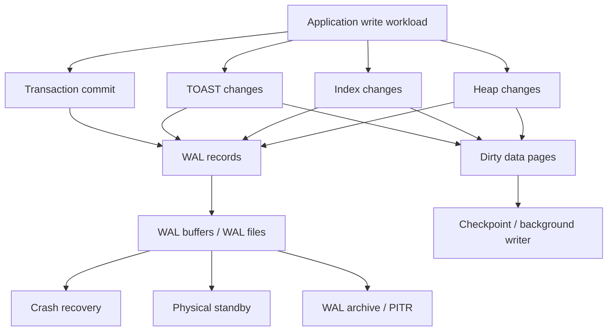

# Measuring WAL Generation by Write Volume in PostgreSQL

A service processes 20,000 orders per minute, yet after deploying a schema change, WAL volume doubles. The database still answers queries normally, but the WAL disk writes more, replica lag grows, and archive storage fills up faster. How do you determine whether WAL grew because of row count, indexes, UPDATEs creating tuple versions, or post-checkpoint full-page images?

In PostgreSQL, **application write volume** and **generated Write-Ahead Log (WAL) volume** are related, but not equal. Inserting a 200-byte row does not necessarily emit 200 bytes of WAL. A small UPDATE can emit multiple WAL records for heap tuples, index entries, TOAST data, and full-page images when needed. Conversely, many writes within a single transaction can be batched and share commit overhead.

This lesson belongs to the **WAL and checkpoints** chapter, focusing on measuring and interpreting WAL volume against write workloads:

- Reading `pg_stat_wal` and WAL counters.
- Capturing two LSN markers and computing the difference via `pg_wal_lsn_diff()`.
- Measuring bytes/second, WAL/transaction, and WAL/row.
- Comparing INSERT, UPDATE, DELETE, UPSERT, COPY, indexes, and TOAST.
- Understanding full-page images, checkpoints, `full_page_writes`, and `wal_compression`.
- Building repeatable benchmarks, controlling concurrent workloads, and handling counter resets.
- Estimating WAL capacity, archive volume, replication bandwidth, and checkpoint impact.

> **Key takeaway:** WAL is the database's recovery and change-propagation log. It is neither a byte-for-byte copy of application payloads nor the number of table data bytes written. Always measure both WAL bytes and application work within the exact same time window.

## 1. What Does WAL Record?

PostgreSQL uses Write-Ahead Logging to ensure data changes can be recovered after a crash. Before data pages are written to data files, WAL records describing the needed changes must be durably persisted in proper order.

Example transaction:

```sql
BEGIN;

INSERT INTO app.orders (customer_id, status, total_amount)
VALUES (42, 'new', 125000);

UPDATE app.inventory
SET available_qty = available_qty - 1
WHERE product_id = 9001;

COMMIT;
```

These operations can generate WAL for:

- New heap tuple in `orders`.
- New tuple version and related metadata when updating `inventory`.
- Index entries added or modified.
- TOAST chunks if large values are stored out-of-line.
- Transaction commit record.
- Full-page images (FPIs) under conditions tied to checkpoints and `full_page_writes`.
- Other metadata or page modifications triggered by the operations.

One SQL statement does not map one-to-one to a single WAL record. One statement can emit multiple records; many records can be buffered in WAL buffers and written in groups.

### 1.1. WAL Differs from Data Files

| Component | Purpose |
| --- | --- |
| Heap/main fork | Stores table tuple versions |
| Index files | Stores index structures and entries |
| WAL | Records changes required for crash recovery and replication |
| Archive WAL | Stores completed WAL segments for recovery/PITR |
| Replication stream | Streams WAL from primary to standbys or logical subscribers |

A transaction can emit WAL long before dirty data pages flush to data files. That is why WAL can redo changes that had not yet reached main relation files when a server fails.

### 1.2. A Write Workload Generates Multiple WAL Streams



The diagram shows WAL and data pages are related yet separate write streams. Never use dirty page sizes to infer WAL bytes directly.

## 2. Three Ways to Measure WAL Volume

Three methods are commonly used, each answering a slightly different question:

1. **`pg_stat_wal.wal_bytes`:** cumulative cluster-level WAL byte counter.
2. **LSN delta:** WAL position difference between two timestamps.
3. **WAL files/archives:** volume of segment files created, retained, or archived.

To measure WAL generated over a short window, `pg_stat_wal` and LSN deltas are the most convenient. To estimate storage/archive capacity, also factor in segment lifecycles, retention, and replication.

## 3. Reading pg_stat_wal

On PostgreSQL versions providing `pg_stat_wal` (introduced in PostgreSQL 14), query:

```sql
SELECT
    wal_records,
    wal_fpi,
    wal_bytes,
    wal_buffers_full,
    wal_write,
    wal_sync,
    wal_write_time,
    wal_sync_time,
    stats_reset
FROM pg_stat_wal;
```

Key columns:

| Column | Meaning |
| --- | --- |
| `wal_records` | Total WAL records generated per statistics |
| `wal_fpi` | Count of full-page images generated |
| `wal_bytes` | Total WAL bytes generated |
| `wal_buffers_full` | Times WAL buffers filled up, forcing backends to write WAL themselves |
| `wal_write` | Number of WAL writes |
| `wal_sync` | Number of WAL syncs per statistics |
| `wal_write_time` | Time spent writing WAL if WAL I/O timing tracking is enabled |
| `wal_sync_time` | Time spent syncing WAL if WAL I/O timing tracking is enabled |
| `stats_reset` | Timestamp when WAL statistics were reset |

Counters are cumulative from the corresponding stats reset timestamp. A single large `wal_bytes` value does not tell you how much WAL the workload you just ran produced; capture two snapshots and compute the delta.

### 3.1. Calculating WAL Bytes Over a Time Interval

Suppose two samples are taken:

| Timestamp | wal_bytes |
| --- | ---: |
| 10:00 | 1,000,000,000 |
| 10:05 | 1,450,000,000 |

WAL generated during the interval:

\[
1,450,000,000 - 1,000,000,000
= 450,000,000 \text{ bytes}
\]

Average WAL rate:

\[
\frac{450,000,000}{300}
= 1,500,000 \text{ bytes/s}
\]

Which is roughly 1.5 MB/s in decimal units.

### 3.2. Snapshot Query

```sql
SELECT
    clock_timestamp() AS sampled_at,
    wal_records,
    wal_fpi,
    wal_bytes,
    wal_buffers_full,
    wal_write,
    wal_sync,
    wal_write_time,
    wal_sync_time,
    stats_reset
FROM pg_stat_wal;
```

Run this query twice separated by a measurement window, storing results externally or in a monitoring system. There is no need to reset counters to compute deltas.

### 3.3. Why Keep stats_reset?

If statistics reset between two snapshots, subtraction produces bogus or negative deltas. Always check `stats_reset` on both samples.

If `stats_reset` changed, start a fresh measurement window. Never subtract a pre-reset snapshot from a post-reset snapshot.

### 3.4. pg_stat_wal Is Cluster-Wide Statistics

`pg_stat_wal` does not break down WAL bytes by database, schema, table, or application. All databases within the cluster contribute to this counter.

If the cluster runs concurrent workloads, the `wal_bytes` delta is the cluster-wide sum. To measure a single workload accurately, benchmark in an isolated environment or correlate against workload timings and counters while explicitly acknowledging concurrent noise.

## 4. Capturing Two LSN Markers and Computing the Delta

WAL is addressed by **Log Sequence Number (LSN)**. An LSN represents a position in the WAL stream.

Common functions:

- `pg_current_wal_insert_lsn()`: current WAL insertion position.
- `pg_current_wal_lsn()`: current WAL write position.
- `pg_current_wal_flush_lsn()`: flushed WAL position.
- `pg_wal_lsn_diff(lsn1, lsn2)`: byte difference between two LSNs.

### 4.1. Capture Start and End Markers

At the start of the window:

```sql
SELECT
    clock_timestamp() AS started_at,
    pg_current_wal_insert_lsn() AS start_lsn;
```

Run the target workload.

At the end of the window:

```sql
SELECT
    clock_timestamp() AS finished_at,
    pg_current_wal_insert_lsn() AS end_lsn;
```

Then compute:

```sql
SELECT pg_wal_lsn_diff(
    '0/5000100'::pg_lsn,
    '0/4F00000'::pg_lsn
) AS wal_bytes;
```

The two LSN literals above only illustrate syntax. In real measurements, substitute the actual LSNs captured at start and end.

### 4.2. Using LSN Diff in a Query

You can capture two markers and compute the diff for a controlled window via two separate queries or by saving markers into a lab table. A single instantaneous query does not span a meaningful benchmark window.

Example calculating from two stored values:

```sql
SELECT
    pg_wal_lsn_diff(end_lsn, start_lsn) AS generated_bytes
FROM measurement_samples
WHERE sample_id = 1;
```

Here `measurement_samples` is a user-created table holding `start_lsn` and `end_lsn` columns of type `pg_lsn`.

### 4.3. Should You Use Insert LSN, Write LSN, or Flush LSN?

| Goal | Typical Marker |
| --- | --- |
| Measure WAL inserted into the WAL stream | `pg_current_wal_insert_lsn()` |
| Measure WAL written out by the WAL writer | `pg_current_wal_lsn()` |
| Measure WAL durably flushed | `pg_current_wal_flush_lsn()` |

To measure WAL generated by a workload, insert LSN is the right marker. Write and flush LSNs answer questions about write progress and durability, which are distinct concepts.

### 4.4. LSN Delta Is Not Per-Table WAL

PostgreSQL's WAL stream is cluster-wide. An LSN delta includes every WAL record emitted between the two markers:

- Sessions in the target database.
- Workloads in other databases in the same cluster.
- Autovacuum, `CREATE INDEX`, DDL, and maintenance jobs.
- Checkpoint-related full-page images.
- Other system WAL activity.

Therefore, when concurrent activity exists, an LSN delta is not the exact WAL of a single SQL statement or single table.

### 4.5. Measure Across Multiple Windows

A single run can be skewed by a checkpoint or background job. Repeat the same experiment multiple times:

```text
Run 1: 10:00–10:05 -> 420 MB
Run 2: 10:10–10:15 -> 438 MB
Run 3: 10:20–10:25 -> 427 MB

Mean = 428.3 MB / 5 min
```

Record checkpoint timestamps, row counts, transaction counts, and system state to explain variations.

## 5. Measuring pg_stat_wal Deltas with SQL

You can use a temporary table in your lab session to store before and after snapshots.

### 5.1. Create a Temp Table for Samples

```sql
CREATE TEMP TABLE wal_sample (
    sample_name text PRIMARY KEY,
    sampled_at timestamptz NOT NULL,
    wal_records bigint NOT NULL,
    wal_fpi bigint NOT NULL,
    wal_bytes numeric NOT NULL,
    wal_buffers_full bigint NOT NULL,
    wal_write bigint NOT NULL,
    wal_sync bigint NOT NULL,
    stats_reset timestamptz
);
```

### 5.2. Save Start Snapshot

```sql
INSERT INTO wal_sample
SELECT
    'start',
    clock_timestamp(),
    wal_records,
    wal_fpi,
    wal_bytes,
    wal_buffers_full,
    wal_write,
    wal_sync,
    stats_reset
FROM pg_stat_wal;
```

### 5.3. Run Workload

Run only the batch being measured; do not mix setup or cleanup inside the window if you want to measure the main batch cleanly.

### 5.4. Save End Snapshot

```sql
INSERT INTO wal_sample
SELECT
    'end',
    clock_timestamp(),
    wal_records,
    wal_fpi,
    wal_bytes,
    wal_buffers_full,
    wal_write,
    wal_sync,
    stats_reset
FROM pg_stat_wal;
```

### 5.5. Compute Delta and Rate

```sql
WITH samples AS (
    SELECT
        MAX(sampled_at) FILTER (WHERE sample_name = 'start') AS started_at,
        MAX(sampled_at) FILTER (WHERE sample_name = 'end') AS finished_at,
        MAX(wal_bytes) FILTER (WHERE sample_name = 'start') AS start_bytes,
        MAX(wal_bytes) FILTER (WHERE sample_name = 'end') AS end_bytes,
        MAX(wal_records) FILTER (WHERE sample_name = 'start') AS start_records,
        MAX(wal_records) FILTER (WHERE sample_name = 'end') AS end_records,
        MAX(wal_fpi) FILTER (WHERE sample_name = 'start') AS start_fpi,
        MAX(wal_fpi) FILTER (WHERE sample_name = 'end') AS end_fpi,
        MAX(stats_reset) FILTER (WHERE sample_name = 'start') AS start_reset,
        MAX(stats_reset) FILTER (WHERE sample_name = 'end') AS end_reset
    FROM wal_sample
)
SELECT
    started_at,
    finished_at,
    EXTRACT(EPOCH FROM finished_at - started_at) AS elapsed_seconds,
    end_bytes - start_bytes AS wal_bytes,
    end_records - start_records AS wal_records,
    end_fpi - start_fpi AS wal_fpi,
    CASE
        WHEN finished_at > started_at
        THEN (end_bytes - start_bytes)
             / EXTRACT(EPOCH FROM finished_at - started_at)
    END AS wal_bytes_per_second,
    start_reset,
    end_reset,
    start_reset = end_reset AS same_stats_epoch
FROM samples;
```

If `same_stats_epoch` is false, discard the delta and retake two snapshots within the same statistics epoch. The query assumes exactly two rows: `start` and `end`.

### 5.6. Reset Lab Data to Re-Measure

Because the table is `TEMP`, it vanishes when the session closes. Within the same session you can run:

```sql
TRUNCATE wal_sample;

-- Save start sample, run workload, then save end sample.
```

There is no need to reset cluster-wide WAL statistics.

## 6. Calculating WAL Rate and Units

Dashboards commonly display MB/s or GB/hour. Always be explicit about units:

- 1 kB = 1,000 bytes.
- 1 MB = 1,000,000 bytes.
- 1 GB = 1,000,000,000 bytes.
- 1 KiB = 1,024 bytes.
- 1 MiB = 1,048,576 bytes.
- 1 GiB = 1,073,741,824 bytes.

### 6.1. WAL Bytes per Second

\[
\text{WAL bytes/s}
=
\frac{\Delta \text{wal\_bytes}}{\Delta t \text{ seconds}}
\]

### 6.2. WAL MB/s

\[
\text{WAL MB/s}
=
\frac{\Delta \text{wal\_bytes}}{\Delta t \times 1,000,000}
\]

### 6.3. WAL GB per Hour

\[
\text{WAL GB/hour}
=
\frac{\Delta \text{wal\_bytes}}{\Delta t}
\times
\frac{3,600}{1,000,000,000}
\]

### 6.4. Example

Suppose 15 minutes generates 9 GB of WAL:

\[
9 / 900 = 0.01 \text{ GB/s}
\]

Which equals roughly 10 MB/s and:

\[
10 \times 3,600 = 36,000 \text{ MB/hour}
\]

or roughly 36 GB/hour in decimal units.

This is the average rate. Peak rates can be far higher during batches or checkpoints.

## 7. Measuring WAL per Transaction and per Row

WAL rate gives total bytes over time. To compare different workloads, compute normalized ratios:

- WAL bytes / transaction.
- WAL bytes / row inserted.
- WAL bytes / row updated.
- WAL bytes / row deleted.
- WAL bytes / logical payload byte.
- WAL bytes / business operation.

### 7.1. WAL per Transaction

\[
\text{WAL/transaction}
=
\frac{\Delta \text{WAL bytes}}
{\Delta \text{committed transactions}}
\]

Clarify whether the denominator includes rolled-back transactions. WAL emitted by a transaction that later rolls back does not vanish from the WAL stream; thus dividing solely by committed transactions inflates the ratio when rollbacks are frequent.

### 7.2. WAL per Inserted Row

\[
\text{WAL/inserted row}
=
\frac{\Delta \text{WAL bytes}}
{\Delta \text{inserted rows}}
\]

This is an empirical ratio for a specific workload and configuration, not a fixed PostgreSQL constant.

### 7.3. WAL per Payload Byte

If an application writes 500 MB of payload and generates 1.2 GB of WAL:

\[
1.2 / 0.5 = 2.4
\]

The workload emitted roughly 2.4 WAL bytes per payload byte in that run.

This ratio can exceed 1 because of tuple headers, indexes, WAL record headers, page images, TOAST, transaction records, and other metadata. It can shift significantly when schemas, indexes, workloads, or checkpoints change.

### 7.4. Counting Rows with pg_stat_database

```sql
SELECT
    datname,
    tup_inserted,
    tup_updated,
    tup_deleted,
    xact_commit,
    xact_rollback,
    stats_reset
FROM pg_stat_database
WHERE datname = current_database();
```

These counters are database-level statistics, whereas `pg_stat_wal.wal_bytes` is cluster-wide. Use their deltas to approximate workload over the same window, keeping in mind:

- Database stats can reset independently.
- WAL bytes may include activity from other databases.
- Tuple counters do not reveal byte sizes per row.
- Autovacuum/maintenance can generate WAL unrelated to application row inserts/updates/deletes.

### 7.5. Never Divide Cluster-Wide WAL by One Database's Rows as a Per-Row Ratio

If a single cluster holds two databases:

```text
appdb:       100,000 rows updated
analyticsdb:  50,000 rows inserted
system:      autovacuum + catalog changes
```

and cluster-wide WAL grows by 300 MB, you cannot divide 300 MB by `appdb`'s 100,000 rows and conclude `appdb` uses 3 KB of WAL per row.

To compute reliable ratios, isolate the workload or use a dedicated benchmark cluster.

## 8. Why Can the Same Row Count Produce Different WAL Bytes?

WAL depends on many factors beyond row count:

1. Tuple width and data types.
2. Number of indexes and which index keys change.
3. Whether UPDATEs create new tuple versions.
4. Whether HOT updates apply.
5. Whether TOAST is triggered.
6. Whether full-page images are emitted.
7. Checkpoint timing and `full_page_writes`.
8. `wal_compression` and `wal_level`.
9. DDL, catalog updates, and maintenance.
10. Transaction boundaries and commit frequency.
11. Concurrent workloads in the same cluster.

### 8.1. Tuple Width

A table with 20 text/JSONB columns produces different WAL than a table with two integer columns, even for identical row counts.

### 8.2. Index Count

Inserting into a table with 5 indexes generates extra WAL for index pages compared to a table with only a primary key. Updating indexed columns alters index entries, whereas eligible HOT updates avoid some index writes.

### 8.3. UPDATE Does Not Write Only the Changed Column

PostgreSQL MVCC generally writes a new tuple version. Even if the app changes one small column, the operation creates a heap tuple version and WAL for affected pages. If the changed column is indexed, index maintenance emits additional WAL.

### 8.4. TOAST

Large text, JSONB, or bytea values may be compressed or stored out-of-line in a TOAST relation. WAL can be emitted for both the heap tuple and TOAST chunks/indexes. Never infer WAL size from logical row width alone.

## 9. Full-Page Images and Checkpoint Impact

A major driver of WAL spikes is **full-page images (FPIs)**.

When `full_page_writes` is enabled, the first time a page is modified after a checkpoint emits a full-page image into WAL to protect against torn pages after a crash. That is why a workload updating very little data can still emit massive WAL right after a checkpoint.

### 9.1. What Is an FPI?

An FPI is a complete snapshot of a page written to WAL when required. It lets recovery reconstruct an intact page if a crash interrupts writing that page to storage.

### 9.2. Why Can WAL/Row Jump After a Checkpoint?

Suppose a table spans 1 million heap pages. After a checkpoint, the workload touches 100,000 pages for the first time. Those first page modifications emit FPIs. Subsequent changes to the same pages within the same checkpoint cycle do not repeat FPIs under the same conditions.

Hence, the exact same 10,000 UPDATEs can emit wildly different WAL depending on how many distinct pages they touch and checkpoint timing.

### 9.3. Measuring FPI Count

```sql
SELECT
    wal_records,
    wal_fpi,
    wal_bytes,
    CASE
        WHEN wal_records > 0
        THEN wal_fpi::numeric / wal_records
    END AS fpi_per_record,
    stats_reset
FROM pg_stat_wal;
```

`wal_fpi` is the count of FPIs, not FPI bytes. Do not multiply `wal_fpi` by block size and claim that is exact FPI bytes; compression, record headers, and formatting alter actual sizes.

### 9.4. full_page_writes

```sql
SHOW full_page_writes;
SHOW wal_compression;
SHOW checkpoint_timeout;
SHOW max_wal_size;
SHOW checkpoint_completion_target;
```

- `full_page_writes`: controls writing full-page images under WAL rules.
- `wal_compression`: compresses FPIs when enabled and supported.
- `checkpoint_timeout`: configured maximum interval between checkpoints.
- `max_wal_size`: WAL threshold suggesting earlier checkpoints, not a hard limit on WAL size.
- `checkpoint_completion_target`: target for spreading checkpoints across the allowed interval.

Never turn off `full_page_writes` to shrink WAL without understanding crash corruption risks. It is a data-integrity safeguard.

### 9.5. Separating Checkpoint Effects from Write Workloads

To compare WAL/row across two application versions:

- Keep checkpoint settings identical.
- Run measurement windows at comparable points relative to checkpoints.
- Record `wal_fpi` deltas.
- Repeat multiple times.
- Avoid forcing checkpoints between runs unless that is deliberately part of the experiment.

If FPIs drive most of the WAL delta, concluding "the app doubled WAL because tuple size doubled" would be wrong.

## 10. Checkpoints and WAL Generation Are Two Distinct Concepts

A checkpoint syncs dirty pages and writes a checkpoint record to bound recovery. WAL generation is creating WAL records when operations modify data.

Checkpoints can shift the **WAL/row ratio** via FPIs, yet checkpoints are not a WAL generation counter.

### 10.1. Checkpoint Statistics

On newer versions, checkpoint statistics live in `pg_stat_checkpointer`; older versions expose checkpoint counters in `pg_stat_bgwriter`.

Because schemas vary by major version, check first:

```sql
SELECT
    to_regclass('pg_catalog.pg_stat_checkpointer') AS checkpointer_view,
    to_regclass('pg_catalog.pg_stat_bgwriter') AS bgwriter_view;
```

If `pg_stat_checkpointer` exists:

```sql
SELECT *
FROM pg_stat_checkpointer;
```

If running a version where checkpoint counters reside in `pg_stat_bgwriter`:

```sql
SELECT *
FROM pg_stat_bgwriter;
```

Never copy queries from another major version assuming all columns exist.

### 10.2. WAL Generated vs. WAL Retained

- WAL generated: newly created WAL volume.
- WAL written/flushed: WAL write/flush progress.
- WAL retained: segments held by checkpoints, recovery, replication, or archive policies.

All three numbers can diverge. A cluster can generate 20 GB of WAL in an hour while retaining a totally different amount depending on checkpoints, replication slots, archiving, and retention.

## 11. Lab Experiment: Measuring WAL of INSERT

Run in a lab database with permissions to create schemas and tables. Never use production tables.

### 11.1. Create a Table Without Secondary Indexes

```sql
CREATE SCHEMA IF NOT EXISTS wal_lab;

DROP TABLE IF EXISTS wal_lab.insert_plain;

CREATE TABLE wal_lab.insert_plain (
    id bigint GENERATED ALWAYS AS IDENTITY PRIMARY KEY,
    tenant_id integer NOT NULL,
    status text NOT NULL,
    amount numeric(12, 2) NOT NULL,
    created_at timestamptz NOT NULL
);
```

The primary key creates one index automatically. "Without secondary indexes" means only the primary key index exists.

### 11.2. Snapshot WAL Before Workload

```sql
SELECT
    clock_timestamp(),
    wal_records,
    wal_fpi,
    wal_bytes,
    stats_reset
FROM pg_stat_wal;
```

Record the output.

### 11.3. Insert 100,000 Rows

```sql
INSERT INTO wal_lab.insert_plain (
    tenant_id, status, amount, created_at
)
SELECT
    (g % 1000) + 1,
    CASE WHEN g % 4 = 0 THEN 'pending' ELSE 'paid' END,
    (g % 100000)::numeric / 100,
    TIMESTAMPTZ '2026-01-01 00:00:00+00'
        + (g % 365) * INTERVAL '1 day'
FROM generate_series(1, 100000) AS s(g);
```

### 11.4. Snapshot After Workload

```sql
SELECT
    clock_timestamp(),
    wal_records,
    wal_fpi,
    wal_bytes,
    stats_reset
FROM pg_stat_wal;
```

Compute the `wal_bytes` delta and divide by 100,000 for the estimated WAL bytes per inserted row in this experiment.

### 11.5. Why Commit Before the Final Snapshot?

In autocommit mode, the `INSERT` commits before returning. When using explicit transactions, take the final snapshot after `COMMIT` to capture the commit record and all WAL generated by that transaction.

WAL insertion happens before `COMMIT`, while the commit record is emitted only when the transaction commits. Do not mix the two definitions when comparing batches.

## 12. Comparing INSERT With and Without Indexes

Create a second table with additional indexes:

```sql
DROP TABLE IF EXISTS wal_lab.insert_indexed;

CREATE TABLE wal_lab.insert_indexed (
    id bigint GENERATED ALWAYS AS IDENTITY PRIMARY KEY,
    tenant_id integer NOT NULL,
    status text NOT NULL,
    amount numeric(12, 2) NOT NULL,
    created_at timestamptz NOT NULL
);

CREATE INDEX idx_insert_indexed_tenant
ON wal_lab.insert_indexed (tenant_id);

CREATE INDEX idx_insert_indexed_status_time
ON wal_lab.insert_indexed (status, created_at DESC);
```

Snapshot WAL, insert the identical dataset, then capture the end snapshot.

Comparison:

| Characteristic | insert_plain | insert_indexed |
| --- | --- | --- |
| Heap rows | Same count | Same count |
| Primary key index | Yes | Yes |
| Secondary indexes | None | Two |
| WAL bytes | Measure actually | Measure actually |
| WAL/row | Delta / rows | Delta / rows |

Do not expect a fixed constant ratio. B-tree page splits, page layout, FPIs, and cache warmth cause WAL to vary across runs.

### 12.1. Indexes Can Increase WAL More Than Expected

Each new row creates entries in every index. When a B-tree page split happens, multiple pages are modified and emit WAL. Wide multi-column indexes also enlarge index size and WAL volume.

### 12.2. Indexes Can Reduce Write Amplification in Other Workloads

An index may reduce how many rows must be scanned/updated in some operations, yet always imposes maintenance overhead when indexed data changes. Weigh both read benefits and WAL costs before adding an index.

## 13. UPDATE Experiment: HOT vs. Non-HOT

`UPDATE` generates different WAL than `INSERT` because it creates new tuple versions and may have to update indexes.

### 13.1. Create the Update Lab Table

```sql
DROP TABLE IF EXISTS wal_lab.update_lab;

CREATE TABLE wal_lab.update_lab (
    id bigint GENERATED ALWAYS AS IDENTITY PRIMARY KEY,
    status text NOT NULL,
    note text NOT NULL,
    updated_at timestamptz NOT NULL DEFAULT clock_timestamp()
) WITH (fillfactor = 80);

INSERT INTO wal_lab.update_lab (status, note)
SELECT 'pending', repeat('x', 40)
FROM generate_series(1, 100000);

CREATE INDEX idx_update_lab_status
ON wal_lab.update_lab (status);

ANALYZE wal_lab.update_lab;
```

### 13.2. UPDATE a Non-Indexed Column

```sql
UPDATE wal_lab.update_lab
SET note = repeat('y', 40),
    updated_at = clock_timestamp()
WHERE id BETWEEN 1 AND 10000;
```

`note` and `updated_at` are not in `idx_update_lab_status`. If enough free space exists on the page and other HOT conditions hold, a portion of updates can be HOT.

### 13.3. UPDATE an Indexed Column

```sql
UPDATE wal_lab.update_lab
SET status = 'paid'
WHERE id BETWEEN 10001 AND 20000;
```

Changing `status` touches the index key, preventing HOT updates for that index in normal cases.

### 13.4. Compare HOT Statistics

```sql
SELECT
    relname,
    n_tup_upd,
    n_tup_hot_upd,
    n_dead_tup
FROM pg_stat_user_tables
WHERE schemaname = 'wal_lab'
  AND relname = 'update_lab';
```

These are relation-level counters/estimates. To compare WAL per batch, snapshot `pg_stat_wal` before and after each `UPDATE` in isolated windows.

### 13.5. Why Can HOT Reduce WAL?

HOT avoids index entry updates when eligible. Even so, the new heap tuple version still requires WAL. Thus HOT does not make `UPDATE` "WAL-free"—it reduces the index-related portion of WAL.

## 14. DELETE and Cleanup WAL

`DELETE` marks tuple versions as deleted in the heap. It also emits WAL for page modifications and related index/metadata processing.

### 14.1. Measure DELETE

```sql
DELETE FROM wal_lab.insert_plain
WHERE id BETWEEN 1 AND 10000;
```

Snapshot `pg_stat_wal` before and after to compute the WAL delta.

### 14.2. VACUUM Also Generates WAL

After `DELETE`:

```sql
VACUUM (VERBOSE) wal_lab.insert_plain;
```

`VACUUM` emits WAL when updating heap/index pages and metadata. Measuring `DELETE` in a window where `VACUUM` also runs captures both operations in the WAL delta.

To measure `DELETE` alone, separate the `DELETE` measurement window from the `VACUUM` window.

### 14.3. Deleting Millions of Rows Is Not the Same as DROP/TRUNCATE

`DELETE` performs tuple-level modifications and generates substantial WAL proportional to rows, pages, and indexes. `TRUNCATE` is DDL with different semantics, altering relation storage with a very different WAL profile. Never compare the two as if they performed equivalent business work.

## 15. UPSERT and ON CONFLICT

```sql
INSERT INTO wal_lab.upsert_lab (id, status, amount)
VALUES (100, 'paid', 250)
ON CONFLICT (id)
DO UPDATE SET
    status = EXCLUDED.status,
    amount = EXCLUDED.amount;
```

An UPSERT takes two paths:

- No conflict: `INSERT`.
- Conflict: `UPDATE` existing row.

Both paths have different WAL costs. Even if `DO UPDATE` leaves values unchanged, PostgreSQL still executes an update path per statement semantics; never assume conflict paths are free.

When benchmarking UPSERT, measure the actual conflict ratio and separate inserted vs. updated row counts if the application can report them.

## 16. COPY and Batch Inserts

```sql
COPY wal_lab.copy_target (tenant_id, status, amount)
FROM STDIN WITH (FORMAT csv);
```

This statement expects the client to stream data; it illustrates `COPY FROM STDIN` syntax and cannot run standalone in every SQL editor.

`COPY` is typically faster than many individual `INSERT` statements because it cuts protocol, parsing, and command overhead, yet WAL volume still depends on tables, indexes, schemas, and WAL settings.

Compare fairly:

- Identical dataset.
- Identical table schema and indexes.
- Identical transaction boundaries.
- Identical checkpoint/full-page-write conditions.
- Identical `wal_level` and `wal_compression`.
- Multiple runs reporting median/percentiles.

Batching cuts commit records and flush operations compared to thousands of tiny transactions. It does not necessarily reduce WAL bytes/row in the same proportion.

## 17. Transaction Size and Commit Frequency

A workload of 100,000 inserts can run as:

- 100,000 transactions of 1 row each.
- 1,000 transactions of 100 rows each.
- 1 transaction of 100,000 rows.

Heap/index WAL for the data still dominates, while commit records, sync frequency, and scheduling differ.

### 17.1. WAL Bytes Are Not Latency

Many small transactions may produce similar `wal_bytes` while incurring far more `wal_sync` calls. Conversely, one giant transaction can create a massive WAL burst and hold locks/transactions open long.

Measure together:

- `wal_bytes`.
- `wal_records`.
- `wal_write`, `wal_sync`.
- Commit/rollback counts.
- Transaction latency.
- Application batch size.

### 17.2. Synchronous Commit

```sql
SHOW synchronous_commit;
```

`synchronous_commit` determines whether commits wait for WAL flush per policy. It alters the durability/latency trade-off, yet should not be viewed as a proportional WAL-volume reduction knob.

Turning off synchronous commit lets clients receive confirmation before WAL flushes; a crash can lose recently confirmed transactions. Adjust only when the business accepts those semantics.

## 18. WAL Compression and wal_level

Some settings alter WAL size or FPI size:

### 18.1. wal_compression

```sql
SHOW wal_compression;
```

When enabled and supported, PostgreSQL compresses full-page images in WAL. This can cut WAL bytes at the cost of CPU, with effectiveness depending on page contents and compression method.

Do not expect it to compress all WAL records or all heap tuple payloads equally.

### 18.2. wal_level

```sql
SHOW wal_level;
```

Common levels include `minimal`, `replica`, and `logical` depending on version. WAL level controls what information WAL carries for replication/decoding. `logical` logs extra info for logical decoding, altering WAL volume.

Never lower `wal_level` if the cluster relies on physical/logical replication or logical decoding. Changing it requires a restart and affects features.

### 18.3. full_page_writes and wal_log_hints

```sql
SHOW full_page_writes;
SHOW wal_log_hints;
```

These settings relate to page protection and specific recovery/replication operations. Never alter them merely to make WAL/row metrics look smaller.

## 19. WAL Segments and Storage Capacity

WAL is stored as segment files in `pg_wal`. Segment size is selected at initdb and is commonly 16 MiB, though it can differ.

### 19.1. WAL Generated Does Not Equal Current File Count

If `pg_wal` currently holds 2 GB, that does not mean the cluster generated only 2 GB of WAL over its lifetime. Old segments are recycled or deleted once no longer needed.

Conversely, `pg_wal` can retain many segments due to:

- Checkpoints not advancing yet.
- Replication slots pinning WAL.
- Archive command failures or slow archiving.
- Standbys lagging in receiving WAL.
- Backup/recovery requirements.
- `wal_keep_size` and retention settings.

### 19.2. Checking Segment Size

```sql
SHOW wal_segment_size;
```

This GUC may not exist on older versions. If absent, check initdb/build settings and documentation for your exact version.

### 19.3. Counting WAL Files Does Not Measure Generation Rate

A single file count snapshot in `pg_wal` shows only current files, not WAL bytes generated per hour.

To measure generation rate, use `pg_stat_wal.wal_bytes` deltas or LSN deltas. To measure storage pressure, monitor `pg_wal` disk usage, archive backlogs, and replication slots.

## 20. WAL, Archiving, and Replication Bandwidth

If a primary generates 5 MB/s of WAL continuously:

\[
5 \times 3,600 = 18,000 \text{ MB/hour}
\]

Roughly 18 GB of WAL per hour, before accounting for differences between raw WAL generation and archive compression/retention.

If archive uploads run slower than generation, backlogs grow. If a standby receives WAL slower than the primary generates it, replication lag grows.

### 20.1. Physical Replication

A physical standby receives the WAL stream to apply changes. Primary WAL generation rate is a key input for sizing network and standby apply capacity.

### 20.2. Logical Replication

Logical decoding/replication can require extra WAL info under `wal_level=logical`. Logical subscribers must also process changes fast enough; WAL generation rate does not directly equal logical apply throughput.

### 20.3. Replication Slots Can Pin WAL

A lagging or inactive replication slot pins WAL segments so the subscriber does not lose unread data. When a slot lags, disk usage rises even when WAL generation rate stays flat.

Inspect:

```sql
SELECT
    slot_name,
    slot_type,
    active,
    restart_lsn,
    confirmed_flush_lsn,
    pg_size_pretty(
        pg_wal_lsn_diff(pg_current_wal_lsn(), restart_lsn)::bigint
    ) AS retained_wal_estimate
FROM pg_replication_slots
WHERE restart_lsn IS NOT NULL;
```

Note: `pg_wal_lsn_diff` returns `numeric` bytes; casting to `bigint` is safe only when the difference fits within `bigint`. Adjust queries for version-specific slot columns. The retained WAL estimate is an LSN distance, not an exact count of physical file bytes exclusively held.

## 21. Measuring One Database's WAL in a Multi-Database Cluster

`pg_stat_wal` and LSNs are cluster-wide. `pg_stat_database` tracks per-database tuple counters, yet lacks a standard WAL-bytes column attributing WAL accurately to each database or table.

Three approaches:

1. **Isolated cluster benchmark:** run only the target workload in the measurement window.
2. **Dedicated cluster/database environment:** spin up an isolated test cluster for the workload.
3. **Correlation estimate:** combine per-database tuple counters, logs, and schedules with the cluster WAL delta, clearly reporting uncertainty.

There is no exact formula splitting `pg_stat_wal.wal_bytes` into exact per-relation WAL bytes.

### 21.1. Inspecting Workload per Database

```sql
SELECT
    datname,
    xact_commit,
    xact_rollback,
    tup_inserted,
    tup_updated,
    tup_deleted,
    stats_reset
FROM pg_stat_database
ORDER BY datname;
```

Use counter deltas to see which database is busiest. This is a tuple-activity proxy, not exact WAL attribution.

### 21.2. Application Metrics

Applications can emit:

- Count of business operations.
- Rows inserted, updated, and deleted.
- Batch sizes.
- Transaction commits and rollbacks.
- Payload bytes.
- Operation types.
- Durations and trace IDs.

Correlating these metrics with WAL deltas helps explain shifts, though WAL itself remains cluster-wide.

## 22. A Repeatable Benchmark

A solid benchmark controls the following variables:

| Variable | How to Control |
| --- | --- |
| Dataset | Same row count and data distribution |
| Schema | Same column types, constraints, TOAST behavior |
| Indexes | Document exact count and types of indexes |
| Transactions | Same batch sizes and commit frequency |
| Checkpoints | Record checkpoint settings and timing |
| WAL config | Same `wal_level`, `full_page_writes`, `wal_compression` |
| Concurrent load | Disable external workloads or measure baseline |
| Autovacuum | Record any vacuum/analyze running during the window |
| Cache | Note warm vs. cold state if relevant |
| Runs | Repeat multiple times and report mean/median/range |

### 22.1. Avoid Resetting Stats Between Benchmarks Unnecessarily

Taking before/after counter snapshots is usually sufficient. Resetting global WAL stats disrupts cluster-wide monitoring dashboards and requires elevated privileges.

In a private lab where resetting is desired:

```sql
SELECT pg_stat_reset_shared('wal');
```

This resets cluster-wide shared WAL statistics. **Never run it on production just to measure a batch.** Capture two snapshots and compute the delta instead.

### 22.2. Using a Baseline Window

Before running the workload, measure WAL for 60 seconds while the system is relatively idle:

\[
W_{\text{baseline}} =
\frac{\Delta WAL_{\text{idle}}}{\Delta t}
\]

Then measure the workload window. If concurrent background activity remains, a rough estimate is:

\[
W_{\text{workload estimate}}
\approx
W_{\text{observed}} - W_{\text{baseline}}
\]

This is only a valid estimate if the baseline is steady. Do not subtract baseline when background activity fluctuates heavily between windows.

## 23. Building a Benchmark Results Table

Sample template:

| Workload | Rows | Transactions | WAL bytes | WAL/row | WAL/transaction |
| --- | ---: | ---: | ---: | ---: | ---: |
| INSERT, PK only | 100,000 | 1 | measure actually | compute delta/rows | compute delta/tx |
| INSERT, 2 secondary indexes | 100,000 | 1 | measure actually | compute delta/rows | compute delta/tx |
| UPDATE non-indexed column | 10,000 | 1 | measure actually | compute delta/rows | compute delta/tx |
| UPDATE indexed column | 10,000 | 1 | measure actually | compute delta/rows | compute delta/tx |
| DELETE | 10,000 | 1 | measure actually | compute delta/rows | compute delta/tx |
| COPY | 100,000 | 1 | measure actually | compute delta/rows | compute delta/tx |

Never fill in hypothetical numbers as universal constants. Benchmark against your actual version, schema, hardware, and WAL configuration.

### 23.1. Record Workload Metadata

Every run should record:

```text
postgres_version
wal_level
full_page_writes
wal_compression
wal_segment_size
checkpoint_timeout
max_wal_size
table_schema
index_definition
row_count
transaction_count
start_time
end_time
start_lsn
end_lsn
start_wal_bytes
end_wal_bytes
wal_fpi_delta
concurrent_activity
```

When comparing across days, this metadata separates code changes from configuration or operational shifts.

## 24. Complete SQL Script Example for Measuring WAL

The example below creates a temporary snapshot table and a lab table. It uses `pg_stat_wal`, so it requires a PostgreSQL version exposing that view.

### 24.1. Setup

```sql
CREATE SCHEMA IF NOT EXISTS wal_lab;

DROP TABLE IF EXISTS wal_lab.measure_orders;

CREATE TABLE wal_lab.measure_orders (
    id bigint GENERATED ALWAYS AS IDENTITY PRIMARY KEY,
    tenant_id integer NOT NULL,
    status text NOT NULL,
    amount numeric(12, 2) NOT NULL,
    created_at timestamptz NOT NULL
);

CREATE TEMP TABLE wal_measurement (
    phase text PRIMARY KEY,
    measured_at timestamptz NOT NULL,
    wal_bytes numeric NOT NULL,
    wal_records bigint NOT NULL,
    wal_fpi bigint NOT NULL,
    stats_reset timestamptz
);
```

### 24.2. Before Snapshot

```sql
INSERT INTO wal_measurement
SELECT
    'before',
    clock_timestamp(),
    wal_bytes,
    wal_records,
    wal_fpi,
    stats_reset
FROM pg_stat_wal;
```

### 24.3. Workload

```sql
INSERT INTO wal_lab.measure_orders (
    tenant_id, status, amount, created_at
)
SELECT
    (g % 500) + 1,
    CASE WHEN g % 3 = 0 THEN 'pending' ELSE 'paid' END,
    (g % 100000)::numeric / 100,
    TIMESTAMPTZ '2026-01-01 00:00:00+00'
        + (g % 180) * INTERVAL '1 day'
FROM generate_series(1, 50000) AS s(g);
```

### 24.4. After Snapshot

```sql
INSERT INTO wal_measurement
SELECT
    'after',
    clock_timestamp(),
    wal_bytes,
    wal_records,
    wal_fpi,
    stats_reset
FROM pg_stat_wal;
```

### 24.5. Compute Delta

```sql
SELECT
    a.measured_at AS started_at,
    b.measured_at AS finished_at,
    EXTRACT(EPOCH FROM b.measured_at - a.measured_at) AS elapsed_seconds,
    b.wal_bytes - a.wal_bytes AS wal_bytes_generated,
    b.wal_records - a.wal_records AS wal_records_generated,
    b.wal_fpi - a.wal_fpi AS full_page_images,
    (b.wal_bytes - a.wal_bytes) / 50000 AS wal_bytes_per_inserted_row,
    a.stats_reset = b.stats_reset AS same_stats_epoch
FROM wal_measurement AS a
CROSS JOIN wal_measurement AS b
WHERE a.phase = 'before'
  AND b.phase = 'after';
```

If stats reset between samples, discard the delta. Because the view is cluster-wide, the result also includes WAL from any concurrent activity in that window.

## 25. Measuring by Application Change Type

A workload table can be broken down by operation:

| Operation | Application Metric | WAL Metric to Correlate |
| --- | --- | --- |
| Create order | Orders created, rows inserted | WAL bytes/created order |
| Update status | Status transitions | WAL bytes/transition |
| Inventory decrement | Rows updated, contention | WAL bytes/update, WAL records |
| Delete retention | Rows deleted | WAL bytes/deleted row |
| Bulk import | Rows copied, batch size | WAL bytes/row and duration |
| Index build | Index build duration/size | WAL burst in build window |
| Vacuum | Tuples/pages cleaned | WAL delta isolated to maintenance window |

### 25.1. Separate Application Writes from Maintenance Writes

A benchmark window can simultaneously contain:

- Autovacuum.
- Manual `VACUUM`.
- `CREATE INDEX`.
- DDL migrations.
- Checkpoints.
- Replication/catalog activity.

If the goal is measuring application WAL, log maintenance windows or use an isolated lab cluster. Never attribute the entire WAL delta to the application simply because it is the primary workload.

### 25.2. WAL from Index Builds

`CREATE INDEX` can generate substantial WAL and shift the WAL rate during the build. Concurrent index builds have different behavior and costs than standard builds. Measure DDL/migration windows separately when budgeting deployment WAL.

## 26. Forecasting WAL from Traffic Forecasts

Suppose benchmarks show an operation emits an average of 2,500 WAL bytes/operation. Forecasted traffic is 40,000 operations/second:

\[
2,500 \times 40,000
= 100,000,000 \text{ bytes/s}
\]

Roughly 100 MB/s of WAL by simple extrapolation.

In 1 hour:

\[
100 \times 3,600 = 360,000 \text{ MB}
\]

Or roughly 360 GB of WAL per hour.

### 26.1. Do Not Extrapolate Linearly Too Far

WAL/operation can shift when:

- Index pages split more often.
- Cache warmth and checkpoint timing shift.
- Data distribution skew changes.
- Concurrent writes climb.
- HOT update ratio drops.
- TOAST values grow larger.
- Full-page images rise.
- Autovacuum and checkpoints run more frequently.
- Transaction batch sizes change.

Forecasts should present low, base, and high scenarios rather than a single point number.

### 26.2. Capacity Planning

From the WAL rate, estimate:

- Daily/weekly archive storage.
- Network throughput for replication.
- Standby replay capacity.
- WAL disk pressure during slow archiving or replication.
- Backup/PITR retention.
- Burst capacity during bulk loads and migrations.

Never set `max_wal_size` to exactly one hour of WAL thinking it is a hard cap. PostgreSQL can exceed it under certain conditions, and replication/archive retention can hold even more WAL.

## 27. WAL Retention Differs from WAL Generation

A system maintains a steady 5 MB/s WAL rate, yet `pg_wal` swells from 5 GB to 100 GB. That does not mean the application started writing more.

Check:

- Replication slots.
- `archive_mode`, `archive_command`, or archive library.
- Archive failures.
- Standby lag.
- `wal_keep_size`.
- Backup/recovery state.
- Checkpoint progress.

### 27.1. Archive Status

```sql
SELECT *
FROM pg_stat_archiver;
```

Columns like `archived_count`, `failed_count`, and `last_failed_wal`/`last_failed_time` help uncover archive failures. Verify exact schema against your version.

### 27.2. Replication Status

On the primary, inspect:

```sql
SELECT
    application_name,
    state,
    sent_lsn,
    write_lsn,
    flush_lsn,
    replay_lsn,
    write_lag,
    flush_lag,
    replay_lag
FROM pg_stat_replication;
```

This shows active WAL sender/standby connections. Returning zero rows can mean no physical standby connection is active; logical replication uses separate views and slot states.

### 27.3. Note on pg_wal Disk Usage

Never manually delete WAL files from `pg_wal`. PostgreSQL manages segment lifecycles. Deleting a file needed by recovery or replication can prevent the cluster from starting or break standby continuity.

## 28. WAL and Unlogged Tables

Unlogged tables do not log table data to WAL in the usual way, reducing WAL generation for temporary workloads. Yet the trade-offs are critical:

- Unlogged table contents are not preserved across crashes like logged tables.
- Unlogged tables are not replicated to physical standbys like ordinary logged data.
- After a crash, contents may be truncated/reset per PostgreSQL semantics.
- Indexes on unlogged tables follow the same unlogged semantics.

```sql
CREATE UNLOGGED TABLE wal_lab.staging_events (
    id bigint,
    payload text
);
```

Use unlogged tables for staging or rebuildable data when those limitations are acceptable. Never switch critical business tables to `UNLOGGED` just to save WAL.

## 29. WAL and Minimal WAL in Bulk Operations

Certain operations can emit less WAL under special conditions—such as bulk loading into a newly created or unlogged relation with `wal_level=minimal` and matching archive/replication settings per version docs.

Never assume `COPY` always bypasses WAL. In production clusters configured for replication or PITR, bulk loads still generate WAL.

Before relying on minimal-WAL optimizations, read the documentation for `wal_level`, archive mode, replication, and command-specific rules. Never drop `wal_level` on a production cluster with standbys or logical decoding.

## 30. WAL Write, Sync, and Latency

```sql
SELECT
    wal_bytes,
    wal_records,
    wal_fpi,
    wal_write,
    wal_sync,
    wal_write_time,
    wal_sync_time
FROM pg_stat_wal;
```

If `track_wal_io_timing` is enabled, `wal_write_time` and `wal_sync_time` expose statistical WAL I/O durations.

### 30.1. Frequent Syncs Can Affect Commit Latency

A workload with many tiny transactions triggers frequent flush/sync operations. Group commit lets one flush serve multiple concurrent commits, so not every `COMMIT` maps to an individual sync.

### 30.2. High WAL Bytes and High WAL Sync Latency Are Distinct Issues

- High WAL bytes: large WAL volume generated.
- High WAL sync time: slow WAL write/flush or high storage latency.
- Rising `wal_buffers_full`: backends forced to write WAL themselves because buffers filled.
- High replication lag: standby falling behind on receive/flush/replay or network congestion.

Identify the real bottleneck before changing `wal_buffers`, `wal_writer_delay`, or storage.

## 31. Correlating with pg_stat_io

Starting in PostgreSQL 16, `pg_stat_io` provides I/O statistics by backend type, object, and context. It helps analyze data-file I/O, though it does not replace `pg_stat_wal` for WAL byte volume.

Inspect:

```sql
SELECT *
FROM pg_stat_io;
```

Use `pg_stat_io` to investigate buffer reads, writes, extends, and I/O categories per version. To measure WAL generation, continue using WAL counters or LSN deltas.

## 32. Access Control and Safety When Measuring

WAL inspection functions and statistics views can have version-dependent privilege restrictions. Detailed columns may require a monitoring role such as `pg_monitor` or equivalent grants.

Never grant superuser to an application solely to read WAL metrics. Use a dedicated monitoring role with restricted connections and dashboard/log access controls.

### 32.1. Resetting Statistics Is Cluster-Wide

`pg_stat_reset_shared('wal')` resets shared WAL statistics. It wipes baselines on monitoring dashboards and skews active reports.

In production:

- Prefer capturing snapshots and computing deltas.
- Record `stats_reset`.
- Never reset counters just to run one benchmark.
- When resetting in a lab, record the timestamp and begin a fresh statistics epoch.

### 32.2. LSNs and Statistics Contain No Business Attribution

LSNs and WAL counters do not identify which customer or business transaction owns a row. Never treat them as business audit logs. Use application logs, tracing, and auditing mechanisms as required.

## 33. Example Analysis: WAL Volume Doubled

Suppose after a deployment:

| Metric | Before Deploy | After Deploy |
| --- | ---: | ---: |
| Orders inserted/min | 20,000 | 20,000 |
| Orders updated/min | 5,000 | 5,000 |
| WAL MB/min | 600 | 1,200 |
| WAL FPI/min | 10,000 | 80,000 |
| Secondary indexes | 3 | 3 |

Row counts stayed identical, while FPIs surged.

Hypotheses to test:

1. Checkpoint frequency changed.
2. Workload began touching many more distinct heap/index pages after checkpoints.
3. `full_page_writes` or `wal_compression` changed.
4. Data distribution scattered write patterns more widely.
5. Migrations or maintenance ran in the same window.

Do not conclude application payloads doubled when row counts stayed flat and the FPI delta spiked sharply.

### 33.1. Another Case: New Index

After deploying a new index:

| Metric | Before | After |
| --- | ---: | ---: |
| Rows inserted/min | 20,000 | 20,000 |
| Rows updated/min | 5,000 | 5,000 |
| Index count | 3 | 4 |
| WAL MB/min | 600 | 760 |

The new index explains part of the WAL increase because INSERTs and UPDATEs must maintain an extra index. Measure read gains to evaluate the trade-off.

### 33.2. Case of Many Small Commits

If the app switches from batching 100 rows/transaction to 1 row/transaction:

- Heap/index data WAL may change very little.
- Commit record count climbs.
- `wal_sync` and commit latency may climb depending on concurrency and group commit.
- Application round trips increase.

Analyze WAL bytes and latency together.

## 34. Common Mistakes

| Misconception | Reality |
| --- | --- |
| WAL bytes equal payload bytes | WAL includes tuple/index/FPI/metadata/commit records |
| One INSERT emits one WAL record | One statement can emit multiple records |
| One 200-byte row emits 200 bytes of WAL | Row headers, indexes, FPIs, and TOAST change WAL size |
| pg_stat_wal is per-database | It is cluster-wide statistics |
| LSN delta is WAL for a single table | The LSN stream includes all cluster activity in that interval |
| pg_wal file count equals generation rate | Existing files reflect recycling and retention |
| wal_fpi is FPI bytes | It is the count of FPIs |
| Checkpoints are WAL generation | Checkpoints sync dirty pages; they can affect FPIs |
| VACUUM generates no WAL | VACUUM emits WAL when updating pages and metadata |
| ANALYZE emits as much WAL as UPDATE | ANALYZE primarily collects stats, unlike heap row updates |
| Indexes do not affect WAL | Index maintenance generates WAL |
| HOT updates emit no WAL | HOT still emits heap WAL, avoiding only some index updates |
| COPY always bypasses WAL | Normally it still generates WAL per configuration |
| UNLOGGED tables have logged durability | Contents lack equivalent crash/replication guarantees |
| Disabling full_page_writes is a safe WAL diet | Increases risk of page corruption after crashes |
| wal_compression compresses all WAL | Primarily targets full-page images per version/support |
| wal_level can be lowered casually | Can break replication or logical decoding requirements |
| High WAL bytes always mean slow storage | Generation volume and write/sync latency are separate |
| Raising max_wal_size hard-caps WAL | It is a checkpoint target, not a hard cap |
| Resetting stats is the only way to measure deltas | Two snapshots suffice with far less disruption |
| Dividing cluster WAL by one database's rows gives an accurate ratio | Requires workload isolation or error bounds |
| Turning off synchronous_commit cuts WAL proportionally | Mainly alters durability and commit latency semantics |
| Replica lag is always caused by high WAL generation | Can stem from network, receiver, disk, or replay bottlenecks |

## 35. Runbook: Measuring and Investigating Workload WAL

When WAL rates climb, archive backlogs grow, or replica lag appears, follow these steps:

**Step 1 — Confirm measurement window.** Record start/end timestamps, LSNs, `wal_bytes`, `stats_reset`, and concurrent workloads.

**Step 2 — Calculate WAL rate.** Divide delta bytes by elapsed seconds; report both MB/s and GB/hour.

**Step 3 — Measure workload.** Capture rows inserted/updated/deleted, committed/rolled-back transactions, batch sizes, and payload bytes from app metrics.

**Step 4 — Check FPIs.** Inspect `wal_fpi` deltas, checkpoint timing, `full_page_writes`, and `wal_compression`.

**Step 5 — Check schemas and indexes.** Inspect index counts, indexed-column updates, HOT ratios, TOAST usage, and row widths.

**Step 6 — Separate maintenance.** Account for `VACUUM`, `CREATE INDEX`, DDL, checkpoints, and migration windows.

**Step 7 — Check WAL I/O.** Inspect `wal_write`, `wal_sync`, timings, `wal_buffers_full`, and storage latency.

**Step 8 — Check retention.** Inspect `pg_wal` usage, replication slots, archive status, and WAL keep settings.

**Step 9 — Check standbys.** Inspect `pg_stat_replication`, network throughput, and replay lag.

**Step 10 — Compare apples to apples.** Hold schema, row counts, transaction size, checkpoint behavior, and WAL config equal.

**Step 11 — Forecast capacity.** Model base/peak WAL rates, archive retention, and replication bandwidth.

**Step 12 — Choose controlled changes.** Optimize indexes, write patterns, batching, or checkpoints only after pinpointing the source; never turn off durability safeguards just to shrink numbers.

**Step 13 — Re-measure.** Run the exact same benchmark and record metadata for before/after comparison.

## 36. Practice Exercises

Exercises use a PostgreSQL lab. `pg_stat_wal` requires a version supporting that view; on older servers, use LSN deltas and matching tools/metrics. Never reset statistics on production.

### Exercise 1 — Reading pg_stat_wal

Run:

```sql
SELECT * FROM pg_stat_wal;
```

Explain `wal_records`, `wal_fpi`, `wal_bytes`, `wal_buffers_full`, `wal_write`, `wal_sync`, and `stats_reset`.

### Exercise 2 — Measuring wal_bytes Deltas

Take two snapshots 60 seconds apart. Compute WAL bytes and MB/s. Why must deltas share the same `stats_reset` epoch?

### Exercise 3 — Capturing Current WAL Insert LSN

```sql
SELECT pg_current_wal_insert_lsn();
```

Run twice around a workload and use `pg_wal_lsn_diff` to compute bytes. Why is the result cluster-wide?

### Exercise 4 — Comparing Insert/Write/Flush LSNs

Read `pg_current_wal_insert_lsn()`, `pg_current_wal_lsn()`, and `pg_current_wal_flush_lsn()`. State the question each milestone answers.

### Exercise 5 — Measuring 100,000 INSERTs

Create a lab table and snapshot WAL before and after inserting 100,000 rows. Compute WAL bytes/row.

### Exercise 6 — Comparing with Secondary Indexes

Create an identical table with two added secondary indexes. Run the same dataset. Compute the WAL/row difference and explain it.

### Exercise 7 — UPDATE Non-Indexed Column

Create a table with an appropriate `fillfactor` and an index on one column. `UPDATE` a column not in the index. Inspect `n_tup_hot_upd` and the WAL delta.

### Exercise 8 — UPDATE Indexed Column

`UPDATE` the indexed column. Compare the WAL delta with Exercise 7. Explain index maintenance and HOT eligibility.

### Exercise 9 — Separating DELETE and VACUUM

Measure `DELETE` in one window and `VACUUM` in another. Why must the two windows be separated?

### Exercise 10 — INSERT vs. COPY

Load the same dataset via batched `INSERT` and via `COPY`. Compare runtime, WAL bytes/row, records, and commit count. Why does `COPY` not bypass WAL by default?

### Exercise 11 — Transaction Batching

Test 1 row/transaction, 100 rows/transaction, and 10,000 rows/transaction. Measure `wal_bytes`, `wal_sync`, elapsed time, and commit count.

### Exercise 12 — FPIs and Checkpoints

Record `wal_fpi` before and after a write-heavy workload. Record checkpoint timing. Explain why the same row count can produce different FPI counts.

### Exercise 13 — wal_compression

Check `SHOW wal_compression`. In a lab where privileges/version allow changing it, compare FPI/WAL bytes when enabled vs. disabled. Never apply in production without measuring CPU and durability needs.

### Exercise 14 — full_page_writes

Check `SHOW full_page_writes`. Explain its page-protection goal and why it must not be turned off merely to cut WAL.

### Exercise 15 — wal_level

Check `SHOW wal_level`. State the purpose difference between `replica` and `logical` decoding. Why must it not be lowered when the cluster needs replication?

### Exercise 16 — TOAST

Create one table with large text/JSONB and another with short payloads. Insert the same row count and compare WAL bytes/row and table sizes.

### Exercise 17 — UPSERT

Measure two workloads—`ON CONFLICT DO NOTHING` and `ON CONFLICT DO UPDATE`—with known conflict rates. Compare WAL and actual inserted/updated row counts.

### Exercise 18 — Per-Database WAL Proxy

Read `pg_stat_database` and `pg_stat_wal`. Explain why per-database tuple counters cannot attribute WAL bytes accurately.

### Exercise 19 — Resetting Statistics in the Lab

In an isolated lab cluster, explore `pg_stat_reset_shared('wal')`. Document required privileges and impact on monitoring. Never run this on production.

### Exercise 20 — Checkpoint Statistics

Inspect `pg_stat_checkpointer` or `pg_stat_bgwriter` matching your version. Compare checkpoint counters against `wal_fpi` deltas.

### Exercise 21 — Archive Status

Read `pg_stat_archiver`. Identify `archived_count`, `failed_count`, and `last_failed_time`. Explain how an archive backlog differs from WAL generation.

### Exercise 22 — Replication Lag

On a primary with a standby, read `pg_stat_replication`. Compare sent/write/flush/replay LSNs and lag fields. What pressures can high WAL generation rates create?

### Exercise 23 — Replication Slot Retention

Inspect `pg_replication_slots.restart_lsn`. Compute the LSN distance from current WAL LSN. Why is retained WAL not the generation rate?

### Exercise 24 — Forecasting Archive Storage

If average WAL rate is 8 MB/s, calculate GB/hour and TB/day in decimal units. Factor in 7-day retention and a 1.5 headroom factor.

### Exercise 25 — Analyzing Rising WAL/Row

A workload maintains constant rows/min yet WAL/min climbs 70%. Propose measurements across FPIs, indexes, TOAST, checkpoints, `wal_level`, maintenance, and concurrent workloads.

### Exercise 26 — Production Runbook

A primary generates 25 MB/s of WAL at peak, archiving slows down, and standby replay lags by 15 minutes. Write a runbook covering:
1. Verifying WAL rate from `pg_stat_wal`/LSN deltas.
2. Checking `stats_reset` and concurrent workloads.
3. Correlating rows, transactions, and batch sizes.
4. Analyzing FPIs, checkpoints, and `full_page_writes`.
5. Reviewing indexes, HOT, TOAST, and DDL.
6. Inspecting archive status and replication slots.
7. Checking network and standby write/flush/replay.
8. Forecasting archive storage and network capacity.
9. Identifying safe code/config changes to reduce WAL.
10. Re-measuring with the same benchmark while preserving durability requirements.

## 37. Summary

Key takeaways when **measuring WAL generation by write volume**:

1. WAL is a recovery/replication log, not a byte-for-byte copy of payloads or data files.
2. `pg_stat_wal.wal_bytes` is a cluster-wide cumulative counter; capture two snapshots to compute deltas.
3. LSN deltas via `pg_wal_lsn_diff()` also measure cluster-wide byte distance in the WAL stream.
4. Use insert LSN to estimate generated WAL; write/flush LSNs measure write and flush progress.
5. Always record `stats_reset` and timestamps to avoid subtracting across different statistics epochs.
6. Compute WAL bytes/second, MB/s, GB/hour, WAL/transaction, and WAL/row to normalize against workload.
7. `pg_stat_database` provides per-database tuple counters, yet does not attribute WAL bytes precisely per database or table.
8. Indexes, tuple width, UPDATEs, HOT, TOAST, and transaction boundaries all alter WAL/row.
9. Full-page images can inflate WAL after checkpoints; `wal_fpi` is an FPI count, not FPI bytes.
10. `full_page_writes` protects page safety; never disable it solely to reduce WAL.
11. `wal_compression`, `wal_level`, and checkpoint settings shape the WAL profile; verify version compatibility before changing.
12. WAL generation differs from WAL retained in `pg_wal`; replication slots and archive failures can hold segments.
13. `wal_write`, `wal_sync`, and timings separate raw volume from I/O latency.
14. `COPY` and batching reduce protocol/commit overhead, but do not bypass WAL by default.
15. Reliable benchmarks hold schema, indexes, row counts, transaction sizes, checkpoint behavior, and workload isolation steady.
16. Capacity planning must include archive storage, network, standby replay, peak bursts, and retention.
17. Any WAL optimization must preserve the application's crash recovery, replication, and durability requirements.

Whenever WAL increases, separate two questions: **how many rows, transactions, and payload bytes did the workload write, and how many WAL records/bytes did PostgreSQL have to emit to protect those changes?** Measuring both within the same window lets you explain WAL/row and pinpoint why it changed.

## 38. Official PostgreSQL Documentation

- [WAL Configuration — WAL settings and checkpoints](https://www.postgresql.org/docs/current/runtime-config-wal.html)
- [Monitoring Statistics — pg_stat_wal and database statistics](https://www.postgresql.org/docs/current/monitoring-stats.html)
- [WAL Internals — WAL records and recovery](https://www.postgresql.org/docs/current/wal-internals.html)
- [WAL Reliability — full_page_writes and checksums](https://www.postgresql.org/docs/current/wal-reliability.html)
- [Write-Ahead Logging — WAL concepts](https://www.postgresql.org/docs/current/wal-intro.html)
- [System Information Functions — LSN functions](https://www.postgresql.org/docs/current/functions-info.html)
- [pg_wal_lsn_diff — LSN arithmetic](https://www.postgresql.org/docs/current/functions-admin.html)
- [pg_stat_archiver — archive statistics](https://www.postgresql.org/docs/current/monitoring-stats.html)
- [pg_stat_replication — sender/standby statistics](https://www.postgresql.org/docs/current/monitoring-stats.html)
- [Replication Slots — WAL retention](https://www.postgresql.org/docs/current/warm-standby.html#STREAMING-REPLICATION-SLOTS)
- [Progress Reporting — checkpoint and maintenance progress](https://www.postgresql.org/docs/current/progress-reporting.html)
- [COPY — bulk loading](https://www.postgresql.org/docs/current/sql-copy.html)

The `current` links point to current PostgreSQL documentation. `pg_stat_wal`, checkpoint statistics, `pg_stat_io`, GUCs, and replication columns can vary across major versions. Before deploying dashboards or benchmarks, verify `SHOW server_version`, the schemas of your statistics views, and your actual WAL configuration.
