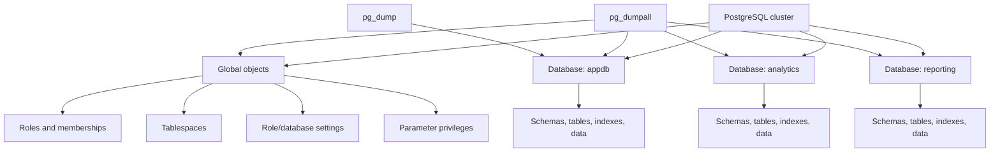

# `pg_dumpall` for Roles and Cluster-Wide Objects in PostgreSQL

A PostgreSQL cluster can contain multiple databases, yet not every important object lives inside an individual database. **Roles, role memberships, and tablespaces** have cluster-wide scope. If you only run `pg_dump` for each database, you may recover tables and data while still missing the roles that own objects, access privileges, or tablespaces required by those databases.

`pg_dumpall` is the cluster-level logical backup tool. It exports cluster-wide objects and can export all databases into a single SQL script. This lesson explains how to dump roles and cluster-wide objects, how to restore them in the proper order, and how to verify whether a dump is sufficient to recover an environment.

This lesson belongs to the **Backup** chapter and focuses on:

- Distinguishing database objects from cluster-wide objects.
- Dumping roles, memberships, tablespaces, and related settings/privileges.
- Using `--globals-only`, `--roles-only`, `--tablespaces-only`, and security options.
- Understanding what `pg_dumpall` does not back up.
- Restoring with `psql`, preparing tablespaces, and handling ownership.
- Managing password hashes, backup permissions, and sensitive dump files.
- Scheduling backups, verifying results, and performing regular restore rehearsals.

> **Key takeaway:** `pg_dumpall` creates a logical SQL dump. It helps recreate roles, tablespaces, databases, and database contents via script, but does not replace physical backups, WAL archives, or backing up configuration and components external to PostgreSQL.

## 1. Database and Cluster Are Two Distinct Scopes

A PostgreSQL server instance manages a **database cluster**. A cluster consists of multiple databases sharing certain server-level catalogs and resources.

### 1.1. Objects Residing Within Each Database

Examples of objects typically belonging to a single database:

- Schemas, tables, views, materialized views.
- Indexes, sequences, constraints, and triggers.
- Functions, procedures, types, and domains.
- Extensions installed inside that database.
- Database-local privileges on schemas, tables, sequences, and functions.
- Large objects and table data.
- Publications and certain database-scoped replication objects depending on version.

When using `pg_dump`, you generally back up one database at a time. A database dump can contain that database's DDL, data, and ACLs.

### 1.2. Cluster-Wide Objects

Certain objects are shared across multiple databases:

| Object | Scope | Why Backup Is Needed |
| --- | --- | --- |
| Roles | Cluster-wide | Object owners and principals for login/authorization |
| Role memberships | Cluster-wide | Defines which roles can inherit or `SET ROLE` to another role |
| Tablespaces | Cluster-wide | Determines where relation files are stored |
| Database definitions | Cluster-wide | Database name, owner, encoding, locale, default tablespace, and ACL |
| Role/database settings | Cluster-level catalog | `ALTER ROLE` or `ALTER DATABASE` settings |
| Configuration parameter privileges | Cluster-wide on supported versions | Stores `GRANT`/`REVOKE` privileges for `SET` on config parameters |

Roles and tablespaces are not created independently inside each database. If you restore a database into a new cluster without the owner role, ownership or ACL commands may fail or require changing owners.

### 1.3. Backup Scope Diagram



`pg_dump` handles a single database. `pg_dumpall` can combine global objects and database dumps into one script.

## 2. How Does `pg_dumpall` Work?

`pg_dumpall` is a client program executed from an administration host or backup host. It connects to the PostgreSQL server, exports global objects, and invokes `pg_dump` to dump each database's contents.

A full-cluster dump command:

```bash
pg_dumpall --host=db.example.internal --port=5432 --username=backup_admin --file=cluster_backup.sql
```

The resulting script typically contains:

1. Statements to create roles and role memberships.
2. Statements to create tablespaces and related settings.
3. Statements to create databases.
4. Connection directives switching to each database.
5. SQL dump contents for each database.

Sections are written in order so required roles and global objects exist before database objects reference them.

### 2.1. Output Format

`pg_dumpall` produces a **plain-text SQL script**. You can inspect the file, search statements, store it in a backup system, or compress it using external tools.

Example:

```bash
pg_dumpall --username=backup_admin | gzip > cluster_backup.sql.gz
```

Restore plain SQL files using `psql`, not `pg_restore`. `pg_restore` is for archive formats created by `pg_dump` such as custom or directory format.

### 2.2. Why Does `pg_dumpall` Invoke `pg_dump`?

Each database has its own catalogs, schemas, and data. `pg_dumpall` orchestrates database dump calls via `pg_dump` and merges their output with the global objects section.

This means:

- Database dump options compatible with `pg_dump` can be passed through `pg_dumpall` depending on version.
- Check `pg_dumpall --help` for the binary in use.
- Some options apply only to global objects, while others are forwarded to database dumps.
- Available options can change across major versions.

### 2.3. Not a Physical Backup

`pg_dumpall` exports SQL statements to recreate objects and data. It does not copy raw data directories, WAL segments, shared buffers, or the physical state of the server.

Therefore, it fits logical migration/backups and object-level recovery. If you need to restore a cluster to an exact point in time using WAL/PITR, you need physical base backups and a WAL archive under a separate plan.

## 3. Dumping Only Global Objects with `--globals-only`

When the goal is to back up roles, tablespaces, and global objects without dumping database contents, use:

```bash
pg_dumpall --globals-only --username=backup_admin --file=globals.sql
```

Shorthand:

```bash
pg_dumpall -g -U backup_admin -f globals.sql
```

This is commonly used to generate a separate global backup file before dumping each database individually with `pg_dump`.

### 3.1. Commonly Exported Contents

A global dump can include:

- Role definitions and attributes.
- Role memberships/grants.
- Tablespaces.
- Role settings and database settings depending on version capabilities.
- Privileges on configuration parameters on supported versions.

Exact contents depend on major version and options used. Inspect the SQL file and consult `pg_dumpall --help` for your client before building restore workflows.

### 3.2. Global Dumps Contain No Table Data

`--globals-only` does not dump table rows, views, or business data. Nor does it create complete database schemas/data like a `pg_dump` database dump.

A split-file logical backup workflow can look like this:

```bash
pg_dumpall --globals-only -U backup_admin -f globals.sql
pg_dump -Fc -U backup_admin -d appdb -f appdb.dump
pg_dump -Fc -U backup_admin -d analytics -f analytics.dump
```

Restore global objects first, then create/restore each database according to plan.

### 3.3. When Should Globals Be Separated?

Separating a global dump is useful when:

- Databases are backed up in `pg_dump` custom format to enable selective restore.
- Roles/tablespaces must be established before restoring multiple databases.
- Moving a database into a cluster that already has global objects.
- Reviewing role definitions and memberships independently.
- Managing privileges and password hashes in a separate controlled artifact.

Avoid creating global dumps out of sync with database dumps if role ownership or memberships change during backups. Record the same backup timestamp and config to know which artifacts belong to the same set.

## 4. Dumping Only Roles or Tablespaces

`pg_dumpall` provides specialized options for global objects.

### 4.1. `--roles-only`

Dump role definitions and related role metadata:

```bash
pg_dumpall --roles-only -U backup_admin -f roles.sql
```

Useful when recreating principals before restoring databases or auditing access rights.

A role dump may include attributes such as:

- `LOGIN` or `NOLOGIN`.
- `SUPERUSER` or `NOSUPERUSER`.
- `CREATEDB`, `CREATEROLE`.
- `REPLICATION`.
- `BYPASSRLS`.
- Connection limits and validity.
- Role memberships and related grants.
- Password verifiers if dumping passwords is permitted and not excluded.

Do not treat a role dump as a complete backup of your entire authentication infrastructure. `pg_hba.conf`, LDAP/Kerberos/OIDC configurations, certificates, and external system secrets still need separate backups.

### 4.2. `--tablespaces-only`

Dump tablespaces:

```bash
pg_dumpall --tablespaces-only -U backup_admin -f tablespaces.sql
```

Tablespace definitions store names and location paths. The dump file does not contain physical data inside tablespace directories and does not automatically create those directories on the target host.

### 4.3. Choosing the Right Option

| Option | Scope |
| --- | --- |
| `--globals-only` | Global objects, no database dumps |
| `--roles-only` | Role-related objects only |
| `--tablespaces-only` | Tablespaces only |
| Without the options above | Dumps global objects and all databases accessible to the account |

Do not combine options in ways undocumented for your version. If you need subsets, generate separate files and inspect outputs before automating.

## 5. Roles, Ownership, and Memberships

A role is a PostgreSQL principal. A role can log in, own objects, receive privileges, or act as a permission group.

### 5.1. `LOGIN` and `NOLOGIN` Roles

```sql
CREATE ROLE app_login
    LOGIN
    CONNECTION LIMIT 50;

CREATE ROLE app_readonly
    NOLOGIN;

GRANT app_readonly TO app_login;
```

`app_login` is a login-enabled role. `app_readonly` is a non-login group role that can hold shared privileges.

Global dumps must preserve both role definitions and membership relationships so the authorization model works after restore.

### 5.2. Role Attributes

```sql
CREATE ROLE deployment_admin
    LOGIN
    CREATEDB
    CREATEROLE
    CONNECTION LIMIT 10;

CREATE ROLE replication_agent
    LOGIN
    REPLICATION;
```

Do not grant `SUPERUSER` merely to make an application run. Sensitive attributes must follow the principle of least privilege.

### 5.3. Memberships and `SET ROLE` Privileges

Role memberships define relationships between roles:

```sql
GRANT app_readonly TO analyst_user;
GRANT app_writer TO order_service;
```

Newer PostgreSQL versions may represent additional membership options such as admin, inherit, or SET ROLE privileges with corresponding syntax. When dumping/restoring across major versions, check compatibility of membership options.

### 5.4. Object Owners Must Exist Upon Restore

For example, if a database dump contains:

```sql
ALTER TABLE public.orders OWNER TO order_owner;
```

If role `order_owner` does not exist yet, the statement fails. Hence, restoring global roles before database objects is the standard order.

If you intentionally restore under a different owner, use appropriate `pg_dump` options or perform a planned ownership migration. Changing owners can affect default privileges, `SECURITY DEFINER` routines, policies, and applications.

### 5.5. Role Settings and Database Settings

Settings such as:

```sql
ALTER ROLE analyst_user SET statement_timeout = '30s';
ALTER DATABASE analytics SET timezone = 'UTC';
ALTER ROLE analyst_user IN DATABASE analytics
    SET search_path = reporting, public;
```

are stored in role/database configuration catalogs. Global dumps can export relevant settings depending on version. Upon restore, verify these values if applications rely on session defaults.

Do not confuse catalog settings with server configuration files. `ALTER SYSTEM` and `postgresql.conf` contents belong to a separate administrative scope.

## 6. Tablespaces and Restore Prerequisites

A tablespace maps a logical name to a filesystem location storing relation files.

Example:

```sql
CREATE TABLESPACE fast_storage
LOCATION '/pgdata/tablespaces/fast_storage';

CREATE DATABASE appdb
    TABLESPACE fast_storage;
```

### 6.1. Dumps Store Only Definitions, Not Data Directories

A global dump can emit a statement like:

```sql
CREATE TABLESPACE fast_storage
    OWNER postgres
    LOCATION '/pgdata/tablespaces/fast_storage';
```

It does not package the contents of the tablespace directory into the SQL file.

On the target server, you must:

1. Create the planned filesystem paths.
2. Ensure paths exist, are empty, and are owned by the OS user running PostgreSQL.
3. Ensure mount points/storage are mounted properly.
4. Restore tablespace definitions with a sufficiently privileged role.
5. Verify permissions and disk capacity before restoring database objects.

Do not create tablespace directories as an application user and expect PostgreSQL to fix ownership automatically.

### 6.2. Tablespace Paths May Differ Between Source and Target

When migrating servers, source paths might not exist on the target. You can:

- Recreate the exact old paths if target architecture allows.
- Build equivalent storage mappings before restore.
- Use `--no-tablespaces` in an appropriate dump workflow to omit tablespace placement clauses and restore objects into the default tablespace.
- Adjust tablespace/database/object placement per your migration plan.

Do not ignore tablespace definitions if database dumps reference them without defining an alternative storage target.

### 6.3. Permissions to Create Tablespaces

Creating a tablespace requires appropriate PostgreSQL administrative privileges and a filesystem location meeting server requirements. Typically superuser or version-appropriate tablespace privileges are needed, and the OS directory must be prepared by a system administrator.

### 6.4. Inspecting Tablespaces After Restore

```sql
SELECT
    spcname,
    pg_get_userbyid(spcowner) AS owner,
    pg_tablespace_location(oid) AS location
FROM pg_tablespace
ORDER BY spcname;
```

`pg_default` and `pg_global` are special system tablespaces; do not treat them like custom tablespaces you need to create manually.

## 7. Password Hashes and Securing Role Dumps

Role dumps can contain role password verifiers. Although not plaintext passwords, they remain sensitive data requiring protection.

### 7.1. Password Verifiers Can Appear in the Output File

If the backup account has privileges to read role password data and password exclusion is not requested, the output may include password verifier strings stored in PostgreSQL.

An exposed dump file enables offline password guessing attacks. Therefore:

- Store dumps in directories with restricted access permissions.
- Encrypt backups at rest and in transit.
- Do not send dump files to unauthorized tickets/chats/logs.
- Do not print role dump contents to public consoles.
- Manage retention and delete expired copies per policy.
- Audit who can download/read backup artifacts.

### 7.2. `--no-role-passwords`

If you want to omit password verifiers from output:

```bash
pg_dumpall --globals-only --no-role-passwords -U backup_admin -f globals_without_passwords.sql
```

After restore, roles may need new passwords assigned or appropriate authentication configured before applications can log in.

In cases where the dump account lacks privileges to read password data, password hashes will also be omitted. If backing up complete authentication state is required, verify the account's privileges and inspect output in a secure environment.

### 7.3. Never Pass Passwords Directly on the Command Line

Avoid putting passwords directly on the command line, where they can leak via process listings, shell history, or logs.

Use appropriate methods:

- `.pgpass` with strict permissions on Unix-like systems.
- `pgpass.conf` per Windows conventions.
- A PostgreSQL service file to manage connection parameters.
- Interactive prompts during manual execution.
- Secret managers or backup platform credential injection.

Avoid setting `PGPASSWORD` persistently in scripts/logs when safer credential management options exist.

### 7.4. Password Hashes and Authentication Compatibility

Password verifiers can use different algorithms/formats depending on config and version, such as MD5 or SCRAM. After restore, confirm:

- The target server supports the dumped verifier method.
- `pg_hba.conf` permits the corresponding authentication method.
- Roles have valid, unexpired passwords.
- TLS/certificates or external authentication dependencies are available.
- Applications can connect using new/restored credentials.

Do not assume a `LOGIN` role guarantees applications will authenticate successfully.

## 8. Privileges Required to Run `pg_dumpall`

`pg_dumpall` must connect to the server and access all databases/global catalogs to be dumped.

### 8.1. Backup Account

For a complete cluster backup, a highly privileged administrative account is usually used because it needs to read global role information, dump all databases, and access objects regular roles cannot read.

Managed database services may provide a special administrative role with certain restrictions.

### 8.2. Least Privilege

Do not grant superuser to applications solely for backups. Use a dedicated backup account:

- Used strictly for backup/restore.
- Never used by application connection pools.
- Has dedicated passwords/certificates.
- Monitored with credential rotation.
- Granted only the privileges required by the server's backup rules.
- Not granted unnecessary DDL privileges outside backup scope.

Verify in practice that the account can dump all databases, roles, and tablespaces mandated by policy.

### 8.3. Insufficient Privileges Can Yield Incomplete Dumps

Scenarios:

- Unable to read password hashes.
- Unable to connect to a database.
- Unable to read certain tables/sequences.
- Unable to access extension objects or large objects.
- Insufficient privileges to dump global settings/privileges.

Never mark a backup successful just because a SQL file was created. Check exit codes, stderr, logs, and dump contents; `pg_dumpall` may report errors when a database fails to dump.

### 8.4. Checking the Connected Role

```sql
SELECT
    current_user,
    session_user,
    current_database(),
    version();
```

`current_user` may differ from `session_user` if the session executed `SET ROLE`. Log the user and server endpoint used for backups for traceability.

## 9. Commonly Used `pg_dumpall` Options

Exact option sets vary by major version. Check:

```bash
pg_dumpall --help
```

Common options:

| Option | Meaning |
| --- | --- |
| `-f, --file` | Write output to a file |
| `-g, --globals-only` | Dump global objects only, no databases |
| `--roles-only` | Dump roles only |
| `--tablespaces-only` | Dump tablespaces only |
| `--no-role-passwords` | Do not emit password verifiers |
| `--no-tablespaces` | Omit tablespace selection commands within applicable scope |
| `-h, --host` | PostgreSQL server host |
| `-p, --port` | Server port |
| `-U, --username` | Role used to connect |
| `-l, --database` | Initial database used for connection |
| `-w, --no-password` | Never prompt for password; fail if needed without credentials |
| `-W, --password` | Force password prompt |
| `-v, --verbose` | Display verbose progress |
| `--clean` | Add DROP commands before corresponding create commands where supported |
| `--if-exists` | Use IF EXISTS with applicable DROP commands when combined with clean |
| `--quote-all-identifiers` | Quote all identifiers for greater compatibility |
| `--no-sync` | Skip waiting for output file sync on exit on supported versions |

### 9.1. `-l` Only Selects the Initial Connection Database

Example:

```bash
pg_dumpall -U backup_admin -l postgres -f cluster.sql
```

`-l postgres` picks the initial database to connect to while starting work. It does not mean dumping only the `postgres` database.

### 9.2. `--clean` Can Destroy Data on Restore

If you use:

```bash
pg_dumpall --clean --if-exists -U backup_admin -f cluster_clean.sql
```

the restore script may contain commands dropping databases/objects before recreating them. Running that script on a target can wipe existing objects.

Use `--clean` only when the target is confirmed replaceable or part of an explicit migration plan. Never run a clean script against a production cluster holding data you need to keep.

### 9.3. `--no-tablespaces` Has Trade-Offs

This option helps when the target lacks identical filesystem paths or you want objects restored into the default tablespace. However, dropping tablespace placement can alter performance, capacity, and storage policies. Document source/target mappings in your migration plan.

### 9.4. Check Options of the Exact Binary

Client utilities may differ in version from the server. Run `pg_dumpall --version` and `pg_dumpall --help` from the exact binary used in automation. Do not copy an option from newer major-version docs into scripts running on older clients.

## 10. Connections and Credential Management

Examples can run from an administrative host connecting to a remote server.

### 10.1. Connecting via Host/Port

```bash
pg_dumpall --host=192.0.2.20 --port=5432 --username=backup_admin --file=cluster.sql
```

The host IP is illustrative. In production, use verified DNS/service endpoints.

### 10.2. Using a Service File

Example service file:

```text
[prod-backup]
host=db.example.internal
port=5432
dbname=postgres
user=backup_admin
sslmode=verify-full
sslrootcert=/etc/postgresql/certs/root.crt
```

Then:

```bash
pg_dumpall "service=prod-backup" --file=cluster.sql
```

Service file syntax and paths must match OS, client version, and policy. Do not store passwords in a service file unless that file is properly protected.

### 10.3. TLS and Server Verification

Because backups carry sensitive data, network connections should authenticate the server and encrypt traffic where appropriate. With `sslmode=verify-full`, the client validates both the certificate chain and hostname per configuration. Simply enabling SSL does not guarantee server identity verification.

### 10.4. Avoid Backing Up the Wrong Cluster

Before running a backup, verify the endpoint:

```sql
SELECT
    inet_server_addr() AS server_address,
    inet_server_port() AS server_port,
    current_database() AS connected_database,
    current_user AS connected_role,
    version();
```

You can cross-check environment labels from your service inventory. Never infer production vs. staging solely from a database name or host alias.

## 11. Full-Cluster Backup with `pg_dumpall`

Example full backup to a SQL file:

```bash
pg_dumpall --host=db.example.internal --port=5432 --username=backup_admin --verbose --file=/backups/postgres/cluster-2026-11-14.sql
```

With compression:

```bash
pg_dumpall --host=db.example.internal --username=backup_admin --verbose | gzip -c > /backups/postgres/cluster-2026-11-14.sql.gz
```

### 11.1. Checking Exit Status

When running through a shell pipeline, check the exit statuses of both `pg_dumpall` and `gzip`. In shells supporting `pipefail`, enable it so a failure in the first command is not masked by compression succeeding.

Bash example:

```bash
set -o pipefail
pg_dumpall -U backup_admin | gzip -c > cluster.sql.gz
status=$?
if [ "$status" -ne 0 ]; then
  echo "Backup failed" >&2
  exit "$status"
fi
```

On PowerShell/Windows, inspect `$LASTEXITCODE` of native binaries and validate output files. Pipeline error handling differs from Bash; do not copy Bash syntax verbatim to PowerShell.

### 11.2. Do Not Treat File Existence as Backup Success

A file can exist even if:

- The dump process was killed mid-run.
- One database failed to dump.
- The disk filled up.
- Credentials expired.
- A network timeout occurred.
- The script contains only the initial portion.
- A compression pipeline masked a `pg_dumpall` failure.

Automation must verify exit codes, plausible file sizes, logs, checksums, and restore tests.

### 11.3. Recording Backup Metadata

Store metadata alongside artifacts:

```text
backup_started_at
backup_finished_at
source_server
source_port
server_version
pg_dumpall_version
backup_scope
dump_options
database_list
globals_file
output_path
output_size_bytes
sha256
exit_code
stderr_log
encryption_method
retention_until
```

Metadata does not replace the dump file, but provides provenance and helps determine restorability.

## 12. Restoring Globals with `psql`

A global dump is plain SQL. Restore it with `psql` connected to an existing database on the target, typically `postgres`.

```bash
psql --host=db-target.example.internal --port=5432 --username=postgres --dbname=postgres --no-psqlrc --set=ON_ERROR_STOP=on --file=globals.sql
```

`--no-psqlrc` avoids loading personal `psql` settings that might alter script behavior. `ON_ERROR_STOP` instructs `psql` to stop on SQL errors instead of silently continuing.

### 12.1. Restore with Superuser or an Appropriate Administrative Role

Creating roles, memberships, and tablespaces normally requires high privileges. Use a restore account with adequate permissions in compliance with target governance policies.

Do not use a regular application role to run a global restore.

### 12.2. Restoring Tablespaces Requires Preparing the Filesystem First

If `globals.sql` includes `CREATE TABLESPACE`, target directories must already exist with proper permissions before running the restore. If source paths cannot be used, prepare a mapping or re-dump without preserving tablespace placement.

### 12.3. Restore Idempotency

Global scripts are not always safe to re-run repeatedly against a cluster that already holds part of the roles/tablespaces. `CREATE` statements may fail because objects already exist; memberships/ACLs may reapply over existing state.

Before a second run, check where the script stopped and what state the target is in. Do not carelessly add `--clean` or drop roles/tablespaces just to force the script through.

## 13. Restoring an Entire Cluster from `pg_dumpall`

If you generated a full cluster SQL dump:

```bash
psql --host=db-target.example.internal --port=5432 --username=postgres --dbname=postgres --no-psqlrc --set=ON_ERROR_STOP=on --file=cluster.sql
```

For compressed files:

```bash
gzip -dc cluster.sql.gz | psql -X -v ON_ERROR_STOP=1 -U postgres -d postgres
```

The restore executes the script and uses embedded connection commands to switch into each database.

### 13.1. Why Must You Restore into an Existing Database?

`psql` needs an existing database to connect to before reading the script. The starting database is usually `postgres` or another available maintenance database on the target.

The script can then create databases and switch connections into them.

### 13.2. Do Not Wrap the Entire Restore in One Transaction

Do not use `psql -1` or `--single-transaction` for full `pg_dumpall` restores in general. The script may contain `CREATE DATABASE`, `DROP DATABASE`, and database-switching meta-commands, which are incompatible with a single transaction.

### 13.3. Restores May Require Environment Adjustments

Statements can fail if the target:

- Lacks tablespace paths.
- Lacks extension packages or shared libraries.
- Runs an older major version that does not understand dumped syntax.
- Lacks permissions for the restore role.
- Has colliding database/role names with differing owners/attributes.
- Has different collation/locale or incompatible encoding.
- Has different authentication configuration.
- Restricts creation of certain objects under managed service policies.

Conduct restore rehearsals on a production-like target before relying on the backup for DR.

## 14. Two-Stage Restore: Globals First, Then Each Database

Another strategy is:

1. `pg_dumpall --globals-only` to back up global objects.
2. `pg_dump -Fc` separately for each database.
3. Restore globals first.
4. Create databases or use `pg_restore --create` per plan.
5. Restore each database with `pg_restore`.

Example:

```bash
pg_dumpall --globals-only -U backup_admin -f globals.sql
pg_dump -Fc -U backup_admin -d appdb -f appdb.dump
```

Restore:

```bash
psql -X -v ON_ERROR_STOP=1 -U postgres -d postgres -f globals.sql
createdb -U postgres appdb
pg_restore --username=postgres --dbname=appdb --exit-on-error appdb.dump
```

### 14.1. Benefits of Custom Format

Custom format supports:

- Selective object restore.
- Parallel restore where appropriate.
- Archive inspection via `pg_restore -l`.
- Separating schema/data/ACL as needed.
- Avoiding a single massive plain SQL script across all databases.

### 14.2. Ownership Ordering

Global roles must exist before restoring object ownership. If database dumps include owners/ACLs, matching roles must exist or options must be used to remap ownership per plan.

### 14.3. Do Not Omit Global Backups When Using `pg_dump`

A backup set containing only `appdb.dump` does not contain cluster roles and tablespaces. Store globals alongside the artifact set or maintain versioned global backups with matching history.

## 15. Consistency of `pg_dumpall`

`pg_dumpall` invokes `pg_dump` for each database. Each database dump gets its own consistent snapshot via `pg_dump`'s mechanism, but the full cluster dump is not one atomic snapshot shared across all databases.

### 15.1. Snapshots Across Databases Can Differ in Time

Suppose:

- `appdb` is dumped at 10:00.
- A business action updates both `appdb` and `analytics` at 10:02.
- `analytics` is dumped at 10:05.

The full dump file may contain `appdb` before the change and `analytics` after the change. If data is logically synchronized across databases, the two databases may not reflect the exact same point in time.

### 15.2. Why Is This Often Still Acceptable?

PostgreSQL does not support ordinary single transactions spanning multiple databases in a cluster. Many applications also do not require an atomic cross-database snapshot. However, systems with external synchronization workflows or cross-database data pipelines should evaluate this carefully.

### 15.3. When a Consistent Whole-Cluster Recovery Point Is Needed

If you must recover all databases and global state to one common point in time, consider physical backups combined with WAL archiving/PITR as designed in PostgreSQL. Physical backups operate at the cluster level and recover consistently via WAL.

`pg_dumpall` fits logical export/migration; it does not provide an atomic recovery point across all databases.

## 16. Components `pg_dumpall` Does Not Back Up

A full `pg_dumpall` is not a complete copy of the entire PostgreSQL installation.

| Component | Included in `pg_dumpall`? | Notes |
| --- | --- | --- |
| Roles | Yes | Includes role definitions per privileges/options |
| Role memberships | Yes | Per version and role-related dump |
| Tablespaces | Definitions only | Does not contain filesystem data inside tablespaces |
| Database definitions | Included in full dump | Excluded with `--globals-only` |
| Database schemas/data | Included in full dump | Logical dump per database |
| `postgresql.conf` | No | Back up configuration files separately |
| `pg_hba.conf` | No | Separate authentication policy |
| `pg_ident.conf` | No | Separate user mapping |
| SSL certificates/private keys | No | Managed outside the database |
| WAL segments/archive | No | Requires WAL archive/physical backup |
| Physical data directory | No | Requires valid base backup/filesystem backup |
| Extension binaries/shared libraries | No | Install corresponding packages on target |
| OS users, groups, mount points | No | OS administration |
| Backup scripts/credentials/service files | No | Separate secret/config management |
| Replication slots and full replication runtime state | Should not be assumed | Verify and rebuild per replication runbook |
| Monitoring agents/log shipping | No | Infrastructure outside PostgreSQL |

### 16.1. Extension Metadata vs. Extension Files

A database dump may contain `CREATE EXTENSION` and extension objects per dump rules. However, the target server still needs compatible extension packages/shared libraries installed.

If extension files are missing, restore statements can fail even when the SQL dump is valid.

### 16.2. Server Configuration Must Be Backed Up Separately

Parameters such as:

- `shared_buffers`.
- `work_mem`.
- `max_connections`.
- `wal_level`.
- `archive_mode`.
- `ssl` settings.
- `log_line_prefix`.
- `pg_hba.conf` rules.

are managed via GUC/config files and deployment systems. `pg_dumpall` does not replace version-controlling or backing up those files.

### 16.3. WAL and PITR

If point-in-time recovery is required, you need physical base backups and continuous storage of required WAL segments. A logical SQL dump cannot replay WAL to an arbitrary timestamp.

## 17. Major Version Upgrades and Migrations

`pg_dumpall` is frequently used to migrate logical data across clusters or major versions.

### 17.1. Choosing Compatible Binaries

Use `pg_dumpall`/`pg_dump` matching the source major version or a supported newer client version. An older dump utility may refuse to connect to a newer server.

Check:

```bash
pg_dumpall --version
psql --version
```

And on the source:

```sql
SHOW server_version;
```

### 17.2. Restoring into an Older Major Version Is Not Guaranteed

SQL output may use syntax or object attributes that an older target does not understand. Never assume a dump from a newer PostgreSQL release will restore cleanly onto an older server.

Read upgrade compatibility notes and test restoring on a clone before migrating.

### 17.3. Collation and Locale

Database creation clauses can specify encoding, locale provider, collation, and locale settings. The target must support the corresponding values. If OS/libc/ICU versions differ, sorting/index behavior may change or require rebuilding indexes per version guidance.

### 17.4. Extension Versions

Install matching extension packages before restoring and verify extension versions. An extension upgrade may require running `ALTER EXTENSION ... UPDATE` per vendor instructions after database restore finishes.

## 18. Backups in Managed PostgreSQL Environments

Managed database services may restrict certain operations:

- No true superuser access.
- Disallowing arbitrary tablespace creation.
- Restricting access to `pg_authid` or password hashes.
- Disallowing restoration of certain global objects.
- Managing WAL archives, backups, and replication internally.
- Providing provider-specific APIs for backup/restore or cloning.

Before choosing `pg_dumpall` as your sole strategy:

1. Confirm backup role permissions supported by the provider.
2. Verify whether all databases can be dumped.
3. Confirm which roles/password verifiers are exported.
4. Check whether tablespace objects are permitted.
5. Determine how databases/roles are restored on the target service.
6. Use the provider's native backup/PITR if recovery points/availability exceed what logical dumps provide.

Do not attempt to create tablespaces or access sensitive catalogs by bypassing service restrictions.

## 19. Inspecting Global Objects After Backup

A backup must be verified for both contents and restorability.

### 19.1. Inspecting Existing Roles

```sql
SELECT
    rolname,
    rolsuper,
    rolinherit,
    rolcreaterole,
    rolcreatedb,
    rolcanlogin,
    rolreplication,
    rolbypassrls,
    rolconnlimit,
    rolvaliduntil
FROM pg_roles
ORDER BY rolname;
```

`pg_roles` is a view that does not expose password verifiers. Do not use it to confirm whether password hashes are present in a dump.

### 19.2. Inspecting Role Memberships

```sql
SELECT
    parent.rolname AS granted_role,
    member.rolname AS member_role,
    grantor.rolname AS grantor
FROM pg_auth_members AS m
JOIN pg_roles AS parent ON parent.oid = m.roleid
JOIN pg_roles AS member ON member.oid = m.member
JOIN pg_roles AS grantor ON grantor.oid = m.grantor
ORDER BY parent.rolname, member.rolname;
```

On newer major versions, the membership catalog may contain extra columns for options. The query above reads only core relationships; inspect the catalog schema if detailed auditing of admin/inherit/set options is needed.

### 19.3. Inspecting Tablespaces

```sql
SELECT
    spcname,
    pg_get_userbyid(spcowner) AS owner,
    pg_tablespace_location(oid) AS location
FROM pg_tablespace
ORDER BY spcname;
```

### 19.4. Inspecting Databases and Owners

```sql
SELECT
    datname,
    pg_get_userbyid(datdba) AS owner,
    pg_encoding_to_char(encoding) AS encoding,
    datcollate,
    datctype,
    dattablespace::regclass AS default_tablespace,
    datallowconn
FROM pg_database
ORDER BY datname;
```

Results help inventory databases, owners, encodings, locales, and default tablespaces.

### 19.5. Checking Role/Database Settings

```sql
SELECT
    COALESCE(r.rolname, 'ALL ROLES') AS role_name,
    COALESCE(d.datname, 'ALL DATABASES') AS database_name,
    unnest(s.setconfig) AS setting
FROM pg_db_role_setting AS s
LEFT JOIN pg_roles AS r ON r.oid = s.setrole
LEFT JOIN pg_database AS d ON d.oid = s.setdatabase
ORDER BY role_name, database_name, setting;
```

Catalog output may differ slightly by version. Use the output to cross-check settings exported in the globals dump.

## 20. Checking Dump Files and Logs

After dumping:

- Check the exit code of `pg_dumpall`.
- Check stderr/logs to confirm no database was skipped.
- Verify file size is non-zero and reasonably aligned with baselines.
- Generate a checksum.
- Compress/encrypt per policy.
- Verify file read permissions.
- Confirm artifacts were uploaded to the backup destination.
- Run periodic test restores.

### 20.1. Generating Checksums

On Linux:

```bash
sha256sum cluster.sql > cluster.sql.sha256
```

On PowerShell:

```powershell
Get-FileHash -Algorithm SHA256 .\cluster.sql
```

Checksums detect file modification or corruption during storage/transfer. They do not prove the SQL script restores cleanly.

### 20.2. Inspecting the Start/End of a Script

You can view portions of the file:

```bash
head -n 40 globals.sql
tail -n 40 globals.sql
```

Do not print an entire role dump into terminal logs or CI outputs that retain logs. If the file contains password hashes, perform inspection in a secured environment.

### 20.3. Parsing SQL Does Not Replace Restore Tests

A syntactically valid file can still fail because the target lacks roles, tablespaces, extensions, privileges, or locales. Only a test restore into a comparable environment validates the actual procedure.

## 21. Designing a Backup Schedule

Backup scheduling depends on how fast global objects change and your RPO/RTO requirements.

### 21.1. Globals May Change Less Often Than Database Data

Roles and tablespaces typically change less frequently than table rows. Still, permission changes, new roles, role attribute rotations, or owner migrations may require immediate backups.

A common model:

- Periodic scheduled full logical dumps.
- Global objects dump after significant role/tablespace changes.
- Per-database dumps per each database's RPO/RTO.
- Physical base backups and WAL archives if PITR is required.
- Separate configuration/secret backups.

### 21.2. Synchronizing Artifacts

If you back up global objects at 02:00 and dump a database at 23:00, a role created between those times may not exist in the globals artifact. Synchronize schedules or generate a globals dump alongside each backup batch.

### 21.3. Retention and Encryption

Global dumps can contain password verifiers, role names, ownership models, and administrative privileges. Apply:

- Encryption at rest.
- Encryption in transit.
- Least-privilege access.
- Auditing of downloads/access.
- Policy-driven retention.
- Secure deletion upon expiration.
- Key rotation and key access controls.

## 22. Recovering When Only Roles or Global Metadata Are Lost

Not every incident requires restoring an entire database.

### 22.1. Losing a Single Role

If a role is accidentally dropped while database objects remain intact, a global backup can supply the role definition/memberships for recovery. However, check current ownership and ACLs before running recreation commands.

Do not mechanically create a new role with the same name but different attributes. Compare:

- `LOGIN`/`NOLOGIN`.
- `SUPERUSER`/`CREATEDB`/`CREATEROLE`.
- `REPLICATION`/`BYPASSRLS`.
- Memberships.
- Connection limits and validity.
- Role settings.
- Related ownership and privileges.

### 22.2. Losing a Tablespace Definition

If the tablespace directory and relation files still exist while tablespace metadata is lost/corrupted, recovery is not simply running `CREATE TABLESPACE` pointing to the old path. Follow PostgreSQL's appropriate recovery/restore procedures and ensure catalogs, symlinks, and data files are consistent.

Do not create a tablespace pointing at a directory full of old files assuming the server will automatically adopt the relation files as before.

### 22.3. Losing the Entire Cluster

If the data directory or storage is lost, a `pg_dumpall` SQL dump can rebuild logical objects and rows on a new cluster. However, to recover accurately to a specific point in time, WAL history and physical backups may be required.

## 23. Restore Rehearsal Procedure

A restore rehearsal should run regularly on a test cluster resembling the production target.

### Step 1 — Prepare Target

- Install a supported PostgreSQL major version.
- Install required extension packages.
- Create OS directories for tablespaces.
- Verify locale/encoding.
- Prepare credentials and restore privileges.

### Step 2 — Verify Artifacts

- Verify checksums.
- Verify backup timestamps.
- Verify source/client versions.
- Verify output is not truncated.
- Read logs and exit status.

### Step 3 — Restore Globals

Use `psql` with `ON_ERROR_STOP`, log output, and stop on errors. Verify roles, memberships, and tablespaces.

### Step 4 — Restore Databases

If using a full `pg_dumpall`, run the full script per procedure. If using per-database custom dumps, create databases and run `pg_restore` according to the dependency/owner plan.

### Step 5 — Verify Application

- Connect as each service role.
- Verify schema/table/function permissions.
- Verify owners and default privileges.
- Run smoke queries.
- Verify extensions and routines.
- Confirm tablespaces/paths.
- Check role/database settings.

### Step 6 — Record Timings and Errors

Measure restore duration, total size, errors, manual intervention steps, and achieved RTO. Update the runbook whenever the environment changes.

## 24. Common Errors When Using `pg_dumpall`

| Error | Common Cause | Remediation |
| --- | --- | --- |
| permission denied when dumping roles | Backup role lacks permission to read global role data | Use a suitably privileged backup role or omit password hashes per policy |
| Unable to connect to a database | Credentials/host/ACL/database state | Verify connectivity to each database and check logs |
| role does not exist on restore | Globals not restored yet or role missing | Restore globals before database objects |
| tablespace does not exist | Tablespace definition not restored yet | Prepare filesystem and restore tablespaces first |
| Tablespace location invalid | Path missing, non-empty, or wrong owner | Prepare OS directory per requirements |
| Syntax error on restore | Incompatible client/server major versions | Use compatible dump utility and test upgrade path |
| Extension does not exist | Missing package/shared library on target | Install extensions before restore |
| Password login fails | Hashes omitted or auth config differs | Reset credentials and check `pg_hba.conf` |
| Script runs partially then stops | A DDL/ACL statement failed | Use `ON_ERROR_STOP`, inspect logs, handle partial state |
| Dump file too large/disk full | Uncompressed output, insufficient disk space | Use streaming compression and forecast capacity |
| Restore accidentally drops objects | Script contains `--clean` | Review SQL and verify target before running |
| Backup file exists yet incomplete | Process killed or pipeline hid error | Check exit code, checksum, and run restore rehearsals |

## 25. Anti-Patterns to Avoid

- Backing up only a database with `pg_dump` and assuming roles/tablespaces are inside the file.
- Running `pg_dumpall` with an under-privileged role yet marking the backup successful.
- Storing global dumps containing password verifiers in world-readable directories.
- Passing passwords on the command line or committing passwords into scripts.
- Restoring databases before creating roles required by database objects.
- Creating tablespaces without preparing filesystem paths.
- Running `--clean` on a cluster holding data you need to preserve.
- Passing `pg_dumpall` plain SQL output to `pg_restore`.
- Passing `psql -1` for full-cluster scripts containing `CREATE DATABASE`/database switches.
- Assuming a full `pg_dumpall` is an atomic snapshot shared across all databases.
- Using logical dumps instead of physical backups when PITR is required.
- Omitting extension binaries and server configuration from the DR plan.
- Assuming password hashes in dumps guarantee applications can log in on the target.
- Skipping restore tests until an actual incident occurs.
- Using a client binary older than the server without checking compatibility.

## 26. Example Global Objects Backup Runbook

### 26.1. Dump Globals

```bash
pg_dumpall --globals-only --host=db.example.internal --port=5432 --username=backup_admin --verbose --file=/backups/postgres/globals.sql
```

### 26.2. Verify Output

```bash
test -s /backups/postgres/globals.sql
sha256sum /backups/postgres/globals.sql
```

Record the dump command's exit status, log, checksum, and completion time in the backup inventory.

### 26.3. Upload/Encrypt

Encrypt the file using an organization-approved backup/secret management system. Do not leave plaintext copies in open-permission staging directories.

### 26.4. Test Restore

On a lab target:

```bash
psql -X -v ON_ERROR_STOP=1 -U postgres -d postgres -f globals.sql
```

Then inspect roles, memberships, tablespaces, and settings using the catalog queries in section 19.

### 26.5. Record Results

Document:

- Source/target versions.
- Restored global objects.
- Objects skipped due to permission/version limits.
- Tablespace path mappings.
- Role login tests.
- Restore duration.
- Errors and remediation.

## 27. Practice Labs

Perform on an isolated lab cluster. Never run `--clean`, drop roles/tablespaces, or reset a production cluster.

### Lab 1 — Distinguishing `pg_dump` and `pg_dumpall`

Create two databases and one shared role. Dump one database with `pg_dump`, then dump the cluster with `pg_dumpall`. Identify where the role definition appears.

### Lab 2 — Dumping `--globals-only`

Run `pg_dumpall --globals-only`. Locate the `CREATE ROLE`, `GRANT`, and `CREATE TABLESPACE` statements in the file. Explain why there are no table rows.

### Lab 3 — Dumping `--roles-only`

Run `pg_dumpall --roles-only`. List exported role attributes and identify membership statements.

### Lab 4 — Dumping `--tablespaces-only`

Create a lab tablespace with a valid directory, dump with `--tablespaces-only`, and read the output. Distinguish the SQL definition from physical data.

### Lab 5 — Role Membership

Create two `NOLOGIN` roles and one `LOGIN` role, and grant memberships. Dump globals and inspect the `GRANT` statements.

### Lab 6 — Role Attributes

Create a lab role with `CREATEDB`, a connection limit, and validity. Dump roles and inspect how attributes appear in SQL.

### Lab 7 — Password Verifiers

In the lab, dump globals with and without `--no-role-passwords`. Secure the outputs and compare the differences. Do not share files containing password hashes.

### Lab 8 — Restoring Globals

Create an empty test cluster, restore globals using `psql` with `ON_ERROR_STOP`. Verify roles/memberships after restore.

### Lab 9 — Owner Dependency

Create a table owned by a dedicated role, dump the database and globals. Restore globals before the database and check ownership.

### Lab 10 — Tablespace Directories

Create a tablespace in the lab and dump globals. Build a target with a different path and document the required filesystem mapping steps.

### Lab 11 — No Tablespaces

Research `--no-tablespaces` on your version. Create a database dump using this option and compare placement behavior upon restore.

### Lab 12 — Role/Database Settings

Use `ALTER ROLE SET`, `ALTER DATABASE SET`, and `ALTER ROLE IN DATABASE SET`. Run a `--globals-only` dump and check whether the settings are exported.

### Lab 13 — Checking Role Inventory

Query `pg_roles`. Compare against role definitions in the globals SQL. Why does `pg_roles` not display password verifiers?

### Lab 14 — Membership Catalog

Read `pg_auth_members`. Compare `granted_role`/`member_role` relationships against `GRANT` statements in the dump.

### Lab 15 — Database Owners

Read `pg_database` to list owners, encodings, and default tablespaces. Compare against database definitions in full `pg_dumpall` output.

### Lab 16 — Full Cluster Dump

Create a full SQL dump on a lab cluster with two databases. Locate the global section, database creations, and connection-switching commands.

### Lab 17 — Restoring a Full Dump

Create a target lab cluster and restore using `psql` with `ON_ERROR_STOP`. Verify both globals and database objects.

### Lab 18 — Avoiding Single Transaction

Observe why a full dump with `CREATE DATABASE` and database switches is incompatible with `psql -1`. Test in an isolated lab and record the error/explanation.

### Lab 19 — The `--clean` Option

In a disposable lab cluster, create a dump with `--clean`. Read the `DROP` statements carefully. Never run on a cluster with data you need to keep.

### Lab 20 — Plain SQL vs. Custom Archive

Dump one database with `pg_dump -Fc`, then dump the full cluster with `pg_dumpall`. Compare restoring with `pg_restore` and `psql`.

### Lab 21 — Version Compatibility

Record `pg_dumpall --version` and `SHOW server_version`. Research client version constraints when dumping newer servers and risks when restoring to older major versions.

### Lab 22 — Missing Extensions

Create an extension in the lab, dump the database, and attempt restoring onto a target missing the extension package. Explain why SQL dumps do not bundle shared libraries.

### Lab 23 — Password Authentication

Restore a role with a password verifier into a lab target. Inspect `pg_hba.conf`, TLS, and authentication methods. Identify when password resets are necessary.

### Lab 24 — Backup Pipeline

Pipe `pg_dumpall` through `gzip` in the lab. Check exit statuses of both processes, file size, and checksum. Simulate a disk/output failure if possible without affecting production.

### Lab 25 — Restore Rehearsal

Write a runbook covering target preparation, restoring globals, restoring databases, smoke tests, role login checks, and recording RTO. Execute it at least once.

### Lab 26 — Distinguishing Logical and Physical Recovery

Compare `pg_dumpall` against base backup + WAL archive. Identify which approach satisfies PITR requirements and why logical dumps are not cluster-wide atomic snapshots.

## 28. Summary

Key takeaways when using **`pg_dumpall` for roles and cluster-wide objects**:

1. A PostgreSQL cluster has global objects shared across multiple databases.
2. `pg_dump` dumps one database; `pg_dumpall` can dump globals and all databases.
3. `--globals-only` dumps global objects such as roles and tablespaces without dumping database contents.
4. `--roles-only` and `--tablespaces-only` generate targeted dumps.
5. Roles, memberships, and ownership must be restored in order before database objects that depend on them.
6. Tablespace dumps contain definitions/paths, not filesystem data; the target must prepare directories and storage.
7. Role dumps may contain password verifiers; protect the files, or use `--no-role-passwords` if they must be excluded.
8. `pg_dumpall` outputs a plain SQL script restored with `psql`, not `pg_restore`.
9. Full restores may contain `CREATE DATABASE` and database-switching commands, so do not wrap the entire script in a single transaction.
10. `pg_dumpall` dumps each database with its own snapshot; it is not one atomic snapshot shared across all databases.
11. It does not back up server config files, WAL archives, physical data directories, OS directories, or extension binaries.
12. Managed services may limit global object dump/restore permissions; verify capabilities before selecting a workflow.
13. Always verify exit codes, logs, checksums, file permissions, and perform restore rehearsals.
14. When PITR or a cluster-wide physical recovery point is required, combine physical backups and WAL archiving.
15. A backup has operational value only once you have proven it can be restored in a target-like environment.

When designing backups, clearly separate two questions: **have database objects and data been dumped, and does the cluster have the roles, memberships, tablespaces, and external configuration required to operate after restore?** `pg_dumpall` protects the global SQL objects; DR runbooks must also cover everything a logical dump leaves behind.

## 29. Official PostgreSQL Documentation

- [pg_dumpall — dump a PostgreSQL database cluster](https://www.postgresql.org/docs/current/app-pg-dumpall.html)
- [pg_dump — dump a database](https://www.postgresql.org/docs/current/app-pgdump.html)
- [psql — PostgreSQL interactive terminal](https://www.postgresql.org/docs/current/app-psql.html)
- [Database Roles](https://www.postgresql.org/docs/current/user-manag.html)
- [Role Membership](https://www.postgresql.org/docs/current/role-membership.html)
- [Tablespaces](https://www.postgresql.org/docs/current/manage-ag-tablespaces.html)
- [Backup and Restore](https://www.postgresql.org/docs/current/backup.html)
- [SQL Dump](https://www.postgresql.org/docs/current/backup-dump.html)
- [Continuous Archiving and Point-in-Time Recovery](https://www.postgresql.org/docs/current/continuous-archiving.html)
- [Client Authentication](https://www.postgresql.org/docs/current/client-authentication.html)
- [Server Configuration](https://www.postgresql.org/docs/current/runtime-config.html)
- [pg_roles and pg_auth_members system catalogs](https://www.postgresql.org/docs/current/view-pg-roles.html)

The `current` links point to the current PostgreSQL documentation. `pg_dumpall` options, role membership syntax, password formats, parameter privileges, and catalog columns can vary by major version. Before running automation or production restores, verify `pg_dumpall --version`, `pg_dumpall --help`, `SHOW server_version`, and version-specific documentation.
