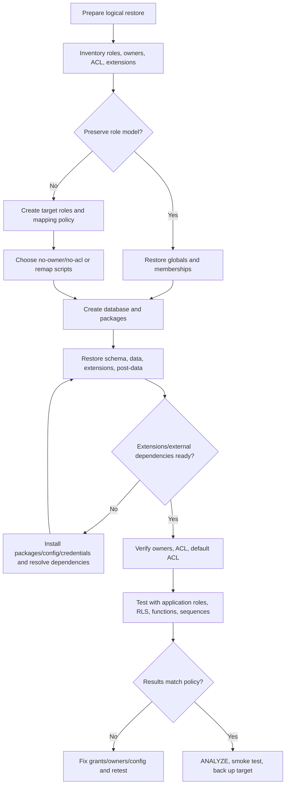

# Role, Owner, ACL, Extension, and Dependencies in PostgreSQL Recovery

A PostgreSQL backup may contain all table rows, indexes, constraints, and functions, yet the recovered database may still not be ready for the application. The application might fail to log in because a role is missing; a migration might fail because an object owner does not exist; users might be able to read a table but fail to use a sequence; a `SECURITY DEFINER` function might run under the wrong owner; or `CREATE EXTENSION` might fail because the target host lacks the corresponding package.

These errors occur because PostgreSQL manages multiple layers of objects and privileges. **Roles, role memberships, and tablespaces are cluster-wide objects**; databases, schemas, tables, functions, ACLs, and extensions have their own scopes; and some dependencies reside outside the database, such as shared libraries, server configuration, filesystems, secrets, foreign services, and authentication systems.

During recovery, dependencies must be recreated in the proper order, and you must explicitly decide whether to preserve existing ownership/ACLs or transition them to a new permission model. A successful `pg_restore` command only indicates that the statements within the dump scope were processed; it does not by itself prove that application users have the right privileges or that all external extensions are working.

This lesson belongs to the **Recovery** chapter in the *Database Engine Relational PostgreSQL* module. We will build a procedure to recover roles, owners, ACLs, default privileges, extensions, and dependencies; use `pg_dumpall`, `pg_dump`, and `pg_restore`; choose between preserving or remapping ownership; and verify access privileges after restore.

> **Principle:** Recover structure and data along with the required identities, ownership, grants, extension packages, and configuration. Verify using actual application roles after restore; do not test only as superuser.

## 1. Learning Objectives

After this lesson, you will be able to:

1. Distinguish between a role, user, group role, and role membership.
2. Understand role attributes such as LOGIN, SUPERUSER, CREATEDB, CREATEROLE, REPLICATION, and BYPASSRLS.
3. Explain why roles are shared objects across an entire PostgreSQL cluster.
4. Back up and recover global objects using `pg_dumpall --globals-only`.
5. Safely handle password hashes in global dumps.
6. Distinguish owners of databases, schemas, tables, sequences, functions, and extensions.
7. Understand ACLs, GRANT, REVOKE, GRANT OPTION, and PUBLIC.
8. Recover default privileges with the correct creator role and schema.
9. Use `pg_restore --no-owner`, `--no-acl`, `--role`, and `--use-set-session-authorization` for their intended purposes.
10. Understand why `--no-owner` does not automatically remap all ACL references.
11. Recreate extension packages, control files, shared libraries, and versions.
12. Distinguish extension-owned objects from extension configuration data.
13. Handle `shared_preload_libraries` and out-of-database configuration.
14. Read dependency metadata via `pg_depend` and `pg_shdepend` at a conceptual level.
15. Identify dependencies not stored inside a database dump.
16. Restore in order: roles, tablespaces, database, extensions, schema, data, ACLs, and post-data.
17. Handle foreign data wrappers, external credentials, collations, and SECURITY DEFINER.
18. Choose between preserving original owners or using new owners during restore.
19. Verify privileges using system catalogs, psql meta-commands, and privilege functions.
20. Build a runbook, lab, and post-recovery privilege verification checklist.

## 2. Map of Object Scopes During Recovery

PostgreSQL has multiple management scopes:

| Object | Scope | Example |
|---|---|---|
| Role | Cluster-wide | login role, owner role, group role |
| Role membership | Cluster-wide | app_runtime is a member of app_readonly |
| Tablespace | Cluster-wide | pg_default, ts_fast |
| Database | Cluster-wide object | app_db |
| Schema | Inside database | app, reporting |
| Table/index/sequence | Inside database/schema | app.orders, app.orders_id_seq |
| Function/procedure/type | Inside database | app.calculate_total() |
| ACL | Attached to each object | GRANT SELECT ON app.orders |
| Default ACL | Inside database, per creator role | default privileges for new tables |
| Extension | Per database | pgcrypto, amcheck |
| Server configuration | Host/cluster runtime | shared_preload_libraries, pg_hba.conf |
| External dependency | Outside PostgreSQL catalog | shared library, API, secret, FDW endpoint |

### 2.1. Roles Exist Across Databases

A role created in a PostgreSQL cluster can connect to multiple databases if permitted. Roles are not created separately inside each database.

Example of a cluster with three databases:

```text
PostgreSQL cluster
├── roles
│   ├── app_owner
│   ├── app_runtime
│   └── report_reader
├── database app_db
│   ├── schema app
│   └── tables, sequences, functions
├── database report_db
│   └── schema reporting
└── database audit_db
    └── schema audit
```

A single database dump is not a complete backup of cluster-wide shared roles.

### 2.2. ACLs Reside on Objects

A role is an identity; an ACL is the list of privileges on an object. Having a role does not mean the role automatically has permission to read a table. It may need CONNECT on the database, USAGE on the schema, and SELECT on the table.

### 2.3. Extensions Have Two Layers

An extension is registered inside a database via the `pg_extension` catalog, while its packages/control files/shared libraries may reside on the OS or in the PostgreSQL installation. A database dump can store the `CREATE EXTENSION` command, but it does not bundle all the binaries required to run the extension.

### 2.4. Dependencies Exist Both Inside and Outside the Catalog

PostgreSQL tracks dependencies between many objects in system catalogs. However, external service endpoints, configuration files, secrets, certificates, OS packages, and DNS are not automatically recovered from `pg_dump`.

## 3. Role, User, and Group Role

In PostgreSQL, a role is the unified concept for both identities and privilege groups. `CREATE USER` is simply an alias for `CREATE ROLE` with the `LOGIN` attribute.

```sql
CREATE ROLE app_runtime LOGIN;
CREATE USER report_reader;
```

Both statements create roles capable of logging in according to the syntax above.

### 3.1. Login Role

A role with LOGIN can be used as a database connection identity:

```sql
CREATE ROLE api_service
    LOGIN
    CONNECTION LIMIT 40;
```

### 3.2. Group Role

A role without LOGIN is commonly used to bundle privileges:

```sql
CREATE ROLE app_readonly NOLOGIN;
CREATE ROLE app_writer NOLOGIN;

GRANT app_readonly TO api_service;
```

An application can receive privileges through membership based on INHERIT/SET attributes and version-specific membership options.

### 3.3. A Role Is Not an Individual Per-Database User

Roles exist cluster-wide. You cannot create two independent roles with the same name in two different databases of the same cluster.

### 3.4. Important Role Attributes

| Attribute | Meaning |
|---|---|
| LOGIN | Can log in |
| SUPERUSER | Bypasses most privilege checks |
| CREATEDB | Can create databases |
| CREATEROLE | Can manage roles within permitted scope |
| REPLICATION | Allows certain replication operations |
| BYPASSRLS | Bypasses row-level security |
| INHERIT | Can inherit privileges from memberships per version semantics |
| CONNECTION LIMIT | Limits concurrent connections |
| VALID UNTIL | Password expiration timestamp |
| PASSWORD | Password or password verifier/hash per configuration |

Do not grant SUPERUSER, BYPASSRLS, or CREATEROLE just to make a restore pass. Create roles with the minimum privileges required for the workload.

## 4. Role Attributes and Memberships Must Be Recovered

A role with only a name and LOGIN does not necessarily have the same capabilities as on the source. You must consider:
- Role attributes.
- Membership in group roles.
- Membership admin/set/inherit options.
- Password verifier or other authentication mechanisms.
- Connection limit and validity.
- Role/database-specific configuration.
- Privileges on databases, schemas, tablespaces, and objects.

Example:

```sql
CREATE ROLE app_owner NOLOGIN;
CREATE ROLE app_runtime LOGIN;
CREATE ROLE app_migrator LOGIN CREATEROLE;

GRANT app_owner TO app_migrator;
GRANT app_readonly TO app_runtime;
```

This is a structural example, not a recommendation to grant CREATEROLE to every migration account.

### 4.1. Membership Does Not Imply Ownership

`GRANT app_owner TO app_migrator` creates a membership relationship. It does not automatically transfer the owner of existing tables to `app_migrator`.

### 4.2. INHERIT and SET ROLE

Depending on the PostgreSQL version and membership options, a member may automatically use inherited privileges or may have to run `SET ROLE` to assume the granted role's identity. PostgreSQL 16 introduced clearer membership options such as INHERIT and SET; verify syntax and behavior against the target version.

### 4.3. ADMIN OPTION

ADMIN OPTION allows a member to administer memberships of the granted role within current rules. This is a sensitive administrative privilege; do not grant it broadly to application roles.

### 4.4. Restore Memberships in the Correct Order

Referenced roles must exist before restoring membership grants. A global dump usually orders global object statements properly, but if the script is split or edited, ensure role definitions are created before `GRANT role`.

## 5. Backing Up Global Roles with pg_dumpall

Use `pg_dumpall` to extract only global objects:

```bash
pg_dumpall --globals-only -f globals.sql
```

The `globals.sql` file typically contains global definitions such as roles, memberships, tablespaces, and certain cluster-wide grants/configurations depending on the tool and version.

### 5.1. Why pg_dump Is Not Enough

`pg_dump app_db` backs up only a single database. It does not create a complete backup of cluster-wide shared roles or all tablespaces/global objects.

### 5.2. Global Dump and Database Dump Are Two Different Artifacts

A common workflow:

```bash
pg_dumpall --globals-only -f globals.sql
pg_dump -Fc -f app_db.dump app_db
```

- `globals.sql`: roles, memberships, tablespaces, and global setup.
- `app_db.dump`: schema/data/ACLs/database objects inside `app_db`.

Manage both files as part of the same backup set and record the source server version, dump client version, timestamp, and encryption/retention policy.

### 5.3. Globals Dump Alone Does Not Back Up Server Configuration

`pg_dumpall` does not replace backing up files such as `postgresql.conf`, `pg_hba.conf`, certificates, service units, OS packages, environment variables, or cloud infrastructure configuration.

### 5.4. Global Dumps Must Be Reviewed Before Execution

When restoring to an existing cluster, `globals.sql` may contain `CREATE ROLE` or `CREATE TABLESPACE` statements that collide with existing objects. Do not run it blindly; compare and merge according to target policy.

## 6. Password Hashes and Global Dump Security

A global dump can contain role password verifiers/hashes unless explicitly excluded.

```bash
pg_dumpall --globals-only --no-role-passwords -f globals-no-passwords.sql
```

### 6.1. Password Hashes Are Still Sensitive Data

A password hash is not plaintext, yet it still holds value for offline attacks if the file is exposed. Protect a globals dump as a secret-bearing artifact.

### 6.2. When Using --no-role-passwords

Roles are created without password hashes recovered from the source. Provision new credentials via a secret manager or an organization-approved identity workflow before application login.

### 6.3. Do Not Copy Password Hashes into Logs or Chat

Do not paste `globals.sql`, password hashes, or connection strings into unprotected tickets or logs. If you need to share restore errors, extract only messages with secrets stripped out.

### 6.4. SCRAM and Target Authentication

If using password authentication, confirm that the target server supports the appropriate auth method, `password_encryption` policy, `pg_hba` rules, and client drivers. You can rotate passwords instead of keeping old verifiers when the recovery environment has new security boundaries.

## 7. Recovering Global Objects

On the target cluster, after preparing roles/tablespaces/paths, you can run:

```bash
psql -X -v ON_ERROR_STOP=1 -d postgres -f globals.sql
```

Execute this against an existing administrative database, such as `postgres`, using a role with sufficient privileges.

### 7.1. -X

The `-X` option skips reading the personal `psqlrc`, making restore script behavior more deterministic.

### 7.2. ON_ERROR_STOP

This option instructs `psql` to stop on SQL errors. If the script continues after a `CREATE ROLE` failure, subsequent `GRANT` or ownership statements can fail in a cascade and become hard to diagnose.

### 7.3. Do Not Blindly Re-run the Entire globals.sql After an Error

Before retrying, determine which statements already ran, which objects were created, and the current target state. Global scripts are not always idempotent.

### 7.4. Existing Roles

If a role already exists, `CREATE ROLE` may fail. Compare attributes/memberships, then decide on the corresponding `ALTER ROLE`/`GRANT`. Do not drop a role referenced by objects or ACLs just to make the script run again.

## 8. Tablespace Paths During Restore

A global dump may contain `CREATE TABLESPACE` with paths from the source server:

```sql
CREATE TABLESPACE ts_fast
    OWNER storage_admin
    LOCATION '/srv/postgresql/ts_fast';
```

The target may use different paths, different mounts, or a managed service that forbids creating arbitrary tablespaces.

### 8.1. Provision the Filesystem First

For self-managed PostgreSQL, create the proper mount/directory before creating the tablespace. The directory must meet PostgreSQL requirements, be accessible by the OS service user, and have adequate capacity.

### 8.2. Do Not Assume pg_dumpall Automatically Maps Paths

A logical global dump does not automatically map source tablespace paths to destination paths the way physical backup mapping does. Review the script and create target tablespaces with the right paths.

### 8.3. When Separate Tablespaces Are Not Needed on Target

If the target layout uses the database default, you can adjust the global setup and restore options to omit tablespace placement commands. Confirm that all objects are allowed to fall into the target default and that there is enough disk space.

### 8.4. --no-tablespaces

`pg_dump`/`pg_restore` has a `--no-tablespaces` option to omit commands assigning objects to specific tablespaces in database dump/restore. It does not automatically resolve all `CREATE TABLESPACE` statements in `globals.sql`; handle globals separately.

### 8.5. Managed PostgreSQL

Managed services may restrict SUPERUSER, `CREATE TABLESPACE`, or filesystem paths. Use the storage tier and capabilities supported by the provider; do not attempt to run the global script verbatim if the provider does not expose tablespaces.

## 9. Database Owner and Object Owner

Every database has an owner. Schemas, tables, sequences, views, functions, types, materialized views, and many other objects also have owners.

An owner holds administrative privileges over the object under the PostgreSQL model. Ownership is not merely a regular ACL entry.

### 9.1. Database Owner

```sql
CREATE DATABASE app_db OWNER app_owner;
```

The `app_owner` role must exist before the database is created with this owner.

### 9.2. Schema Owner

```sql
CREATE SCHEMA app AUTHORIZATION app_owner;
```

The schema owner can manage objects inside the schema with appropriate privileges and memberships.

### 9.3. Table Owner

A table normally belongs to the role executing `CREATE TABLE`, unless DDL or restore ownership assigns a different owner.

### 9.4. Function Owner

The function owner is especially critical for `SECURITY DEFINER`, because the function can execute with the owner's privileges rather than the caller's. Restoring the wrong owner can alter the security boundary.

### 9.5. Extension Owner

An extension has an owner recorded in the `pg_extension` catalog. The extension owner and the owner of every object in the database do not necessarily have to be the same role.

## 10. Ownership Is Not the Same as GRANT

For example:

```sql
GRANT SELECT ON app.orders TO app_runtime;
```

This statement grants the SELECT privilege. It does not transfer ownership of the table.

Transferring ownership:

```sql
ALTER TABLE app.orders OWNER TO app_owner;
```

### 10.1. Owners Have Administrative Privileges

An owner can ALTER/DROP the object and manage privileges on it according to PostgreSQL semantics. A role with only SELECT does not have those administrative capabilities.

### 10.2. GRANT ALL Does Not Mean Owner

`GRANT ALL` grants the privileges defined for that object type. It does not automatically transfer ownership and does not grant all special capabilities of an owner.

### 10.3. Owner Roles Should Usually Be NOLOGIN

A common pattern is that owner roles do not log in directly; a deployer/migrator has membership and uses `SET ROLE` when running DDL. Application runtime receives privileges through group roles/ACLs.

## 11. What Is an ACL?

An ACL (Access Control List) is the list of privileges granted on an object. PostgreSQL supports different privileges depending on the object type.

| Object | Common Privileges |
|---|---|
| Database | CONNECT, CREATE, TEMPORARY |
| Schema | USAGE, CREATE |
| Table/view | SELECT, INSERT, UPDATE, DELETE, TRUNCATE, REFERENCES, TRIGGER |
| Sequence | USAGE, SELECT, UPDATE |
| Function/procedure | EXECUTE |
| Type/domain | USAGE |
| Tablespace | CREATE |
| Large object | SELECT, UPDATE |
| Foreign server | USAGE |

Specific privileges depend on the object type and PostgreSQL version.

### 11.1. ACLs Are Stored in System Catalogs

For example:
- `pg_class.relacl` for many relation objects.
- `pg_namespace.nspacl` for schemas.
- `pg_proc.proacl` for functions/procedures.
- `pg_database.datacl` for databases.
- `pg_tablespace.spcacl` for tablespaces.
- `pg_default_acl` stores default privileges.

An ACL may be NULL when defaults are in use. NULL does not mean the object has no effective privileges.

### 11.2. PUBLIC

PUBLIC is a pseudo-role representing all roles. A `GRANT TO PUBLIC` can affect every user, including roles created later.

### 11.3. Grant Option

GRANT OPTION allows the grantee to re-grant the privilege to other roles within permitted scope:

```sql
GRANT SELECT ON app.orders
TO report_reader
WITH GRANT OPTION;
```

Retain grant option only if the recipient genuinely needs to delegate privilege management further.

### 11.4. GRANTOR

An ACL can record the grantor. Restoring privileges under a different role may change the grantor context or require appropriate permissions. Do not treat an ACL as merely a list of grantee names.

## 12. Privilege Layers That Must Be Recovered Together

For `app_runtime` to read table `app.orders`, you typically need:

```sql
GRANT CONNECT ON DATABASE app_db TO app_runtime;
GRANT USAGE ON SCHEMA app TO app_runtime;
GRANT SELECT ON app.orders TO app_runtime;
```

If one layer is missing, the query can still fail even if the other layers are granted.

### 12.1. CONNECT on Database

CONNECT allows a role to establish a session to the database (subject to `pg_hba`, authentication, connection limits, and other conditions).

### 12.2. USAGE on Schema

USAGE allows resolving/accessing objects inside the schema according to each object's privileges. It does not automatically grant SELECT on tables.

### 12.3. SELECT on Table

SELECT allows reading table columns/rows subject to privilege rules, RLS policies, and other factors.

### 12.4. Sequence Privileges

INSERT into a table with a serial/identity sequence may require permission to use the sequence depending on how it is invoked and by which role:

```sql
GRANT USAGE, SELECT ON SEQUENCE app.orders_id_seq TO app_runtime;
```

Identity columns have some distinct privilege characteristics during INSERT operations; verify the exact DDL and how the application calls `nextval`/`currval`. Do not infer sequence privileges solely from table INSERT privileges.

### 12.5. Function EXECUTE

A stored function may require an explicit EXECUTE privilege:

```sql
GRANT EXECUTE ON FUNCTION app.calculate_total(bigint)
TO app_runtime;
```

Function overloading means you must identify the exact signature.

## 13. Default Privileges

Default privileges determine the default permissions assigned to future objects created by a specific role.

Example:

```sql
ALTER DEFAULT PRIVILEGES
FOR ROLE app_owner
IN SCHEMA app
GRANT SELECT ON TABLES TO report_reader;
```

### 13.1. Default Privileges Do Not Modify Existing ACLs

The command above only affects objects created afterward by creator role `app_owner` in schema `app`. Existing tables require separate `GRANT` statements.

### 13.2. Default Privileges Are Bound to the Creator Role

If a migration executes `CREATE TABLE` as `app_migrator` instead of `SET ROLE app_owner`, `app_owner`'s default privileges will not apply. This is a common restore/deploy error.

### 13.3. Schema-Specific and Global Defaults

You can configure database-wide default privileges for a creator role or add per-schema settings. Per-schema defaults are additive to global defaults; you cannot use a per-schema `REVOKE` to remove a privilege granted by a global default.

### 13.4. Membership Does Not Automatically Inherit Default Privileges

Another role's default privileges do not automatically apply simply because the creator is a member of that role. Create objects under the exact creator role.

### 13.5. Default Privileges Must Be Backed Up

They are part of database-level configuration. After restoring with ACLs, inspect them via `psql` and catalogs once complete.

### 13.6. Viewing Default ACLs

```sql
SELECT
    pg_get_userbyid(defaclrole) AS creator_role,
    COALESCE(n.nspname, '(all schemas)') AS schema_name,
    defaclobjtype,
    defaclacl
FROM pg_default_acl AS d
LEFT JOIN pg_namespace AS n
    ON n.oid = d.defaclnamespace
ORDER BY creator_role, schema_name, defaclobjtype;
```

The catalog shows raw ACLs; use `\ddp` for a readable display in `psql`.

## 14. Restoring ACLs with pg_dump/pg_restore

With a custom-format dump, `pg_dump` stores ACLs in the archive and `pg_restore` can apply them during restore.

Example:

```bash
pg_dump -Fc -f app_db.dump app_db

pg_restore --dbname=app_db --verbose app_db.dump
```

By default, restore attempts to preserve ownership and privileges recorded in the archive. Therefore, involved roles must exist and the restore identity must have sufficient privileges.

### 14.1. --no-acl

```bash
pg_restore --no-acl --dbname=app_db app_db.dump
```

This option skips restoring access privileges (GRANT/REVOKE), which is suitable when the target will use a new ACL policy and privileges will be granted afterward via migration/security scripts.

### 14.2. --no-owner

```bash
pg_restore --no-owner --dbname=app_db app_db.dump
```

This option skips setting original object owners. Objects will belong to the role performing the restore or the current role per command execution.

### 14.3. The Two Options Solve Two Different Problems

| Option | Effect |
|---|---|
| --no-owner | Does not restore original ownership |
| --no-acl | Does not restore GRANT/REVOKE |
| --role=role | Runs SET ROLE to the specified role after connecting |
| --use-set-session-authorization | Uses SET SESSION AUTHORIZATION to restore owner per archive |
| --no-tablespaces | Does not apply tablespace placement from dump |

Do not use `--no-owner` assuming it also skips ACLs. A `GRANT` may still reference a non-existent role.

### 14.4. --role Is Not an Old-to-New Owner Mapping

`--role` only changes the role that the restore session uses after connecting, if membership/privileges allow. It does not automatically map each owner in the archive to a corresponding target role. If you need to map multiple owners, create corresponding roles or design a separate restore/DDL ownership process.

### 14.5. --use-set-session-authorization

This option uses `SET SESSION AUTHORIZATION` to restore ownership per the archive. It requires appropriate privileges and has stricter requirements on the restore identity. Check version and privilege documentation before using it.

## 15. Choosing an Ownership Strategy During Recovery

There are three common approaches:

| Strategy | When to Use | Preparation Required |
|---|---|---|
| Preserve owners | DR clone, migration keeping the same role model | Create roles and memberships first |
| One new owner for objects | Restoring to a simpler environment | Use --no-owner, appropriate restore identity |
| Remap by owner group | Separating environments/teams or renaming | Controlled role mapping script/DDL |

### 15.1. Preserving Owners

This is the natural choice when recovering the same system or needing to preserve separation between owner/runtime/admin roles. Restore globals and role memberships before the database dump.

### 15.2. Using a New Owner

You can restore with `--no-owner`, then assign ownership by schema/table groups:

```sql
ALTER SCHEMA app OWNER TO app_owner;

ALTER TABLE app.orders OWNER TO app_owner;
ALTER SEQUENCE app.orders_id_seq OWNER TO app_owner;
```

With many objects, you need a script that accurately enumerates objects and controls transactions/permissions. Do not assume `ALTER SCHEMA` transfers ownership of all objects inside it.

### 15.3. Remapping by Group

For example, the source has role `legacy_sales_owner` and the target wants `sales_owner`. Create the target role, restore with a strategy that does not preserve original owners, then assign the new owner per inventory/schema. If ACLs are still preserved, `GRANT`s to `legacy_sales_owner` may remain; decide whether to keep, map, or drop the corresponding ACLs.

### 15.4. Do Not Use DROP ROLE to Immediately Remove Old Roles

A role may still own objects or be referenced by ACLs across multiple databases. Identify dependencies cluster-wide before deleting.

## 16. REASSIGN OWNED and DROP OWNED

PostgreSQL provides commands to manage ownership/privileges of an old role.

### 16.1. REASSIGN OWNED

```sql
REASSIGN OWNED BY legacy_owner TO app_owner;
```

This command transfers ownership of objects owned by the old role in the current database and certain shared objects supported by the command (e.g., databases/tablespaces). It requires appropriate privileges/memberships on both roles.

### 16.2. Per-Database Scope

You must connect to and execute this inside each database that contains objects to transfer. A single run in `app_db` does not automatically scan all user databases in the cluster.

### 16.3. DROP OWNED

```sql
DROP OWNED BY legacy_owner;
```

`DROP OWNED` can drop objects owned by that role in the current database and revoke privileges granted to that role on objects in scope. It also handles shared objects per PostgreSQL semantics.

**This is a data-destructive command.** Do not run it as a default cleanup step without first inventorying owners and dependencies.

### 16.4. DROP ROLE Last

Only after handling ownership, grants, memberships, and references across all databases should you consider:

```sql
DROP ROLE legacy_owner;
```

PostgreSQL refuses `DROP ROLE` if dependencies remain. Do not use `CASCADE` casually; identify each object and privilege to keep.

### 16.5. Role Grants on Other Objects

A role might not own an object yet still hold `GRANT` privileges on it. `REASSIGN OWNED` does not replace handling all ACL grants; `DROP OWNED` can revoke privileges received by the role within the current scope. Plan separately for owner and grantee.

## 17. Verifying Ownership After Restore

List table-like relations and owners:

```sql
SELECT
    n.nspname AS schema_name,
    c.relname AS relation_name,
    c.relkind,
    pg_get_userbyid(c.relowner) AS owner
FROM pg_class AS c
JOIN pg_namespace AS n
    ON n.oid = c.relnamespace
WHERE n.nspname NOT IN ('pg_catalog', 'information_schema')
ORDER BY n.nspname, c.relname;
```

### 17.1. relkind

The `pg_class` catalog contains tables, indexes, sequences, views, materialized views, foreign tables, partitioned relations, and several other object kinds. Use `relkind` to filter the exact types to inspect.

### 17.2. Schema Owner

```sql
SELECT
    nspname,
    pg_get_userbyid(nspowner) AS owner
FROM pg_namespace
ORDER BY nspname;
```

### 17.3. Database Owner and Default Tablespace

```sql
SELECT
    datname,
    pg_get_userbyid(datdba) AS owner,
    dattablespace::regclass AS default_tablespace
FROM pg_database
ORDER BY datname;
```

Do not confuse a database's default tablespace with the explicit tablespace of individual relations.

## 18. Verifying ACLs with psql

Useful meta-commands:

| Command | Purpose |
|---|---|
| \du+ | Roles and attributes |
| \l+ | Databases, owners, ACLs, and related info |
| \dn+ | Schemas, owners, and privileges |
| \dp | Table/view/sequence ACLs |
| \ddp | Default privileges |
| \df+ | Functions and attributes/ACLs |
| \dx+ | Extensions and versions |
| \db+ | Tablespaces and owners |
| \dp app.* | ACLs within the matching pattern scope |

### 18.1. psql Meta-Commands Are Not SQL

Commands starting with a backslash are `psql` client commands and are not sent directly as SQL via JDBC/ORM.

### 18.2. NULL ACLs and Default ACLs

A catalog ACL may be NULL while default privileges are still in effect. Use `psql` display or privilege-check functions to evaluate effective permissions.

### 18.3. Checking Effective Privileges

```sql
SELECT
    has_database_privilege(
        'app_runtime', 'app_db', 'CONNECT'
    ) AS can_connect,
    has_schema_privilege(
        'app_runtime', 'app', 'USAGE'
    ) AS can_use_schema,
    has_table_privilege(
        'app_runtime', 'app.orders', 'SELECT'
    ) AS can_select_orders;
```

Effective-privilege functions account for memberships and granted privileges according to PostgreSQL rules.

## 19. Verifying Role Memberships

```sql
SELECT
    granted.rolname AS granted_role,
    member.rolname AS member_role,
    grantor.rolname AS grantor_role,
    m.admin_option
FROM pg_auth_members AS m
JOIN pg_roles AS granted
    ON granted.oid = m.roleid
JOIN pg_roles AS member
    ON member.oid = m.member
JOIN pg_roles AS grantor
    ON grantor.oid = m.grantor
ORDER BY granted_role, member_role;
```

Membership option columns may change across major versions. Newer PostgreSQL versions include additional options related to INHERIT/SET; adjust the query to match the target server's catalog.

### 19.1. Role Membership Does Not Automatically Create Database Privileges Without Corresponding Grants

If a role is a member of `app_readonly`, but `app_readonly` lacks `SELECT` on a table, the member will not gain `SELECT` from that membership either.

### 19.2. Membership May Require SET ROLE

If privileges are not inherited per configuration, the session may need:

```sql
SET ROLE app_owner;
```

This requires membership options/privileges permitting `SET`. Verify behavior on the target version.

### 19.3. Verify Login Separately

A role may have the right ACLs yet have LOGIN disabled or no password provisioned. Check attributes and test a connection using the actual application identity.

## 20. Extension Recovery: Target Requires Packages

An extension typically consists of:
- A control file, e.g., `extension.control`.
- SQL install/update scripts.
- A shared library if the extension contains C code.
- Dependency packages.
- Required server configuration.

A logical dump may contain `CREATE EXTENSION`, but it does not carry all the extension installation files.

### 20.1. Install Packages Matching the PostgreSQL Major Version

Install extension packages compatible with the target PostgreSQL major version and OS/architecture. Do not arbitrarily copy shared objects (`.so`/`.dll`) from a different PostgreSQL major version.

### 20.2. Non-Core Extensions

Some extensions are distributed via contrib packages or separate vendor packages. Identify the exact package name, repository, version, and compatibility matrix.

### 20.3. The Control File Determines Availability

If PostgreSQL cannot find the control file, `CREATE EXTENSION` will report that the extension is not available. Check package installation and the extension directory on the target.

### 20.4. Shared Libraries

Extensions with C code require a matching binary. The binary must be built/installed for the target PostgreSQL version, architecture, and ABI. SQL restore cannot substitute for binary installation.

## 21. Inventorying Extensions on the Source

In the source database:

```sql
SELECT
    e.extname,
    e.extversion,
    n.nspname AS extension_schema,
    e.extrelocatable,
    pg_get_userbyid(e.extowner) AS owner
FROM pg_extension AS e
JOIN pg_namespace AS n
    ON n.oid = e.extnamespace
ORDER BY e.extname;
```

Check available extension packages on the server:

```sql
SELECT
    name,
    default_version,
    installed_version,
    comment
FROM pg_available_extensions
ORDER BY name;
```

### 21.1. Installed Version Differs from Available Version

`installed_version` is the extension version currently installed in the database; `default_version` is the default version the server can create from the current package. These two values can differ.

### 21.2. Listing Available Version Scripts

```sql
SELECT
    name,
    version,
    installed,
    superuser,
    trusted,
    relocatable
FROM pg_available_extension_versions
ORDER BY name, version;
```

This reflects the target package installation; it does not prove that source and target have identical extension files.

### 21.3. Record Package and OS Dependencies

Supplement the inventory from the package manager/container image: extension package version, library path, config, `shared_preload_libraries`, and external services. The database catalog alone does not contain enough deployment details.

## 22. CREATE EXTENSION During Restore

An extension installed in the source database typically appears in a database dump as `CREATE EXTENSION` rather than dumping every individual object managed by the extension.

Example:

```sql
CREATE EXTENSION pgcrypto;
```

### 22.1. Packages Are Needed Before Restore

The target must have the extension control files and SQL scripts. If the extension uses a C library, the binary must be installed at the right version before calling functions.

### 22.2. Privilege to Create Extensions

Some extensions are trusted and can be created by roles with appropriate privileges; many extensions require superuser or elevated administrative privileges. Check metadata/package details and documentation for the specific extension.

### 22.3. CREATE EXTENSION IF NOT EXISTS Does Not Verify the Right Version

If the extension already exists, `IF NOT EXISTS` may simply emit a notice without checking whether it has the schema/version/owner expected by the dump. Inspect `pg_extension` after restore.

### 22.4. Extension Schema

Some extensions are relocatable, while others require a fixed schema or require the schema to already exist. Restore must satisfy the extension control script and schema placement requirements.

## 23. Extension Versions and Update Paths

Inventory versions:

```sql
SELECT
    extname,
    extversion
FROM pg_extension
ORDER BY extname;
```

If the target package has a different version from the source, determine the plan:
- Install a package version compatible with the source.
- Restore the extension at the exact version if scripts are available.
- Restore and then run `ALTER EXTENSION UPDATE` along a supported update path.
- Use the official upgrade procedure from the extension vendor.

### 23.1. ALTER EXTENSION UPDATE

```sql
ALTER EXTENSION pgcrypto UPDATE;
```

This example statement only illustrates syntax. Not every extension has an update script from every older version to a newer one.

### 23.2. Update Paths May Have Multiple Steps

An extension package may define update scripts from specific versions to others. If a direct upgrade path is missing, install intermediate packages/versions or follow vendor instructions.

### 23.3. Do Not Upgrade Extensions Arbitrarily During Restore

An extension update can change schemas, data formats, operators, or behavior. Review release notes and application compatibility before updating.

### 23.4. PostgreSQL Major Version and Extension Version Are Separate Axes

Upgrading the PostgreSQL server does not automatically ensure extension binaries and SQL scripts are upgraded compatibly. Build a matrix covering PostgreSQL major version, extension version, OS package, and application compatibility.

## 24. shared_preload_libraries and Extension Configuration

Some extensions require declaration in server configuration:

```conf
shared_preload_libraries = 'extension_name'
```

### 24.1. This Is Server Configuration

`pg_dump` does not bundle `postgresql.conf` or service startup configuration. It must be recovered/configured separately on the target.

### 24.2. Usually Requires a Restart

Changing `shared_preload_libraries` normally requires a server restart. Check parameter context and metadata when planning.

### 24.3. Extensions May Require Background Workers or Hooks

If the library is not preloaded, the SQL extension might still be created, yet certain runtime features will not work or will raise errors. Consult the extension documentation.

### 24.4. Do Not Blindly Preload Every Library from Source

An outdated or incompatible library can prevent the server from starting. Install the package, verify compatibility, and test on staging first.

## 25. Extension Configuration Tables

Some extensions have configuration tables whose data needs to be backed up with the database. An extension can mark these tables using `pg_extension_config_dump()` so `pg_dump` knows to dump their data.

### 25.1. Extension Objects vs. Config Data

- Extension objects: functions, types, operators, tables, and objects installed by the extension.
- Configuration data: rows in extension tables that users can customize and need to carry over on restore.

### 25.2. pg_dump Does Not Dump All Extension Internals Like Regular Tables

Objects belonging to an extension are managed through `CREATE EXTENSION` and its scripts. Only declared config tables have their data dumped via the extension mechanism.

### 25.3. Check Extension Documentation

Some extensions require separate state export/import, external file backups, or post-restore commands. Do not assume a single `pg_dump` captures all out-of-database state.

## 26. Extension Dependencies and pg_depend

PostgreSQL tracks many dependencies between objects through system catalogs.

`pg_depend` records dependencies between objects inside a database. `pg_shdepend` records shared dependencies such as relationships between roles and cluster-wide objects.

### 26.1. Extension Membership

Objects belonging to an extension are marked in the catalog as members of that extension. During dump/restore, PostgreSQL can create the extension and let the extension script rebuild member objects.

### 26.2. Dependency Types

Dependency types distinguish relationships such as normal dependency, auto dependency, internal dependency, extension membership, and others. Do not modify these catalogs directly.

### 26.3. Restore Order Relies on Dependency Metadata

`pg_dump` generates an archive TOC and `pg_restore` orders object entries by dependencies to restore in the proper order within tool capabilities.

### 26.4. Not All Dependencies Can Be Inferred from pg_depend

OS libraries, filesystem paths, secrets, network endpoints, external APIs, cloud IAM, and service accounts are not ordinary database object dependencies. They require a separate inventory.

## 27. Out-of-Database Dependencies to Prepare

| Dependency | Example | How to Prepare |
|---|---|---|
| OS package | extension binary, client library | Install exact compatible package version |
| Server config | shared_preload_libraries | Recover config and restart as needed |
| Filesystem | tablespace path, extension files | Provision mount/directory |
| Authentication | pg_hba.conf, LDAP, certificates | Recover identity/config |
| Secrets | password, FDW credentials, API keys | Provision via secret manager |
| Network | DNS, firewall, endpoint | Verify connectivity |
| External database | FDW server | Create new endpoint/credential |
| Locale/collation | libc/ICU | Install compatible locale/provider |
| Scheduler | cron, systemd timer | Recover jobs separately |
| Monitoring | exporters, alert rules | Re-provision per platform |

### 27.1. pg_dump Does Not Back Up Server Files

Configuration files, certificates, service definitions, extension binaries, or OS users are not included in a standard logical database dump.

### 27.2. Secrets Need Re-provisioning

Some credentials may be stripped or should not be carried into a new environment. Verify external auth/FDW mappings and re-provision secrets through a secure channel.

### 27.3. External Services May Change Endpoints

DR environments often use hostnames/credentials different from production. Update FDW servers, connection strings, and network policies for the target environment.

## 28. Foreign Data Wrappers and User Mappings

A Foreign Data Wrapper (FDW) connects PostgreSQL to external data sources. Database restore can recover extension/foreign server metadata, but the external source and credentials must still be operational.

### 28.1. Install the FDW Extension First

For example, an FDW requires a package/binary on the target. `CREATE EXTENSION` will fail if the package is missing.

### 28.2. Foreign Server

```sql
CREATE SERVER remote_sales
    FOREIGN DATA WRAPPER postgres_fdw
    OPTIONS (host 'db.example.internal', dbname 'sales');
```

This is endpoint metadata. Hostname/port/dbname may need to change for the target environment.

### 28.3. User Mapping

```sql
CREATE USER MAPPING FOR app_runtime
    SERVER remote_sales
    OPTIONS (user 'remote_reader', password 'replace-through-secret-process');
```

Do not place real passwords in shared scripts or logs. Verify dump/restore behavior for user mappings per tool/version and re-provision credentials as needed.

### 28.4. Verify Connectivity After Restore

Test using the actual application role, query a foreign table, and confirm network, remote grants, TLS, credentials, and timeouts. The existence of a foreign server object does not mean the endpoint is reachable.

## 29. Security-Definer Functions and Ownership

A `SECURITY DEFINER` function runs with the privileges of the function owner according to PostgreSQL rules. Therefore, owner and `search_path` can impact security.

Example:

```sql
CREATE FUNCTION app.read_private_summary()
RETURNS TABLE (order_count bigint)
LANGUAGE sql
SECURITY DEFINER
SET search_path = pg_catalog, app
AS $function$
    SELECT count(*) FROM app.orders;
$function$;
```

### 29.1. Wrong Owner Can Change Execution Privileges

If the function is restored with owner `app_runtime` instead of `app_owner`, callers may receive broader or narrower execution privileges than intended.

### 29.2. search_path Must Be Reviewed

A `SECURITY DEFINER` function should use a safe `search_path` and appropriate schema-qualified references. Avoid placing schemas writable by untrusted roles ahead of trusted schemas.

### 29.3. EXECUTE ACL

Verify who has `EXECUTE` on the function. Do not assume every role should be able to call `SECURITY DEFINER` routines.

### 29.4. Test After Restore with the Real Identity

Test the function under the application role, confirm the caller does not gain unintended direct privileges, and verify the function still accesses the right objects.

## 30. Row-Level Security (RLS) and Policies

RLS policies can reference roles and functions. If a role is missing or membership changes, row access results can differ from the source.

### 30.1. RLS Policies Do Not Replace Table ACLs

A role still typically needs table-level privileges like SELECT/INSERT/UPDATE/DELETE; the policy determines which rows are visible/modifiable when RLS applies.

### 30.2. Table Owner and BYPASSRLS

The table owner can normally bypass RLS unless `FORCE ROW LEVEL SECURITY` is enabled; superusers and roles with `BYPASSRLS` also have specific semantics. Restoring the wrong owner or attributes can alter security behavior.

### 30.3. Policies Depend on Roles and Functions

Restore the roles, functions, and memberships referenced by policies before testing the application. Inspect policy catalogs and execute tests using the app role.

### 30.4. Do Not Test Only as Superuser

Superusers normally bypass many checks. Testing only as superuser can miss cases where the application role cannot read data or where RLS does not behave as expected.

## 31. Functions, Procedures, Languages, and Dependencies

Functions can depend on:
- Languages such as SQL, PL/pgSQL, or other procedural languages.
- Types/domains/composite types.
- Operators/casts.
- Extension functions.
- Shared libraries.
- Roles and ACLs.
- Search path and configuration.

### 31.1. Procedural Languages

PL/pgSQL is typically bundled in standard PostgreSQL distributions, while other languages may require separate packages/extensions. Confirm language availability before restore.

### 31.2. C Functions

Functions declared with `LANGUAGE C` reference a shared library. The target needs a compatible binary and proper library path; the SQL definition alone is not enough.

### 31.3. Function Owner and ACL

After restore, verify owner, `SECURITY DEFINER`, volatility, configuration settings, and `EXECUTE` grants. Do not merely check that the function name exists.

### 31.4. Event Triggers

Event triggers are database objects that can affect DDL during restore. If specialized event triggers exist, understand their behavior and when they are enabled; a trigger can block or modify restore DDL statements.

## 32. Collations, Locale, and Index Dependencies

Database encoding, locale provider, and collation definitions affect sorting/comparison and indexes.

### 32.1. Target Needs Compatible Locales

When creating the target database, choose encoding/locale provider/collation based on application requirements and OS capabilities. Do not assume source locales exist on the target.

### 32.2. Collation Version Changes

libc/ICU versions can alter sort order. After restore or OS upgrade, check collation version mismatch warnings and collation-dependent indexes.

### 32.3. Refreshing Version Does Not Automatically Rebuild Indexes

`ALTER COLLATION ... REFRESH VERSION` updates the recorded version metadata; it does not automatically rebuild affected indexes. Plan to `REINDEX` relevant indexes before considering the collation state consistent.

### 32.4. Database Template

Create databases with `template0` when you need a new encoding/locale or want to avoid objects from `template1`. Cross-check `CREATE DATABASE` options with source and target OS.

## 33. Publications, Subscriptions, and Logical Replication

A logical replication setup involves multiple objects and out-of-database dependencies.

### 33.1. Publications

A publication is a database object defining which tables/operations are published. Verify owner, privileges, and table membership after restore.

### 33.2. Subscriptions

A subscription holds the connection to the publisher and replication state. Connection strings, credentials, slots, and publisher availability may need to be re-provisioned. Do not enable a consumer connecting to the production publisher before confirming the target topology.

### 33.3. Replication Slots Are Not Ordinary Dump Objects

Replication slots are cluster/runtime state and require separate procedures. Do not assume `pg_dump` or `pg_dumpall --globals-only` backed up all slots or WAL retention state.

### 33.4. Avoid Accidentally Creating an Actively Connecting Subscription During Restore

Check restore options and subscription state per version. When needed, create the subscription in a disabled state or use a `connect=false` workflow, then enable it after verifying the endpoint and slot.

## 34. Recommended Recovery Sequence

A practical sequence for logical restore:

```text
1. Prepare PostgreSQL target and server configuration
2. Install extension packages/shared libraries
3. Prepare filesystem, tablespaces, and external services
4. Recover roles and role memberships
5. Create database with appropriate owner/encoding/locale
6. Restore schema/pre-data and extension definitions
7. Restore table data, large objects, and sequence state
8. Restore indexes, constraints, triggers, and post-data
9. Restore ACLs/default privileges according to strategy
10. Update extensions if required by the plan
11. Configure FDWs/secrets/replication/external connections
12. Run ANALYZE and verify query plans
13. Test privileges using application roles
14. Run application smoke tests and shift traffic per change plan
```

### 34.1. Roles Before ACLs

GRANT/owner statements can reference roles. Creating roles first avoids `role does not exist` errors.

### 34.2. Packages Before CREATE EXTENSION

Extension SQL scripts/binaries must exist on the target before restoring extension definitions.

### 34.3. Database Before Database Objects

If not using `pg_restore -C`, you must create the target database beforehand. The database owner and default tablespace must be right.

### 34.4. pg_restore Handles Intra-Archive Dependencies

You do not need to manually order every table/index/function when using a standard archive; `pg_restore` relies on the TOC/dependencies. However, external prerequisites such as roles, tablespaces, packages, and configuration must still be in place beforehand.

## 35. Creating the Target Database

Example creating a database with an owner:

```bash
createdb --owner=app_owner --template=template0 --encoding=UTF8 app_db
```

Choose the proper locale/collation and tablespace if required by the application.

### 35.1. Restoring with -C

If the archive was created with database metadata and you want `pg_restore` to create the database:

```bash
pg_restore --create --dbname=postgres --verbose app_db.dump
```

The `--create` option requires connecting to another database to create the target database from archive metadata.

### 35.2. Do Not Use -C When a Custom Database Name Is Needed Without Adjustment

The database name in the archive may be the source name. If the target uses a different name, create the database beforehand and restore into it, or use an explicit renaming workflow.

### 35.3. Database Owner and ACL

If preserving database owner/ACLs, roles must exist and the restore identity must have sufficient privileges. If using `--no-owner`/`--no-acl`, provision the new owner and grants according to policy.

## 36. Custom-Format Dump and Restore

Create a custom-format dump:

```bash
pg_dump --format=custom --file=app_db.dump app_db
```

Inspect the TOC:

```bash
pg_restore --list app_db.dump
```

Restore into a pre-created database:

```bash
pg_restore \
  --dbname=app_db \
  --verbose \
  --exit-on-error \
  app_db.dump
```

### 36.1. --exit-on-error

Instructs `pg_restore` to stop when encountering an error. If not enabled, restore may continue and leave a partially completed database; always read output and exit status.

### 36.2. Parallel Restore

You can use:

```bash
pg_restore --jobs=4 --dbname=app_db --verbose app_db.dump
```

Parallel restore can speed up execution, though it adds concurrency/I/O and has restrictions with transaction options. Do not combine `--jobs` with `--single-transaction`.

### 36.3. Single Transaction

```bash
pg_restore --single-transaction --dbname=app_db app_db.dump
```

This provides atomicity at the restore command scope when appropriate, but it is incompatible with parallel jobs and can create a very large transaction. Evaluate WAL/lock capacity and dump size.

### 36.4. Plain SQL Dump

Plain text dumps are restored using `psql`, not `pg_restore`:

```bash
psql -X -v ON_ERROR_STOP=1 --dbname=app_db --file=app_db.sql
```

## 37. Using --no-owner and --no-acl in a New Environment

Example where the target has a new owner/runtime model:

```bash
pg_restore \
  --dbname=app_db \
  --no-owner \
  --no-acl \
  --exit-on-error \
  app_db.dump
```

Then apply ownership and ACLs using reviewed scripts.

### 37.1. When to Omit Owner?

- Source roles are no longer used.
- Target has standardized owner roles.
- Restore identity needs to own the new objects.
- Security policy requires a new owner.

### 37.2. When to Omit ACL?

- You want to apply a new ACL policy.
- Target uses different role naming and grants are managed by migration/security scripts.
- You do not want to retain old source privileges.

### 37.3. If Only Owner Is Omitted While ACL Is Kept

`GRANT` statements may still reference source roles. Create the required grantees/grantors or omit ACLs and re-grant.

### 37.4. If Only ACL Is Omitted While Owner Is Kept

Original owners still need to exist and the restore must have privileges to assign owners. Do not use `--no-acl` to solve a missing owner error.

## 38. --clean and Restoring onto an Existing Database

The `--clean` option tells `pg_restore` to drop objects before recreating them:

```bash
pg_restore --clean --if-exists --dbname=app_db app_db.dump
```

### 38.1. Can Delete Target Objects

This is not a safe default option for a database already holding data. Review the database name, target connection, archive contents, and dependencies before running.

### 38.2. --if-exists Only Reduces Errors Dropping Missing Objects

It does not make `--clean` non-destructive. Existing objects can still be dropped.

### 38.3. Restoring into a Fresh Database Is Usually Easier to Control

Create a separate target database, restore, validate, and only then switch application traffic. Retain the old database per your retention/rollback plan.

## 39. Selective Restore Using TOC

An archive can list its sections:
- `pre-data`: schema definitions, types, functions, tables.
- `data`: table data, large objects, sequence values.
- `post-data`: indexes, triggers, constraints, and many dependent objects.

You can generate a TOC list:

```bash
pg_restore --list app_db.dump > restore.list
```

Then edit the restore list in a controlled manner and run:

```bash
pg_restore --use-list=restore.list --dbname=app_db app_db.dump
```

### 39.1. Selective Restore Can Omit Dependencies

If you omit a type/function/schema required by another object, the restore will fail. Read the TOC and dependency order before building a custom list.

### 39.2. Data-Only Restore

Data-only is suitable when the schema already exists and is compatible. Verify sequence states, constraints, triggers, RLS, and data ordering.

### 39.3. Schema-Only Restore

Schema-only creates DDL without data. You still must verify extension packages and roles beforehand; schema-only does not mean external prerequisites are automatically in place.

## 40. Large Objects, Sequences, and State

Logical dumps normally include large objects unless explicitly excluded. Sequence values are also dumped/restored as part of data/sequence state per tool behavior.

### 40.1. Large Objects

If the application uses OID large objects, verify they are in the archive and that large object privileges are properly restored. Do not just count table rows.

### 40.2. Sequence State

After restore, sequences must align with existing data to avoid duplicate keys. Verify `nextval`/`currval` behavior using the application role.

### 40.3. Identity Columns

Identity sequences are tied to table/column and ownership dependencies. Do not arbitrarily change sequence ownership or run `setval` without checking the data's max key.

## 41. Restore Order and Dependency Failures

Some common errors:

| Error | Common Cause | Resolution |
|---|---|---|
| role does not exist | Globals were not restored | Create roles/memberships first |
| permission denied to create extension | Missing privilege or extension requires superuser | Use appropriate role, check extension trust |
| extension is not available | Target lacks package/control file | Install matching package version |
| could not load library | Missing/incompatible shared library | Install matching binary, check preload |
| tablespace does not exist | Target tablespace not created | Create tablespace or intentionally omit placement |
| permission denied for schema | Wrong schema owner/CREATE ACL | Grant proper privilege or restore as owner |
| must be owner of relation | Wrong ownership restore context | Create owner role/SET ROLE or use no-owner strategy |
| permission denied for sequence | Missing sequence ACL | GRANT sequence privileges |
| function does not exist | Missing extension/type/function dependency | Restore packages/pre-data in proper order |
| collation version mismatch | Target locale provider differs | Assess/rebuild affected indexes |
| foreign server connection fails | Endpoint/secret/network missing | Provision external dependency |

### 41.1. Never Edit System Catalogs Directly

Do not `INSERT`/`UPDATE`/`DELETE` in `pg_class`, `pg_authid`, `pg_depend`, `pg_shdepend`, or `pg_extension` to bypass restore errors. Use DDL, grants, packages/config, and supported PostgreSQL tools.

### 41.2. Read the First Failing Statement

A single initial error can cause cascading subsequent errors. Stop, identify the root cause, fix the prerequisite, and retry on a clean or known target state.

### 41.3. Record Partial Restores

If restore halts mid-way, the database may contain partial objects/data. Record the archive, command, exit code, and created objects; decide whether to clean/recreate or perform a selective retry after evaluation.

## 42. Dependency Catalogs: pg_depend and pg_shdepend

These are catalogs used by PostgreSQL to manage dependencies.

### 42.1. pg_depend

Tracks relationships between objects within the same database, such as table-column dependencies, function/type dependencies, extension memberships, and view dependencies.

### 42.2. pg_shdepend

Tracks dependencies on shared objects such as roles and tablespaces, which have cluster-wide scope.

### 42.3. Do Not Use Catalog Queries as a Custom Dependency Resolver

Dependency types and object address fields have specific semantics. `pg_dump`/`pg_restore` already handle TOC/dependencies; only use catalog queries for diagnostics when needed.

### 42.4. Do Not Delete Rows from Dependency Catalogs

Directly altering metadata can cause PostgreSQL to drop wrong objects, miss dependencies, or corrupt catalog consistency.

## 43. Extension Dependency Graph

For example, a database uses:
- Extension A providing a type.
- Extension B providing an operator class based on that type.
- A table with a column using A's type.
- An index using B's operator class.
- An application function calling a function from A.

The target needs the corresponding packages/extensions and scripts creating dependencies before dependent objects. `pg_restore` typically orders extension/pre-data/data/post-data per the archive, yet packages must be installed prior to restore.

### 43.1. Extension Upgrades Can Change Dependencies

A new version can alter object definitions or internal dependencies. Read release notes and test restore/upgrade on staging.

### 43.2. Extension Unavailable on Target

If an extension cannot be installed, you cannot pretend it was restored by skipping `CREATE EXTENSION` and continuing. Dependent objects may fail or lack expected behavior.

### 43.3. Replacing an Extension with Equivalent Objects Requires Migration

If the target no longer uses an old extension, design a migration to replace types/functions/indexes and data; do not simply strip the extension command from the dump.

## 44. Role Dependencies and Safe Role Dropping

A role may:
- Own a database.
- Own schemas/tables/functions/sequences.
- Hold `GRANT` privileges on objects.
- Be a grantee/grantor of an ACL.
- Be a member of other roles.
- Be used in RLS policies, `SECURITY DEFINER` ownership, or default privileges.
- Be referenced by server/user mappings and external auth.

### 44.1. Inventory Before Dropping

Check all databases, object owners, ACLs, memberships, default ACLs, and shared objects. Do not query only `pg_class` in a single database.

### 44.2. REASSIGN OWNED Per Database

Run in each database containing objects to transfer. The command does not automatically iterate across all databases.

### 44.3. DROP OWNED Can Delete Objects

Use only when the goal is to drop objects owned by the role and revoke the role's privileges within the command's scope. Review each database beforehand.

### 44.4. A Role May Still Be Needed Even If It Can No Longer Log In

A `NOLOGIN` owner role may still need to exist to preserve ownership separation. Do not drop a role just because it does not log in.

## 45. Default Privileges After Restore

Inspect with `psql`:

```psql
\ddp
```

Or query the catalog:

```sql
SELECT
    pg_get_userbyid(defaclrole) AS creator_role,
    defaclnamespace::regnamespace AS schema_name,
    defaclobjtype,
    defaclacl
FROM pg_default_acl
ORDER BY 1, 2, 3;
```

### 45.1. Test with a New Object

Create a test table under the exact creator role, then verify whether `app_runtime` gets the expected privileges. This catches cases where default privileges do not apply because migrations ran under a different role.

### 45.2. Default ACLs Do Not Replace Existing Grants

If `app_runtime` also needs to read older tables, check existing `GRANT`s. Default ACLs only apply to future objects.

### 45.3. Deploy Scripts Must Run SET ROLE Correctly

If the ownership model dictates that `app_owner` creates objects, the migration runner should use `SET ROLE app_owner` or an approved equivalent mechanism.

## 46. Sequence and Identity Privileges After Restore

A common error: the application role has `INSERT` on a table but lacks permission to call the sequence.

Check:

```sql
SELECT
    has_sequence_privilege(
        'app_runtime',
        'app.orders_id_seq',
        'USAGE'
    ) AS can_nextval,
    has_sequence_privilege(
        'app_runtime',
        'app.orders_id_seq',
        'SELECT'
    ) AS can_currval;
```

### 46.1. SERIAL

Serial typically creates a separate sequence and a column default calling `nextval`. The application role needs privileges matching how inserts and sequence APIs are called.

### 46.2. IDENTITY

Identity columns bind an internal sequence to the column; regular `INSERT` behavior can differ from directly calling sequence functions. If the application calls `currval`/`nextval` by sequence name, check privileges and specific behavior.

### 46.3. Default Privileges for Sequences

```sql
ALTER DEFAULT PRIVILEGES
FOR ROLE app_owner
IN SCHEMA app
GRANT USAGE, SELECT ON SEQUENCES TO app_runtime;
```

Set this under the right creator role and verify new sequences receive the desired ACL.

## 47. Schema and Table ACLs

A privilege-granting pattern:

```sql
GRANT CONNECT ON DATABASE app_db TO app_runtime;
GRANT USAGE ON SCHEMA app TO app_runtime;

GRANT SELECT, INSERT, UPDATE, DELETE
ON ALL TABLES IN SCHEMA app
TO app_runtime;

GRANT USAGE, SELECT
ON ALL SEQUENCES IN SCHEMA app
TO app_runtime;
```

### 47.1. ON ALL TABLES IN SCHEMA

This applies to existing objects in the schema of the types supported by PostgreSQL. It does not change default privileges for future objects.

### 47.2. Views and Materialized Views

`SELECT` privileges on views/materialized views and owner/underlying table behavior should be verified separately. With security-invoker views and newer features, semantics depend on version.

### 47.3. Functions

If execute permission is needed on existing functions:

```sql
GRANT EXECUTE ON ALL FUNCTIONS IN SCHEMA app
TO app_runtime;
```

Evaluate security impact before granting `EXECUTE` broadly.

## 48. Role/Database Configuration Settings

Roles and databases can have custom GUC settings, such as `search_path`, `statement_timeout`, or application-specific settings.

```sql
ALTER ROLE app_runtime
SET statement_timeout = '30s';

ALTER ROLE app_runtime IN DATABASE app_db
SET search_path = app, public;
```

### 48.1. Settings Do Not Replace ACLs

`search_path` does not grant schema `USAGE`; it only affects name resolution. Privileges still need to be granted separately.

### 48.2. Review search_path

Especially for `SECURITY DEFINER` functions, an unsafe `search_path` can open the door to object shadowing. Do not blindly restore an arbitrary `search_path` from the source if the target has a different schema trust model.

### 48.3. Separate Server Configuration

Settings in `postgresql.conf`/`auto.conf`, `pg_hba.conf`, TLS, and the service environment must be backed up/restored at the infrastructure layer. Do not assume `globals.sql` contains all server configuration.

## 49. Version Compatibility in Dump/Restore

Use a `pg_dump` client of the same major version or newer than the source server per compatibility rules; `pg_dump` cannot dump a server running a newer major version than the client. An archive created by a newer client may not be readable by an overly old `pg_restore`.

### 49.1. Restoring to a Newer Major Version

Logical dump is a common path for moving to a newer major version. However, extension versions, removed features, SQL behavior, collations, and reserved words may still need attention.

### 49.2. Restoring Back to an Older Major Version

Do not assume a dump from a newer major version will restore cleanly into an older major version. SQL syntax or catalog features may not exist.

### 49.3. Record Versions in the Backup Manifest

Store:
- Source PostgreSQL server version.
- `pg_dump`/`pg_dumpall` client version.
- Archive format.
- Extension names/versions.
- OS/architecture/package versions.
- Database encoding/locale/collation.
- Target version on which restore was tested.

## 50. Handling Restore When Target Already Has Roles

If the target already has some roles with matching names, do not run `globals.sql` verbatim before comparing.

Procedure:
1. Dump/list source and target roles.
2. Compare attributes, memberships, and password policies.
3. Determine which roles to keep, create, rename, or omit.
4. Create/`ALTER` roles per policy.
5. Restore memberships after both ends exist.
6. Handle owner/grant references.
7. Test login/`SET ROLE` with appropriate identities.

### 50.1. Avoid Unintended Password Overwrites

The global script may set password verifiers from the source. If the target requires new credentials, use `--no-role-passwords` or remove/adjust password clauses via a reviewed process.

### 50.2. Do Not Downgrade Production Roles to Match Staging

The target security policy may differ from the source. Define the privileges needed for the target rather than mechanically copying `SUPERUSER`/`CREATEROLE`/`BYPASSRLS`.

### 50.3. Do Not Delete Built-In Roles

PostgreSQL has predefined roles and system identities. Do not drop or rename them to resolve name collisions.

## 51. Restoring by Environment: Production, Staging, and Development

| Environment | Ownership | ACL | Credentials |
|---|---|---|---|
| DR production | Usually preserved | Preserved per policy | Recovered/rotated per procedure |
| Staging | May be remapped | Restricted data/privileges | Separate staging credentials |
| Development | Dev/shared owner | Simpler ACLs | Local secrets |
| Analytics | Analytics owner | Read-only/selective | Separate identity |

### 51.1. Do Not Copy Production Secrets into Dev

Use `--no-role-passwords` when appropriate, create separate credentials, replace external endpoints, and remove unnecessary privileges.

### 51.2. Anonymization Is a Separate Task

`pg_dump` does not automatically anonymize PII. If staging requires masked data, apply controlled data transformations after restore and audit all data copies.

### 51.3. Role Names Can Stay the Same While Attributes Must Differ

An `app_runtime` role on staging might only read data or lack connectivity to external systems. Identical names do not mean privileges/credentials should match production.

## 52. Verifying Extensions After Restore

```sql
SELECT
    e.extname,
    e.extversion,
    n.nspname AS schema_name,
    pg_get_userbyid(e.extowner) AS owner
FROM pg_extension AS e
JOIN pg_namespace AS n
    ON n.oid = e.extnamespace
ORDER BY e.extname;
```

### 52.1. Compare Source and Target

Build an extension inventory from source backup metadata and target. Each extension needs a compatible version and available package/binary.

### 52.2. Test Extension Functions

Do not merely check that the extension row exists. Invoke a key function/type/operator with safe test input.

### 52.3. Preload State

Check:

```sql
SHOW shared_preload_libraries;
```

Compare against each extension's requirements and target configuration.

### 52.4. Extension Owner and Schema

Confirm `extowner`/`extnamespace` are correct. If an extension is relocatable and needs to move to another schema, use `ALTER EXTENSION ... SET SCHEMA` per documentation; do not move member objects manually.

## 53. Verifying ACLs After Restore Using Privilege Functions

A verification query set:

```sql
SELECT
    has_database_privilege('app_runtime', 'app_db', 'CONNECT')
        AS database_connect,
    has_schema_privilege('app_runtime', 'app', 'USAGE')
        AS schema_usage,
    has_table_privilege('app_runtime', 'app.orders', 'SELECT')
        AS table_select,
    has_table_privilege('app_runtime', 'app.orders', 'INSERT')
        AS table_insert,
    has_sequence_privilege(
        'app_runtime', 'app.orders_id_seq', 'USAGE'
    ) AS sequence_usage,
    has_function_privilege(
        'app_runtime',
        'app.calculate_total(bigint)',
        'EXECUTE'
    ) AS function_execute;
```

### 53.1. Test Both Allowed and Denied Operations

Security validation must confirm the role can perform valid operations and cannot perform out-of-policy operations. Testing only that `SELECT` succeeds does not prove there is no unintended `DELETE` privilege.

### 53.2. RLS Test

Connect with the application role, run `SELECT`/`UPDATE`, and confirm visible rows match tenant/user policy. Superuser tests do not substitute.

### 53.3. Sequence Test

Attempt inserting a new row in an appropriate test/rollback transaction and confirm sequence state does not produce duplicate keys.

## 54. Verifying Database/Schema/Table Ownership

An inventory query for relation owners:

```sql
SELECT
    n.nspname,
    c.relname,
    c.relkind,
    pg_get_userbyid(c.relowner) AS owner,
    c.relacl
FROM pg_class AS c
JOIN pg_namespace AS n
    ON n.oid = c.relnamespace
WHERE n.nspname NOT IN ('pg_catalog', 'information_schema')
ORDER BY n.nspname, c.relname;
```

### 54.1. Raw ACLs Can Be Hard to Read

`relacl` is an ACL array; NULL uses defaults. Use `\dp` or `aclexplode` when detailed parsing is needed.

### 54.2. Functions and Procedures

```sql
SELECT
    n.nspname,
    p.proname,
    pg_get_userbyid(p.proowner) AS owner,
    p.prosecdef AS security_definer,
    p.proacl
FROM pg_proc AS p
JOIN pg_namespace AS n
    ON n.oid = p.pronamespace
WHERE n.nspname NOT IN ('pg_catalog', 'information_schema')
ORDER BY n.nspname, p.proname;
```

### 54.3. Schema ACLs

```sql
SELECT
    nspname,
    pg_get_userbyid(nspowner) AS owner,
    nspacl
FROM pg_namespace
ORDER BY nspname;
```

## 55. Backing Up Global State and Database State Together

A backup set should record:
- `globals.sql` or equivalent.
- One logical dump per database.
- Tablespace mapping/target path plan.
- Extension inventory and package versions.
- Server configuration snapshots.
- Role/ACL inventory.
- External service/secret references (do not store plaintext secrets in the manifest).
- Restore order/runbook.
- Verification output and restore test results.

### 55.1. Point-in-Time Alignment

If roles, grants, or extension versions change while a database dump is being taken, the global dump and DB dump may not reflect the exact same instant. A change freeze or clear metadata/timestamp capture may be required.

### 55.2. Global Object Changes Are Rarer Than Data Writes Yet Still Critical

A new `GRANT` after the globals dump but before the database dump can cause the target's security state to mismatch. Backup automation should record or capture global changes according to policy.

### 55.3. Keep Related Artifacts Together

Do not separate `globals.sql` from the database dump and lose the manifest/relationship. Attach backup ID, cluster ID, source version, and timestamp to avoid restoring a mismatched pair.

## 56. Troubleshooting: role does not exist

Causes:
- Restored only the `pg_dump` database dump and forgot globals.
- Role was renamed on target.
- ACL or owner references a role that was not created.
- Restore scripts were run out of order.

Resolution:
1. Identify whether the missing role is an owner, grantee, grantor, or membership target.
2. Check source role inventory.
3. Create the role with appropriate attributes or choose a `--no-owner`/`--no-acl` strategy.
4. Retry against a known target state.
5. Verify effective privileges using the application role.

Do not create a dummy `SUPERUSER` role just to bypass the error.

## 57. Troubleshooting: must be owner of relation

Common causes:
- Restore session is not the owner/superuser.
- Owner role does not exist yet.
- Connected role lacks appropriate membership/`SET` option.
- DDL/`ALTER OWNER` ran under the wrong role.

Check:
- Current object owner.
- Restore identity.
- Membership chain.
- Role attributes and target version.
- Whether `--no-owner` can be used if policy calls for a new owner.

Do not grant long-lived `SUPERUSER` just to get through a single restore.

## 58. Troubleshooting: permission denied for schema/table/sequence

Identify the missing privilege layer:
- Database `CONNECT`.
- Schema `USAGE`/`CREATE`.
- Table privileges.
- Sequence privileges.
- Function `EXECUTE`.
- Tablespace `CREATE` if an object needs placement in that tablespace.

Use `has_database_privilege`, `has_schema_privilege`, `has_table_privilege`, `has_sequence_privilege`, and `has_function_privilege`. Then grant the minimum required privileges.

## 59. Troubleshooting: extension is not available

Check:
1. Is the package installed for the exact PostgreSQL major version?
2. Is the control file in the extension directory?
3. Are scripts present for the version requested by the dump?
4. Is the shared library compatible with the architecture/ABI?
5. Does the extension require `shared_preload_libraries`?
6. Does the user have permission to run `CREATE EXTENSION`?
7. Does the extension vendor have specific upgrade/restore instructions?

Do not fabricate a dummy control file or copy binaries from another machine without checking compatibility.

## 60. Troubleshooting: extension version mismatch

If `pg_extension` shows a target version different from the source:
- Check which version the dump requests.
- Check available versions.
- Check update paths.
- Read release notes.
- Test migration on staging.
- Run `ALTER EXTENSION UPDATE` only when supported by the package/update scripts.

A higher version number does not always guarantee data/application compatibility.

## 61. Troubleshooting: ACLs Restored Yet App Is Still Denied

Check in order:
1. Role LOGIN/password/authentication.
2. `pg_hba.conf` and network.
3. Database `CONNECT`.
4. Schema `USAGE`.
5. Object privileges.
6. Sequence/function privileges.
7. Role membership `INHERIT`/`SET`.
8. RLS policies and `BYPASSRLS`/owner behavior.
9. Search path and object resolution.
10. External dependencies/FDW credentials.

A permission denied error can stem from multiple layers; read the object name in the error and test with the actual application identity.

## 62. Troubleshooting: Restore Succeeded Yet SECURITY DEFINER Behavior Differs

Check:
- Function owner.
- `prosecdef`.
- `EXECUTE` ACL.
- `search_path` setting.
- Schema ownership/`CREATE` privileges.
- Referenced functions/types.
- RLS and `BYPASSRLS` behavior.
- Target extension/function versions.

Do not fix this by granting `SUPERUSER` to the application role.

## 63. Troubleshooting: Default Privileges Do Not Apply

Common causes:
- Default privileges were declared for `app_owner`, but DDL ran under `app_migrator`.
- Default ACLs were not restored or were skipped by `--no-acl`.
- Schema-specific default was not created.
- Grantee role is missing.
- Application is accessing old objects rather than newly created ones.

Use `\ddp`, the `pg_default_acl` catalog, and create a test object under the exact creator role.

## 64. Troubleshooting: Collation Mismatch

If the server warns of a differing collation version:
- Identify the source/target locale provider and version.
- List collation-dependent indexes.
- Plan to `REINDEX` affected indexes.
- Once data/indexes are handled, update collation version metadata per documentation.
- Test `ORDER BY`, equality, uniqueness, and application comparisons.

Do not simply refresh metadata and ignore old indexes.

## 65. Troubleshooting: Foreign Server Cannot Connect

Check:
- FDW extension is installed.
- Foreign server options match the target.
- User mapping exists for the app role.
- Password/secret has been provisioned.
- Network route, DNS, firewall, TLS.
- Remote database grants.
- Remote schema/table names.
- Connection timeout and certificate trust.

Restoring foreign server metadata does not guarantee the remote service exists or is reachable.

## 66. Lab: Designing Source Roles and ACLs

Execute in a test database:

```sql
CREATE ROLE app_owner NOLOGIN;
CREATE ROLE app_runtime LOGIN;
CREATE ROLE report_reader LOGIN;
CREATE ROLE app_migrator LOGIN;

CREATE ROLE app_readonly NOLOGIN;

GRANT app_owner TO app_migrator;
GRANT app_readonly TO report_reader;

CREATE SCHEMA app AUTHORIZATION app_owner;
```

### 66.1. Creating Objects Under the Owner Role

```sql
SET ROLE app_owner;

CREATE TABLE app.orders (
    order_id BIGINT GENERATED BY DEFAULT AS IDENTITY PRIMARY KEY,
    customer_id BIGINT NOT NULL,
    total_amount NUMERIC(12,2) NOT NULL
);

CREATE TABLE app.audit_events (
    event_id BIGINT GENERATED ALWAYS AS IDENTITY PRIMARY KEY,
    event_text TEXT NOT NULL
);

RESET ROLE;
```

### 66.2. Granting Runtime Privileges

```sql
GRANT CONNECT ON DATABASE app_db TO app_runtime;
GRANT USAGE ON SCHEMA app TO app_runtime;
GRANT SELECT, INSERT ON app.orders TO app_runtime;
GRANT SELECT ON app.orders TO report_reader;
```

### 66.3. Default Privileges

```sql
ALTER DEFAULT PRIVILEGES
FOR ROLE app_owner
IN SCHEMA app
GRANT SELECT ON TABLES TO report_reader;

ALTER DEFAULT PRIVILEGES
FOR ROLE app_owner
IN SCHEMA app
GRANT USAGE, SELECT ON SEQUENCES TO app_runtime;
```

### 66.4. Confirming Owner and ACL

```sql
SELECT
    n.nspname,
    c.relname,
    pg_get_userbyid(c.relowner) AS owner,
    c.relacl
FROM pg_class AS c
JOIN pg_namespace AS n ON n.oid = c.relnamespace
WHERE n.nspname = 'app'
ORDER BY c.relname;
```

## 67. Lab: Creating an Extension and Inventory

In an environment with the `pgcrypto` package:

```sql
CREATE EXTENSION pgcrypto;

SELECT
    extname,
    extversion,
    extnamespace::regnamespace AS extension_schema,
    pg_get_userbyid(extowner) AS owner
FROM pg_extension
WHERE extname = 'pgcrypto';
```

### 67.1. Testing the Extension Function

```sql
SELECT encode(digest('restore-lab', 'sha256'), 'hex');
```

If the restored target has the extension row but an incompatible package/library, testing the function reveals runtime issues that querying `pg_extension` alone would miss.

### 67.2. Recording Version Inventory

Record `extname`/`extversion`, PostgreSQL major version, OS package version, and preload configuration if any.

## 68. Lab: Creating a Logical Backup

On the test source cluster:

```bash
pg_dumpall --globals-only --no-role-passwords -f lab-globals.sql
pg_dump --format=custom --file=lab-app.dump app_db
pg_restore --list lab-app.dump > lab-app.list
```

Keep files in a test directory with access control; never commit globals dumps containing password hashes into a repository.

### 68.1. Inspecting the TOC

Read `lab-app.list` to see schemas, extensions, table data, sequences, ACLs, indexes, and post-data entries in the archive.

### 68.2. Saving the Manifest

Record source PostgreSQL version, `pg_dump` client version, extension versions, database encoding/locale, and timestamp.

## 69. Lab: Restoring to a Test Target

On a target with packages installed and roles prepared:

```bash
psql -X -v ON_ERROR_STOP=1 -d postgres -f lab-globals.sql

createdb --owner=app_owner --template=template0 app_db_restore

pg_restore \
  --dbname=app_db_restore \
  --verbose \
  --exit-on-error \
  lab-app.dump
```

### 69.1. If Using a New Owner

```bash
createdb --owner=restore_owner --template=template0 app_db_restore

pg_restore \
  --dbname=app_db_restore \
  --no-owner \
  --no-acl \
  --exit-on-error \
  lab-app.dump
```

Then create ACLs/ownership using target policy scripts.

### 69.2. Do Not Run Both Examples on the Same Target Database

These are two different strategies. Choose one strategy per separate restore database to avoid object conflicts.

## 70. Lab: Verifying Privileges with Application Roles

Connect as `app_runtime` and test:
- `CONNECT` to `app_db_restore`.
- `SELECT` on `app.orders`.
- `INSERT` into `app.orders` if permitted by policy.
- Call a function granted `EXECUTE`.
- Call `nextval` if the application requires it directly.
- Attempt `DELETE`/`ALTER TABLE` and verify denial if not permitted.

### 70.1. Testing report_reader

Connect as `report_reader`, confirm `SELECT` is allowed and `INSERT`/`UPDATE` are denied per policy.

### 70.2. Testing Owner/Deployer

Using `app_migrator`, run `SET ROLE app_owner` and create a test table. Verify whether default privileges apply to the new object.

### 70.3. Testing RLS If Present

Use different application identities/tenant contexts to verify each role sees only rows allowed by policy.

## 71. Lab: Verifying Extensions After Restore

```sql
SELECT
    e.extname,
    e.extversion,
    n.nspname,
    pg_get_userbyid(e.extowner) AS owner
FROM pg_extension AS e
JOIN pg_namespace AS n ON n.oid = e.extnamespace
ORDER BY e.extname;
```

Then run a test function for each critical extension and check `shared_preload_libraries` if required by the extension.

## 72. Lab: Verifying Role Memberships and Default ACLs

Membership:

```sql
SELECT
    granted.rolname AS granted_role,
    member.rolname AS member_role
FROM pg_auth_members AS m
JOIN pg_roles AS granted ON granted.oid = m.roleid
JOIN pg_roles AS member ON member.oid = m.member
ORDER BY 1, 2;
```

Default ACL:

```sql
SELECT
    pg_get_userbyid(defaclrole) AS creator_role,
    defaclnamespace::regnamespace AS schema_name,
    defaclobjtype,
    defaclacl
FROM pg_default_acl;
```

Compare the results with the source inventory and target security policy.

## 73. Lab: Controlled Cleanup

In the lab database, drop the test schema once you are sure it is no longer needed:

```sql
DROP SCHEMA app CASCADE;
```

If roles still own objects or are referenced by ACLs, `DROP ROLE` may fail. In the lab, resolve dependencies in order and only then drop the roles.

Never use `DROP OWNED`/`DROP ROLE` in production just to clean up a test.

## 74. Pre-Restore Checklist

1. Are globals and database dumps backed up as part of the same backup set?
2. Are source/target PostgreSQL major versions documented?
3. Are `pg_dump`/`pg_restore` client versions compatible?
4. Is there an inventory of roles, attributes, and memberships?
5. Should password hashes be preserved or rotated?
6. Is the global dump protected as a sensitive artifact?
7. Do tablespace paths exist on the target?
8. Is the target a managed service restricting `CREATE TABLESPACE`?
9. Are extension packages/control files/shared libraries installed?
10. Have extension versions and update paths been confirmed?
11. Does `shared_preload_libraries` need configuration/restart?
12. Are external services, FDW endpoints, and credentials provisioned?
13. Are target database locale/encoding/collation compatible?
14. Are the database owner and default tablespace determined?
15. Will you preserve owners or remap owners?
16. Will you preserve ACLs or apply a new ACL policy?
17. Do all roles referenced by ACLs/policies/functions already exist?
18. Have default privileges been inventoried?
19. Have `SECURITY DEFINER` owners/`search_path` been reviewed?
20. Have RLS policies and role attributes been identified?
21. Are `--clean`/`--if-exists`/`--no-owner`/`--no-acl` decisions explicit?
22. Is there sufficient disk/WAL/IOPS for restore and index builds?
23. Has the TOC/restore list been checked prior to selective restore?
24. Is there a plan for handling partial restores?
25. Is the target backed up before overwriting existing objects?

## 75. Post-Restore Checklist

1. Are all roles present with the right attributes?
2. Are role memberships accurate?
3. Can application roles log in under the auth policy?
4. Are the database owner and database ACL correct?
5. Are schema owners/`USAGE`/`CREATE` correct?
6. Are table/view/sequence/function owners correct?
7. Are ACL grants/revokes and grant options correct?
8. Are default privileges set for the right creator role/schema?
9. Are extension names/versions/schemas/owners correct?
10. Do extension functions/types/operators work?
11. Are `shared_preload_libraries` and restart state correct?
12. Can FDW servers/user mappings connect?
13. Have external credentials been provisioned via secret manager?
14. Do `SECURITY DEFINER` functions have safe owner/`search_path`/`EXECUTE` ACLs?
15. Do RLS policies work with application roles?
16. Do sequence/identity values avoid duplicate keys?
17. Have collation mismatches been resolved and affected indexes rebuilt?
18. Are large objects and extension config data intact?
19. Are publications/subscriptions/replication slots properly configured?
20. Have application smoke tests run under actual identities?
21. Have query plans and `ANALYZE` statistics been updated?
22. Are backups of the new target and the next restore test scheduled?

## 76. Quick Reference Table

| Need | Command/Tool |
|---|---|
| Back up roles/tablespaces | pg_dumpall --globals-only |
| Omit password hashes from globals | pg_dumpall --globals-only --no-role-passwords |
| Back up database (custom format) | pg_dump -Fc -f app.dump app_db |
| View archive TOC | pg_restore --list app.dump |
| Restore globals | psql -X -v ON_ERROR_STOP=1 -d postgres -f globals.sql |
| Restore archive | pg_restore --dbname=app_db --exit-on-error app.dump |
| Create database with owner | createdb --owner=app_owner --template=template0 app_db |
| Do not restore owner | pg_restore --no-owner |
| Do not restore ACL | pg_restore --no-acl |
| Run restore under role | pg_restore --role=restore_role |
| Session authorization ownership | pg_restore --use-set-session-authorization |
| Skip tablespace placement | pg_restore --no-tablespaces |
| Drop objects before restore | pg_restore --clean --if-exists (destructive) |
| Parallel restore | pg_restore --jobs=4 |
| Single transaction | pg_restore --single-transaction (do not combine with jobs) |
| Change object owner | ALTER TABLE/SCHEMA/FUNCTION ... OWNER TO |
| Transfer old owners | REASSIGN OWNED BY old_role TO new_role |
| Clean up role objects/privileges | DROP OWNED BY old_role (may delete data) |
| View roles | \du+ |
| View database ACL/owners | \l+ |
| View schema ACL | \dn+ |
| View table ACL | \dp |
| View default ACL | \ddp |
| View extensions | \dx+ |
| View extension inventory | pg_extension, pg_available_extensions |
| Check privileges | has_database/schema/table/sequence/function_privilege |
| View relation owner | pg_class.relowner |
| View default privileges | pg_default_acl |
| View dependencies | pg_depend, pg_shdepend (diagnostics only) |

## 77. Decision Flowchart for Restoring Identity and ACLs



## 78. Common Mistakes to Avoid

| Mistake | Consequence |
|---|---|
| Running pg_dump on database and forgetting roles | Owner/ACL restore fails |
| Restoring globals without review | Role/tablespace collisions or passwords overwritten |
| Putting globals.sql in a public repository | Leaks password hashes and sensitive metadata |
| Thinking --no-owner also skips ACLs | GRANT still references old roles |
| Thinking --role remaps every individual owner | Objects still lack desired owner mapping |
| Granting only SELECT on table | Missing CONNECT/USAGE/sequence/function privileges |
| Omitting default ACLs | New objects after restore/deploy get wrong privileges |
| Installing extension after pg_restore | CREATE EXTENSION fails |
| Having extension SQL without binary | Function/runtime load fails |
| Not configuring shared_preload_libraries | Extension features fail to operate |
| Dropping role before resolving dependencies | Drop fails or loses privileges/objects if cleaned carelessly |
| Using DROP OWNED for quick cleanup | May drop objects |
| Testing only as superuser | Misses ACL/RLS/application identity errors |
| Using --clean on a live database | Unintentionally drops objects/data |
| Checking only the pg_extension row | Does not verify extension binary/functions |
| Ignoring FDW secrets | Foreign queries fail |
| Ignoring collation version | Index comparisons/order may become invalid |
| Editing system catalogs manually | May further corrupt catalog dependencies |

## 79. Exercise 1 — What Scope Does a Role Have?

**Prompt:** Create role `api_user` in `app_db`; can `report_db` see that role?

**Answer:** Yes. Roles are cluster-wide objects and do not belong to a single database.

## 80. Exercise 2 — Does pg_dump Contain All Roles?

**Prompt:** You only run `pg_dump -Fc app_db`, then restore to an empty cluster. Do the source roles automatically appear completely?

**Answer:** No. Back up globals with `pg_dumpall --globals-only` or create roles per target policy beforehand.

## 81. Exercise 3 — Password Hashes

**Prompt:** You want to recover roles while rotating all passwords on the target.

**Answer:** Use `pg_dumpall --globals-only --no-role-passwords`, then provision new credentials through a secret manager.

## 82. Exercise 4 — Owner and GRANT ALL

**Prompt:** Does `GRANT ALL ON TABLE` to a role turn that role into the owner?

**Answer:** No. Privileges and ownership are two distinct concepts.

## 83. Exercise 5 — CONNECT and SELECT

**Prompt:** A role has `SELECT` on a table but lacks `CONNECT` on the database.

**Answer:** It cannot open a session to the database without `CONNECT` or higher privileges per rules; verify each layer.

## 84. Exercise 6 — Schema USAGE

**Prompt:** A role has `SELECT` on a table but lacks `USAGE` on the schema.

**Answer:** Name resolution/access through the schema may be denied; grant appropriate `USAGE`.

## 85. Exercise 7 — Sequence Privilege

**Prompt:** An application `INSERT` fails with permission denied on the sequence even though it has table `INSERT`.

**Answer:** Check the sequence ACL and how the application invokes `nextval`/`currval`; grant `USAGE`/`SELECT` as needed.

## 86. Exercise 8 — Default Privileges

**Prompt:** Default ACLs are set for `app_owner`, but migrations run under `app_migrator`.

**Answer:** `app_owner`'s default privileges do not apply automatically just via membership; create objects under the exact creator role.

## 87. Exercise 9 — --no-owner

**Prompt:** Restore uses `--no-owner`, yet still fails with role `legacy_reader` in `GRANT`.

**Answer:** `--no-owner` does not omit ACLs. Create the grantee role or use `--no-acl` and apply target grants.

## 88. Exercise 10 — --no-acl

**Prompt:** You want to preserve original owners while granting privileges under a new policy.

**Answer:** Use a strategy that preserves ownership along with `--no-acl`; create roles/owners first and apply grants afterward.

## 89. Exercise 11 — --role

**Prompt:** Does `pg_restore --role=app_owner` automatically change all original owners to `app_owner`?

**Answer:** No. `--role` switches the restore session role; it does not map original object owners.

## 90. Exercise 12 — Global Dump

**Prompt:** Restoring `globals.sql` can fail because a role already exists.

**Answer:** True. Review/merge role definitions and memberships; do not re-run blindly.

## 91. Exercise 13 — Tablespace Path

**Prompt:** Source tablespace is at `/srv/pg/data`, while the target uses `/mnt/pg/data`.

**Answer:** Adjust global tablespace setup and target paths; logical dumps do not automatically map source paths.

## 92. Exercise 14 — Extension Package

**Prompt:** The archive contains `CREATE EXTENSION postgis`, but the target lacks the package.

**Answer:** Install the compatible package before restoring the extension.

## 93. Exercise 15 — Extension Version

**Prompt:** The target has a newer extension version than the source.

**Answer:** Check restore behavior, version scripts, and compatibility; do not assume a higher version is always compatible.

## 94. Exercise 16 — Shared Preload

**Prompt:** An extension requires `shared_preload_libraries`, but the target has not configured it.

**Answer:** Recover/configure the server setting and restart per the extension's requirements before using preload-dependent features.

## 95. Exercise 17 — Extension Config Data

**Prompt:** `CREATE EXTENSION` succeeds, yet the extension settings table is empty.

**Answer:** Check whether the extension registers config tables with `pg_extension_config_dump` and whether separate export/import is required.

## 96. Exercise 18 — Dependency Order

**Prompt:** A table column uses a type from an extension, but the extension package is not installed yet.

**Answer:** Install the package and restore the extension before dependent objects.

## 97. Exercise 19 — pg_depend

**Prompt:** Can you delete a row in `pg_depend` to bypass a dependency error?

**Answer:** No. Use DDL/restore options; modifying system catalogs directly can corrupt metadata.

## 98. Exercise 20 — DROP OWNED

**Prompt:** Can running `DROP OWNED BY old_role` in preparation for `DROP ROLE` delete tables?

**Answer:** Yes. It can drop objects owned by the role; review dependencies and run in the right database beforehand.

## 99. Exercise 21 — REASSIGN OWNED

**Prompt:** Does running `REASSIGN OWNED` once in `app_db` transfer objects in `report_db`?

**Answer:** No. Execute it inside each database that contains objects to transfer.

## 100. Exercise 22 — SECURITY DEFINER

**Prompt:** A `SECURITY DEFINER` function is restored with the runtime role as owner instead of a dedicated owner.

**Answer:** This can alter the security boundary. Check owner, `search_path`, `EXECUTE` ACL, and function dependencies.

## 101. Exercise 23 — RLS

**Prompt:** Testing RLS as superuser returns all rows.

**Answer:** Superusers bypass RLS. Test using the actual application role and tenant context.

## 102. Exercise 24 — FDW

**Prompt:** The foreign server exists, yet querying the foreign table fails authentication.

**Answer:** Provision user mapping credentials, remote grants, network/TLS, and endpoint.

## 103. Exercise 25 — Collation

**Prompt:** The target ICU/libc version differs from the source.

**Answer:** Check collation versions and dependent indexes; rebuild necessary indexes before refreshing metadata.

## 104. Exercise 26 — --clean

**Prompt:** Using `pg_restore --clean` on a database that already contains data.

**Answer:** This option can drop existing objects. Use only after confirming the target and having a backup/rollback plan.

## 105. Exercise 27 — Parallel Restore

**Prompt:** Combining `--jobs=4` with `--single-transaction`.

**Answer:** These two options are incompatible. Choose either parallel restore or a single transaction.

## 106. Exercise 28 — Extension Binaries

**Prompt:** Copying `.so` files from PostgreSQL 15 to PostgreSQL 18 for a quick restore.

**Answer:** No. Install/build binaries compatible with the target PostgreSQL version, OS, and architecture.

## 107. Exercise 29 — Role NOLOGIN

**Prompt:** Can a `NOLOGIN` owner role still be needed after restore?

**Answer:** Yes. It can serve as an ownership/security boundary for schemas and objects.

## 108. Exercise 30 — Successful Restore

**Prompt:** Is a `pg_restore` exit code of 0 sufficient proof that the application works?

**Answer:** No. You must verify owners, ACLs, default privileges, extension functions, external services, and smoke tests with application roles.

## 109. Summary

PostgreSQL recovery requires recreating both data and the model of identities, ownership, privileges, and extension dependencies. Roles and memberships exist at the cluster level; ACLs/default privileges attach to database objects; extensions depend on packages/binaries/config; and external services and secrets require separate infrastructure procedures.

1. **Roles:** back up global objects with `pg_dumpall --globals-only`; protect password hashes; recover role attributes and memberships before applying ACLs/ownership.
2. **Ownership:** owner differs from `GRANT ALL`. Choose to preserve owners or remap explicitly; `--no-owner` does not automatically omit ACLs and `--role` is not an owner mapping.
3. **ACL:** verify `CONNECT`, schema `USAGE`, table privileges, sequence/function privileges, memberships, and default privileges. Test permissions with application roles.
4. **Extensions:** install packages/control files/shared libraries matching the PostgreSQL major version and extension version; handle preload settings, update paths, and extension configuration data.
5. **Dependencies:** `pg_dump`/`pg_restore` manage most database object ordering, yet they do not automatically build OS packages, server config, credentials, network endpoints, locales, or external services.
6. **Restore:** prepare target, globals, packages, and database first; then restore schema/data/post-data, apply ACLs per policy, and verify runtime behavior.
7. **Validation:** verify owners, grants, RLS, `SECURITY DEFINER`, sequences, FDWs, and extension functions using real identities; back up the target after confirmation.

A restore is only complete when **the right role owns the right object, the right user receives the right privileges, extensions run on the target, and all external dependencies are ready**. Treat globals, the database dump, the extension inventory, and infrastructure configuration as linked parts of the same restore set.
