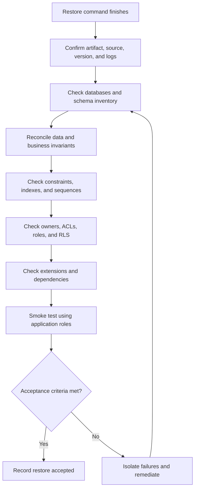

# Verifying Data, Constraints, Privileges, and Completeness After PostgreSQL Recovery

A restore command exiting with code 0 is a good sign, yet it does not prove the system is ready to serve the application. The database may be missing tables due to an incomplete dump scope, hold unvalidated foreign keys, contain invalid indexes, have sequences lagging behind the maximum key value, or have lost access privileges for the application role. A recovery is only complete when **data, structure, constraints, privileges, and application behavior all meet requirements**.

This lesson belongs to the **Recovery** chapter and focuses on how to verify a PostgreSQL database or cluster after restoring:

- Confirming the scope, point in time, and source of the backup.
- Inspecting databases, schemas, tables, partitions, indexes, constraints, and extensions.
- Reconciling data using row counts, aggregates, key ranges, checksums, and business invariants.
- Verifying foreign keys, check constraints, unique constraints, and validation states.
- Checking sequence/identity states after import.
- Verifying owners, role memberships, ACLs, default privileges, RLS, and connection access.
- Inspecting large objects, functions, triggers, publications, and special objects.
- Running smoke tests, checking initial performance, and compiling a recovery acceptance report.

> **Principle:** A technically successful restore and a business-valid recovery are two different conclusions. Use repeatable evidence, document the limits of every check, and verify using the exact role the application will use.

## 1. Post-Restore Verification Layers

You should never inspect just a few tables and conclude the database is complete. A thorough procedure checks multiple independent layers.

| Layer | Question to Answer | Common Evidence |
| --- | --- | --- |
| Backup and restore execution | Right artifact, right source, restore command completed? | Backup manifest, checksum, exit code, logs |
| Database and schema | Right databases, schemas, objects? | Catalog inventory, schema dump/diff |
| Data completeness | Rows and contents complete at the right point? | Counts, aggregates, checksums, key ranges |
| Constraints | PK/FK/CHECK/UNIQUE present and validated? | `pg_constraint`, validation queries |
| Indexes | Indexes valid and usable? | `pg_index.indisvalid`, `indisready` |
| Sequences | Can sequences issue new keys without collision? | Sequence state vs. maximum key |
| Ownership and privileges | Right owners, ACLs, and memberships? | `pg_roles`, ACLs, `has_*_privilege()` |
| Security | RLS, policies, SECURITY DEFINER, and auth accurate? | `pg_policies`, role-specific tests |
| Dependencies | Extensions, large objects, functions, triggers intact? | System catalogs and application tests |
| Application readiness | Can the app read/write/commit? | Smoke tests, health checks, logs |
| Operational readiness | Capacity, monitoring, next backups ready? | Metrics, storage, replication, DR record |

One layer may pass while another fails. For instance, all tables may exist yet the application cannot log in due to missing role membership; or row counts may match while a sequence lags behind `MAX(id)`.

### 1.1. Verification Flow



Never route production traffic to the target simply because step B passed. Define acceptance criteria and cutover sign-off authority beforehand.

## 2. Confirming the Right Backup Source and Recovery Point

Before inspecting database contents, confirm you restored the right artifact onto the right target.

### 2.1. Recording Backup Metadata

A backup inventory should contain at minimum:

```text
backup_id
source_cluster
source_host_or_service
source_server_version
dump_client_version_or_base_backup_tool
backup_type
backup_scope
started_at
finished_at
snapshot_or_recovery_target
database_list
included_globals
included_tablespaces
included_extensions
wal_archive_range
artifact_path
artifact_size
checksum_algorithm
checksum
encryption_key_reference
restore_started_at
restore_finished_at
restore_target
restore_exit_code
restore_log
```

For logical dumps, specify whether the dump covers the whole cluster, globals only, or a single database/schema/table. For physical backups/PITR, record the base backup and WAL range/recovery target.

### 2.2. Checking Checksums

If the backup is stored with SHA-256:

```bash
sha256sum -c cluster_backup.sql.sha256
```

On PowerShell:

```powershell
Get-FileHash -Algorithm SHA256 .\cluster_backup.sql
```

A checksum confirms the artifact matches the hash recorded at creation time. It does not prove the logical data inside the backup is valid, nor that restore succeeded.

### 2.3. Confirming the Endpoint After Restore

Connect to the target and record:

```sql
SELECT
    current_database() AS database_name,
    current_user AS current_role,
    session_user AS login_role,
    inet_server_addr() AS server_address,
    inet_server_port() AS server_port,
    version() AS server_version,
    current_setting('server_version_num') AS server_version_num,
    clock_timestamp() AS checked_at;
```

Cross-check host, port, version, and environment label against the restore plan. Behind proxies or managed services, `inet_server_addr()` may not reflect the client-facing endpoint; combine with your service inventory.

### 2.4. Distinguishing Logical Restore from PITR

Logical dumps normally restore state as of the dump's snapshot. Physical backups combined with WAL archives can recover to a chosen recovery target.

Thus, the question "is the data complete?" must be tied to a point in time:

- Logical dump: data reflects the snapshot of each dumped database.
- PITR: data reflects WAL replayed up to the target time/LSN.
- Multiple databases logically dumped sequentially: each database's snapshot may not align to a single cluster-wide instant.

If the application depends on cross-database consistency, explicitly state the consistency boundary when evaluating.

## 3. Verifying Database and Schema Inventory

Begin by verifying the expected databases, owners, encodings, locales, and tablespaces.

### 3.1. Listing Databases

```sql
SELECT
    d.datname,
    pg_get_userbyid(d.datdba) AS owner,
    pg_encoding_to_char(d.encoding) AS encoding,
    d.datcollate,
    d.datctype,
    t.spcname AS default_tablespace,
    d.datallowconn,
    d.datconnlimit
FROM pg_database AS d
JOIN pg_tablespace AS t ON t.oid = d.dattablespace
WHERE d.datistemplate = false
ORDER BY d.datname;
```

Compare against the backup manifest or source inventory. Not every cluster requires `postgres` and application databases to share identical restore goals; define clearly which databases are in scope.

### 3.2. Listing Schemas

Within each database:

```sql
SELECT
    n.nspname AS schema_name,
    pg_get_userbyid(n.nspowner) AS owner
FROM pg_namespace AS n
WHERE n.nspname NOT LIKE 'pg_temp_%'
  AND n.nspname NOT LIKE 'pg_toast_temp_%'
ORDER BY n.nspname;
```

System schemas like `pg_catalog`, `information_schema`, and extension schemas should be distinguished from application-owned schemas. Cross-check application schemas against the manifest or schema-only dump.

### 3.3. Counting Relation Types

```sql
SELECT
    n.nspname AS schema_name,
    c.relkind,
    CASE c.relkind
        WHEN 'r' THEN 'table'
        WHEN 'p' THEN 'partitioned table'
        WHEN 'i' THEN 'index'
        WHEN 'I' THEN 'partitioned index'
        WHEN 'S' THEN 'sequence'
        WHEN 'v' THEN 'view'
        WHEN 'm' THEN 'materialized view'
        WHEN 'f' THEN 'foreign table'
        ELSE c.relkind::text
    END AS object_type,
    count(*) AS object_count
FROM pg_class AS c
JOIN pg_namespace AS n ON n.oid = c.relnamespace
WHERE n.nspname NOT IN ('pg_catalog', 'information_schema')
  AND n.nspname NOT LIKE 'pg_toast%'
GROUP BY n.nspname, c.relkind
ORDER BY n.nspname, c.relkind;
```

This is a catalog inventory, not proof that data inside relations is complete. It helps catch missing or extra schemas/tables/indexes/sequences.

### 3.4. Comparing Schemas via Dump

You can generate schema-only dumps from source and target:

```bash
pg_dump --schema-only --no-owner --no-privileges -d source_db -f source_schema.sql
pg_dump --schema-only --no-owner --no-privileges -d target_db -f target_schema.sql
```

Then compare using a diff tool. If you intentionally stripped owner/privileges with flags, verify them separately via catalogs; never use two ACL-stripped dumps to conclude privileges match.

SQL dumps may show differences due to versions, extensions, object ordering, or metadata. Read diffs semantically rather than merely counting changed lines.

## 4. Verifying Data Volume

Row count is an intuitive check, yet it must be applied properly.

### 4.1. Getting Exact Row Counts

```sql
SELECT count(*) AS exact_rows
FROM app.orders;
```

`COUNT(*)` returns an exact count as of the query's snapshot, yet it can scan the entire table and incur heavy I/O/CPU on large tables. Schedule checks thoughtfully and watch system load.

Never use `pg_class.reltuples` or `pg_stat_user_tables.n_live_tup` as exact row counts; those are estimates.

### 4.2. Using Estimates for Quick Inventory

```sql
SELECT
    schemaname,
    relname,
    n_live_tup,
    n_dead_tup,
    last_analyze,
    last_autoanalyze
FROM pg_stat_user_tables
ORDER BY schemaname, relname;
```

Estimates are useful for fast triage and spotting anomalous tables. Right after restore, statistics may be stale or empty; never treat `n_live_tup` as final proof.

### 4.3. Counting Multiple Tables in a Schema

You can build a list of tables to count and run `COUNT(*)` per table via an admin script. Lab example using PL/pgSQL:

```sql
DO $$
DECLARE
    r record;
    row_count bigint;
BEGIN
    FOR r IN
        SELECT schemaname, tablename
        FROM pg_tables
        WHERE schemaname = 'app'
        ORDER BY tablename
    LOOP
        EXECUTE format(
            'SELECT count(*) FROM %I.%I',
            r.schemaname,
            r.tablename
        ) INTO row_count;

        RAISE NOTICE '%.%: % rows',
            r.schemaname, r.tablename, row_count;
    END LOOP;
END
$$;
```

`NOTICE` messages appear in client output/logs; for larger systems, persist structured results into an inventory table or CSV file rather than relying on console text.

### 4.4. Comparing Counts Requires the Same Consistency Point

If the source continues accepting writes while you count, source and target counts will differ even for a perfect restore. Either:

- Pause writes during the verification window, or
- Compare the source at a matching snapshot/point, or
- Use logical replication/CDC watermarks to account for post-backup changes, or
- Accept and document expected delta from ongoing writes.

Never conclude data loss solely from two counts taken at different points in time.

### 4.5. Checking Key Ranges and Business Aggregates

Beyond row counts, check min/max keys, status counts, and business totals:

```sql
SELECT
    count(*) AS order_count,
    min(order_id) AS min_order_id,
    max(order_id) AS max_order_id,
    count(*) FILTER (WHERE status = 'paid') AS paid_orders,
    count(*) FILTER (WHERE status = 'pending') AS pending_orders,
    sum(total_amount) FILTER (WHERE status = 'paid') AS paid_amount
FROM app.orders;
```

Business aggregates can uncover a missing subset of data even when overall row counts look nearly identical. Pick meaningful invariants: daily order counts, ledger balances, total inventory quantities, or record counts per tenant/status.

## 5. Verifying Content with Checksums

Matching row counts do not guarantee matching rows. One row may be missing while another is duplicated, or column values may differ while the count remains unchanged.

### 5.1. Row-Level Checksums

If the `pgcrypto` extension is available, you can hash a stable row representation:

```sql
SELECT
    order_id,
    encode(
        digest(
            concat_ws(
                '|',
                coalesce(customer_id::text, '<NULL>'),
                coalesce(status, '<NULL>'),
                coalesce(total_amount::text, '<NULL>'),
                coalesce(created_at::text, '<NULL>')
            ),
            'sha256'
        ),
        'hex'
    ) AS row_hash
FROM app.orders
ORDER BY order_id;
```

This example illustrates row hashing; delimiter-based concatenation must avoid collisions if data can contain the delimiter or literal `'<NULL>'`. For critical data, use unambiguous encoding, JSON/bytea canonicalization, or length-prefixed per-column hashing.

### 5.2. Never Assume Text Serialization Is Always Identical

Timestamps, numerics, floating-point values, JSON, arrays, collations, and custom types can serialize differently across versions or settings.

Before comparing source/target checksums:

- Fix a consistent timezone.
- Use stable numeric formatting.
- Canonicalize JSON if key order is insignificant.
- Handle NULLs distinctly.
- Standardize text encoding/collation if needed.
- Exclude columns altered by restore if outside the comparison goal.

Hashes are only meaningful when both sides canonicalize identically.

### 5.3. Aggregated Checksums by Chunks

You do not always have to pull every row hash to an admin workstation. Partition data by key ranges and compute per-chunk hashes/aggregates:

```sql
SELECT
    (order_id / 100000) AS key_bucket,
    count(*) AS row_count,
    min(order_id) AS min_id,
    max(order_id) AS max_id,
    sum(total_amount) AS amount_sum
FROM app.orders
GROUP BY (order_id / 100000)
ORDER BY key_bucket;
```

Comparing source/target buckets narrows down problematic key ranges. Note that this is an aggregate check, not yet a cryptographic checksum of every column.

### 5.4. Using pgcrypto Digest for Byte Hashing

If `pgcrypto` is installed:

```sql
SELECT encode(
    digest(convert_to('stable test value', 'UTF8'), 'sha256'),
    'hex'
);
```

Do not install extensions onto production solely to run a check without reviewing policy. You can compute hashes at the application/ETL layer or use dedicated data comparison tools.

### 5.5. Full-Table Hashing Can Be Resource-Intensive

Hashing requires reading data. On multi-terabyte tables, full scans generate heavy I/O. Run in chunks, pick off-peak windows, measure impact, and prioritize critical tables/columns per RPO/RTO.

## 6. Verifying Primary Keys and Unique Constraints

Primary key/unique constraints enforce uniqueness and typically rely on unique indexes.

### 6.1. Listing Constraints

```sql
SELECT
    n.nspname AS schema_name,
    c.relname AS table_name,
    con.conname AS constraint_name,
    con.contype,
    con.convalidated,
    pg_get_constraintdef(con.oid, true) AS definition
FROM pg_constraint AS con
JOIN pg_class AS c ON c.oid = con.conrelid
JOIN pg_namespace AS n ON n.oid = c.relnamespace
WHERE n.nspname = 'app'
ORDER BY c.relname, con.conname;
```

Common types:

| contype | Constraint Type |
| --- | --- |
| p | Primary key |
| u | Unique |
| f | Foreign key |
| c | Check |
| x | Exclusion |

`convalidated = false` indicates the constraint has not been fully validated against existing data. Do not check only whether the constraint name exists.

### 6.2. Checking for Missing Primary Keys

Find tables in an application schema lacking a primary key:

```sql
SELECT
    n.nspname AS schema_name,
    c.relname AS table_name
FROM pg_class AS c
JOIN pg_namespace AS n ON n.oid = c.relnamespace
WHERE n.nspname = 'app'
  AND c.relkind IN ('r', 'p')
  AND NOT EXISTS (
      SELECT 1
      FROM pg_constraint AS con
      WHERE con.conrelid = c.oid
        AND con.contype = 'p'
  )
ORDER BY c.relname;
```

Some staging/log tables may be designed without primary keys. Compare against the schema contract rather than assuming every table must have a PK.

### 6.3. Checking for Duplicates Before Creating Unique Constraints

Example with `order_number`:

```sql
SELECT
    order_number,
    count(*) AS duplicate_count
FROM app.orders
GROUP BY order_number
HAVING count(*) > 1
ORDER BY duplicate_count DESC
LIMIT 100;
```

If duplicates exist, trace the data source, confirm business rules, and remediate before adding unique constraints. Never delete duplicates arbitrarily after restore.

## 7. Verifying Foreign Keys and Referential Integrity

Foreign keys ensure child rows reference valid parent keys. An existing yet unvalidated foreign key does not guarantee all older data satisfies the relationship.

### 7.1. Listing Foreign Keys and Validation Status

```sql
SELECT
    conrelid::regclass AS child_table,
    conname AS constraint_name,
    confrelid::regclass AS parent_table,
    convalidated,
    condeferrable,
    condeferred,
    pg_get_constraintdef(oid, true) AS definition
FROM pg_constraint
WHERE contype = 'f'
  AND connamespace = 'app'::regnamespace
ORDER BY conrelid::regclass::text, conname;
```

Check child table, parent table, referenced columns, `ON DELETE`/`UPDATE` actions, and deferrability against application requirements.

### 7.2. Finding Unvalidated Foreign Keys

```sql
SELECT
    conrelid::regclass AS child_table,
    conname,
    confrelid::regclass AS parent_table,
    pg_get_constraintdef(oid, true) AS definition
FROM pg_constraint
WHERE contype = 'f'
  AND NOT convalidated
ORDER BY conrelid::regclass::text, conname;
```

If a constraint was created `NOT VALID`, it still enforces new changes per PostgreSQL semantics, yet existing rows remain unverified. Evaluate and validate once data has been checked.

### 7.3. Validating a Foreign Key

After confirming data satisfies the constraint:

```sql
ALTER TABLE app.order_items
VALIDATE CONSTRAINT order_items_order_id_fkey;
```

`VALIDATE CONSTRAINT` scans existing data and can consume time/I/O. Plan carefully for large tables; monitor locks and workload. Do not run bulk validations during peak hours without assessment.

### 7.4. Finding Orphan Rows

Example finding order items without a matching order:

```sql
SELECT count(*) AS orphan_rows
FROM app.order_items AS i
LEFT JOIN app.orders AS o
  ON o.order_id = i.order_id
WHERE i.order_id IS NOT NULL
  AND o.order_id IS NULL;
```

Expected count is normally 0 for mandatory relationships. For composite FKs, join on all columns and handle NULLs according to the constraint's match semantics. Check logic must match supported match modes.

### 7.5. Deferrable Constraints

A `DEFERRABLE` constraint may be checked at transaction end rather than immediately when the statement runs. Post-restore smoke tests should commit test transactions to verify relationships actually pass; statement success before `COMMIT` is not enough.

## 8. Verifying CHECK Constraints

CHECK constraints guarantee an expression evaluates appropriately for every checked row.

### 8.1. Listing Check Constraints

```sql
SELECT
    conrelid::regclass AS table_name,
    conname,
    convalidated,
    pg_get_constraintdef(oid, true) AS definition
FROM pg_constraint
WHERE contype = 'c'
  AND connamespace = 'app'::regnamespace
ORDER BY conrelid::regclass::text, conname;
```

### 8.2. Finding Rows Violating the Expression

Example constraint:

```sql
ALTER TABLE app.orders
ADD CONSTRAINT orders_amount_nonnegative
CHECK (total_amount >= 0)
NOT VALID;
```

Query to find violations:

```sql
SELECT count(*) AS invalid_amount_rows
FROM app.orders
WHERE total_amount < 0;
```

Adjust the predicate to match the exact constraint. Note that SQL CHECK passes when the expression evaluates to TRUE or NULL; if a column must be present, a separate `NOT NULL` constraint is required.

### 8.3. Validating a Check Constraint

```sql
ALTER TABLE app.orders
VALIDATE CONSTRAINT orders_amount_nonnegative;
```

Once validation succeeds, `convalidated` becomes true. Document any constraints intentionally kept `NOT VALID` and why they cannot yet be validated.

## 9. Verifying Indexes

An index can exist in the catalog yet be invalid for the planner or DML. This can occur after a failed concurrent index build or an interrupted restore/maintenance operation.

### 9.1. Listing Invalid Indexes

```sql
SELECT
    ns.nspname AS schema_name,
    tbl.relname AS table_name,
    idx.relname AS index_name,
    i.indisvalid,
    i.indisready,
    i.indislive,
    pg_get_indexdef(idx.oid) AS index_definition
FROM pg_index AS i
JOIN pg_class AS idx ON idx.oid = i.indexrelid
JOIN pg_class AS tbl ON tbl.oid = i.indrelid
JOIN pg_namespace AS ns ON ns.oid = tbl.relnamespace
WHERE ns.nspname = 'app'
  AND (
      NOT i.indisvalid
      OR NOT i.indisready
      OR NOT i.indislive
  )
ORDER BY tbl.relname, idx.relname;
```

If rows are returned, investigate each index's state. Never drop/rebuild automatically before understanding constraint dependencies and workload.

### 9.2. Checking Primary/Unique Constraint Indexes

Constraint-backing indexes are referenced in `pg_constraint.conindid`. An invalid unique index can prevent uniqueness enforcement from working as expected. Cross-check constraint inventory with index state.

### 9.3. Rebuilding Indexes When Needed

One option is:

```sql
REINDEX INDEX app.orders_customer_id_idx;
```

Or rebuild table/indexes per an appropriate workflow. `REINDEX` consumes I/O, CPU, disk space, and holds locks; `REINDEX CONCURRENTLY` has version-specific limits and semantics. Plan before running on production.

### 9.4. Checking Index Definitions and Sizes

```sql
SELECT
    schemaname,
    tablename,
    indexname,
    indexdef
FROM pg_indexes
WHERE schemaname = 'app'
ORDER BY tablename, indexname;
```

Cross-check definitions, column order, expressions, predicates, operator classes, and `INCLUDE` columns against the source schema. Identical index names alone are not sufficient.

## 10. Verifying Sequences and Identity Columns

A common post-restore error is a sequence lagging behind the table's maximum key value. The next `INSERT` can raise a duplicate key error.

### 10.1. Listing Sequences

```sql
SELECT
    schemaname,
    sequencename,
    data_type,
    start_value,
    min_value,
    max_value,
    increment_by,
    cycle,
    cache_size,
    last_value
FROM pg_sequences
WHERE schemaname = 'app'
ORDER BY sequencename;
```

`last_value` can be NULL if the sequence has never been used or the role lacks read permission per view semantics. `pg_sequences` provides an inventory, yet each sequence must be compared against its owning column.

### 10.2. Finding Sequences Attached to Columns

```sql
SELECT
    table_schema,
    table_name,
    column_name,
    pg_get_serial_sequence(
        format('%I.%I', table_schema, table_name),
        column_name
    ) AS sequence_name
FROM information_schema.columns
WHERE table_schema = 'app'
  AND column_default LIKE 'nextval(%'
ORDER BY table_name, ordinal_position;
```

This query finds serial-style defaults. Identity columns carry different metadata; inventory identity columns separately via `is_identity` and `identity_generation`.

### 10.3. Checking Identity Columns

```sql
SELECT
    table_schema,
    table_name,
    column_name,
    is_identity,
    identity_generation,
    is_generated,
    column_default
FROM information_schema.columns
WHERE table_schema = 'app'
  AND (is_identity = 'YES' OR column_default LIKE 'nextval(%')
ORDER BY table_name, ordinal_position;
```

### 10.4. Comparing Sequence State Against MAX(id)

For a specific sequence, read state during a maintenance window:

```sql
SELECT last_value, is_called
FROM app.orders_order_id_seq;
```

Compare against:

```sql
SELECT max(order_id) AS max_existing_id
FROM app.orders;
```

Understand `is_called`:

- If true, the next `nextval()` will advance by the increment.
- If false, the next `nextval()` may return `last_value` itself.

Therefore, do not compare `last_value` to `MAX(id)` while ignoring `is_called`, increment, and cycle.

### 10.5. Adjusting Sequences When Proven Necessary

Example for an ascending +1 sequence when the table has no concurrent writes and you want the next issued value above max key:

```sql
SELECT setval(
    'app.orders_order_id_seq',
    COALESCE((SELECT max(order_id) FROM app.orders), 1),
    EXISTS (SELECT 1 FROM app.orders)
);
```

This assumes the sequence starts at 1, increments by +1, and fits default bounds. On an empty table, `setval(..., 1, false)` makes the next `nextval()` return 1. If the sequence has a different start/increment, compute from actual metadata.

Never run a copy-pasted `setval()` formula blindly across all sequences. Check ownership, data type, min/max, increment, cycle, and concurrent inserts. Pause writers or use a maintenance window to avoid races between `MAX(id)` and `nextval()`.

## 11. Verifying Owners and Role Inventory

A database with all objects intact yet wrong owners can cause migrations, DDL, default privileges, or security-definer code to behave differently.

### 11.1. Checking Key Roles

```sql
SELECT
    rolname,
    rolsuper,
    rolinherit,
    rolcreaterole,
    rolcreatedb,
    rolcanlogin,
    rolreplication,
    rolbypassrls,
    rolconnlimit,
    rolvaliduntil
FROM pg_roles
ORDER BY rolname;
```

Compare service roles, owner roles, read-only roles, and admin roles against the source inventory. `pg_roles` does not expose password verifiers.

### 11.2. Checking Relation Owners

```sql
SELECT
    n.nspname AS schema_name,
    c.relname AS relation_name,
    c.relkind,
    pg_get_userbyid(c.relowner) AS owner
FROM pg_class AS c
JOIN pg_namespace AS n ON n.oid = c.relnamespace
WHERE n.nspname = 'app'
  AND c.relkind IN ('r', 'p', 'v', 'm', 'S', 'f')
ORDER BY n.nspname, c.relname;
```

Also verify owners of schemas, functions, procedures, types, and databases if within application scope.

### 11.3. Checking Schema Owners

```sql
SELECT
    nspname,
    pg_get_userbyid(nspowner) AS owner
FROM pg_namespace
WHERE nspname = 'app'
ORDER BY nspname;
```

### 11.4. Checking Role Memberships

```sql
SELECT
    granted.rolname AS granted_role,
    member.rolname AS member_role,
    grantor.rolname AS grantor
FROM pg_auth_members AS m
JOIN pg_roles AS granted ON granted.oid = m.roleid
JOIN pg_roles AS member ON member.oid = m.member
JOIN pg_roles AS grantor ON grantor.oid = m.grantor
ORDER BY granted.rolname, member.rolname;
```

Newer PostgreSQL versions store additional membership options such as `ADMIN`, `INHERIT`, and `SET`. If these options are part of your security model, verify all corresponding catalog columns for your running version.

## 12. Verifying ACLs and Privileges

Do not merely check whether a role has `LOGIN`. Verify effective privileges on databases, schemas, tables, sequences, and functions.

### 12.1. Database Connection Privileges

```sql
SELECT
    datname,
    has_database_privilege('app_service', datname, 'CONNECT') AS can_connect,
    has_database_privilege('app_service', datname, 'CREATE') AS can_create,
    has_database_privilege('app_service', datname, 'TEMP') AS can_temp
FROM pg_database
WHERE datname = current_database();
```

Replace `app_service` with the actual role. Connection access also depends on database ACLs and external authentication layers like `pg_hba.conf`.

### 12.2. Schema Privileges

```sql
SELECT
    has_schema_privilege('app_service', 'app', 'USAGE') AS can_use_schema,
    has_schema_privilege('app_service', 'app', 'CREATE') AS can_create_in_schema;
```

`USAGE` allows resolving/accessing objects inside the schema per object privileges; `CREATE` allows creating objects inside the schema. Having `USAGE` does not mean a role has `SELECT` on every table.

### 12.3. Table Privileges

```sql
SELECT
    has_table_privilege('app_service', 'app.orders', 'SELECT') AS can_select,
    has_table_privilege('app_service', 'app.orders', 'INSERT') AS can_insert,
    has_table_privilege('app_service', 'app.orders', 'UPDATE') AS can_update,
    has_table_privilege('app_service', 'app.orders', 'DELETE') AS can_delete,
    has_table_privilege('app_service', 'app.orders', 'TRUNCATE') AS can_truncate;
```

Run role-specific checks for every operation the application actually needs. Never grant extra privileges just to turn a test green.

### 12.4. Sequence Privileges

```sql
SELECT
    has_sequence_privilege('app_service', 'app.orders_order_id_seq', 'USAGE') AS can_nextval,
    has_sequence_privilege('app_service', 'app.orders_order_id_seq', 'SELECT') AS can_read_state,
    has_sequence_privilege('app_service', 'app.orders_order_id_seq', 'UPDATE') AS can_set_value;
```

Inserting into serial/identity columns may require sequence privileges depending on configuration and how the application invokes sequences. Check the exact role and real operations.

### 12.5. Function Privileges

```sql
SELECT has_function_privilege(
    'app_service',
    'app.calculate_tax(numeric)',
    'EXECUTE'
) AS can_execute;
```

Function names require full argument signatures when overloaded. Also check procedures and routines called by the application.

### 12.6. Relation ACLs

```sql
SELECT
    n.nspname,
    c.relname,
    c.relacl
FROM pg_class AS c
JOIN pg_namespace AS n ON n.oid = c.relnamespace
WHERE n.nspname = 'app'
ORDER BY c.relname;
```

A NULL ACL normally indicates default privileges for the object type/owner, not "zero privileges." `has_*_privilege()` is more accurate for checking a role's effective permissions.

## 13. Verifying Default Privileges

Default privileges apply to future objects created by the corresponding owner/role. They do not retroactively alter ACLs on existing objects.

### 13.1. Inspecting the Default ACL Catalog

```sql
SELECT
    pg_get_userbyid(defaclrole) AS owner_role,
    COALESCE(n.nspname, '(all schemas)') AS schema_name,
    defaclobjtype,
    defaclacl
FROM pg_default_acl AS d
LEFT JOIN pg_namespace AS n ON n.oid = d.defaclnamespace
ORDER BY owner_role, schema_name, defaclobjtype;
```

Compare owner role, schema scope, and object type against the source.

### 13.2. Why Are Default Privileges Important?

Suppose the application role receives default `SELECT` on all new tables created by `app_owner`. If default ACLs are missing, existing tables remain accessible, yet the next deployment creating a new table will hit `permission denied`.

### 13.3. Testing with a New Object in a Lab

On a test target, create an object using the exact owner role, then verify the service role's privileges. Never create test objects inside a production schema without proper cleanup plans and approval.

## 14. Verifying Row-Level Security (RLS)

RLS can cause different roles—or the same role in different contexts—to see different row counts. Running `COUNT(*)` as an admin role does not prove the application role can see the data it needs.

### 14.1. Listing Tables with RLS

```sql
SELECT
    n.nspname AS schema_name,
    c.relname AS table_name,
    c.relrowsecurity AS rls_enabled,
    c.relforcerowsecurity AS rls_forced,
    pg_get_userbyid(c.relowner) AS owner
FROM pg_class AS c
JOIN pg_namespace AS n ON n.oid = c.relnamespace
WHERE n.nspname = 'app'
  AND c.relkind IN ('r', 'p')
  AND (c.relrowsecurity OR c.relforcerowsecurity)
ORDER BY c.relname;
```

### 14.2. Listing Policies

```sql
SELECT
    schemaname,
    tablename,
    policyname,
    permissive,
    roles,
    cmd,
    qual,
    with_check
FROM pg_policies
WHERE schemaname = 'app'
ORDER BY tablename, policyname;
```

Compare policy expressions, role lists, command scopes, and permissive/restrictive behavior.

### 14.3. Testing Under the Exact Application Role

You can test in a lab session:

```sql
BEGIN;
SET LOCAL ROLE app_service;

SELECT count(*) FROM app.orders;

ROLLBACK;
```

`SET LOCAL ROLE` requires appropriate membership/`SET ROLE` permission. If you cannot assume the role, connect directly using the application role credentials in a test environment. Never use superuser to test RLS, because superusers and roles with `BYPASSRLS` bypass policies.

### 14.4. FORCE ROW LEVEL SECURITY

Table owners can normally bypass RLS unless `FORCE ROW LEVEL SECURITY` is enabled. `relforcerowsecurity` must be verified if application security depends on owner behavior.

## 15. Verifying Extensions, Functions, Triggers, and Dependencies

A database dump may restore object definitions, yet the target server must still have all required runtime components.

### 15.1. Extensions

```sql
SELECT
    e.extname,
    e.extversion,
    n.nspname AS schema_name
FROM pg_extension AS e
JOIN pg_namespace AS n ON n.oid = e.extnamespace
ORDER BY e.extname;
```

Compare extension names and versions against the source. Install compatible packages/shared libraries on the target prior to restore if required by extensions. Do not upgrade extension versions automatically during verification; upgrades need a separate plan.

### 15.2. Functions and Procedures

```sql
SELECT
    n.nspname AS schema_name,
    p.proname AS routine_name,
    pg_get_userbyid(p.proowner) AS owner,
    p.prokind,
    p.prosecdef AS security_definer,
    pg_get_function_identity_arguments(p.oid) AS arguments
FROM pg_proc AS p
JOIN pg_namespace AS n ON n.oid = p.pronamespace
WHERE n.nspname = 'app'
ORDER BY p.proname, arguments;
```

Confirm critical routines are present with the right owner, security mode, and signature. For `SECURITY DEFINER`, check `search_path` and execute privileges to avoid unintended security changes.

### 15.3. Triggers

```sql
SELECT
    t.tgrelid::regclass AS table_name,
    t.tgname AS trigger_name,
    t.tgenabled,
    pg_get_triggerdef(t.oid, true) AS definition
FROM pg_trigger AS t
JOIN pg_class AS c ON c.oid = t.tgrelid
JOIN pg_namespace AS n ON n.oid = c.relnamespace
WHERE NOT t.tgisinternal
  AND n.nspname = 'app'
ORDER BY t.tgrelid::regclass::text, t.tgname;
```

`tgenabled` indicates trigger state. Some restore workflows temporarily disable triggers or use `session_replication_role`; verify afterward that triggers are enabled as designed.

### 15.4. Views and Materialized Views

Check that views have valid definitions and dependencies. Materialized views may need refreshing per plan if the backup/restore strategy omitted materialized data or relied on source state.

```sql
SELECT
    schemaname,
    matviewname,
    ispopulated
FROM pg_matviews
WHERE schemaname = 'app'
ORDER BY matviewname;
```

`ispopulated = false` means the materialized view has no readable data yet. When refreshing, consider cost, locks, and completion time.

## 16. Verifying Partitions and Partition Bounds

For partitioned tables, check parent tables, leaf partitions, bounds, and row counts per partition.

### 16.1. Listing the Partition Tree

```sql
SELECT
    parentrelid::regclass AS parent_table,
    relid::regclass AS partition_table,
    isleaf,
    level
FROM pg_partition_tree('app.events'::regclass)
ORDER BY level, partition_table::text;
```

`pg_partition_tree()` is available on PostgreSQL versions supporting declarative partitioning accordingly. Check version before putting queries into automation.

### 16.2. Checking Partition Bounds

```sql
SELECT
    c.oid::regclass AS partition_name,
    pg_get_expr(c.relpartbound, c.oid) AS partition_bound
FROM pg_class AS c
WHERE c.relispartition
  AND c.relnamespace = 'app'::regnamespace
ORDER BY c.oid::regclass::text;
```

Compare partition time/key ranges against the source. A missing partition might not raise an error during restore, yet it can cause queries to miss data or new inserts to fail routing.

### 16.3. Checking Rows per Partition

```sql
SELECT tableoid::regclass AS partition_name, count(*) AS rows
FROM app.events
GROUP BY tableoid
ORDER BY partition_name;
```

For large partitions, `COUNT(*)` still requires scanning. Use statistics estimates for fast inventory and exact counts on critical partitions during maintenance windows.

## 17. Verifying Large Objects and Out-of-Table Data

PostgreSQL supports large objects stored in dedicated system catalogs, distinct from ordinary `bytea` columns.

### 17.1. Counting Large Objects

```sql
SELECT count(*) AS large_object_count
FROM pg_largeobject_metadata;
```

Compare count against the source if large objects are within backup scope. Also check ACL/owner on large objects per application needs.

### 17.2. Inspecting Large Object Owners

```sql
SELECT
    oid,
    lomowner::regrole AS owner,
    lomacl
FROM pg_largeobject_metadata
ORDER BY oid;
```

Do not assume `pg_dump` always includes large objects if dump flags or scope excluded them. Verify dump options and restore logs.

### 17.3. Files Outside the Database

If the application stores files in object storage, filesystems, or external services, logical database restore does not recover those bytes. Verify object keys, file counts, checksums, and referential links between database records and external storage.

## 18. Verifying Data Consistency via Business Rules

Row counts and constraints form the foundation. Applications also enforce business rules not fully expressed as database constraints.

### 18.1. Checking Balance Totals

Example for a ledger system:

```sql
SELECT
    account_id,
    sum(amount) AS net_amount
FROM app.ledger_entries
GROUP BY account_id
ORDER BY account_id;
```

Compare against balance snapshots or ledger totals closed at the same recovery point. Never compare against live balances if the source processed transactions after the backup point.

### 18.2. Checking Status Relationships

Example ensuring paid orders have a payment record:

```sql
SELECT count(*) AS paid_without_payment
FROM app.orders AS o
WHERE o.status = 'paid'
  AND NOT EXISTS (
      SELECT 1
      FROM app.payments AS p
      WHERE p.order_id = o.order_id
        AND p.status = 'captured'
  );
```

Expected output depends on business rules: partial payments, refunds, or asynchronous settlement can alter conditions.

### 18.3. Checking Time Ranges and Data Distribution

```sql
SELECT
    date_trunc('day', created_at) AS day,
    count(*) AS rows_per_day
FROM app.events
GROUP BY 1
ORDER BY 1;
```

Pay close attention to timezone and recovery target. End-of-day records can shift buckets if source and target use different session/timezone settings.

### 18.4. Checking Key Gaps

With sequence-generated IDs, gaps are not necessarily errors: rollbacks, sequence caches, allocations, and deletions all create gaps. Use key ranges and business identifiers to look for missing data; never require IDs to be contiguous.

## 19. Checking Statistics and Query Readiness

After restore, planner statistics may be missing or stale. Queries may return accurate results yet run slowly due to poor estimates.

### 19.1. Checking ANALYZE Timestamps

```sql
SELECT
    schemaname,
    relname,
    last_analyze,
    last_autoanalyze,
    n_live_tup,
    n_mod_since_analyze
FROM pg_stat_user_tables
ORDER BY schemaname, relname;
```

If statistics are missing or stale, run `ANALYZE` per plan. There is no need to run `VACUUM FULL` simply because a restore just finished.

### 19.2. Analyzing the Database or Key Tables

```sql
ANALYZE;
ANALYZE app.orders;
ANALYZE app.order_items;
ANALYZE app.customers;
```

`ANALYZE` gathers planner statistics; it does not verify data completeness and does not replace constraint validation.

### 19.3. Smoke-Testing Query Plans

Inspect critical queries with:

```sql
EXPLAIN (COSTS, VERBOSE)
SELECT order_id, created_at, total_amount
FROM app.orders
WHERE customer_id = 42
ORDER BY created_at DESC
LIMIT 50;
```

Do not run `EXPLAIN ANALYZE` mechanically on queries with side effects or heavy load—it actually executes the query. Compare plans against baselines and confirm needed indexes/column statistics.

## 20. Verifying Privileges Using Actual Application Roles

One of the most common mistakes is running checks solely as superuser. Superusers bypass many restrictions that applications must obey.

### 20.1. Connecting Directly as the Service Role

Prefer testing via the application role's connection string/test credentials in the restore environment. Run:

```sql
SELECT
    current_user,
    session_user,
    current_database(),
    current_setting('search_path'),
    current_setting('row_security');
```

Confirm the right database, role, and session settings.

### 20.2. Read/Write Smoke Tests in a Rolled-Back Transaction

In a test database, you can insert a test row and roll back:

```sql
BEGIN;

INSERT INTO app.restore_smoke_test (test_key, test_value)
VALUES ('restore-check', 'temporary');

SELECT *
FROM app.restore_smoke_test
WHERE test_key = 'restore-check';

ROLLBACK;
```

Run as the application role. This tests schema usage, `INSERT`/`SELECT`, and certain trigger/policy behaviors. It does not test commit durability or external side effects because the transaction rolls back.

### 20.3. Commit Tests Only on Test Data with a Cleanup Plan

If you must verify sequences, triggers, or async workers after commit, use a designated test tenant/record with a defined cleanup procedure. Never leave synthetic test data inside production business tables without an owner and cleanup plan.

### 20.4. Testing Authentication Separately

SQL privilege checks do not verify TLS, certificates, `pg_hba.conf`, rotated passwords, IAM tokens, or connection pools. Test connecting using the application's actual authentication method.

## 21. Checking Database-Level Settings and search_path

Role/database settings can alter post-restore behavior.

### 21.1. Viewing Settings by Role/Database

```sql
SELECT
    COALESCE(r.rolname, '(all roles)') AS role_name,
    COALESCE(d.datname, '(all databases)') AS database_name,
    unnest(s.setconfig) AS setting
FROM pg_db_role_setting AS s
LEFT JOIN pg_roles AS r ON r.oid = s.setrole
LEFT JOIN pg_database AS d ON d.oid = s.setdatabase
ORDER BY role_name, database_name, setting;
```

### 21.2. Checking search_path

```sql
SHOW search_path;
```

A different `search_path` can cause applications to resolve the wrong function/table or create objects in the wrong schema. For `SECURITY DEFINER` functions, `search_path` is also a security control.

### 21.3. Checking Key Parameters

```sql
SELECT name, setting, unit, source
FROM pg_settings
WHERE name IN (
    'TimeZone',
    'DateStyle',
    'default_transaction_isolation',
    'default_transaction_read_only',
    'search_path',
    'row_security',
    'standard_conforming_strings'
)
ORDER BY name;
```

Some values are overridden at the role/database/session level. `pg_settings.source` and `current_setting()` inside the target session explain effective values.

## 22. Checking Publications, Subscriptions, and Replication Objects

If the application uses logical replication, verify publication/subscription metadata and sync status.

### 22.1. Publications

```sql
SELECT
    pubname,
    pubowner::regrole AS owner,
    puballtables,
    pubinsert,
    pubupdate,
    pubdelete,
    pubtruncate
FROM pg_publication
ORDER BY pubname;
```

Columns and options may vary by version. Verify publication tables and column/row filters if used.

### 22.2. Publication Tables

```sql
SELECT *
FROM pg_publication_tables
ORDER BY pubname, schemaname, tablename;
```

Cross-check table lists and filters against source design.

### 22.3. Subscriptions

```sql
SELECT
    subname,
    subowner::regrole AS owner,
    subenabled,
    subslotname,
    subpublications
FROM pg_subscription
ORDER BY subname;
```

Subscriptions hold sensitive connection strings and behave differently depending on restore scenario/version. Never enable subscriptions on a newly restored target if doing so could create two consumers applying the same stream or trigger duplicate processing. Plan reconfiguration explicitly.

### 22.4. Physical Replication

For physical standbys, check recovery state and replication lag:

```sql
SELECT
    pg_is_in_recovery() AS is_standby,
    pg_last_wal_receive_lsn() AS last_received_lsn,
    pg_last_wal_replay_lsn() AS last_replayed_lsn,
    pg_last_xact_replay_timestamp() AS last_replayed_transaction_at;
```

On the primary, use `pg_stat_replication` to inspect sender/standby status. Never treat an old replay timestamp as exact lag when the primary has no writes; combine LSN deltas and workload metrics.

## 23. Verifying Data After PITR

For Point-in-Time Recovery, besides checking structure and data, confirm recovery stopped at the right target.

### 23.1. Confirming Recovery State

On the recovering instance:

```sql
SELECT
    pg_is_in_recovery() AS is_in_recovery,
    pg_last_wal_replay_lsn() AS replay_lsn,
    pg_last_xact_replay_timestamp() AS last_replayed_transaction_at;
```

Cross-check against target time/LSN and startup logs. After promotion, `pg_is_in_recovery()` changes; preserve logs and pre/post-promotion evidence.

### 23.2. Transaction Timestamp Is Not the Exact Recovery Target

`pg_last_xact_replay_timestamp()` is the timestamp of the last replayed transaction, not necessarily equal to the recovery target. If no transactions occurred near the target, the value can look much older even though recovery satisfied the target condition.

Use PostgreSQL recovery logs and target configuration for accurate confirmation.

### 23.3. Checking the Final Transaction and Business Watermark

If the application records sequence numbers/event offsets, check the latest recovered watermark. Example:

```sql
SELECT
    max(event_id) AS max_event_id,
    max(occurred_at) AS latest_event_time,
    count(*) AS event_count
FROM app.events;
```

Cross-check with event producers, queue offsets, or audit ledgers as of the target time. A maximum timestamp alone does not prove every earlier event is present.

## 24. Checking Database Size and Tablespace Placement

Size differences can be a signal to investigate, yet they do not automatically prove missing data. Index bloat, fillfactor, TOAST, compression, physical layout, and version can all alter sizes.

### 24.1. Database Sizes

```sql
SELECT
    datname,
    pg_size_pretty(pg_database_size(datname)) AS database_size
FROM pg_database
WHERE datistemplate = false
ORDER BY pg_database_size(datname) DESC;
```

### 24.2. Table and Index Sizes

Inside a database:

```sql
SELECT
    schemaname,
    relname,
    pg_size_pretty(pg_total_relation_size(
        format('%I.%I', schemaname, relname)::regclass
    )) AS total_size,
    pg_size_pretty(pg_relation_size(
        format('%I.%I', schemaname, relname)::regclass
    )) AS heap_size,
    pg_size_pretty(pg_indexes_size(
        format('%I.%I', schemaname, relname)::regclass
    )) AS indexes_size
FROM pg_stat_user_tables
ORDER BY pg_total_relation_size(
    format('%I.%I', schemaname, relname)::regclass
) DESC;
```

The query relies on schema/name from `pg_stat_user_tables`; verify relations exist when running. Sizes reflect bytes on the target, not a substitute for data-level comparison.

### 24.3. Tablespace Mapping

```sql
SELECT
    spcname,
    pg_get_userbyid(spcowner) AS owner,
    pg_tablespace_location(oid) AS location
FROM pg_tablespace
ORDER BY spcname;
```

Check relation placement if the source used multiple tablespaces. If restore intentionally collapsed everything into `pg_default`, record this as an architectural change and assess storage/performance capacity.

## 25. Detecting Missing or Unexpected Objects

Use inventory from source backups or schema manifests to compare:

- Schema and relation counts.
- Tables, partitions, and partition bounds.
- Index definitions.
- Constraints and validation states.
- Views/materialized views.
- Functions/procedures and signatures.
- Triggers and enabled states.
- Sequences/identity columns.
- Extensions and versions.
- Owners, grants, and default ACLs.
- Large objects.
- Publications/subscriptions if in scope.

### 25.1. Do Not Compare Object Counts Alone

Two databases with identical table counts can still have one missing table and one extra unexpected table. Compare by qualified names and definitions, not total counts alone.

### 25.2. Handling Extension-Owned Objects

Objects managed by an extension should not be manually created or dropped. Compare extension versions and extension memberships; use extension scripts per documentation rather than editing catalogs.

### 25.3. Object Exists Yet Dependency Is Missing

A function may exist while its language handler, extension library, or referenced type is missing. Smoke-test critical routines and read restore logs to catch dependency errors.

## 26. Restore Logs and Interpreting Errors

Restore logs are essential evidence. With `psql`, stop on errors:

```bash
psql -X \
  -v ON_ERROR_STOP=1 \
  -U restore_admin \
  -d postgres \
  -f cluster.sql \
  > restore.stdout.log \
  2> restore.stderr.log
```

With `pg_restore`:

```bash
pg_restore \
  --exit-on-error \
  --verbose \
  --dbname=target_db \
  database.dump \
  > restore.stdout.log \
  2> restore.stderr.log
```

Check the shell exit code after completion. A restore with warnings may still return exit code 0 depending on the warning; read logs to identify any warnings affecting data/privileges.

### 26.1. Common Error Categories

| Error Group | Example | Impact to Determine |
| --- | --- | --- |
| Ownership | Role does not exist | Owners/ACLs may be missing |
| Privilege | Permission denied | Objects or ACLs incomplete |
| Extension | Extension control file missing | Missing function/type/operator dependencies |
| Tablespace | Path does not exist | Placement or database creation failed |
| Constraint | Duplicate key / FK violation | Data violates constraint or restore order |
| Index | Could not create index | Query plans/uniqueness affected |
| Encoding/collation | Incompatible locale | Sort/index semantics may differ |
| Version syntax | Unsupported command | Part of DDL not applied |
| Disk/resource | No space, OOM, timeout | Restore halted partway |

### 26.2. Never Ignore Errors Just Because Tables Have Rows

A table may have loaded rows while its indexes or constraints failed to build. `SELECT` queries still run, yet uniqueness, referential integrity, or performance may be broken.

### 26.3. After a Mid-Run Error, Determine Partial State

Never blindly re-run the entire restore. Identify the last successful statement, created objects, loaded data, and transaction boundaries. Decide whether to continue, drop/recreate the test target, or restart from scratch per runbook.

## 27. Creating an Auditable Validation Report

A recovery report should include evidence, expected values, observed values, and status.

Sample:

| Check | Expected | Observed | Evidence | Result |
| --- | --- | --- | --- | --- |
| Backup checksum | Match | Match | SHA-256 record | Pass |
| Database inventory | 4 databases | 4 | `pg_database` | Pass |
| App schemas | 6 schemas | 6 | `pg_namespace` | Pass |
| Orders count | 12.5M | 12.5M | Exact count at snapshot | Pass |
| Orphan order items | 0 | 0 | FK anti-join | Pass |
| Invalid indexes | 0 | 0 | `pg_index` | Pass |
| Unvalidated constraints | 0 expected | 0 | `pg_constraint` | Pass |
| Sequence headroom | Next value safe | Safe | Sequence state vs max key | Pass |
| Application grants | Required set | Verified | `has_*_privilege()` | Pass |
| RLS policies | Match manifest | Match | `pg_policies` | Pass |
| Extensions | Required versions | Match | `pg_extension` | Pass |
| Smoke tests | All pass | All pass | Test log | Pass |

Never mark "Pass" without evidence. If a check was skipped or infeasible, record `Not checked` along with the reason and accountable owner.

### 27.1. Record Timestamp and Role for Every Check

A thorough report records:

- Checked timestamp.
- Target endpoint/database.
- Query/script version.
- Role used to execute.
- Snapshot/recovery target.
- Expected value and observed value.
- Result and evidence path.
- Known limitations.
- Cutover approver/team.

### 27.2. Distinguishing Pass, Warning, and Blocker

- **Pass:** verified with evidence and matches expected state.
- **Warning:** understood discrepancy, approved, and does not block recovery goals.
- **Blocker:** data, structure, privileges, or consistency fails requirements; do not cut over.
- **Not checked:** lacks evidence; must never be interpreted as pass.

## 28. Post-Recovery Verification Runbook

Follow an ordered sequence to avoid overlooking dependencies.

**Step 1 — Verify backup artifact.** Check checksum, scope, source version, database list, backup timestamp, and recovery target.

**Step 2 — Confirm target.** Record endpoint, version, database, role, timezone, and recovery state.

**Step 3 — Read restore logs.** Check exit code, errors, warnings, skipped databases, and whether restore halted mid-way.

**Step 4 — Check database/schema inventory.** Reconcile databases, schemas, relations, partitions, extensions, and object definitions.

**Step 5 — Reconcile data.** Run exact counts on key tables, key ranges, aggregates, chunk checksums, and business invariants at a consistent point.

**Step 6 — Check constraints.** PK, unique, FK, CHECK, `convalidated`, orphan rows, and duplicates.

**Step 7 — Check indexes.** `indisvalid`, `indisready`, `indislive`, index definitions, and constraint-backing indexes.

**Step 8 — Check sequences/identity.** Compare state to max keys, increment, cycle, and `is_called`; adjust only with clear evidence.

**Step 9 — Check ownership/ACLs.** Roles, memberships, database/schema/table/sequence/function privileges, default ACLs, and role/database settings.

**Step 10 — Check security.** RLS enabled/forced, policies, `SECURITY DEFINER`, trigger states, and authentication.

**Step 11 — Check dependencies.** Extensions, large objects, tablespaces, external storage references, publications/subscriptions.

**Step 12 — Update statistics.** Run `ANALYZE` per workload and inspect key query plans.

**Step 13 — Smoke tests.** Connect using application roles, read/write test records, commit per test plan, and verify external side effects.

**Step 14 — Check operations.** Disk, connection limits, monitoring, replication, archiving, backup schedules, and alerting.

**Step 15 — Record acceptance report.** Pass/warning/blocker status, evidence, known limitations, owner, and cutover decision.

## 29. Recovery Acceptance Criteria

Define system-specific acceptance criteria before starting the restore.

### 29.1. Data Criteria

Examples:

- All databases/schemas in backup scope exist.
- Critical tables match counts or checksums as of the recovery point.
- Business aggregates fall within expected ranges.
- Zero orphan references outside approved exceptions.
- Required partitions and key ranges are present.

### 29.2. Integrity Criteria

- PK/unique constraints complete and valid.
- FK/CHECK constraints validated or covered by an explicit waiver.
- No unexplained invalid indexes.
- Sequences/identities can safely issue subsequent keys.
- Required trigger/function dependencies operational.

### 29.3. Security Criteria

- Owners accurate.
- Service roles exist with proper memberships.
- ACLs and default privileges match the application contract.
- RLS policies and `FORCE RLS` accurate.
- Authentication, TLS, and secrets working.
- No excessive privileges outside policy.

### 29.4. Operational Criteria

- Key queries meet performance baselines or temporary SLOs.
- Sufficient storage headroom.
- Monitoring and alerting active.
- Replication/archiving properly configured if required.
- Next backups scheduled and verified runnable.
- Actual RPO/RTO recorded.

## 30. Anti-Patterns to Avoid

| Anti-Pattern | Why Dangerous | Better Practice |
| --- | --- | --- |
| Checking only restore exit code | Misses warnings and incomplete scope | Read logs and verify inventories |
| Comparing only row counts | Rows can differ in content | Use aggregates, hashes, and business checks |
| Using estimates as exact counts | Statistics have estimation error | Run controlled `COUNT(*)` |
| Comparing source/target at different times | Ongoing writes create false deltas | Pin snapshot/recovery point |
| Testing only as superuser | Bypasses privileges/RLS enforced on app | Test with service roles |
| Ignoring `convalidated` | Constraint may not cover older rows | Check and schedule validation |
| Ignoring index validity | Index may exist yet be invalid | Query `pg_index` |
| Setting sequences to MAX(id) blindly | Breaks on increment/cycle/`is_called` or live writers | Read metadata and pause writers when fixing |
| Checking only table owners | Schemas/functions/sequences may have wrong owners | Check all object classes |
| Skipping default privileges | Future deployments fail | Check `pg_default_acl` and test new objects |
| Testing RLS as superuser | Superuser bypasses policies | Connect as application role |
| Skipping extension binaries | SQL definitions cannot run without libraries | Install matching packages before restore |
| Comparing DB size to claim data loss | Physical layout can differ | Use size as a signal, never sole proof |
| Running bulk REINDEX/VACUUM FULL right away | Heavy I/O, locks, and disk usage | Investigate per object, schedule carefully |
| Cutting over before smoke tests | App may fail auth/sequences/dependencies | Cut over only after acceptance |
| Not saving validation evidence | Hard to audit and reproduce | Log queries, timestamps, roles, and outputs |

## 31. Hands-On Exercises

Execute in a PostgreSQL lab with separate source and target instances. Never run data-modifying statements, `setval()`, `VALIDATE CONSTRAINT`, `REINDEX`, or smoke writes on production without a change plan.

### Exercise 1 — Confirming the Target

Run the endpoint/version/current-role query. Record server, database, role, and timestamp. Explain why confirming the endpoint is necessary before evaluating data.

### Exercise 2 — Database Inventory

List databases, owners, encodings, locales, and tablespaces. Compare against the backup manifest.

### Exercise 3 — Schema Inventory

List schemas and owners. Generate a list of qualified names for tables/views/sequences inside the application schema.

### Exercise 4 — Relation Counts

Count tables, partitioned tables, indexes, views, materialized views, and sequences. Why do object counts not prove data completeness?

### Exercise 5 — Exact Row Counts

Run `COUNT(*)` on three lab tables. Compare against estimates in `pg_stat_user_tables`. Explain discrepancies and scan cost.

### Exercise 6 — Key Ranges

Compare min/max primary keys and bucket counts between source and target. Find a case where row counts match yet key ranges differ.

### Exercise 7 — Business Aggregates

Sum amounts by status/day/tenant. Build a business invariant with an expected value as of the recovery point.

### Exercise 8 — Per-Row Checksums

Use `pgcrypto` in the lab to hash a canonical row representation. Compare source/target hashes and modify one value to observe the difference.

### Exercise 9 — Chunk Checksums

Divide a table by primary key ranges and compute per-chunk counts and aggregates. Pinpoint which chunk differs.

### Exercise 10 — Primary Keys

List tables missing a PK. Distinguish tables intentionally designed without a PK from tables missing a constraint post-restore.

### Exercise 11 — Unique Constraints

List unique constraints and run duplicate detection on business columns. Explain why checking constraint name existence alone is insufficient.

### Exercise 12 — Foreign Key Inventory

List FK definitions, parent/child tables, and `convalidated`. Compare against the schema contract.

### Exercise 13 — Orphan Rows

Insert an orphaned child row in the lab before adding an FK `NOT VALID`. Detect the orphan using an anti-join.

### Exercise 14 — Validating Constraints

After fixing lab data, run `VALIDATE CONSTRAINT`. Check `convalidated` before and after.

### Exercise 15 — Check Constraints

Create a `CHECK ... NOT VALID`, find violating rows, and validate once data is clean. Explain the separate role of `NOT NULL`.

### Exercise 16 — Invalid Indexes

Find indexes where `indisvalid=false`, `indisready=false`, or `indislive=false`. Research how a failed concurrent index build leaves behind state needing cleanup.

### Exercise 17 — Index Definitions

Compare `pg_indexes.indexdef` between source and target. Inspect column order, expressions, predicates, and `INCLUDE` columns.

### Exercise 18 — Sequence Inventory

List sequences via `pg_sequences`. Identify the serial/identity column linked to each sequence.

### Exercise 19 — Sequence Headroom

Compare `last_value`, `is_called`, increment, and `MAX(id)` in the lab. Simulate the post-restore duplicate key risk when a sequence lags behind.

### Exercise 20 — Sequence Repair

In a lab with no concurrent writers, adjust the sequence with `setval()` matching its actual start/increment. Verify the next `nextval()`, then reset the lab per plan.

### Exercise 21 — Object Ownership

List owners of schemas, tables, sequences, and routines. Compare against the owner manifest.

### Exercise 22 — Role Membership

Read `pg_auth_members`. Confirm the service role has required memberships and appropriate options.

### Exercise 23 — Effective ACLs

Use `has_database_privilege`, `has_schema_privilege`, `has_table_privilege`, `has_sequence_privilege`, and `has_function_privilege` with a lab role.

### Exercise 24 — Default Privileges

Inspect `pg_default_acl`, create a new object in a lab schema as the owner role, and verify the service role's privileges.

### Exercise 25 — RLS

Create a lab table with RLS and a per-tenant policy. Compare `SELECT` results across owner, superuser, and application role.

### Exercise 26 — Extensions

List extensions and versions. Attempt restoring a lab database to a target missing an extension package to observe the dependency error.

### Exercise 27 — Functions and Triggers

List routines, `SECURITY DEFINER` flags, and triggers. Check trigger enabled state and run a rollbackable smoke test.

### Exercise 28 — Partitions

Use `pg_partition_tree`, inspect bounds, and check leaf partition row counts. Identify any missing partition relative to the manifest.

### Exercise 29 — Large Objects

Create a lab large object, dump/restore within appropriate scope, check `pg_largeobject_metadata` and access privileges.

### Exercise 30 — Query Plans and Statistics

Inspect analyze timestamps, run `ANALYZE` in the lab, and compare `EXPLAIN` plans before and after. Explain why statistics are not data validation.

### Exercise 31 — Application Role Smoke Test

Connect as the application role. Verify `SELECT`/`INSERT`/`UPDATE` and RLS. Test a rolled-back transaction, then design a commit test with cleanup.

### Exercise 32 — PITR Recovery Point

In a lab with a WAL archive, recover to a target time. Cross-check recovery logs, replay LSN, and application event watermarks.

### Exercise 33 — Restore Logs

Trigger a controlled restore error in the lab. Use `ON_ERROR_STOP`, capture the exit code, and find which objects were created before execution halted.

### Exercise 34 — Validation Report

Build a report table with expected, observed, evidence, result, `checked_at`, and limitation. Never mark unexecuted checks as pass.

### Exercise 35 — Complete Recovery Runbook

Write a runbook for an application database covering:
1. Artifact/checksum/source/recovery target.
2. Database/schema inventory.
3. Exact counts and business aggregates.
4. Constraints/FKs/index validity.
5. Sequence/identity state.
6. Owners/ACLs/default privileges/RLS.
7. Extensions/large objects/partitions.
8. Application role smoke tests.
9. Performance/monitoring/replication.
10. Acceptance report, owner, and cutover decision.

## 32. Summary

Key takeaways when **verifying data, constraints, privileges, and completeness after recovery**:

1. Exit code 0 only confirms part of restore execution; always read logs and verify contents.
2. Document backup scope, source, version, timestamp, and recovery point before comparing.
3. Reconcile databases, schemas, relations, partitions, and definitions by qualified names.
4. Row counts must share a single consistency point; estimates never replace exact counts.
5. Combine key ranges, aggregates, chunk checksums, and business invariants to detect missing or altered data.
6. Check primary keys, unique/FK/CHECK constraints, and `convalidated` state.
7. Inspect `pg_index` to detect invalid or not-ready indexes.
8. Verify sequence/identity state, `is_called`, increment, and maximum key before allowing writes.
9. Verify owners, role memberships, ACLs, and default privileges.
10. Test RLS using the exact application role; superuser does not reflect application privileges.
11. Check extensions, functions, triggers, partitions, large objects, and external storage dependencies.
12. Run `ANALYZE` as needed and inspect key query plans; planner statistics do not prove data completeness.
13. For PITR, cross-check recovery logs, target time/LSN, and business watermarks.
14. Smoke-test authentication and read/write behavior using service roles.
15. Produce a validation report with evidence, limitations, warnings/blockers, and acceptance owner prior to cutover.

A database is only ready after recovery when **the data is accurate at the right recovery point, structures and constraints work, privileges match requirements, and the application actually runs**. Turn these conditions into measurable, repeatable criteria for every restore.

## 33. Official PostgreSQL Documentation

- [Backup and Restore](https://www.postgresql.org/docs/current/backup.html)
- [SQL Dump and Restore](https://www.postgresql.org/docs/current/backup-dump.html)
- [pg_restore](https://www.postgresql.org/docs/current/app-pgrestore.html)
- [psql](https://www.postgresql.org/docs/current/app-psql.html)
- [System Catalogs — pg_constraint, pg_index, pg_class](https://www.postgresql.org/docs/current/catalogs.html)
- [Information Schema](https://www.postgresql.org/docs/current/information-schema.html)
- [Privileges](https://www.postgresql.org/docs/current/ddl-priv.html)
- [Role Membership](https://www.postgresql.org/docs/current/role-membership.html)
- [Row Security Policies](https://www.postgresql.org/docs/current/ddl-rowsecurity.html)
- [Sequence Functions](https://www.postgresql.org/docs/current/functions-sequence.html)
- [ANALYZE](https://www.postgresql.org/docs/current/sql-analyze.html)
- [Routine Vacuuming and Statistics](https://www.postgresql.org/docs/current/routine-vacuuming.html)
- [Partitioning](https://www.postgresql.org/docs/current/ddl-partitioning.html)
- [Large Objects](https://www.postgresql.org/docs/current/largeobjects.html)
- [Extensions](https://www.postgresql.org/docs/current/extend-extensions.html)
- [Continuous Archiving and Point-in-Time Recovery](https://www.postgresql.org/docs/current/continuous-archiving.html)
- [Monitoring Database Activity](https://www.postgresql.org/docs/current/monitoring-stats.html)

`current` links point to the latest PostgreSQL documentation. Catalog columns, membership options, statistics views, and certain functions can differ across major versions. Before putting queries into automation, verify `SHOW server_version`, catalog/view schemas on the target, and documentation for your exact version.
