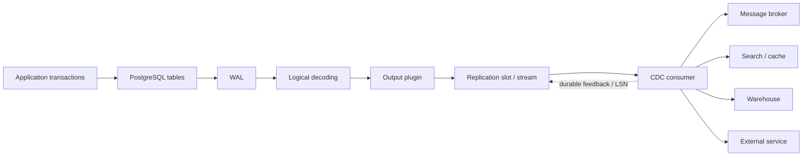

# Logical Decoding, Output Plugins, and Streaming Data Changes to External Systems

Logical decoding is the mechanism by which PostgreSQL reads changes written to the Write-Ahead Log (WAL) and converts them into a logical event stream for external systems to consume. It serves as the foundation for Change Data Capture (CDC): instead of continuously polling tables to detect new or modified rows, a consumer receives INSERT, UPDATE, DELETE, and certain logical messages in commit order.

In PostgreSQL, **logical decoding** is the WAL reading engine; the **output plugin** governs how changes are represented; the **replication slot** holds the read position so PostgreSQL knows which WAL is still needed; and the **consumer** is responsible for persisting changes to the destination system and acknowledging progress. These components work together while maintaining distinct lifecycles and responsibilities.

This lesson belongs to the **Logical Replication** chapter and focuses on:

- Understanding WAL, logical decoding, transaction boundaries, LSNs, and snapshots.
- Configuring PostgreSQL to support logical decoding.
- Creating and managing logical replication slots.
- Distinguishing `pgoutput`, `test_decoding`, and external output plugins.
- Using publications, replica identities, and the logical replication protocol.
- Reading changes via SQL functions or streaming clients.
- Designing CDC consumers with checkpointing, idempotency, and error handling.
- Monitoring WAL retention, slot lag, backpressure, and slot health.
- Handling schema evolution, DDL, sequences, and out-of-scope data.
- Securing data, replication privileges, and operating CDC safely.

> **Key takeaway:** logical decoding supplies a change stream from WAL. It does not automatically create a complete copy of the database on the target system, does not automatically synchronize DDL, and does not guarantee durable persistence by the consumer. The consumer must manage initial snapshots, transactions, offsets, and schema compatibility.

## 1. What is logical decoding?

PostgreSQL uses Write-Ahead Logging to record changes required for crash recovery and replication. WAL is organized into records addressed by a Log Sequence Number (LSN).

Logical decoding reads WAL, combines it with metadata from PostgreSQL catalogs, and interprets physical changes into data-level changes, such as:

- A row inserted into a table.
- A row updated.
- A row deleted.
- A transaction beginning and committing.
- A TRUNCATE executed.
- A logical message emitted by an application if supported by the plugin.

Physical WAL records do not necessarily correspond directly to readable SQL statements. Logical decoding decodes relevant records, and the output plugin formats the information for the consumer.

### 1.1. Logical decoding vs. physical replication

| Criterion | Physical replication | Logical decoding |
| --- | --- | --- |
| Transmission unit | Physical-level WAL records | Database-level logical changes |
| Purpose | Standbys, HA, PITR | CDC, integration, logical replication |
| Scope | Entire physical cluster | Changes of one database/slot |
| Schema dependency | Standby uses identical physical structure | Consumer must understand schemas and data |
| Table/column selection | Not selectable via publication | Restrictable via publication/plugin |
| Cross-major-version | Tight physical compatibility constraints | Can assist logical migrations per compatibility rules |
| Destination | PostgreSQL physical standby | PostgreSQL or external systems |

Physical replication maintains a physical copy of the cluster. Logical decoding transforms changes into events external systems can process.

### 1.2. Logical decoding and CDC

CDC is the pattern of capturing and forwarding data changes from a source system to one or more destination systems.

Examples:

- PostgreSQL → Kafka → search index.
- PostgreSQL → data warehouse.
- PostgreSQL → cache invalidation service.
- PostgreSQL → near-real-time analytics system.
- PostgreSQL → another PostgreSQL cluster via logical replication.

Logical decoding is one way to extract a change stream from PostgreSQL. A full CDC platform typically adds initial snapshots, schema history, retries, checkpointing, routing, serialization, monitoring, and schema evolution management.

### 1.3. Overall architecture



WAL is the source of changes. The output plugin formats the data. The slot tracks retained progress. The consumer applies events and acknowledges an LSN only after durable processing per system semantics.

## 2. WAL, LSNs, and transaction boundaries

Because logical decoding builds on WAL, you must understand how PostgreSQL tracks positions and change ordering.

### 2.1. What is an LSN?

An LSN is an address within the WAL stream. It is typically displayed as two hexadecimal parts, for example:

```text
0/16B6C50
```

An LSN is neither a timestamp nor a row ID. It represents a position in WAL. Consumers usually store the LSN or commit LSN as a checkpoint to track progress.

Useful functions include:

```sql
SELECT
    pg_current_wal_lsn() AS current_lsn,
    pg_current_wal_insert_lsn() AS current_insert_lsn,
    pg_wal_lsn_diff(
        pg_current_wal_lsn(),
        '0/16B6C50'
    ) AS bytes_since_example_lsn;
```

`pg_current_wal_lsn()` and `pg_current_wal_insert_lsn()` reflect different WAL positions. They are helpful for monitoring, but do not replace the confirmed position of a logical slot.

### 2.2. Transactions are emitted at commit

Logical decoding preserves transaction boundaries. A consumer must not apply half of a transaction and treat it as complete.

Example source transaction:

```sql
BEGIN;

INSERT INTO app.orders(order_id, status)
VALUES (1001, 'created');

INSERT INTO app.order_items(order_id, product_id, quantity)
VALUES (1001, 55, 2);

COMMIT;
```

The consumer must recognize that both row changes belong to the same transaction. If the destination system supports transactions, apply them inside a single target transaction and commit together.

A rolled-back transaction is not treated as committed data for downstream application. Logical decoding handles transaction visibility using PostgreSQL mechanisms.

### 2.3. XID and LSN do not mean the same thing

A Transaction ID (XID) identifies a transaction in PostgreSQL, but XIDs can wrap around and be reused over a system's lifecycle. LSNs locate WAL progress. Consumers should checkpoint using commit LSNs and appropriate transaction metadata, never a standalone XID as a long-term offset.

### 2.4. Commit order and event ordering

Output plugins/protocols can emit `BEGIN`, `CHANGE`, and `COMMIT` markers. Consumers must preserve required ordering, especially when multiple transactions execute concurrently.

For a single source stream, commit order is fundamental to reconstructing state. If a consumer splits one transaction across multiple workers without ordering/dependency tracking, target data can become temporarily or permanently inconsistent.

### 2.5. Large transactions

A large transaction can generate substantial WAL and many change events. Logical decoding may have to buffer or stage transaction data until it can emit changes with proper semantics. Consequences include:

- Increased event emission latency.
- Large batches delivered to the consumer.
- Higher memory and disk usage.
- Longer WAL retention by the slot.
- Sink needing adequate capacity to apply the transaction.

Do not assume every SQL statement maps to an independent message that can commit separately downstream.

## 3. Logical replication slots

A replication slot stores state required for PostgreSQL to continue serving WAL from the position unconfirmed by a consumer. Logical slots are bound to one database and one output plugin.

### 3.1. Slots retain WAL

If a consumer slows down or goes offline, PostgreSQL cannot delete WAL segments the slot still needs. This lets the consumer resume reading upon return, at the cost of increased disk usage.

A slot left inactive for extended periods can retain huge volumes of WAL and fill the disk. Creating a slot therefore carries responsibility for operating and monitoring it.

### 3.2. Slots have a plugin and database

A logical slot typically tracks:

- A cluster-unique slot name.
- An output plugin, such as `test_decoding` or `pgoutput`.
- The database from which the slot reads changes.
- The WAL position to retain.
- The position confirmed by the consumer.
- Active/inactive status.
- Metadata supporting vacuum/catalog retention.

A logical slot is not a publication. The slot tracks decoding progress; a publication defines which tables and operations logical replication with `pgoutput` emits.

### 3.3. Creating a slot via SQL

In a lab configured with `wal_level = logical` and the `test_decoding` plugin available:

```sql
SELECT *
FROM pg_create_logical_replication_slot(
    'app_cdc_slot',
    'test_decoding'
);
```

The result returns the slot name and consistent point LSN. From this position, logical decoding can begin emitting qualifying changes.

Slot names should be stable and follow conventions. Do not create a new slot on every consumer restart without cleaning up old slots; each slot retains WAL independently.

### 3.4. Reading changes via SQL

With an output plugin supporting text output like `test_decoding`, read changes with:

```sql
SELECT lsn, xid, data
FROM pg_logical_slot_get_changes(
    'app_cdc_slot',
    NULL,
    NULL
);
```

This function **consumes** changes and advances the slot. If a consumer has not saved them durably, reading and crashing can lose the ability to reread from the previous position.

To inspect without advancing the slot:

```sql
SELECT lsn, xid, data
FROM pg_logical_slot_peek_changes(
    'app_cdc_slot',
    NULL,
    NULL
);
```

`peek_changes` is suitable for observation/testing, whereas `get_changes` is for consuming. Never run `get_changes` as a harmless inspection query on a production slot.

### 3.5. Slots emit changes only from the consistent point

A logical slot cannot reconstruct all changes prior to slot creation once needed WAL/catalog history is gone. To synchronize an entire table, combine an initial snapshot coordinated with the slot, and then apply the change stream starting at the consistent point.

Creating a slot on a long-running database does not automatically emit all existing rows. That is the job of the initial snapshot.

## 4. What is an output plugin?

An output plugin is a server-side module that receives callbacks from logical decoding and generates a representation for each change. PostgreSQL invokes the plugin on relevant transaction/change events.

The plugin determines:

- Output format: text, JSON, or binary protocol.
- How schemas, tables, columns, and values are represented.
- How transaction markers are handled.
- How TOAST values and replica identities are handled.
- Plugin configuration options.
- Whether logical messages, streaming, or two-phase decoding are supported, depending on plugin and version.

### 4.1. Common output plugins

| Plugin | Origin | Purpose |
| --- | --- | --- |
| `pgoutput` | PostgreSQL core | Logical replication protocol, used with publications |
| `test_decoding` | PostgreSQL contrib | Human-readable text output for testing and demonstrations |
| `wal2json` | External extension | Represents changes as JSON |
| Other CDC plugins | Third-party/custom | Custom formats and consumer semantics |

External plugins must be installed on the PostgreSQL server and must match its major version, build, and operating environment. A client cannot arbitrarily push its own shared library onto the server to act as a plugin.

### 4.2. pgoutput

`pgoutput` is the built-in output plugin used by PostgreSQL's native logical replication protocol. It pairs with publications to determine which tables and operations are emitted.

`pgoutput` uses binary protocol messages, not a plain-text SQL script. Consumers must speak the logical replication protocol and understand its message types.

Do not expect `pg_logical_slot_get_changes()` to produce readable text output from `pgoutput`. SQL decoding functions are primarily for text-output plugins; `pgoutput` is designed for protocol consumers.

### 4.3. test_decoding

`test_decoding` is helpful in labs because its output is human-readable:

```text
BEGIN 742
table app.orders: INSERT: order_id[integer]:1001 status[text]:'created'
COMMIT 742
```

Exact output format depends on plugin version and data. It is a demonstration tool, not a stable schema on which to build production parsers unless format guarantees exist.

### 4.4. External plugins

JSON plugins such as `wal2json` can help consumers integrate quickly with systems that do not speak the PostgreSQL protocol. However, check:

- Whether the plugin version matches the PostgreSQL server.
- Whether the JSON format/version changes across releases.
- How NULLs, numerics, timestamps, binary data, and TOAST values are represented.
- Whether transaction boundaries are preserved.
- Whether streaming of large transactions is supported.
- How output handles schema changes.
- Security and provenance of the extension binary.

Do not install unreviewed plugins on production servers merely because their output format is convenient.

### 4.5. Writing a custom output plugin

PostgreSQL exposes a logical decoding output plugin C extension API. A plugin implements callbacks such as startup, begin, change, commit, and shutdown; exact APIs depend on the PostgreSQL major version.

A custom plugin must carefully handle:

- Memory contexts and data lifetimes.
- Transaction boundaries.
- TOAST and replica identity.
- Encoding and type output.
- Error handling and server process safety.
- Plugin options and validation.
- Compatibility across major versions.
- Security review and packaging.

Output plugins run inside server processes. Bugs in a plugin can destabilize the decoding backend, so use well-tested plugins and restrict slot access.

## 5. Configuring PostgreSQL for logical decoding

Logical decoding requires WAL to carry enough information to reconstruct row-level changes.

### 5.1. wal_level = logical

Check:

```sql
SHOW wal_level;
```

Configure in `postgresql.conf`:

```conf
wal_level = logical
max_replication_slots = 10
max_wal_senders = 10
```

`wal_level = logical` requires a PostgreSQL restart to take effect. Slot and WAL sender limits must also be sized before deployment. Actual counts depend on consumers, subscriptions, migration tools, and operational headroom.

### 5.2. Related parameters

| Parameter | Role |
| --- | --- |
| `wal_level` | Controls WAL detail level; logical decoding requires `logical` |
| `max_replication_slots` | Caps number of replication slots |
| `max_wal_senders` | Caps WAL sender processes |
| `max_slot_wal_keep_size` | Caps WAL retained by replication slots on supported versions |
| `wal_sender_timeout` | Timeout for WAL sender connections |
| `max_logical_replication_workers` | Workers for logical replication subscriptions |
| `max_sync_workers_per_subscription` | Parallel table synchronization workers |
| `max_worker_processes` | Overall capacity for related background workers |

Some parameters apply only to built-in subscriptions while others apply more broadly. Read documentation for your exact major version before tuning.

### 5.3. Configuring authentication

Replication connections require a role with the `REPLICATION` attribute or appropriate administrative privileges. Example:

```sql
CREATE ROLE cdc_reader
    LOGIN
    REPLICATION
    PASSWORD 'replace-through-secret-management';
```

Never hardcode literal passwords in production scripts. Provision credentials via a secret manager or organizationally approved mechanism.

`pg_hba.conf` must allow connections from the consumer host to the target database and authenticate the role. Logical replication connects to a specific database; HBA rules must match that database. Use TLS and server verification when transmitting changes across networks.

### 5.4. Publication creation privileges

Example publication specifying tables:

```sql
CREATE PUBLICATION app_changes
FOR TABLE app.orders, app.order_items
WITH (publish = 'insert, update, delete');
```

The role creating a publication needs appropriate privileges on the database and tables. `FOR ALL TABLES` requires higher privileges. Verify ownership/privileges in your version's documentation.

### 5.5. Confirming effective configuration

```sql
SELECT
    name,
    setting,
    unit,
    source,
    pending_restart
FROM pg_settings
WHERE name IN (
    'wal_level',
    'max_replication_slots',
    'max_wal_senders',
    'max_slot_wal_keep_size',
    'wal_sender_timeout'
)
ORDER BY name;
```

`pending_restart` indicates parameters awaiting a server restart. Do not start CDC until confirming runtime configuration meets requirements.

## 6. Publications: defining emitted data

A publication is a database-level object describing which tables and change types are published for logical replication. It is used by `pgoutput` and built-in logical replication.

### 6.1. Publication for a table list

```sql
CREATE PUBLICATION orders_publication
FOR TABLE app.orders, app.order_items
WITH (publish = 'insert, update, delete');
```

Publications can restrict table scope so consumers receive only needed changes. This reduces data volume and limits sensitive data leaving the database.

### 6.2. Publication for all tables

```sql
CREATE PUBLICATION all_tables_publication
FOR ALL TABLES;
```

All-tables publications have broad scope and require appropriate administrative privileges. When adding new tables, understand publication/version semantics and how consumers handle new schemas.

### 6.3. Schema-wide publications

Newer PostgreSQL versions support schema-level publications. Syntax and availability vary by major version; check server docs before using:

```sql
CREATE PUBLICATION app_schema_publication
FOR TABLES IN SCHEMA app;
```

Schema publications automatically include eligible tables in the schema, yet do not turn DDL into stream change events. Consumers still must handle schema evolution.

### 6.4. Selecting operations

Publications can choose operations:

- INSERT.
- UPDATE.
- DELETE.
- TRUNCATE.

Example publishing only inserts/updates:

```sql
CREATE PUBLICATION app_upserts
FOR TABLE app.customer_profiles
WITH (publish = 'insert, update');
```

Omitting DELETE can leave deleted source rows lingering downstream. Omitting TRUNCATE can keep consumers from reflecting truncate actions. Design explicit semantics rather than toggling options solely to trim traffic.

### 6.5. Row filters

Versions supporting row filters can restrict published rows, for example:

```sql
CREATE PUBLICATION eu_orders
FOR TABLE app.orders
WHERE (region_code = 'EU');
```

Row filters are publication conditions, not RLS policies. RLS does not automatically filter logical decoding output. With row filters, verify behavior when an UPDATE moves a row from matching to non-matching or vice versa, as consumers must interpret the resulting events.

### 6.6. Column lists

Some PostgreSQL versions support column lists in publications. You can limit transmitted columns to reduce payload or avoid sending unneeded fields.

Verify replica identity requirements: columns needed to identify rows for UPDATE/DELETE must remain available as required for subscribers. Never omit key columns consumers need to apply changes.

### 6.7. Inspecting publications

```sql
SELECT
    pubname,
    pubowner::regrole AS owner,
    puballtables,
    pubinsert,
    pubupdate,
    pubdelete,
    pubtruncate
FROM pg_publication
ORDER BY pubname;
```

List tables:

```sql
SELECT *
FROM pg_publication_tables
ORDER BY pubname, schemaname, tablename;
```

Views and catalog columns may differ by major version. Cross-check table filters, column lists, and partition behavior if used.

## 7. Replica identity and UPDATE/DELETE

Logical decoding needs to know which old row changed when emitting UPDATE or DELETE. PostgreSQL uses replica identity to identify that row.

### 7.1. REPLICA IDENTITY DEFAULT

By default, PostgreSQL uses the primary key if present. This is usually the best choice:

```sql
ALTER TABLE app.orders
REPLICA IDENTITY DEFAULT;
```

Consumers receive the key needed to locate the row in the target system. Keep primary keys stable and enforced in the schema.

### 7.2. REPLICA IDENTITY USING INDEX

An eligible unique index can be used:

```sql
ALTER TABLE app.customer_profiles
REPLICA IDENTITY USING INDEX customer_profiles_replica_key;
```

The index must satisfy PostgreSQL's requirements—such as being unique, non-partial, and on suitable columns. Check docs for your version before selecting an index.

### 7.3. REPLICA IDENTITY FULL

If no suitable primary/unique key exists:

```sql
ALTER TABLE app.audit_events
REPLICA IDENTITY FULL;
```

PostgreSQL logs fuller old-row information to help identify rows on UPDATE/DELETE. This can increase WAL volume significantly, especially for tables with wide columns.

Use `FULL` only when truly required and measure its overhead. A natural key or unique index is usually more efficient.

### 7.4. REPLICA IDENTITY NOTHING

`NOTHING` supplies no old-row identity for UPDATE/DELETE. For logical replication needing target row lookup, UPDATE/DELETE may not be published/decoded as consumers need or may trigger errors. Never use this setting for tables where downstream must reflect updates or deletes.

### 7.5. Checking replica identity

```sql
SELECT
    n.nspname AS schema_name,
    c.relname AS table_name,
    c.relreplident AS replica_identity
FROM pg_class AS c
JOIN pg_namespace AS n ON n.oid = c.relnamespace
WHERE n.nspname = 'app'
  AND c.relkind IN ('r', 'p')
ORDER BY c.relname;
```

Catalog characters stand for `DEFAULT`, `USING INDEX`, `FULL`, or `NOTHING`. Reconcile against schema design and publication operations.

### 7.6. Testing UPDATE/DELETE in a lab

Create one lab table with a primary key and one without. Create corresponding publications/slots, execute INSERT/UPDATE/DELETE, and observe output plugin behavior.

Never change replica identity in production solely to experiment; `REPLICA IDENTITY FULL` can raise WAL volume and hurt performance.

## 8. Reading changes with test_decoding

This is the easiest way to observe logical decoding in a lab.

### 8.1. Preparing the table

```sql
CREATE SCHEMA IF NOT EXISTS app;

CREATE TABLE app.cdc_demo (
    id bigint PRIMARY KEY,
    message text,
    updated_at timestamptz DEFAULT now()
);
```

### 8.2. Creating the slot

```sql
SELECT *
FROM pg_create_logical_replication_slot(
    'cdc_demo_slot',
    'test_decoding'
);
```

### 8.3. Generating committed changes

```sql
BEGIN;

INSERT INTO app.cdc_demo(id, message)
VALUES (1, 'first event');

UPDATE app.cdc_demo
SET message = 'updated event'
WHERE id = 1;

DELETE FROM app.cdc_demo
WHERE id = 1;

COMMIT;
```

### 8.4. Reading changes

```sql
SELECT lsn, xid, data
FROM pg_logical_slot_peek_changes(
    'cdc_demo_slot',
    NULL,
    NULL
);
```

Use `peek` to inspect output without advancing the slot. Once done observing in the lab, you can consume:

```sql
SELECT lsn, xid, data
FROM pg_logical_slot_get_changes(
    'cdc_demo_slot',
    NULL,
    NULL
);
```

Output includes transaction markers and change lines. Exact format depends on the plugin.

### 8.5. Testing rollback

```sql
BEGIN;
INSERT INTO app.cdc_demo(id, message)
VALUES (2, 'will rollback');
ROLLBACK;
```

Read the slot again. Rolled-back rows are not emitted to consumers as committed changes.

### 8.6. Dropping the lab slot

Once the slot is no longer needed and is inactive:

```sql
SELECT pg_drop_replication_slot('cdc_demo_slot');
```

Never drop a production slot to free WAL without evaluating consumers and recovery plans. Dropping a slot permanently removes the ability to resume from the previous position.

## 9. Streaming changes with pg_recvlogical

`pg_recvlogical` is a client utility using the logical replication protocol to create, manage, and stream from logical slots. It works well with stream-oriented output plugins such as `test_decoding`.

### 9.1. Creating a slot

Example in a lab:

```bash
pg_recvlogical \
  --dbname="host=db.example.internal port=5432 dbname=appdb user=cdc_reader sslmode=verify-full" \
  --slot=app_cdc_slot \
  --create-slot \
  --plugin=test_decoding
```

Credentials should be supplied via `.pgpass`, service files, or a secret manager. Never put passwords on the command line, in shell history, or in logs.

### 9.2. Starting the stream

```bash
pg_recvlogical \
  --dbname="host=db.example.internal port=5432 dbname=appdb user=cdc_reader sslmode=verify-full" \
  --slot=app_cdc_slot \
  --start \
  --file=-
```

`--file=-` writes output to stdout. You can redirect it to a lab file to observe. Production consumers should manage durable checkpoints and feedback rather than writing raw text files without controlled offset protocols.

### 9.3. Useful options

- `--create-slot`: creates the slot.
- `--drop-slot`: drops the slot.
- `--start`: starts streaming.
- `--slot`: selects the slot.
- `--plugin`: chooses the output plugin when creating a slot.
- `--file`: selects the output destination.
- `--option`: passes plugin options.
- `--status-interval`: adjusts status/feedback frequency as supported by the utility.

Run `pg_recvlogical --help` for your exact client since options and behavior vary across versions.

### 9.4. Utility limitations

`pg_recvlogical` is a helpful utility for testing and simple streaming. Production CDC services typically require reconnect handling, durable offsets, schema history, retries, routing, backpressure, monitoring, and exactly-once effects in sinks where supported.

## 10. pgoutput and the logical replication protocol

`pgoutput` is the plugin PostgreSQL uses for built-in logical replication. It pairs with publications and sends protocol messages over a replication connection.

### 10.1. Creating a publication

```sql
CREATE PUBLICATION orders_pub
FOR TABLE app.orders, app.order_items
WITH (publish = 'insert, update, delete');
```

### 10.2. Creating a logical slot for pgoutput

The logical replication protocol includes a command to create a slot with `pgoutput`. A replication client sends a command such as:

```text
CREATE_REPLICATION_SLOT orders_slot LOGICAL pgoutput
```

If an initial snapshot is needed, the protocol supports snapshot export options in slot creation on appropriate versions. The snapshot name and consistent point must be coordinated with the snapshot process.

This is a replication protocol command, not an ordinary SQL statement executed in a standard SQL session. Use a driver or client supporting replication mode.

### 10.3. Starting replication

The client sends a command such as:

```text
START_REPLICATION SLOT orders_slot LOGICAL 0/0
(proto_version '1', publication_names 'orders_pub')
```

Actual LSNs and protocol options must be managed by the client according to the consistent point and server version. Never hardcode `0/0` as a production start position.

### 10.4. Protocol messages

A `pgoutput` consumer must handle messages such as:

- `Begin`: transaction starts.
- `Relation`: metadata about table/columns.
- `Type`: type metadata when required.
- `Insert`: new row.
- `Update`: modified row, potentially including old key/tuple and new tuple.
- `Delete`: deleted row, typically with old key/tuple per replica identity.
- `Truncate`: table truncated.
- `Commit`: transaction completed.
- `Logical message`: message emitted via the corresponding mechanism if supported by plugin/protocol.

The protocol may include version-specific features such as streaming large transactions, binary transfer, and two-phase transaction support. Clients negotiate appropriate protocol versions and options.

### 10.5. Relation metadata is not a schema migration

`Relation` messages describe metadata needed to decode row changes, not a replacement for DDL migrations. When schemas change, consumers need a compatible schema contract before applying new events.

## 11. Initial snapshots and consistent points

Logical decoding emits changes only from the point where the slot begins decoding. To populate a complete destination system, CDC usually requires two phases:

1. Copy existing data via an initial snapshot.
2. Apply changes generated after the consistent point.

### 11.1. Risk if snapshot and slot are unaligned

Suppose a consumer starts copying tables at 10:00 but creates the slot at 10:05. A row inserted at 10:02 might be missed by the snapshot if the snapshot was taken earlier or inconsistently, while WAL prior to the slot is not emitted. That row goes missing on the target.

Conversely, if the slot is created at 10:00 while the snapshot copy is not bound to the slot's consistent snapshot, a row can appear in both the snapshot and the change stream, causing duplicates or conflicts.

### 11.2. Exported snapshots

The logical replication protocol can create a slot and export a snapshot at its consistent point. The client keeps the snapshot transaction open while dumping initial data, then begins streaming from the matching position.

A complete CDC tool typically coordinates:

- Creating the slot and obtaining the consistent point/snapshot identifier.
- Keeping the snapshot transaction alive.
- Dumping tables within the publication scope.
- Starting change consumption from the exact LSN.
- Handling overlap between snapshot and stream per tool semantics.
- Recording a checkpoint after the target persists data.

### 11.3. Never stitch arbitrary snapshots manually

Do not run an independent `pg_dump` and an independent logical slot assuming both share a snapshot. Use tools supporting snapshot coordination or implement the exact protocol per PostgreSQL documentation.

### 11.4. Large snapshots

Initial snapshots can run for hours. Throughout that time, the slot must retain required WAL. If the snapshot runs long and the consumer has not caught up, WAL retention grows substantially.

Size WAL storage based on peak write rate and snapshot/catch-up duration. Never create a slot without a capacity plan.

## 12. Designing a CDC consumer

The consumer receives events, transforms formats, writes to the sink, and confirms progress. This is where end-to-end correctness is decided.

### 12.1. Consumers must manage state

A practical consumer usually persists:

- Source cluster/database identity.
- Slot name and plugin/protocol version.
- Last durably applied commit LSN.
- Current transaction boundary.
- Schema version or schema history reference.
- Sink checkpoint.
- Retry/error state.
- Metrics and timestamps.

Checkpoints must be stored durably and survive restarts.

### 12.2. Apply first, acknowledge second

Common safe sequence:

1. Read a transaction from the source.
2. Transform events.
3. Write all changes inside a sink transaction.
4. Record the checkpoint/commit LSN inside the same sink transaction if possible.
5. Commit the sink.
6. Send feedback acknowledging the durably flushed/applied LSN.

If you acknowledge before the sink commits, a crash can lose data because the source freed WAL before the consumer persisted changes. If the sink commits before acknowledging, the source may replay the transaction on reconnect; the sink needs idempotency to prevent duplicates.

### 12.3. At-least-once delivery

Many CDC consumers operate with at-least-once semantics: a transaction can be replayed if the consumer crashes before acknowledging. This is safer than losing data, provided the sink handles duplicates.

Design for idempotency by:

- Upserting by primary key.
- Storing source commit LSN and event order.
- Using unique event keys.
- Writing checkpoints atomically with sink transactions.
- Ignoring events older than already-persisted state.
- Handling `DELETE` idempotently.

### 12.4. Exactly-once is an end-to-end property

The replication protocol alone does not guarantee exactly-once side effects across external systems. Exactly-once requires sink transactions, checkpoint atomicity, and idempotency or deduplication mechanisms.

For external APIs lacking shared transactions, use idempotency keys, outbox/inbox patterns, or durable delivery state.

### 12.5. Never checkpoint mid-transaction

If a source transaction contains multiple row changes, the consumer must not acknowledge a commit LSN until all changes in that transaction are durably saved by the sink. Checkpointing midway can skip the remainder on restart.

### 12.6. Do not use XID as a unique event ID

XIDs wrap around and get reused, making them insufficient to distinguish all events uniquely. Combine source identity, commit LSN, transaction position, and event ordinal when constructing idempotency keys.

## 13. Transaction streaming and two-phase transactions

Large transactions can be streamed in chunks on supported protocol versions. This reduces memory pressure at the cost of greater consumer complexity.

### 13.1. Streaming large transactions

With streaming protocols, consumers receive transaction data before the transaction commits. Those changes must not become visible final state in the sink until the corresponding commit arrives.

The consumer must support:

- Transaction identifiers and stream start/stop markers.
- Chunk buffering or staged writes.
- Commit/abort semantics.
- Protocol-compliant reconnect/resume.
- Preventing partial transactions from leaking externally.

### 13.2. Two-phase commit

PostgreSQL supports prepared transactions. Logical decoding can support two-phase decoding if the slot and plugin/protocol are configured appropriately. Consumers must handle `PREPARE`, `COMMIT PREPARED`, and `ROLLBACK PREPARED` with exact semantics.

Do not enable two-phase decoding if the sink lacks a matching model. Specific options and availability depend on major version and output plugin.

## 14. WAL retention, slot lag, and backpressure

This is one of the most critical operational concerns in logical decoding.

### 14.1. Why does a slot retain WAL?

PostgreSQL cannot remove WAL segments still needed by a slot to continue decoding. If the consumer stops reading or acknowledging progress, the slot's `restart_lsn` stalls and WAL accumulates.

This occurs when:

- The consumer is offline.
- The consumer writes slowly to the sink.
- Network connectivity drops.
- The consumer reads without sending feedback.
- A long-running transaction pins decoding state.
- Initial snapshot takes a long time.
- The plugin or sink continuously errors.

### 14.2. restart_lsn and confirmed_flush_lsn

Two key positions:

- `restart_lsn`: oldest WAL position the slot may still need.
- `confirmed_flush_lsn`: position confirmed by the consumer per logical slot mechanics.

`restart_lsn` reflects WAL retention, whereas `confirmed_flush_lsn` reflects consumer progress. The two values need not match because PostgreSQL may still need older WAL/catalog history.

### 14.3. Monitoring slots

```sql
SELECT
    slot_name,
    plugin,
    slot_type,
    database,
    active,
    restart_lsn,
    confirmed_flush_lsn,
    wal_status
FROM pg_replication_slots
WHERE slot_type = 'logical'
ORDER BY slot_name;
```

Some columns exist only on newer PostgreSQL major versions. Verify view definitions on your running server before deploying shared monitoring queries.

### 14.4. Estimating retained WAL

On the primary, estimate the span from current WAL position to `restart_lsn`:

```sql
SELECT
    slot_name,
    pg_size_pretty(
        pg_wal_lsn_diff(
            pg_current_wal_lsn(),
            restart_lsn
        )::bigint
    ) AS approximate_wal_backlog
FROM pg_replication_slots
WHERE slot_type = 'logical'
  AND restart_lsn IS NOT NULL;
```

This is an approximate WAL span, not the exact byte volume of changes waiting for the consumer. WAL also holds unrelated database activity; a slot can pin segments containing records outside its publication.

### 14.5. max_slot_wal_keep_size

On supported PostgreSQL versions, `max_slot_wal_keep_size` caps WAL retained by slots. Exceeding the threshold can cause a slot to lose its ability to resume or become invalidated depending on mechanism/version.

This cap protects storage, but can force slot recreation and a full resnapshot if a consumer falls too far behind. Do not treat it as a harmless way to clear backlog without impacting CDC correctness.

### 14.6. Backpressure

If the sink slows down, the consumer should regulate read/write rates, queue sizes, and concurrency. However, pausing reads for too long increases WAL retention. Plan capacity around:

- Peak WAL generation rate.
- Maximum tolerated consumer offline window.
- Snapshot duration.
- Sink throughput.
- Network bandwidth.
- Transaction sizes.
- Number of independent slots.
- Storage dedicated to `pg_wal`.

### 14.7. Alerting on inactive slots

A slot remaining inactive beyond normal windows should trigger alerts. Never auto-delete slots solely because they are inactive; the consumer might be restarting or serving as a standby slot in a DR plan.

## 15. Monitoring CDC

Monitor both PostgreSQL and the consumer/sink. Checking replication connection status alone is insufficient.

### 15.1. PostgreSQL-side monitoring

Useful sources:

- `pg_replication_slots`: slot `active`, plugin, `restart_lsn`, `confirmed_flush_lsn`, `wal_status`.
- `pg_stat_replication`: WAL sender connections and write/flush/replay positions.
- `pg_stat_activity`: backends, wait events, and query/state.
- `pg_stat_database`: database activity.
- `pg_stat_wal`: WAL generation metrics on supported versions.

Example viewing replication senders:

```sql
SELECT
    pid,
    usename,
    application_name,
    client_addr,
    state,
    sent_lsn,
    write_lsn,
    flush_lsn,
    replay_lsn,
    write_lag,
    flush_lag,
    replay_lag
FROM pg_stat_replication
ORDER BY application_name;
```

A logical consumer does not necessarily display identically to a physical standby; interpret columns and semantics according to connection type.

### 15.2. Consumer-side monitoring

Track:

- Last received LSN.
- Last durably applied LSN.
- Latest commit timestamp.
- Event throughput.
- Source-to-sink latency.
- Consumer restart count.
- Retry/error rate.
- Transaction sizes.
- Queue depth.
- Duplicate/dedup counts.
- Schema compatibility errors.

### 15.3. Time lag vs. byte lag

Time lag answers how stale downstream data is. LSN/byte lag measures the amount of WAL remaining to process. Never rely on a single metric:

- When source write traffic is low, the last timestamp can look old with little actual backlog.
- When source writes spike, byte lag rises quickly even before time lag grows large.
- A consumer may have received events without applying them; `received_lsn` is not durable applied LSN.

### 15.4. Meaningful alert thresholds

| Metric | Condition needing attention |
| --- | --- |
| Inactive slot | Exceeds allowed offline window |
| WAL backlog | Exceeds disk budget or growth rate |
| `wal_status` | No longer `reserved`/usable per expected state |
| Consumer apply lag | Exceeds downstream RPO |
| Sink errors | Steadily rising or poison event detected |
| Last applied LSN | Stalled despite active source writes |
| Schema mismatch | Consumer cannot decode/apply events |
| Free disk | Insufficient headroom for WAL and workload |

Base thresholds on actual write rates and RPO/RTO. One universal threshold across every cluster produces either alert noise or missed incidents.

## 16. Managing slot lifecycles

Long-lived slots require an explicit lifecycle policy.

### 16.1. Creating slots

Create a slot only after documenting its consumer owner, plugin, database, retention budget, and recovery plan. Record the slot name in inventory.

### 16.2. Consumer reconnects

When a consumer reconnects, resume from the slot's durable checkpoint/feedback. Never auto-create a second slot, as doing so can skip WAL from the old slot or leave an orphaned slot retaining extra WAL.

### 16.3. Dropping slots

Drop only after the consumer has stopped and the owner confirms the slot is no longer needed. Example:

```sql
SELECT pg_drop_replication_slot('app_cdc_slot');
```

This fails if the slot is active. Never kill a consumer or drop a slot as a quick fix for lag before evaluating data-loss impact.

### 16.4. Advancing slots

`pg_replication_slot_advance()` moves a slot's position forward. This skips changes prior to the new LSN; skipped events cannot be reread through that slot.

Use only inside an approved recovery procedure when resnapshot/reconciliation is accepted. Never use it arbitrarily to clear WAL.

### 16.5. Temporary slots

Temporary logical slots are tied to a session's lifetime and are unsuitable for consumers needing to reconnect across restarts or disconnects. Use persistent slots for long-running CDC.

### 16.6. Failover logical slots

Newer PostgreSQL versions support mechanisms for synchronizing/failing over logical slots. Availability depends on major version, slot options, and standby sync configuration. Never assume a slot survives and advances cleanly after failover; test actual failover and verify slot state on the promoted node.

## 17. Schema evolution and DDL

Logical decoding focuses on row changes. DDL is not automatically emitted as a row-level schema migration event through built-in logical replication publications.

### 17.1. DDL does not replicate automatically

Statements such as:

```sql
ALTER TABLE app.orders ADD COLUMN source_channel text;
CREATE INDEX orders_source_channel_idx
ON app.orders(source_channel);
```

are not automatically sent to consumers as ordinary DDL changes. Consumers receive row messages based on known metadata/schemas; if the target lacks a compatible column or type, apply fails.

### 17.2. Schema migrations must be coordinated

A safe workflow typically:

1. Designs backward-compatible changes.
2. Deploys schema changes to the sink/consumer first or in proper order.
3. Deploys source DDL.
4. Updates schema registry/connector metadata.
5. Verifies event decoding and apply.
6. Removes legacy compatibility after a transition window.

Expand-contract example: add a nullable column, deploy a consumer supporting both old and new schemas, deploy writers, backfill, and only later drop the legacy column.

### 17.3. Data type changes

Type changes can alter plugin output representations. Test boundary values, NULLs, precision, timezones, and casting behavior before rollout.

### 17.4. Renaming/dropping columns

Renames/drops can break consumer field mapping or sink schemas. Do not deploy destructive DDL while CDC lag is unsafe or consumers remain incompatible.

### 17.5. Schema history

CDC platforms often store an independent schema history. Schema history allows decoding events under the schema active when they occurred, especially when schemas evolve while a consumer processes backlog.

## 18. Data not covered by standard logical decoding/publications

Do not treat logical decoding as a complete mirror of every PostgreSQL state.

| Component | Notes |
| --- | --- |
| DDL/schema migrations | Not automatically replicated like row changes via publications |
| Sequence state | Not automatically synced like table rows by publications |
| Large objects | Not replicated by built-in logical replication in the usual way |
| Unlogged tables | Lack WAL row changes suitable for logical decoding |
| Temporary tables | Session-scoped and excluded from persistent CDC streams |
| Server configuration | Outside database logical changes |
| Roles/global objects | Must be managed separately; not row changes in a publication |
| Extension binaries | Installed separately on servers/targets |
| External files/object storage | Require separate backup/sync |
| Data filtered out of publications | Intentionally absent downstream |

If downstream systems require sequences, DDL, large objects, or external files, build a dedicated sync channel and document consistency/ordering relative to row changes.

## 19. Logical messages for application events

PostgreSQL provides `pg_logical_emit_message()` to write logical messages into WAL. Plugins supporting logical messages can emit them to consumers.

### 19.1. Emitting transactional messages

```sql
SELECT pg_logical_emit_message(
    true,
    'app_event',
    '{"type":"rebuild-cache","customer_id":42}'
);
```

Setting the first argument to `true` binds the message to the current transaction. If the transaction rolls back, the transactional message is not processed as a committed event.

### 19.2. Non-transactional messages

```sql
SELECT pg_logical_emit_message(
    false,
    'maintenance',
    'refresh-reference-data'
);
```

Non-transactional messages do not follow transaction commit boundaries like transactional messages. Understand plugin and consumer semantics before using them.

### 19.3. When to use logical messages?

They can transmit metadata or event markers without modifying a business table. However:

- The plugin must support emitting logical messages.
- Consumers must parse prefixes and payloads.
- Schema/versioning conventions are needed for messages.
- Event ordering relative to row changes must be preserved.
- Do not replace a transactional outbox with logical messages if business events must remain tightly coupled to data transactions with clear semantics for all consumers.

## 20. Transactional outbox and CDC

A common pattern for integrating external systems is the transactional outbox.

### 20.1. The dual-write problem

An application attempting to write to PostgreSQL and call a message broker separately risks:

1. Database commit succeeds.
2. Message publish fails.

Or the message succeeds while the database transaction rolls back. Both systems drift out of sync.

### 20.2. Outbox pattern

The application writes business data and the outbox event inside the same transaction:

```sql
BEGIN;

UPDATE app.orders
SET status = 'paid'
WHERE order_id = 1001;

INSERT INTO app.outbox_events(
    event_id,
    aggregate_type,
    aggregate_id,
    event_type,
    payload,
    created_at
)
VALUES (
    'evt-1001-paid',
    'order',
    '1001',
    'OrderPaid',
    '{"order_id":1001,"status":"paid"}',
    now()
);

COMMIT;
```

The CDC consumer reads the outbox table via logical decoding and forwards events to the broker. Because business and outbox rows commit in one transaction, events are recorded consistently with business state changes.

### 20.3. Outbox consumer

The consumer should:

- Use a stable `event_id` as an idempotency key.
- Advance offsets only after the broker/sink confirms durable writes.
- Handle retries and poison events.
- Preserve ordering per aggregate if business rules require it.
- Enforce a retention/cleanup policy on outbox rows.
- Monitor backlog and duplicate deliveries.

### 20.4. Do not delete outbox rows too early

If cleanup deletes rows before the CDC consumer reads them, events can be lost. Set retention longer than the maximum outage/recovery window or tie cleanup to consumer progress.

## 21. Securing logical decoding and CDC

Logical decoding exposes row contents outside PostgreSQL. Treat this data path with the same rigor as direct database access.

### 21.1. Replication privileges

Create a dedicated role with minimal required privileges:

```sql
CREATE ROLE cdc_service
    LOGIN
    REPLICATION;
```

Exact privileges to create publications, create slots, read catalogs, and connect depend on your workflow. Never grant `SUPERUSER` when `REPLICATION` and object privileges suffice.

### 21.2. RLS does not filter WAL streams automatically

Logical decoding reads WAL and does not evaluate application-role `SELECT` RLS policies. Never assume a consumer receives only rows an ordinary role could `SELECT`.

Use publication table scope, row filters, column lists, and plugin options to restrict exported data. Audit sensitive columns before opening a slot.

### 21.3. Encrypting connections and secrets

- Use TLS and verify server certificates.
- Store credentials in a secret manager.
- Rotate passwords/certificates per policy.
- Never log connection strings containing passwords.
- Restrict source network IPs.
- Audit slot creation/deletion and replication connections.

### 21.4. Securing the sink

CDC streams may contain PII, payment metadata, or internal business events. Enforce access controls, encryption at rest, retention, and auditing across brokers, object storage, warehouses, and downstream services.

### 21.5. Plugins run server-side code

Output plugins are shared libraries loaded into PostgreSQL backends. Install plugins only from trusted sources, verifying compatibility, signatures/provenance, and patching workflows.

## 22. Logical replication to another PostgreSQL instance

Logical decoding also powers built-in logical replication between two PostgreSQL databases.

### 22.1. Publisher

On the source:

```sql
CREATE PUBLICATION app_pub
FOR TABLE app.customers, app.orders;
```

The publisher needs `wal_level = logical`, slot/WAL sender capacity, and a replication role.

### 22.2. Subscriber

On the target:

```sql
CREATE SUBSCRIPTION app_sub
CONNECTION 'host=source.example.internal port=5432 dbname=appdb user=replicator sslmode=verify-full'
PUBLICATION app_pub;
```

Connection strings must use protected credentials. Subscriptions can create replication slots on the publisher and launch initial table synchronization depending on options.

### 22.3. Schemas must exist beforehand

Logical replication does not replicate DDL automatically. Tables must already exist on the subscriber with compatible schemas. Table names, column types, and replica identities must align.

### 22.4. Sequences must be synced separately

Logical replication does not automatically sync sequence states like table data. After initial sync/cutover, subscriber sequences may need adjustment against source values and write ownership. Never allow both publisher and subscriber to write to overlapping key spaces without a conflict-free design.

### 22.5. Subscribers are not multi-master

Built-in logical replication is primarily publisher → subscriber. It does not automatically resolve conflicts if both sides accept writes. Enforce write ownership or adopt a dedicated multi-master solution.

## 23. Consumer error handling and recovery

Consumers need explicit recovery procedures to avoid losing or duplicating data.

### 23.1. Network disconnects

When connectivity drops:

- Keep durable checkpoints.
- Reconnect to the exact source/database/slot.
- Resume from the confirmed position.
- Handle replayed duplicates idempotently.
- Monitor slot retention throughout the offline window.

### 23.2. Sink unavailable

If the sink cannot accept writes, the consumer must not acknowledge new LSNs. Pause apply, retry with backoff, and alert before WAL retention breaches budgets.

### 23.3. Poison events

An event that fails to apply due to schema mismatch or invalid data can block the entire stream when transaction ordering must hold.

Route raw events and safe metadata to a dead-letter workflow only when business semantics allow. Never silently skip an event and advance checkpoints if doing so breaks downstream consistency.

### 23.4. Consumer restarts

Upon restart:

1. Read the durable checkpoint.
2. Connect to the exact logical slot.
3. Resume streaming from the confirmed source position.
4. Deduplicate transactions that may be replayed.
5. Advance the checkpoint only after durable sink commit.
6. Confirm lag decreases and consumer progress advances.

### 23.5. Slot invalidated or WAL lost

If a slot is no longer usable because WAL was removed or the slot was invalidated, the consumer cannot resume from the old offset. Recovery typically involves:

- Stopping the consumer.
- Assessing the missing data window.
- Creating a new slot per procedure.
- Taking a fresh initial snapshot.
- Reconciling source and sink.
- Switching the consumer to the new stream after the consistent point.
- Recording the gap/recovery decision.

Never create a new slot and blindly resume from an old offset without reconciliation; changes in between will be missed or duplicated.

## 24. Performance and capacity planning

Logical decoding consumes WAL, CPU, and network bandwidth; consumers also generate load on sinks.

### 24.1. WAL generation rate

Measure WAL generation under normal and peak workloads. A CDC consumer lagging by 30 minutes during peak hours can retain vastly more WAL than during idle periods.

### 24.2. Replica identity FULL

`FULL` can inflate WAL volume due to wider old-row images. This is especially costly on tables with large JSON/document or `bytea` columns.

### 24.3. Large transactions

Large transactions produce bursty output. Sinks must have sufficient capacity for large batches and transaction staging.

### 24.4. Publication scope

Publish only needed tables and columns. Trimming scope reduces network and sink load, though it does not eliminate all WAL retention because slots still depend on database WAL positions.

### 24.5. Consumer parallelism

Processing can be parallelized across independent keys/partitions while respecting ordering constraints. Never split a single transaction into independently committed fragments when business rules require atomicity.

### 24.6. Network and serialization

JSON/text serialization can introduce substantial overhead. Measure message sizes, compression, batch sizes, and serialization CPU. Binary protocols can be more efficient, provided clients support them.

## 25. Testing and reconciling CDC streams

Do not check merely whether the consumer is running; verify event completeness and ordering.

### 25.1. Generating a test transaction

In a lab, execute a multi-operation transaction:

```sql
BEGIN;

INSERT INTO app.orders(order_id, status)
VALUES (2001, 'created');

UPDATE app.orders
SET status = 'paid'
WHERE order_id = 2001;

COMMIT;
```

The consumer should observe the exact transaction and event order per plugin semantics.

### 25.2. Reconciling source and sink

For small tables:

```sql
SELECT
    count(*) AS row_count,
    min(order_id) AS min_id,
    max(order_id) AS max_id
FROM app.orders;
```

Compare at the same recovery/snapshot point. On systems with ongoing writes, use a watermark/LSN to bound the applied interval.

### 25.3. Verifying deletes

Insert a row and then delete it. Confirm the sink removes the matching row. If the publication omits DELETE, downstream systems will retain stale data.

### 25.4. Verifying key updates

If primary keys are updated, the output plugin and consumer must handle old identity and new tuples properly. Many architectures treat primary keys as immutable to simplify downstream sinks.

### 25.5. Verifying duplicate delivery

Disconnect the consumer after sink commit but before sending feedback. Reconnect and confirm the event is replayed without producing duplicate side effects in the sink.

## 26. Useful catalogs and functions

### 26.1. Viewing logical slots

```sql
SELECT
    slot_name,
    plugin,
    slot_type,
    database,
    active,
    restart_lsn,
    confirmed_flush_lsn,
    wal_status
FROM pg_replication_slots
WHERE slot_type = 'logical'
ORDER BY slot_name;
```

### 26.2. Viewing publications

```sql
SELECT
    pubname,
    puballtables,
    pubinsert,
    pubupdate,
    pubdelete,
    pubtruncate
FROM pg_publication;
```

### 26.3. Viewing publication tables

```sql
SELECT *
FROM pg_publication_tables
ORDER BY pubname, schemaname, tablename;
```

### 26.4. Viewing replica identities

```sql
SELECT
    n.nspname,
    c.relname,
    c.relreplident
FROM pg_class AS c
JOIN pg_namespace AS n ON n.oid = c.relnamespace
WHERE n.nspname = 'app'
  AND c.relkind IN ('r', 'p');
```

### 26.5. Viewing database WAL settings

```sql
SHOW wal_level;
SHOW max_replication_slots;
SHOW max_wal_senders;
SHOW max_slot_wal_keep_size;
```

Some parameters may not exist on older major versions. Query `pg_settings` conditionally in automation scripts.

### 26.6. Logical slot functions

| Function | Purpose |
| --- | --- |
| `pg_create_logical_replication_slot()` | Creates a logical slot via SQL |
| `pg_logical_slot_get_changes()` | Reads and consumes text changes |
| `pg_logical_slot_peek_changes()` | Reads text changes without advancing the slot |
| `pg_logical_slot_get_binary_changes()` | Reads binary changes when supported by plugin/API |
| `pg_logical_slot_peek_binary_changes()` | Peeks binary changes |
| `pg_replication_slot_advance()` | Advances a slot to a specified LSN |
| `pg_drop_replication_slot()` | Drops an inactive slot |
| `pg_logical_emit_message()` | Writes a logical message into WAL |

Execution privileges and signatures vary by version. SQL functions do not replace the replication protocol when plugins like `pgoutput` expect protocol messages.

## 27. Common errors

| Symptom | Common cause | Resolution |
| --- | --- | --- |
| `wal_level` is not `logical` | Server not configured or restarted | Edit config, restart, and verify runtime setting |
| Cannot create slot | Missing `REPLICATION` privilege, capacity, or config | Check role, `max_replication_slots`, logs |
| Plugin fails to load | Extension uninstalled or version mismatch | Install compatible package and inspect server logs |
| Slot emits no changes | No committed changes, wrong database, or publication scope | Check transactions, database, plugin, and publication |
| UPDATE/DELETE lacks old key | Unsuitable replica identity | Use PK, qualifying unique index, or `FULL` when required |
| SQL functions fail with `pgoutput` | Plugin uses logical replication protocol | Use a replication protocol client |
| Consumer sees duplicates | Crash after sink commit before feedback | Implement idempotency and checkpoint atomicity |
| Consumer loses changes | Acknowledged before durable sink commit | Apply first, send feedback afterward |
| WAL disk grows steadily | Inactive/slow slot, long transaction | Alert on slot, scale consumer throughput, manage retention |
| Slot invalidated | WAL exceeded retention budget or slot unusable | Resnapshot and reconcile |
| Target missing column | DDL does not replicate | Coordinate schema migrations |
| Target sequence collision | Sequence state does not auto-sync | Sync sequences separately before cutover |
| RLS does not filter stream | Logical decoding bypasses `SELECT` policies | Limit publication/filter/column scope |
| Initial snapshot missing/duplicated | Snapshot misaligned with consistent point | Use exported snapshots and slot coordination |
| Plugin JSON parse error | Schema/type/output format changed | Versioned parsers, schema history, compatibility tests |

## 28. Runbook for deploying logical decoding/CDC

**Step 1 — Define the use case.** Document tables, operations, latency targets, sink, data classification, RPO, and offline consumer behavior.

**Step 2 — Select plugin/protocol.** Choose `pgoutput` for native logical replication protocol or a plugin matching your CDC tool. Verify version compatibility.

**Step 3 — Configure the server.** Enable `wal_level = logical`, size slots/WAL senders, and configure WAL retention. Restart when required by parameters.

**Step 4 — Prepare roles and networking.** Create a dedicated replication role, HBA entry, TLS, secrets, and firewall allowlists.

**Step 5 — Define publications.** Select tables, operations, and row filters/column lists if supported by your version. Verify replica identities.

**Step 6 — Design the initial snapshot.** Use tools/protocols supporting snapshot coordination; estimate snapshot duration and WAL capacity.

**Step 7 — Create the slot.** Record slot name, database, plugin, consistent point, and owner. Avoid creating redundant extra slots.

**Step 8 — Deploy the consumer.** Support transaction boundaries, durable checkpoints, idempotency, reconnects, schema history, and poison events.

**Step 9 — Verify correctness.** Test INSERT/UPDATE/DELETE/TRUNCATE, rollbacks, large transactions, duplicate deliveries, and schema changes in a lab.

**Step 10 — Enable monitoring.** Track active slots, `restart_lsn`, `confirmed_flush_lsn`, WAL backlog, consumer applied LSN, latency, errors, and disk.

**Step 11 — Run a canary.** Start with a small set of tables/consumers; reconcile source/sink counts and business aggregates.

**Step 12 — Scale and operate.** Expand scope once throughput and correctness are verified. Maintain runbooks for reconnects, slot invalidation, failover, resnapshots, and cleanup.

## 29. Consumer design checklist

Before production, verify the consumer answers:

- How are the source cluster/database and slot identified?
- Which LSN is checkpointed and where is it persisted?
- Are sink commits and checkpoints atomic?
- What happens on a crash between sink commit and feedback?
- What happens on a crash between receiving events and sink commit?
- How does the consumer handle a transaction with millions of changes?
- Are transaction boundaries preserved?
- Are DELETEs and key updates handled properly?
- Where is schema history stored?
- In what order are DDL changes deployed?
- Are TOAST, NULL, binary, numeric, and timestamp values handled accurately?
- Are retry and dead-letter policies defined?
- How are inactive slots and WAL backlogs detected?
- Can resnapshots and reconciliation be performed?
- Does failover preserve compatible slots and checkpoints?
- How is sensitive data filtered, encrypted, and audited?

If checkpointing, slot retention, and resnapshot answers are missing, the CDC pipeline is not yet production-ready.

## 30. Practice exercises

Perform exercises in an isolated PostgreSQL lab. Never create/drop/advance production slots or toggle `wal_level` in production solely for experimentation.

### Exercise 1 — Checking WAL level

Run `SHOW wal_level`. Explain why logical decoding requires the `logical` WAL level.

### Exercise 2 — Reading LSNs

Run `pg_current_wal_lsn()` and `pg_wal_lsn_diff()`. Distinguish LSNs from timestamps and XIDs.

### Exercise 3 — Creating a test_decoding slot

Create a logical slot using `pg_create_logical_replication_slot`. Record the consistent point.

### Exercise 4 — INSERT/UPDATE/DELETE

Create a lab table, execute each DML type, and read changes via `pg_logical_slot_peek_changes`.

### Exercise 5 — Peek vs. get

Compare `pg_logical_slot_peek_changes` with `pg_logical_slot_get_changes`. Identify which advances the slot.

### Exercise 6 — Rollback

Execute a transaction with an INSERT followed by `ROLLBACK`. Check the output stream and explain transaction visibility.

### Exercise 7 — Multi-statement transaction

Write multiple changes within one transaction. Observe `BEGIN`/`COMMIT` markers and change ordering.

### Exercise 8 — Slot state

Query `pg_replication_slots`. Observe `active`, `restart_lsn`, and `confirmed_flush_lsn` before and after consuming.

### Exercise 9 — Replica identity DEFAULT

Create a table with a PK, run UPDATE/DELETE, and observe the emitted old key.

### Exercise 10 — Replica identity FULL

In a lab, switch to `FULL` and observe old-row output. Estimate the impact on rows with large payloads.

### Exercise 11 — Keyless table

Create a table without a PK and test logical UPDATE/DELETE. Determine an appropriate replica identity.

### Exercise 12 — Publication scope

Create a publication for selected tables. Modify tables inside and outside scope and compare outputs.

### Exercise 13 — Publication operations

Create a publication publishing only INSERT/UPDATE. Run DELETE and determine downstream behavior.

### Exercise 14 — Row filter

If supported by your version, create a publication row filter. Test INSERT and UPDATE moving rows into and out of the filter.

### Exercise 15 — Column list

If supported by your version, restrict published columns. Check replica identity columns and output metadata.

### Exercise 16 — pgoutput protocol

Use a logical replication client/driver supporting `pgoutput`. Create a publication and slot, and read Relation/Begin/Insert/Commit messages.

### Exercise 17 — test_decoding via pg_recvlogical

Create a slot with `pg_recvlogical`, stream to stdout or a lab file, and observe transaction markers.

### Exercise 18 — Initial snapshot

Use a tool supporting exported snapshots. Copy a table while writing to the source and verify zero lost or duplicate rows around the consistent point.

### Exercise 19 — Consumer checkpointing

Build a lab consumer persisting sink state and LSN checkpoints. Restart between two transactions and resume from the durable offset.

### Exercise 20 — Duplicate delivery

Simulate a successful sink commit before feedback is sent. Confirm the consumer handles the replay idempotently.

### Exercise 21 — Sink failure

Force the sink to reject a transaction. Confirm the consumer does not advance the LSN and the source slot retains needed WAL.

### Exercise 22 — Slot lag

Generate changes without consuming them. Observe `restart_lsn` and WAL backlog; then consume and monitor progress.

### Exercise 23 — Inactive slot alert

Stop the lab consumer. Configure an alert based on inactive duration and WAL budget. Identify the slot owner.

### Exercise 24 — Slot cleanup

Stop the consumer, drop the lab slot, and check status. Explain why production slots must never be dropped arbitrarily.

### Exercise 25 — Schema evolution

Add a source column and attempt to apply events before the sink has the column. Design an expand-contract migration to keep CDC running.

### Exercise 26 — Sequence state

Create a sequence/identity column and advance its value. Determine whether sequence state appears in the logical row stream or requires separate synchronization.

### Exercise 27 — Logical messages

Use `pg_logical_emit_message` in transactional and non-transactional modes. Check which plugins emit the messages.

### Exercise 28 — Transactional outbox

Write a business row and an outbox row in the same transaction. Read the outbox via CDC and verify idempotent event IDs.

### Exercise 29 — Security/RLS

Create an RLS policy for an application role, then inspect logical decoding output. Explain why RLS does not automatically filter the WAL stream.

### Exercise 30 — WAL capacity

Measure WAL generation rate in a lab. Estimate storage required if a consumer stays offline for a defined duration.

### Exercise 31 — Consumer throughput

Generate continuous write load, throttle the sink, and observe lag. Tune batch size/concurrency while preserving transaction order.

### Exercise 32 — Plugin compatibility

Check plugin version, PostgreSQL version, and output format. Document supported options and upgrade steps.

### Exercise 33 — Failover/recovery

If your lab supports failover logical slots, test slot synchronization per version. Otherwise, write a resnapshot and reconciliation runbook.

### Exercise 34 — Data reconciliation

Compare source/sink row counts, key ranges, aggregates, and business invariants at a shared watermark. Explain the limitations of each check.

### Exercise 35 — CDC production runbook

Author a runbook covering publication scope, plugin, slot inventory, credentials, snapshot workflow, consumer checkpointing, WAL budget, alert thresholds, schema migrations, failover, resnapshots, and cleanup.

## 31. Summary

Core points when working with **logical decoding, output plugins, and streaming changes to external systems**:

1. Logical decoding reads WAL and converts changes into logical events.
2. Output plugins define the format and semantics of the change stream.
3. `pgoutput` powers the logical replication protocol; `test_decoding` is handy for testing text output.
4. Logical replication slots hold the needed position and can retain WAL when consumers lag.
5. `restart_lsn` reflects WAL retention; `confirmed_flush_lsn` reflects consumer progress.
6. Publications restrict tables and operations; DDL does not replicate automatically via row changes.
7. Replica identity governs what old-row information can be emitted for UPDATE/DELETE.
8. Initial snapshots must align with the slot's consistent point to prevent missing or duplicate rows.
9. Consumers must preserve transaction boundaries and acknowledge only after durable sink commits.
10. At-least-once delivery requires idempotency; exactly-once is an end-to-end property.
11. Slot lag, WAL backlog, inactive slots, and consumer apply latency require monitoring.
12. Schema changes, sequences, large objects, roles, and external files require separate sync procedures.
13. Logical decoding does not automatically obey RLS policies to filter the stream.
14. Failover/slot synchronization is version-dependent and must be tested.
15. Production CDC requires runbooks for snapshots, checkpointing, retries, resnapshots, reconciliation, and security.

Logical decoding delivers a reliable change stream when PostgreSQL, the output plugin, and the consumer coordinate properly. End-to-end CDC correctness ultimately hinges on the consumer preserving transaction order, durable checkpoints, schema compatibility, and clean recovery from interruptions.

## 32. Official PostgreSQL documentation

- [Logical Decoding Concepts](https://www.postgresql.org/docs/current/logicaldecoding-explanation.html)
- [Logical Decoding Output Plugins](https://www.postgresql.org/docs/current/logicaldecoding-output-plugin.html)
- [Logical Decoding SQL Interface](https://www.postgresql.org/docs/current/functions-admin.html#FUNCTIONS-REPLICATION)
- [Logical Replication](https://www.postgresql.org/docs/current/logical-replication.html)
- [Logical Replication Publications](https://www.postgresql.org/docs/current/logical-replication-publication.html)
- [Logical Replication Protocol](https://www.postgresql.org/docs/current/protocol-logical-replication.html)
- [Replication Slots](https://www.postgresql.org/docs/current/logicaldecoding-explanation.html#LOGICALDECODING-REPLICATION-SLOTS)
- [pg_recvlogical](https://www.postgresql.org/docs/current/app-pgrecvlogical.html)
- [pgoutput plugin](https://www.postgresql.org/docs/current/protocol-logical-replication.html)
- [WAL Configuration](https://www.postgresql.org/docs/current/runtime-config-wal.html)
- [Replication Configuration](https://www.postgresql.org/docs/current/runtime-config-replication.html)
- [System Information Functions](https://www.postgresql.org/docs/current/functions-info.html)
- [Monitoring Database Activity](https://www.postgresql.org/docs/current/monitoring-stats.html)
- [CREATE PUBLICATION](https://www.postgresql.org/docs/current/sql-createpublication.html)
- [CREATE SUBSCRIPTION](https://www.postgresql.org/docs/current/sql-createsubscription.html)
- [ALTER TABLE — Replica Identity](https://www.postgresql.org/docs/current/sql-altertable.html)
- [Logical Message Functions](https://www.postgresql.org/docs/current/functions-admin.html)

Current links point to current PostgreSQL documentation. The logical replication protocol, publication row filters/column lists, streaming large transactions, two-phase decoding, failover slots, and catalog columns change across major versions. Before deploying, check `SHOW server_version`, `pg_recvlogical --help`, output plugin compatibility, and documentation for your exact version.
