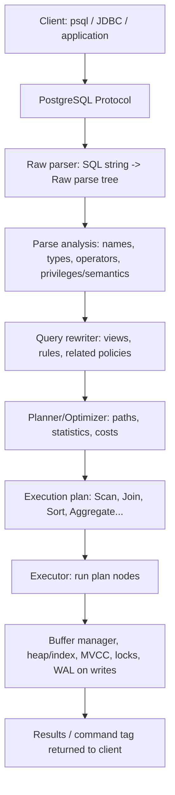
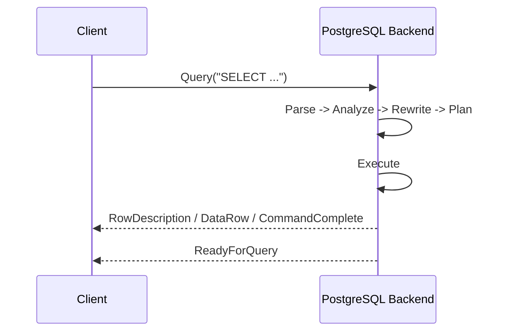
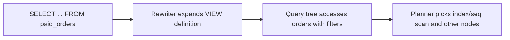
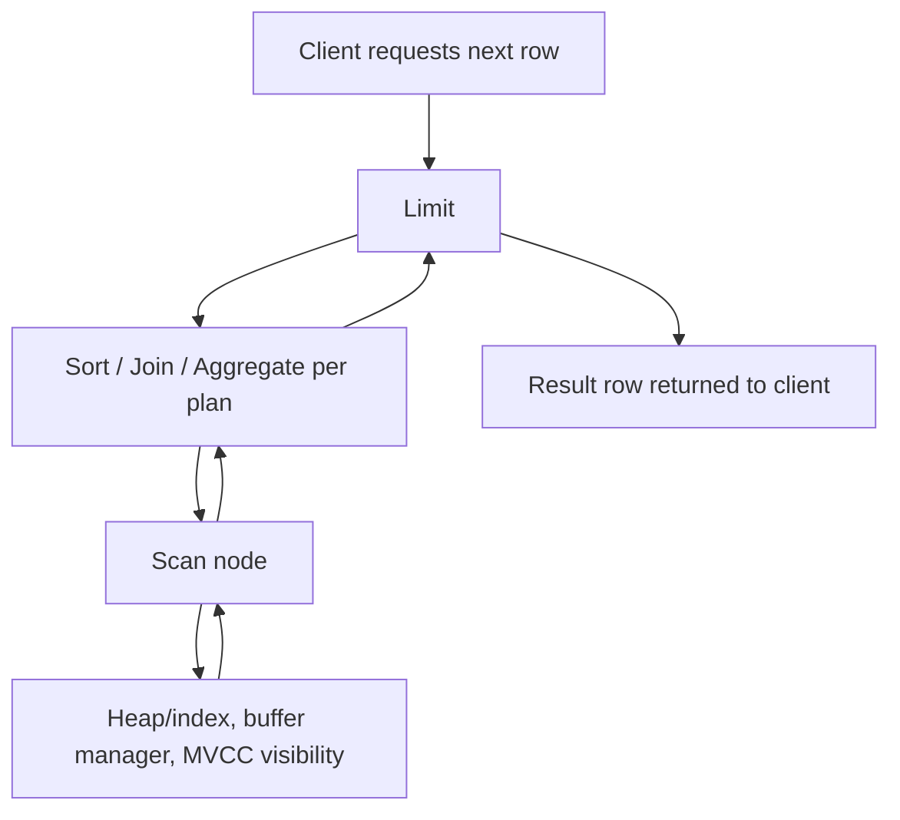

# Query Lifecycle Through Parsing, Rewriting, Planning, and Execution in PostgreSQL

When an application sends a statement such as `SELECT ... FROM orders WHERE ...` to PostgreSQL, the server does not simply read SQL line by line and execute it literally. PostgreSQL must **understand the statement**, resolve the tables/columns/data types it references, apply any necessary transformation rules, **choose a data-access strategy with a reasonable estimated cost**, and only then use its storage and transaction mechanisms to execute it.

The lifecycle is typically described in five stages:

1. **Parsing:** turns the SQL string into a raw parse tree.
2. **Parse analysis:** resolves object names, data types, and SQL semantics to produce an analyzed query tree.
3. **Query rewriting:** transforms the query tree according to rules/views and related mechanisms.
4. **Planning/optimization:** evaluates access paths, joins, filters, and sorts; generates an execution plan.
5. **Execution:** runs the plan nodes, interacts with buffers/cache, tables, and indexes, and returns results or writes data.

Separating these stages explains why a syntactically valid SQL statement can still raise an error, why querying a view turns into a join of base tables, why the optimizer sometimes picks a table scan over an index, and why `EXPLAIN` and `EXPLAIN ANALYZE` report two different kinds of information.

## 1. Overall Diagram of the Query Lifecycle



This diagram is a general model for typical SQL queries. Administrative commands such as `VACUUM`, `CREATE TABLE`, `SHOW`, and other utility commands take separate execution paths; not every SQL command goes through a `SELECT`-style optimizer producing `Seq Scan` and `Hash Join` nodes.

| Stage | Input | Main output | Key takeaway |
| --- | --- | --- | --- |
| Raw parsing | SQL text | Raw parse tree | Primarily checks syntax and structure |
| Parse analysis | Raw parse tree + catalog | Analyzed `Query` tree | Resolves relations, columns, types, operators, and semantic validity |
| Rewriting | `Query` tree | One or more transformed query trees | Applies rules/views, not simple text replacement |
| Planning | Query tree + stats/metadata | Feasible plan tree under cost model | Chooses an execution strategy; not guaranteed fastest in every situation |
| Execution | Plan + parameters + transaction state | Result rows or data modifications | Actual row counts and timings only exist when run |

**Distinguishing the query tree and the plan tree:** the query tree describes *what needs to be done* per SQL semantics; the plan tree describes *how PostgreSQL will attempt to do it* for a given execution.

## 2. From Application to Server: Simple Query and Extended Query Protocol

Clients may use `psql`, JDBC, an ORM framework, or another service. Every statement travels over the PostgreSQL wire protocol, though **when parsing and planning happen** can differ by protocol path.

### 2.1. Simple Query Protocol

In the simple path, the client sends a **Query** message containing SQL text. PostgreSQL processes the statements in that message according to protocol and transaction rules and returns responses accordingly.



This is a conceptual diagram; the exact sequence of response messages also depends on command type and whether errors occur.

### 2.2. Extended Query Protocol

Many clients, including drivers using prepared statements, use the **Parse → Bind → Execute → Sync** message flow:

| Message | General purpose |
| --- | --- |
| `Parse` | Declares a statement and parses the SQL string; may specify parameter types |
| `Bind` | Binds parameter values, creates a portal, and prepares an appropriate plan |
| `Describe` | Requests metadata about parameters or result columns when needed |
| `Execute` | Runs the portal, optionally limiting rows returned in one round-trip |
| `Sync` | Ends the message batch and synchronizes protocol state |

This means in an application reusing prepared statements, **parse, bind, and execute do not necessarily happen in one monolithic step**. Depending on plan caching and parameters, PostgreSQL can reuse previous work or generate a new plan.

Do not equate the extended protocol with SQL `PREPARE` in every case. Both involve prepared statements, but one is a **client-server wire protocol** and the other is an **SQL command** preparing a query within a session.

## 3. Raw Parsing: Turning an SQL String into a Parse Tree

Example:

```sql
SELECT order_id, total_amount
FROM orders
WHERE customer_id = 42;
```

The raw parser uses a lexer and grammar to recognize tokens such as `SELECT`, the target column list, `FROM`, `WHERE`, the `=` operator, and constants. Its output is a **raw parse tree** representing syntactic structure.

Simplified illustration, **not an actual dump of internal structures**:

```text
SelectStmt
  targetList:
    ColumnRef(order_id)
    ColumnRef(total_amount)
  fromClause:
    RangeVar(orders)
  whereClause:
    A_Expr("=")
      left:  ColumnRef(customer_id)
      right: Integer(42)
```

At this step, PostgreSQL knows the statement is structured as a `SELECT` with a filter expression. However, the raw parser **has not yet verified** whether the `orders` table exists, `customer_id` exists, or `=` is valid for the corresponding data types.

### 3.1. Where do syntax errors arise?

Example with invalid syntax:

```sql
SELECT FROM WHERE;
```

PostgreSQL raises a syntax error (SQLSTATE `42601`) during parsing because the token stream fails to match the SQL grammar.

Another statement:

```sql
SELECT nonexistent_column
FROM orders;
```

can be **syntactically valid** yet fail during parse analysis if the table exists without that column. Do not label every query error a "syntax error."

### 3.2. Why should you never concatenate user input into SQL strings?

The raw parser parses *the entire SQL string* sent by the client. If an application concatenates user input directly into the command, special characters can alter SQL structure and lead to SQL injection.

Unsafe:

```text
sql = "SELECT * FROM customers WHERE email = '" + userInput + "'"
```

The proper approach is a **parameterized query** via the driver:

```sql
SELECT customer_id, full_name
FROM customers
WHERE email = $1;
```

`$1` represents a parameter at the PostgreSQL/statement level, whereas JDBC uses `?` placeholders in its API. Parameters are transmitted and parsed as **values**, never spliced as raw SQL text. Dynamic table or column names must be controlled via an allowlist or proper identifier quoting helpers, because value parameters cannot substitute for identifiers.

## 4. Parse Analysis: Resolving Objects and Checking Semantics

After parsing, PostgreSQL performs **parse analysis** (often shortened to analysis or transformation). Here the server looks up declared database objects and determines many data-type details.

Typical tasks:

1. Resolve table, schema, column, and alias names using the system catalogs and `search_path`.
2. Disambiguate column references when a query spans multiple tables.
3. Infer or cast data types per type-resolution rules and choose matching operators/functions.
4. Validate placement of aggregates, grouping, window functions, and expressions.
5. Normalize syntactic constructs into internal query representations.
6. Attach metadata needed by later stages for permission checks and planning.

Example:

```sql
SELECT o.order_id, c.full_name
FROM orders AS o
JOIN customers AS c
  ON c.customer_id = o.customer_id
WHERE o.status = 'PAID';
```

At this stage, the server must determine:

- Which relations `orders AS o` and `customers AS c` refer to.
- Which columns `o.customer_id` and `c.customer_id` are, and their types.
- Which `=` operator applies between those two columns.
- How the string literal `'PAID'` should be typed relative to `orders.status`.
- Whether `full_name` is unique or an ambiguous reference.

### 4.1. Common parse analysis errors

| Illustrative SQL | Issue | Common error type |
| --- | --- | --- |
| `SELECT * FROM missing_table;` | Table does not exist or is not in search path | `undefined_table`, SQLSTATE `42P01` |
| `SELECT unknown_col FROM orders;` | Column does not exist | `undefined_column`, `42703` |
| `SELECT customer_id FROM customers JOIN orders USING (customer_id);` | This form is valid because `USING` coalesces the output column name; not an ambiguous-column example | No ambiguity error for the `USING` column itself |
| `SELECT customer_id FROM customers c JOIN orders o ON c.customer_id=o.customer_id;` | `customer_id` is unqualified and exists in both tables | `ambiguous_column`, `42702` |
| `SELECT customer_id, count(*) FROM orders;` | Non-aggregated column is missing from `GROUP BY` in this example | `grouping_error`, `42803` |

An unqualified `customer_id` is not always wrong: an error occurs only when multiple sources do not coalesce the name and the analyzer cannot resolve which column is meant.

### 4.2. search_path can change the meaning of an SQL statement

```sql
SHOW search_path;
```

Suppose there are two tables `sales.orders` and `archive.orders`. The statement:

```sql
SELECT count(*) FROM orders;
```

is resolved according to `search_path` rules. To avoid ambiguity in critical queries:

```sql
SELECT count(*) FROM sales.orders;
```

Before optimizing performance, confirm the query targets **the intended object**. This is also why you should not grant `CREATE` casually on schemas included in privileged routines' `search_path`.

## 5. Query Rewriting: Transforming the Query Tree by Rules and Views

Once an analyzed query tree exists, PostgreSQL runs **query rewriting**. It operates on the **internal query tree**, not by searching and replacing SQL text keywords.

PostgreSQL has a **rule** system: rules can transform one command into one or more other commands. A particularly important case is a **view**: the query rewriter expands the view into its underlying query definition.

### 5.1. Example of view expansion

Suppose:

```sql
CREATE VIEW paid_orders AS
SELECT order_id, customer_id, total_amount, placed_at
FROM orders
WHERE status = 'PAID';
```

The application queries:

```sql
SELECT order_id, total_amount
FROM paid_orders
WHERE customer_id = 42;
```

Semantically, PostgreSQL must combine:

- The view definition's condition: `status = 'PAID'`.
- The caller's condition: `customer_id = 42`.

One way to **conceptualize** the equivalent underlying query:

```sql
SELECT order_id, total_amount
FROM orders
WHERE status = 'PAID'
  AND customer_id = 42;
```

This is **not a promise** that PostgreSQL regenerates the exact SQL text above. The rewriter and planner manipulate internal trees; depending on view type, `security_barrier`, rules, and transformations, expressions may be structured differently in the plan.



### 5.2. Rules differ from triggers and planner optimizations

Three commonly confused mechanisms:

| Mechanism | Timing / nature | Example |
| --- | --- | --- |
| Query rewrite rule | Transforms the query tree according to rules | Views, `CREATE RULE ... ON ... DO ...` |
| Planner transformation | Changes execution strategy while preserving semantics | Join ordering, predicate pushdown, hash join |
| Trigger | Runs during execution of operations on a table/view | `BEFORE INSERT`, `AFTER UPDATE` |

**The rewriter is not where triggers run.** Triggers fire when the statement reaches the executor stage and corresponding trigger conditions are met.

Avoid complex rewrite rules in place of multi-step business logic simply because rules can rewrite SQL. For writes with side effects, triggers, constraints, transactions, or application logic are often easier to reason about and control, depending on the case.

### 5.3. Row-Level Security and security barriers

PostgreSQL supports **Row-Level Security (RLS)**. When RLS is enabled on a table and applies to the current role, policies inject **row-filtering security predicates** into queries during rewriting/related processing. This restricts which rows a user can read or modify.

Conceptual example:

```text
User query:
  SELECT * FROM orders WHERE status = 'PAID';

Hypothetical RLS policy:
  current role may only see orders.customer_id = 42

Logical behavior:
  returns only rows where status='PAID' AND permitted by policy
```

**Do not treat RLS as an optional filter the application can skip at will.** It is a server-enforced security policy governed by privileges, roles, and table configuration. However, table owners and roles with special attributes may bypass RLS depending on settings; understand the exact effective role. Views with `security_barrier` also constrain how expressions can be pushed across security boundaries.

## 6. Planner/Optimizer: Choosing How to Execute

After rewriting, a query specifies **what must be returned**, but not yet **how to access the data**. The PostgreSQL planner/optimizer considers feasible options and uses **cost-based optimization** to pick a plan.

For example, the same SQL query can be executed in multiple ways:

```sql
SELECT order_id, total_amount
FROM orders
WHERE customer_id = 42
  AND placed_at >= DATE '2026-05-01';
```

Possible options:

- Scan all of `orders` and filter: **Sequential Scan**.
- Use a B-tree index on `(customer_id, placed_at)` to locate matching rows: **Index Scan**.
- Build a bitmap of matching index entries and then read heap blocks: **Bitmap Index Scan + Bitmap Heap Scan**.
- If the query only needs columns present in the index and visibility allows, **Index Only Scan** can reduce heap reads.
- If the table is partitioned, access only required partitions when **partition pruning** applies.

The planner does not follow "if an index exists, always use it." It evaluates **row estimates, data distribution, I/O and CPU costs, caching likelihood, sort order, joins, and query limits**.

### 6.1. Common scan types

| Plan node | Primary work | When it can make sense |
| --- | --- | --- |
| `Seq Scan` | Reads table heap pages sequentially | Small table or large fraction of rows needed |
| `Index Scan` | Probes index to locate row pointers, usually reading matching heap pages | Selective filter, needing columns outside the index |
| `Index Only Scan` | Reads columns stored in the index; checks visibility when needed | Required columns are in the index and visibility map is favorable |
| `Bitmap Index Scan` | Collects matching tuple locations into a bitmap | Many rows spread across blocks, or combined conditions |
| `Bitmap Heap Scan` | Visits heap blocks in order using the bitmap, rechecking conditions if needed | Follows a bitmap index scan |
| `Tid Scan` | Accesses rows directly by tuple identifier where applicable | Special queries using `ctid` |

**Index Only Scan does not mean "never touches the heap."** PostgreSQL must verify tuple visibility under MVCC; whenever the visibility map cannot guarantee all tuples on a page are visible, it still reads the heap page.

### 6.2. JOIN strategies

A `JOIN` can be executed with several algorithms:

| Node | Idea | Key considerations |
| --- | --- | --- |
| `Nested Loop` | For each outer row, look up matching inner rows | Strong when outer input is small and inner side has an efficient index lookup |
| `Hash Join` | Builds a hash table on one input and probes using the join key from the other | Good for equijoins where the build side fits nicely in memory |
| `Merge Join` | Merges two streams already sorted by the join key | Beneficial when inputs are pre-sorted or sort cost is worthwhile |

Example:

```sql
SELECT c.full_name, o.order_id
FROM customers AS c
JOIN orders AS o
  ON o.customer_id = c.customer_id
WHERE c.customer_id = 42;
```

The planner may look up one customer and probe orders via index; for a report joining millions of rows, it may prefer `Hash Join`. **The order of tables written in `FROM` does not dictate execution order** for inner joins after optimization.

### 6.3. GROUP BY, ORDER BY, LIMIT, and CTEs

Other common operators include:

- `Sort`: sorts input tuples when required.
- `Aggregate`, `HashAggregate`, `GroupAggregate`: aggregates rows.
- `Limit`: caps output rows.
- `Materialize` or `CTE Scan`: strategies that store/read intermediate results.
- `Append` / `Merge Append`: combines results from multiple sources/partitions.
- `Gather` / `Gather Merge`: coordinates parallel worker execution.

In modern PostgreSQL, a CTE is not always an automatic **optimization fence**. For non-recursive, side-effect-free CTEs referenced appropriately, the planner can **inline** them; `MATERIALIZED` or `NOT MATERIALIZED` influences this choice per PostgreSQL rules. Do not assume every `WITH ...` materializes into a temporary table.

## 7. Costs and Statistics: What Does the Planner Know?

PostgreSQL estimates row counts and costs using sources such as:

- Estimated page count and tuple count of relations.
- Histograms and most-common values (MCV) frequencies in column statistics.
- `NULL` fractions, number of distinct values, and physical-to-logical correlation.
- **Extended statistics** when created to capture multi-column correlations or distinct group counts.
- Index characteristics, filter expressions, join predicates, ordering, and `LIMIT`.
- Cost constants such as `seq_page_cost`, `random_page_cost`, and `cpu_tuple_cost`.

For instance, if 99% of orders have `status = 'PAID'`, an index on `status` is unattractive for querying all `PAID` orders. Conversely, if only 0.1% of orders match a given `customer_id`, a customer index can be highly beneficial.

### 7.1. Updating statistics with ANALYZE

```sql
ANALYZE orders;
```

`ANALYZE` collects/updates statistics to inform the optimizer; it **does not create indexes**, does not physically reorder rows to match filters, and is not a magic guarantee of an optimal plan. Autovacuum typically triggers autoanalyze once enough data changes, depending on configuration.

In production, `ANALYZE` consumes I/O and CPU; run it according to sound operational strategy rather than spamming it repeatedly just because one `EXPLAIN` estimate looks off.

### 7.2. Cost is not milliseconds

Illustrative plan fragment:

```text
Index Scan using idx_orders_customer_time on orders
  (cost=0.29..18.42 rows=8 width=24)
```

Read it as:

| Part | Meaning |
| --- | --- |
| `cost=0.29..18.42` | Estimated startup-to-total cost in planner **relative cost units** |
| `rows=8` | Estimated number of rows the node expects to emit |
| `width=24` | Estimated average size of an output row from this node, in bytes |

The value `18.42` is **not 18.42 ms**, and `rows=8` is not a runtime row measurement. When you need actual timing and row counts, use `EXPLAIN ANALYZE`.

## 8. Setting Up a Practice Schema to Observe the Planner

Run this in a **lab database** with a role allowed to create schemas and tables. Using a dedicated schema avoids colliding with other data:

```sql
CREATE SCHEMA IF NOT EXISTS query_lifecycle_lab;

CREATE TABLE query_lifecycle_lab.customers (
    customer_id INTEGER PRIMARY KEY,
    full_name   TEXT NOT NULL,
    email       TEXT NOT NULL UNIQUE
);

CREATE TABLE query_lifecycle_lab.orders (
    order_id      BIGINT GENERATED ALWAYS AS IDENTITY PRIMARY KEY,
    customer_id   INTEGER NOT NULL
        REFERENCES query_lifecycle_lab.customers (customer_id),
    status        TEXT NOT NULL
        CHECK (status IN ('PAID', 'PENDING', 'CANCELLED')),
    placed_at     TIMESTAMP NOT NULL,
    total_amount  NUMERIC(12, 2) NOT NULL
        CHECK (total_amount >= 0)
);

CREATE INDEX idx_orders_customer_time
ON query_lifecycle_lab.orders (customer_id, placed_at);

CREATE INDEX idx_orders_status
ON query_lifecycle_lab.orders (status);
```

Load a small representative dataset for observation. `generate_series` is a PostgreSQL **set-returning function**:

```sql
INSERT INTO query_lifecycle_lab.customers
    (customer_id, full_name, email)
SELECT
    n,
    'Customer ' || n::text,
    'customer' || n::text || '@example.test'
FROM generate_series(1, 100) AS gs(n);

INSERT INTO query_lifecycle_lab.orders
    (customer_id, status, placed_at, total_amount)
SELECT
    (n % 100) + 1,
    CASE
        WHEN n % 10 < 7 THEN 'PAID'
        WHEN n % 10 < 9 THEN 'PENDING'
        ELSE 'CANCELLED'
    END,
    TIMESTAMP '2026-01-01'
        + (n % 300) * INTERVAL '1 day'
        + (n % 24) * INTERVAL '1 hour',
    ((n % 19) + 1) * 25000.00
FROM generate_series(1, 10000) AS gs(n);

ANALYZE query_lifecycle_lab.customers;
ANALYZE query_lifecycle_lab.orders;
```

This script assumes a **fresh, empty schema**. Re-running the `INSERT` statements on populated tables will cause duplicate-key errors or inflate row counts. Exact plans also vary by PostgreSQL version, memory settings, statistics, and table size; the explanations below do not assume every machine picks the exact same node.

### 8.1. Sample query to analyze

```sql
SELECT
    c.full_name,
    o.order_id,
    o.total_amount,
    o.placed_at
FROM query_lifecycle_lab.customers AS c
JOIN query_lifecycle_lab.orders AS o
  ON o.customer_id = c.customer_id
WHERE c.customer_id = 42
  AND o.status = 'PAID'
  AND o.placed_at >= TIMESTAMP '2026-05-01'
ORDER BY o.placed_at DESC
LIMIT 5;
```

Stage by stage:

1. **Parse:** identifies `SELECT`, `JOIN`, `WHERE`, `ORDER BY`, `LIMIT`.
2. **Analyze:** resolves aliases `c`/`o`, columns, `TIMESTAMP` type, and comparison operators.
3. **Rewrite:** applies rules/policies if present; on ordinary base tables without rules, this may produce no visible change.
4. **Plan:** evaluates indexes, `status` selectivity, join order, sorting, and the 5-row limit.
5. **Execute:** reads tuples per the plan, applies predicates, returns up to five rows in the requested order to the client.

## 9. EXPLAIN: Viewing the Plan *Before* Execution

`EXPLAIN` shows which nodes the planner intends to use:

```sql
EXPLAIN
SELECT
    c.full_name,
    o.order_id,
    o.total_amount,
    o.placed_at
FROM query_lifecycle_lab.customers AS c
JOIN query_lifecycle_lab.orders AS o
  ON o.customer_id = c.customer_id
WHERE c.customer_id = 42
  AND o.status = 'PAID'
  AND o.placed_at >= TIMESTAMP '2026-05-01'
ORDER BY o.placed_at DESC
LIMIT 5;
```

An **illustrative tree of nodes you might see** (not measured output from a specific PostgreSQL server):

```text
Limit
  -> Nested Loop
       -> Index Scan using idx_orders_customer_time on orders o
            Index Cond: ((customer_id = 42) AND (placed_at >= ...))
            Filter: (status = 'PAID')
       -> Index Scan using customers_pkey on customers c
            Index Cond: (customer_id = 42)
```

With `ORDER BY ... DESC`, the planner may also insert a `Sort`, scan an index backward, or pick another structure. **Do not copy the tree above expecting your live `EXPLAIN` output to match character-for-character.**

Interpreting the nodes:

- `Limit`: caps output at up to five rows.
- `Nested Loop`: joins each row from the outer input against the inner input.
- `Index Scan`: reads through the selected index.
- `Index Cond`: predicate used directly to bound/probe the index.
- `Filter`: additional predicate evaluated on rows produced by the access step.

The plan tree's presentation order is not the textual clause order of SQL. The planner is free to reorder table access within semantically equivalent transformations.

### 9.1. Why might PostgreSQL pick a Seq Scan?

If a table has few rows, the filter matches most rows, or no suitable index exists, `Seq Scan` can be cheaper. That is not automatically an optimizer bug.

Example:

```sql
EXPLAIN
SELECT *
FROM query_lifecycle_lab.orders
WHERE status = 'PAID';
```

Because the sample data has a high share of `PAID` rows, the planner may decide scanning the table sequentially beats jumping across many heap pages via an index. Evaluate **row estimates, value distributions, and heap-read costs**, rather than judging solely by the presence of `Seq Scan`.

### 9.2. Useful EXPLAIN options

```sql
EXPLAIN (VERBOSE, COSTS, SETTINGS)
SELECT count(*)
FROM query_lifecycle_lab.orders
WHERE status = 'PAID';
```

| Option | Main effect |
| --- | --- |
| `VERBOSE` | Adds detail such as output columns/expressions |
| `COSTS` | Displays estimated cost, rows, and width |
| `SETTINGS` | Displays planner-relevant settings that differ from defaults as reported by EXPLAIN |
| `FORMAT JSON` | Outputs the plan in structured JSON format |
| `ANALYZE` | **Executes the statement** and includes runtime statistics |
| `BUFFERS` | Reports buffer statistics where supported, especially useful alongside `ANALYZE` |

PostgreSQL supports additional options such as `TIMING`, `SUMMARY`, `WAL`, and `MEMORY` depending on version and command type. Do not assume all options behave identically across every major version.

## 10. EXPLAIN ANALYZE: Observing the Plan *During Real Execution*

`EXPLAIN ANALYZE` executes the statement and adds runtime measurements:

```sql
EXPLAIN (ANALYZE, BUFFERS)
SELECT
    c.full_name,
    o.order_id,
    o.total_amount,
    o.placed_at
FROM query_lifecycle_lab.customers AS c
JOIN query_lifecycle_lab.orders AS o
  ON o.customer_id = c.customer_id
WHERE c.customer_id = 42
  AND o.status = 'PAID'
  AND o.placed_at >= TIMESTAMP '2026-05-01'
ORDER BY o.placed_at DESC
LIMIT 5;
```

Because this is a pure `SELECT` on lab tables, it is safe and convenient to experiment with. Actual plan output may include:

```text
(cost=... rows=... width=...)
(actual time=... rows=... loops=...)
Buffers: shared hit=..., read=...
Planning Time: ...
Execution Time: ...
```

Meaning:

| Field | Metric type | Interpretation |
| --- | --- | --- |
| `cost` | Estimated | Planner cost units, not milliseconds |
| `rows` before actual | Estimated | Rows the node expects to produce |
| `actual time` | Measured | Time spent by the node during execution, typically reported in ms |
| `actual rows` | Measured | Rows produced by the node; with multiple loops, normally the per-loop average |
| `loops` | Measured | Number of times the node was executed |
| `Buffers: shared hit` | Runtime buffer | Buffer page accesses satisfied from shared buffers |
| `Buffers: shared read` | Runtime buffer | Buffer page reads not found in shared buffers (not always physical disk reads) |
| `Planning Time` | Measured | Time spent planning within measured scope |
| `Execution Time` | Measured | Execution time reported by EXPLAIN |

**A mismatch between actual rows and estimated rows** signals that statistics or estimates may be inaccurate, especially if off by orders of magnitude at an expensive node. Keep in mind that measured timings are also affected by caching, concurrent load, OS behavior, and `EXPLAIN ANALYZE` instrumentation overhead.

### 10.1. Warning when using EXPLAIN ANALYZE with DML

Unlike plain `EXPLAIN`, `EXPLAIN ANALYZE INSERT/UPDATE/DELETE` **actually performs the data modifications**, along with any triggers. In a lab environment, you can wrap it in a transaction and roll back:

```sql
BEGIN;

EXPLAIN (ANALYZE, BUFFERS)
UPDATE query_lifecycle_lab.orders
SET total_amount = total_amount + 1000
WHERE order_id = 1;

ROLLBACK;
```

`ROLLBACK` undoes transactional changes inside PostgreSQL, but **cannot undo external side effects** from triggers or functions (such as calling external services), and sequences do not normally roll back allocated values. Never run `EXPLAIN ANALYZE` on DML with risky side effects in production merely intending to roll it back afterward.

## 11. Executor: What Do Plan Nodes Actually Do?

The executor runs the execution plan produced by the planner. A common mental model is an **iterator/pull-based operator tree**: a parent node needs a row, asks its child node for the next row, processes it, and passes it upward. Internally, PostgreSQL's executor runs initialization, execution, and shutdown routines for each plan node.



In practice, some nodes are **blocking** (such as certain `Sort` or `HashAggregate` nodes that must consume all input before emitting a row), and **parallel execution** adds worker coordination, so not every node yields one row per simple pull. Still, the operator-tree model helps you read plans from **root to leaves**.

### 11.1. Buffer manager and I/O

When `Seq Scan` or `Index Scan` needs data, PostgreSQL reads through the buffer/cache system and storage manager. Some pages are already in **shared buffers**, while others must be fetched from storage, potentially hitting the OS page cache.

Therefore:

- `shared hit` indicates accesses served from shared buffers.
- `shared read` counts page reads through the buffer read path, **not necessarily physical disk I/O operations**, because the OS may cache pages.
- CPU costs for tuple filtering, decoding, and shipping results to the client still exist even when most pages are cached.

To improve a query, identify which node is doing the bulk of the work—not just how many SQL queries the application sends.

### 11.2. MVCC and snapshots

PostgreSQL uses **Multi-Version Concurrency Control (MVCC)** to manage row versions and concurrent reads/writes. The executor must check which tuples are **visible** to the statement's or transaction's snapshot rather than returning every tuple found on a page.

Example:

```text
Transaction A: UPDATE orders SET status='PAID' WHERE order_id=1
               (uncommitted)
Transaction B: SELECT status FROM orders WHERE order_id=1
```

Under the common `READ COMMITTED` isolation level, B does not see A's uncommitted value. B reads the committed version visible to its statement snapshot. Once A commits, a new `SELECT` in B can see the updated value per the active isolation rules.

Under `REPEATABLE READ`, a transaction-wide snapshot means subsequent reads in B continue seeing the older state even after A commits. That is **transaction semantics**, not a planner bug.

### 11.3. Writing data, WAL, constraints, and triggers

For the statement:

```sql
UPDATE query_lifecycle_lab.orders
SET status = 'PAID'
WHERE order_id = 1;
```

The plan may include a `ModifyTable` node above the scan path locating target rows. During execution, PostgreSQL handles:

- Row/version checks and update concurrency conflicts.
- Required locks and access checks.
- Applicable constraints such as `CHECK`, `FOREIGN KEY`, and `UNIQUE`.
- Appropriate triggers if defined.
- **WAL (Write-Ahead Log)** records to support crash recovery and durability as configured.

The **rewrite** stage may have transformed the statement by rule, yet **actually modifying records** happens inside the executor and storage engine. A statement succeeding inside an explicit transaction does not mean the transaction has `COMMIT`ted.

## 12. Prepared Statements: When Are Parsing and Planning Reused?

PostgreSQL supports preparing statements for reuse with different parameters:

```sql
PREPARE find_orders(integer) AS
SELECT order_id, customer_id, status, placed_at
FROM query_lifecycle_lab.orders
WHERE customer_id = $1
ORDER BY placed_at DESC
LIMIT 10;

EXECUTE find_orders(42);
EXECUTE find_orders(7);
```

Meaning:

- `PREPARE` parses/prepares the query with placeholder `$1` typed as `integer`.
- `EXECUTE` supplies concrete parameter values and runs the prepared statement.
- PostgreSQL can pick a **custom plan** tailored to specific parameter values or a **generic plan** reused across executions, according to plan-cache rules and cost comparisons.

A prepared statement is not always planned **only once**. With skewed data distributions, a custom plan can outperform for specific values; a generic plan can save planning overhead on repeated calls.

### 12.1. Viewing the plan of EXECUTE

```sql
EXPLAIN EXECUTE find_orders(42);

EXPLAIN (ANALYZE, BUFFERS)
EXECUTE find_orders(42);
```

You can compare plans and row estimates across parameters. However, our demo table distributes rows fairly evenly across customers, so you may not see dramatic differences.

The `plan_cache_mode` setting controls how PostgreSQL chooses between generic and custom plans in relevant situations:

```sql
SHOW plan_cache_mode;
```

**Do not change this setting globally just to "force caching."** When diagnosing, test inside a controlled session with representative data and measure real cost.

### 12.2. Plans are not immutable forever

PostgreSQL performs **plan invalidation/replanning** when referenced metadata changes or under other prepared-statement rules. Adding indexes, altering schemas, or updating statistics can trigger re-evaluation of cached plans. Do not assume `PREPARE` locks in an access path forever regardless of database changes.

When a prepared statement is no longer needed:

```sql
DEALLOCATE find_orders;
```

This is a session-level PostgreSQL command, not an operation that drops tables or deletes data.

## 13. Analyzing a Query Through a VIEW

Create a view on the lab schema:

```sql
CREATE OR REPLACE VIEW query_lifecycle_lab.paid_order_report AS
SELECT
    o.order_id,
    o.customer_id,
    c.full_name,
    o.total_amount,
    o.placed_at
FROM query_lifecycle_lab.orders AS o
JOIN query_lifecycle_lab.customers AS c
  ON c.customer_id = o.customer_id
WHERE o.status = 'PAID';
```

Query through the view:

```sql
EXPLAIN (VERBOSE)
SELECT order_id, full_name, total_amount
FROM query_lifecycle_lab.paid_order_report
WHERE customer_id = 42
ORDER BY placed_at DESC
LIMIT 5;
```

In `EXPLAIN`, you will see **the underlying tables `orders` and `customers`** instead of a physical node named after the view. This happens because ordinary views are expanded during rewriting/planning, not because PostgreSQL secretly stores a separate physical table for the view.

### 13.1. Ordinary view vs. materialized view

| Kind | Characteristics |
| --- | --- |
| Regular `VIEW` | Primarily stores **a query definition**; when queried, the system applies the definition and executes an appropriate plan |
| `MATERIALIZED VIEW` | Holds **computed and stored data**; requires explicit refresh to update |

A materialized view can be scanned like a physically stored relation, whereas a regular view is expanded by rules. Therefore, if users report a view is "slow to read," do not assume "we need to create an index directly on the regular view"; inspect the underlying tables, predicates, and plan, or consider a materialized view if business requirements allow refreshed data.

## 14. Where Transactions and Access Control Fit in the Lifecycle

SQL executes inside a **connection session** and is bound to a transaction. In many clients' default autocommit mode, each standalone statement runs inside an implicit transaction. When using:

```sql
BEGIN;

SELECT count(*)
FROM query_lifecycle_lab.orders;

UPDATE query_lifecycle_lab.orders
SET total_amount = total_amount + 1000
WHERE order_id = 1;

COMMIT;
```

the two SQL statements are separate requests belonging to **the same transaction** within that block.

Each statement's parse/analyze/rewrite/plan/execution steps must operate consistently with session info, snapshot, permissions, and transaction state. **The planner does not decide when to commit**; transaction boundaries are controlled by the protocol and client transaction commands under PostgreSQL semantics.

### 14.1. How are access permissions checked?

When a query references tables/views, PostgreSQL records required privileges and checks them during relevant execution processing. Beyond `SELECT` on a table, a query may require:

- `CONNECT` privilege on the database.
- `USAGE` privilege on the schema containing the object.
- Privileges on tables/columns, sequences, or functions.
- Row-level security policies if enabled.
- `SECURITY INVOKER`/`SECURITY DEFINER` context rules when accessing via configured objects.

Do not state as an absolute rule that "all permissions are checked completely in the parser" or "all permissions are only checked at the end of the executor." Privilege recording, object validation, and enforcement participate at multiple points in the pipeline depending on object type and command.

### 14.2. Why can errors occur at multiple stages?

| Stage involved | Example | Observation |
| --- | --- | --- |
| Parsing | Missing `FROM`/parentheses, bad token | Fails to form valid syntax |
| Analysis | Missing column/table, mismatched types | Statement can be syntactically valid yet semantically wrong |
| Rewriting / permissions | View/rule/policy results in unauthorized access | Involves objects or security policies |
| Planning | No valid plan in unusual cases, or early constant-expression error | Less common than semantic errors, but possible |
| Execution | Division by zero, `UNIQUE` violation, deadlock, out of resources | Fails while actually reading/writing/evaluating data |
| Commit | Serialization/write conflict or deferred constraint failure on commit | Statements may have run, yet transaction fails to commit |

For instance, a constant expression dividing by zero is sometimes evaluated early during planning; you cannot strictly classify every division-by-zero error as occurring only when the executor fetches rows.

## 15. How an SQL Statement Changes Shape Across Stages

Take this query:

```sql
SELECT
    c.full_name,
    SUM(o.total_amount) AS paid_total
FROM query_lifecycle_lab.customers AS c
JOIN query_lifecycle_lab.orders AS o
  ON o.customer_id = c.customer_id
WHERE o.status = 'PAID'
GROUP BY c.customer_id, c.full_name
HAVING SUM(o.total_amount) >= 1000000
ORDER BY paid_total DESC
LIMIT 10;
```

From each stage's perspective:

**Raw parser:** recognizes `SELECT`, `JOIN`, `WHERE`, `GROUP BY`, `HAVING`, `ORDER BY`, `LIMIT`, and the `SUM` call.

**Parse analysis:** checks that `SUM` receives a valid numeric/input type, non-aggregated columns appear validly in `GROUP BY`, and alias `paid_total` in `ORDER BY` resolves per PostgreSQL SQL rules.

**Rewrite:** applies rules/views/RLS if applicable; if querying base tables without relevant rules, the query tree retains largely the same meaning.

**Planner:** considers scanning `orders` via `status` vs. sequential scan, which join algorithm to pair with `customers`, whether to group via hash aggregate or sort/group aggregate, how to perform the final sort, and how to stop after ten rows.

**Executor:** reads visible tuples, filters `status='PAID'`, joins, computes `SUM` per group, applies `HAVING`, sorts, and returns rows. Operations can execute in a plan **different from the written clause order**, while preserving SQL query semantics.

### 15.1. SQL describes the desired result, not a step-by-step script

Do not assume that because `SELECT` appears first in text, the executor "evaluates SELECT before WHERE," or that because `customers` comes first in `FROM`, it is always scanned first. SQL is a declarative language; the optimizer can reorder operations as long as correctness is preserved.

This also explains why writing a "shorter" SQL query does not guarantee faster execution. A short query can have a terrible plan, while a multi-line query with well-matched indexes and predicates can optimize cleanly.

## 16. Reading EXPLAIN to Connect All Stages Together

When investigating a slow query, follow this sequence:

1. **Confirm SQL semantics:** verify database, schema, column names, `WHERE`/`JOIN` conditions, and expected row count.
2. **Check `EXPLAIN` first** to see which nodes the planner chose, estimated rows, and which indexes are used.
3. **Inspect statistics** and value distributions on filter/join columns; consider `ANALYZE` if statistics are stale.
4. **Use `EXPLAIN (ANALYZE, BUFFERS)` when safe** to compare estimated vs. actual rows, loops, timings, and buffer usage.
5. **Pinpoint expensive nodes**, such as an unselective `Seq Scan` reading huge row counts, an inner `Nested Loop` executing too many times, a `Sort` spilling to disk, or a hash join building a large hash table.
6. **Make targeted changes**, such as adding an appropriate index, fixing predicates, fetching fewer columns, updating statistics, or revisiting joins/partitioning.
7. **Re-measure** on representative data and workloads, accounting for write and index-maintenance overhead.

The query lifecycle helps diagnose by layer: incorrect results do not mean a slow engine; valid syntax does not mean valid semantics; a good plan on tiny test data does not guarantee a good plan on production volume.

## 17. Common Misconceptions

| Common misconception | Accurate understanding |
| --- | --- |
| "The parser checks all table/column names and permissions." | The raw parser primarily checks syntax; parse analysis and subsequent stages handle names, types, and permissions/policies in context. |
| "Query rewrite just reformats SQL cleanly." | The rewriter transforms the **query tree** according to rules/views and policies. |
| "A view is always a table with pre-stored data." | Regular views store query definitions; materialized views store computed data requiring refresh. |
| "Both rules and triggers execute during rewrite." | Rules belong to rewriting; triggers run during operation execution. |
| "If an index exists, PostgreSQL must choose Index Scan." | The planner uses cost estimation; Seq Scan can be cheaper. |
| "cost=100 means it takes 100 ms." | Cost is measured in relative units, not wall-clock milliseconds. |
| "EXPLAIN executes the query to measure actual performance." | Plain `EXPLAIN` displays the estimated plan; `EXPLAIN ANALYZE` executes it. |
| "EXPLAIN ANALYZE UPDATE does not modify data." | It actually executes the UPDATE; be careful with transactions and side effects. |
| "Index Only Scan never touches the heap." | It may still read the heap to check MVCC visibility. |
| "SELECT returns rows in physical order without ORDER BY." | SQL provides no ordering guarantee without `ORDER BY`. |
| "JOINs always execute in the order tables appear in FROM." | The planner can reorder joins when semantics permit. |
| "PREPARE always generates one fixed plan." | PostgreSQL can pick generic/custom plans and replan when needed. |
| "MVCC belongs to the planner." | The planner picks access paths; the executor/storage layer checks tuple visibility against snapshots. |
| "A finished statement means the transaction is committed." | Inside an explicit transaction, changes finalize only upon successful `COMMIT`. |
| "CTEs always materialize." | Eligible CTEs can be inlined depending on conditions and settings. |

## 18. Practice Exercises

1. Draw the full lifecycle diagram of a `SELECT` statement from client → raw parser → parse analysis → rewriter → planner → executor → storage. Note the input and output of each stage.
2. Classify two SQL statements: one with an invalid token and one syntactically valid but referencing a nonexistent column. Identify which stage detects each error.
3. Create the `query_lifecycle_lab` schema, both tables, and indexes per section 8. Run the sample query and inspect actual `EXPLAIN` output on your PostgreSQL version.
4. Compare `EXPLAIN` for a query filtering `customer_id = 42` against `status = 'PAID'`. Explain why having an index does not guarantee the plan uses it.
5. Run `EXPLAIN (ANALYZE, BUFFERS)` for a pure `SELECT`. Record estimated rows, actual rows, loops, Planning Time, and Execution Time; distinguish what each metric represents.
6. Write a `SELECT` against the `paid_order_report` view and run `EXPLAIN (VERBOSE)`. Identify the underlying base tables appearing in the plan and explain the query rewriter's role.
7. Compare an ordinary view with a materialized view. When is a data refresh needed? Why does querying an ordinary view not imply a separate physical table?
8. Use `PREPARE find_orders(integer)` and `EXECUTE` with two customer IDs. Explain generic vs. custom plans and why a prepared statement does not necessarily keep the same plan forever.
9. Write a `GROUP BY` + `HAVING` + `ORDER BY` example; use `EXPLAIN` to locate nodes such as `Aggregate`/`HashAggregate`/`Sort` if present. Explain why plan nodes may not follow written SQL clause order.
10. Explain why a `SELECT` on InnoDB or PostgreSQL with MVCC does not see an uncommitted `UPDATE` from another session. In PostgreSQL, identify where the executor/storage layer checks snapshot visibility in the conceptual model.
11. Propose an investigation workflow for a query with estimated rows = 100 but actual rows = 1,000,000. In what order would you check statistics, filter predicates, and index design?
12. Run a test transaction containing `BEGIN; EXPLAIN (ANALYZE, BUFFERS) UPDATE ...; ROLLBACK;` on a safe table. Explain why this pattern must not be used with triggers calling external services or sensitive production data.
13. Explain the difference between Simple Query Protocol and Extended Query Protocol; how do `Parse`, `Bind`, and `Execute` support statement reuse?
14. Write an architecture note for a slow reporting API: which pipeline stage lies closest to each symptom (syntax error, missing column, excessive table scan, lock wait, transaction rollback)?

## 19. Summary

A PostgreSQL query's lifecycle can be remembered as this sequence:

```text
SQL text
  -> Raw parsing
  -> Parse analysis
  -> Query rewriting
  -> Planning / optimization
  -> Execution
  -> Tuple/row result or data modification
```

**Parsing** validates syntax; **analysis** resolves objects and semantics; **rewriting** applies rules/views and related policies; **the planner** selects data-access and join steps via a cost model; **the executor** runs the plan within transaction, MVCC, locking, and storage rules. When investigating why a query is slow or behaves unexpectedly, pinpoint the right stage, inspect `EXPLAIN` for **estimates**, and cautiously use `EXPLAIN ANALYZE` to verify **runtime reality**. This is the foundation for understanding PostgreSQL's architecture and tuning queries based on evidence rather than guesswork.
