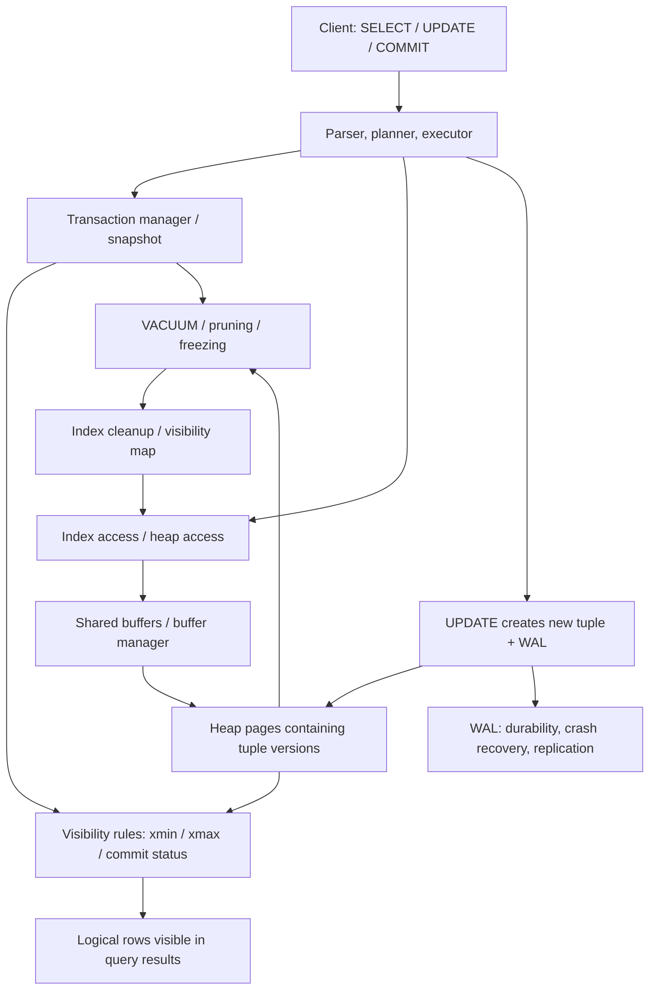
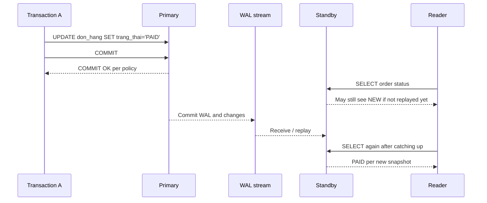

# MVCC, Row Versions, and Snapshots in the Big Picture

Two transactions access the same order in PostgreSQL: transaction A is reading status `NEW`, while transaction B updates the status to `PAID` and commits. Why can A continue seeing `NEW` while another query already sees `PAID`? Why can a single `UPDATE` make a table grow larger even when changing only a few characters? Why do `VACUUM`, indexes, transaction IDs, WAL, and replication all tie into the exact same mechanism?

The answer starts with **Multi-Version Concurrency Control (MVCC)**: instead of forcing every reader and writer to fight over a single copy of a row, PostgreSQL maintains **tuple versions** alongside transaction metadata to decide which version may appear in each SQL query's results.

This lesson places **MVCC, row versions, and snapshots** into PostgreSQL's overall architecture, then traces concurrent reads, updates, locks, indexes, vacuum cleanup, long-running queries, and replicas. Examples target ordinary heap tables on modern PostgreSQL using two or three independent connections for observation. The goal is not memorizing every bit in tuple headers, but building an accurate mental model explaining how PostgreSQL preserves consistency across concurrent sessions.

## 1. Why Does PostgreSQL Need MVCC?

If a database stored only one copy of each row and let a writer overwrite it immediately on `UPDATE`, readers would need a mechanism to avoid seeing half-edited rows. One approach is locking rows so nobody can read while writes happen. Yet if a reporting query takes minutes scanning many tables, read locks and write locks piling up would cripple throughput.

PostgreSQL uses MVCC to decouple **the physical storage of row versions** from **the logical state visible to each transaction**.

- One session can read an older version matching its snapshot.
- Another session can write and commit a newer version.
- Two sessions can see different results without anyone reading uncommitted data.
- Once older versions are no longer needed by any active snapshot, PostgreSQL reclaims their space for reuse.
- Concurrent transactions trying to modify the same row still resolve conflicts via locks and isolation rules; MVCC **does not eliminate all locks**.

A memorable rule:

> **One logical business row can have multiple physical tuple versions; snapshots and transaction states decide which version is visible to each read.**

### 1.1. Four concepts never to confuse

| Concept | Description | Example |
|---|---|---|
| **Logical row** | The entity an application identifies by business/primary key | Order `id = 101` |
| **Tuple version** | A physical version of that row stored in the heap | Version with status `NEW` or `PAID` |
| **Transaction** | A unit of work with `BEGIN`, `COMMIT`/`ROLLBACK`, and isolation rules | Transitioning an order's status |
| **Snapshot / read view** | Metadata recording which transactions had committed or were active at an observation point | "Transaction B's change is hidden because B had not committed at this snapshot" |

**A snapshot is not a full copy of the table cloned into private RAM.** It consists primarily of transaction-visibility boundaries so PostgreSQL can evaluate visibility directly on tuples sitting in heap and index pages. PostgreSQL therefore does not duplicate data pages whenever a transaction starts reading.

### 1.2. Architectural big picture



This diagram shows **responsibilities**, not a single fixed execution path for every statement. A read-only `SELECT` does not generate WAL for business data changes, whereas an `UPDATE` can touch the heap, indexes, shared buffers, and WAL together.

## 2. Where Are Rows Stored: Heap Pages and Tuples

Ordinary PostgreSQL tables are stored as a **heap**. A heap comprises data pages, typically 8 KiB in standard builds. Each page holds a header, item pointers, and tuple payloads.

A table with three logical rows looks simple under `SELECT`, yet physically it is not a simple array of three Java objects:

```text
Heap relation: don_hang
 ├── Page 0
 │    ├── Item pointer 1 → tuple (id=101, status=NEW)
 │    ├── Item pointer 2 → tuple (id=102, status=PAID)
 │    └── ...
 ├── Page 1
 │    └── ...
 └── ...

B-tree index on PRIMARY KEY:
    key 101 → tuple location (TID)
    key 102 → tuple location (TID)
```

Under MVCC, the same row `id = 101` may have existed across multiple tuples over time. An index points to a tuple location, and the executor still **checks whether that target version is visible to the current snapshot**.

### 2.1. Primary key vs. physical address

- `id` is the logical identifier defined by the schema.
- `ctid` is the system column reporting a tuple's physical heap location: block number and item pointer offset.
- `ctid` can change after `UPDATE` or table-reorganizing operations; never use it as a durable business ID.
- Never assume an `UPDATE` modifies bytes of the old tuple in place at the exact same physical slot in every case.

Use `PRIMARY KEY` or an appropriate business key to identify rows. `ctid` belongs mainly to controlled internal diagnostics.

## 3. What Metadata Does a Tuple Version Carry?

To determine visibility, PostgreSQL attaches header metadata to every tuple, notably **`xmin`**, **`xmax`**, and **`ctid`**.

| Field | General role |
|---|---|
| `xmin` | Transaction ID (XID) that created this tuple version, or related frozen state after freezing |
| `xmax` | Transaction/lock info related to deletion, update replacement, or row locking; **non-zero does not simply mean deleted** |
| `ctid` | Physical location of the tuple, also linking forward to newer versions in update chains |
| Header flags | Status bits aiding interpretation of `xmin`/`xmax`, hint bits, MultiXact flags, and more |

You can inspect these system columns on **tuples visible to your query**:

```sql
SELECT
    ctid,
    xmin,
    xmax,
    id,
    trang_thai
FROM demo_mvcc.don_hang
ORDER BY id;
```

This query requires creating `demo_mvcc.don_hang` in the practice section below. When run, it returns only versions visible to that `SELECT`; it is not a tool to list dead tuple versions still sitting physically in the heap.

### 3.1. Why can't you infer deletion mechanically from xmax?

A tuple with a non-zero `xmax` **can still be visible**. `xmax` may hold an aborted transaction's XID, or row-lock / MultiXact metadata, rather than a committed `DELETE`.

PostgreSQL combines:

- XID / MultiXact values in the tuple header.
- Header status flags, including cached commit/abort hint bits.
- Transaction commit status stored by the engine.
- The active snapshot.
- Special rules for tuples created or modified by the currently executing transaction itself.

Hence, **never use `xmax <> 0` as a formula to judge whether a row is deleted**. At the SQL level, rely on `SELECT` results under your chosen isolation level.

### 3.2. XIDs and transaction status

PostgreSQL assigns transaction IDs to track transaction ordering and status. Write transactions require an XID. Read-only transactions may not consume an XID right at `BEGIN`; XID assignment and snapshot acquisition are separate mechanisms.

Transaction commit/abort statuses are recorded in structures such as `pg_xact` alongside supporting metadata. When checking tuples, the executor uses that status plus hint bits to avoid repeated lookups on subsequent accesses.

**Never treat an XID as a timestamp.** XIDs track transaction ordering with wraparound and freezing semantics; they do not represent wall-clock start or commit times.

## 4. What Is a Snapshot If Not a Copy of Data?

A PostgreSQL MVCC snapshot can be understood through three logical components:

- **Snapshot `xmin`:** the lowest XID still relevant as potentially active within the snapshot's scope.
- **Snapshot `xmax`:** the upper boundary; XIDs at or above this boundary were not assigned yet when the snapshot was taken and are not considered visible.
- **Active XID list at snapshot time:** transactions with XIDs below `xmax` that were **still uncommitted when the snapshot was captured**.

This model explains visibility rules conceptually; internal implementation also accounts for subtransactions, combo command IDs, transaction status, and special cases.

### 4.1. Timeline model

Suppose we have these transactions:

| Transaction | State when snapshot S is taken |
|---|---|
| T10 | Committed |
| T11 | Running, uncommitted |
| T12 | Committed |
| T13 | Not started yet |
| T14 | Not started yet |

When a `SELECT` uses snapshot S:

- Changes by T10 and T12 can be visible if other visibility checks pass.
- **Uncommitted changes by T11** are hidden; even if T11 commits later, snapshot S does not change retroactively.
- Changes by T13 and T14 were not committed at S, so they stay hidden to S.
- Earlier writes by the reading transaction itself follow command-visibility rules rather than being hidden just because its own XID is active.

```text
Time  ────────────────────────────────────────────────────→

T10: [BEGIN ─── COMMIT]
T11:      [BEGIN ───────────────── COMMIT]
T12:         [BEGIN ─ COMMIT]
                            ▲
                            S: snapshot taken
T13:                            [BEGIN ─── COMMIT]

Snapshot S:
  T10, T12 can be treated as completed
  T11 uncommitted at S → T11's changes hidden
  T13 started after S → T13's changes hidden
```

A snapshot tells a query **which consistent state is valid to read**, even while concurrent transactions continue running.

### 4.2. A snapshot is not identical to a transaction

One transaction can take **a fresh snapshot per statement** or **keep one consistent snapshot across statements**, depending on isolation level.

This yields two very different behaviors:

- `READ COMMITTED`: a subsequent `SELECT` can see changes committed by other transactions since the previous `SELECT`.
- `REPEATABLE READ`: queries within the same transaction read from one consistent snapshot, so commits by other transactions do not appear mid-transaction.

Many "why did SELECT show old data earlier and new data now?" puzzles come straight from snapshot behavior, not broken PostgreSQL caching.

## 5. Setting Up the MVCC Practice Dataset

Run once in a lab database:

```sql
CREATE SCHEMA IF NOT EXISTS demo_mvcc;

CREATE TABLE demo_mvcc.don_hang (
    id INTEGER PRIMARY KEY,
    trang_thai TEXT NOT NULL,
    tong_tien NUMERIC(12, 2) NOT NULL,
    cap_nhat_luc TIMESTAMPTZ NOT NULL DEFAULT clock_timestamp()
);

INSERT INTO demo_mvcc.don_hang (id, trang_thai, tong_tien)
VALUES
    (101, 'NEW', 120000.00),
    (102, 'PAID', 230000.00);

CREATE TABLE demo_mvcc.tai_khoan (
    id INTEGER PRIMARY KEY,
    ten TEXT NOT NULL,
    so_du NUMERIC(14, 2) NOT NULL
);

INSERT INTO demo_mvcc.tai_khoan (id, ten, so_du)
VALUES
    (1, 'Lan', 1000.00),
    (2, 'Minh', 500.00);
```

Inspect the table and current default isolation level:

```sql
SELECT id, trang_thai, ctid, xmin, xmax
FROM demo_mvcc.don_hang
ORDER BY id;

SHOW default_transaction_isolation;
```

In most PostgreSQL installations, the default is `read committed`. Administrators can change the default, so always check rather than assuming.

**Practice warning:** the multi-session experiments below all use row `id = 101`. To repeat an experiment, reset the row to its starting state before opening new test transactions and snapshots; never reset data while another session holds an active experiment transaction.

## 6. Experiment 1: UPDATE Creates a New Version

Inspect a row before updating:

```sql
SELECT id, trang_thai, ctid, xmin, xmax
FROM demo_mvcc.don_hang
WHERE id = 101;
```

Then update it:

```sql
BEGIN;

UPDATE demo_mvcc.don_hang
SET trang_thai = 'PAID',
    cap_nhat_luc = clock_timestamp()
WHERE id = 101
RETURNING id, trang_thai, ctid, xmin, xmax;

COMMIT;
```

Read it again:

```sql
SELECT id, trang_thai, ctid, xmin, xmax
FROM demo_mvcc.don_hang
WHERE id = 101;
```

Key observations:

1. An `UPDATE` in the heap creates a **new tuple version** for the same logical row.
2. The new tuple's `xmin` matches the XID of the updating transaction.
3. The visible tuple's `ctid` typically changes because the new version occupies a different physical slot.
4. The old tuple does not vanish instantly on `COMMIT`. Older snapshots may still need it.
5. Ordinary `SELECT` only returns the visible version, so you cannot use it to count every version remaining on the page.

On a small table, exact XID and `ctid` values depend on prior writes and VACUUM activity. **Never hard-code assertions expecting `ctid` to equal `(0,3)`** or XIDs to increment by exact fixed steps.

### 6.1. UPDATE does not overwrite the "logical row" across all snapshots

To the application, `id = 101` remains the same order. Under MVCC, PostgreSQL ensures it can serve:

- `NEW` to an eligible older snapshot.
- `PAID` to a new snapshot taken after commit.
- The updated version to later statements inside the updating transaction itself per command-visibility rules.

Coexistence of those versions allows readers and writers to avoid blocking each other.

## 7. Experiment 2: READ COMMITTED Uses a Per-Statement Snapshot

Open **two independent PostgreSQL connections**, Session A and Session B. Reset order `101` to `NEW` first:

```sql
UPDATE demo_mvcc.don_hang
SET trang_thai = 'NEW'
WHERE id = 101;
```

In **Session A**:

```sql
BEGIN ISOLATION LEVEL READ COMMITTED;

SELECT id, trang_thai
FROM demo_mvcc.don_hang
WHERE id = 101;
-- Expected: NEW.
```

Keep transaction A open. In **Session B**:

```sql
BEGIN;

UPDATE demo_mvcc.don_hang
SET trang_thai = 'PAID'
WHERE id = 101;

COMMIT;
```

Back in **Session A**:

```sql
SELECT id, trang_thai
FROM demo_mvcc.don_hang
WHERE id = 101;
-- Under READ COMMITTED, the new SELECT typically sees PAID.

COMMIT;
```

Two `SELECT`s inside **the exact same transaction A** see two different statuses. That is expected under `READ COMMITTED`: each statement acquires a fresh snapshot of committed data.

### 7.1. Does READ COMMITTED allow dirty reads?

**No.** If B runs `UPDATE` without `COMMIT`, normal `SELECT`s in A never see B's uncommitted value.

`READ COMMITTED` allows seeing newly committed changes **between statements**, never uncommitted edits from another transaction. The proper term is **non-repeatable reads can occur**, not dirty reads.

### 7.2. Additional rules apply to UPDATE

If A runs `UPDATE` instead of `SELECT` on a row currently modified by B, A must **wait for the row lock**. Once B finishes, PostgreSQL re-evaluates the `WHERE` predicate against the newly committed version per `READ COMMITTED` rules. You cannot explain write behavior simply by saying "UPDATE uses a statement-start snapshot and ignores concurrent updates."

This is why understanding both **MVCC visibility** and **locking + predicate rechecking for writes** matters.

## 8. Experiment 3: REPEATABLE READ Holds One Snapshot Across the Transaction

Reset the test row to `NEW` in its own transaction, ensuring prior transactions have finished:

```sql
UPDATE demo_mvcc.don_hang
SET trang_thai = 'NEW'
WHERE id = 101;
```

In **Session A**:

```sql
BEGIN ISOLATION LEVEL REPEATABLE READ;

SELECT id, trang_thai
FROM demo_mvcc.don_hang
WHERE id = 101;
-- Expected: NEW; consistent transaction snapshot established.
```

In **Session B**:

```sql
UPDATE demo_mvcc.don_hang
SET trang_thai = 'PAID'
WHERE id = 101;
-- In autocommit mode, this UPDATE commits as soon as the statement finishes.
```

In **Session A**, before ending the transaction:

```sql
SELECT id, trang_thai
FROM demo_mvcc.don_hang
WHERE id = 101;
-- Still NEW under the established transaction snapshot.

COMMIT;

SELECT id, trang_thai
FROM demo_mvcc.don_hang
WHERE id = 101;
-- A new query after COMMIT typically sees PAID.
```

**Key difference:** under `REPEATABLE READ`, transaction A does not advance to a newer snapshot when B commits. Its existing snapshot keeps seeing the older tuple version even though the newer version is already committed for new transactions.

### 8.1. When is the snapshot captured?

Do not assume the exact snapshot timestamp is always when `BEGIN` executes. In a normal `REPEATABLE READ` transaction, the snapshot is captured when the transaction runs its first statement requiring a snapshot (and then held for subsequent statements). In the experiment above, the first `SELECT` establishes the snapshot.

In production transactions that set options before querying, understand isolation-level ordering and snapshot timing. Never try to change isolation level mid-transaction after queries have already run.

### 8.2. A transaction sees its own writes

`REPEATABLE READ` does not freeze the transaction against its own writes. If A executes `INSERT` or `UPDATE` after its snapshot is established, subsequent statements in **A itself** see those changes according to statement order.

That is why you cannot describe snapshots merely as "freezing everything completely." PostgreSQL also evaluates command IDs and visibility for modifications made by the current transaction.

## 9. MVCC and Isolation Levels

PostgreSQL supports the standard SQL isolation levels with these specific behaviors:

| Isolation level | Normal read snapshot | Behavior to remember |
|---|---|---|
| `READ UNCOMMITTED` | Treated identically to `READ COMMITTED` | Never allows dirty reads from other transactions |
| `READ COMMITTED` | Fresh snapshot per statement | Later queries in the transaction can see newly committed changes |
| `REPEATABLE READ` | Fixed snapshot across the transaction | Prevents non-repeatable and phantom reads for snapshot queries; can still raise serialization failures on write conflicts |
| `SERIALIZABLE` | Snapshot + serializability conflict tracking | May abort a transaction with SQLSTATE `40001` to preserve serializability |

PostgreSQL's `REPEATABLE READ` actually gives stronger guarantees than the SQL standard minimum (for example, avoiding phantom reads on normal snapshot queries). Even so, **REPEATABLE READ is not the same as SERIALIZABLE**.

### 9.1. Why isn't REPEATABLE READ enough for every invariant?

A business invariant can span **multiple rows**. Suppose a hospital requires at least one doctor on call. Two transactions both read "2 doctors on call," then each updates **a different doctor** to off-duty.

Because the two transactions update different rows under snapshot isolation, they do not collide on row locks; both commit, leaving 0 doctors on call. This anomaly is **write skew**.

A stable snapshot alone cannot protect every multi-row invariant. You may need:

- Schema/constraints capable of enforcing the invariant.
- Explicit locking coordination inside transactions.
- `SERIALIZABLE` isolation with retry logic.
- A data model consolidating the decision into a single atomic row update.

### 9.2. SERIALIZABLE and SSI

PostgreSQL implements serializable isolation via **Serializable Snapshot Isolation (SSI)**. It tracks read/write dependency patterns that could create non-serializable schedules and aborts a conflicting transaction with:

```text
ERROR: could not serialize access due to read/write dependencies among transactions
SQLSTATE: 40001
```

The proper application response is **rolling back and retrying the entire transaction**, with retry limits and safeguards against duplicating external side effects.

Never treat `SERIALIZABLE` as a magic switch meaning "no retry handling needed": correctness is enforced partly by aborting transactions that cannot safely commit.

## 10. MVCC Does Not Replace Row Locks

Normal consistent reads do not block `UPDATE`s. Yet two transactions attempting to write **the exact same row** must still serialize writes to avoid blind overwrites.

### 10.1. Row locking experiment

In Session A:

```sql
BEGIN;

UPDATE demo_mvcc.tai_khoan
SET so_du = so_du - 100
WHERE id = 1;

-- Keep transaction open without COMMIT.
```

In Session B:

```sql
BEGIN;

UPDATE demo_mvcc.tai_khoan
SET so_du = so_du + 50
WHERE id = 1;
-- May wait until transaction A completes.
```

Meanwhile, in Session C, you can still run:

```sql
SELECT id, so_du
FROM demo_mvcc.tai_khoan
WHERE id = 1;
```

Under normal isolation, a plain `SELECT` without `FOR UPDATE` reads the committed version prior to A's uncommitted change rather than blocking on A's write lock.

After observing, execute `COMMIT` or `ROLLBACK` in A as desired, then resolve B and end its transaction cleanly. Never leave practice sessions hanging inside open transactions.

### 10.2. SELECT FOR UPDATE is different

```sql
BEGIN;

SELECT id, so_du
FROM demo_mvcc.tai_khoan
WHERE id = 1
FOR UPDATE;

-- Business logic requiring a row lock.

COMMIT;
```

`SELECT ... FOR UPDATE` acquires row locks and waits on other transactions holding incompatible locks. It fits read-modify-write coordination within a transaction, while reducing concurrency if applied too broadly or held too long.

**Do not assume every `SELECT` takes zero locks of any kind.** PostgreSQL still acquires relation-level locks (such as `AccessShareLock`) to protect query execution and metadata from concurrent DDL. The point is that ordinary MVCC `SELECT`s do not acquire row-level locks that block writers merely to read committed versions.

### 10.3. REPEATABLE READ and concurrent updates

Suppose A under `REPEATABLE READ` has taken a snapshot, B updates and commits a row, and then A tries to update that same row. PostgreSQL rejects A with `could not serialize access due to concurrent update` (SQLSTATE `40001`) instead of silently overwriting a version outside A's snapshot.

This contrasts with `READ COMMITTED`, where the writer waits and rechecks the newly committed row version under `READ COMMITTED` rules.

## 11. UPDATE, DELETE, and Old Tuple Versions

### 11.1. UPDATE does not overwrite a single tuple

In heap storage, `UPDATE` inserts a new tuple version. The old tuple is marked superseded and can only be reclaimed once no active snapshot needs it.

```text
Before UPDATE:
  tuple A → id=101, trang_thai=NEW

Transaction T20 UPDATE:
  tuple A → old version, with end/replaced metadata
  tuple B → id=101, trang_thai=PAID, xmin=T20

Before T20 COMMIT:
  other transaction's snapshot → still sees A

After T20 COMMIT:
  new snapshot → sees B
  active old snapshot → can still see A

Once A is no longer needed:
  VACUUM / pruning can reclaim obsolete space
```

Do not interpret this diagram as claiming every old tuple version waits intact until the next full VACUUM run: PostgreSQL also performs opportunistic page pruning during reads/writes when safe.

### 11.2. DELETE updates visibility, not always erasing bytes immediately

```sql
BEGIN;

DELETE FROM demo_mvcc.don_hang
WHERE id = 102;

-- A SELECT inside this transaction no longer sees the deleted row,
-- following intra-transaction statement visibility semantics.

ROLLBACK;
```

`DELETE` does not need to wipe tuple bytes immediately from the heap page for post-commit snapshots to stop seeing the row. PostgreSQL marks transaction/deletion metadata on the tuple; later, VACUUM reclaims the dead space.

If you `ROLLBACK` as above, the delete never commits, so eligible snapshots continue seeing the row. This is another reason `xmax <> 0` alone never proves a row was deleted.

### 11.3. INSERT, UPDATE, and DELETE all interact with WAL

Heap and index modifications needed for recovery are logged to the **Write-Ahead Log (WAL)**. WAL supports crash recovery and replication.

MVCC tuple versions live in the heap; WAL is not a SQL-queryable history table for `SELECT`. Never equate MVCC with WAL:

- **MVCC:** who sees which tuple version under a transaction/snapshot?
- **WAL:** how do we recover changes after a crash and stream changes to replicas?
- **VACUUM:** when are dead tuple versions and storage space reclaimed/reused?

These three layers collaborate, yet answer completely different questions.

## 12. How Do Indexes Interact with Row Versions?

PostgreSQL uses indexes like B-trees to locate tuples in the heap. An index entry points either to a tuple version directly or to the root of a HOT chain on a heap page.

A query such as:

```sql
SELECT id, trang_thai, tong_tien
FROM demo_mvcc.don_hang
WHERE id = 101;
```

uses the primary key index to locate the row quickly. Yet **finding a TID does not guarantee that version is visible**. The executor still checks MVCC rules when visiting the heap.

### 12.1. Why can UPDATE cause index bloat?

If an `UPDATE` writes a new tuple at a different location without qualifying for HOT, PostgreSQL must insert new index entries in every index pointing to the new tuple version—even for indexed columns whose values did not change.

Consequently, having many indexes increases:

- Index disk footprint.
- CPU and write cost to maintain index entries.
- WAL generated during updates.
- Cleanup work removing index entries pointing to dead tuples.
- I/O and checkpoint pressure under write-heavy workloads.

**Indexes speed up reads, at a direct amplification cost on MVCC writes.**

### 12.2. HOT updates reduce index maintenance in eligible cases

**Heap-Only Tuple (HOT)** optimization lets an `UPDATE` skip inserting new index entries when key conditions hold:

1. No indexed columns (including expressions and partial-index predicates) change in ways requiring index updates.
2. There is enough free space on **the exact same heap page** for the new tuple version.
3. Index and tuple rules permit HOT.

Example:

```sql
CREATE TABLE demo_mvcc.ghi_chu (
    id INTEGER PRIMARY KEY,
    noi_dung TEXT NOT NULL,
    so_lan_sua INTEGER NOT NULL DEFAULT 0
);

INSERT INTO demo_mvcc.ghi_chu (id, noi_dung)
VALUES (1, 'Initial');

UPDATE demo_mvcc.ghi_chu
SET noi_dung = 'Edited once',
    so_lan_sua = so_lan_sua + 1
WHERE id = 1;
```

If the table only has the primary key index on `id` and free space remains on the page, updating unindexed columns **can** use HOT. However, HOT is never guaranteed for every `UPDATE`; it depends on page space and internal constraints.

Check table-level counters:

```sql
SELECT
    relname,
    n_tup_upd,
    n_tup_hot_upd
FROM pg_stat_user_tables
WHERE schemaname = 'demo_mvcc'
  AND relname = 'ghi_chu';
```

These are cumulative counters, not exact per-statement proof if other activity ran or stats have not flushed yet.

### 12.3. Covering indexes and HOT eligibility

If you add an index including a frequently updated column:

```sql
CREATE INDEX idx_ghi_chu_so_lan
ON demo_mvcc.ghi_chu(id) INCLUDE (so_lan_sua);
```

updates to `so_lan_sua` can no longer qualify for HOT because the new index stores `so_lan_sua` and must be updated. Optimizing one `SELECT` can silently add overhead to thousands of subsequent `UPDATE`s.

Design lesson: **evaluate write workload and HOT update rates before adding indexes containing frequently updated columns**.

## 13. MVCC and Index Only Scan: Why Is the Visibility Map Still Needed?

An `Index Only Scan` can return column values directly from the index when all needed columns reside there. Still, PostgreSQL must know whether the referenced tuple version is **visible to the query's snapshot**.

Standard indexes do not store full transaction visibility status per entry. PostgreSQL therefore uses the **visibility map (VM)**, whose **all-visible** bit marks heap pages where every tuple is visible to all active and future transactions.

When a page is marked all-visible, `Index Only Scan` skips checking the heap for entries on that page. When not marked all-visible, the executor visits the heap to check visibility.

```sql
CREATE INDEX idx_don_hang_trang_thai_cover
ON demo_mvcc.don_hang(trang_thai) INCLUDE (tong_tien);

EXPLAIN (ANALYZE, BUFFERS)
SELECT trang_thai, tong_tien
FROM demo_mvcc.don_hang
WHERE trang_thai = 'PAID';
```

On a tiny table, the planner may still choose `Seq Scan`. When `Index Only Scan` appears, inspect **Heap Fetches** to see how often the executor still had to touch the heap.

The relationship:

```text
Index locates tuple or supplies column values
              │
              ▼
Snapshot requires visibility check
              │
       ┌──────┴────────┐
       │               │
       ▼               ▼
Heap page          Heap page
all-visible        not all-visible
       │               │
       ▼               ▼
Fewer heap fetches Heap fetches likely
       │               │
       └──────┬────────┘
              ▼
         SELECT results
```

Thus, `Index Only Scan` efficiency depends not only on **index definition** but also on **write/VACUUM cycles and VM state**.

## 14. VACUUM: The Inevitable Companion to MVCC

Because PostgreSQL writes new versions on updates, old versions must be cleaned up on time. Otherwise, tables and indexes grow physically even while logical row counts stay flat.

### 14.1. What is a dead tuple?

A tuple version becomes **dead** (reclaimable) when no active transaction or snapshot can possibly need to see it anymore. "Old version" and "reclaimable dead version" are not always identical.

Example:

1. Session A holds an older snapshot.
2. Session B updates a row and commits.
3. The old version is still needed by A, so it cannot be reclaimed in a way that breaks A's reads.
4. Once A finishes and no remaining snapshot/horizon needs that version, VACUUM or pruning can reclaim the space.

### 14.2. What work does VACUUM perform?

**VACUUM** in PostgreSQL handles vital duties:

- Identifies and removes dead tuple versions once safe.
- Reclaims heap space for reuse.
- Removes index entries pointing to dead tuples where applicable.
- Updates the visibility map (`VM`) and free space map (`FSM`).
- Performs **freezing** to protect against transaction ID wraparound.
- Keeps performance stable under update/delete-heavy workloads.

**Autovacuum** automates this maintenance continuously. Never disable autovacuum merely because it uses CPU/I/O without understanding the consequences: bloat will climb and XID wraparound risks become severe.

### 14.3. VACUUM does not necessarily shrink files immediately

```sql
VACUUM (ANALYZE) demo_mvcc.don_hang;
```

Regular `VACUUM` primarily marks space reusable inside existing files for future writes. It can truncate empty trailing pages at the end of a relation when safe, yet does not promise to return empty holes in the middle of a file to the OS immediately.

`VACUUM FULL` rewrites the whole table under a heavy exclusive lock, carrying major operational cost and blocking impact:

```sql
-- Do not run indiscriminately in production:
VACUUM FULL demo_mvcc.don_hang;
```

Therefore, never treat `VACUUM FULL` as a routine post-UPDATE cleanup tool. Investigating bloat requires real measurements and planned maintenance.

### 14.4. Inspecting MVCC/VACUUM metrics

```sql
SELECT
    schemaname,
    relname,
    n_live_tup,
    n_dead_tup,
    n_tup_ins,
    n_tup_upd,
    n_tup_del,
    n_tup_hot_upd,
    last_vacuum,
    last_autovacuum,
    last_analyze,
    last_autoanalyze
FROM pg_stat_user_tables
WHERE schemaname = 'demo_mvcc'
ORDER BY relname;
```

`n_live_tup` and `n_dead_tup` are **statistical estimates**, not exact `COUNT(*)` values. Cumulative counters are best evaluated as deltas over time. Never declare a table "broken" simply because `n_dead_tup > 0`: having dead tuples is completely normal on tables receiving writes.

## 15. Long Snapshots and the "Oldest xmin Horizon"

VACUUM cannot remove tuple versions that **any active snapshot might still need**. Cleanup therefore depends on **the oldest transaction/snapshot boundary the system must preserve**—often referred to informally as the horizon or global xmin.

Picture this timeline:

```text
09:00  Transaction A opens and takes snapshot
09:05  Many other transactions UPDATE/DELETE
09:10  Write transactions COMMIT
09:15  Autovacuum wants to clean old tuple versions
09:20  A is still open and may still need old versions
09:30  A COMMITs / ROLLBACKs
09:35  No remaining snapshot needs old versions
       → dead tuples can now be cleaned on next maintenance pass
```

If thousands of updates happen while A holds a snapshot open, dead versions pile up. Consequences include:

- Growing heap and index footprints.
- VACUUM unable to reclaim expected space.
- Queries scanning past more dead tuples and pages.
- Rising I/O, buffer pressure, and WAL overhead.
- Harder XID/freezing management if prolonged.

This is why even a **read-only** transaction holding a snapshot open for hours can hurt operations despite writing zero rows.

### 15.1. Idle in transaction sessions

A Java application might call `setAutoCommit(false)`, run one `SELECT`, and return/hold the pooled connection without calling `COMMIT` or `ROLLBACK`. On PostgreSQL, that session sits in `idle in transaction`.

```sql
SELECT
    pid,
    usename,
    application_name,
    state,
    xact_start,
    backend_xmin,
    now() - xact_start AS transaction_age,
    left(query, 180) AS last_query
FROM pg_stat_activity
WHERE datname = current_database()
ORDER BY xact_start NULLS LAST;
```

Notes:

- `xact_start` shows when the open transaction started, if any.
- `backend_xmin` reflects the horizon held by that backend's snapshot; it may be `NULL`.
- `state = 'idle in transaction'` warrants investigation, though alone it does not prove that specific session is blocking VACUUM on a specific table.
- `query` shows the last statement executed, not necessarily an actively running SQL statement.

In applications, the fix is keeping transactions short and closing them in every success and error path—never holding transactions open across external HTTP calls, user prompts, or long background work.

### 15.2. Other mechanisms can also pin the horizon

Beyond active transactions, mechanisms like **replication slots**, logical decoding, or `hot_standby_feedback` can require PostgreSQL to retain WAL or older tuple versions longer. Each has its own purpose; never lump every horizon issue into "someone forgot to COMMIT a SELECT."

Inspect slots when authorized:

```sql
SELECT
    slot_name,
    slot_type,
    active,
    xmin,
    catalog_xmin,
    restart_lsn,
    confirmed_flush_lsn
FROM pg_replication_slots;
```

- `xmin` and `catalog_xmin`, when non-null, indicate tuple retention horizons pinned by that slot.
- `restart_lsn` marks the oldest WAL position retained for the consumer.
- `confirmed_flush_lsn` applies to logical decoding slots.
- Not every slot populates every column.

**Never delete a replication slot** solely to clear bloat/WAL without verifying whether the subscriber still needs it. Dropping a slot can break replication and force rebuilding the replica.

## 16. Transaction ID Wraparound and Freezing

PostgreSQL transaction IDs are finite 32-bit counters subject to wraparound. PostgreSQL uses modular XID comparison and **freezing** to ensure very old tuples remain permanently visible without wrapping into the apparent future.

Distinguish clearly:

- **Dead tuple cleanup:** removing obsolete versions no longer needed.
- **Freezing:** marking old live tuples as frozen so their age stops advancing toward XID wraparound.

Even an append-only or rarely updated table still needs XID-age management via freezing—not just tables with high dead-tuple churn.

### 16.1. Why should you never disable autovacuum?

If transaction age advances too far without timely freezing, PostgreSQL emits warnings and eventually enters protective mode against XID wraparound, refusing writes to avoid misinterpreting historical XIDs as future transactions.

This is a **data-correctness safeguard**, not just "a few extra GB on disk." Therefore:

- Monitor database/table XID age in high-transaction clusters.
- Avoid leaving transactions or unused replication slots open for extreme durations.
- Ensure autovacuum has adequate workers and I/O budget to keep up.
- Never alter anti-wraparound thresholds arbitrarily without solid operational understanding.

Example checking database XID age:

```sql
SELECT
    datname,
    age(datfrozenxid) AS xid_age
FROM pg_database
ORDER BY age(datfrozenxid) DESC;
```

`age(datfrozenxid)` is an operational transaction-count signal, not calendar age in days. Interpreting thresholds requires factoring in PostgreSQL version, XID consumption rate, vacuum config, and dependent systems.

## 17. Snapshots and Indexes in Query Plans

PostgreSQL's optimizer uses statistics to choose among `Seq Scan`, `Index Scan`, `Bitmap Heap Scan`, and `Index Only Scan`. MVCC influences real execution cost because index lookups lead to tuple versions needing visibility checks, and bloated heaps force scanning more pages.

Example:

```sql
EXPLAIN (ANALYZE, BUFFERS)
SELECT id, trang_thai
FROM demo_mvcc.don_hang
WHERE id = 101;
```

When interpreting output:

1. **The planner** chooses an access path from statistics, costs, and predicates.
2. **The executor** runs that path and checks tuple visibility against the snapshot.
3. If an index-only scan makes many heap fetches, inspect all-visible state, update frequency, and VACUUM cadence.
4. If tables/indexes are bloated, pages read will exceed expectations.
5. On a tiny table, `Seq Scan` can be completely optimal despite having a `PRIMARY KEY`.

**MVCC does not automatically make every Index Scan slow.** It is one component of data access alongside selectivity, caching, page density, joins, sorts, and overall workload.

### 17.1. ANALYZE differs from VACUUM

```sql
ANALYZE demo_mvcc.don_hang;
VACUUM (ANALYZE) demo_mvcc.don_hang;
```

- `ANALYZE` collects data-distribution statistics for the planner.
- `VACUUM` cleans dead tuple versions, maintains storage maps, and freezes old XIDs.
- `VACUUM (ANALYZE)` performs both.

A table with fresh statistics can still contain heavy dead tuples; a freshly vacuumed table can still need updated statistics after workload shifts. Never confuse the two goals.

## 18. MVCC and Durability: WAL, Commit, and Checkpoints

MVCC governs **transactional visibility**, while durability ensures data survives crashes. PostgreSQL uses **Write-Ahead Logging (WAL)** to protect recoverable modifications.

Simplified update flow:

```text
BEGIN
  │
  ▼
UPDATE row
  ├── Locate current tuple version
  ├── Acquire required row lock
  ├── Write new tuple version in heap
  ├── Maintain indexes if needed
  └── Generate WAL records
          │
          ▼
       COMMIT
          │
          ├── Flush commit / WAL per durability policy
          └── Acknowledge client once satisfied
          │
          ▼
Dirty heap/index pages flush later
          │
          ▼
Checkpoint + crash recovery if needed
```

When the client receives `COMMIT` success under standard durability settings, modified heap/index pages **do not all have to be flushed to data files yet**. Durable WAL enables crash recovery to reconstruct missing page changes.

Key settings to know:

```sql
SHOW synchronous_commit;
SHOW fsync;
SHOW full_page_writes;
SHOW checkpoint_timeout;
SHOW max_wal_size;
```

Never infer from parameter names alone whether a transaction is already visible on every replica: primary durability, snapshot visibility, and replication replay progress are distinct axes.

### 18.1. WAL does not "re-run SQL statements" after a crash

Crash recovery replays WAL at the storage/transaction level—it does not replay HTTP requests or re-execute application logic. Committed transactions are recovered; uncommitted transactions never become committed merely because some dirty pages or WAL records hit disk.

If a client loses its connection right around commit time, the application may not know whether the commit succeeded. Design **idempotency keys** or verify business state rather than blindly retrying order-creation or payment commands.

## 19. MVCC and Replication: Who Sees New Versions When?

The primary runs MVCC and writes WAL. Under physical streaming replication, WAL streams to standbys, which replay it to maintain matching storage state.

This introduces **two timelines**:

1. Each query's snapshot on the **primary**.
2. WAL **replay** progress and snapshots on the **standby**.



Under **asynchronous** replication, the primary acknowledges commit before the standby receives and replays WAL. Reading from the standby immediately after a primary commit can still return the older state.

### 19.1. MVCC stays active on standbys

A hot standby serves read-only queries with snapshots matching the standby's replay state—it is not a frozen file dump lacking transaction visibility. However, long read queries on a standby can conflict with WAL recovery needing to prune older versions.

PostgreSQL manages **recovery conflicts** via settings like `max_standby_streaming_delay` and `hot_standby_feedback`. Depending on configuration, either long standby queries get canceled or the primary retains dead versions longer, increasing primary bloat. This is a trade-off among **replica lag, long standby query tolerance, and primary VACUUM health**.

### 19.2. Logical replication also reads from WAL

Logical replication decodes committed changes to stream table/row-level events to subscribers. It differs from physical replication in object granularity and how subscribers apply changes.

Either way, never treat replication as a backup against accidental deletes: a committed `DELETE` replicates faithfully to standbys. Returning to a moment before a mistake requires backups and WAL archiving/PITR.

## 20. Should You Use a Transaction Snapshot for Consistent Reports?

A report often queries multiple tables: customers, orders, payments. If the first query and second query see different commit points, aggregates can disagree across **a single logical point in time**.

Within one PostgreSQL database, one approach is running the read report inside a `REPEATABLE READ` transaction:

```sql
BEGIN TRANSACTION
    ISOLATION LEVEL REPEATABLE READ
    READ ONLY;

SELECT COUNT(*) AS so_don
FROM demo_mvcc.don_hang;

SELECT SUM(tong_tien) AS tong_tien
FROM demo_mvcc.don_hang;

COMMIT;
```

Both `SELECT`s share the same snapshot, preventing commits between the two statements from skewing totals.

Keep these limitations in mind:

- Long-running read transactions force VACUUM to retain old tuple versions longer.
- The snapshot covers only that PostgreSQL database/transaction, not external APIs or other systems.
- A consistent snapshot does not prove **report logic is bug-free** if a `JOIN` multiplies rows or filters are wrong.
- High-contention workloads needing strict serializability require deeper isolation/invariant design.

**Never keep a `REPEATABLE READ` transaction open for hours for reporting when batching, dedicated read replicas, or snapshot exports can meet the need safely.**

## 21. Sharing Snapshots Across Transactions: Advanced Case

PostgreSQL lets sessions export and import snapshots so multiple connections can read the exact same consistent view via `pg_export_snapshot()` and `SET TRANSACTION SNAPSHOT`.

Conceptual example in **Session A**:

```sql
BEGIN ISOLATION LEVEL REPEATABLE READ READ ONLY;

SELECT pg_export_snapshot();
-- Returns a snapshot identifier, e.g. 00000003-0000001B-1.

-- Keep A open until importing sessions have imported the snapshot.
```

In **Session B**, using the actual identifier returned in A:

```sql
BEGIN ISOLATION LEVEL REPEATABLE READ READ ONLY;

SET TRANSACTION SNAPSHOT '00000003-0000001B-1';

SELECT COUNT(*)
FROM demo_mvcc.don_hang;

COMMIT;
```

The identifier shown above is **illustrative only**; never copy it literally. Specific prerequisites apply: the importing transaction must use an appropriate isolation level and set the snapshot **before executing any query that acquires its own snapshot**, and the exporting transaction must stay open until all imports complete.

This helps parallel multi-connection tasks such as parallel dumps. It does not merge multiple transactions into **one atomic commit unit**; it merely shares one read view under supported rules.

## 22. Why Can pg_dump Read Consistently While Applications Keep Writing?

`pg_dump` uses transaction snapshots to produce a logically consistent export of supported PostgreSQL objects. With parallel dumps, workers synchronize via shared snapshots so tables are not exported from different points in time.

This relies directly on the MVCC principles covered above:

- The backup reader does not lock out ordinary DML across the entire database.
- The reader uses its snapshot to fetch tuple versions consistent with one point in time.
- Concurrent write transactions continue writing new versions.
- VACUUM must retain old versions needed by the dump's snapshot until the dump finishes.
- Concurrent DDL and schema changes still require care because metadata/locks follow separate rules.

**MVCC makes backups far less blocking for writes**, yet dumps are never "free" in I/O, CPU, disk, or runtime. A very long dump can impact VACUUM and latency.

## 23. MVCC Is Not Application-Level Optimistic Locking

Applications sometimes use a `version` column to prevent lost updates across separate user interactions:

```sql
CREATE TABLE demo_mvcc.tai_lieu (
    id INTEGER PRIMARY KEY,
    noi_dung TEXT NOT NULL,
    version INTEGER NOT NULL DEFAULT 1
);

INSERT INTO demo_mvcc.tai_lieu (id, noi_dung, version)
VALUES (1, 'Initial content', 1);
```

When a client reads `version = 1` and later submits an edit, it checks the version in `WHERE`:

```sql
UPDATE demo_mvcc.tai_lieu
SET noi_dung = 'New content',
    version = version + 1
WHERE id = 1
  AND version = 1
RETURNING id, version;
```

If another transaction already incremented `version`, the `UPDATE` affects **0 rows**, signaling a conflict for the application to handle.

This pattern is **application-level optimistic concurrency control**; it differs from PostgreSQL's MVCC:

| PostgreSQL MVCC | Optimistic `version` column |
|---|---|
| Lives inside the storage/transaction engine | Designed in schema and application logic |
| Relies on tuple versions, XIDs, snapshots | Relies on comparing a `version` column |
| Governs transactional read visibility | Detects concurrent edits across separate requests/sessions |
| Works without any `version` column | Requires a version column/token and checking affected row count |

Both mechanisms work well **together**. Never substitute `xmin` unconditionally for a business version column, because XIDs undergo wraparound/freezing and are not a durable application API.

## 24. Common Misconceptions

**"MVCC creates a full copy of the database for every transaction."** False. Snapshots track transaction visibility boundaries; tuple versions live in the heap as writes occur.

**"One logical row always has one physical tuple."** False after updates. Multiple tuple versions can coexist temporarily.

**"Inspecting `xmin`/`xmax` lets you determine visibility with a simple comparison."** False. Visibility depends on transaction commit status, tuple header flags, snapshot boundaries, command IDs, and locking/MultiXact rules.

**"If `xmax != 0`, the row has been DELETEd."** False. `xmax` can record row locks or aborted transactions without confirming a committed delete.

**"PostgreSQL never needs locks because of MVCC."** False. Concurrent writers to the same row, `SELECT FOR UPDATE`, DDL, and constraints all take locks.

**"`READ COMMITTED` allows reading uncommitted data."** False. In PostgreSQL, `READ COMMITTED` never allows dirty reads; it takes fresh snapshots between statements.

**"`REPEATABLE READ` guarantees all multi-row invariants are serializable."** False. Snapshot isolation allows write skew; use `SERIALIZABLE` with retries or explicit locking/design where required.

**"Adding a covering index guarantees `Index Only Scan` never reads the heap."** False. It still depends on the visibility map's all-visible bits and the chosen plan.

**"VACUUM deletes data that active transactions are currently reading."** False. VACUUM respects transaction horizons and visibility; needed versions are never reclaimed prematurely.

**"VACUUM always shrinks table files on disk."** False. Regular vacuum primarily makes space reusable internally; shrinking files depends on conditions and maintenance methods.

**"Once COMMIT returns, the heap page must already be flushed to disk."** False. WAL guarantees durability per policy; dirty data pages can flush later.

**"An asynchronous replica always sees the latest primary COMMIT immediately."** False. WAL receive/replay lag and replica snapshots can trail the primary.

## 25. Production MVCC Troubleshooting Playbook

When diagnosing "stale reads," "table bloat," or "blocked UPDATEs," isolate the right cause before acting.

### 25.1. Data appears stale

1. Are reads hitting the **primary or a standby**? Is there replication lag?
2. Is the connection inside `REPEATABLE READ` or an old open transaction?
3. Which snapshot timestamp did the `SELECT` actually use?
4. Is an application/external cache serving stale data outside PostgreSQL?
5. Is an uncommitted DML change sitting in another session?

Distinguish a **stale snapshot inside one transaction** from a **lagging replica**—both return older data through totally different mechanisms.

### 25.2. Table/index bloat is growing

1. Is there heavy `UPDATE`/`DELETE` churn?
2. How are `n_dead_tup` and autovacuum runs trending?
3. Are there `idle in transaction` sessions or long-running snapshots?
4. Is a replication slot or `hot_standby_feedback` pinning the horizon?
5. Does autovacuum have enough workers/cost budget to keep up with writes?
6. Did a newly added index prevent HOT updates?

Never jump straight to `VACUUM FULL` without finding the root cause; it takes heavy locks and fixes only the symptom temporarily if an app keeps pinning old snapshots.

### 25.3. UPDATEs are blocked waiting on locks

Inspect active sessions and blockers:

```sql
SELECT
    pid,
    state,
    wait_event_type,
    wait_event,
    xact_start,
    now() - xact_start AS transaction_age,
    pg_blocking_pids(pid) AS blocking_pids,
    left(query, 200) AS sql_preview
FROM pg_stat_activity
WHERE datname = current_database()
ORDER BY xact_start NULLS LAST;
```

When `pg_blocking_pids(pid)` lists blocking PIDs, inspect what the blocking transaction is doing before intervening. An `idle in transaction` session can hold row locks even with no query currently running.

**Never call `pg_terminate_backend` or `pg_cancel_backend` blindly.** Terminating a session with a huge open transaction can trigger an expensive rollback or disrupt business workflows.

## 26. Reinforcement Exercises

### Exercise 1. Same transaction reading two different results

Session A runs `BEGIN ISOLATION LEVEL READ COMMITTED` and reads order `101` with status `NEW`. B updates it to `PAID` and commits. A reads again.

**Expected result:** A sees `PAID` on the second `SELECT` because `READ COMMITTED` uses a fresh per-statement snapshot. There is no dirty read because B committed before A's second read.

### Exercise 2. Why does REPEATABLE READ still see NEW?

A starts a `REPEATABLE READ` transaction and takes a snapshot when the order is `NEW`. B updates it to `PAID` and commits. A selects again before ending its transaction.

**Answer:** A's snapshot stays pinned at its initial point, so tuple version `NEW` remains visible to A. Once A ends and starts a new transaction, it sees `PAID`.

### Exercise 3. Why does UPDATE grow table disk usage?

A table has 1 million rows; the app updates 10,000 rows per minute while logical row count stays constant.

**Answer:** PostgreSQL creates new tuple versions; old versions accumulate until reclaimed. If VACUUM falls behind or long snapshots pin old versions, heap and index bloat grow.

### Exercise 4. An index helps SELECT yet slows UPDATE

A table has `id` as PRIMARY KEY and a frequently updated `so_lan_sua` column. Adding `INCLUDE (so_lan_sua)` reduces heap fetches in reports.

**Explanation:** the new index adds index-maintenance cost and can disqualify `so_lan_sua` updates from HOT. Measure HOT update ratio, WAL generation, write latency, and read gains before and after.

### Exercise 5. SELECT on a standby returns older data

The primary returned `COMMIT` success, yet an asynchronous standby does not show the new row yet.

**Answer:** the replica has not replayed that WAL yet. MVCC on the primary does not force an async standby to reflect commits instantaneously. For read-your-writes, read from the primary or wait for replica replay LSN.

### Exercise 6. Are all tuples with non-zero xmax dead?

**No.** `xmax` can reflect row locking, aborted transactions, or MultiXact metadata. Visibility depends on transaction commit status, snapshot, and header flags.

### Exercise 7. Snapshots vs. backups

A report uses a `REPEATABLE READ` transaction with a consistent snapshot. Does that serve as a backup against disk loss?

**No.** An MVCC snapshot is a transactional read rule, not an independent stored copy. Recovery from disk loss requires proper backups, WAL archiving/PITR, and tested restores.

### Exercise 8. VACUUM is running, so why is n_dead_tup still high?

Possible causes include long-running snapshots pinning the horizon, continuous heavy writes, under-resourced VACUUM, or stale statistical estimates. Check transaction horizons, autovacuum activity, replication slots, and multi-sample trends instead of reacting to one number.

## 27. Summary Diagram: MVCC in the PostgreSQL Architecture

```text
                      APPLICATION / SQL
                              │
                 ┌────────────┴─────────────┐
                 │                          │
                 ▼                          ▼
              SELECT                  UPDATE / DELETE
                 │                          │
            Planner picks             Locate tuple &
            Seq/Index Scan            acquire row lock
                 │                          │
                 ▼                          ▼
              Heap tuple             New tuple version
                 │                          │
                 ├──────┐                   ├── Index maintenance / HOT
                 │      │                   ├── WAL records
                 ▼      ▼                   └── Commit / rollback
           Snapshot   Transaction                  │
           visibility   status                     ▼
                 │                           WAL / dirty pages
                 ▼                                 │
       Visible logical rows                 Checkpoint / recovery
                 │                                 │
                 └───────────┬─────────────────────┘
                             │
                             ▼
                      VACUUM / PRUNING
                 ┌───────────┼───────────┐
                 ▼           ▼           ▼
            Dead tuples  Visibility    Freeze XID
              cleanup       map       / wraparound
                 │           │           │
                 └───────────┴───────────┘
                             │
                             ▼
                   Heap & index performance
                     and space health

Primary WAL ──→ streaming / logical replication
                             │
                             ▼
                    Standby / subscriber
                             │
                             ▼
                  Data may lag according to
                    replay / apply progress
```

Five core connections:

1. **Tuple versions + snapshots = MVCC visibility.** PostgreSQL lets concurrent sessions read different logical points in time without turning every `SELECT` into a row lock.
2. **Transaction state + isolation = semantics of each read.** `READ COMMITTED` takes a fresh snapshot per statement; `REPEATABLE READ` holds one snapshot; `SERIALIZABLE` adds conflict tracking to enforce serializability.
3. **MVCC + indexes = finding the right version, not just the key.** Indexes locate tuples while visibility decides what appears; HOT and the visibility map link read performance directly to write cost.
4. **MVCC + VACUUM = lifecycle of old versions.** Dead versions need timely cleanup, while long snapshots or replication slots can pin old versions in place.
5. **MVCC + WAL + replicas = three distinct consistency layers.** Snapshots govern what a transaction sees; WAL persists recoverable writes; replication ships changes to other servers per replay progress.

When troubleshooting unexpected PostgreSQL behavior, ask: **is this about tuple versions, active snapshots, transaction locks, indexes and VACUUM, or WAL/replica lag?** Identifying the right layer prevents misguided fixes—like raising timeouts, adding indexes, or forcing `VACUUM FULL`—when the true root cause is a single forgotten transaction pinning a snapshot.
