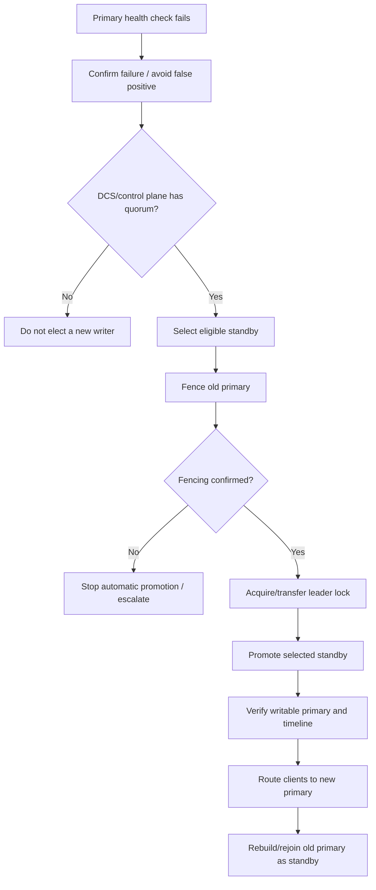

# Quorum, Fencing, and Split-Brain Prevention in PostgreSQL

A PostgreSQL cluster with a primary and multiple standbys can continue serving when a server fails. However, when the network partitions, a node loses contact with the control plane, or the failover system mistakenly concludes the primary is dead, the greatest danger is not just downtime: **two nodes may simultaneously accept writes as primary**. That condition is called *split-brain*.

If two primaries accept writes concurrently, each generates WAL and modifies data on a separate timeline. PostgreSQL has no mechanism to automatically merge two divergent write histories. When connectivity is restored, choosing one history to keep can lose transactions already acknowledged on the other side. Therefore, HA must guarantee that only a single node holds write authority at any given time, even when nodes cannot communicate with each other.

Three concepts commonly used to build this guarantee are **quorum**, **fencing**, and **leader coordination**. Quorum allows a group of members to reach a majority decision; fencing stops the old node from continuing to act as a writer; leader coordination manages ownership of the primary role. They complement one another. Control-plane quorum does not automatically kill the old PostgreSQL instance, and fencing alone does not select a new node with suitable data.

This lesson belongs to the **High Availability** chapter of the *Database Engine Relational PostgreSQL* module. We will cover quorum in a distributed control plane, witnesses, failure domains, fencing via STONITH/watchdog/storage/network, how an HA manager coordinates failover, its relationship with synchronous replication, split-brain scenarios, verification, and recovery drills.

> **Principle:** Before allowing a standby to accept writes, there must be proof that the old primary has lost write authority or been fenced. Do not promote solely because a node cannot ping the primary, do not rely solely on DNS/VIP, and do not confuse WAL-acknowledgment quorum with leader-election quorum.

## 1. Learning Objectives

After this lesson, you will be able to:

1. Explain split-brain in PostgreSQL HA and the consequences of two writable primaries.
2. Distinguish high availability, replication, leader election, and fencing.
3. Explain majority quorum and why an odd number of voters is usually convenient.
4. Calculate how many voter failures a quorum group can tolerate.
5. Distinguish data nodes, control-plane voters, and witnesses.
6. Understand why quorum is meaningful only when membership and failure domains are properly designed.
7. Distinguish DCS quorum from synchronous replication quorum.
8. Explain why PostgreSQL streaming replication does not elect a primary by itself.
9. Recognize network partitions, asymmetric partitions, and false failure detection.
10. Use fencing to stop the old primary from continuing to write.
11. Compare STONITH, power fencing, storage fencing, network fencing, and watchdog.
12. Understand the limits of leases/leader locks when a node becomes isolated.
13. Describe the safe failover sequence.
14. Understand how an HA manager like Patroni uses a distributed configuration store.
15. Evaluate `synchronous_commit` and `synchronous_standby_names` in HA design.
16. Select promotion candidates based on replication state, WAL, and timeline.
17. Rejoin the old primary using `pg_rewind` or a base backup.
18. Monitor leader, quorum, replication lag, and fencing status.
19. Build runbooks for failover, failback, and DCS incidents.
20. Drill network partitions and fencing in a lab environment.

## 2. What Is Split-Brain?

Split-brain occurs when two or more nodes simultaneously believe they are primary/leader and both accept write operations in a cluster where only a single writer is permitted.

```text
             Network partition
       +----------------+----------------+
       |                                 |
       v                                 v
+--------------+                  +--------------+
| Node A       |                  | Node B       |
| believes     |                  | believes     |
| PRIMARY      |                  | PRIMARY      |
| accepts      |                  | accepts      |
| writes       |                  | writes       |
+--------------+                  +--------------+
       |                                 |
       v                                 v
  WAL timeline A                    WAL timeline B
       |                                 |
       +----------- diverged ------------+
```

### 2.1. Why Is Split-Brain Dangerous?

Each primary can:
- Commit different transactions.
- Allocate conflicting sequence values.
- Update the same row to two different results.
- Receive different DDL changes.
- Ship WAL to different standbys.
- Return success to two separate groups of applications.

When both sides reconnect, PostgreSQL cannot automatically merge two timelines like merging two source code branches. You usually must pick one history as canonical and resolve writes on the other history through manual reconciliation or business recovery.

### 2.2. Old Primary Still Running Does Not Automatically Mean Split-Brain

A primary may still have a running PostgreSQL process after the HA manager decides to fail over. What matters is whether the old node can still accept writes. If the old node has been reliably fenced and cannot serve writes, a lingering process does not necessarily create split-brain.

### 2.3. An Unpromoted Standby Is Not a Second Writer

A standby in recovery mode only replays WAL and serves read-only queries if hot standby is enabled. The hazard arises when a standby is promoted while the old primary remains capable of writing.

### 2.4. Split-Brain Can Occur After Manual Failover

An operator might run a promote command on a standby because the primary is unreachable over the network. If the primary is merely isolated from the operator while still receiving writes from applications, both nodes can become writable.

## 3. Distinguishing Replication, Quorum, Leader Election, and Fencing

These components solve different problems:

| Component | Question It Answers | Example |
|---|---|---|
| Replication | How is data transferred to another node? | PostgreSQL physical streaming |
| Quorum | Which group has enough members to decide? | Majority of DCS voters |
| Leader election/lock | Which node is recognized as leader? | Patroni and DCS |
| Fencing | How do we stop the old leader from writing? | STONITH, watchdog, storage fence |
| Routing | Which writer are clients sent to? | Proxy, VIP, service discovery |
| Backup/PITR | How is data history restored? | Base backups and WAL archives |

### 3.1. Replication Is Not Election

PostgreSQL streaming replication sends WAL one-way from primary to standby. It has no consensus algorithm for all nodes to agree on a single primary.

### 3.2. Quorum Is Not Fencing

A DCS may confirm Node B holds the leader lock. That does not automatically terminate the PostgreSQL process on Node A if A lost connectivity to the DCS yet still receives application traffic.

### 3.3. Fencing Does Not Pick the Right Data

Shutting down the old node stops it from continuing to write, but does not identify which standby holds the latest WAL or all acknowledged transactions. Candidate selection still requires replication metadata and recovery policies.

### 3.4. Routing Is Not Fencing

Moving a VIP, DNS record, or proxy to the new node redirects only part of traffic. Old clients may connect directly to the old primary's IP, retain old connection pools, or use another endpoint. Routing does not prevent the old node from writing to its data directory.

## 4. Majority Quorum

Quorum is the minimum number of members required to agree for a decision to be accepted. In consensus systems using majority, quorum is typically:

\[
Q = \left\lfloor \frac{N}{2} \right\rfloor + 1
\]

Where:
- \(N\): number of voting members.
- \(Q\): number of votes required.

Examples:

| Voting Members (N) | Majority Quorum (Q) | Max Voter Failures Tolerated While Keeping Quorum |
|---:|---:|---:|
| 1 | 1 | 0 |
| 2 | 2 | 0 |
| 3 | 2 | 1 |
| 4 | 3 | 1 |
| 5 | 3 | 2 |
| 6 | 4 | 2 |
| 7 | 4 | 3 |

For a group with majority quorum, the number of voter failures tolerated is:

\[
f = \left\lfloor \frac{N-1}{2} \right\rfloor
\]

### 4.1. Why Is Majority Needed?

Any two majorities within the same voter group always intersect in at least one member. This intersection property underpins how consensus algorithms like Raft maintain a consistent decision history across leader changes.

This does not mean any arbitrary group of PostgreSQL servers automatically gets consistency just by having an odd node count. Nodes must participate in a properly implemented consensus protocol with valid membership and persistent state.

### 4.2. Three Voters Is Typically the Smallest Practical Configuration

With three voters, the system can continue making decisions when one voter fails. If another voter loses contact, the remaining voter lacks a majority and the control plane must reject new quorum-dependent decisions.

### 4.3. Two Voters Cannot Tolerate a Single Failure

Two voters require both votes for a majority. Losing one voter breaks quorum. Thus, a two-node DCS deployment does not provide fault tolerance the way three voters do.

### 4.4. Four Voters Generally Do Not Improve Fault Tolerance Over Three

Four voters require three votes, tolerating only one failure. Five voters require three votes and tolerate two failures. Adding voters adds network/coordination overhead and must fit the topology.

### 4.5. Not Every System Uses This Exact Majority Formula

Some systems use witnesses, weighted voting, or custom membership protocols. Always rely on your specific control plane's quorum semantics. Never calculate majority rules on paper and apply them to a product with a different algorithm.

## 5. Quorum and Network Partitions

Suppose there are three voters A, B, and C. The network splits into two sides: A is isolated; B and C can still communicate.

```text
Partition 1                  Partition 2

+---------+                 +---------+---------+
| A       |                 | B       | C       |
| 1 vote  |                 | 1 vote  | 1 vote  |
+---------+                 +---------+---------+

No majority                 Majority = 2
Cannot commit               Can retain quorum
new consensus decisions     and elect/retain leader
```

### 5.1. The Majority Side Can Continue

If the consensus protocol and policies permit, B and C can maintain leadership and commit new decisions.

### 5.2. The Minority Side Must Stop Making Decisions

A cannot elect a new leader on its own with one vote. This prevents two isolated groups from simultaneously recognizing two leaders in the control plane.

### 5.3. Losing Quorum Affects Availability

Without a majority, the coordination system must refuse to grant/renew leader locks or commit consensus logs. This can halt failovers and certain administrative actions. This is the trade-off between consistency and availability during a partition.

### 5.4. Majority Does Not Guarantee the Best Data Node

Control-plane majority decides leader/locks per protocol. It does not guarantee the PostgreSQL node holding the lock has the latest WAL. The HA manager must combine election with replication state and failover policies.

## 6. Data Nodes and Control-Plane Voters Are Separate Groups

A PostgreSQL HA deployment typically consists of:
- PostgreSQL primary.
- PostgreSQL standbys.
- Distributed Configuration Store (DCS) or control plane.
- HA agents on database nodes.
- Client routing/proxy.
- Monitoring/backup services.

Example:

```text
Database data plane:
  PostgreSQL primary
       | WAL
       +---- standby A
       +---- standby B

Control plane:
  DCS voter 1
  DCS voter 2
  DCS voter 3

HA agents:
  Agent on primary and each standby
  reads/writes leader state via DCS
```

### 6.1. DCS Voters Store Coordination State

The DCS can store leader locks, cluster membership, configuration, and failover metadata. It is not a copy of the PostgreSQL data directory.

### 6.2. Standbys Hold PostgreSQL Data

Standbys are database replicas. A DCS witness does not replace a standby holding heap files, indexes, and WAL.

### 6.3. Two Quorums Can Exist Independently

A deployment may have:
- DCS election quorum.
- Synchronous replication acknowledgment quorum.
- Separate quorum/majority in a storage cluster or orchestrator.

Diagram each group separately. Never add DCS voters and PostgreSQL standbys together into a single combined quorum.

## 7. Witness Nodes

A witness is a member that assists quorum decisions without necessarily holding a full copy of PostgreSQL data.

### 7.1. Witnesses Break Ties

For example, with two data nodes across two sites, a witness in a third site can participate in control-plane voting so one side attains a majority during a network partition.

### 7.2. A Witness Is Not a Database Replica

A witness cannot be promoted to PostgreSQL primary if it lacks the required data directory and standby state.

### 7.3. Witnesses Need Independent Failure Domains

If a witness shares a host, rack, power circuit, or network failure domain with a data node, a single failure can knock out both votes together.

### 7.4. A Witness Does Not Turn Two Database Copies into Three

It improves leader-decision capability without creating an extra copy of data. Durability still depends on the primary, standbys, synchronous policy, and backups.

### 7.5. Check the Witness Role in Your Product

Some products use a witness purely to vote; some provide an arbitrator service; others do not treat witnesses as voting members with identical semantics. Read the exact documentation for your DCS/HA manager.

## 8. Failure Domains and Placement

Quorum is only effective if voters cannot die together from a single shared incident.

Failure domains can include:
- Process/host.
- Virtual machine/hypervisor.
- Rack/power circuit.
- Availability zone.
- Region.
- Cloud account/project.
- Network provider.
- Storage array/control plane.

### 8.1. Three Voters on One Host Cannot Survive Host Failure

Multiple logical processes do not substitute for physical independence.

### 8.2. Three Zones Reduce Correlated Failures

Placing each voter in a separate availability zone mitigates zone outages, though network connectivity and provider control planes must still be evaluated.

### 8.3. Network Latency Affects Consensus

Distant voters can increase election and commit latency. Choose a topology balancing failure isolation against latency.

### 8.4. Data Replicas Also Need Separate Placement

DCS quorum can remain healthy while all PostgreSQL standbys sit in a single storage failure domain. Design the data plane and control plane together.

## 9. DCS and Consensus

A Distributed Configuration Store (DCS) provides a shared coordination point for HA agents. Common choices in the PostgreSQL ecosystem include etcd, Consul, and ZooKeeper, typically integrated via an HA manager.

### 9.1. Consensus Log

A consensus-based DCS requires members to agree on the order of committed changes. In Raft, the leader and a majority coordinate to commit log entries.

### 9.2. Leader Locks

An HA manager can use a lock/lease in the DCS to identify which node holds leadership for a bounded duration or until the lock is transferred.

### 9.3. Lease Expiry Does Not Automatically Stop the Old Process

If Node A loses connectivity to the DCS, A's lease may expire and the DCS may grant the lock to B. Yet A may still be running PostgreSQL unaware its lease expired. Fencing/self-fencing is required so A stops serving writes.

### 9.4. DCS Loses Quorum

When the DCS lacks a majority, HA agents must never invent a new leader based solely on local belief. The current primary may continue under existing policy, but no second writer may be created. Exact behavior depends on the HA manager and watchdog/fencing configuration.

### 9.5. Do Not Build Consensus Using a SQL Table

A `leader=true` table inside the PostgreSQL primary is not an independent DCS. If that database fails or partitions, leader election depends on the very node being elected and cannot resolve split-brain.

## 10. Leases, TTL, and Leader Locks

A lease/TTL limits how long a node is recognized as holding a lock if it fails to renew.

Conceptual flow:

```text
Node A acquires leader lease
       |
       v
A periodically renews lease
       |
       +---- renewal succeeds ----> A remains leader
       |
       +---- renewal fails -------> lease expires
                                      |
                                      v
                              DCS may elect B
```

### 10.1. TTL Is the Lock Duration

TTL is neither a PostgreSQL transaction timeout nor an automatic mechanism that halts the database process.

### 10.2. Clocks and Networks

Lease systems must account for clock drift, scheduling pauses, network partitions, and process stalls per protocol rules. Never build custom leases using wall-clock timestamps without proper synchronization and fencing.

### 10.3. Process Pauses

A host can stall due to hypervisor pauses, kernel stalls, or CPU scheduling. Upon resuming, an old process might not realize its lease expired and continue executing stale logic.

### 10.4. Safety Margins

HA managers typically combine timeouts and watchdog margins so a node self-fences before its lease expires or before another node is allowed to serve. Configure these strictly per your manager/version documentation.

### 10.5. A Lease Does Not Prove the Old Node Stopped Writing

Proving that requires fencing or an equivalent self-fencing guarantee. This is the core principle of split-brain prevention.

## 11. What Is Fencing?

Fencing is removing a node's ability to continue acting as a writer before granting write authority to another node.

Goals:
- Stop the old node from accepting application writes.
- Stop the old node from writing to shared storage.
- Prevent the old node from self-promoting or rejoining on the wrong timeline.
- Ensure only one primary holds write authority in the topology.

### 11.1. Fencing Differs from Failover

Failover moves the primary role to a new node. Fencing ensures the old primary can no longer operate. A safe failover procedure coordinates both.

### 11.2. Fencing Requires Proof

Never treat a ping failure, SSH timeout, or DNS change as proof of fencing. Record explicit confirmation from a power controller, cloud API, storage reservation, or watchdog mechanism.

### 11.3. Fencing Must Work Outside the Fenced Node's Failure Mode

If shutting down a VM via a cloud API, the control path and API credentials must operate independently of the failed guest OS/network. If a fence command depends on the isolated old host itself, it may fail to execute.

### 11.4. Fencing Must Be Tested

Having a STONITH command in config does not prove it powers off the right machine. Test identity, target mapping, permissions, timeouts, retries, and resulting power state.

## 12. STONITH and Power Fencing

STONITH stands for “Shoot The Other Node In The Head,” the traditional term for hard-powering off a suspect node to guarantee it stops operating.

### 12.1. Power Fencing

Mechanisms include:
- IPMI/BMC.
- Redfish.
- PDU power control.
- Hypervisor/VM management APIs.
- Cloud provider instance stop/terminate APIs.
- Cluster power controllers.

### 12.2. Advantages

Once a node is confirmed powered off, PostgreSQL on that node cannot accept writes. It is a strong and operationally clear form of fencing.

### 12.3. Risks

- Fencing the wrong node.
- Fencing controller unreachable.
- API reports request accepted before power state actually changes.
- Node auto-reboots after power-off.
- Operator mis-maps IP to instance ID.
- Fencing takes longer than the failover timeout.

### 12.4. Verify Power State

Runbooks must verify power-off status from an independent source. Simply issuing a shutdown request without confirmation is insufficient proof.

### 12.5. Reboot and Rejoin

After the old node powers back on, it must not automatically accept writes. It must start as a standby on the new timeline or be rebuilt/rewound before re-entering routing.

## 13. Storage Fencing

Storage fencing blocks the old node from writing to shared storage or a volume that might be attached to a new node.

### 13.1. SCSI Persistent Reservations

Some shared-storage systems support reservations so one initiator holds write access and can evict the old initiator.

### 13.2. Cloud Volume Detach

Some platforms allow detaching a volume from the old VM and attaching it to a new VM with exclusive-attachment semantics. Wait for the provider to confirm detachment completed.

### 13.3. Shared Storage vs. PostgreSQL Physical Replication

PostgreSQL streaming replication typically uses separate data directories per node. Shared storage fencing appears in shared-disk architectures or storage systems managed by cluster stacks. Never attach the same `PGDATA` read-write to two PostgreSQL servers.

### 13.4. Filesystem Locks Do Not Replace Fencing

Host-local file locks or process locks do not protect against another host unless the storage/filesystem provides cluster-wide locking semantics.

### 13.5. Avoid Arbitrary Force Detaches

Detaching a volume while a database is writing can cause corruption or data loss. Follow provider/storage fencing workflows, ensure the old writer stopped, and follow filesystem guidance.

## 14. Network Fencing

Network fencing isolates a node from some or all communication paths.

It can block:
- Client application traffic.
- Replication traffic.
- DCS/control-plane traffic.
- Inter-node traffic.
- Storage networks.

### 14.1. Blocking Client Traffic May Be Insufficient

If the old node can still accept local writes and later re-enters the cluster as primary, divergence still occurs. Prevent it from re-entering any writable path.

### 14.2. Blocking Replication Is Not Complete Fencing

Cutting only the replication link lets the old primary keep accepting application writes while making standbys lag further behind.

### 14.3. Firewall Rules Can Drift

Some clients may use direct IPs, alternate networks, or persistent connections. Fencing policies must cover every possible write path.

### 14.4. Network Fencing and the Control Plane

Network isolation can fence a node from the DCS or application network, provided you know which direction is blocked. Cutting a node from the DCS while leaving client writes open lets it lose its lease yet keep serving writes.

### 14.5. Prefer Verifiable Mechanisms

Network fencing must confirm rules are applied at independent infrastructure on the correct interfaces/subnets and cannot be undone by the old node itself.

## 15. Watchdog and Self-Fencing

A watchdog is a mechanism that resets or powers off a node if it cannot maintain safety conditions within an allowed window.

### 15.1. Why Is Self-Fencing Needed?

A node can lose contact with the DCS while PostgreSQL keeps running. The HA agent can trigger a watchdog host reset if it fails to renew leadership before a deadline.

### 15.2. A Watchdog Is Not a Monitoring Health Check

A watchdog forces a node to halt when software can no longer guarantee safety. It requires hardware/kernel support and properly tuned timeouts.

### 15.3. Test Watchdogs Under DCS Loss

Verify:
- Does the agent detect lock loss?
- Is the watchdog armed properly?
- If the agent freezes/pauses, does the watchdog reset the host?
- Does the timeout leave enough margin before another node can acquire the leader lease?
- After reboot, does the node boot in a standby/fenced state?

### 15.4. Watchdogs Do Not Replace DCS Quorum

A watchdog makes the old node stop itself. It does not decide which new node holds enough data to promote.

### 15.5. Never Enable a Watchdog Without Understanding Recovery

A watchdog can reset an entire host under unexpected conditions, causing downtime or reboot loops if misconfigured. Test in staging with console/recovery access ready.

## 16. Lease and Watchdog Fencing in an HA Manager

Some HA managers integrate DCS leader locks with watchdog/self-fencing. Typical sequence:

1. A node holds the leader lock in the DCS.
2. The agent renews the lock periodically.
3. If renewal fails, the agent must step down from leadership.
4. The watchdog ensures the host resets if the agent fails to shut down in time.
5. The DCS grants the lock to another node after the old lease expires.
6. The new candidate promotes per failover policy.

This is a conceptual description. Exact order, timeouts, and watchdog integration depend on the HA manager and version. Read official documentation and verify timing inequalities before configuring.

### 16.1. Lock Timeout and Watchdog Timeout Must Align

If the watchdog resets too late, the DCS may grant a new lock before the old node stops. If it resets too early, transient DCS hiccups can trigger unnecessary primary reboots.

### 16.2. Agent Dies While PostgreSQL Keeps Running

This is a critical failure case. If the watchdog is not armed or fails to fire when the agent dies, the node may continue serving writes even though it stopped renewing the leader lock.

### 16.3. Fencing Status Must Be Observable

Monitoring should expose the leader lock holder, lease state, watchdog armed state, last successful renewal, and fencing action results as supported by the HA manager.

## 17. Safe Failover in Order

A general state machine:



### 17.1. Detect

Health checks detect an unresponsive primary. A single TCP error does not prove the database is dead.

### 17.2. Confirm

Combine multiple signals: PostgreSQL health, host health, DCS state, network paths, replication state, and fencing provider.

### 17.3. Quorum

The control plane must hold quorum to make leader decisions under the consensus protocol. Without quorum, never create an independent leader on a minority side.

### 17.4. Candidate Selection

Select a standby matching timeline, WAL progress, synchronous policy, lag limits, and business RPO.

### 17.5. Fence

Prevent the old primary from continuing writes. Confirm completion from an independent control path.

### 17.6. Promote

Once leadership authority and fencing are complete, promote the standby via HA manager/runbook. Never run parallel promotions across multiple candidates.

### 17.7. Route

Update proxies, VIPs, or service discovery after the new node is confirmed writable and recognized as leader.

### 17.8. Rejoin

The old primary must rewind or rebuild and join as a standby on the new timeline. Never reopen application traffic to the old node before this step.

## 18. Why Not Promote Immediately on Primary Timeout?

A primary might stop responding because:
- The host actually powered off.
- The PostgreSQL process crashed.
- Disk I/O hung.
- The network path from the observer failed.
- The DCS path partitioned while the application path remained intact.
- CPU scheduling or VM pause occurred.
- Firewall rules changed.
- The load balancer or monitor failed.

### 18.1. Asymmetric Partitions

Operators or HA agents might lose contact with the primary while some application clients still reach it. The old node continues accepting writes.

### 18.2. False Positives

Overly sensitive health checks can declare a slow primary dead. Without fencing, a false positive triggers split-brain.

### 18.3. Timeouts Do Not Create Safety

Raising timeouts reduces false failovers but does not guarantee the old node stopped. Lowering timeouts speeds detection but increases false positives. Safety comes from coordination and fencing.

### 18.4. Failure Detectors Cannot Be Certain in Asynchronous Networks

In distributed systems, a silent node may be dead or merely delayed/partitioned. Timeouts alone can therefore never guarantee a single writer.

## 19. PostgreSQL Streaming Replication Does Not Prevent Split-Brain by Itself

PostgreSQL provides recovery/standby mechanisms and WAL replay, not a full HA control plane.

### 19.1. `pg_promote` Is a Promotion Action

```sql
SELECT pg_promote();
```

This tells a standby to promote to primary. It does not check DCS quorum, does not fence the old primary, and does not coordinate application routing.

### 19.2. `pg_ctl promote`

```bash
pg_ctl -D /path/to/standby promote
```

This is likewise a promotion action, not an independent safe election workflow.

### 19.3. `pg_is_in_recovery`

```sql
SELECT pg_is_in_recovery();
```

Returning `false` indicates the instance is no longer in recovery mode. It does not prove the node is the sole leader in the cluster.

### 19.4. Two Nodes Returning `false` Is a Critical Alert

If two PostgreSQL nodes in the same cluster lineage are simultaneously writable, halt writes immediately and inspect timelines/histories. Never attempt an ad-hoc merge.

## 20. Synchronous Replication and Quorum: Two Different Meanings

PostgreSQL `synchronous_standby_names` supports priority-based or quorum-based synchronous replication.

Example:

```conf
synchronous_standby_names = 'ANY 2 (standby_a, standby_b, standby_c)'
```

This requires WAL acknowledgments from any two standbys in the list for transactions using remote synchronous commit levels.

### 20.1. This Is a WAL Acknowledgment Quorum

Its purpose is determining whether a transaction commit must wait for enough standby acknowledgments.

### 20.2. This Is Not a DCS Election Quorum

`ANY 2` does not automatically:
- Elect a new PostgreSQL primary.
- Grant a leader lease.
- Fence the old primary.
- Pick a promotion candidate after a partition.
- Prevent an operator from promoting a third node.
- Guarantee the HA manager holds quorum.

### 20.3. `FIRST` Is Not Majority Voting

`FIRST 1 (a,b,c)` selects by priority. It does not carry majority-voting consensus semantics like a DCS.

### 20.4. Synchronous Replication Does Not Auto-Failover

If synchronous standbys disconnect, commits may wait per policy. PostgreSQL does not automatically promote another standby or move a VIP.

### 20.5. Both Layers Must Be Designed

A system can combine:
- DCS quorum to elect and retain the leader.
- Synchronous replication to confirm WAL on one or more standbys.
- Fencing to remove the old primary.
- An HA manager to orchestrate transitions.
- A proxy to route clients.

No single component replaces the others.

## 21. `synchronous_commit` in Durability Design

Main levels:
- `off`: may return commit before local WAL flush.
- `local`: waits for local WAL flush, not standbys.
- `remote_write`: waits for standby to write WAL to OS.
- `on`: waits for standby to flush WAL.
- `remote_apply`: waits for standby to replay WAL.

### 21.1. Choose Levels by Requirement

If the goal is transactions durably written on a standby, remote flush (`on`) is typically considered. If immediate reads on the acknowledging standby are needed, `remote_apply` can help.

### 21.2. Sync Mode Without Eligible Standbys

When no synchronous standby is available, transactions requiring remote acknowledgment may block. If HA policy permits relaxing quorum, the durability contract changes and must be audited.

### 21.3. Session Overrides

A transaction can execute `SET LOCAL synchronous_commit = 'local'` or `'off'`. Audit role/database/session defaults and application code paths for overrides.

### 21.4. Quorum Acknowledgments Do Not Mean Every Replica Has the WAL

With `ANY 2` of three candidates, two standbys may acknowledge a transaction while the third lags. Promotion selection must inspect acknowledgment sets and WAL positions rather than assuming all nodes hold every commit.

## 22. Candidate Selection and WAL Freshness

When the primary is lost, the HA manager must pick an eligible standby. Factors include:
- Is it in the right cluster/timeline lineage?
- Is it actively streaming or does it have required WAL archives?
- Where are its receive/write/flush/replay LSNs?
- Did it synchronously acknowledge transactions that must be preserved?
- Is lag within policy limits?
- Does it have sufficient WAL to replay to the target point?
- Can it be safely promoted after fencing the old primary?

### 22.1. Higher LSN Is Not the Entire Decision

Comparing LSNs is meaningful when nodes share lineage/timeline and positions are interpreted accurately. Factor in timeline history, acknowledged commits, archives, and HA manager metadata.

### 22.2. Async Failover Can Lose Data

If a standby lacks the latest WAL, promotion can discard commits already acknowledged to clients by the old primary. Whether this is acceptable is a business RPO decision.

### 22.3. Synchronous Failover Must Promote the Right Node

Transactions acknowledged under sync policy can be preserved if you promote a standby that actually holds that WAL and storage assumptions hold. Never promote a node solely because it appears in a candidate list.

### 22.4. Never Promote a Node in an Unknown State

If LSN, timeline, or receiver state is indeterminate, halt automatic promotion and escalate. A slower decision is safer than creating two unmergeable histories.

## 23. HA Managers and Patroni

Patroni is a popular HA solution in the PostgreSQL ecosystem. It coordinates PostgreSQL instances via a DCS such as etcd, Consul, or ZooKeeper.

### 23.1. Patroni Agent

Each database node runs a Patroni agent monitoring PostgreSQL, health, replication state, and the leader lock.

### 23.2. DCS

The DCS holds cluster state and the leader lock. Patroni agents use the DCS to coordinate which node holds the primary role.

### 23.3. Leader Lock

The lock holder retains the primary role while Patroni configuration conditions are met. If renewal fails, the agent must transition to safe behavior per config, including self-fencing when a watchdog is used.

### 23.4. Candidate Selection

Patroni provides policies such as `maximum_lag_on_failover`, synchronous mode, and related criteria. Understand these settings for your version and topology.

### 23.5. Patroni Does Not Eliminate Design Work

DCS quorum, watchdog, fencing, networking, replication slots, sync mode, routing, and backups still require proper configuration and monitoring. Installing Patroni alone does not make split-brain impossible.

## 24. Patroni Timing and Watchdog

Patroni includes parameters such as:
- `ttl`: duration the leader lock remains valid.
- `loop_wait`: HA loop interval.
- `retry_timeout`: retry window for DCS operations.
- Watchdog configuration: self-fencing behavior.
- `maximum_lag_on_failover`: lag threshold for candidate eligibility.

### 24.1. Timeout Relationships

Timeouts must satisfy constraints for your Patroni version. Patroni documentation typically requires coordinating `loop_wait`, `retry_timeout`, and `ttl` so lock renewal and safe failover have adequate margins. Never tune these values independently.

### 24.2. Watchdog Modes

Patroni supports watchdog integration in compatible environments. Choose the mode matching your safety requirements and verify the actual device/driver works.

### 24.3. Required Mode

If a deployment depends on the watchdog for self-fencing, configure the required watchdog mode and verify the agent refuses to continue as primary if the watchdog is unavailable. Exact behavior depends on Patroni version.

### 24.4. Testing DCS Loss

Test partitioning a primary from the DCS in staging. Confirm:
- The node losing the lock stops serving writes or self-fences before its deadline.
- A node on the majority side acquires the lock per policy.
- Two writable primaries never exist simultaneously.
- Watchdog events are logged and monitored.
- Client routing does not revert to the old node.

### 24.5. Do Not Copy Sample Configs Verbatim

Parameters and YAML schemas vary across versions. Consult documentation for your installed Patroni version, verify the effective configuration, and run controlled failure tests.

## 25. Example DCS with Three Voters

A control plane with three voting members:

```text
          +------------------+
          | Voter 1          |
          | DCS node         |
          +------------------+
                    |
          +---------+---------+
          |                   |
+------------------+  +------------------+
| Voter 2          |  | Voter 3          |
| DCS node         |  | DCS node         |
+------------------+  +------------------+

Majority = 2 of 3
Tolerates one voter failure
```

### 25.1. One Voter Fails

The remaining two voters hold a majority. The DCS can continue consensus operations for cluster state.

### 25.2. Two Voters Fail

Only one voter remains—no majority. No PostgreSQL node may declare itself the new leader merely because it is still running.

### 25.3. Changing Voter Membership

Updating DCS cluster membership must follow the product's joint-consensus/reconfiguration procedure. Never manually remove nodes during a partition without understanding the impact.

### 25.4. DCS Snapshots and Backups

The DCS stores critical coordination metadata. Back up and restore the DCS strictly per vendor guidelines, and never arbitrarily restore an old snapshot into a running cluster, as doing so can roll back leader/lease state.

## 26. Witness Topology for Two Database Nodes

Suppose two PostgreSQL nodes sit at two sites and a witness sits at a third site:

```text
Site A                  Site B                Site C
+-----------+           +-----------+         +-----------+
| Primary A |           | Standby B |         | Witness   |
| PostgreSQL|           | PostgreSQL|         | DCS voter |
| DCS voter |           | DCS voter |         |           |
+-----------+           +-----------+         +-----------+
```

### 26.1. Witness Helps Determine Majority

If Site A loses contact with B while still reaching C, A+C hold a majority; B alone lacks quorum. Still, HA policy must define who holds the leader lock and how to fence the side without quorum.

### 26.2. Witness Holds No WAL

If Primary A is completely lost, the witness cannot replace Standby B as a database. B still needs sufficient base data and WAL to promote.

### 26.3. Place the Witness Independently

A witness colocated with Site A can fail alongside A. Placing it in a third failure domain improves independence, though network paths, power, and identity must also be checked.

### 26.4. Do Not Design Around Pinging the Witness

A witness votes inside the DCS protocol—it is not merely a machine to ping as a tie-breaker. Use the official mechanism of your HA manager/DCS.

## 27. Common Split-Brain Scenarios

### 27.1. Network Partition Between Primary and DCS

The primary cannot renew its leader lock yet continues receiving application traffic. If the DCS grants the lock to a standby while the primary fails to self-fence, split-brain can occur.

### 27.2. Primary Pauses and Resumes

Node A stalls for an extended period; its lease expires and B is promoted. A resumes and continues running its old process if no watchdog/fencing is present.

### 27.3. Parallel Manual Promotions

Two operators promote two standbys when the primary stops responding. Each node starts a new timeline.

### 27.4. DNS/VIP Moves While Old Primary Remains Writable

Some clients move to the new endpoint while others retain direct old connections. Both nodes accept writes.

### 27.5. DCS Restored from an Old Snapshot

The control plane forgets the latest leader/lease state and grants authority improperly if restored outside consensus procedures.

### 27.6. Watchdog Inactive

HA config assumes self-fencing, yet the watchdog device was never opened/armed, driver failed, or timeouts were misconfigured.

### 27.7. Wrong or Incomplete Fencing

A fence command targets the wrong instance or issues a shutdown without verifying power-off. The HA manager promotes the new node too soon.

### 27.8. Synchronous Quorum Mistaken for Election Quorum

An operator assumes `ANY 2` prevents dual primaries, when in reality it only governs WAL acknowledgments. Promotion still requires DCS/election/fencing.

## 28. Client Routing After Failover

After promotion, clients must transition to the new primary.

Mechanisms:
- HAProxy or equivalent PostgreSQL-aware proxy.
- PgBouncer integrated with service discovery.
- Virtual IP.
- DNS/service records.
- Kubernetes Services / operator endpoints.
- Application connection strings.

### 28.1. Routing Must Be Role-Aware

Never route writes based solely on a live process. Check `pg_is_in_recovery()` or HA manager primary endpoints/role labels.

### 28.2. Existing Connections

Open or hung connections to the old primary may linger. Drain, terminate, or close them per policy after failover; poolers must detect role transitions.

### 28.3. Direct IP Access

If applications can bypass the proxy and connect by direct IP, the routing layer cannot stop old-primary writes. Fencing must block at the node, storage, or sufficiently strong network layer.

### 28.4. DNS TTL Is Not a Safety Mechanism

DNS caches and resolvers can hold old IPs past TTL. Use DNS for discovery, never as fencing.

### 28.5. Unknown Commit Outcomes

If a connection drops while a `COMMIT` response is in flight, the client may not know whether the transaction committed. Applications should use idempotency keys or business transaction identifiers to retry safely.

## 29. The Old Primary After Promotion

Once the new standby is promoted, the old primary may be:
- Powered off by power fencing.
- Reset via watchdog.
- Still running yet network/storage fenced.
- Partitioned and unaware failover happened.

Never let the old primary automatically reconnect into the application path.

### 29.1. Rejoining with `pg_rewind`

`pg_rewind` can resynchronize a diverged data directory onto the new timeline when prerequisites—such as data checksums or `wal_log_hints`, `full_page_writes`, and required WAL—are satisfied. Consult the manual for your exact version.

### 29.2. Rebuilding with a Base Backup

If rewind is unavailable, WAL is missing, or the node is untrusted, rebuild the standby from a base backup of the new primary.

### 29.3. Do Not Just Delete `standby.signal` and Start

The old primary may hold a divergent timeline. Removing `standby.signal` or starting normally can let it accept independent writes. Follow the rewind/rebuild procedure.

### 29.4. Check Timeline History

Verify the old node follows the new timeline and `pg_is_in_recovery()` returns `true` before letting it join standby routing or replication.

## 30. Synchronous Mode and Failover Policy

A deployment may enable synchronous replication to lower RPO. The HA manager must understand synchronous state when selecting candidates.

### 30.1. Strict / Non-Strict Synchronous Modes

Some HA managers offer strict synchronous modes or policies adjusting quorum when standbys go missing. Exact semantics and settings depend on product and version.

### 30.2. Strict Mode

Can halt writes when insufficient synchronous standbys exist to preserve durability policy. This is an intentional availability trade-off.

### 30.3. Non-Strict Mode

Can allow writes to continue with degraded synchronous requirements per policy. Understand clearly when transactions are no longer acknowledged on a remote standby.

### 30.4. Candidate Eligibility

The HA manager may disqualify candidates that lag excessively or fail synchronous policy. Check policy and metadata before promoting.

### 30.5. Never Assume Sync State Persists Automatically Across Failover

After promotion, synchronous standby configuration may shift under the new topology. Inspect and restore quorum/standby selection once the cluster stabilizes.

## 31. Monitoring Quorum and Fencing

An HA dashboard should cover these layers:

**Control plane**
- DCS member health.
- DCS leader/term/lease.
- Quorum availability.
- Last successful renewal.
- Membership changes.
- DCS latency and leader transitions.

**Database data plane**
- Current primary identity.
- `pg_is_in_recovery()` per node.
- `pg_stat_replication`.
- Standby receive/write/flush/replay LSNs.
- Sync state / quorum status.
- WAL sender/slot health.
- Replication lag and WAL retention.

**Fencing**
- Watchdog armed/healthy status.
- Last fencing action and outcome.
- Power state from an independent controller.
- Storage reservation / attachment owner.
- Network isolation rule state.

**Client path**
- Writer endpoint.
- Proxy health.
- Lingering connections to the old primary.
- Application write errors / unknown commit outcomes.

### 31.1. Alert on Two Writable Nodes

If monitoring detects two nodes in the same cluster lineage both reporting `pg_is_in_recovery() = false`, raise a critical alert. Halt writes on one side per the incident runbook and inspect timelines.

### 31.2. Alert on Lost DCS Quorum

Loss of quorum is a control-plane incident. Do not merely alert “DCS down”; identify which nodes retain majority and the state of the database writer.

### 31.3. Alert on Missing Fencing Capability

If the watchdog is disarmed or the power fencing API fails, failover automation may no longer satisfy safety assumptions. Do not wait until a failover to discover this.

### 31.4. Metrics Must Carry Identity

Record node name, PostgreSQL system identifier/cluster identity, timeline, role, DCS member ID, and timestamp. Avoid conflating metrics from two clusters sharing hostname labels.

## 32. PostgreSQL Verification Queries

### 32.1. Check Whether an Instance Is in Recovery

```sql
SELECT
    pg_is_in_recovery() AS is_standby,
    pg_postmaster_start_time() AS server_started_at;
```

On the primary, check current WAL position via `pg_current_wal_lsn()`. On a standby, use the corresponding recovery/receive/replay functions.

### 32.2. Inspect Replication Connections on the Primary

```sql
SELECT
    application_name,
    client_addr,
    state,
    sync_state,
    sync_priority,
    sent_lsn,
    write_lsn,
    flush_lsn,
    replay_lsn
FROM pg_stat_replication
ORDER BY application_name;
```

### 32.3. Inspect the WAL Receiver on the Standby

```sql
SELECT
    status,
    sender_host,
    sender_port,
    slot_name,
    written_lsn,
    flushed_lsn,
    latest_end_lsn,
    latest_end_time
FROM pg_stat_wal_receiver;
```

### 32.4. Inspect Replication Slots

```sql
SELECT
    slot_name,
    slot_type,
    active,
    restart_lsn,
    wal_status
FROM pg_replication_slots
ORDER BY slot_name;
```

Some columns may vary by PostgreSQL major version.

### 32.5. Calculate Replay Lag in Bytes

```sql
SELECT
    application_name,
    pg_wal_lsn_diff(sent_lsn, replay_lsn) AS sent_to_replay_bytes
FROM pg_stat_replication
WHERE replay_lsn IS NOT NULL;
```

This is LSN distance, not absolute elapsed time. Pair it with WAL generation rates and receiver status.

## 33. Checking DCS and HA Manager

Exact commands depend on the product. With Patroni, a common command is:

```bash
patronictl -c /etc/patroni/patroni.yml list
```

This displays cluster members and status as configured in Patroni.

DCS tooling also provides health/status commands, such as etcd client commands. Syntax, authentication, and endpoints depend on version and deployment.

### 33.1. Do Not Check Only the HTTP Health Endpoint

A responsive Patroni REST API does not prove DCS quorum is healthy or that the node holds the leader lock. Check both cluster state and DCS state.

### 33.2. Verify the Leader Lock

Inspect the lock holder, lease expiry/renewal, and cluster scope via the HA manager tools. Never manually edit keys inside the DCS to force a promotion.

### 33.3. DCS Latency

Elevated DCS request latency can delay lock renewals, causing leader churn or self-fencing. Monitor latency, disk fsync, and networking between voters.

### 33.4. DCS Backup/Restore

Follow DCS vendor instructions. Old snapshots may contain stale state; never restore into a live production cluster without a recovery plan.

## 34. Handling DCS Quorum Loss

When the control plane loses majority:

1. Identify which voters are alive and the network partition topology.
2. Determine whether the current PostgreSQL primary is still accepting writes.
3. Check leader lock/lease state from the majority side (if one exists).
4. Never elect a new leader from a minority partition.
5. Check watchdog/self-fencing behavior on nodes isolated from the DCS.
6. Confirm whether any other node has been granted the leader lock.
7. Restore DCS voters or networking per product procedures.
8. Only after quorum stabilizes should failover or leader transfer occur.
9. Verify a single writable primary.
10. Verify standbys, timelines, client routing, and backups.

### 34.1. Primary May Continue Operating Per Policy

Some HA managers let the current primary keep running briefly when the DCS is unavailable, depending on lease/watchdog policy. That does not mean a second leader may be granted.

### 34.2. Do Not Recover by Deleting Lock Keys

Deleting keys erases ownership state and can trigger races between agents. Use vendor-supported commands and repair procedures.

### 34.3. If Fencing Cannot Be Proven

Halt automatic promotion and escalate. Without proof that the old primary is fenced, granting a new writer is unsafe.

## 35. Safe Manual Failover Procedure

Manual failover requires a clear runbook. Before acting:
- Confirm cluster identity and current primary.
- Confirm the primary is truly unavailable or a planned switchover is intended.
- Verify DCS quorum and leader state.
- Pick a candidate standby.
- Inspect replication lag and WAL state.
- Check synchronous acknowledgment policy.
- Ensure independent fencing authority.
- Assign an owner and record the timeline.

A general sequence:

1. Stop or fence the old primary.
2. Verify the old primary cannot accept writes.
3. Confirm the control-plane leader lock can transfer.
4. Select the best standby candidate per policy.
5. Promote solely the selected candidate.
6. Verify the new node is writable and on a new timeline.
7. Update the writer endpoint/proxy.
8. Verify application connections and writes.
9. Rebuild/rejoin the old primary.
10. Restore desired replication and synchronous policy.

### 35.1. Planned Switchover vs. Emergency Failover

Planned switchover drains writes, synchronizes WAL, and transitions roles cleanly. Emergency failover occurs when the primary may be unresponsive; it requires fencing and data-loss assessment.

### 35.2. Never Run Promote Before Fencing Just to Save Time

If the old primary stays writable, promoting first creates two timelines. There is no safe automatic merge afterward.

### 35.3. Account for Commit Uncertainty

Clients disconnected during failover may not know whether their transaction committed. Application reconciliation should rely on business keys and idempotency.

## 36. Fencing and Shared-Nothing Architecture

PostgreSQL physical streaming usually uses shared-nothing nodes: each instance owns its own data directory. This avoids certain shared-disk hazards without eliminating split-brain.

### 36.1. Two Separate Data Directories Can Still Both Accept Writes

A network partition does not stop the old primary from serving clients. Both nodes can diverge independently.

### 36.2. Storage Fencing May Not Apply

If each node uses local storage, fencing relies on power/watchdog/network/HA agents rather than shared-storage reservations.

### 36.3. Preserve the Old Local Disk as Evidence

After an incident, do not wipe the old data directory immediately. Retain snapshots and logs and assess whether forensic or data reconciliation is needed per policy.

## 37. Fencing and Shared Storage

If a cluster stack uses shared storage, another hazard arises: two PostgreSQL processes could access the same files simultaneously.

### 37.1. Never Run Two PostgreSQL Servers on the Same `PGDATA`

A PostgreSQL data directory must never be opened read-write simultaneously by two postmasters. A shared filesystem does not turn PostgreSQL into a multi-writer database.

### 37.2. Exclusive Ownership

The storage layer must guarantee only one host holds write access. Fencing must revoke the old host's access before the new host mounts or activates the volume.

### 37.3. Mount Status Alone Is Insufficient

Seeing a filesystem mounted on the new host does not prove the old host unmounted or was fenced. Verify reservation or attachment ownership from the storage control plane.

### 37.4. Recovery After Power Failure

Once storage ownership transfers, PostgreSQL must recover cleanly from WAL. Inspect logs, filesystem, and backups per runbook.

## 38. DCS Quorum and Control-Plane Backups

DCS state affects cluster operability. Protect:
- DCS data directory.
- Member identities/configurations.
- TLS certificates/credentials.
- Cluster membership.
- Snapshot/restore procedures.
- Monitoring and audit logs.

### 38.1. DCS Backups Do Not Replace PostgreSQL Backups

A DCS snapshot contains no PostgreSQL heap, index, or WAL data. Separate database backups remain mandatory.

### 38.2. PostgreSQL Backups Do Not Replace DCS Recovery

After restoring PostgreSQL, HA membership, leader state, slots, routing, and fencing config must also be restored.

### 38.3. Never Restore Stale Lock State as Truth

An old snapshot may record the pre-incident leader. After failover, that state is stale. Fencing and cluster reconciliation must precede re-enabling automation.

## 39. RPO/RTO and Quorum Design

Quorum and fencing primarily provide safety; they also influence availability and recovery time.

### 39.1. RPO

RPO depends on:
- Async vs. synchronous replication.
- Commit acknowledgment level.
- Synchronous standby count/quorum.
- Candidate WAL freshness.
- Failure mode and storage durability.
- Whether the right acknowledged standby is promoted.

### 39.2. RTO

RTO depends on:
- Failure detection timeout.
- DCS election/lock transition.
- Fencing duration.
- Candidate promotion/recovery time.
- Proxy/DNS/connection pool convergence.
- Application retries and warm-up.

### 39.3. Fencing Can Be the Longest Step

Power fencing or cloud API calls take time. Set failover timeouts based on actual fencing duration, not promotion duration alone.

### 39.4. Never Sacrifice Safety for Fake RTO

Promoting fast without fencing invites split-brain, turning a short outage into hours or days of reconciling divergent histories. RTO must account for recovery consequences.

## 40. HA Managers and External Orchestrators

There are several ways to deploy PostgreSQL HA:
- Patroni + etcd/Consul.
- Repmgr combined with witness/monitoring and fencing policies.
- Pacemaker/Corosync with resource agents and STONITH.
- Kubernetes operators with control-plane leases and storage/network policies.
- Cloud-managed PostgreSQL with provider-orchestrated failover.

### 40.1. Read the Product's Failure Semantics

The label “automatic failover” does not tell you:
- Which DCS it uses.
- Whether it has quorum.
- Whether it performs fencing.
- What the old primary does upon losing DCS.
- Whether candidates are chosen by LSN or sync state.
- How it handles routing.
- How the old primary rejoins.

### 40.2. Never Run Two Independent HA Managers

Two managers can make uncoordinated decisions if both control the same PostgreSQL cluster. Use a single authority for leader election/failover or an officially designed integration.

### 40.3. Manual Commands Must Go Through the HA Manager

If Patroni manages a node, never run `pg_ctl promote` or alter roles outside the manager. Doing so desynchronizes DCS state from PostgreSQL's actual role.

### 40.4. Kubernetes Leases Do Not Automatically Fence PostgreSQL

Lease/endpoint control can pick a control-plane leader, but you must verify whether the operator stops the old pod/VM from writing and whether routing actually blocks it. Storage and network semantics still matter.

## 41. Distinguishing Fencing, Switchover, and Failback

| Action | Meaning |
|---|---|
| Switchover | Planned primary transition while the old primary is still running and can synchronize |
| Failover | Primary transition after an incident / unusable old primary |
| Fencing | Stopping the old node from continuing to act as a writer |
| Promotion | Converting a standby into a primary |
| Failback/rejoin | Returning the old node to the cluster as a standby |
| Rebuild | Recreating a standby from a base backup |

### 41.1. Switchover Still Requires a Single-Writer Guarantee

Even when planned, ensure the old primary stops accepting writes before the new primary opens for writes per the manager workflow.

### 41.2. Failback Is Not Reverse Promotion

After failover, the old primary must follow the new timeline. Never promote it back to primary just because the old host was repaired.

### 41.3. Rejoining Takes Time

`pg_rewind` or a base backup can require heavy I/O and WAL transfer. Return the node to the replication topology before evaluating capacity and lag.

## 42. Incident Response When Two Writable Primaries Are Detected

If evidence shows two nodes are both writable:

1. Activate incident procedures and notify the DBA/HA owner.
2. Halt further writes according to the approved fencing plan.
3. Identify the primary recognized by the control plane and which node to keep.
4. Fence the other node using appropriate power/storage/network/watchdog controls.
5. Preserve logs, snapshots, WAL, and timeline metadata from both sides.
6. Never blindly run `pg_rewind` between two unevaluated histories.
7. Choose the canonical history based on HA state and business recovery policy.
8. Recover writes present only on the discarded branch via controlled reconciliation if feasible.
9. Rebuild/rejoin the discarded node.
10. Investigate root cause: DCS, leases, watchdog, fencing, routing, operator actions.
11. Re-drill the failure scenario after fixing the root cause.

### 42.1. Do Not Automatically Discard the Lower-LSN Node

The node with the lower LSN might hold a transaction acknowledged to the business that never reached the other node. Compare timelines, acknowledgments, and application records before deciding.

### 42.2. Preserve Evidence

Do not delete old data directories or WAL before finalizing the recovery path. You may need to compare transaction IDs, application audit logs, or logical exports.

### 42.3. Reconciliation Is Not Merging WAL

You can export/import business records or replay application events at the logical level after choosing the canonical database. Never manually splice two independent WAL streams into one timeline.

## 43. Lab: Simulating Majority Quorum

Use three control-plane test nodes or a dedicated lab DCS. Never use the production DCS.

### 43.1. Verify Normal State

Confirm all three voters are healthy, consensus/leader state is stable, and quorum exists.

### 43.2. Stop One Voter

Stop one node using the DCS-supported method. Confirm the remaining two nodes retain quorum.

### 43.3. Stop a Second Voter

Only one voter remains. Confirm the DCS refuses new membership or leader decisions requiring a majority.

### 43.4. Restore Voters

Start the stopped nodes and verify they catch up on the consensus log and rejoin membership. Never re-add them by arbitrarily copying data directories.

### 43.5. Record Results

Document election timing, quorum state, leader changes, log errors, and HA agent behavior.

## 44. Lab: Network Partition and Fencing

Use two PostgreSQL nodes, a quorum-backed DCS, and an isolated network simulation environment.

### 44.1. Preparation

- Primary A and Standby B.
- DCS voters placed on separate nodes/failure domains.
- HA manager managing the leader lock.
- Tested watchdog or fencing integration.
- Monitoring displaying role, lock, and fencing state.

### 44.2. Partition Primary from DCS

Sever connectivity from A to the DCS while keeping the application path intact to simulate an asymmetric partition.

### 44.3. Observe Self-Fencing

Confirm A loses the leader lock and self-fences/is fenced before B is allowed to accept writes.

### 44.4. Promote B

Allow the HA manager to act only when quorum and fencing policies permit. Confirm B is writable and A cannot accept writes.

### 44.5. Rejoin A

Restore networking and confirm A does not reopen as a writer. Rewind/rebuild A to follow B's timeline.

### 44.6. Do Not Just Block Ping

A test blocking only ICMP does not simulate a real partition. Test DCS, replication, client, storage, and fencing paths individually.

## 45. Lab: Checking the Old Primary After Failover

After B is promoted:
- On B, confirm `pg_is_in_recovery()` is `false`.
- On A, confirm it is fenced or unable to accept writes.
- Verify the HA manager reports exactly one leader.
- Test connecting to the writer endpoint.
- Test the direct old-primary endpoint in the lab and confirm writes are blocked.
- Inspect timeline/recovery state.
- Rejoin A as a standby.

Never intentionally create two writable primaries on systems holding valuable data. To test split-brain detection, use disposable clusters and synthetic data.

## 46. Lab: Distinguishing DCS Quorum from PostgreSQL Sync Quorum

Deploy one PostgreSQL primary, two standbys, and a three-voter DCS in the lab.

### 46.1. Test DCS Quorum

Stop one DCS voter. The control plane retains a two-of-three majority.

### 46.2. Test Sync Quorum

Configure the primary:

```conf
synchronous_standby_names = 'ANY 1 (standby_a, standby_b)'
synchronous_commit = on
```

Stop `standby_a` while keeping `standby_b` streaming. Commits can still be acknowledged by `standby_b` per the quorum policy.

### 46.3. Separate the Two Layers

Next, simulate DCS quorum loss while standbys remain streaming. PostgreSQL sync acknowledgments do not replace DCS election. The HA manager must enforce its own leader/fencing policy.

### 46.4. Observe Blocking

Stop both synchronous standbys and observe transactions waiting on SyncRep. This demonstrates commit quorum, not DCS election state.

## 47. Lab: Manual Failover with Fencing

Only on a disposable cluster:
1. Write a marker transaction on the primary.
2. Confirm the standby replays the marker.
3. Fence the primary using the test mechanism.
4. Verify the primary can no longer accept writes.
5. Promote a single standby.
6. Read the marker on the new node.
7. Confirm the writer endpoint moved to the new node.
8. Rebuild the old primary as a standby.
9. Test replication back to it.

### 47.1. Test Failover When Fencing Fails

In the test harness, force the fencing command to fail and verify the HA manager aborts promotion and escalates. This is a critical test of safety behavior.

### 47.2. Do Not Bypass Failures to Finish the Lab

If fencing fails, do not promote just to complete the exercise. The expected outcome is that automation refuses unsafe actions.

## 48. Troubleshooting: Two Nodes Both Report Primary

Inspect:
- `pg_is_in_recovery()` on every node.
- HA manager cluster state and leader lock.
- DCS membership and quorum.
- Watchdog/fencing logs.
- PostgreSQL timelines.
- Client routing and active connections.
- Which node is actually receiving writes.
- Replication connections and slots.

Actions:
1. Stop writes via fencing.
2. Identify canonical history.
3. Preserve evidence.
4. Do not merge timelines manually.
5. Rebuild/rejoin the discarded node.

## 49. Troubleshooting: DCS Loses Quorum While Primary Remains Writable

This may be designed behavior depending on the HA manager and lease policy, but verify:
- Does the primary still hold a valid lock?
- Is the watchdog armed?
- When the lease expires, will the node self-fence?
- Could a standby acquire a new lock?
- Does the control plane hold majority elsewhere?
- Do client paths still reach the old primary?

Never assume safety simply because the primary still answers queries. Verify leader leases and fencing guarantees.

## 50. Troubleshooting: Fencing Command Timeouts

Inspect:
- Target instance ID mapping.
- Cloud/BMC credentials.
- Independent API endpoint/network path.
- Controller health.
- Permission policies.
- Action result and actual power state.
- Retries/backoff.
- Watchdog fallback.

If fencing cannot be verified, stop automatic promotion per safety policy.

## 51. Troubleshooting: Watchdog Reset Does Not Trigger

Inspect:
- Device path and driver.
- Kernel watchdog support.
- Permissions/capabilities.
- Watchdog timeout.
- HA agent arm/disarm logs.
- Host pause/suspend behavior.
- Reboot event logs.

Never assume a watchdog works simply because the config file contains a watchdog section.

## 52. Troubleshooting: Repeated Failovers

Causes:
- DCS latency or quorum instability.
- Network flapping.
- Overly tight timeouts.
- Primary overload.
- Storage stalls.
- Misaligned watchdog timeouts.
- Faulty health checks.
- Routing failing to converge.
- Standby lag exceeding policy.

Correlate timestamps across leader transitions, DCS latency, PostgreSQL health, replication lag, and fencing actions. Avoid blindly increasing TTLs or timeouts.

## 53. Troubleshooting: Old Primary Fails to Rejoin

Inspect:
- New and old timelines.
- `pg_rewind` prerequisites.
- Whether required WAL still exists in `pg_wal` or the archive.
- Whether data checksums or `wal_log_hints` were properly enabled.
- `full_page_writes`.
- System identifier and base backup lineage.
- Replication slot/connection settings.

If ineligible for rewind, rebuild the standby from a base backup of the new primary.

## 54. Mistakes to Avoid

| Mistake | Consequence |
|---|---|
| Promoting solely because pinging primary failed | Old primary may still accept writes |
| Using DNS as fencing | Clients may keep hitting direct IP / cached addresses |
| Assuming a DCS lock stops PostgreSQL | Old primary may keep running |
| Using two DCS voters expecting 1-failure tolerance | Losing one voter loses majority |
| Placing all voters in the same rack/zone | One shared failure loses quorum |
| Treating a witness as a standby | Witness holds no PostgreSQL data/WAL |
| Confusing `ANY 2` with election majority | WAL ack quorum does not elect a leader |
| Running `pg_promote` manually during a partition | Can create a second writer |
| Promoting before fencing | Split-brain |
| Not verifying power-off | Fencing may not have completed |
| Moving only a VIP | Old primary can still accept direct writes |
| Restoring an old DCS snapshot arbitrarily | Leader/lease state may regress |
| Starting old primary normally after failover | Causes timeline divergence |
| Running `pg_rewind` without prerequisites | Rejoin fails or yields untrusted data |
| Deleting WAL manually | Breaks recovery/replication |
| Relying on replay timestamps during idle load | Misjudges lag |
| Testing partitions using only ping | Misses asymmetric partitions |
| Skipping fencing-failure tests | Unknown whether automation blocks unsafe promotion |

## 55. Designing a Failure Matrix

Before deployment, document expected behavior:

| Failure | DCS Quorum | Old Primary | Expected Safe Action |
|---|---|---|---|
| One PostgreSQL standby down | Preserved | Healthy | Keep primary, alert on replication |
| Primary process crash | Preserved | Down | Select candidate, fence/confirm old node, promote |
| Primary loses DCS path, keeps client path | Majority on other side | Potentially writable | Self-fence/fence before granting new writer |
| DCS loses one voter | Majority preserved | Healthy | Keep leader, restore voter |
| DCS loses majority | Lost | Potentially healthy | Do not elect new leader on minority side |
| Network splits 1/2 | Present on side of 2 | Partially reachable | Majority retains control; fence side losing lock |
| Fencing API unavailable | May exist | Unknown | Do not promote until old writer removal is proven |
| Old primary reboots after failover | Preserved | Node returns | Keep node standby/fenced, rewind/rebuild |
| Storage failure on primary | Preserved | I/O errors | Fence/stop writer, promote candidate with sufficient WAL |
| Entire region fails | May be lost | Down | DR recovery per RPO/RTO and backups |

### 55.1. Every Row Needs a Test

A failure matrix is only useful when each scenario defines:
- Explicit trigger.
- Expected leader.
- Expected fencing action.
- Expected client routing.
- Expected data-loss boundary.
- Rollback/recovery path.
- Evidence/metrics to collect.

### 55.2. Test Fencing Failures Too

If the fencing API fails, automation must refuse promotion when safety cannot be guaranteed. This test matters more than a happy-path failover.

## 56. Privilege Management and Auditing for Fencing

Fencing credentials carry high privilege: stopping VMs, power-cycling hosts, detaching volumes, or altering firewalls. Protect them like production infrastructure secrets.

### 56.1. Least Privilege

Scope permissions strictly to the instances, nodes, or volumes the HA manager controls. Avoid full cloud account administrator credentials when narrower policies exist.

### 56.2. Independent Control Path

Fencing agents must reach the control plane even when the target node's guest network fails. Check IAM, API endpoints, and routes.

### 56.3. Audit Logs

Record actor, target ID, reason, request ID, timestamp, outcome, and verification. You must be able to trace who/which agent fenced which node.

### 56.4. Credential Rotation

Plan credential rotation so fencing never breaks mid-incident. Verify new credentials before revoking old ones.

### 56.5. Never Store Secrets in Public Scripts

Use a secret store or credential provider and secure HA configs. Redact passwords and tokens from logs.

## 57. Planned Switchover

Switchover is safer and incurs less data loss than emergency failover while the primary remains operational.

General steps:
1. Choose target standby.
2. Confirm standby is streaming with near-zero lag.
3. Verify synchronous policy if required.
4. Drain/stop application writes or invoke HA manager switchover.
5. Wait for WAL catch-up and appropriate commit state.
6. Transfer the leader lock.
7. Promote the standby via the manager.
8. Route clients to the new primary.
9. Confirm old primary enters recovery/standby mode.
10. Verify synchronous standbys and routing.

### 57.1. Switchover Must Never Leave Two Writers Briefly

The old primary must transition to standby or shut down before the new primary accepts writes per the manager workflow.

### 57.2. Test Application Reconnection

Connection pools must recognize the role change and reconnect. A database switchover where applications keep writing to the old endpoint is incomplete.

### 57.3. Record Role Transitions

Log timestamps, old/new nodes, timelines, LSNs, DCS lock state, and application endpoint updates.

## 58. Recovering from Complete DCS Loss

If the entire DCS is lost:
- Do not spin up a fresh DCS with the same cluster identity while PostgreSQL nodes may still run independently.
- Identify the current database primary and fencing state.
- Preserve DCS snapshots and logs.
- Establish an authoritative source of cluster state.
- Restore the DCS per vendor procedure.
- Reconcile leader/member state against PostgreSQL reality.
- Re-enable HA automation only after confirming a single writer.

### 58.1. DCS Recovery and Database Recovery Are Independent

The DCS may require restoration while PostgreSQL data remains intact. Conversely, PostgreSQL may require restoration while the DCS is healthy. Runbooks need both branches.

### 58.2. Never Restore Old Lock State as Ground Truth

A snapshot may list the pre-incident leader. After failover, that state is outdated. Fencing and cluster reconciliation must come before re-enabling automation.

## 59. HA Security and Operational Boundaries

Split-brain can stem from misconfiguration or excessive privileges:
- An operator runs promote manually.
- Applications have direct access to every node.
- Fencing credentials expire.
- DCS credentials get revoked.
- Firewall rules drift out of sync.
- HA agent runs with insufficient roles/permissions.
- Watchdog device loses permissions.

### 59.1. Restrict Manual Promotion

Define who is authorized to promote and via which tools. Audit promote commands and role transitions.

### 59.2. Isolate the Application Write Path

Applications should use the HA-managed writer endpoint, while fencing still protects against direct access and stale endpoints.

### 59.3. Protect the DCS

The DCS must enforce authentication/TLS, network isolation, backups, and monitoring. Unauthorized users must not edit leader keys or membership.

### 59.4. Break-Glass Procedures

When manual intervention is required, require confirmation of current writer, fencing evidence, candidate, RPO, and responsible owner. Document every change.

## 60. Production Design Checklist

1. Is there exactly one HA manager/control authority for the cluster?
2. Are DCS consensus/quorum semantics thoroughly understood?
3. Are voting member count and failure tolerance calculated?
4. Are voters placed across independent failure domains?
5. Are witnesses clearly distinguished from PostgreSQL standbys?
6. Is there a runbook for DCS membership changes?
7. Are DCS latency, health, and quorum monitored?
8. Are lease/TTL/loop intervals coordinated per documentation?
9. Is self-fence/fencing behavior defined if the primary loses the DCS path?
10. Has the watchdog been tested on real hosts?
11. Does STONITH/power/storage/network fencing provide independent verification?
12. Does fencing failure block automatic promotion?
13. Does failover ordering fence before promotion?
14. Does candidate selection evaluate WAL, timeline, lag, and sync policy?
15. Is synchronous replication quorum distinguished from DCS quorum?
16. Are `synchronous_commit` overrides controlled?
17. Is client routing role-aware and handling stale connections?
18. Can direct IP access bypass the writer endpoint?
19. Has rejoining the old primary via rewind/rebuild been tested?
20. Is DCS backup/restore using a vendor-supported procedure?
21. Are PostgreSQL backups/WAL archives/PITR independent of replicas?
22. Does the application handle idempotency/reconciliation for unknown commit outcomes?
23. Does the failure matrix include asymmetric partitions?
24. Are fencing credentials least-privilege and audited?
25. Do planned switchover and emergency failover runbooks exist?
26. Have fencing API failures and DCS quorum loss been drilled?
27. Is there an alert for two writable nodes?
28. Are logs/metrics captured for watchdog armed state, lock renewals, and fencing results?
29. Are RPO/RTO defined per failure domain?
30. Are there 24/7 owners and escalation paths?

## 61. Failover Checklist

- [ ] Identify exact cluster identity and old primary.
- [ ] Confirm failure via multiple signals.
- [ ] Check DCS quorum and leader state.
- [ ] Pick candidate by WAL/timeline/sync policy.
- [ ] Fence old primary using a tested mechanism.
- [ ] Verify fencing completion from an independent control path.
- [ ] Grant leader lock to exactly one node.
- [ ] Promote the exact chosen candidate via HA manager.
- [ ] Confirm new node is writable and on the expected timeline.
- [ ] Switch writer endpoint and flush/reset connection pools.
- [ ] Verify application writes and check unknown commits.
- [ ] Rebuild/rejoin old primary as a standby.
- [ ] Restore desired sync quorum.
- [ ] Verify backups, WAL archives, and monitoring.
- [ ] Record incident timeline and data-loss assessment.

## 62. Official Reference Documentation

- [PostgreSQL 18 — High Availability, Load Balancing, and Replication](https://www.postgresql.org/docs/18/high-availability.html): HA architecture and replication.
- [PostgreSQL 18 — Warm Standby](https://www.postgresql.org/docs/18/warm-standby.html): standby servers and streaming replication.
- [PostgreSQL 18 — Synchronous Replication](https://www.postgresql.org/docs/18/warm-standby.html#SYNCHRONOUS-REPLICATION): synchronous acknowledgments and quorum commits.
- [PostgreSQL 18 — Administration Functions](https://www.postgresql.org/docs/18/functions-admin.html): promotion functions.
- [PostgreSQL 18 — pg_rewind](https://www.postgresql.org/docs/18/app-pgrewind.html): bringing an old primary onto a new timeline.
- [PostgreSQL 18 — Replication Configuration](https://www.postgresql.org/docs/18/runtime-config-replication.html): WAL senders, slots, and synchronous standby configuration.
- [Patroni Documentation](https://patroni.readthedocs.io/): DCS, leader locks, failover, watchdog, and cluster configuration.
- [etcd Documentation](https://etcd.io/docs/): Raft consensus, membership, quorum, and operations.
- [Consul Documentation](https://developer.hashicorp.com/consul/docs): consensus, servers, quorum, and failure handling.
- [Pacemaker Documentation](https://clusterlabs.org/projects/pacemaker/doc/): resource management and fencing integration.

Quorum, lease, watchdog, and fencing behavior depend on product, version, and infrastructure. Consult documentation for your exact versions and test failure scenarios in staging before modifying production.

## 63. Summary

Quorum enables the control plane to reach unified decisions during node failures or network partitions. Fencing prevents the old primary from continuing to write. The HA manager combines both with replication state, candidate selection, promotion, and client routing to maintain a single writer.

1. **Split-brain:** two PostgreSQL primaries accepting writes concurrently create divergent histories whose WAL cannot be automatically merged.
2. **Quorum:** majority lets a consensus group keep deciding while enough voters remain; the minority must stop quorum-dependent decisions. An odd voter count usually improves fault tolerance cost-effectively.
3. **Witness:** supports control-plane voting without holding database data and does not replace a standby.
4. **Fencing:** STONITH, storage/network fencing, or a watchdog must stop the old primary from writing. Lease expiry alone does not halt PostgreSQL processes.
5. **Two distinct quorums:** DCS quorum elects/retains the leader; `synchronous_standby_names = ANY n` confirms WAL from standbys. Neither replaces the other.
6. **Failover:** detect, verify quorum, select candidate, fence old primary, grant leader lock, promote, route clients, and rejoin the old primary in controlled order.
7. **Recovery:** the old primary must rewind/rebuild onto the new timeline; never restart it as a writer. Backups/PITR remain mandatory for logical errors and data loss.
8. **Operations:** drill asymmetric network partitions, fencing failures, DCS quorum loss, watchdog behavior, manual failover, and failback; monitor both the control plane and PostgreSQL data plane.

An HA system is safe only when it can answer two questions in every situation: **which node holds write authority right now, and what proof guarantees all other nodes cannot write?** Quorum answers the collective decision question; fencing supplies proof that the old writer is eliminated. Without either one, automatic promotion can turn an outage into split-brain.
