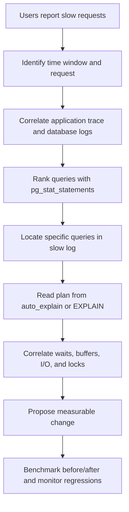

# auto_explain, Slow Query Log, and Observability Overhead in PostgreSQL

PostgreSQL performance needs to be observed across multiple data layers: logging slow statements to identify which queries exceed thresholds, inspecting execution plans to see how PostgreSQL ran them, and collecting aggregate statistics to find workloads consuming heavy resources over time. Three commonly combined data sources are the **slow query log**, **auto_explain**, and **pg_stat_statements**.

Each source answers a different question:

- The slow query log shows which statements took too long and how long they took.
- `auto_explain` logs the execution plan of statements meeting configured criteria, optionally including actual rows, buffers, WAL, and runtime details.
- `pg_stat_statements` aggregates statistics by query fingerprint to pinpoint queries with high total time, call frequency, I/O, or temporary block usage.

Enabling observability is not free. Logging can increase CPU, I/O, disk usage, network traffic, ingestion cost, and exposure of sensitive data. The goal is to capture sufficient diagnostic evidence while keeping overhead, retention, and exposure under control.

This lesson belongs to the **Monitoring** chapter and focuses on:

- Understanding slow query logging and logging thresholds.
- Configuring `auto_explain` to capture execution plans.
- Distinguishing estimated plans from actual execution statistics.
- Using `pg_stat_statements` to rank workloads.
- Combining logs, plans, waits, buffers, WAL, and I/O metrics.
- Measuring observability overhead and controlling log volume.
- Protecting query text, bind parameters, and user information.
- Designing sampling, retention, rotation, alerting, and runbooks.

> **Operational principle:** Start with a concrete observability question, choose the smallest data source capable of answering it, benchmark overhead on a representative workload, and expand collection scope only when necessary. Logging every query or capturing actual plans for every statement can alter the very workload you are trying to observe.

## 1. PostgreSQL Query Observability Layers

A production system typically needs both aggregated metrics and per-execution evidence. No single tool gives the complete picture.

| Source | Provides | Primary Question | Cost / Limitations |
| --- | --- | --- | --- |
| Slow query log | Query text and duration above threshold | Which statements exceeded allowed time? | Log volume, parsing/ingest, sensitive data |
| auto_explain | Execution plan, optionally with actual runtime | Why was the query slow? | Instrumentation overhead, large plan output, log volume |
| pg_stat_statements | Aggregated stats by query fingerprint | Which query family consumes the most resources? | Shared memory, tracking overhead, query text/normalization limits |
| pg_stat_activity | Session state and currently running query | Which backend is running/waiting/blocked? | Point-in-time snapshot, query text can be truncated |
| pg_stat_database / pg_stat_io | I/O and activity counters | Which database or I/O type is rising? | Counters require baselines and time intervals |
| Application tracing | Request, endpoint, correlation ID | Which request was impacted by the slow query? | Instrumentation and trace storage |
| OS/storage metrics | CPU, memory, disk latency, filesystem | Which resource is slowing the database? | Needs correlation with database evidence |

### 1.1. Diagnostic flow



Start with timestamp, database, role, `application_name`, and request context. With only a bare line saying “slow query,” it is hard to distinguish plan regression, lock wait, I/O saturation, connection pool queueing, or a single request touching an unusually large dataset.

### 1.2. Estimated plans vs. actual plans

Standard `EXPLAIN` shows the planner's estimated plan. `EXPLAIN ANALYZE` executes the statement and adds actual runtime metrics such as actual rows, loops, and execution time.

These two pieces of evidence answer different questions:

- Estimated rows differ from actual rows: statistics or cardinality estimates may be inaccurate.
- High actual time on a node: that node consumed execution time, though you must inspect `loops` and input volume too.
- Rising buffers read: the query had to load pages not already in `shared_buffers`; this does not guarantee all were physical disk reads since OS cache plays a role.
- Long lock wait: request time may be dominated by a blocking transaction rather than the plan.
- Rising temporary blocks: sorts or hashes may be spilling to temporary files.

## 2. What Is the Slow Query Log?

Slow query logging records statements exceeding a configured duration threshold to the server log. PostgreSQL does not create a separate file named “slow query log”; rather, logging settings are configured to emit slow statements.

### 2.1. log_min_duration_statement

`log_min_duration_statement` sets the minimum execution duration (in milliseconds) required for a statement to be logged.

| Value | Meaning |
| --- | --- |
| `-1` | Disables duration-threshold logging |
| `0` | Logs every completed statement |
| `250` | Logs statements taking at least 250 ms |
| `1000` | Logs statements taking at least 1 second |

Configuration example:

```conf
# Log statements taking at least 500 ms
log_min_duration_statement = 500
```

Thresholds must match latency targets and workload volume. For an API targeting a 200 ms p95, a 5-second threshold will miss most queries hurting user experience. Conversely, a 10 ms threshold on tens of thousands of queries/sec can generate massive log volume.

### 2.2. Logging all durations

`log_duration = on` logs the duration of every completed statement regardless of threshold. Combined with `log_statement`, it can generate tremendous log volume.

```conf
log_duration = on
```

Use this only for a bounded measurement window after calculating log volume. For steady-state workloads, slow thresholds or sampling are usually easier to operate.

### 2.3. log_statement

`log_statement` controls which statement classes are logged:

| Value | Meaning |
| --- | --- |
| `none` | Do not log statements via this setting |
| `ddl` | Log DDL statements |
| `mod` | Log DDL and data-modifying statements |
| `all` | Log all statements |

Example:

```conf
log_statement = 'ddl'
```

`log_statement` logs commands as PostgreSQL processes them, whereas `log_min_duration_statement` logs duration once a statement finishes. They complement each other. Never leave `all` enabled long-term merely to find a slow query when slow logging suffices.

### 2.4. log_min_duration_sample and sampling

PostgreSQL versions supporting log sampling can use:

- `log_min_duration_sample`: minimum duration threshold for sampled statements.
- `log_statement_sample_rate`: probability that an eligible statement is logged.

Example:

```conf
log_min_duration_sample = 200
log_statement_sample_rate = 0.05
```

This illustrates sampling 5% of statements taking at least 200 ms. Verify parameter availability and exact semantics for your running major version.

Sampling helps on high-frequency workloads. However, a rare yet very expensive query might not be sampled. Combine a stricter always-log threshold for extreme outliers with sampling for moderately slow queries.

### 2.5. Duration and statement text

Slow logs are most useful when they include both duration and query text. Note that prepared statements and the extended query protocol may be logged across Parse/Bind/Execute phases with representations varying by protocol and version. When correlating logs, never assume every log line maps one-to-one to an HTTP request or a single application function call.

### 2.6. What the slow log does not explain

A high-duration log line does not explain root cause on its own. It does not tell you:

- Which node in the execution plan consumed the time.
- How long the query waited on locks without additional lock diagnostics.
- How many shared buffers were hit or read.
- Whether sort or hash operations spilled to disk.
- Where the planner's row estimates diverged.
- Which application request triggered the query.
- Whether the query runs frequently or happened only once.

Use the slow log to locate specific statements, then combine with `auto_explain`, `pg_stat_statements`, `pg_stat_activity`, and tracing.

## 3. Configuring Slow Query Logging

Logging parameters are usually placed in `postgresql.conf` or managed-service configurations. Some changes apply via reload; others require a restart. Always check `context`, `pending_restart`, and runtime settings.

### 3.1. Basic threshold configuration

A conservative starting example:

```conf
log_min_duration_statement = 500
log_statement = 'none'
log_duration = off
log_line_prefix = '%m [%p] db=%d,user=%u,app=%a,client=%r '
```

In this example:

- Statements taking 500 ms or longer are logged.
- `log_statement` does not log every statement.
- Durations of all statements are not logged unconditionally.
- The log prefix includes timestamp, PID, database, role, application name, and client.

The 500 ms threshold is just a lab starting point. Choose values aligned with your SLOs, traffic, and log ingestion capacity.

### 3.2. Inspecting effective settings

```sql
SELECT
    name,
    setting,
    unit,
    source,
    context,
    pending_restart
FROM pg_settings
WHERE name IN (
    'log_min_duration_statement',
    'log_min_duration_sample',
    'log_statement_sample_rate',
    'log_statement',
    'log_duration',
    'log_line_prefix'
)
ORDER BY name;
```

`pg_settings.source` shows where the current value came from. `pending_restart` flags settings modified in configuration that await a server restart to take effect.

### 3.3. Reloading configuration

Logging settings with reload context can generally be applied via:

```sql
SELECT pg_reload_conf();
```

This call signals a reload request; check PostgreSQL logs and `pg_settings` to verify the new settings actually took effect. Never assume every parameter reloads dynamically.

### 3.4. Per-role and per-database configuration

Some settings can be scoped per role or database via `ALTER ROLE ... SET` or `ALTER DATABASE ... SET`. However, logging settings have specific permission and context rules; many can be changed only by superusers or roles with appropriate privileges.

Do not rely on role-level settings as a default mechanism to isolate slow logs for one app if settings apply instance-wide. Filter downstream by `application_name`, role, database, or in the log pipeline.

### 3.5. Setting application_name

Applications should supply a meaningful `application_name` in connection strings or startup parameters. Example:

```text
application_name=orders-api
```

Then `%a` in the log prefix distinguishes `orders-api`, `billing-worker`, migration tools, and dashboard sessions. Avoid embedding user IDs, request IDs, or high-cardinality values in `application_name`; use tracing context for request-level correlation.

## 4. Log Prefixes and Log Formatting

The log prefix controls which metadata accompanies every log line. A good prefix lets you group and filter logs without parsing raw query text.

### 4.1. Useful placeholders

Common placeholders in `log_line_prefix`:

| Placeholder | Content |
| --- | --- |
| `%m` | Timestamp with milliseconds |
| `%t` | Timestamp without milliseconds |
| `%p` | Backend process ID |
| `%c` | Session ID |
| `%l` | Log line sequence number per session |
| `%u` | Database user |
| `%d` | Database name |
| `%r` | Remote host and port |
| `%h` | Remote host |
| `%a` | Application name |
| `%e` | SQLSTATE |
| `%x` | Transaction ID |
| `%v` | Virtual transaction ID |
| `%Q` | Query ID if computed and supported by version |

Example:

```conf
log_line_prefix = '%m [%p] session=%c line=%l user=%u db=%d app=%a client=%r sqlstate=%e '
```

Unsupported placeholders or values unavailable in a given context render empty. Check the documentation for your exact PostgreSQL version.

### 4.2. Query ID

Query IDs group queries sharing the same normalized structure. On supported versions, `compute_query_id` controls identifier computation:

```conf
compute_query_id = auto
```

A Query ID is not a business ID and is not guaranteed stable across major versions, query-structure edits, or separate environments. Use it as a fingerprint within appropriate monitoring/statistics scopes rather than a permanent storage key.

### 4.3. log_destination

PostgreSQL supports several destinations depending on platform and version, commonly including:

- `stderr`: standard error output.
- `csvlog`: CSV-formatted logs.
- `jsonlog`: JSON-formatted logs on supported versions.
- `syslog`: OS syslog where supported.
- `eventlog`: Windows Event Log on Windows.

Example:

```conf
logging_collector = on
log_destination = 'stderr,csvlog'
```

`logging_collector` requires a restart to change. `csvlog` and `jsonlog` have collector requirements documented per version. Managed PostgreSQL services may route logs through provider-specific logging pipelines; check provider policies and interfaces.

### 4.4. Structured logs

CSV/JSON logs are easier to ingest than plain text when querying by field. Useful fields include:

- Timestamp and timezone.
- PID/session ID.
- Database, role, and application name.
- Client address.
- SQLSTATE and severity.
- Duration.
- Query ID.
- Query text and bind parameters where policy permits.

Structured logging reduces brittle regex parsing while increasing per-record byte size. Select fields aligned with investigative needs.

### 4.5. Preserving correlation

Synchronize clocks across PostgreSQL, applications, brokers, and observability platforms. Keep timezones consistent or store UTC. To tie a slow statement back to a request, pair application trace IDs with database session metadata; PostgreSQL does not automatically know HTTP request IDs.

## 5. What Is auto_explain?

`auto_explain` is a PostgreSQL contrib module that automatically logs execution plans for statements matching configured criteria. It is especially valuable when slow queries occur only in production and are hard to reproduce manually.

Instead of re-running queries after an incident passes, `auto_explain` captures the plan right as the statement executes.

### 5.1. What does auto_explain log?

Depending on options, logged plans can include:

- Plan tree and node types.
- Estimated costs and estimated rows.
- Actual times, rows, and loops.
- Shared, local, and temporary buffer statistics.
- WAL records, bytes, and FPIs if supported and enabled.
- Trigger statistics.
- Planner settings affecting the plan.
- Verbose output and nested statements.

### 5.2. auto_explain does not replace the slow log

The slow log captures statement durations. `auto_explain` logs plans conditionally. Both are commonly used together:

- The slow log identifies the query and its duration.
- `auto_explain` explains the plan and actual execution behavior.
- `pg_stat_statements` shows the query family's aggregate impact.

If `auto_explain` is not loaded or its duration threshold exceeds the query's runtime, no plan will be captured for that query.

### 5.3. Loading per session or instance-wide

In a lab, load the module per session if the shared library is available:

```sql
LOAD 'auto_explain';
```

To load automatically for all new sessions, configure `shared_preload_libraries`:

```conf
shared_preload_libraries = 'auto_explain,pg_stat_statements'
```

Changing `shared_preload_libraries` requires restarting PostgreSQL. If modules are already listed, append to the list rather than overwriting existing ones.

On managed services, enabling modules may require parameter groups or provider-specific workflows.

## 6. Key auto_explain Parameters

`auto_explain` GUCs use the `auto_explain.` prefix. Verify exact options and availability on your PostgreSQL version.

### 6.1. auto_explain.log_min_duration

Sets the duration threshold in milliseconds for logging a plan.

| Value | Meaning |
| --- | --- |
| `-1` | Disables automatic plan logging |
| `0` | Logs plans for all eligible statements |
| `500` | Logs plans when execution reaches at least 500 ms |

Example:

```conf
auto_explain.log_min_duration = '500ms'
```

You can specify `500` in milliseconds or an explicit unit string. Start with a high threshold to bound log volume, then adjust toward your SLOs.

### 6.2. auto_explain.log_analyze

When enabled, logged plans include actual execution statistics:

```conf
auto_explain.log_analyze = on
```

Actual rows, loops, and timings reveal divergences between planner estimates and runtime reality. However, instrumentation adds overhead to tracked statements—even statements that ultimately finish below the log threshold depending on how instrumentation hooks execute. Never enable it across full production load without benchmarking first.

### 6.3. auto_explain.log_timing

When `log_analyze` is on, `log_timing` controls per-node timing measurement:

```conf
auto_explain.log_timing = off
```

Disabling per-node timing avoids clock-read overhead on workloads with many nodes or statements. Actual rows and loops remain useful, though per-node timing breakdowns will not appear.

### 6.4. auto_explain.log_buffers

Enables buffer statistics:

```conf
auto_explain.log_buffers = on
```

Buffer stats show shared/local/temp buffer usage per node. This setting requires actual plan instrumentation depending on version; verify documentation and GUC dependencies.

### 6.5. auto_explain.log_wal

On supported versions, logs WAL statistics:

```conf
auto_explain.log_wal = on
```

WAL metrics expose statements generating heavy WAL—valuable for bulk updates, deletes, inserts, and index creation. WAL stats do not represent total final storage cost and must be read alongside workload context.

### 6.6. auto_explain.log_triggers

Logs trigger execution statistics when actual execution data is collected:

```conf
auto_explain.log_triggers = on
```

Triggers can account for a major share of a DML statement's cost. Enabling this lengthens log entries.

### 6.7. auto_explain.log_verbose and log_settings

- `auto_explain.log_verbose = on` adds verbose details such as output columns to the plan.
- `auto_explain.log_settings = on` records non-default planner settings affecting the plan on supported versions.

Verbose/settings output helps explain cross-environment differences while expanding log payloads. Enable selectively and inspect output before broad rollout.

### 6.8. auto_explain.log_format

Supported versions allow formats such as `text`, `xml`, `json`, or `yaml`:

```conf
auto_explain.log_format = 'json'
```

JSON is convenient for automated parsing, though plan outputs can be large. Ingestion pipelines must preserve nested structures, arrays, and numeric values. Do not assume all versions support identical formats.

### 6.9. auto_explain.log_nested_statements

When enabled:

```conf
auto_explain.log_nested_statements = on
```

The module logs plans for statements executed inside functions, procedures, or nested contexts per version semantics. This reveals SQL hidden inside PL/pgSQL, though it can dramatically increase log volume.

### 6.10. auto_explain.sample_rate

Samples plan logging:

```conf
auto_explain.sample_rate = 0.1
```

For example, `0.1` samples roughly 10% of eligible statements. Sampling curbs output volume, though it does not guarantee catching rare queries or brief spikes.

### 6.11. auto_explain.log_level

`auto_explain.log_level` sets the log severity for emitted plans, commonly `LOG` or `DEBUG` levels aligned with your logging pipeline. Do not lower severity below what your log pipeline retains.

## 7. A Conservative auto_explain Configuration

The configuration below is a cautious starting point for investigating slow queries, not a universal production preset:

```conf
# Requires adding module to shared_preload_libraries and restarting
shared_preload_libraries = 'auto_explain,pg_stat_statements'

# Log plans only for slow statements
auto_explain.log_min_duration = '750ms'

# Actual rows and loops help spot cardinality errors
auto_explain.log_analyze = on

# Reduce per-node timing overhead
auto_explain.log_timing = off

# Include buffer evidence
auto_explain.log_buffers = on

# Keep WAL/triggers/verbose/nested off until needed
auto_explain.log_wal = off
auto_explain.log_triggers = off
auto_explain.log_verbose = off
auto_explain.log_nested_statements = off

# Limit logged plan volume
auto_explain.sample_rate = 0.25
```

Before applying this configuration, verify GUC availability on your major version and check option dependencies. Enabling `log_analyze` must be benchmarked on a representative workload; if overhead is too high, turn off actual analysis or raise the duration threshold / lower the sample rate.

### 7.1. Checking auto_explain GUCs

After loading the module:

```sql
SELECT
    name,
    setting,
    unit,
    source,
    context,
    pending_restart
FROM pg_settings
WHERE name LIKE 'auto_explain.%'
ORDER BY name;
```

If no rows return, the module is likely not loaded or the GUCs differ on your version. Check server startup logs and module installation.

### 7.2. Enabling the module in a lab

```sql
LOAD 'auto_explain';

SET auto_explain.log_min_duration = 0;
SET auto_explain.log_analyze = on;
SET auto_explain.log_timing = off;
SET auto_explain.log_buffers = on;
```

`SET` in a lab session affects only that session and requires the module to be loaded. Never use threshold `0` in production workloads as it attempts to log plans for every statement.

## 8. Reading Execution Plans from auto_explain

An execution plan is the tree of operations PostgreSQL chose to execute a statement. Read plans top-down and correlate each node with rows, loops, buffers, and time.

### 8.1. Plan example

An illustrative plan:

```text
Limit  (cost=0.42..18.10 rows=20 width=48)
       (actual rows=20 loops=1)
  ->  Index Scan using orders_customer_created_idx on orders
        (cost=0.42..1800.00 rows=2000 width=48)
        (actual rows=20 loops=1)
        Index Cond: (customer_id = 42)
        Buffers: shared hit=15 read=3
Planning Time: 0.250 ms
Execution Time: 1.800 ms
```

The plan shows PostgreSQL using an index scan, returning 20 rows, with shared buffer hits and reads. This is an illustrative snippet, not identical across all versions.

### 8.2. Estimated rows vs. actual rows

Compare:

- `rows` in the cost estimate is what the planner expected the node to emit.
- `actual rows` is the average rows emitted per loop as reported by EXPLAIN.
- Large mismatches can lead the planner into suboptimal join orders or scan types.

For example, estimating 10 rows when actual is 100,000 rows often points to stale statistics, unmodeled column correlations, or hard-to-estimate predicates.

### 8.3. loops

`loops` is how many times a node executed. A node taking 0.2 ms per loop yet executed 100,000 times becomes a major bottleneck.

Always read `actual time` and `actual rows` in context of `loops`. Total work is not a single per-loop number.

### 8.4. Cost is not milliseconds

`cost=...` is in the planner's relative cost units, not wall-clock time. Costs exist to compare competing plan alternatives under current cost settings.

Never claim a query took 18 ms just because its plan shows `cost=18.10`.

### 8.5. Planning Time and Execution Time

- Planning Time is how long planning took.
- Execution Time is runtime reported by EXPLAIN ANALYZE.
- Slow log duration can include protocol and statement-processing phases depending on context and does not always match Execution Time in the plan.

If Planning Time is large, inspect query complexity, partition counts, join counts, prepared statement caching, and planning statistics.

## 9. EXPLAIN ANALYZE and Safety Considerations

You can reproduce a slow query in a lab or controlled environment using:

```sql
EXPLAIN (ANALYZE, BUFFERS, VERBOSE)
SELECT order_id, created_at, total_amount
FROM app.orders
WHERE customer_id = 42
ORDER BY created_at DESC
LIMIT 50;
```

### 9.1. EXPLAIN ANALYZE executes the query

This distinction is critical: `EXPLAIN ANALYZE` runs the statement for real. For SELECT, it executes the query and measures runtime. For INSERT/UPDATE/DELETE, it modifies data.

A rolled-back transaction helps test DML:

```sql
BEGIN;
EXPLAIN (ANALYZE, BUFFERS)
UPDATE app.orders
SET status = 'review'
WHERE order_id = 1001;
ROLLBACK;
```

However, rolling back does not undo every side effect. Sequence increments, external side effects in functions, notifications, calls to external systems, or non-transactional actions still happen. Run only after understanding both the statement and the environment.

### 9.2. BUFFERS

`BUFFERS` reports page counters such as:

- `shared hit`: page found in shared buffers.
- `shared read`: page read into shared buffers.
- `shared dirtied`: page modified.
- `shared written`: page written out from shared buffers.
- `temp read/written`: temporary blocks read/written.
- `local`: local buffers for temporary tables where applicable.

`shared read` does not strictly equal physical disk reads because the OS page cache may fulfill them. Interpret buffer counters alongside OS/storage metrics.

### 9.3. WAL

On supported versions, `EXPLAIN (ANALYZE, WAL)` adds WAL records, full-page images, and WAL bytes—helpful for heavy DML or index builds.

```sql
EXPLAIN (ANALYZE, BUFFERS, WAL)
UPDATE app.orders
SET status = 'archived'
WHERE created_at < timestamptz '2024-01-01 00:00:00+00';
```

This statement executes a real UPDATE. Run it only in a lab or test environment where data can safely be modified.

### 9.4. SETTINGS

On supported versions, `EXPLAIN (SETTINGS)` shows non-default planner settings influencing the plan—valuable evidence when source and target environments are configured differently.

### 9.5. TIMING

`TIMING` controls per-node timing measurement. To lower overhead while keeping actual row counts, disable detailed timing:

```sql
EXPLAIN (ANALYZE, BUFFERS, TIMING OFF)
SELECT count(*)
FROM app.orders
WHERE status = 'pending';
```

Disabling timing does not eliminate all ANALYZE overhead; the statement still executes and remains instrumented.

## 10. pg_stat_statements: Seeing the Overall Workload

`pg_stat_statements` collects planning and execution statistics for normalized statements. It surfaces query families with high cumulative time, excessive call counts, or heavy I/O and temp activity.

### 10.1. Installing the extension

The module must be preloaded:

```conf
shared_preload_libraries = 'pg_stat_statements'
```

If `auto_explain` or other modules are present, keep the full list. Changes require restarting PostgreSQL.

Once loaded, create the extension in every database where you intend to query the view:

```sql
CREATE EXTENSION IF NOT EXISTS pg_stat_statements;
```

### 10.2. Key parameters

| Setting | Role |
| --- | --- |
| `pg_stat_statements.max` | Maximum query entries retained |
| `pg_stat_statements.track` | Scope of tracked statements |
| `pg_stat_statements.track_utility` | Whether utility commands are tracked |
| `pg_stat_statements.track_planning` | Whether planning statistics are collected |
| `pg_stat_statements.save` | Persists statistics across shutdown/restart per version behavior |

`pg_stat_statements.track` typically accepts `top`, `all`, or `none`. Specific options and semantics vary by version.

`track_planning` can increase overhead when planning occurs frequently. Enable it only if your question requires planning time and plan counts.

### 10.3. Top queries by total execution time

Example on versions providing `total_exec_time`:

```sql
SELECT
    queryid,
    calls,
    round(total_exec_time::numeric, 2) AS total_exec_ms,
    round(mean_exec_time::numeric, 2) AS mean_exec_ms,
    rows,
    shared_blks_hit,
    shared_blks_read,
    temp_blks_read,
    temp_blks_written,
    left(query, 500) AS query_sample
FROM pg_stat_statements
ORDER BY total_exec_time DESC
LIMIT 20;
```

This finds queries with high cumulative runtime. A 1 ms query running 10 million times can burn more CPU than a 10-second query running once.

### 10.4. Top queries by mean time

```sql
SELECT
    queryid,
    calls,
    round(mean_exec_time::numeric, 2) AS mean_exec_ms,
    round(max_exec_time::numeric, 2) AS max_exec_ms,
    rows,
    left(query, 500) AS query_sample
FROM pg_stat_statements
WHERE calls > 0
ORDER BY mean_exec_time DESC
LIMIT 20;
```

The mean can be skewed by outliers and does not give percentiles. Combine with histograms/tracing or slow logs to measure tail latency.

### 10.5. Queries called excessively often

```sql
SELECT
    queryid,
    calls,
    round(total_exec_time::numeric, 2) AS total_exec_ms,
    round(mean_exec_time::numeric, 3) AS mean_exec_ms,
    rows,
    left(query, 400) AS query_sample
FROM pg_stat_statements
ORDER BY calls DESC
LIMIT 20;
```

High call counts on tiny queries often signal N+1 query patterns or chatty applications. Reducing round-trips can improve latency and connection utilization even when each individual query is fast.

### 10.6. Temporary blocks

```sql
SELECT
    queryid,
    calls,
    temp_blks_read,
    temp_blks_written,
    round(total_exec_time::numeric, 2) AS total_exec_ms,
    left(query, 400) AS query_sample
FROM pg_stat_statements
ORDER BY temp_blks_written DESC
LIMIT 20;
```

Temporary blocks can indicate sort/hash spills, materialization, or queries processing large datasets. Review execution plans and `work_mem` per workload; never increase instance-wide `work_mem` blindly since each operation and connection allocates memory independently.

### 10.7. I/O time and buffers

On versions providing these columns:

```sql
SELECT
    queryid,
    calls,
    shared_blks_hit,
    shared_blks_read,
    blk_read_time,
    blk_write_time,
    round(total_exec_time::numeric, 2) AS total_exec_ms,
    left(query, 400) AS query_sample
FROM pg_stat_statements
ORDER BY shared_blks_read DESC
LIMIT 20;
```

`blk_read_time`/`blk_write_time` are meaningful only when I/O timing is collected. Verify `track_io_timing` and version. Counters accumulate since the last reset or entry creation, not instantaneous rates.

### 10.8. Query fingerprints and query text

`pg_stat_statements` groups similar statements after normalization. Literals are typically replaced by parameters in the normalized representation. This caps entry counts while potentially hiding differences between rare and common parameter values.

A `queryid` can change across versions, schemas, object identities, or configuration. Never use `queryid` as a stable cross-cluster or cross-major-upgrade identifier.

### 10.9. Resetting statistics

Reset with:

```sql
SELECT pg_stat_statements_reset();
```

Resetting destroys cumulative baselines. Before resetting, export/snapshot metrics and record the timestamp. Reset only with a clear purpose, such as starting a post-deploy measurement window—never to make a dashboard “look cleaner.”

## 11. Combining Slow Log, auto_explain, and pg_stat_statements

These three sources complement one another. A typical diagnostic workflow looks like this:

1. Use `pg_stat_statements` dashboards to locate `queryid` entries with unusual jumps in total time or calls.
2. Filter slow logs by timestamp, database, role, app, and query text.
3. Locate matching `auto_explain` plans, checking query fingerprints and parameter values if logged.
4. Check estimated vs. actual rows, loops, buffers, temp blocks, and WAL.
5. Cross-check `pg_stat_activity` or lock logs if the query slowed down while waiting.
6. Use application traces to link the query to endpoints and requests.
7. Propose a change and re-measure under an equivalent workload.

### 11.1. Scenario example

An `/orders` endpoint sees p95 latency jump from 150 ms to 2 seconds. Dashboards show total execution time surging on a customer-orders lookup query. Slow logs capture runs exceeding 1 second. `auto_explain` reveals:

- Planner estimated 20 rows.
- Actual execution returned 80,000 rows.
- A Nested Loop repeated many times.
- Buffers read were high.
- A filter predicate ran after a join.

Investigate statistics, indexes, predicates, and data distribution next. Remediation may involve `ANALYZE`, a better index, or query rewriting. Never add an index based on one plan alone; evaluate write overhead and all other queries using the table.

### 11.2. Query plans and parameters

A prepared statement can switch between generic and custom plans depending on parameter distribution. If logs contain only normalized query text, you may lack the specific parameter values triggering slow runs.

Use controlled reproduction with representative parameters rather than enabling instance-wide bind-parameter logging when sensitive data exists. Consider application-level tracing or a controlled test session.

## 12. Observing Waits and Blocking

A slow query may be waiting on a lock, I/O, or another resource. An execution plan alone does not explain all wall-clock time.

### 12.1. Inspecting active sessions

```sql
SELECT
    pid,
    usename,
    datname,
    application_name,
    client_addr,
    state,
    wait_event_type,
    wait_event,
    clock_timestamp() - query_start AS query_age,
    left(query, 500) AS query_sample
FROM pg_stat_activity
WHERE state <> 'idle'
ORDER BY query_start NULLS LAST;
```

`query_age` is measured from `query_start`, not CPU time. If a backend is waiting on a lock, wall time rises without a matching rise in CPU.

### 12.2. Finding blockers

```sql
SELECT
    a.pid AS blocked_pid,
    a.usename AS blocked_user,
    a.wait_event_type,
    a.wait_event,
    pg_blocking_pids(a.pid) AS blocking_pids,
    left(a.query, 300) AS blocked_query
FROM pg_stat_activity AS a
WHERE cardinality(pg_blocking_pids(a.pid)) > 0
ORDER BY a.query_start;
```

Then query the PIDs in `blocking_pids` to inspect the blocking transactions and sessions. Never terminate a backend from a single monitoring row; verify transaction owner and impact first.

### 12.3. log_lock_waits

You can enable:

```conf
log_lock_waits = on
deadlock_timeout = '1s'
```

When a lock wait exceeds `deadlock_timeout`, PostgreSQL logs lock wait details per setting semantics. `deadlock_timeout` also governs when deadlock checks run; altering it can affect overhead. Pick a threshold suited to latency targets and workload.

### 12.4. Wait events

`wait_event_type` and `wait_event` classify what sessions are waiting on. A backend in `state = active` can still be waiting on a resource. Do not equate `active` with “using CPU.”

## 13. Additional Diagnostic Logging Settings

Beyond slow query logs and `auto_explain`, several settings surface supporting root causes.

### 13.1. Temporary files

```conf
log_temp_files = 0
```

`0` logs every deleted temporary file; positive integers log files at or above the byte/KB threshold per setting units; `-1` disables it. Logging all temporary files can generate heavy volume, so start with a reasonable threshold.

### 13.2. I/O timing

```conf
track_io_timing = on
```

Enables I/O timing capture in supported statistics views. It carries clock-measurement overhead depending on platform. Benchmark before enabling instance-wide.

### 13.3. Checkpoints and WAL

Checkpoint and WAL logs clarify write pressure and checkpoint behavior. Settings such as `log_checkpoints` emit checkpoint statistics depending on version.

Do not blame every slow query on query plans if the system is simultaneously experiencing checkpoint bursts, WAL pressure, or storage latency spikes.

### 13.4. Deadlocks

Deadlocks are detected and logged by PostgreSQL. Combine SQLSTATE, lock wait logs, and application retry metrics to measure deadlock frequency and affected transactions.

### 13.5. Error verbosity

`log_error_verbosity` controls error log detail (`terse`, `default`, `verbose`). Verbose output helps debugging while lengthening logs and potentially exposing internal details.

## 14. Observability Cost: CPU and Latency

Observability affects workloads through multiple channels.

### 14.1. Slow logging overhead

Every selected statement requires formatting a log record and sending it through the logging pipeline. At high query rates, logging increases CPU, memory copying, context switching, and I/O.

If the collector or downstream sink falls behind, logging can directly hurt latency. Never assume log output is free because it happens in the background.

### 14.2. auto_explain instrumentation

`log_analyze` gathers actual execution details. Per-node instrumentation creates overhead, especially for short queries with many plan nodes or loops.

`log_timing = off` avoids per-node clock reads while preserving row/loop instrumentation overhead. Sampling and thresholds reduce logged plan counts; benchmark on production-like workloads.

### 14.3. pg_stat_statements tracking

`pg_stat_statements` updates shared statistics for tracked statements. Overhead depends on entry count, concurrency, tracking scope, and planning tracking. Workloads generating lots of unique queries increase hash-table churn.

### 14.4. I/O timing

`track_io_timing` measures I/O via OS clock calls. Impact varies by platform and clock implementation. Measure CPU overhead before and after enabling.

### 14.5. Duplicate tracing and instrumentation

If application tracing already captures every SQL span while database slow logs and external query monitors also capture every statement, you end up paying ingestion and instrumentation costs multiple times for the same data.

Define clearly which system is the source of truth for request latency, query fingerprints, and database execution evidence.

## 15. Cost of Log Volume, Storage, and Ingestion

Log volume often becomes an operational bottleneck before CPU overhead becomes obvious.

### 15.1. Estimation formula

A simple estimate:

```text
daily_bytes ≈ logged_statements_per_second
             × average_record_bytes
             × 86,400
```

Example: 10 statements/second averaging 1,200 bytes/record:

```text
10 × 1,200 × 86,400
= 1,036,800,000 bytes/day
≈ 0.97 GiB/day
```

That covers query logs alone. Plan logs are much larger because they contain many nodes and buffer lines. Compression shrinks storage without eliminating network and CPU ingestion costs.

### 15.2. Log volume by query rate

| Query rate | Sampling/log rate | Average record | Approximate volume/day |
| --- | --- | --- | --- |
| 100/s | 1% = 1/s | 1 KB | 84 MB |
| 1,000/s | 1% = 10/s | 1 KB | 0.8 GiB |
| 5,000/s | 1% = 50/s | 1 KB | 4.0 GiB |
| 1,000/s | 100% = 1,000/s | 1 KB | 80.5 GiB |

These figures are rough estimates using approximate units and exclude metadata, compression, replicas, indexes, and retention overhead. Substitute your actual traffic and measured record sizes.

### 15.3. Plan logs

Plan output ranges from a few KB to hundreds of KB depending on query complexity, nested statements, verbose output, and relation counts. Enabling `auto_explain.log_analyze` for every statement can make plan logs dwarf slow-query log volume.

Measure average and p95 plan sizes in a lab before choosing a sample rate.

### 15.4. Retention cost

Total storage depends on:

```text
retained_storage ≈ daily_ingested_bytes × retention_days
```

Also factor in replication factors, index storage, object storage versioning, compression ratios, and log-platform backup policies.

### 15.5. Ingestion cost

Many observability platforms bill by GB ingested, indexed data, retention, or query volume. Overly broad statement logging causes costs to scale linearly with query rate.

Monitor ingested bytes/day, indexed bytes/day, dropped events, parser errors, and retention consumption as operational metrics.

## 16. Cost and Risks of Sensitive Data

Query logs and execution plans can expose sensitive data.

### 16.1. Query text

SQL literals can contain:

- Emails, phone numbers, and street addresses.
- Customer identifiers.
- Payment references.
- Tokens or secrets mistakenly embedded in SQL by applications.
- Search terms or personal data.

Never assume query text is harmless.

### 16.2. Bind parameters

Bind parameters can contain sensitive data absent from normalized query text. PostgreSQL exposes settings for bind-parameter logging on supported versions, such as `log_parameter_max_length` and `log_parameter_max_length_on_error`.

Check defaults and version semantics before modifying them. To keep data safe, avoid instance-wide full bind-parameter logging unless clear data classification, access controls, and retention policies exist.

### 16.3. Execution plans can also expose metadata

Plans reveal schema/table names, predicates, partition names, function names, and object structures. Treat this internal metadata as access-controlled.

### 16.4. Redaction

Redaction can be applied at the application, proxy, or log pipeline, though regex-based redaction cannot guarantee complete SQL syntax understanding. Prefer keeping secrets out of SQL literals, limiting bind-parameter logging, and enforcing strict access controls.

### 16.5. Access control

Only operators, DBAs, and authorized investigators should read raw SQL logs. Separate permissions for aggregate dashboards from permissions to view raw query text. Audit log access per policy.

## 17. Log Rotation, Retention, and Shipping

Logging without a retention plan risks filling disks or losing critical observability data.

### 17.1. Logging collector

When using the logging collector:

```conf
logging_collector = on
log_directory = 'log'
log_filename = 'postgresql-%Y-%m-%d_%H%M%S.log'
log_rotation_age = '1d'
log_rotation_size = '100MB'
log_truncate_on_rotation = off
```

`logging_collector` requires a restart to enable. Rotation age and size only create new log files; they do not delete old files per retention policy.

### 17.2. log_truncate_on_rotation

When enabled, PostgreSQL may truncate an existing log file when reopening a filename under rotation conditions. Understand naming patterns and overwrite risks carefully. Typically, include timestamps in filenames and let a retention manager clean up old files.

### 17.3. External log shipping

Logs can ship to centralized logging platforms, syslog, sidecars, or managed services. Ensure:

- Buffering and retries exist.
- Slow downstream sinks cannot block database execution unexpectedly.
- Disk buffer capacity is provisioned.
- Alerts fire when shippers stall.
- Deduplication and ordering are controlled.
- Encryption and access controls are enforced.

### 17.4. Retention

Retention depends on compliance, incident investigation windows, and storage budgets. Separate retention for raw logs from aggregate metrics. Query fingerprints and percentiles often need longer retention than raw SQL text.

### 17.5. Disk alerts

Monitor log filesystems separately from `pg_wal`. Log growth and WAL retention are independent sources of disk pressure; never let them share an unmonitored storage budget without alerts.

## 18. Sampling Strategy

Sampling lowers cost while risking missed events. Design sampling around your objectives.

### 18.1. Threshold first, sampling second

A common strategy:

- Log 100% of extreme slow queries above a high threshold.
- Sample moderately slow queries.
- Use `pg_stat_statements` for aggregate statistics.
- Enable actual plan capture only when diagnosing.

Illustrative example:

```conf
log_min_duration_statement = 2000
log_min_duration_sample = 300
log_statement_sample_rate = 0.05

auto_explain.log_min_duration = '1500ms'
auto_explain.sample_rate = 0.1
```

Tune actual values based on SLOs, query rates, and logging budgets.

### 18.2. Tail latency

Rare yet very slow queries can slip past sampling. For statements exceeding critical blocker thresholds, consider capturing 100% of slow events within a narrow window if volume remains bounded.

### 18.3. Stratified sampling

When workloads span many applications or databases, global sampling can let high-volume workloads drown out smaller ones. Categorize downstream in the log pipeline by app, database, or role with dedicated budgets.

### 18.4. Adaptive sampling

Some observability pipelines raise sampling rates when latency or errors spike and lower them when stable. If used, ensure the policy cannot create a feedback loop that spikes ingestion right when the system is overloaded.

## 19. Correlating Query Logs with Application Tracing

Database logs identify the statement. Application tracing identifies which request triggered that statement.

### 19.1. Application name

Set `application_name` by service or component:

```text
orders-api
billing-worker
reporting-job
migration-runner
```

Avoid putting individual request IDs in `application_name` since constantly changing values create high cardinality.

### 19.2. Trace ID

Use a tracing framework to store trace/span IDs in application logs. You can pass session-level metadata via `SET`/`set_config` if properly designed and authorized, provided connection pools cannot leak session context across requests.

### 19.3. Connection pooling

With transaction pooling, session state does not persist reliably across transactions. If setting `application_name`, custom GUCs, or tracing context via session-level `SET`, understand pooler reset behavior and use transaction-local context when appropriate.

### 19.4. Query fingerprint

Combine `queryid`/normalized SQL with span names to identify query families. Never use raw SQL or literal parameters as metric labels due to cardinality and data exposure.

## 20. Analyzing Plan Regressions

A query can slow down abruptly without any SQL change if statistics, data distributions, index states, or configuration shift.

### 20.1. Common causes

- `ANALYZE` has not updated stale statistics.
- Data distribution or skew changed.
- An index was dropped, became invalid, or no longer fits.
- Partition pruning stopped working.
- Different parameter values make a plan unsuitable.
- `work_mem` causes spills.
- Join cardinality estimates are wrong.
- Table bloat or cache state shifted.
- Lock contention or I/O saturation.
- PostgreSQL upgrade altered planner behavior.

### 20.2. Comparing plans under identical conditions

When comparing before vs. after:

- Use identical representative parameter values.
- Use matching datasets or data distributions where possible.
- Record server version and relevant settings.
- Record statistics state.
- Compare buffers, rows, loops, and execution time.
- Separate warm-cache from cold-cache measurements.
- Run enough iterations to avoid drawing conclusions from a single outlier.

### 20.3. Large estimated vs. actual row discrepancies

When actual rows diverge sharply from estimates, run:

```sql
ANALYZE app.orders;
```

If predicates span correlated columns, consider extended statistics:

```sql
CREATE STATISTICS orders_customer_status_stats
    (dependencies, mcv, ndistinct)
ON customer_id, status
FROM app.orders;

ANALYZE app.orders;
```

Evaluate this option using query plans and workload impact. Do not create extended statistics on every column pair without evidence.

### 20.4. Indexes are not always the answer

Indexes can cut reads while increasing write amplification, WAL, storage, vacuum work, and cache pressure. Review the full workload in `pg_stat_statements` before adding an index.

## 21. Query Logging in Multi-Tenant Environments

In multi-tenant systems, query logs may carry tenant IDs and generate high cardinality.

### 21.1. Avoid tenant IDs as metric labels

Do not emit per-tenant metric labels or dashboard series. Use aggregations, top-k reports, or controlled log fields.

### 21.2. Tenant-specific diagnostics

When investigating a specific tenant, run access-controlled query/log searches scoped to an incident window, paired with application tracing and audit logs.

### 21.3. Fairness and workload isolation

One noisy tenant can flood slow queries and consume the logging budget. Apply quotas, workload classes, or app-level throttling where needed. Track per-tenant query volume in the application tier where tenant identity is explicit.

## 22. Managed PostgreSQL and Configuration Differences

On managed databases, parameters are often configured through parameter groups or consoles rather than editing files directly.

### 22.1. Check extension/module allowlists

Providers may restrict `shared_preload_libraries` or permit only a curated set of modules. Verify module availability before designing your monitoring pipeline.

### 22.2. Log exports

Managed services typically export logs to provider logging services or object storage. Check:

- Supported log types.
- Export delay.
- Retention.
- Pricing.
- Encryption.
- Access control.
- Whether `auto_explain`, CSV, and JSON logs are exported.

### 22.3. Parameter groups

Changes may be pending reboot or apply immediately. Check rollout status and verify `pg_settings` after applying.

### 22.4. Do not assume filesystem access

Not all managed PostgreSQL offerings let you read `log_directory` directly or shell into the host. Use supported provider log interfaces and metrics.

## 23. Designing Dashboards and Alerts

Dashboards should support trend detection and investigation, not merely pack in as many charts as possible.

### 23.1. Query performance dashboard

Useful panels:

- Top query families by total execution time.
- Top queries by mean/max time.
- Calls/second and rows/call.
- Shared blocks read/hit.
- Temporary blocks written.
- Planning vs. execution time.
- Slow query counts above threshold.
- p50/p95/p99 from tracing if available.
- Lock wait duration and counts.
- Query errors and cancellations.

### 23.2. Logging cost dashboard

Track:

- Log bytes/second and bytes/day.
- Plan log counts and average sizes.
- Collector/shipper queue depth.
- Log ingestion bytes.
- Parser errors and dropped events.
- Free disk space on log filesystems.
- Retention usage and estimated monthly cost.

### 23.3. Actionable alerts

| Alert | Illustrative Trigger | Action |
| --- | --- | --- |
| Slow query spike | Count exceeds baseline for 5 minutes | Check query fingerprints and deploy timeline |
| Rising query total time | Top query jumps sharply vs. baseline | Inspect plan and buffers |
| Rising temp spills | Temp blocks/files exceed threshold | Inspect sort/hash nodes and memory |
| Lock wait spike | Lock waits breach latency budget | Find blockers and transaction owners |
| Log disk low | Free space drops below safety threshold | Reduce log volume, ship, or rotate per runbook |
| Log shipper lag | Queue age climbs | Inspect collector and sink |
| Plan log burst | Plan records jump abruptly | Check thresholds, sampling, and config changes |

Calibrate thresholds against baselines and business SLOs. Avoid alerting on a single slow query without clear user impact.

## 24. Safe Rollout for auto_explain and Slow Logging

Never flip every setting on cluster-wide at once. Roll out in phases so you can isolate which component introduces overhead.

### 24.1. Phase 1 — Baseline

Capture before making changes:

- QPS and transaction rate.
- CPU, memory, and disk latency.
- p95/p99 request latency.
- Query counts and `pg_stat_statements` totals.
- Current log bytes/day.
- WAL generation rate.
- Connection counts and wait events.

### 24.2. Phase 2 — Slow threshold

Enable `log_min_duration_statement` at a high threshold. Measure log bytes/day, CPU, and latency. Audit query text exposure.

### 24.3. Phase 3 — pg_stat_statements

Preload the module, perform a planned restart, and create the extension. Capture baseline statistics and identify top query families. Monitor shared memory and tracking overhead.

### 24.4. Phase 4 — Sampled auto_explain

Enable plan logging with a high threshold, low sample rate, and `log_timing = off` where actual analysis is needed. Watch plan log volume and database latency.

### 24.5. Phase 5 — Targeted expansion

Where necessary, enable buffers, WAL, triggers, or nested statements within a bounded window or specific workload. Re-evaluate overhead and privacy before leaving enabled long-term.

### 24.6. Configuration rollback

Document previous values, reload/restart procedures, and owners. If latency or log volume exceeds budget, disable heavy instrumentation first while preserving lower-cost aggregate telemetry.

## 25. Complete Lab Configuration Example

The illustrative configuration below must be adapted for your major version:

```conf
# Logging
log_min_duration_statement = 500
log_statement = 'none'
log_duration = off
log_line_prefix = '%m [%p] db=%d,user=%u,app=%a,client=%r '

# Slow statement sampling (if supported by version)
log_min_duration_sample = 200
log_statement_sample_rate = 0.05

# Modules; changes require restart
shared_preload_libraries = 'pg_stat_statements,auto_explain'

# pg_stat_statements
compute_query_id = auto
pg_stat_statements.max = 10000
pg_stat_statements.track = top
pg_stat_statements.track_utility = off
pg_stat_statements.track_planning = off

# auto_explain
auto_explain.log_min_duration = '750ms'
auto_explain.log_analyze = on
auto_explain.log_timing = off
auto_explain.log_buffers = on
auto_explain.log_wal = off
auto_explain.log_triggers = off
auto_explain.log_verbose = off
auto_explain.log_nested_statements = off
auto_explain.sample_rate = 0.1

# Storage/log rotation
logging_collector = on
log_destination = 'stderr,csvlog'
log_directory = 'log'
log_filename = 'postgresql-%Y-%m-%d_%H%M%S.log'
log_rotation_age = '1d'
log_rotation_size = '100MB'
```

Never copy this entire config straight into production without verifying parameter availability, context, existing `shared_preload_libraries`, logging collector setup, and storage capacity. Sample settings may need unsupported parameters removed for your version or provider.

## 26. Useful Verification Queries

### 26.1. Inspect logging-related settings

```sql
SELECT
    name,
    setting,
    unit,
    source,
    pending_restart
FROM pg_settings
WHERE name LIKE 'log_%'
   OR name LIKE 'auto_explain.%'
   OR name LIKE 'pg_stat_statements.%'
ORDER BY name;
```

### 26.2. Inspect top queries by total time

```sql
SELECT
    queryid,
    calls,
    total_exec_time,
    mean_exec_time,
    rows,
    shared_blks_read,
    temp_blks_written,
    left(query, 300) AS query
FROM pg_stat_statements
ORDER BY total_exec_time DESC
LIMIT 15;
```

### 26.3. Inspect long-running active queries

```sql
SELECT
    pid,
    application_name,
    usename,
    datname,
    state,
    wait_event_type,
    wait_event,
    now() - query_start AS elapsed,
    left(query, 500) AS query
FROM pg_stat_activity
WHERE state = 'active'
  AND query_start IS NOT NULL
ORDER BY query_start;
```

### 26.4. Inspect blocked queries

```sql
SELECT
    pid,
    pg_blocking_pids(pid) AS blockers,
    wait_event_type,
    wait_event,
    left(query, 300) AS query
FROM pg_stat_activity
WHERE cardinality(pg_blocking_pids(pid)) > 0;
```

### 26.5. Inspect the I/O timing setting

```sql
SHOW track_io_timing;
```

When disabled, I/O timing counters remain 0 or do not reflect actual runtime timings depending on view and version.

## 27. Anti-Patterns to Avoid

| Anti-pattern | Why It Hurts | Better Practice |
| --- | --- | --- |
| `log_min_duration_statement = 0` long-term | Logs every statement, massive volume | Use thresholds and sampling |
| `log_statement = 'all'` in production | Huge log volume and sensitive data exposure | Use slow thresholds and DDL logging as needed |
| `auto_explain.log_analyze = on` without benchmarking | Instrumentation can degrade latency | Benchmark, use thresholds, sampling, and `log_timing = off` |
| `auto_explain.log_min_duration = 0` | Plan output for every statement | Start with slow queries |
| Unbounded nested statement logging | Log explosion inside functions | Enable only for targeted investigations |
| Instance-wide bind-parameter logging | Can leak PII/secrets | Mask/restrict data, use controlled reproduction |
| Reading cost as milliseconds | Cost is a planner unit | Use actual time and wall-clock metrics |
| Checking only mean query time | Hides tail latency | Combine with max, percentiles, and tracing |
| Resetting `pg_stat_statements` casually | Destroys baselines | Export first, record reset timestamps |
| Using `queryid` as a permanent ID | Fingerprints can change | Store query text, version, and source context |
| Raising global `work_mem` to eliminate spills | Concurrent memory usage can spike sharply | Analyze plans and tune by workload |
| Skipping log rotation and retention | Can fill filesystems | Configure rotation, shipping, retention, and disk alerts |
| Using application request IDs as metric labels | High cardinality | Keep them in trace backends, not metric labels |
| Optimizing one query in isolation | Can regress other workloads | Measure total workload before and after |
| Enabling many collectors simultaneously | Hard to attribute overhead | Roll out in phases |

## 28. Runbook for Investigating a Slow Query

**Step 1 — Quantify impact.** Record endpoint, user impact, time window, environment, database, and severity.

**Step 2 — Identify the query family.** Use `pg_stat_statements`, slow logs, or application tracing to locate the normalized query and call count.

**Step 3 — Check wait states.** Use `pg_stat_activity`, `pg_blocking_pids`, and lock logs to determine whether the query is executing or waiting.

**Step 4 — Capture the plan.** Locate matching `auto_explain` output; if reproducible, run a controlled `EXPLAIN` with representative parameters.

**Step 5 — Read the plan.** Compare estimated vs. actual rows, loops, join strategies, scan types, buffers, temp blocks, WAL, and planning/execution times.

**Step 6 — Correlate resources.** Inspect CPU, memory, disk latency, checkpoints, WAL generation, connection pools, and cache behavior.

**Step 7 — Form hypotheses.** Examples: stale statistics, missing index, N+1 pattern, lock contention, temp spills, or parameter-sensitive plans.

**Step 8 — Test changes in lab/staging.** Run a representative workload and measure both the target query and neighboring queries.

**Step 9 — Deploy with monitoring.** Record before/after baselines, maintain a rollback plan, and verify SLOs.

**Step 10 — Tune observability back down.** After the incident, reduce or disable temporary instrumentation no longer needed and adjust thresholds and retention.

## 29. Practice Exercises

Perform these exercises in an isolated PostgreSQL lab. Never enable full logging, collect sensitive bind parameters, or run `EXPLAIN ANALYZE` on DML in production just to experiment.

### Exercise 1 — Slow query threshold

Set `log_min_duration_statement` to 200 ms in the lab. Run fast and slow queries and verify which statements appear in the log.

### Exercise 2 — Comparing log_duration

Enable `log_duration` for a short window. Compare its output against slow-threshold logging and explain the volume difference.

### Exercise 3 — log_statement

Test `ddl`, `mod`, and `all` in the lab. Compare log line counts and logged content.

### Exercise 4 — Log prefix

Configure a prefix with timestamp, PID, database, user, and application name. Open two sessions with different `application_name` values and distinguish their log lines.

### Exercise 5 — Structured logs

If your environment supports CSV/JSON logs, enable the format in the lab and parse duration, database, role, and query text fields.

### Exercise 6 — Loading auto_explain

Load the module in a lab session. Inspect `auto_explain` GUCs in `pg_settings`.

### Exercise 7 — auto_explain threshold

Set threshold 0 in the lab, run a simple query, and locate the plan in the server log. Then raise the threshold and observe the difference.

### Exercise 8 — Actual plans

Enable `auto_explain.log_analyze`. Run a `SELECT` with scans and joins; read estimated rows, actual rows, and loops.

### Exercise 9 — Timing overhead

Compare `log_timing=on` and `off` using a repeated workload. Record median and p95 runtimes while noting benchmark noise.

### Exercise 10 — Buffer statistics

Enable `log_buffers`. Run a query twice to observe the shift between shared hits and reads in a warm-cache scenario.

### Exercise 11 — WAL statistics

If supported by your version, enable `log_wal` and run DML in the lab. Read WAL records, full-page images, and bytes.

### Exercise 12 — Trigger statistics

Create a lab trigger doing extra work. Enable `log_triggers` and observe the trigger time contribution.

### Exercise 13 — Nested statements

Create a function calling nested `SELECT` statements. Test `log_nested_statements` and measure the additional log volume.

### Exercise 14 — Sampling

Set a low `auto_explain.sample_rate`, run many similar queries, and verify that the proportion of logged plans approaches the configured probability over a large enough sample.

### Exercise 15 — pg_stat_statements setup

Preload the module, restart the lab, and create the extension. Verify the view exists and query statistics update.

### Exercise 16 — Top total time

Create a workload mixing a fast query called many times and a slow query called rarely. Rank by total execution time.

### Exercise 17 — Top mean time

Using the same workload, rank by mean execution time. Explain why the ordering differs.

### Exercise 18 — Calls and N+1

Create an application pattern issuing a query per row. Use `calls` to spot abnormal call counts and propose batching or joining.

### Exercise 19 — Temporary blocks

Create a sort/hash workload large enough to spill in the lab. Inspect temp blocks and test controlled query or `work_mem` adjustments.

### Exercise 20 — I/O timing

Enable `track_io_timing`, run a read workload, and inspect I/O timing counters. Compare overhead before and after.

### Exercise 21 — Query fingerprints

Run the same prepared query with varied literal values. Observe how `pg_stat_statements` groups statements and note the limits of `queryid`.

### Exercise 22 — Resetting statistics

Export metrics, call `pg_stat_statements_reset()` in the lab, and observe the impact on baselines.

### Exercise 23 — Wait events

Open a transaction holding a lock, run a conflicting query in another session, and inspect `wait_event_type`/`wait_event` alongside `pg_blocking_pids`.

### Exercise 24 — Lock logging

Enable `log_lock_waits` with a suitable `deadlock_timeout` in the lab. Trigger a lock wait and locate the corresponding log record.

### Exercise 25 — Temporary file logging

Enable `log_temp_files` with a threshold. Trigger a sort spill and correlate temporary file logs with the execution plan.

### Exercise 26 — Log volume estimate

Measure query logs over one minute. Estimate bytes/day and retention cost under projected traffic.

### Exercise 27 — Plan log size

Collect at least 20 plan logs. Compute average and p95 record sizes and estimate storage under alternative thresholds and sample rates.

### Exercise 28 — Parameter privacy

Run a query with bind parameters representing sensitive data. Audit current logging settings and draft a policy preventing parameter value exposure.

### Exercise 29 — Query plan regressions

Alter data distribution, run `ANALYZE`, and compare estimated vs. actual rows. Explain the effect on join and scan choices.

### Exercise 30 — Application correlation

Set `application_name` on two services, combine slow logs with application traces, and identify which query drives endpoint latency.

### Exercise 31 — Sampling trade-offs

Compare capturing slow queries with a high threshold against a sampled lower threshold. Evaluate capture reliability for rare slow queries vs. log volume.

### Exercise 32 — Rotation and retention

Configure log rotation in the lab. Confirm files rotate as expected and design a cleanup policy matching a retention window.

### Exercise 33 — Log shipping failures

Simulate an unavailable shipper or sink in a test environment. Specify required queues, disk buffers, and alerts.

### Exercise 34 — Rollout plan

Draft a phased rollout plan enabling slow logs, `pg_stat_statements`, and `auto_explain`, covering baselines, thresholds, sampling, overhead budgets, and rollback.

### Exercise 35 — Query incident report

Create a slow-query investigation report covering request impact, query fingerprint, logged duration, execution plan, waits, buffers, temp/WAL, hypothesis, change, and benchmark results.

## 30. Summary

Key takeaways when using **auto_explain, the slow query log, and observability overhead**:

1. Slow query logging records statements exceeding a duration threshold; it surfaces queries without explaining root cause on its own.
2. `auto_explain` captures execution plans for statements matching configured rules.
3. `log_analyze` adds actual rows and loops while introducing instrumentation overhead.
4. `log_timing=off` reduces per-node clock-measurement cost.
5. `log_buffers`, `log_wal`, and `log_triggers` enrich evidence at the cost of larger plan logs.
6. `pg_stat_statements` ranks workloads by calls, total/mean time, rows, buffers, and temp activity.
7. Query cost is in planner units, not milliseconds; rely on actual times and wall-clock metrics for runtime evaluation.
8. `EXPLAIN ANALYZE` executes the statement for real; exercise caution with DML and side-effecting functions.
9. Queries can be slow due to lock waits, I/O, spills, or connection pool contention—not just execution plans.
10. Sampling and thresholds curb overhead while risking missed rare queries.
11. Log volume drives CPU, disk, network, ingestion, and retention costs.
12. Query text, bind parameters, and plans can expose sensitive data.
13. Use `application_name`, query fingerprints, and tracing to link database evidence to requests.
14. Roll out in phases, benchmark baselines, and maintain a rollback plan.
15. Effective observability requires clear dashboards, alerts, retention policies, and runbooks.

The slow query log detects, `auto_explain` explains, and `pg_stat_statements` reveals overall workload impact. Combining these three sources with wait events and application tracing enables evidence-based PostgreSQL troubleshooting while keeping observability overhead within operational limits.

## 31. Official PostgreSQL Documentation

- [Error Reporting and Logging](https://www.postgresql.org/docs/current/runtime-config-logging.html)
- [auto_explain](https://www.postgresql.org/docs/current/auto-explain.html)
- [EXPLAIN](https://www.postgresql.org/docs/current/sql-explain.html)
- [Using EXPLAIN](https://www.postgresql.org/docs/current/using-explain.html)
- [pg_stat_statements](https://www.postgresql.org/docs/current/pgstatstatements.html)
- [Monitoring Database Activity](https://www.postgresql.org/docs/current/monitoring-stats.html)
- [Statistics Collector and Statistics Views](https://www.postgresql.org/docs/current/monitoring-stats.html)
- [Runtime Configuration: Query Planning](https://www.postgresql.org/docs/current/runtime-config-query.html)
- [Runtime Configuration: Resource Consumption](https://www.postgresql.org/docs/current/runtime-config-resource.html)
- [Logging Collector](https://www.postgresql.org/docs/current/runtime-config-logging.html#RUNTIME-CONFIG-LOGGING-WHERE)
- [System Information Functions](https://www.postgresql.org/docs/current/functions-info.html)
- [pg_stat_activity](https://www.postgresql.org/docs/current/monitoring-stats.html#MONITORING-PG-STAT-ACTIVITY-VIEW)
- [pg_stat_io](https://www.postgresql.org/docs/current/monitoring-stats.html#MONITORING-PG-STAT-IO-VIEW)

`current` links point to the latest PostgreSQL release documentation. Statistics view names/columns, sampling GUCs, log formats, and `auto_explain` options can differ across major versions. Before deploying, check `SHOW server_version`, `pg_settings`, extension versions, and version-specific documentation.
