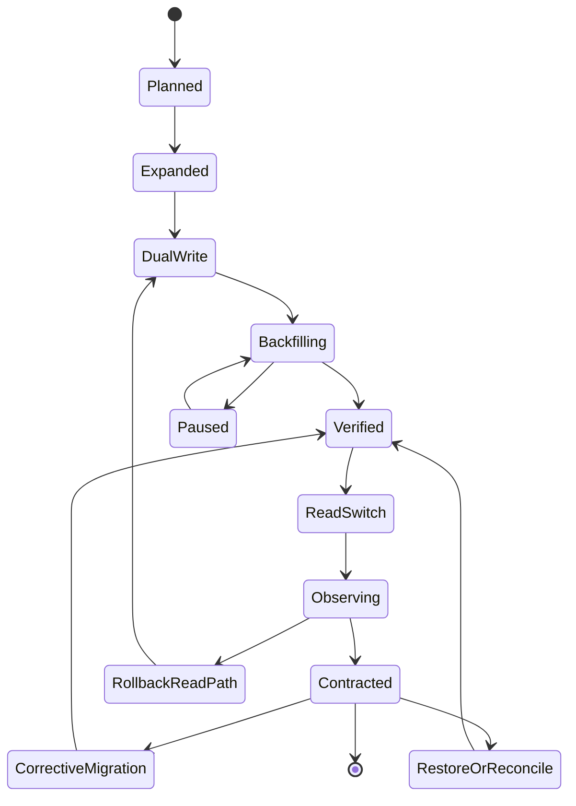

# Evaluating Rollback vs. Roll-Forward After Data Has Changed in PostgreSQL

After a schema change or data migration, the system may be in a significantly different state than when the rollout started. New applications may have written data in the new format, backfills may have executed partially, consumers may have processed events, and many transactions may have committed. When a bug surfaces, deciding between **rollback** and **roll-forward** must be grounded in actual data state, reversibility, impact on post-migration writes, and recovery time.

Rollback typically means returning the application, schema, or data to its pre-change state. Roll-forward means keeping the current state and deploying a new change to fix the defect or complete the transition. Either path can be right; picking the wrong one can discard valid writes, prolong downtime, or leave application versions incompatible with the schema.

This lesson belongs to the **Schema Migrations** chapter, focusing on:

- Distinguishing application rollback, schema rollback, data rollback, and backup restoration.
- Determining which changes remain inside an open transaction versus what has committed.
- Assessing the reversibility of data transformations after new data has been written.
- Identifying migration states: unrun, partially run, backfilled, reads switched, and contracted.
- Comparing rollback against roll-forward across data loss, compatibility, blast radius, RTO, and RPO.
- Using expand-contract, dual-write, shadow columns, and batched backfills to preserve rollback paths.
- Designing migrations with checkpoints, idempotency, and reconciliation.
- Choosing among corrective migrations, compensating actions, PITR, and backup restores.
- Handling external side effects outside the database such as messages, payments, emails, and cache invalidation.
- Building decision records, recovery runbooks, and hands-on exercises.

> **Principle:** a committed migration cannot be "undone" merely by issuing a transaction rollback. Once data has changed and live traffic continues writing, determine exactly which data remains preserved, which information was lost, and what writes occurred after the change. Without a reliable inverse transformation, a forward corrective migration is usually safer than an assumed down migration.

## 1. Four Concepts Commonly Lumped Together as "Rollback"

During an incident, the word "rollback" gets applied to very different actions. Before deciding, name the exact operation you intend to run.

### 1.1. Application rollback

Reverting the application binary, container, or configuration to the prior release. The database may retain the new schema.

Example:

- The new release starts reading a new column.
- The new release has a bug.
- Re-deploy the previous release.
- The new schema remains intact so the previous release keeps running.

Application rollback is safe only if the older release is compatible with the current schema and will not encounter data it cannot parse.

### 1.2. Schema rollback

Running DDL to restore the previous schema shape: dropping a new column, renaming a column back, dropping a constraint, or restoring an old definition.

Schema rollback does not automatically restore transformed or deleted data. If an old column was dropped, renaming the new column back to the old name cannot reconstruct lost values.

### 1.3. Data rollback

Applying an inverse transformation to return values to their prior state. This is reliable only when original data was preserved or the transformation is strictly reversible and no new writes broke the one-to-one mapping.

For example, converting text to lowercase cannot accurately restore original capitalization unless the source value was saved.

### 1.4. Restore or point-in-time recovery

Restoring the database from backups and WAL to a timestamp prior to the incident. This is database/cluster-level recovery and discards all valid transactions committed after the recovery target.

PITR is not a single-table rollback operation. Often you restore to a separate instance and extract/reconcile needed data if valid post-target writes must be preserved.

### 1.5. Compensating actions

Some actions cannot be undone directly. The system issues a compensating business action to correct the outcome:

- Recording a refund transaction instead of deleting a captured payment.
- Emitting a correction event instead of recalling an event already processed by consumers.
- Creating an adjustment entry instead of mutating ledger history.
- Marking an order canceled instead of deleting an order already received by downstream systems.

Compensation corrects business state via a new action with its own audit trail.

## 2. Migration State Dictates the Recovery Path

Never choose rollback or roll-forward based solely on a migration's name or whether the migration tool marked it successful. Inspect the database, application releases, and data pipelines.

### 2.1. Common stages

| Stage | Database state | Rollback feasibility |
| --- | --- | --- |
| DDL not yet run | Old schema | Usually just halt deployment |
| DDL ran inside uncommitted transaction | Changes still inside transaction | Can `ROLLBACK` if operations are transactional |
| Expand committed | New schema, old data intact | Usually easy to keep schema and roll back app |
| Dual-write active | Both old and new written | Can roll back while representations remain synced |
| Backfill in progress | Partial rows converted | Requires checkpoints/reconciliation; never assume all or zero rows changed |
| Backfill complete | New data populated | Can switch back to old if old source remains preserved |
| Reads switched | App reads new format | Must assess data compatibility and new writes |
| Contract executed | Old column/table dropped | Direct rollback may no longer be viable |
| External consumers received data | Side effects occurred outside DB | Requires compensation or coordinated recovery |

### 2.2. The migration ledger is only one piece of evidence

Migration frameworks typically record migration versions and statuses. The ledger may not capture:

- DDL that committed before the client lost connection prior to updating the ledger.
- Non-transactional scripts that partially completed.
- Backfills run by separate workers.
- Manual hotfixes outside the migration tool.
- Batches that committed before checkpoints persisted.
- Migrations run on the primary while logical subscribers remain un-updated.

When state is unclear, inspect the migration ledger, catalogs, data invariants, running application versions, and worker checkpoints together.

### 2.3. Never retry blindly when commit outcome is uncertain

If the client times out after sending `COMMIT`, the server may have committed while the response was lost. Before re-running:

1. Check the migration ledger.
2. Check schema/catalog state.
3. Check mutated data.
4. Determine whether statements are idempotent.
5. Retry only after state is confirmed.

Repeating a non-idempotent `UPDATE` or counter increment can corrupt data further.

## 3. Transaction Rollbacks and Their Limits

PostgreSQL supports transactional DDL for many schema commands. If an error occurs before `COMMIT` and all operations share one transaction, `ROLLBACK` reverts transactional changes to their prior state.

### 3.1. Example: DDL and DML in the same transaction

```sql
BEGIN;

ALTER TABLE app.orders
    ADD COLUMN source_code text;

UPDATE app.orders
SET source_code = 'legacy'
WHERE source_code IS NULL;

-- Verify results before committing.
SELECT count(*)
FROM app.orders
WHERE source_code IS NULL;

ROLLBACK;
```

In this lab example, if the transaction rolls back, both `ALTER TABLE` and the transactional `UPDATE` are undone. In production, that transaction holds locks throughout and rolling back massive WAL/data work takes time.

### 3.2. After COMMIT, ROLLBACK no longer applies

Once `COMMIT` succeeds, the transaction ends. Calling `ROLLBACK` in a subsequent session cannot undo the prior transaction.

Remediation requires:

- Running a new transaction with corrective SQL.
- Applying a new migration.
- Executing a compensating business action.
- Restoring from backup/PITR if corruption scope and recovery objectives demand it.

### 3.3. Transactional DDL does not mean all DDL is transactional

Certain commands cannot run inside a transaction block, such as:

- `CREATE INDEX CONCURRENTLY`.
- `DROP INDEX CONCURRENTLY`.
- `VACUUM`.
- `CREATE DATABASE`.
- Some forms of `REINDEX CONCURRENTLY`.

The exact list depends on the command and PostgreSQL version. Migration frameworks must support non-transactional migrations and handle partial states when commands are interrupted.

### 3.4. Rolling back a long transaction has a cost

A transaction that updated millions of rows generates substantial WAL. If rolled back:

- The database must process transaction abort and visibility cleanup.
- Locks remain held while running and release only upon completion.
- Already-generated WAL does not vanish immediately.
- Physical replicas still replay the WAL per streaming replication mechanics.
- Vacuum/cleanup needs time to reclaim dead row versions.

Do not rely on one massive transaction as your default recovery mechanism for large backfills.

### 3.5. Savepoints are not a recovery strategy for committed releases

`SAVEPOINT` rolls back partial work within an uncommitted transaction. It does not restore data committed in prior transactions and does not replace durable checkpoints for batch jobs.

## 4. Is the Data Transformation Reversible?

A transformation is reversible only if exact input values can be reconstructed from output data and preserved metadata.

### 4.1. Reversible transformations

Examples include converting a string to an equivalent lossless representation/encoding, or adding a new column while retaining the original column.

Even when mathematically reversible, verify:

- Were any rows truncated?
- Was rounding or normalization applied?
- Were `NULL` values replaced with defaults?
- Were collation or timezone assumptions baked in?
- Did concurrent writes occur during conversion?
- Did application code already write values in the new format?

### 4.2. Lossy transformations

Operations that commonly lose information:

- Converting high-scale `numeric` to integer or lower scale via rounding.
- Lowercasing, trimming, or normalizing text without keeping the source.
- Collapsing multiple enum/status values into a single shared value.
- Truncating strings to a maximum length.
- Converting timezone-local timestamps without keeping the original timezone.
- Hashing or encrypting without retaining keys or original values.
- Dropping rows or columns.
- Merging multiple records into one record.
- Deduplicating by discarding duplicate rows.
- Aggregating detail rows into summaries.

Exact original values cannot be reconstructed solely from lossy outputs.

### 4.3. Example of irreversible rounding

Suppose an amount had four decimal places:

```sql
SELECT round(12.3456::numeric, 2);
-- 12.35
```

From `12.35` alone, you cannot tell whether the original was `12.3456`, `12.346`, `12.35`, or another value rounding to `12.35`.

If rollback is required, keep original values or a transformation ledger.

### 4.4. NULLs and defaults can erase initial state

Example:

```sql
UPDATE app.customers
SET region = 'unknown'
WHERE region IS NULL;
```

After `UPDATE`, you cannot distinguish rows that originally held `region = 'unknown'` from rows that were previously `NULL` without saved provenance. Rolling back by resetting all `'unknown'` rows to `NULL` would corrupt originally valid `'unknown'` data.

### 4.5. Record source and transformation versions

When transformations may need reversal, store:

- Original value or source table.
- New value.
- Transformation version.
- Timestamp and migration/job ID.
- Row primary key.
- Batch/checkpoint ID.
- Reason or mapping rule.

Not every column requires retaining two versions forever; design retention around realistic rollback windows and data policies.

## 5. New Data Written After the Migration

A decisive factor is that writes continue arriving after the schema or data changed.

### 5.1. Rollback can overwrite valid writes

Suppose the new release wrote new statuses into column `v2`. Rolling back the schema by restoring the old column from an older snapshot discards all changes made after that snapshot.

Before rolling back, determine:

- How many writes occurred since the migration?
- Have those writes committed?
- Can they be converted back to the old representation?
- Was any data created exclusively in the new schema?
- Have events or consumers already processed those writes?

### 5.2. Dual-write keeps two representations synchronized

During the expand phase, the application can write both old and new columns in the same transaction:

```sql
BEGIN;

UPDATE app.orders
SET
    status = 'approved',
    status_v2 = 'approved'
WHERE id = 1001;

COMMIT;
```

If the new release has a bug, reads can revert to the old column while the old column remains accurately maintained.

Dual-write requires updating *all* writers: web services, background workers, admin scripts, ETL, triggers, and integrations. Missing a single writer causes the two columns to diverge.

### 5.3. Never dual-write via two separate requests

If old and new representations update in two separate transactions, one write can succeed while the other fails. Keep both writes in the same transaction or use an outbox/reconciliation mechanism.

### 5.4. Triggers can help, with trade-offs

Database triggers can synchronize old/new columns across multiple clients. However:

- Triggers hide write behavior outside application code.
- Triggers can affect bulk loads and replication semantics.
- Rollout ordering between triggers and application code must be clear.
- Triggers can cause recursion or double transformations if poorly designed.
- Trigger errors and latency must be monitored.

Never deploy an ad-hoc synchronization trigger mid-incident without mapping all write paths.

## 6. Partially Executed Backfills

Batched backfills avoid massive single transactions. When failures hit, data ends up in a mixed state.

### 6.1. Why do partial backfills need checkpoints?

Suppose a worker processes 10,000 rows per batch. After batch 12, the worker crashes. Possible states:

- Batch 12 committed, yet the checkpoint did not persist.
- Checkpoint persisted, yet the data transaction did not commit if stored separately.
- Certain rows were skipped due to concurrent locks.
- Application writers inserted new rows while the backfill ran.

Therefore, checkpoints need clear semantics and jobs must be safely re-runnable.

### 6.2. Idempotent batches

An idempotent batch can re-run without corrupting results:

```sql
UPDATE app.customers
SET normalized_email = lower(trim(email))
WHERE id >= 10001
  AND id < 20001
  AND normalized_email IS NULL;
```

The `IS NULL` predicate skips already-converted rows, provided `NULL` is not a valid distinct target value. If `NULL` is valid, use a dedicated status column or migration marker.

### 6.3. Upserts and version checks

When multiple workers or application writers update the same row, add version guards:

```sql
UPDATE app.customers
SET
    normalized_email = lower(trim(email)),
    normalization_version = 2
WHERE id = 1001
  AND normalization_version < 2;
```

Ensure the version marker genuinely reflects complete transformation state. Updating a marker before data transformation finishes can cause workers to skip uncorrected rows.

### 6.4. Keyset batching instead of large OFFSETs

Use a primary key or stable cursor:

```sql
SELECT id
FROM app.customers
WHERE id > 500000
ORDER BY id
LIMIT 2000;
```

Large `OFFSET`s walk through increasingly many rows and degrade steadily. Keyset pagination is straightforward to checkpoint and maintains stable performance with an appropriate key.

### 6.5. Commit checkpoints with batches when possible

If checkpoints live in the same database, update the checkpoint in the same transaction as the data batch:

```sql
BEGIN;

WITH batch AS (
    SELECT id
    FROM app.customers
    WHERE id > 500000
      AND id <= 502000
    ORDER BY id
    FOR UPDATE
)
UPDATE app.customers AS c
SET normalized_email = lower(trim(c.email))
FROM batch
WHERE c.id = batch.id;

UPDATE ops.migration_checkpoint
SET last_id = 502000,
    updated_at = clock_timestamp()
WHERE migration_name = 'normalize_customer_email';

COMMIT;
```

This example assumes the range was fully selected and the checkpoint row already exists. With multiple workers, partition checkpoints by worker/range or use proper queue semantics.

### 6.6. Reconciliation after partial failures

After a worker stops:

1. Identify the last committed checkpoint.
2. Count rows by migration marker.
3. Find rows having source data but missing target values.
4. Find target values mismatching source per transformation rules.
5. Check concurrent writes.
6. Re-run idempotent batches or corrective batches.
7. Mark complete only once invariants pass.

Never infer completion solely from logged batch counts.

## 7. Comparing Rollback and Roll-Forward

| Criterion | Rollback | Roll-forward |
| --- | --- | --- |
| Goal | Return to prior behavior/state | Fix current state with a new change |
| Best suited when | Inverse is reliable and old version is compatible | Data changed or inverse is unsafe |
| Data loss risk | May lose writes after rollback point | Usually preserves current writes, though repair is needed |
| Schema | May require reverse DDL | Usually keeps schema and adds a corrective migration |
| Complexity | Can be high post-contraction | Can be high if reconciling multiple states |
| Downtime | May require stopping traffic / restoring | Often deployable online in phases |
| Auditability | Depends on rollback script | Forward fix creates a new migration/event |
| External side effects | Not automatically undone | Usually requires compensation |
| RTO/RPO | Restore can be slow and lose writes | Often faster for localized bugs |
| Primary risk | Deleting new data or irreversible state | Accumulating migrations and complexity |

Neither choice is universally right. Decide based on evidence and blast radius.

## 8. When Should You Roll Back?

Rollback is typically suitable when these conditions hold:

- The faulty change has a clear, contained scope.
- The old application version remains compatible with current schema and data.
- Source values remain available for recovery.
- The inverse migration has been tested on similar data shapes.
- No new writes exist solely in the new format, or they convert cleanly back.
- Rolling back will not break external consumers that already received data.
- Rollback duration fits recovery objectives.
- Rollback carries a smaller blast radius than a corrective migration.

### 8.1. Example: application rollback

The schema expanded with a new column, the old column remains, and dual-write is active. The new release has a bug in the read path.

Re-deploy the previous application release, keep the expanded schema, and continue dual-writing both columns until the new release is fixed.

### 8.2. Example: data rollback with preserved source

A transformation populated a new target column from an existing source column. The source was neither modified nor dropped. If the target computation was wrong, clear/fix the target and re-run the corrected transformation.

### 8.3. Rollback when a migration has not committed

If DDL/DML remains inside an open transaction with no non-transactional side effects, `ROLLBACK` is simplest. Verify the session/transaction still exists and has not committed.

## 9. When Should You Roll Forward?

Roll-forward is typically suitable when:

- The migration committed and new data has already been written.
- The transformation was lossy.
- The old application cannot read the current format.
- Rolling back would discard valid post-migration writes.
- Multiple external systems already received side effects.
- The schema has contracted or old columns were dropped.
- A corrective change can fix data in place safely.
- Restoring the full database would cause greater data loss or downtime.

### 9.1. Corrective migrations

A new migration fixing faulty logic:

```sql
UPDATE app.orders
SET status = 'pending'
WHERE status = 'pendng'
  AND created_at >= timestamp '2026-11-01';
```

This is illustrative. The `WHERE` predicate must isolate the exact affected row set; verify the source of truth and avoid altering valid rows sharing the same value.

### 9.2. Roll-forward via mapping tables

If a transformation collapsed multiple values into one shared value, use audit/mapping data or business sources to determine how each row should be restored. Without a mapping, exact restoration may be impossible.

### 9.3. Corrective migrations must be new migrations

Never edit an already-run migration file on some environments and re-run the same version. Keep migration history immutable; create a new migration describing the correction. Editing old migrations causes environments to interpret the same version differently.

### 9.4. Never hide errors with migration markers

Never reset a ledger entry to "not applied" to force re-execution once DDL/data committed. Reconcile actual state first, then author an appropriate forward migration.

## 10. Decision Matrix by Deployment State

| Situation | Typically appropriate direction | What to verify |
| --- | --- | --- |
| Uncommitted transactional DDL | `ROLLBACK` transaction | No external side effects; locks released |
| Expand committed, no new writes yet | Roll back app or keep schema open | Old code compatible with expanded schema |
| Dual-write running, source still synced | Can roll back app/read path | All writers maintain old representation |
| Partial backfill | Pause worker, reconcile, then resume or revert batch | Checkpoints, idempotency, source preservation |
| Backfill complete, old source intact | Can switch reads back to old or fix target | Whether source remained accurate after new writes |
| Backfill complete, source deleted | Usually roll-forward or restore | Backups/PITR, external copies |
| Lossy transformation | Roll-forward/compensation or restore | Whether original values or audit mappings exist |
| Old column contracted | Forward migration or restore/reconcile | Which consumers still depend on it |
| External events/payments emitted | Compensation and roll-forward | Idempotency, downstream state |
| Widespread corruption, no inverse | Evaluate PITR/restore | RPO/RTO and writes after target timestamp |

This is a decision guide, not an automated script. Every production incident needs a decision record capturing facts, assumptions, and accountable owners.

## 11. Expand-Contract Preserves Rollback Paths

Expand-contract is a multi-release schema evolution strategy allowing old and new application versions to run simultaneously for a transition window.

### 11.1. Expand

Add new structures while old code keeps working:

```sql
ALTER TABLE app.customers
    ADD COLUMN display_name_v2 text;
```

Retain old columns and old constraints during transition.

### 11.2. Deploy compatibility code

The new application:

- Can read either the old or new column via feature flag.
- Writes both representations in sync.
- Emits drift-detection metrics.
- Does not require immediate removal of the old column.

### 11.3. Backfill

Backfill old data into the target using batches, checkpoints, and safe retries. Do not run a massive `UPDATE` if table size/traffic makes transaction, WAL, and vacuum impact excessive.

### 11.4. Verify and switch

Check row counts, null counts, mismatches, and application behavior. Once the target is verified trustworthy, switch reads to the new column.

### 11.5. Observe

Keep the old column and compatibility path across an observation period spanning business cycles. During this window, application reads can roll back without reconstructing old data.

### 11.6. Contract

Drop the old column only after:

- Old application releases are completely gone.
- Old writers are eliminated.
- Downstream consumers have migrated.
- Data consistency is confirmed.
- The rollback window has closed.
- Recovery plans are approved.

Contraction is where rollback costs rise sharply. Treat it as a distinct decision gate.

## 12. Example: Migrating Order Status to a New Representation

Suppose `status` is currently `text` and we want to standardize statuses to new values.

### 12.1. Expand

```sql
ALTER TABLE app.orders
    ADD COLUMN status_v2 text;
```

Do not drop the old `status`.

### 12.2. Explicit mapping

Create a versioned mapping:

```sql
CREATE TABLE ops.order_status_mapping (
    old_status text PRIMARY KEY,
    new_status text NOT NULL,
    mapping_version integer NOT NULL
);

INSERT INTO ops.order_status_mapping
    (old_status, new_status, mapping_version)
VALUES
    ('awaiting_payment', 'pending', 1),
    ('paid', 'confirmed', 1),
    ('shipped', 'fulfilled', 1);
```

The mapping must cover all existing statuses and explicitly flag unknown values. Never assign a default to unknown states without an approved business rule.

### 12.3. Dual-write

The application writes both old and new values in one transaction. If not all writers can deploy simultaneously, use a compatibility layer or tested trigger.

### 12.4. Backfill

```sql
UPDATE app.orders AS o
SET status_v2 = m.new_status
FROM ops.order_status_mapping AS m
WHERE o.status = m.old_status
  AND o.status_v2 IS NULL;
```

On large tables, add primary-key ranges or `SKIP LOCKED` batching. Count unmapped rows:

```sql
SELECT status, count(*)
FROM app.orders
WHERE status_v2 IS NULL
GROUP BY status
ORDER BY count(*) DESC;
```

### 12.5. Consistency check

```sql
SELECT count(*) AS mismatches
FROM app.orders AS o
JOIN ops.order_status_mapping AS m
  ON m.old_status = o.status
WHERE o.status_v2 IS DISTINCT FROM m.new_status;
```

If new statuses appear outside the mapping, handle them explicitly rather than treating a zero mismatch count on the inner join as complete proof.

### 12.6. Rollback before contract

If the new read path fails, switch reads back to the old `status`. Because the old column remained dual-written, new data is still readable in the old representation.

### 12.7. Roll-forward after contract

Once the old column is dropped, discovering a bad mapping requires a corrective mapping/migration or restoring data from audit/backups. You cannot simply rename `status_v2` back to `status` to restore old values if the mapping collapsed multiple states.

## 13. Designing Honest Down Migrations

Many migration frameworks support up/down migrations. A down migration is safe only if it genuinely restores the prior state.

### 13.1. Reversible DDL

For example, a nullable `ADD COLUMN` can have a `DROP COLUMN` down migration provided the column has received no critical data and has no consumers or dependencies.

### 13.2. Irreversible data migrations

Example:

```sql
UPDATE app.users
SET display_name = lower(display_name);
```

A down migration cannot reconstruct original capitalization. Writing a speculative down migration misleads operators into believing rollback is safe when it is not.

### 13.3. Mark migrations irreversible

If your framework supports it, mark the migration irreversible or provide a down migration that intentionally fails with a clear error message. Document that recovery is roll-forward or restore.

### 13.4. Down migrations can lose new writes

Even if the initial transformation had an inverse, a down migration can break values created afterward. For instance, if a new enum value was added and rows already use it, older code will not understand it.

Verify domain values, constraints, and callers before reversing.

### 13.5. Immutable migration history

Never edit a migration already applied in any environment. Write a new migration to fix issues. If a change is needed to a migration not yet run anywhere, follow release policy and verify across all environments.

## 14. Safe Data Correction After Commit

When fixing bad rows, scope the cohort accurately and preserve evidence first.

### 14.1. Preview affected rows

Run a `SELECT` using the exact same predicate as the planned `UPDATE`:

```sql
SELECT
    id,
    status,
    updated_at
FROM app.orders
WHERE status = 'pendng'
  AND updated_at >= timestamp '2026-11-01'
ORDER BY id
LIMIT 100;
```

Count total matching rows and compare against expected population. Never run an `UPDATE` whose predicate was guessed from only a few sample rows.

### 14.2. Save before-images

For recoverable data, capture affected rows into an audit table:

```sql
CREATE TABLE ops.order_status_repair_backup AS
SELECT
    id,
    status AS old_status,
    updated_at AS old_updated_at,
    clock_timestamp() AS captured_at,
    'repair_2026_11_14'::text AS repair_id
FROM app.orders
WHERE status = 'pendng';
```

Add a primary key/unique constraint and retention policy if used in practice. Ensure consistent snapshot capture and restrict access if the table contains sensitive data.

### 14.3. Conditional update

```sql
UPDATE app.orders
SET status = 'pending'
WHERE status = 'pendng'
  AND updated_at >= timestamp '2026-11-01';
```

The predicate must tightly target the affected cohort and be verifiable. If writers can still emit the bad value, fix the writer first or concurrently to avoid recurrence.

### 14.4. Verify after update

```sql
SELECT status, count(*)
FROM app.orders
GROUP BY status
ORDER BY status;
```

Cross-check counts against expected business totals, event logs, and application metrics. A query returning zero bad rows does not prove downstream side effects were repaired.

### 14.5. Batch repairs

For large row counts:

- Use key ranges or bounded batches.
- Commit each batch.
- Record checkpoints.
- Support resumption after failures.
- Monitor WAL, replication lag, and autovacuum.
- Enforce stop conditions and maximum runtime.
- Keep predicates tight so valid concurrent changes are never overwritten.

## 15. When Is PITR or Backup Restoration Needed?

PITR is appropriate when the database suffered severe corruption or data loss, no reliable inverse exists, and corrective SQL cannot reconstruct valid state.

### 15.1. Selecting a recovery target

Pick a timestamp immediately prior to data corruption based on:

- Migration timestamps.
- Transaction commit times if logged.
- Application deployment timelines.
- Audit/event records.
- WAL/archive availability.
- Clock synchronization and timezones.

Never pick a target time based solely on when users reported errors if corruption started earlier.

### 15.2. RPO

Recovery Point Objective (RPO) is the tolerable amount of data loss. Restoring to a point before the error omits transactions committed after the target time from the restored database.

If the database continued accepting valid writes after the error, plan how to extract, replay, or reconcile those writes.

### 15.3. RTO

Recovery Time Objective (RTO) is the tolerable system downtime. PITR takes time to provision, replay WAL, validate, and shift traffic.

Measure restore durations on comparable systems before choosing a restore during an incident.

### 15.4. PITR normally restores the whole database/cluster

PITR restores an entire PostgreSQL instance/cluster to a chosen timestamp. You cannot simply "roll back one table" while assuming all other tables stay untouched.

A typical safe procedure:

1. Restore to an isolated instance.
2. Verify the restored state.
3. Extract rows/objects needing recovery.
4. Compare against current production.
5. Reconcile valid transactions committed after the target time.
6. Cut over or replace the instance only after explicit sign-off.

### 15.5. Backups must be restore-tested

Having backup files does not guarantee restoring within RTO. Verify:

- Base backup integrity.
- WAL archive continuity.
- Encryption keys and credentials.
- Tablespaces and extensions.
- PostgreSQL major version compatibility.
- Restore permissions and infrastructure capacity.
- Application connection/routing cutover.
- Periodic restore drills.

## 16. Partial Data Recovery from a Restored Instance

If only one table or a subset of rows is corrupted, restore to a secondary instance and extract needed data rather than replacing all of production.

### 16.1. Benefits

- Preserves valid transactions committed after the recovery target.
- Enables before/after comparison by primary key.
- Allows selective restoration of specific rows or columns.
- Shrinks blast radius compared to full cutover.

### 16.2. Risks

- Foreign keys and dependencies complicate imports.
- Rows validly updated after the target could be overwritten.
- Sequences may need resynchronization.
- Large objects, partitions, triggers, and generated columns require careful handling.
- Cross-table relationships require consistent snapshots and reconciliation.
- External side effects are not restored by database backups.

### 16.3. Reconciling by business keys

Never overwrite an entire table if production kept accepting writes. Compare by stable primary/business keys and classify each row:

- Did not exist prior to the error.
- Existed and remained unaffected.
- Corrupted by the migration.
- Validly updated after the migration.
- Conflicting between restored and current versions.

Use the authoritative source of truth plus versions, timestamps, and audit records to choose the right state.

### 16.4. Sequences and identity

When importing rows from a restored instance, current sequence values may lag behind the maximum primary key. Inspect sequence ownership and call `setval` carefully once writes are quiesced or coordinated with locking.

## 17. Side Effects Outside PostgreSQL

A database rollback does not automatically revert distributed systems.

### 17.1. Message queues

A transaction may write a row and publish a message. If the broker accepted the message and consumers processed it, rolling back the row does not recall that side effect.

Use transactional outbox/inbox patterns, idempotency keys, and compensating events to manage state.

### 17.2. Payments and financial operations

Never delete a payment capture to "roll back." Issue refunds, voids, or adjustments per the payment provider's API and ledger rules. Store provider transaction IDs and ensure compensations are idempotent.

### 17.3. Emails, notifications, and webhooks

Sent emails cannot be unsent. Send correction notices or suppress future sends. Webhook consumers may have persisted state; emit correction events or follow a replay protocol.

### 17.4. Caches and search indexes

Schema/data rollbacks can leave caches or search indexes stale. Plan invalidation or rebuild strategies. A full cache flush risks a cache stampede; index rebuilds may need throttling.

### 17.5. Object storage and files

Database rows may reference object storage. Restoring the DB does not restore overwritten or deleted files. Maintain versioning, retention, and separate restore plans for external storage.

### 17.6. Audit trails

Never erase history to make it look as though an incident never happened. Record compensations and corrections with timestamps, actors, reasons, and references to the incident/migration.

## 18. Logical Replication and Multiple Database Consumers

Schema migrations can impact publishers, subscribers, CDC pipelines, and downstream warehouses.

### 18.1. Logical replication does not automatically replicate DDL

Schema changes must be deployed separately on publishers and subscribers in compatible order. If a publisher begins streaming a new column before the subscriber is ready, the apply worker can error.

### 18.2. Rolling back a schema can break new consumers

If subscribers or CDC consumers already updated to require a new field, reverting the publisher to the old schema can break downstream pipelines.

### 18.3. Coordinated roll-forward

Retain both old and new fields during transition, update subscribers, monitor replication lag, and contract only once all consumers have moved.

### 18.4. CDC event schemas

If an event schema changed and consumers committed offsets, rolling back the publisher does not make consumers forget already-processed events. Maintain schema registry compatibility and event versioning.

## 19. Data Versioning and Auditability

Recovery is far easier when you know who transformed a row, when, and under which rule.

### 19.1. Row versions

You can add a version column:

```sql
ALTER TABLE app.customers
    ADD COLUMN data_version integer NOT NULL DEFAULT 1;
```

When the application writes the new representation, increment the version in the same transaction. Backfills update only rows with the old version and write the new version.

### 19.2. Transformation ledgers

A ledger table can record:

```sql
CREATE TABLE ops.data_migration_ledger (
    migration_id text NOT NULL,
    entity_id bigint NOT NULL,
    source_version integer NOT NULL,
    target_version integer NOT NULL,
    processed_at timestamptz NOT NULL DEFAULT clock_timestamp(),
    batch_id bigint,
    PRIMARY KEY (migration_id, entity_id)
);
```

Ledgers track which rows were processed, though they do not store original values themselves. If inversion is required, store source data or ensure it can be reconstructed.

### 19.3. Audit tables

Audit tables can save before/after values or JSON snapshots. Prefer explicit columns where practical; JSON snapshots are convenient, though they still require schema, storage, and privacy governance.

### 19.4. Retention

Keep before-images throughout the rollback window and per retention/compliance policies. Deleting audit data too early removes recovery options; keeping it too long increases privacy/security exposure.

### 19.5. Provenance

Tagging migration IDs, code releases, transformation versions, and batch IDs lets you trace exactly which rollout altered any given row.

## 20. Idempotency and Exactly-Once Assumptions

Distributed systems retry on timeouts and dropped connections. Migration and recovery scripts must tolerate retries.

### 20.1. Idempotent operations

An idempotent operation yields the same outcome whether run once or multiple times:

```sql
UPDATE app.orders
SET normalized_status = lower(status)
WHERE normalized_status IS DISTINCT FROM lower(status);
```

This statement is idempotent with respect to the current transformation, though it could overwrite a `normalized_status` edited manually by a user. Clarify ownership of the target column first.

### 20.2. Non-idempotent operations

Example:

```sql
UPDATE app.accounts
SET balance = balance + 100
WHERE id = 42;
```

Retrying the same statement adds 100 again. Use unique operation IDs, ledger rows, or transaction idempotency keys to prevent duplicate application.

### 20.3. At-least-once delivery

Workers and jobs can receive the same message multiple times. Make data migrations idempotent or persist a processed marker inside the same transaction as the data update.

### 20.4. Exactly-once does not emerge automatically from transactions

A PostgreSQL transaction guarantees atomicity inside the database. It does not guarantee end-to-end exactly-once semantics across databases, brokers, HTTP APIs, and external systems. Use outbox/inbox patterns and idempotent consumers.

## 21. Pausing Writes vs. Keeping Traffic Flowing During Recovery

This choice depends on the severity of divergence and whether consistency can be maintained.

### 21.1. When to pause writes

- The authoritative source of truth is unclear.
- Every new write complicates reconciliation.
- Risk of generating more corrupted data persists.
- A consistent snapshot is needed.
- Recovery requires a synchronized cutover.

You can pause a single endpoint/worker or switch one business domain to read-only rather than taking the whole database offline.

### 21.2. When traffic can continue

- The corrective migration has a tight, idempotent predicate.
- Old and new representations remain synchronized.
- Repairs can execute in batches.
- Conflict detection is active.
- Faulty writers have been fixed so the error cannot recur.

### 21.3. Controlled quiescing

If writes must stop:

1. Stop or pause producers.
2. Wait for in-flight transactions to finish or handle blockers with owners.
3. Stop background workers.
4. Confirm zero writes arrive via alternate paths.
5. Take a snapshot or backup if appropriate.
6. Execute recovery.
7. Verify invariants.
8. Resume producers in order.

Never assume halting web traffic stops all writes; cron jobs, admin scripts, and integrations may still be writing.

## 22. Risks of Large Corrective UPDATEs

Rolling forward is not automatically low-risk. A large data repair can create impact comparable to the initial migration.

### 22.1. WAL and replication

Updating many rows generates new row versions and WAL. Monitor replication lag, WAL archiving, and retained slots.

### 22.2. Dead tuples and vacuum

Old row versions become dead tuples once no longer visible to active transactions. Autovacuum needs time and I/O to reclaim reusable space. Never assume an `UPDATE` reduces disk usage.

### 22.3. Locks and contention

`UPDATE` acquires row locks. Oversized batches hold locks longer, trigger deadlocks, or block application writes touching the same rows.

### 22.4. Batch size

Start with small batches in staging, measuring:

- Rows/second.
- Transaction duration.
- WAL bytes.
- Replica lag.
- Lock waits.
- CPU and I/O.
- Application latency.

Adjust batch sizes and pause intervals to stay within resource budgets.

### 22.5. Abort thresholds

Define stop triggers upfront: free disk below reserve, replica lag past budget, API latency/error rate breaching SLO, rising lock waits, or anomalous batch runtimes.

## 23. Migration State Machines

A state machine tells workers and operators the next step after restarts or failures.



Record state transitions with migration IDs and timestamps. The state machine is an operational record; database invariants remain the ultimate proof of data state.

### 23.1. Planned

Preflight complete, production untouched. Rollback and roll-forward plans exist.

### 23.2. Expanded

The new schema exists while applications remain compatible with the old schema.

### 23.3. DualWrite

Writers keep old and new representations synchronized.

### 23.4. Backfilling

Workers convert historical data in batches with checkpoints and metrics.

### 23.5. Verified

Data invariants pass; the target is eligible for switching reads.

### 23.6. ReadSwitch and Observing

Applications read the new representation. The old representation remains maintained throughout the rollback window.

### 23.7. Contracted

Old columns/objects have been dropped. Direct rollback paths are likely closed; forward repair or restore is the primary option.

## 24. Incident Decision Records

Every rollback/roll-forward decision needs documented facts and rationale so subsequent responders understand the context.

### 24.1. Minimum contents

- Incident ID and detection timestamp.
- Migration ID and application release.
- Database/cluster and affected objects.
- Actual schema state.
- Data transformation progress and checkpoints.
- Count of affected rows and how it was determined.
- Post-migration writes that occurred.
- External side effects already emitted.
- Backup/PITR availability and recovery point.
- Rollback option and data-loss estimate.
- Roll-forward option and estimated repair time.
- RPO, RTO, and SLO impact.
- Decision maker and executor.
- Verification criteria and rollback/abort thresholds.

### 24.2. State assumptions explicitly

Examples:

- "All API writers have dual-written since release 2026.11.14.2."
- "The nightly ETL job still uses the old column."
- "The backfill checkpoint committed through ID 500000."
- "No source copy exists for rows past ID 500000."
- "The logical subscriber already received schema version 2."

Assumptions must be verified, never treated as facts merely because they appear in a runbook.

## 25. Recovery Runbook: From Detection to Decision

**Step 1 — Contain.** Stop the rollout or pause the failing job. If needed, disable feature flags or restrict writes to the affected domain.

**Step 2 — Establish state.** Record release, migration ledger, schema state, transaction state, backfill checkpoints, and replication status.

**Step 3 — Preserve evidence.** Capture snapshots, exports, or audit data before altering state. Save timestamps and query predicates.

**Step 4 — Quantify impact.** Count affected rows, new writes, failed requests, and external side effects. Determine whether data loss occurred or only incorrect behavior.

**Step 5 — Evaluate reversibility.** Check whether source values remain intact, whether an exact inverse exists, and whether new writers produced differing formats.

**Step 6 — Compare options.** Estimate rollback, corrective migration, and PITR across RPO/RTO, downtime, blast radius, and validation effort.

**Step 7 — Choose and record.** Write the decision record, owner, and abort conditions. Communicate clearly which data is preserved or lost.

**Step 8 — Execute in controlled scope.** Pause affected writers if needed; run short transactions or batches; never run unbounded DDL or data repairs.

**Step 9 — Verify invariants.** Check row counts, checksums/aggregates, foreign keys, application behavior, downstream consumers, and replication.

**Step 10 — Resume safely.** Re-enable producers/workers sequentially, monitor errors/latency, and maintain a recovery window.

**Step 11 — Close the loop.** Update migration history, audit trails, documentation, and preventive actions.

## 26. Post-Rollback or Post-Roll-Forward Verification

An SQL statement succeeding does not prove recovery is complete.

### 26.1. Schema invariants

- Column names, types, defaults, and nullability match expectations.
- Constraints are validated and enabled.
- Indexes are valid and ready.
- Views, functions, and triggers are compatible.
- Partition hierarchy is intact.
- Migration ledger accurately reflects actual state.

### 26.2. Data invariants

- Zero rows violate business rules.
- Source and target representations match per mapping.
- Row counts fall within expected ranges.
- Referential integrity holds.
- No unexpected `NULL`s or duplicates exist.
- Sequence values exceed current generated IDs where needed.
- Audits/ledgers record all repair operations.

### 26.3. Application invariants

- Old and new application releases are compatible.
- Error rates and latency return to baseline.
- Background jobs run normally.
- No connection pool saturation or retry storms occur.
- Feature flags are properly configured.
- Caches and search indexes are synchronized.

### 26.4. Downstream invariants

- Replication apply is healthy.
- CDC consumers handle the schema version cleanly.
- Warehouse and reporting jobs succeed.
- Message consumers neither duplicate nor skip events.
- External systems received required compensations/corrections.

### 26.5. Never rely solely on row counts

Two datasets can share identical row counts while containing different values. Combine aggregates, key-range checksums, targeted comparisons, and business reconciliation.

## 27. Anti-Patterns to Avoid

| Anti-pattern | Risk | Better approach |
| --- | --- | --- |
| Running down migration immediately on incident | May discard new writes or fail to invert data | Inspect actual state and reversibility first |
| Editing an already-run migration | Same version behaves differently across environments | Create a new corrective migration |
| Resetting migration ledger to re-run | Masks true state, duplicates DDL | Reconcile catalogs/data then forward-fix |
| Immediately restoring production | Discards all transactions after target time | Restore separately, diff, and reconcile first |
| Full-table `UPDATE` in one transaction | Huge WAL, locks, and replica lag | Batch, checkpoint, and bound runtime |
| Using defaults to replace all `NULL`s | Loses distinction between missing and real default | Preserve provenance or mapping |
| Dropping old column right after switch | Closes rollback path | Retain through observation window |
| Dual-writing across two separate transactions | One representation updates while the other fails | Same transaction or outbox/reconciliation |
| Retrying non-idempotent scripts | Double application | Operation IDs, ledgers, and idempotent predicates |
| Checking only migration version | Ledger can drift from actual state | Verify catalogs and data invariants |
| Assuming DB rollback undoes external effects | Payments/messages/emails persist | Issue compensating actions |
| Assuming backup files alone suffice | Backup may fail to restore within RTO | Run restore drills and PITR tests |
| Leaving faulty writers running | Corrective repairs keep getting corrupted again | Fix writers or contain first |
| Comparing only row counts | Misses value corruption | Use checksums, predicates, and business reconciliation |

## 28. Designing Migrations for Easier Recovery

The best recovery begins in migration design.

### 28.1. Separate schema and data phases

Never lump expand, backfill, read switch, and contract into a single release when changes carry a large blast radius.

### 28.2. Preserve source values

Throughout the rollback window, retain the old column or enough before-images to reconstruct state. Define retention windows before deployment.

### 28.3. Version transformations

Give each transformation an explicit version. When mapping rules change, workers know which rows need reprocessing and avoid misapplying new logic to already-finished rows.

### 28.4. Idempotent scripts

Design for safe retries using predicates and migration markers. Never rely on "run-once scripts" in distributed job systems.

### 28.5. Consistent checkpoints

Checkpoints and data updates should commit in the same transaction when in the same database. Across separate systems, build reconciliation protocols for cases where one side commits and the other times out.

### 28.6. Observability

Minimum metrics:

- Rows processed/remaining.
- Batch duration and failures.
- Source-target mismatches.
- Dual-write drift.
- Writes per version.
- Migration state.
- WAL generation and replica lag.
- Application errors and latency.
- External consumer schema versions.

### 28.7. Recovery drills

Practice application rollbacks, corrective migrations, partial backfill resumption, and PITR on staging/restore environments. Record actual timings and faulty assumptions.

## 29. Example: Deciding When a Migration Mutated Data Incorrectly

Suppose a phone-number normalization migration stripped spaces and formatting characters. Post-deploy, a cohort of international numbers is found missing their leading `"+"`.

### 29.1. Contain

Stop the normalization worker and temporarily disable the code path writing the bad format. Keep unaffected traffic running.

### 29.2. Establish scope

Locate the migration ID, batch checkpoints, timestamps, and release version. Identify rows processed before and after the faulty cutoff.

### 29.3. Check original values

If the `old_phone` column was retained and dual-write stayed accurate, rebuild `normalized_phone` from `old_phone` using the corrected transformation.

If `old_phone` was overwritten without an audit/source copy, original data may be incomplete.

### 29.4. Compare options

- Application rollback: helpful only if the older release understands current data and writers stop corrupting formats.
- Data rollback: feasible only if original values remain intact.
- Roll-forward: write a corrected transformation using country metadata and source records.
- PITR: can restore original values up to a point in time, though valid subsequent writes must be reconciled.

### 29.5. Controlled repair

Build the exact affected-row set from migration IDs or provable predicates. Capture current before-images, execute corrections in batches, and verify format and business invariants.

### 29.6. Do not reverse by blindly prepending "+" to all numbers

A naive heuristic can corrupt domestic numbers, extensions, or numbers already prefixed. Use explicit country/source metadata and validation rules.

## 30. Practice Exercises

Perform these on an isolated PostgreSQL lab. Never run recovery drills, destructive DDL, or PITR on production for practice.

### Exercise 1 — Transactional DDL

Create a table, run `ALTER TABLE`, and run `UPDATE` inside one transaction, then `ROLLBACK`. Confirm schema and data return to their prior state.

### Exercise 2 — After COMMIT

Commit a change, open a new transaction, and attempt `ROLLBACK`. Explain why the prior transaction is not undone.

### Exercise 3 — Non-transactional commands

Test `CREATE INDEX CONCURRENTLY` inside a transaction block and outside a transaction. Note migration runner limitations.

### Exercise 4 — Migration ledger mismatch

Simulate DDL committing while the migration runner fails to update the ledger. Build a catalog verification procedure before retrying.

### Exercise 5 — Reversible transformations

Convert an integer to text preserving digits. Write the inverse and prove round-trip fidelity on a lab dataset.

### Exercise 6 — Lossy transformations

Lowercase a column and attempt to restore original values. Identify what information was lost and how to preserve source values pre-transformation.

### Exercise 7 — Rounding

Convert `numeric` scale 4 to scale 2. Create multiple inputs yielding identical rounded outputs and prove the inverse is non-unique.

### Exercise 8 — Null/default ambiguity

Replace `NULL` with a default value. Write a query showing you cannot distinguish original `NULL`s from rows that already held the default without a marker.

### Exercise 9 — Dual-write

Create old and new columns and update both in the same transaction. Run a mismatch query after multiple writes.

### Exercise 10 — Dual-write failures

Simulate a writer updating only the old column. Detect drift and design reconciliation.

### Exercise 11 — Partial backfills

Run a backfill across key ranges and halt midway. Resume from the checkpoint and confirm no rows were missed.

### Exercise 12 — Idempotency

Re-run a batch `UPDATE` multiple times. Identify why the current predicate is idempotent and what condition would make it unsafe.

### Exercise 13 — Non-idempotent increments

Write an `UPDATE` incrementing a counter. Simulate a timeout retry and design an operation ledger to prevent double application.

### Exercise 14 — Checkpoint atomicity

Persist batch data and checkpoints in the same transaction. Simulate failures before `COMMIT` and after `COMMIT`.

### Exercise 15 — Before-images

Create an audit table storing old/new values and migration ID. Write a query restoring a cohort of rows in the lab.

### Exercise 16 — Expand-contract

Add a new column, dual-write, backfill, switch reads, and retain the old column through a rollback window.

### Exercise 17 — Application rollback

Deploy a new app release reading column `v2`, then roll back the app while schema `v2` remains. Verify compatibility.

### Exercise 18 — Rollback after new writes

Write new data in format `v2`, then attempt reverting to `v1`. Identify values requiring mapping or compensation.

### Exercise 19 — Contract boundaries

Drop the old column in the lab. Attempt building a down migration and explain why old data does not reappear automatically.

### Exercise 20 — Corrective migrations

Create a set of corrupted rows matching a clear predicate. Preview, back up before-images, update, and verify.

### Exercise 21 — Batch repairs

Fix hundreds of thousands of rows in batches. Measure WAL, locks, replica lag, and transaction duration.

### Exercise 22 — PITR restore lab

Restore backup/WAL onto an isolated instance to a recovery target. Record restore duration and identify lost transactions.

### Exercise 23 — Partial data recovery

Compare a table on the restored instance against the current instance. Select a cohort of rows to recover by primary key.

### Exercise 24 — Sequence reconciliation

Import rows from the restored table into the lab current database. Identify and adjust sequences safely.

### Exercise 25 — External side effects

Simulate a database row and an outbox event. Have a consumer process the event, then roll back another database change; design a compensating event.

### Exercise 26 — Idempotent consumers

Deliver the same event twice. Use an inbox table or unique event ID to prevent applying the side effect twice.

### Exercise 27 — Logical replication compatibility

Alter schemas on publisher and subscriber across multiple phases. Simulate an unready subscriber and design rollout ordering.

### Exercise 28 — Migration state machine

Define state transitions and checkpoint records for expand, dual-write, backfill, verify, switch, and contract.

### Exercise 29 — Decision matrix

Create three scenarios: zero new writes, active dual-write, and old column already dropped. Select rollback, roll-forward, or PITR for each case.

### Exercise 30 — RPO/RTO

Set hypothetical RPO/RTO targets for a lab database. Compare corrective migration runtime against PITR restore time.

### Exercise 31 — Recovery decision records

Write an incident record containing facts, assumptions, options, data-loss estimates, owners, and verification criteria.

### Exercise 32 — Fault injection

Kill a worker after batch commit but before checkpoint update. Observe state and fix atomicity design.

### Exercise 33 — Fault injection after contract

Simulate a bug after the old column is dropped. Build a forward migration restoring behavior without assuming source values still exist.

### Exercise 34 — Recovery drills

Practice application rollback, forward correction, and restore-to-new-instance on staging. Measure actual RTO.

### Exercise 35 — Production runbook

Write a runbook for deciding rollback vs. roll-forward on a major data migration, covering containment, evidence, reversibility, RPO/RTO, execution, validation, and communication.

## 31. Summary

Key takeaways when **evaluating rollback vs. roll-forward after data has changed**:

1. Distinguish application rollback, schema rollback, data rollback, PITR, and compensating actions.
2. Transaction rollbacks only undo uncommitted work within that specific transaction.
3. Many PostgreSQL DDL commands are transactional, yet commands like `CREATE INDEX CONCURRENTLY` cannot run inside a transaction block.
4. After `COMMIT`, recovery requires a new migration/correction or restoring from backup.
5. Lossy transformations lack reliable inverses if original values were not preserved.
6. Post-migration writes can cause rollbacks to discard valid data.
7. Partial backfills require checkpoints, idempotency, and reconciliation.
8. Dual-write and expand-contract keep old and new representations compatible throughout the rollback window.
9. Contracting closes direct rollback paths and must be treated as a separate decision gate.
10. Down migrations must be honest about reversibility; never edit applied migrations to mask state.
11. PITR restores the database to a point in time, yet discards post-target transactions and does not undo external side effects.
12. Restoring separately and diffing/reconciling can preserve valid writes on live production.
13. Messages, payments, emails, and external APIs require compensating actions.
14. Corrective migrations must also control locks, WAL, batches, replication lag, and application SLOs.
15. Recovery is complete only when schema, data, application, and downstream invariants are all verified.

Sound decisions rest on current data state and how much original information remains recoverable. If the old representation stayed accurate and writers remained synced, rollback can be fast and low-risk. If data lost information, new writes arrived, or external systems already processed outcomes, roll-forward and compensation usually preserve far more valid data. PITR is the recovery option when corruption exceeds controlled repair capabilities and RPO/RTO permit it.

## 32. PostgreSQL and Recovery References

- [Transactions](https://www.postgresql.org/docs/current/tutorial-transactions.html)
- [Transaction Isolation](https://www.postgresql.org/docs/current/transaction-iso.html)
- [ALTER TABLE](https://www.postgresql.org/docs/current/sql-altertable.html)
- [CREATE INDEX](https://www.postgresql.org/docs/current/sql-createindex.html)
- [Explicit Locking](https://www.postgresql.org/docs/current/explicit-locking.html)
- [MVCC Caveats](https://www.postgresql.org/docs/current/mvcc-caveats.html)
- [Write-Ahead Logging](https://www.postgresql.org/docs/current/wal-intro.html)
- [Continuous Archiving and Point-in-Time Recovery](https://www.postgresql.org/docs/current/continuous-archiving.html)
- [Backup and Restore](https://www.postgresql.org/docs/current/backup.html)
- [pg_stat_activity](https://www.postgresql.org/docs/current/monitoring-stats.html#MONITORING-PG-STAT-ACTIVITY-VIEW)
- [Progress Reporting](https://www.postgresql.org/docs/current/progress-reporting.html)
- [Logical Replication](https://www.postgresql.org/docs/current/logical-replication.html)
- [Logical Replication Restrictions](https://www.postgresql.org/docs/current/logical-replication-restrictions.html)
- [pg_dump](https://www.postgresql.org/docs/current/app-pgdump.html)
- [pg_restore](https://www.postgresql.org/docs/current/app-pgrestore.html)

`current` links point to the latest PostgreSQL documentation. Transactional DDL, non-transactional commands, logical replication behavior, and backup/PITR procedures depend on PostgreSQL version, backup tooling, and topology. Before an incident strikes, verify your server version, WAL archive continuity, restore procedures, and actual environment recovery objectives.
