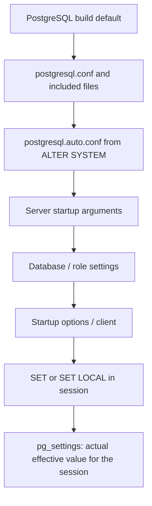
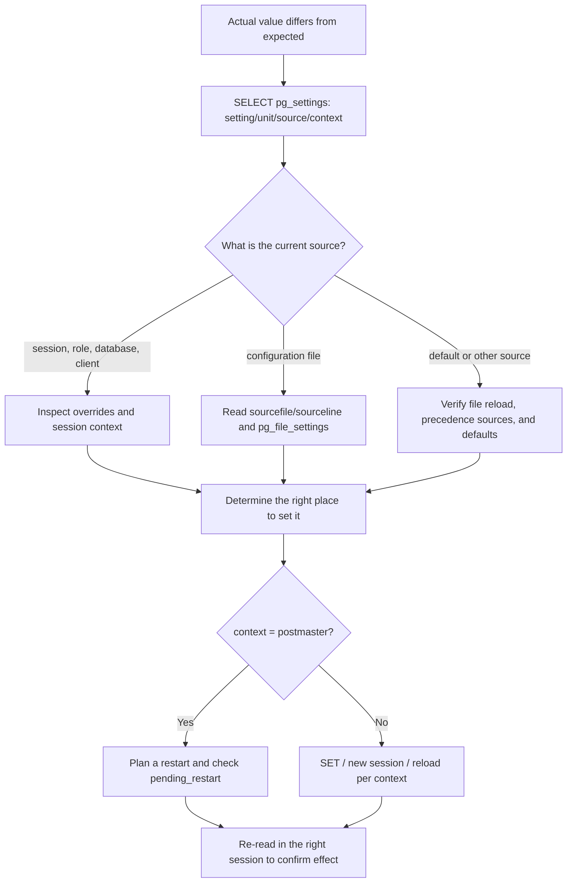

# Looking Up Values, Configuration Sources, and Units via pg_settings in PostgreSQL

A PostgreSQL server has hundreds of configuration parameters: connection limits, query memory, shared buffers, logging levels, timeouts, WAL mechanisms, and many other options. When a query is slow or a setting appears not to take effect, the question is not just **"what is the parameter set to?"**, but also:

- What value is the **current session** actually using?
- Does that value come from the **default, a configuration file, command line, database, role, or a `SET` command**?
- Is the number in the output expressed in **bytes, kB, 8 kB blocks, milliseconds**, or is it unitless?
- Can the parameter be changed **immediately in the session, after a reload, or only after a restart**?
- An administrator edited a file, yet the running value has not changed: **is it pending a restart**?

PostgreSQL provides the **`pg_settings`** system view to answer those questions. It is the central tool for inspecting the actual configuration rather than reading a single line in `postgresql.conf` and assuming the server is using it.

This lesson belongs to the **Configuration** section of the *Database Engine Relational PostgreSQL* module, using SQL running on modern PostgreSQL. It covers the structure of `pg_settings`, how to interpret `setting` and `unit`, identifying `source` and `sourcefile`, understanding `context`, detecting `pending_restart`, combining with `pg_file_settings`, and practicing per-session configuration diagnostics.

> **Safety principle:** The `SELECT` and `SHOW` queries in this lesson only read information. `SET` examples only modify the practice session or transaction. Administrative commands such as `ALTER SYSTEM`, file edits, or restarts are described to explain the mechanism; do not run them on production without authorization, a change plan, and a recovery plan.

## 1. What Is pg_settings?

`pg_settings` is a **system view** in PostgreSQL that lets you query information about configuration parameters, also known as **GUCs** (*Grand Unified Configuration*).

Instead of displaying only a value, the view also provides metadata:

| Information | Typical Column |
|---|---|
| Parameter name | `name` |
| Effective value in the current session | `setting` |
| Unit of a numeric value | `unit` |
| Configuration group | `category` |
| Short description, extra description | `short_desc`, `extra_desc` |
| Timing/scope allowed for changes | `context` |
| Parameter type | `vartype` |
| Source of the effective value | `source` |
| Minimum, maximum, or enum value set | `min_val`, `max_val`, `enumvals` |
| Default value when the server was built | `boot_val` |
| Value if `RESET` is executed in the session | `reset_val` |
| File/line supplying a file-based value | `sourcefile`, `sourceline` |
| New configuration waiting for restart | `pending_restart` |

The simplest query:

```sql
SELECT name, setting, unit, source
FROM pg_settings
ORDER BY name;
```

The result can have hundreds of rows depending on the PostgreSQL version and loaded extensions. You do not need to memorize every parameter; what matters is knowing how to **filter the right parameter and read its metadata correctly**.

### 1.1. pg_settings Reflects the Session's Perspective

A very common misconception: `pg_settings.setting` represents the **effective value in the current session** for the inspected parameter. If one connection ran `SET work_mem = '32MB'`, that session can see a different value from another connection using the default configuration.

```text
                      PostgreSQL instance
                              |
              +---------------+---------------+
              |                               |
       Session A: work_mem=4MB          Session B: SET work_mem=32MB
              |                               |
      Session A's pg_settings           Session B's pg_settings
      reflects 4MB                      reflects 32MB
```

Therefore, **do not** run `SELECT * FROM pg_settings` in Session A and conclude that all active connections share the same value, especially for parameters that can vary by role, database, client, or session.

### 1.2. How pg_settings Differs from Reading postgresql.conf

A parameter can have multiple declaration sources and multiple precedence layers. Simply seeing:

```conf
work_mem = '16MB'
```

in a file does not prove the current session is using 16 MB. A role may have its own setting, a `SET` command may override it, the file may not have been reloaded yet, or a file read later may hold a different value. `pg_settings` tells you the **value currently in use and the effective source** for the querying session.

## 2. Three Quick Ways to Look Up Settings: SHOW, current_setting, and pg_settings

### 2.1. SHOW: Reading a Single Value

```sql
SHOW work_mem;
SHOW shared_buffers;
SHOW statement_timeout;
SHOW max_connections;
```

`SHOW` is very convenient when you only need a human-readable formatted value. For example:

```text
 work_mem
----------
 4MB
```

Specific values shown are examples, not mandatory defaults for every installation.

### 2.2. current_setting(): Using the Result Inside SQL Expressions

```sql
SELECT current_setting('work_mem') AS current_work_mem;

SELECT
    current_setting('statement_timeout') AS statement_limit,
    current_setting('TimeZone') AS time_zone;
```

The `current_setting` function is suitable when you need to embed a value in an expression, combine multiple parameters, or inspect settings in SQL code.

If checking an optional parameter that might not be defined yet, PostgreSQL supports a second argument:

```sql
SELECT current_setting('myapp.feature_flag', true)
    AS custom_setting_if_any;
```

Setting `missing_ok` to `true` returns `NULL` instead of raising an error when the parameter does not exist in the applicable context. Note that custom GUC mechanisms and parameter visibility can depend on extensions or the session.

### 2.3. pg_settings: Reading Value, Source, and Unit Together

```sql
SELECT
    name,
    setting,
    unit,
    source,
    context
FROM pg_settings
WHERE name IN (
    'work_mem',
    'shared_buffers',
    'statement_timeout',
    'max_connections'
)
ORDER BY name;
```

This is the best option when the goal is not merely seeing a number, but also **explaining why that value is currently in effect**.

| Tool | Returns | When to Use |
|---|---|---|
| `SHOW work_mem` | A formatted human-readable value | Quick check |
| `current_setting('work_mem')` | Text representation of the current setting | Inside SQL expressions |
| `pg_settings` | Value along with unit, source, context, bounds, and metadata | Investigating configuration, generating audit reports |
| `pg_file_settings` | Declarations in configuration files and their apply/parse status | Finding misconfigured or overridden lines in files |

## 3. Reading name, setting, and unit Correctly

One of the biggest traps is mistakenly assuming `pg_settings.setting` always uses the same unit the administrator typed in the configuration file.

### 3.1. setting Is Text; unit Determines How to Interpret It

`setting` is the **current value as text**, and for many numeric parameters, `unit` indicates the internal unit of that number. Illustrative examples on a system using the common 8 kB PostgreSQL block size:

| Parameter | Value You Might See from `SHOW` | `pg_settings.setting` | `unit` | Meaning |
|---|---|---|---|---|
| `work_mem` | `4MB` | `4096` | `kB` | 4096 kB = 4 MiB under the conversion used |
| `shared_buffers` | `128MB` | `16384` | `8kB` | 16384 blocks × 8 kB |
| `statement_timeout` | `5s` | `5000` | `ms` | 5000 milliseconds |
| `max_connections` | `100` | `100` | `NULL` | Connection count, not bytes or time |

These are **hypothetical values for illustration**. Real outputs vary by version, build configuration, and machine settings.

Specifically:

- `unit = 'kB'`: do not multiply by 1024 and call it kB; `setting` is already in kB.
- `unit = '8kB'`: `setting` is the **number of 8 kB blocks**, not 16,384 bytes or 16,384 kB directly.
- `unit = 'ms'`: `setting` is in milliseconds, not seconds.
- `unit IS NULL`: the parameter does not report a physical unit in this column, such as a connection count, boolean, or string.

For `shared_buffers`, the block size depends on the PostgreSQL build's block size setting. Do not hardcode 8 kB if the software was compiled with a different block size.

### 3.2. Inspecting Both Display Form and Internal Form

```sql
SHOW work_mem;

SELECT
    name,
    setting,
    unit,
    vartype
FROM pg_settings
WHERE name = 'work_mem';
```

For a 4 MB setting, the two representations differ textually yet are semantically equivalent: `SHOW` outputs `4MB`, while `setting` is `4096` and `unit` is `kB`.

### 3.3. Converting a Parameter Using the Exact Unit

If `unit = 'kB'`, for example with `work_mem`:

```sql
SELECT
    name,
    setting,
    unit,
    setting::numeric / 1024 AS value_mib
FROM pg_settings
WHERE name = 'work_mem'
  AND unit = 'kB';
```

If `unit = '8kB'`, for example on a PostgreSQL build using 8192-byte blocks:

```sql
SELECT
    name,
    setting,
    unit,
    setting::numeric * 8 / 1024 AS value_mib
FROM pg_settings
WHERE name = 'shared_buffers'
  AND unit = '8kB';
```

If the server was built with a different block size, the condition `unit = '8kB'` will not match; check the actual parameter:

```sql
SHOW block_size;

SELECT name, setting, unit
FROM pg_settings
WHERE name IN ('block_size', 'shared_buffers');
```

Conversion formulas should **derive from observed metadata**. Never write a generic SQL query assuming "every `setting` multiplied by 1024 equals bytes": parameters may have time units, block units, or no unit at all.

### 3.4. Converting Time from Milliseconds to Seconds

```sql
SELECT
    name,
    setting,
    unit,
    setting::numeric / 1000 AS value_seconds
FROM pg_settings
WHERE name = 'statement_timeout'
  AND unit = 'ms';
```

When `statement_timeout = 0`, many timeout parameters use 0 to mean **disable the limit**, rather than "0 seconds expires immediately." Always read the description of the parameter itself; do not apply the same interpretation blindly across all settings.

## 4. Looking Up Descriptions, Categories, Types, and Value Domains

`pg_settings` also helps learners explore parameters without having to memorize their purpose beforehand.

### 4.1. Searching Parameters by Name or Description

```sql
SELECT
    name,
    category,
    short_desc
FROM pg_settings
WHERE name ILIKE '%timeout%'
ORDER BY name;
```

Searching by description:

```sql
SELECT
    name,
    category,
    short_desc,
    extra_desc
FROM pg_settings
WHERE short_desc ILIKE '%memory%'
   OR extra_desc ILIKE '%memory%'
ORDER BY category, name;
```

`ILIKE` performs case-insensitive matching according to applicable rules. Descriptions and parameter names can vary across PostgreSQL versions; querying helps you explore directly on the real server.

### 4.2. Parameter Types in vartype

```sql
SELECT name, setting, vartype, unit
FROM pg_settings
WHERE name IN (
    'enable_seqscan',
    'work_mem',
    'application_name',
    'default_transaction_isolation'
)
ORDER BY name;
```

`vartype` describes the value type, such as:

| Type | Meaning | Example Parameter |
|---|---|---|
| `bool` | On/off toggle | `enable_seqscan` |
| `integer` | Whole number | `max_connections` |
| `real` | Floating-point number | Some optimizer cost parameters |
| `string` | Character string | `application_name` |
| `enum` | One value from a predefined list | `default_transaction_isolation` |

Boolean parameters may appear as `on`/`off` in configuration. Do not cast `setting::integer` for `string` or `enum` parameters.

### 4.3. min_val, max_val, and enumvals

```sql
SELECT
    name,
    vartype,
    unit,
    min_val,
    max_val,
    enumvals
FROM pg_settings
WHERE name IN (
    'work_mem',
    'max_connections',
    'default_transaction_isolation'
)
ORDER BY name;
```

Fields:

- `min_val` and `max_val` describe valid bounds for numeric parameters, usually also represented as text.
- `enumvals` lists supported values for enum parameters.
- Non-applicable columns may be `NULL`.

Valid bounds **are not recommended values**. A value accepted by the server may consume excessive RAM or harm workloads if set in production.

## 5. Configuration Source: The source Column

To find out where the current value comes from:

```sql
SELECT
    name,
    setting,
    unit,
    source
FROM pg_settings
WHERE name IN (
    'work_mem',
    'statement_timeout',
    'log_min_duration_statement',
    'max_connections'
)
ORDER BY name;
```

`source` describes the **origin of the effective value**, not a file path. Common values include:

| Source (`source`) | How to Interpret |
|---|---|
| `default` | Built-in default value is in use |
| `configuration file` | Value came from an applied configuration file |
| `command line` | Value passed to the PostgreSQL process at startup |
| `environment variable` | Value sourced from an environment variable where supported by PostgreSQL |
| `database` | Default configuration for a database, e.g., `ALTER DATABASE ... SET` |
| `user` | Default configuration for a role, e.g., `ALTER ROLE ... SET` |
| `database user` | Configuration for a specific role in a specific database |
| `client` | Parameter received during connection initialization |
| `session` or session-equivalent source | Value changed within the session |
| `override` and other internal sources | Value applied by internal/special precedence mechanisms |

You do not need to memorize every string: query `source` directly on the server under investigation. A parameter can report `default` because it has not been overridden, even if you saw a line with the same value in another unapplied file.

### 5.1. Typical Configuration Source Chain



The diagram illustrates **the layers that can influence a value**, not a rigid application order valid for every parameter. Parameters with different `context` values are allowed to be set at different layers; some parameters cannot be changed with `SET` or `ALTER ROLE`.

### 5.2. source Is Not a Change History

If `source = 'configuration file'`, that indicates **the current effective value originates from a file**; it does not provide a history of all past edits, does not identify who made the edit, and does not prove the file was reloaded at the expected time.

If you need to track who changed parameters, you must use configuration management systems, version control, audit logs, or appropriate operational processes. `pg_settings` serves **state observation**, not historical auditing.

## 6. Distinguishing boot_val, reset_val, and setting

These three columns answer three different questions:

| Column | Question |
|---|---|
| `boot_val` | What was the initial default value when PostgreSQL was built? |
| `reset_val` | If `RESET` is run in this session, what value will it revert to? |
| `setting` | At the moment of the query, what is the current session actually using? |

Example:

```sql
SELECT
    name,
    setting,
    reset_val,
    boot_val,
    unit,
    source
FROM pg_settings
WHERE name = 'work_mem';
```

Suppose the global configuration sets `work_mem = 8MB`, while the current connection ran `SET work_mem = '64MB'`:

```text
setting   : value in the current session, corresponding to 64MB
reset_val : value that RESET reverts the session to, which may correspond to 8MB
boot_val  : build default, which may correspond to 4MB
```

This is an example. `boot_val` is not "the value right before SET," and `reset_val` is not necessarily equal to `boot_val`, because file, database, role, or session-startup settings may exist.

### 6.1. Safely Practicing SET and RESET

In a test connection, check first:

```sql
SHOW work_mem;

SELECT name, setting, unit, source, reset_val
FROM pg_settings
WHERE name = 'work_mem';
```

Change **only in the current session**:

```sql
SET work_mem = '32MB';

SHOW work_mem;

SELECT name, setting, unit, source, reset_val
FROM pg_settings
WHERE name = 'work_mem';
```

Then:

```sql
RESET work_mem;

SHOW work_mem;
```

The value may return to that session's file/database/role setting rather than a hardcoded default. The `SET` and `RESET` commands in this example do not modify `postgresql.conf` and do not apply automatically to other connections.

### 6.2. SET LOCAL Lives Only Within a Transaction

```sql
BEGIN;

SET LOCAL statement_timeout = '3s';

SHOW statement_timeout;

SELECT
    name, setting, unit, source
FROM pg_settings
WHERE name = 'statement_timeout';

COMMIT;

SHOW statement_timeout;
```

`SET LOCAL` sets the value within the scope of the current transaction; after the transaction ends, the session's previous value is restored according to PostgreSQL rules. Do not run `SET LOCAL` outside a transaction expecting it to apply to the entire session.

**Note:** A regular `SET` inside a transaction is also subject to commit/rollback semantics; if the transaction rolls back, `SET` changes made inside that transaction may be undone. With connection pools, ensure session state is properly reset so parameter values do not leak from one request to the next.

## 7. context Shows Whether SET, RELOAD, or RESTART Is Needed

Not every parameter can be changed at any time. The **`context`** column describes the **conditions under which each setting can be applied**.

```sql
SELECT
    name,
    setting,
    context,
    source,
    pending_restart
FROM pg_settings
WHERE name IN (
    'max_connections',
    'shared_buffers',
    'log_min_duration_statement',
    'work_mem',
    'statement_timeout'
)
ORDER BY name;
```

Common `context` values:

| context | General Meaning |
|---|---|
| `internal` | Internal information, usually cannot be changed through normal configuration |
| `postmaster` | Parameter applied at server startup; changes require a **restart** |
| `sighup` | Can be changed via configuration files and applied with a **reload** |
| `superuser-backend` | Must be set before/at connection start with appropriate privileges, cannot be freely changed mid-session |
| `backend` | Usually can only be changed at backend/connection startup, not via mid-session SET |
| `superuser` | Can be changed within a session if the actor holds appropriate configuration privileges |
| `user` | Can be set within a session with normal privileges, subject to applicable rules |

Actual privilege limits also depend on `SET` privileges on the parameter, PostgreSQL version, and system policies. `context` is not a complete authorization matrix.

### 7.1. Example of Parameters Requiring Restart

`max_connections` and `shared_buffers` are classic examples of `context = 'postmaster'`. When their values in configuration files change, a reload may **read the new value without applying it to the running process**; the server requires a restart for the new value to take effect.

### 7.2. Example of Parameters Changeable in a Session

`work_mem` and `statement_timeout` typically belong to `context = 'user'`. A role with appropriate privileges can run:

```sql
SET work_mem = '16MB';
SET statement_timeout = '5s';
```

These changes apply only to the running session or specified scope, not system-wide.

### 7.3. Example of a Reloadable Parameter

A parameter like `log_checkpoints` is typically configured at the server level and can take effect after reloading configuration, depending on the PostgreSQL version and the parameter's exact rules.

To be certain, inspect:

```sql
SELECT name, context, source
FROM pg_settings
WHERE name = 'log_checkpoints';
```

Do not assume from a parameter's name that it can definitely be changed on the fly. **Checking the actual `context`** is far more reliable.

## 8. sourcefile, sourceline, and Viewing Privileges

When the effective value comes from a file, PostgreSQL can provide the file path and line number.

```sql
SELECT
    name,
    setting,
    unit,
    source,
    sourcefile,
    sourceline
FROM pg_settings
WHERE name IN (
    'work_mem',
    'shared_buffers',
    'log_min_duration_statement'
)
ORDER BY name;
```

Illustrative output example:

| name | source | sourcefile | sourceline |
|---|---|---|---:|
| `work_mem` | `configuration file` | `/etc/postgresql/.../postgresql.conf` | 145 |
| `shared_buffers` | `configuration file` | `/var/lib/postgresql/.../postgresql.auto.conf` | 3 |
| `statement_timeout` | `default` | `NULL` | `NULL` |

**Do not treat the paths above as standard paths for every machine.** The OS, packaging, and deployment method determine actual locations.

### 8.1. Why Can sourcefile Be NULL?

`sourcefile` or `sourceline` may be `NULL` when:

- The effective value does not come from a configuration file, e.g., `default`, `SET`, or another source.
- The querying user **lacks privileges to view configuration file source metadata**.
- The parameter is currently overridden by a higher-precedence source, so the effective source is not a file.

Because configuration file paths can reveal sensitive infrastructure details, PostgreSQL restricts these columns: typically the user needs to be a superuser or hold appropriate full-settings read privileges, such as via a role granted **`pg_read_all_settings`**, to see full information.

**Do not interpret `sourcefile IS NULL` as "no configuration file exists."** Check `source`, current privileges, and override sources.

### 8.2. Checking Current Configuration Locations

With appropriate privileges:

```sql
SHOW config_file;
SHOW data_directory;
SHOW hba_file;
```

These results tell you where PostgreSQL is reading configuration from. Some parameters may be restricted from display based on the environment's authorization policies. Avoid guessing paths based on a guide written for a different OS distribution.

### 8.3. include, include_if_exists, and include_dir

`postgresql.conf` can include other files:

```conf
# Illustrative example of include syntax.
include = 'memory.conf'
include_if_exists = 'local-overrides.conf'
include_dir = 'conf.d'
```

As a result, the effective configuration line may reside inside an **included file**, not the main file. `sourcefile` and `sourceline` help locate the active declaration when privileges allow.

Additionally, `ALTER SYSTEM` typically writes to **`postgresql.auto.conf`**, a PostgreSQL-managed configuration file that can override values in `postgresql.conf` according to read-order rules. Do not manually edit `postgresql.auto.conf` when using supported administrative workflows.

## 9. pending_restart: Configuration Read but Not Yet Applied

The **`pending_restart`** column is especially helpful when someone edited a restart-required parameter but the server has not yet restarted.

```sql
SELECT
    name,
    setting,
    unit,
    context,
    source,
    pending_restart
FROM pg_settings
WHERE pending_restart
ORDER BY name;
```

Meaning:

- `pending_restart = false`: for the returned parameter, PostgreSQL is not reporting a file-based configuration change waiting for a restart to take effect.
- `pending_restart = true`: a configuration change has been recognized, but **cannot be fully applied without a restart**.

`pending_restart` is not the sole verification that all file edits are valid or applied. A file with syntax errors, not yet reloaded, or containing overridden lines may still require diagnosis via `pg_file_settings` and logs.

### 9.1. The max_connections Scenario

Suppose the running configuration has:

```text
max_connections = 100
```

An authorized administrator changes the file to:

```conf
max_connections = 200
```

After a reload, because `max_connections` requires a restart, PostgreSQL may continue using **100** while reporting `pending_restart = true`.

```sql
SELECT
    name,
    setting,
    context,
    pending_restart
FROM pg_settings
WHERE name = 'max_connections';
```

Do not diagnose "reload is broken" merely because `setting` has not changed to 200 yet. In this situation, a **controlled restart** is the necessary step for the change to take effect, provided the new configuration is valid and the infrastructure has enough resources.

### 9.2. Why Not Restart Reflexively Right Away?

Restarting affects active connections, transactions, and service availability. Operators must:

- Confirm the exact parameter that is pending.
- Assess resource impact when applying the new value.
- Prepare a maintenance window or appropriate HA/failover procedure.
- Verify the configuration file has no other errors.
- Have a recovery plan ready if the server fails to start with the new configuration.

A `pg_settings` query is an investigative step, **not a license to stop the server immediately**.

## 10. pg_file_settings: Cross-Checking Lines Declared in Files

`pg_settings` shows the **effective value of the session**. When you need to inspect **the actual lines parsed from configuration files**, PostgreSQL also provides the **`pg_file_settings`** view.

```sql
SELECT
    sourcefile,
    sourceline,
    seqno,
    name,
    setting,
    applied,
    error
FROM pg_file_settings
ORDER BY seqno;
```

Columns:

| Column | Role |
|---|---|
| `sourcefile` | File containing the declaration |
| `sourceline` | Line number in the file |
| `seqno` | Processing order of declarations |
| `name` | Declared parameter name |
| `setting` | Value declared in the file |
| `applied` | Application/precedence status of the configuration entry |
| `error` | Parse error or reason it could not be applied, if any |

`pg_file_settings` may contain lines that **are not the final applied value**, such as a parameter declared multiple times or a line with an error. If the same setting appears in multiple places, examine `seqno`, `applied`, and `error`, and compare against `pg_settings`.

### 10.1. Inspecting a Single Parameter

```sql
SELECT
    sourcefile,
    sourceline,
    seqno,
    name,
    setting,
    applied,
    error
FROM pg_file_settings
WHERE name = 'work_mem'
ORDER BY seqno;
```

Example with two `work_mem` declarations:

```conf
# postgresql.conf
work_mem = '8MB'

# conf.d/reporting.conf
work_mem = '16MB'
```

If the later file is processed in an order that overrides the earlier file, the effective value from files may be **16MB**. Looking only at filenames is not enough: examine the **processing order and actual source**.

### 10.2. Filtering Lines with Errors

```sql
SELECT
    sourcefile,
    sourceline,
    name,
    setting,
    error
FROM pg_file_settings
WHERE error IS NOT NULL
ORDER BY seqno;
```

This is a useful query when a reload fails or a parameter has an invalid type, wrong context, or file issue. However, the view reflects file read/parse status per the server's mechanism; to see full actual application status, you still need `pg_settings` and server logs.

### 10.3. Privileges to View pg_file_settings

`pg_file_settings` can expose file paths and configuration contents. By default, reading it is typically restricted to privileged administrative accounts; administrators may grant specific read permissions under appropriate policy. Do not use "just wanting to view config" as a justification to grant superuser to an application.

## 11. Reloading Configuration vs. Restarting the Server

After editing PostgreSQL files, there are two types of changes:

- **Reloadable parameters:** instruct PostgreSQL to re-read configuration files without stopping the entire instance.
- **Postmaster parameters:** require a restart to take effect.

With appropriate privileges, you can trigger a reload signal:

```sql
SELECT pg_reload_conf();
```

The function returns a value reflecting whether the reload signal was sent, **not a guarantee that every parameter in the files is valid or has taken effect**. Afterward, still inspect `pg_settings`, `pending_restart`, `pg_file_settings`, and logs if errors are suspected.

A command-line administrative tool also provides a reload operation, for example:

```bash
# Syntax illustration only, once actual PGDATA and admin account are verified.
pg_ctl -D /path/to/actual/PGDATA reload
```

Do not run `pg_ctl` with guessed paths, and do not perform restarts or reloads on someone else's server just to test a command.

### 11.1. Decision Table

| Symptom | What to Check | Common Resolution |
|---|---|---|
| Edited `work_mem` in file, still old value | Which file was read, reload, source, overrides | Reload, check higher-precedence sources and open a new connection if needed |
| Edited `max_connections`, unchanged | `context = postmaster`, `pending_restart` | Plan a restart |
| `pg_reload_conf()` returns true, setting unchanged | Invalid file, restart-required parameter, another precedence source | Check `pg_file_settings`, `pg_settings`, and logs |
| `pg_settings.sourcefile` is NULL | Source not from file or missing privileges | Check `source` and `pg_read_all_settings` privilege |
| Session A sees different value than B | `SET`, role/db defaults, or timing differences | Check per-session source, context, and connection creation timing |

## 12. Differences Between SET, ALTER ROLE, ALTER DATABASE, and ALTER SYSTEM

A parameter can be configured at multiple scopes. You must understand **where a change takes effect** to interpret `source` accurately.

### 12.1. SET and SET LOCAL

```sql
-- Affects the current session.
SET statement_timeout = '5s';

-- Affects the current transaction.
BEGIN;
SET LOCAL work_mem = '16MB';
SELECT current_setting('work_mem');
COMMIT;

-- Restores the session setting.
RESET statement_timeout;
```

These operations do not alter the global configuration for all sessions. After `SET`, `pg_settings` can show a session-level source; after `RESET`, the value returns to that session's baseline configuration.

### 12.2. ALTER DATABASE: Default Configuration for Connections to a Database

With appropriate privileges:

```sql
-- Administrative example; do not run in production without approval.
ALTER DATABASE appdb SET statement_timeout = '10s';
```

This setting typically affects **new connections** to `appdb`; already-open connections do not automatically change all settings simply because the command ran. When a new connection opens to `appdb`, `pg_settings.source` can report `database` if no higher-precedence setting overrides it.

### 12.3. ALTER ROLE: Default for a Role

```sql
ALTER ROLE report_user SET work_mem = '32MB';
```

This is also an administrative operation applying to **new sessions of that role**, not forcing all existing connected sessions to change immediately.

### 12.4. ALTER ROLE IN DATABASE: Intersection of Role and Database

```sql
ALTER ROLE report_user IN DATABASE appdb
    SET statement_timeout = '20s';
```

In this case, the effective source can appear as `database user`. When investigating why a parameter differs only in a specific database for a specific role, this is the layer to check.

### 12.5. ALTER SYSTEM: Writing Server-Level Configuration File

```sql
-- Administrative command that can affect the entire instance.
-- Do not run in a live environment without a plan.
ALTER SYSTEM SET work_mem = '16MB';
```

`ALTER SYSTEM` writes settings to `postgresql.auto.conf` under the data directory. For reloadable parameters, you must **reload** configuration; for restart-required parameters, you must **restart** to apply. `ALTER SYSTEM` requires appropriate privileges and cannot be run inside a transaction block.

Do not use `ALTER SYSTEM` as the default way to tweak a parameter needed only for a single reporting session. Instance-wide settings can affect all services and increase resource risk.

### 12.6. Scope Comparison Table

| How It Is Set | Scope | When It Typically Takes Effect |
|---|---|---|
| `SET name = value` | Current session | Immediately in the session, if context/privileges allow |
| `SET LOCAL name = value` | Current transaction | Within the transaction, restored when it ends |
| `ALTER DATABASE ... SET` | New connections to the database | When a new session starts |
| `ALTER ROLE ... SET` | New connections by the role | When a new session starts |
| `ALTER ROLE ... IN DATABASE ... SET` | New connections by the role in that specific DB | When a new session starts |
| `postgresql.conf` and included files | Server/instance, depending on context | After reload or restart |
| `ALTER SYSTEM SET` | Global configuration via `postgresql.auto.conf` | After reload or restart |
| Startup command-line arguments | PostgreSQL process | Per startup invocation, with corresponding precedence |

**Do not assume every parameter supports every method.** The `context` column and privilege policies determine what is valid.

## 13. Session A and Session B See Different Values

Open two independent `psql` connections to the same server and database.

**Session A:**

```sql
SELECT
    name, setting, unit, source
FROM pg_settings
WHERE name = 'work_mem';

SET work_mem = '32MB';

SELECT
    name, setting, unit, source
FROM pg_settings
WHERE name = 'work_mem';
```

**Session B:**

```sql
SELECT
    name, setting, unit, source
FROM pg_settings
WHERE name = 'work_mem';
```

Session A may see 32 MB, while B continues using B's initial value. This is normal: `SET` is normally a **session-level** change.

Back in A:

```sql
RESET work_mem;
```

The result in A returns to the appropriate `reset_val`. If an application uses a connection pool, consider what happens when returning a connection to the pool while it still carries a `SET` from an earlier request; ensure a connection state reset mechanism is in place.

## 14. Writing Clean, Readable Configuration Reports

### 14.1. Reporting Core Resource Parameters

```sql
SELECT
    name,
    setting,
    unit,
    vartype,
    source,
    context,
    pending_restart
FROM pg_settings
WHERE name IN (
    'shared_buffers',
    'work_mem',
    'maintenance_work_mem',
    'max_connections',
    'effective_cache_size',
    'wal_level'
)
ORDER BY name;
```

For multi-machine reports, include **`server_version`** and collection timestamp because defaults/units/features can differ across versions:

```sql
SELECT
    current_setting('server_version') AS version,
    now() AS query_time;
```

Note that `now()` returns the start time of the current transaction. If you need a wall-clock timestamp at the exact moment of execution, use `clock_timestamp()` rather than assuming `now()` updates for every statement in a long transaction.

### 14.2. Finding Non-Default Parameters

```sql
SELECT
    name,
    setting,
    unit,
    source,
    context
FROM pg_settings
WHERE source <> 'default'
ORDER BY source, name;
```

This query helps isolate settings that have overrides. However, **`source <> 'default'` does not mean "someone misconfigured the parameter"**: environments or PostgreSQL processes typically have legitimate overrides.

### 14.3. Finding Parameters Pending Restart

```sql
SELECT
    name,
    setting,
    context,
    source,
    sourcefile,
    sourceline
FROM pg_settings
WHERE pending_restart
ORDER BY name;
```

An empty result only means **the querying session reports no parameters marked pending_restart in the view at that moment**; there may still be un-reloaded files or configuration errors requiring separate inspection.

### 14.4. Finding Settings by Category

```sql
SELECT
    category,
    name,
    setting,
    unit,
    short_desc
FROM pg_settings
WHERE category ILIKE '%Resource Usage%'
ORDER BY category, name;
```

`category` helps you discover related parameters without knowing every parameter name ahead of time. Category names and descriptions can change across versions.

## 15. Investigating a Configuration That "Was Changed but Has No Effect"

Consider an operations on-call incident: someone reports changing `work_mem` to 64 MB, yet the application still uses 4 MB.

Investigation workflow:

### Step 1 — Measure the Effective Value in the Right Session

```sql
SHOW work_mem;

SELECT
    name,
    setting,
    unit,
    source,
    context,
    reset_val,
    pending_restart
FROM pg_settings
WHERE name = 'work_mem';
```

Running `SHOW` only in an admin connection does not prove the application has the same value. Collect data from the application connection itself or a fresh session with the same role, database, and startup behavior.

### Step 2 — Identify the Winning Source

If `source` is `user` or `database user`, inspect `ALTER ROLE`/`ALTER DATABASE` and session defaults. If the source is `session` or equivalent, look for `SET` statements or a connection pooler setting the parameter upon connection open.

If `source = 'configuration file'`, check `sourcefile`/`sourceline` when permitted.

### Step 3 — Inspect Files Actually Parsed

```sql
SELECT
    sourcefile,
    sourceline,
    seqno,
    name,
    setting,
    applied,
    error
FROM pg_file_settings
WHERE name = 'work_mem'
ORDER BY seqno;
```

If there are two configuration lines or a file is overridden by `postgresql.auto.conf`, fix it at the right source layer. If the file has not been reloaded or contains errors, follow the configuration change procedure.

### Step 4 — Check context and pending_restart

```sql
SELECT name, context, pending_restart
FROM pg_settings
WHERE name = 'work_mem';
```

`work_mem` is changeable within a session, so if its value did not change, the cause is usually not `postmaster` context. However, do not apply that conclusion to `shared_buffers` or `max_connections`.

### Step 5 — Check Logs and Re-Verify

`pg_reload_conf()` succeeding at sending the signal does not guarantee all files are valid. Check server logs, `pg_file_settings`, and `pg_settings`, and re-read the value inside the **right session** after verifying the effective mechanism.

### 15.1. Decision Flowchart



## 16. Misconceptions to Avoid

**1. "`setting = 4096` means 4096 bytes."** Incorrect if `unit = 'kB'`; for `work_mem`, that is 4096 kB.

**2. "`shared_buffers = 16384` means 16 MB."** Not necessarily. If `unit = '8kB'`, then 16,384 × 8 kB = 128 MB.

**3. "`SHOW` and `pg_settings.setting` must be the exact same string."** Not required. `SHOW` formats values for readability, whereas `setting` is often a number in internal units.

**4. "`sourcefile` being NULL means `postgresql.conf` wasn't read."** No. The value may come from another source or you may lack privileges to view file paths.

**5. "`source = configuration file` means the value is in the main `postgresql.conf`."** Not necessarily. It could come from an included file or `postgresql.auto.conf`.

**6. "Editing the file makes it take effect immediately."** False. Some parameters need a reload, and others need a restart.

**7. "`pg_reload_conf()` returning true means every parameter has been applied."** False. You must inspect `pg_settings`, `pg_file_settings`, `pending_restart`, and logs.

**8. "`pending_restart = false` guarantees there are no config errors."** False. Files might not have been reloaded yet or may have separate errors; `pending_restart` only reports one kind of state.

**9. "`ALTER SYSTEM` immediately changes all open sessions."** False. It depends on context, reload/restart, and whether backends already have session-level overrides.

**10. "`SET work_mem` in one connection changes every connection."** False. `SET` changes typically affect only the current session.

**11. "`reset_val` always equals `boot_val`."** False. `reset_val` can reflect configuration from files, databases, or roles.

**12. "Any `source` other than `default` is misconfigured."** False. Most production systems require workload-appropriate overrides that must be evaluated per workload.

**13. "`work_mem = 64MB` means all of PostgreSQL uses at most 64MB total for sorting/hashing."** False. That budget can apply to multiple operations per query and across many concurrent connections.

**14. "Seeing `superuser` context means the application must be granted `SUPERUSER`."** No. `SET` privileges on parameters and administrative roles must be evaluated per PostgreSQL version; follow least privilege.

## 17. Practice Exercises with Solutions

### Exercise 1 — Finding the Unit of a Parameter

**Task:** Check `work_mem` and `statement_timeout`, recording `setting`, `unit`, and `source` for the current session.

**SQL:**

```sql
SELECT name, setting, unit, source
FROM pg_settings
WHERE name IN ('work_mem', 'statement_timeout')
ORDER BY name;
```

**Solution:** There is no single fixed pair of numbers across all machines; read the values returned by your server. `work_mem` typically has unit `kB`, and `statement_timeout` typically has unit `ms`. Never compare two values arithmetically without converting their units accurately first.

### Exercise 2 — Converting work_mem

The server returns `setting = 8192` and `unit = 'kB'` for `work_mem`.

**Question:** How many MiB is this equivalent to?

**Solution:** 8192 / 1024 = **8 MiB**.

### Exercise 3 — Converting shared_buffers

The server returns `setting = 16384` and `unit = '8kB'` for `shared_buffers`.

**Question:** Approximately how many MiB is this equivalent to?

**Solution:** 16384 × 8 / 1024 = **128 MiB**.

### Exercise 4 — Two Sessions with Different Values

Session A runs `SET work_mem = '32MB'`, while Session B does not run `SET` and continues using `4MB`.

**Question:** Is PostgreSQL misconfigured?

**Solution:** No. `pg_settings` shows the effective value **per session**. `SET` in A does not automatically modify B.

### Exercise 5 — New Value Requires Restart

An administrator changes `max_connections` from 100 to 200 and reloads. `pg_settings` still reports 100, `context='postmaster'`, and `pending_restart=true`.

**Solution:** The server has not applied the new value yet because the parameter requires a restart. Plan a controlled restart and verify resource capacity; do not repeatedly reload expecting it to automatically switch to 200.

### Exercise 6 — Cannot View sourcefile

A regular user sees `source = 'configuration file'` while `sourcefile` is `NULL`.

**Solution:** They may lack privileges to read configuration source paths. Ask someone with appropriate privileges to inspect the details rather than treating `NULL` as proof that no file exists.

### Exercise 7 — Where Does RESET Revert To?

`boot_val` corresponds to 4 MB, `reset_val` corresponds to 8 MB, and the current session ran `SET work_mem = '64MB'`.

**Question:** Does `RESET work_mem` revert to 4 MB or 8 MB?

**Solution:** It reverts to the session's `reset_val`, i.e., **8 MB** in this hypothetical scenario.

### Exercise 8 — Overridden Configuration Line

`postgresql.conf` sets `work_mem = '8MB'`; an included file processed later sets `work_mem = '16MB'`. The administrator sees 16 MB in effect.

**Solution:** This is explained by file precedence order. Use `pg_file_settings` with `seqno`, `applied`, `error`, and `pg_settings.sourcefile/sourceline` to confirm the location of the final effective line.

### Exercise 9 — Writing a Monitoring Query

**Task:** List all parameters waiting for a restart along with their sources.

**Solution:**

```sql
SELECT
    name,
    setting,
    unit,
    context,
    source,
    pending_restart
FROM pg_settings
WHERE pending_restart
ORDER BY name;
```

An empty result means no parameters are flagged pending in the view at query time; do not infer that every configuration file is definitely error-free.

### Exercise 10 — Adjusting a Parameter Only for a Report

An application only needs `work_mem = '64MB'` for a reporting transaction, without changing the system-wide configuration.

**Solution:** If privileges allow, use `BEGIN; SET LOCAL work_mem = '64MB'; ...; COMMIT;`. The value only takes effect within that transaction. However, evaluate memory per operation and concurrent transaction counts to avoid exhausting resources.

## 18. A Reusable Configuration Inspection Workflow

When receiving a ticket that "a PostgreSQL parameter is wrong," follow this sequence:

1. **Identify the right server and session:** use `SELECT version()`, `current_database()`, `current_user` if needed; avoid checking the wrong replica or environment.
2. **Read the current value:** `SHOW` or `current_setting` for a quick check.
3. **Fetch metadata:** `SELECT name, setting, unit, source, context, reset_val, pending_restart FROM pg_settings`.
4. **Interpret units:** do not arbitrarily assume bytes/seconds for `setting`; rely on `unit`.
5. **Trace the source:** if from a file and permitted, inspect `sourcefile`/`sourceline`; if from role/database/session, inspect the appropriate scope.
6. **Cross-check files:** use `pg_file_settings`, checking precedence via `seqno`, `error`, and `applied` when investigating overrides.
7. **Determine how to apply changes:** rely on `context` to know whether `SET`, a new connection, reload, or restart is required.
8. **Re-verify on the right connection:** compare expected vs. observed results after the change, while checking logs and `pending_restart`.

**Conclusion:** `pg_settings` is the reliable place to observe and answer three core questions: **which value is in use (`setting`), in which unit (`unit`), and from which source (`source`)**. Combining it with `context`, `sourcefile`, `sourceline`, and `pending_restart` helps separate configuration mistakes, session-scope differences, and restart-pending cases; `pg_file_settings` helps locate overridden or errored file lines. Understanding these fields well makes PostgreSQL configuration evidence-based, safe, and easy to verify.
