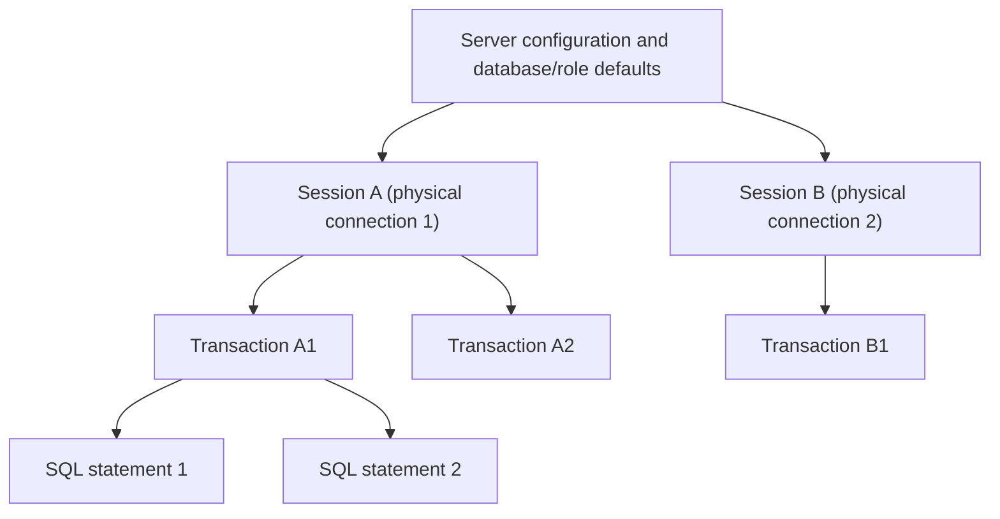
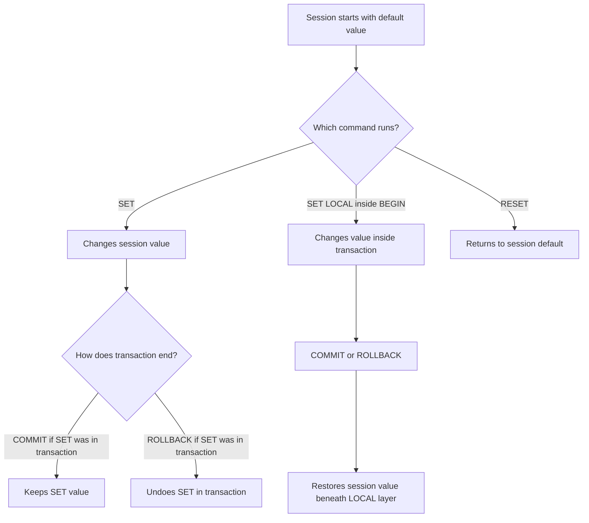

# SET, SET LOCAL, RESET, and Scope of Effect in PostgreSQL

PostgreSQL has many configuration parameters that control how a connection, a transaction, or the entire server processes queries: timeouts, memory for sort operations, time zone, schema search order, transaction isolation level, logging behavior, and so on. Not every configuration change requires editing `postgresql.conf` and restarting the server. For parameters **that can be changed at runtime**, PostgreSQL provides three important commands:

- `SET`: changes a value in the **current connection session**, unless the change is rolled back.
- `SET LOCAL`: changes a value **temporarily within the current transaction**.
- `RESET`: returns a parameter to the **default value applicable to the session**, according to the active configuration layers.

Understanding their exact scope helps avoid subtle bugs, especially in Java/Spring Boot applications using a connection pool: a change intended for request A can inadvertently affect request B if it remains on the physical connection.

## 1. First, Distinguish Server, Session, Transaction, and Statement

An application establishes a connection to PostgreSQL and executes multiple transactions over the same connection. Each backend connection has its own session state.



| Scope | Characteristics | Configuration Examples |
| --- | --- | --- |
| PostgreSQL server or cluster | Baseline configuration loaded from files, administrative statements, or other sources; some parameters require a restart | `shared_buffers`, `max_connections` |
| Database/role defaults | Applied when a new session is formed, according to precedence rules | `ALTER DATABASE ... SET`, `ALTER ROLE ... SET` |
| Session | One physical connection; can execute multiple transactions | `SET work_mem = '32MB'` |
| Transaction | A group of statements starting with `BEGIN` and ending with `COMMIT`/`ROLLBACK` | `SET LOCAL lock_timeout = '500ms'` |
| Statement | A single SQL statement; governed by the active configuration at execution time | `SELECT ...` affected by `statement_timeout` |

**A session is not synonymous with an HTTP request.** HikariCP or another pool typically borrows and returns the same physical connection across multiple requests. Therefore, how you change parameters should be based on the actual lifecycle of the PostgreSQL connection.

Two further concepts must be distinguished:

- **Effective scope**: whether a change applies for the session or only within the transaction.
- **Modification privilege**: whether the parameter allows the current user to change it with `SET`.

A parameter may be readable with `SHOW` yet disallowed from runtime modification, or it may require specific administrative privileges.

## 2. Inspecting the Current Configuration Before Changing It

Suppose you are already connected to PostgreSQL via `psql`. Use `SHOW`:

```sql
SHOW work_mem;
SHOW statement_timeout;
SHOW lock_timeout;
SHOW TimeZone;
SHOW search_path;
```

`SHOW ALL` lists parameters along with their current values and descriptions. For SQL needed inside an application:

```sql
SELECT current_setting('work_mem') AS work_mem;
SELECT current_setting('statement_timeout') AS statement_timeout;

-- Returns NULL when the parameter name does not exist.
SELECT current_setting('my_app.unregistered_option', true);
```

To inspect the value's source, modification privileges, and the value restored by `RESET`, query the `pg_settings` catalog view:

```sql
SELECT
    name,
    setting,
    unit,
    context,
    source,
    reset_val,
    pending_restart
FROM pg_settings
WHERE name IN (
    'work_mem',
    'statement_timeout',
    'shared_buffers',
    'search_path'
)
ORDER BY name;
```

Several columns need to be understood accurately:

| `pg_settings` Column | Meaning |
| --- | --- |
| `setting`, `unit` | Effective value and unit when applicable |
| `context` | Context permitting changes: e.g., `user`, `superuser`, `sighup`, `postmaster` |
| `source` | Source of the effective value, e.g., configuration file, database, role, client, or interactive change |
| `reset_val` | Value that will take effect after `RESET` for that parameter in the session |
| `pending_restart` | Whether the parameter has a pending configuration change waiting for a restart to take effect |

For units such as `kB`, `8kB`, or `ms`, the `setting` column in `pg_settings` may be displayed in internal units rather than the format originally entered. Use `SHOW` or `current_setting` when you want to see the value formatted as PostgreSQL presents it for SQL.

## 3. SET: Changing Session-Level Configuration

Standard syntax:

```sql
SET [SESSION] configuration_parameter TO value;
SET [SESSION] configuration_parameter = value;

-- Restore to the session's default value.
SET configuration_parameter TO DEFAULT;
```

`SESSION` is an optional keyword; when omitted, `SET` defaults to `SET SESSION`.

Examples:

```sql
SET work_mem = '32MB';
SHOW work_mem;
-- 32MB

SET statement_timeout TO '5s';
SHOW statement_timeout;
-- 5s

SET TIME ZONE 'Asia/Ho_Chi_Minh';
SHOW TimeZone;
-- Asia/Ho_Chi_Minh
```

`work_mem` is the memory limit **per eligible sort/hash operation** in a query plan, not the total memory budget for the entire session. Because a single query can have multiple operations and multiple queries can run concurrently, raising `work_mem` system-wide or across all connections requires careful consideration of RAM usage.

### 3.1. How Long Does SET Persist?

Within an open session, a value set with `SET` continues to apply to subsequent statements and subsequent transactions until:

- Another `SET` changes the value.
- A `RESET` or equivalent reset operation occurs.
- The session ends.
- A transaction containing `SET` is rolled back, as shown in the next section.

```sql
-- Session A:
SET work_mem = '32MB';
SELECT current_setting('work_mem');  -- 32MB

-- Start and finish a new transaction.
BEGIN;
SELECT current_setting('work_mem');  -- 32MB
COMMIT;

SELECT current_setting('work_mem');  -- Still 32MB
```

Running `SET` in session A **does not automatically change** session B; each connection has its own state.

### 3.2. SET Inside a Transaction Is Transactional

`SET` is no exception to rollback:

```sql
SET work_mem = '32MB';

BEGIN;
    SET work_mem = '48MB';
    SHOW work_mem;  -- 48MB
ROLLBACK;

SHOW work_mem;      -- 32MB
```

If `ROLLBACK` is replaced with `COMMIT`, the value `48MB` is retained in the session after the transaction ends:

```sql
BEGIN;
    SET work_mem = '48MB';
COMMIT;

SHOW work_mem;      -- 48MB
```

This is a common point of confusion: a `SET` inside `BEGIN ... COMMIT` **can still alter the session state after commit**. To restrict the effect to the transaction, use `SET LOCAL`.

## 4. SET LOCAL: Temporary Change Within a Transaction

`SET LOCAL` has a structure similar to `SET`:

```sql
BEGIN;
    SET LOCAL work_mem = '64MB';
    SET LOCAL statement_timeout = '3s';

    -- Run the required queries here.
    SELECT current_setting('work_mem');
COMMIT;
```

A value set with `SET LOCAL` remains in effect only until the end of the current transaction, **regardless of COMMIT or ROLLBACK**.

Example with a previously established session value:

```sql
SET work_mem = '32MB';
SHOW work_mem;          -- 32MB

BEGIN;
    SET LOCAL work_mem = '64MB';
    SHOW work_mem;      -- 64MB
COMMIT;

SHOW work_mem;          -- Reverts to 32MB
```

If the transaction ends with `ROLLBACK`, the value also reverts to `32MB`.

### 4.1. SET LOCAL Must Be Inside a Transaction

The following example does not establish a useful transaction configuration:

```sql
-- With psql autocommit enabled and no BEGIN:
SET LOCAL statement_timeout = '2s';

-- This statement belongs to a different transaction; the LOCAL value is gone.
SELECT pg_sleep(1);
```

Outside a transaction block, PostgreSQL may issue a warning that `SET LOCAL` can only be used in transaction blocks; the change does not persist for the next SQL statement.

To have a group of statements share a temporary configuration, use `BEGIN ... COMMIT` or your framework's actual transaction mechanism:

```sql
BEGIN;
    SET LOCAL lock_timeout = '500ms';
    SET LOCAL statement_timeout = '5s';

    SELECT count(*) FROM pg_catalog.pg_class;
COMMIT;
```

The timeout values `500ms` and `5s` are only illustrative; choose values based on latency and application requirements. `lock_timeout` limits how long to wait to acquire a lock, whereas `statement_timeout` limits the execution time of a statement. They address two different kinds of wait time.

### 4.2. SET and SET LOCAL Appearing Together in One Transaction

When both modify the same parameter, the `LOCAL` value can temporarily shadow the `SET` value inside the transaction, yet after `COMMIT` the `SET` value persists:

```sql
SET work_mem = '16MB';

BEGIN;
    SET work_mem = '32MB';
    SET LOCAL work_mem = '64MB';

    SHOW work_mem;        -- 64MB
COMMIT;

SHOW work_mem;            -- 32MB
```

Therefore, do not assume that `SET LOCAL` automatically cancels a session-level change made by an earlier `SET`.

### 4.3. Savepoints Also Affect SET/SET LOCAL

PostgreSQL allows rolling back to a savepoint prior to when a parameter was changed:

```sql
SET work_mem = '16MB';

BEGIN;
    SAVEPOINT before_override;

    SET LOCAL work_mem = '64MB';
    SHOW work_mem;             -- 64MB

    ROLLBACK TO SAVEPOINT before_override;
    SHOW work_mem;             -- 16MB
COMMIT;
```

Similarly, `ROLLBACK TO SAVEPOINT` also undoes the effect of a `SET` executed after that savepoint. This is why code using nested transactions or savepoints should carefully verify where configuration commands are placed.

## 5. RESET: Restoring the Session Default

`RESET` does not necessarily return to PostgreSQL's compiled-in default value. It returns to the **default applicable to the session**, which may have been established by a configuration file, database, role, or connection option.

```sql
-- Parameter has been changed in the session.
SET work_mem = '32MB';

-- Return to the default for the current session.
RESET work_mem;

SHOW work_mem;

-- Equivalent syntax to return to the session default:
SET work_mem TO DEFAULT;
```

`RESET ALL` restores runtime configuration parameters to the default values applicable to the session:

```sql
RESET ALL;
```

Do not treat `RESET ALL` as a universal solution for cleaning **all** connection state. It is not equivalent to removing all temporary tables, prepared statements, advisory locks, the current role, or other session states. Connection pools may have their own reset procedures; PostgreSQL also provides `DISCARD ALL` with broader semantics, though it cannot be run inside a transaction block.

### 5.1. RESET Is Transactional

`RESET` executed inside a transaction also follows commit/rollback semantics:

```sql
SET work_mem = '32MB';

BEGIN;
    RESET work_mem;
    SHOW work_mem;      -- Default applicable to the session
ROLLBACK;

SHOW work_mem;          -- 32MB
```

If `COMMIT` is used instead of `ROLLBACK`, the value after `RESET` is retained in the session. Thus, placing `RESET` inside a transaction and rolling back **is not** a reliable way to clear an earlier session-level `SET`.

## 6. Quick Comparison Through an Execution Scenario

Suppose the current `work_mem` value is explicitly set to `16MB`. The table below shows the result after each step:

| Step | Command / Event | `SHOW work_mem` |
| --- | --- | --- |
| 1 | `SET work_mem = '16MB';` | `16MB` |
| 2 | `BEGIN; SET LOCAL work_mem = '64MB';` | `64MB` |
| 3 | `COMMIT;` | `16MB` |
| 4 | `BEGIN; SET work_mem = '32MB';` | `32MB` |
| 5 | `COMMIT;` | `32MB` |
| 6 | `BEGIN; SET work_mem = '48MB';` | `48MB` |
| 7 | `ROLLBACK;` | `32MB` |
| 8 | `RESET work_mem;` | Default applicable to the session |

A way to remember it:



## 7. Which Settings Can Be Changed with SET?

PostgreSQL divides parameters into configuration contexts. `SET`/`SET LOCAL` cannot bypass a parameter's technical constraints or privilege requirements.

| Context in `pg_settings.context` | Characteristics | Examples |
| --- | --- | --- |
| `user` | Typically permitted for users to change in a session | `work_mem`, `statement_timeout`, `search_path` |
| `superuser` | Requires superuser or appropriately granted `SET` privilege, depending on version | Certain logging/administrative parameters |
| `sighup` | Only applied when the server reloads configuration | Many logging configuration parameters |
| `postmaster` | Only changed when the server restarts | `shared_buffers`, `max_connections` |
| `backend` / `superuser-backend` | Set at backend initialization, depending on privileges/context | Certain connection and operational options |
| `internal` | Determined by PostgreSQL; cannot be changed arbitrarily with `SET` | Internal parameters |

Always verify each parameter on the **actual server**, because the names, privileges, and semantics of some parameters depend on the PostgreSQL version.

For example, the statement:

```sql
SET shared_buffers = '1GB';
```

cannot change `shared_buffers` at runtime like `SET work_mem`. `shared_buffers` is a parameter requiring a restart. Being able to assign a value in a configuration file does not mean the current session can use `SET` to change it.

For non-superusers, an administrator can grant `SET` privilege on certain supported parameters using the `GRANT SET ON PARAMETER ...` mechanism (depending on version and parameter). Do not assume a user has sufficient privileges merely because a parameter can be changed at runtime.

## 8. Distinguishing Session SET from Persistent Default Configuration

There are multiple sources of configuration values. They serve different purposes:

```sql
-- Requires appropriate administrative privileges.
ALTER DATABASE appdb SET statement_timeout = '5s';

ALTER ROLE app_user SET work_mem = '16MB';

ALTER ROLE app_user IN DATABASE appdb
    SET statement_timeout = '3s';
```

`ALTER DATABASE` and `ALTER ROLE` statements create defaults for **new sessions** matching that database/role; they do not automatically alter all currently active sessions.

Typically, a value can be determined from the following layers (increasing precedence in the corresponding cases):

1. PostgreSQL built-in defaults and server configuration (`postgresql.conf`, `ALTER SYSTEM`, etc.).
2. Database-level defaults from `ALTER DATABASE ... SET`.
3. Role-level defaults from `ALTER ROLE ... SET`; role settings can override database settings for the same parameter.
4. Specific values for a role/database pair via `ALTER ROLE ... IN DATABASE ... SET`.
5. Configuration options sent by the client at session startup, and valid runtime changes within the session via `SET`.

This is a model for understanding scope. To explain **the active value on a specific connection**, inspect `pg_settings.source` and `pg_settings.reset_val`; do not infer it solely from the database name.

For example, when a specific default already exists for `app_user` in `appdb`:

```sql
-- In a session where app_user connects to appdb:
SHOW statement_timeout; -- Might be 3s per the ALTER ROLE ... IN DATABASE example

SET statement_timeout = '1s';
SHOW statement_timeout; -- 1s

RESET statement_timeout;
SHOW statement_timeout; -- Returns to session default, e.g., 3s
```

To **remove a default** created by `ALTER ROLE`, use the corresponding administrative statement such as `ALTER ROLE app_user IN DATABASE appdb RESET statement_timeout;`. This operates on role/database metadata, unlike `RESET statement_timeout` inside a session.

`ALTER SYSTEM` writes cluster-wide configuration to `postgresql.auto.conf`; applicable parameters require a reload, while `postmaster` parameters require a restart. Do not use `ALTER SYSTEM` for changes intended only for a single request.

## 9. Using Correctly in Java/Spring Boot Applications and Connection Pools

### 9.1. Common Bug: Changing Session State and Returning the Connection to the Pool

Suppose request A borrows connection #3:

```sql
SET search_path = tenant_a, public;
SELECT * FROM orders;
```

Then the application returns connection #3 to the pool without restoring `search_path`. Request B borrows the same connection and executes `SELECT * FROM orders`, which may inadvertently access schema `tenant_a`.

This phenomenon occurs whenever **connections are reused**; closing a logical connection in the application does not necessarily close the physical session on PostgreSQL.

Use schema-qualified names (`tenant_a.orders`) where appropriate; restrict `CREATE` on untrusted schemas; if you must change `search_path` per request, do so inside a transaction using `SET LOCAL`.

```sql
BEGIN;
    SET LOCAL search_path = tenant_a, pg_catalog;
    SELECT * FROM orders;
COMMIT;
-- search_path reverts to the session value prior to BEGIN
```

Dynamically switched schema names must come from a trusted/validated source or be properly identifier-quoted; never concatenate arbitrary user input directly into SQL. Nor is this an access-control mechanism for tenants by itself: data access permissions must be enforced independently.

### 9.2. SET LOCAL Must Use the Same Physical Connection and Real Transaction

With JDBC, the following example merely illustrates connection and transaction management:

```java
import java.sql.Connection;
import java.sql.PreparedStatement;
import java.sql.ResultSet;
import java.sql.SQLException;
import javax.sql.DataSource;

public class OrderQueryService {
    private final DataSource dataSource;

    public OrderQueryService(DataSource dataSource) {
        this.dataSource = dataSource;
    }

    public long countOrders() throws SQLException {
        try (Connection conn = dataSource.getConnection()) {
            conn.setAutoCommit(false);
            try {
                try (PreparedStatement setTimeout = conn.prepareStatement(
                        "SET LOCAL statement_timeout = '3s'")) {
                    setTimeout.execute();
                }

                long count;
                try (PreparedStatement query = conn.prepareStatement(
                        "SELECT count(*) FROM public.orders");
                     ResultSet rs = query.executeQuery()) {
                    rs.next();
                    count = rs.getLong(1);
                }

                conn.commit();
                return count;
            } catch (SQLException | RuntimeException ex) {
                try {
                    conn.rollback();
                } catch (SQLException rollbackEx) {
                    ex.addSuppressed(rollbackEx);
                }
                throw ex;
            }
        }
    }
}
```

In this example:

- `setAutoCommit(false)` opens a transaction scope managed by JDBC; `SET LOCAL` and `SELECT` execute on the **same connection**.
- `COMMIT` or `ROLLBACK` ends the effect of `SET LOCAL`.
- `try-with-resources` releases the JDBC resources; the transaction must be explicitly closed before returning the connection to the pool.
- The database account and `public.orders` table are illustrative only.

If the application already uses Spring `@Transactional` and a transaction manager, let the framework manage commit/rollback. `SET LOCAL` must be executed after the transaction starts, within the same transaction, and on the connection that the ORM/JDBC uses for the business query. Calling `SET LOCAL` on a different connection will not affect the main transaction's queries.

Pool tools can run initialization commands when creating physical connections. Settings such as HikariCP's `connectionInitSql` are suitable for baseline values on new connections, **not** for setting parameters that vary per request.

### 9.3. SQL Functions set_config and current_setting

PostgreSQL provides SQL functions to modify configuration and retrieve values:

```sql
-- Set for the session, similar to SET.
SELECT set_config('work_mem', '32MB', false);

-- Set temporarily in the current transaction, similar to SET LOCAL.
BEGIN;
    SELECT set_config('statement_timeout', '2s', true);
    SELECT current_setting('statement_timeout');
COMMIT;
```

The third boolean parameter of `set_config(name, value, is_local)` determines the scope:

- `true`: transaction scope (similar to `SET LOCAL`).
- `false`: session scope (similar to `SET`), and also follows commit/rollback if called inside a transaction.

For custom configuration parameters named like `app.request_id`, you can use:

```sql
BEGIN;
    SELECT set_config('app.request_id', 'req-123', true);
    SELECT current_setting('app.request_id', true);
COMMIT;
```

These custom variables are useful for application context or per-request logging. However, a value set by the application role itself should not be treated as authentication proof or a trustworthy authorization mechanism if users have any way to control SQL statements.

## 10. Common Errors and How to Diagnose Them

| Symptom | Possible Cause | How to Handle |
| --- | --- | --- |
| `SET LOCAL` followed by next statement shows no change | No `BEGIN`, or the two statements ran on different connections | Use a real transaction and the same physical connection |
| `SET` remains in effect after commit | `SET` is session-level when the transaction commits | Use `SET LOCAL` for settings needed only within the transaction |
| `SET` changes then disappears after rollback | The change occurred inside a rolled-back transaction | Clearly identify where the transaction begins and ends |
| `RESET` does not return to the expected value | A role/database/client default is configured | Check `pg_settings.reset_val` and `source` |
| PostgreSQL reports the parameter cannot be changed | Parameter requires reload/restart or higher privileges | Check `pg_settings.context` and verify the role |
| `current transaction is aborted` error after timeout | A failed statement put the transaction into an aborted state | `ROLLBACK` and open a new transaction; do not continue querying in an aborted transaction |
| Another request inherits a previous request's setting | Session `SET` leaked through a connection pool | Switch to `SET LOCAL` inside a transaction, or perform controlled reset/session cleanup |
| `SHOW` differs between two `psql` windows | The two sessions received different defaults or separate changes | Inspect the value in the **exact** connection experiencing the issue |

Additionally, `psql` has a `\set` command for assigning **psql client variables**, such as `\set report_date '2026-11-14'`. This command is not equivalent to PostgreSQL server SQL `SET` and is not reflected by `SHOW` as server configuration.

Some parameters have special semantic rules; not every `SET` should be treated as a plain string assignment. For instance, transaction options (isolation level, read only, deferrable) have timing constraints on when they may change, and `SET TRANSACTION`/`SET SESSION CHARACTERISTICS` have their own syntax and targets. Consult the documentation for your specific version when working with those cases.

## 11. Step-by-Step Practice

Open a `psql` session on a test database. Run each group of commands and predict the result before checking `SHOW`.

**Exercise 1 – Observe session-level SET and RESET**

```sql
SHOW work_mem;
SELECT reset_val FROM pg_settings WHERE name = 'work_mem';

SET work_mem = '24MB';
SHOW work_mem;

RESET work_mem;
SHOW work_mem;
```

Question: after `RESET`, does the value necessarily equal PostgreSQL's compiled-in default? Use `reset_val` to explain.

**Exercise 2 – Observe SET LOCAL inside a transaction**

```sql
SET work_mem = '16MB';

BEGIN;
    SET LOCAL work_mem = '64MB';
    SHOW work_mem;
COMMIT;

SHOW work_mem;
```

Key result: inside the transaction it is `64MB`; after commit it is `16MB`.

**Exercise 3 – Compare commit with rollback**

```sql
SET work_mem = '16MB';

BEGIN;
    SET work_mem = '32MB';
COMMIT;
SHOW work_mem;     -- 32MB

BEGIN;
    SET work_mem = '48MB';
ROLLBACK;
SHOW work_mem;     -- 32MB
```

Explain why the first `SET` inside a transaction is kept after `COMMIT`, whereas the second `SET` is discarded after `ROLLBACK`.

**Exercise 4 – Test scoped timeout**

```sql
SHOW statement_timeout;

BEGIN;
    SET LOCAL statement_timeout = '200ms';
    SELECT pg_sleep(1);  -- Expected to be canceled by statement_timeout.
ROLLBACK;

SHOW statement_timeout;
```

After `pg_sleep(1)` hits the timeout error, the transaction is in an aborted state; `ROLLBACK` is required before running further commands in this session. Only test this in a learning environment.

**Exercise 5 – Self-check for session leakage**

Use a connection pool in a test environment with a small pool size. Compare two approaches: calling `SET search_path` before the query and returning the connection to the pool, versus calling `SET LOCAL search_path` inside an explicit transaction. Observe `SHOW search_path` on the same physical connection when a subsequent request borrows it again. Do not use sensitive data tables for testing.

## 12. Conclusion on Using the Right Scope

When you need to apply a value across multiple transactions on the same connection, `SET` is appropriate and should be actively reset/restored when done. When you need to limit a value to a group of queries wrapped in `BEGIN ... COMMIT/ROLLBACK`, prefer `SET LOCAL`. When you need to return to the connection's applicable default, use `RESET`, keeping in mind that this default may come from role, database, or client policies.

These three commands are tools for operating **valid runtime configuration**. They do not replace configuration changes requiring a restart, do not create permanent changes across all sessions, and do not guarantee that connection pool sessions are cleaned automatically. Understanding session and transaction lifecycles is fundamental to making PostgreSQL configuration predictable in both development and production.
