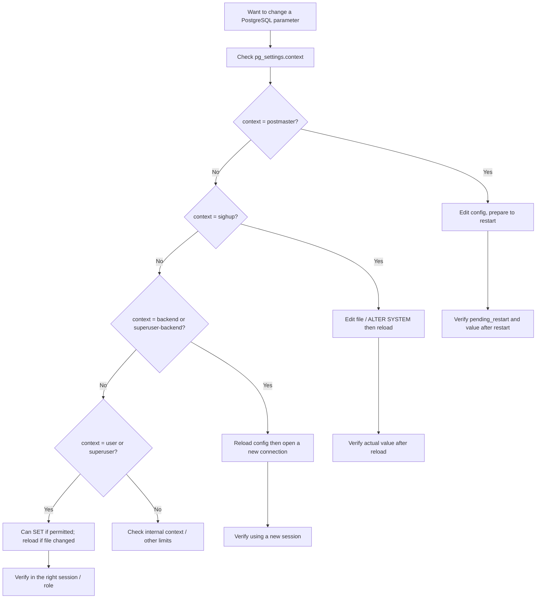
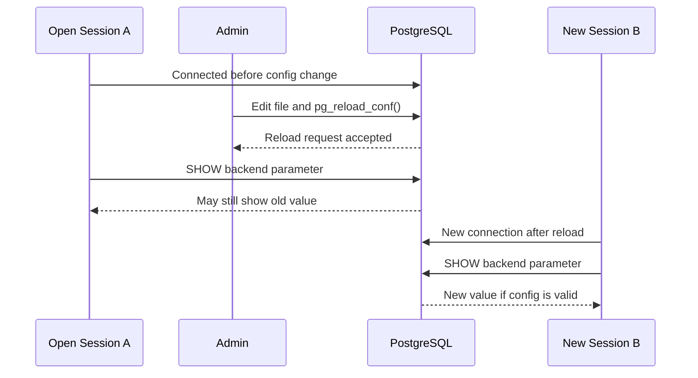

# Distinguishing Parameters Requiring Reload vs. Restart in PostgreSQL

PostgreSQL has many configuration parameters related to memory, connections, logging, storage, transactions, and security. However, **not every configuration change takes effect in the same way**. Some parameters require **restarting the entire PostgreSQL server (restart)**; some only require **asking the server to re-read configuration (reload)**; some can be changed with `SET` right inside a connection session, or only apply to **newly created sessions**.

For example:

- Increasing `shared_buffers` typically **requires a restart** because PostgreSQL allocates shared memory regions at startup.
- Changing `log_line_prefix` in server configuration typically **only requires a reload**.
- Adjusting `work_mem` for one query can use `SET LOCAL` inside a transaction, **requiring neither reload nor restart**.
- A parameter in the `backend` group can be edited in configuration and reloaded, yet the new value only applies when **clients open new connections**.

Therefore, asking "does this parameter need a reload or a restart?" is an essential step when operating PostgreSQL. Answering incorrectly leads to two kinds of incidents: the application assumes a new setting is active while the server is still using the old value, or an administrator performs an unnecessary restart that drops connections and disrupts service.

This lesson focuses on **how to accurately determine a parameter's type on the running server**, apply changes safely, and verify the results. Examples use modern PostgreSQL; parameter names, modification privileges, and service management commands may vary by version or installation method.

## 1. Three Easily Confused Concepts: SET, Reload, and Restart

First, separate **where configuration is declared** from **how configuration is brought into effect**.

| Action | What Does It Do? | Drops All Connections? | Example |
| --- | --- | --- | --- |
| `SET` / `SET LOCAL` | Changes a permitted parameter's value within the current session or transaction | No | `SET work_mem = '64MB'` |
| **Reload** | Asks PostgreSQL processes to re-read relevant configuration files | Normally does not restart the server or drop all connections | `SELECT pg_reload_conf();` |
| **Restart** | Stops and starts the PostgreSQL instance again | **Can disconnect all active connections and running transactions** | Restarting the PostgreSQL service for that instance |
| **Reconnect** | Closes an old session and opens a new connection | Affects only the reconnected session | Parameters with `backend` context |

**A reload is not a "light restart."** Reloading sends a request to running server processes to re-read configuration; it does not reinitialize shared memory regions and does not change options fixed at server startup. Restarting creates a new server lifecycle, which can break connection pools, roll back uncommitted transactions, and require connection recovery time.

### 1.1. Decision Flowchart



This flowchart is a basic decision model. **Privileges** to alter the parameter, higher-precedence config sources, value bounds, and parameter-specific semantics must still be evaluated alongside `context`.

## 2. The Most Reliable Source of Truth: pg_settings.context

PostgreSQL provides the `pg_settings` system view. It shows parameters, values, units, the context allowing changes, and restart-pending status.

Connect using an administrative role or a role with sufficient privileges to view the needed details, then run:

```sql
SELECT
    name,
    setting,
    unit,
    context,
    source,
    pending_restart
FROM pg_settings
WHERE name IN (
    'shared_buffers',
    'max_connections',
    'listen_addresses',
    'port',
    'log_line_prefix',
    'work_mem',
    'statement_timeout',
    'search_path'
)
ORDER BY name;
```

Key columns:

| Column | Explanation |
| --- | --- |
| `name` | PostgreSQL parameter name |
| `setting` | Value reported by the session via the GUC mechanism |
| `unit` | Conventional unit of numeric values, if any |
| `context` | **Context permitting changes**: `postmaster`, `sighup`, `backend`, `superuser`, `user`, etc. |
| `source` | Source leading to the effective value, e.g., default, configuration file, session, database, user |
| `pending_restart` | `true` if a configuration change was detected that requires a restart to apply |

Never guess context solely from parameter names. For example, both `shared_buffers` and `work_mem` relate to memory, yet one affects shared memory across the entire instance while the other governs per-operation query execution memory—so **how they are changed differs**.

### 2.1. Inspecting a Specific Parameter

```sql
SELECT
    name,
    setting,
    unit,
    context,
    vartype,
    source,
    pending_restart
FROM pg_settings
WHERE name = 'shared_buffers';
```

In standard PostgreSQL, `shared_buffers` has `context = 'postmaster'`. This indicates that configuration file changes cannot be fully applied to the running server via reload alone.

Try a parameter changeable inside a session:

```sql
SELECT
    name,
    setting,
    unit,
    context,
    source
FROM pg_settings
WHERE name = 'work_mem';
```

`work_mem` typically has `context = 'user'`, allowing regular roles to use `SET` within permitted bounds.

### 2.2. Units in pg_settings and SHOW

For size parameters, `pg_settings.setting` may return a number paired with a base unit specified in `unit`. Do not assume `setting='16384'` always means **16,384 bytes**; PostgreSQL expresses some parameters in blocks, kB, or other units.

To inspect values in human-readable form, you can usually run:

```sql
SHOW shared_buffers;
SHOW work_mem;
SHOW max_connections;
```

Or:

```sql
SELECT
    current_setting('shared_buffers') AS shared_buffers,
    current_setting('work_mem') AS work_mem;
```

Actual output depends on the instance and session. Never copy an example value into `postgresql.conf` just because it appeared in a blog post without evaluating RAM and workload.

## 3. Configuration Parameter Context Values

`context` in `pg_settings` is the key to knowing when a change can take effect.

| Context | What Does It Mean? | Common Way to Apply |
| --- | --- | --- |
| `internal` | Value determined internally/at build time or by server state; not a normal user-editable setting | Cannot be changed via `SET` or edited in config arbitrarily |
| `postmaster` | Can only be set at **server startup** | Edit config then **restart** |
| `sighup` | Changed by asking the server to re-read configuration | Edit file or `ALTER SYSTEM` then **reload** |
| `backend` | Value read/applied when a **new backend process starts** | Reload config then **reconnect** to see in new sessions |
| `superuser-backend` | Similar to `backend`, but modification is restricted to higher privileges | Privileged role edits config, reloads, then opens a new session |
| `superuser` | Can be changed in a session by a superuser or role with appropriate parameter privileges; can also come from config | `SET` if authorized; reload if file changed |
| `user` | Can be changed in a session by regular roles per GUC rules | `SET` / `SET LOCAL`, or reload if config changed |

Context labels are technical classifications and are not identical to "the current SQL user's permissions." A `context='superuser'` parameter may be granted separate `SET` permission on supporting PostgreSQL versions; conversely, a `user` parameter can still be constrained by environment configuration and governance policies.

### 3.1. postmaster: Only Changed at Server Startup

Typical examples:

- `shared_buffers`: size of the shared buffers pool.
- `max_connections`: configured limit on concurrent connections.
- `listen_addresses`: IP addresses/interfaces the server listens on.
- `port`: PostgreSQL TCP port.
- `wal_level`: level of information written to WAL for specific capabilities.
- `shared_preload_libraries`: libraries requested to preload at startup.
- `logging_collector`: enables the background log collector process per config.

You can verify each parameter on the instance:

```sql
SELECT name, setting, context
FROM pg_settings
WHERE name IN (
    'shared_buffers',
    'max_connections',
    'listen_addresses',
    'port',
    'wal_level',
    'shared_preload_libraries',
    'logging_collector'
)
ORDER BY name;
```

**Why is a restart required?** These settings affect structures or resources prepared when PostgreSQL starts up, such as allocating shared memory, binding listening sockets, or preloading libraries. A reload cannot reinitialize those components.

### 3.2. sighup: Server Re-Reads Configuration

A commonly used example:

```sql
SELECT name, setting, context
FROM pg_settings
WHERE name = 'log_line_prefix';
```

`log_line_prefix` typically has `context = 'sighup'`. After updating its value in configuration and reloading successfully, processes adopt the new log formatting via the reload mechanism **without restarting the entire server**.

The name `sighup` originates from the Unix SIGHUP signal, though reloading in PostgreSQL is not limited to Linux: Windows and containerized environments also have administrative mechanisms to ask the server to reload configuration.

### 3.3. backend and superuser-backend: Require a New Connection

An easily overlooked nuance: for some parameters, **a reload is required for the server to learn the new value**, yet **sessions already open before the reload may not switch to the new value**. Parameters with `backend` or `superuser-backend` context typically take effect when a backend connection is initialized.

With connection pools, note that:

1. Connections already sitting in the pool may continue using the old value.
2. Reloading configuration on the server does not mean all application sessions now have the new setting.
3. You must open **new physical connections** or gracefully recycle the pool when the change requires it.

Do not abruptly close the entire connection pool in production; plan to drain/recycle connections gracefully to minimize disruption.

### 3.4. superuser and user: Can Be SET Within Scope

For example, a regular role can typically run:

```sql
SET work_mem = '32MB';

SHOW work_mem;

RESET work_mem;
```

Changing `work_mem` this way affects only the **current session**, does not edit `postgresql.conf`, and requires neither reload nor restart.

Conversely, a regular role cannot arbitrarily `SET` `superuser` parameters unless granted appropriate privileges. SQL privileges and context must be evaluated together.

## 4. Where Does PostgreSQL Get Configuration From?

To avoid concluding "I edited the file yet `SHOW` didn't change," know that multiple **configuration sources** can exist.

Common sources:

1. **Built-in defaults** provided by PostgreSQL.
2. **Server startup arguments**, supplied by the service manager or `postgres` launch command.
3. **Configuration files**: `postgresql.conf` and included files.
4. **`postgresql.auto.conf`**, typically created/updated by `ALTER SYSTEM`, with higher precedence within file-based configuration.
5. **Database/role-level defaults** declared with `ALTER DATABASE ... SET` or `ALTER ROLE ... SET`.
6. **Session or transaction values** set with `SET` and `SET LOCAL`.

Exact precedence depends on the source and parameter type. Avoid relying on a single simplistic rule of thumb when command-line, file, database, role, and session values compete. PostgreSQL lets you inspect the effective source via `pg_settings.source`.

### 4.1. Locating the Actual File Paths

Once logged in with a role holding sufficient privileges:

```sql
SHOW config_file;
SHOW data_directory;
SHOW hba_file;
SHOW ident_file;
```

Paths vary across platforms:

- Ubuntu/Debian typically manage config per cluster/version outside the data directory.
- A standard `initdb` installation may place `postgresql.conf` inside the data directory.
- Windows, Homebrew, Postgres.app, containers, and managed databases each have their own layout.

**Never guess paths solely from the OS.** If you have multiple PostgreSQL instances, verify you are connected to the right server and editing the right configuration directory before making changes.

### 4.2. postgresql.conf and Includes

Inside `postgresql.conf`, you may see:

```conf
# Illustrative sample values in a lab environment
shared_buffers = '256MB'
work_mem = '16MB'
log_line_prefix = '%m [%p] %u@%d '

# Other config files may exist:
include_if_exists = 'custom.conf'
include_dir = 'conf.d'
```

PostgreSQL supports `include`, `include_if_exists`, and `include_dir` to split configuration. When a parameter is declared multiple times, read order and higher-precedence sources can mean the value you just edited **is not the value applied**.

Do not edit a random line in a file without checking included files and the effective value.

### 4.3. postgresql.auto.conf Managed by ALTER SYSTEM

The command:

```sql
ALTER SYSTEM SET work_mem = '16MB';
```

writes settings to `postgresql.auto.conf` in the data directory. PostgreSQL uses this file to store options set by `ALTER SYSTEM`, and within the configuration file layer it takes precedence over parameters of the same name in `postgresql.conf`.

Therefore, if a parameter was already set via `ALTER SYSTEM`, editing the same parameter in `postgresql.conf` may **fail to change the effective value**. Verify the source first, then edit using whichever mechanism owns the configuration.

Do not manually edit `postgresql.auto.conf` when `ALTER SYSTEM SET/RESET` or your database management workflow should manage it. Managed PostgreSQL environments may disallow `ALTER SYSTEM` or use a different configuration mechanism.

## 5. Pre-Change State Inspection Workflow

A standard step before applying any change is capturing the relevant parameters:

```sql
SELECT
    name,
    setting,
    unit,
    context,
    source,
    sourcefile,
    sourceline,
    pending_restart
FROM pg_settings
WHERE name IN (
    'shared_buffers',
    'max_connections',
    'work_mem',
    'log_line_prefix'
)
ORDER BY name;
```

| Field | When Is It Useful? |
| --- | --- |
| `source` | Does the value come from default, configuration file, session, database, or another source? |
| `sourcefile` | Which file provides the effective value, if available? |
| `sourceline` | Which line in that file is involved? |
| `pending_restart` | Has the server recognized a change requiring a restart? |

Fields such as `sourcefile` and `sourceline` may be hidden from roles lacking sufficient privileges. Never grant broad administrative privileges to an application role just to display config paths.

### 5.1. Selecting the Right Server in Multi-Node Environments

```sql
SELECT
    current_database() AS database_name,
    current_user AS current_role,
    inet_server_addr() AS server_ip,
    inet_server_port() AS server_port,
    pg_is_in_recovery() AS is_standby;
```

`pg_is_in_recovery() = true` typically indicates the server is in recovery/standby mode. Over Unix socket connections, `inet_server_addr()` may be `NULL`. Cross-check service names, hostnames, ports, and orchestration tools to avoid editing the wrong instance.

In an HA cluster, nodes may have **different configuration files and effective values**. Reloading one node does not automatically apply configuration uniformly across every node.

## 6. Changes Requiring Only Reload: Example with log_line_prefix

Let's examine a log-formatting parameter: `log_line_prefix`. It is helpful for recording timestamp, PID, user, and database in logs without changing shared memory allocation.

First, verify its real context:

```sql
SELECT name, setting, context, source, pending_restart
FROM pg_settings
WHERE name = 'log_line_prefix';
```

If the server reports `context = 'sighup'`, the next step can be performed in a test environment with configuration privileges.

### 6.1. Approach A: Editing the Config File

In `postgresql.conf` (or a properly managed config file), set:

```conf
log_line_prefix = '%m [%p] %u@%d '
```

The `%m`, `%p`, `%u`, and `%d` escapes record timestamp, PID, user, and database in each log line. Changing log formats can break log parsers, so assess the impact beforehand on systems with centralized log monitoring.

After saving the file, instruct PostgreSQL to reload:

```sql
SELECT pg_reload_conf();
```

Returning `true` generally means PostgreSQL **successfully sent the reload request** to the relevant processes. **It does not certify that all configuration values are valid or have been applied.** To confirm, inspect `pg_settings`, `pg_file_settings`, and logs as needed.

Verify:

```sql
SHOW log_line_prefix;

SELECT name, setting, context, source, pending_restart
FROM pg_settings
WHERE name = 'log_line_prefix';
```

For a valid `sighup` parameter not overridden by another source, the new value takes effect after reload **without requiring a restart**.

### 6.2. Approach B: Using ALTER SYSTEM

If `ALTER SYSTEM` is permitted:

```sql
ALTER SYSTEM SET log_line_prefix = '%m [%p] %u@%d ';

SELECT pg_reload_conf();
```

`ALTER SYSTEM` **writes a configuration file** rather than instantly changing all sessions when executed; hence, reload or restart is still required depending on `context`.

To remove the override and fall back to the next highest-precedence source:

```sql
ALTER SYSTEM RESET log_line_prefix;

SELECT pg_reload_conf();
```

Note: the value after `RESET` **does not necessarily revert to the build-time default**. It may come from `postgresql.conf` or an included file, because only the override in `postgresql.auto.conf` was removed.

**Do not mix Approaches A and B for the same parameter without actively managing configuration precedence.** In automated environments, prefer editing whichever source automation owns so the next deployment does not overwrite your change.

## 7. Changes Requiring Restart: Example with shared_buffers

`shared_buffers` is a classic example of `context = 'postmaster'`.

Check:

```sql
SELECT
    name,
    setting,
    unit,
    context,
    pending_restart
FROM pg_settings
WHERE name = 'shared_buffers';
```

In a test environment where configuration changes are allowed, suppose you want to set it to `256MB`:

```sql
ALTER SYSTEM SET shared_buffers = '256MB';

SELECT pg_reload_conf();
```

**Do not expect `SHOW shared_buffers;` to change immediately if it previously held a different value.** The running server retains the amount allocated at startup. After reload, `pg_settings.pending_restart` may report `true`:

```sql
SELECT
    name,
    setting,
    context,
    pending_restart
FROM pg_settings
WHERE name = 'shared_buffers';
```

An **illustrative** state after requesting a new value different from the running one:

```text
name            setting    context       pending_restart
--------------  ---------  ------------  ---------------
shared_buffers  <current value> postmaster true
```

This is a model output showing how to read the status flag, not captured server output. If you set the exact same value already running, the flag may stay `false` because no actual change is pending.

To apply the new configuration:

1. Check available RAM and related memory parameters.
2. Verify the new configuration is valid and the server is reading the right file.
3. Back up or ensure ability to revert to the old configuration if issues occur.
4. Choose a maintenance window or switchover mechanism appropriate for the topology.
5. **Restart the exact PostgreSQL instance**.
6. Open a **new** connection and re-verify `SHOW shared_buffers;`, `pending_restart`, and startup logs.

Setting `shared_buffers = '256MB'` here is solely to illustrate syntax; it is **not** a general recommendation for every server. The right value depends on RAM, workload, and infrastructure characteristics.

### 7.1. Why Can't Reload Change shared_buffers Directly?

PostgreSQL creates shared memory structures and shared components at server startup. Resizing that memory while backends are actively running is not a simple GUC update. Therefore, `postmaster` context indicates the value must be set when the server starts anew.

`max_connections` has a similar reason: increasing the maximum connection limit changes shared structure/memory sizing. It is not merely a scalar variable running sessions can raise or lower unconditionally.

## 8. backend: Reload Still Requires a New Connection

The `backend` and `superuser-backend` groups often cause confusion because administrators sometimes check using an **already-open session**, see no change, and mistakenly assume a restart is needed.

Flow:



An appropriate verification sequence:

1. Confirm via `pg_settings.context` that the parameter is `backend` or `superuser-backend`.
2. Edit configuration in the authoritative source and trigger a reload.
3. **Close the old test session** or open a completely new connection.
4. Check the value in the new session.
5. If the application uses a connection pool, plan to recycle physical connections appropriately.

Running `SET role = ...` does not substitute for creating a new backend connection when a parameter is only read at backend startup.

## 9. SET and SET LOCAL: No Need to Touch Server-Wide Config

For a `user`-context parameter like `work_mem`, you can adjust it solely for a session or transaction.

### 9.1. SET Within a Session

```sql
SHOW work_mem;

SET work_mem = '64MB';

SHOW work_mem;

RESET work_mem;
```

`SET` changes the GUC in the current session. It does not write to `postgresql.conf` or `postgresql.auto.conf`. When you open another session, that session **does not inherit** the value set by `SET` in the earlier session.

After `RESET work_mem`, the session returns to its effective default according to active configuration sources and GUC rules—such as a role/database setting, config file, or server default.

### 9.2. SET LOCAL Within a Transaction

```sql
BEGIN;

SET LOCAL work_mem = '64MB';

SELECT customer_id, COUNT(*) AS order_count
FROM orders
GROUP BY customer_id
ORDER BY order_count DESC;

COMMIT;
```

`SET LOCAL` applies only within the scope of the current transaction and expires at the end of the transaction. If run outside a transaction block, it does not persist as shown above and PostgreSQL may emit a warning.

The `SELECT ... FROM orders` statement assumes an `orders` table exists in your database; if not, substitute an appropriate practice table. The focus of the example is **configuration scope**, not table content.

### 9.3. Do Not Increase work_mem Arbitrarily

`work_mem` is not "total RAM reserved for the entire server." PostgreSQL can allocate memory for **multiple sort/hash operations per query**, across many concurrent connections or parallel workers. Raising `work_mem` instance-wide from a small value to a very large one can cause total memory consumption to spike sharply under concurrency.

If only one reporting query needs more memory, consider tuning it selectively in a transaction or session rather than changing it globally without measurement.

## 10. ALTER DATABASE / ALTER ROLE: Defaults for New Sessions

PostgreSQL also supports setting defaults per database or role:

```sql
ALTER ROLE reporting_user
SET work_mem = '32MB';

ALTER DATABASE analytics_db
SET statement_timeout = '30s';
```

These commands only succeed when **role `reporting_user` and database `analytics_db` exist**, and the caller holds appropriate privileges. They are configuration design examples, not advice to apply one timeout value across every database.

Key points:

- `ALTER ROLE ... SET` and `ALTER DATABASE ... SET` establish **defaults for matching sessions opened in the future**.
- You do not need `pg_reload_conf()` for the act of setting these defaults.
- Previously opened sessions do not automatically change because they already initialized settings at connection creation.
- Within a session, `SET` can still override permitted parameters per privilege rules.
- `ALTER ROLE ... IN DATABASE ... SET` enables configuring a specific role/database combination on supporting versions.

Example:

```sql
ALTER ROLE reporting_user IN DATABASE analytics_db
SET work_mem = '48MB';
```

After making the change, **reconnect** with that exact role and database to verify the value rather than running `SHOW` from another admin session.

To remove a setting:

```sql
ALTER ROLE reporting_user RESET work_mem;

ALTER DATABASE analytics_db RESET statement_timeout;
```

This alters role/database defaults, **unlike** `ALTER SYSTEM RESET` which removes server-wide overrides in `postgresql.auto.conf`.

## 11. ALTER SYSTEM Does Not Mean Immediate Activation

`ALTER SYSTEM` is a convenient mechanism to write configuration via SQL, but it **does not bypass context**.

Example:

```sql
ALTER SYSTEM SET work_mem = '16MB';
ALTER SYSTEM SET log_line_prefix = '%m [%p] ';
ALTER SYSTEM SET shared_buffers = '256MB';
```

These three statements share the same syntax yet have different activation requirements:

| Parameter | Typical Context | Action Needed After ALTER SYSTEM |
| --- | --- | --- |
| `work_mem` | `user` | Reload so file config is read; verify in target session |
| `log_line_prefix` | `sighup` | Reload |
| `shared_buffers` | `postmaster` | Reload may surface the pending change; **restart** to take effect |

`ALTER SYSTEM` typically requires high privileges or parameter-specific delegation depending on version. It **cannot run inside a transaction block**, so do not write:

```sql
-- Improper usage: ALTER SYSTEM cannot run inside a transaction.
BEGIN;
ALTER SYSTEM SET shared_buffers = '256MB';
COMMIT;
```

This example **cannot be executed as a single block**.

### 11.1. SET, RESET, RESET ALL

```sql
ALTER SYSTEM SET work_mem = '16MB';

-- Remove only the work_mem override from the ALTER SYSTEM source.
ALTER SYSTEM RESET work_mem;
```

`ALTER SYSTEM RESET ALL` is a **very broad** operation that removes all overrides managed by `ALTER SYSTEM`. Never run it just to "reset" a single parameter, as it can impact numerous settings governing connections, logging, WAL, and availability.

After `RESET`, you must still reload or restart depending on the parameter's context and the newly exposed source.

### 11.2. When the Environment Disallows ALTER SYSTEM

Managed PostgreSQL services, Kubernetes Operators, containers, or IaC systems often manage configuration via a control plane, ConfigMap, manifest, or provider-supported configuration. In those environments:

- You may lack `ALTER SYSTEM` permissions.
- Manual file edits inside a container may disappear when a new pod starts.
- An operator may overwrite changes with the cluster's desired state.
- Certain parameters may roll out via controlled restarts or rolling replacements per platform policy.

Therefore, before making changes, identify **which system owns configuration**. Whether changes originate from a cloud UI or local files, `pg_settings.context` remains invaluable for understanding how PostgreSQL applies them underneath.

## 12. pg_reload_conf(): Capabilities and Limitations

To request a reload directly from a privileged SQL session:

```sql
SELECT pg_reload_conf();
```

This function asks the server to re-read necessary configuration files, similar to sending the reload signal to the instance. However, it has three limitations:

1. **Sending the request does not guarantee every setting was applied.** Syntactically invalid, out-of-range, or disallowed values may be rejected and logged.
2. **It does not activate `postmaster` parameters.** A restart is still required if the value actually changed.
3. **It does not update old sessions with `backend` values or replace role/database defaults loaded at login.** Reconnecting may be necessary.

After a reload, always **verify effective values and logs**, especially for changes affecting permissions, connections, or logging.

### 12.1. Reloading from the Operating System

On Linux with the `pg_ctl` binary and the exact data directory known:

```bash
pg_ctl -D /path/to/pgdata reload
```

`/path/to/pgdata` is a placeholder, not an actual path. The account executing the command must hold proper permissions; never run `pg_ctl` pointing at the wrong data directory.

On Linux with systemd, the service unit may support:

```bash
sudo systemctl reload postgresql
```

**Not every installation uses the exact service name `postgresql` or supports the same reload mechanism.** Debian/Ubuntu use cluster/version tooling; PGDG packages, containers, and managed databases differ. Always verify the actual service before running commands.

A platform-independent method in many environments is executing `SELECT pg_reload_conf();` from an administrative SQL session connected to the **exact target instance**.

## 13. Restarting PostgreSQL: Understanding Impact and Execution

A restart is necessary when changing `postmaster`-context parameters. However, it is a **service-impacting operational action**, not a quick trial step just to test whether a parameter takes effect.

### 13.1. Before Restarting

Minimum checks:

1. **Right instance:** which server, data directory, port, and service?
2. **Who is using it?** Connection pools, long-running transactions, Java apps, ETL jobs, or reports?
3. **High availability:** is the instance a primary, standby, or operator-managed node? Is a switchover or rolling restart needed?
4. **Valid configuration:** is the new value within supported bounds and backed by sufficient hardware resources?
5. **Recovery plan:** backup, method to revert to old config, and where to read startup logs if the server fails to start.
6. **Maintenance window:** have dependent services been notified and accepted the interruption?

### 13.2. Service Management Examples by Environment

**Linux with systemd**, once the exact service unit name is verified:

```bash
sudo systemctl restart postgresql
sudo systemctl status postgresql
```

On Debian/Ubuntu, a specific cluster can be managed with `pg_ctlcluster`:

```bash
# Example only for cluster named main, major version 18.
sudo pg_ctlcluster 18 main restart
```

With other PostgreSQL packages, the unit name might be `postgresql-18` or another versioned name. Never run commands copied from docs without verifying the actual version and cluster name.

**Windows:** The PostgreSQL installer typically creates a Windows Service. You can list services with:

```powershell
Get-Service -Name 'postgresql*'
```

Once the exact service is identified and the action is approved, administrators use Windows Services or PowerShell with the real service name. Do not assume every installation uses `postgresql-x64-18`.

**macOS Homebrew:** example with a versioned formula:

```bash
brew services list

# Once the exact service name is confirmed:
brew services restart postgresql@18
```

**Postgres.app:** manage through the application itself; do not use `brew services` if the instance is not managed by Homebrew.

**Containers/Kubernetes:** do not manually restart the database like a normal host service; follow the platform's deployment/operator mechanism, persistent volume rules, and runbooks. Restarting the wrong pod/instance can cause outages or alter cluster topology state.

### 13.3. Post-Restart Verification

Open a **new connection** to the right server and check:

```sql
SELECT
    name,
    setting,
    context,
    source,
    pending_restart
FROM pg_settings
WHERE name IN (
    'shared_buffers',
    'max_connections',
    'listen_addresses',
    'port'
)
ORDER BY name;
```

The requested values should now be applied in runtime config, and `pending_restart` should no longer report unprocessed changes. If the server fails to start, inspect **startup logs** first, check the newly edited values, and revert per your runbook—do not blindly restart repeatedly without understanding the error.

## 14. pg_file_settings: Are the Files Actually Valid and Applied?

`pg_settings` reports **effective values in the server/session**; `pg_file_settings` lets you inspect configuration entries found in files and how they were processed.

```sql
SELECT
    sourcefile,
    sourceline,
    seqno,
    name,
    setting,
    applied,
    error
FROM pg_file_settings
WHERE name IN (
    'shared_buffers',
    'work_mem',
    'log_line_prefix',
    'max_connections'
)
ORDER BY seqno;
```

Columns:

| Column | Purpose |
| --- | --- |
| `sourcefile` | File containing the configuration line |
| `sourceline` | Line number in the file |
| `seqno` | Processing sequence in which PostgreSQL evaluated the entry |
| `name` / `setting` | Parameter name and value read from the file |
| `applied` | Whether the line could be applied during configuration processing |
| `error` | Reason the line was invalid or could not be applied, if any |

This view is helpful when:

- You edited `postgresql.conf`, yet an included file overrides it.
- An override exists in `postgresql.auto.conf`.
- A value has an invalid type or is out of range.
- The file was read, yet the parameter requires a restart.
- A change could not be applied due to a configuration processing error.

**Do not look only at `applied=true` and conclude a postmaster parameter is already active at runtime.** Also inspect `pg_settings.setting`, `pg_settings.pending_restart`, and `context`. Entries read from disk can reflect file parsing status while the runtime value still awaits a restart.

Permissions to view file/config metadata may be restricted. If you lack permission, do not grant broad system privileges to an application account; use an authorized administrative or monitoring account.

### 14.1. Diagnostic Query for Unapplied Pending Values

```sql
SELECT
    name,
    setting AS active_setting,
    context,
    source,
    pending_restart
FROM pg_settings
WHERE pending_restart
ORDER BY name;
```

If rows are returned, the server is reporting configuration changes **requiring a restart** to take effect. This is an important signal when checking after a reload.

However, **zero rows returned** does not prove every configuration edit is flawless: there could be parse errors, overrides from another source, or you could be checking the wrong instance. Inspect both `pg_file_settings` and logs whenever anomalies occur.

## 15. Distinguishing Reloading HBA/IDENT Files from Restarting GUC Parameters

Beyond `postgresql.conf`, PostgreSQL also uses:

- `pg_hba.conf`: rules selecting authentication methods by connection type, database, role, and client source.
- `pg_ident.conf`: mappings from external identities to database roles when the authentication method uses them.

These files **are not represented as standard `postmaster`/`sighup` GUCs in `pg_settings`**. In many Unix/Linux environments, editing them requires a **reload** so PostgreSQL loads them for subsequent connections.

### 15.1. Example: Adjusting Host Authentication

An illustrative rule:

```text
# TYPE  DATABASE    USER          ADDRESS        METHOD
host    learning_pg  learning_app  192.0.2.0/24   scram-sha-256
```

`192.0.2.0/24` is a documentation-reserved address range, **not** a real application subnet. In live environments, substitute approved IPs/subnets while enforcing firewalls and TLS.

After editing `pg_hba.conf`, inspect how PostgreSQL reads and parses the file:

```sql
SELECT
    line_number,
    type,
    database,
    user_name,
    address,
    auth_method,
    error
FROM pg_hba_file_rules
ORDER BY line_number;
```

Then reload per your environment's mechanism:

```sql
SELECT pg_reload_conf();
```

**Special note for Windows:** PostgreSQL's behavior for applying HBA changes to new connections on Windows can differ from Unix; PostgreSQL documentation notes that `pg_hba.conf` changes may take effect immediately for new connections on Windows. Always verify your exact version and platform behavior, while maintaining proper configuration review and verification practices.

### 15.2. Changing HBA Does Not Re-Authenticate Existing Sessions

When authentication rules change, clients **already logged in and holding open connections** are generally not prompted to re-authenticate just because HBA changed. New rules govern the authentication phase of matching **subsequent** connections.

If immediate access revocation is required, implement administrative procedures covering role privileges, connection termination, and application policy; reloading HBA alone does not disconnect existing sessions.

### 15.3. listen_addresses Still Requires a Restart

This is an easily confused pair:

- Editing `pg_hba.conf` to **permit/authenticate a connection source**: typically reload (or Windows-specific behavior).
- Editing `listen_addresses` so the server **listens on another network interface**: typically **restart** because of `postmaster` context.

Even if `pg_hba.conf` allows an external IP, clients still cannot connect if the server listens only on `localhost`. Conversely, listening on all interfaces does not mean any arbitrary user will authenticate and gain access.

## 16. Order of Applying Changes in Production

Modifying configuration on a live PostgreSQL server serving applications should follow a clear workflow rather than ad-hoc commands.

### 16.1. Reload-Only Changes

1. Record the **current value**, `context`, `source`, and file path from `pg_settings`.
2. Identify which system owns the file: manual admin, Ansible/Terraform, Helm/Operator, or cloud provider.
3. Choose an appropriate value, verify formatting, and evaluate operational impact.
4. Write the change to the authoritative managed source.
5. Issue a reload via the appropriate mechanism.
6. Verify the effective value, `pg_file_settings`, logs, and related functionality.
7. Monitor metrics afterward and revert via **reload** if problems arise.

If configuration shows the new value from a file while an old session still has an override from `SET` or a role/database setting, distinguish the **server default** from the **current session value**.

### 16.2. Restart-Required Changes

1. Confirm `context='postmaster'` and document the goal of the change.
2. Evaluate memory, connection counts, WAL, extensions, and parameter interactions.
3. Test in a comparable staging environment; verify the server starts cleanly with the new config.
4. Prepare backups, a rollback runbook, and an expected interruption window.
5. In an HA cluster, consider **rolling restart** or **switchover**, avoiding restarting the primary without service-continuity planning.
6. Edit configuration in the right source and verify it was written.
7. Restart the **exact target node/instance** following coordination procedures.
8. Open a new connection, verify `SHOW`/`pg_settings`, replication status, health checks, and application load.
9. Monitor and revert if errors occur; log the change in operational records.

Never assume "having a standby" automatically means zero downtime: client routing, replication lag, connection draining, and leader election can all affect availability.

## 17. Illustrative Scenario: Three Changes at Once

Suppose the operations team receives three requests:

1. Update the log prefix to include PID and username.
2. Increase the maximum number of connections.
3. Increase memory for a slow reporting query.

First, inspect:

```sql
SELECT name, setting, context, pending_restart
FROM pg_settings
WHERE name IN (
    'log_line_prefix',
    'max_connections',
    'work_mem'
)
ORDER BY name;
```

Evaluate each request:

| Request | Parameter | Appropriate Scope | How to Apply |
| --- | --- | --- | --- |
| Add metadata to logs | `log_line_prefix` | Server default | Edit file or `ALTER SYSTEM`, **reload** |
| Increase concurrent connections | `max_connections` | Entire instance | Edit config, planned **restart** |
| Increase RAM for one report | `work_mem` | Prefer job's session/transaction | `SET LOCAL` / `SET` if appropriate, **no restart** |

**Important note:** Higher `max_connections` does not make PostgreSQL process queries faster; more backends can increase RAM consumption and resource contention. For high-request web apps, connection pooling and appropriate concurrency limits are often just as critical as `max_connections`.

### 17.1. When Multiple Changes Touch the Same File

You do not need to restart just to apply `sighup` parameters when they can reload independently. However, if you already plan a restart for a `postmaster` change, valid `sighup` edits in the same configuration set will also load when the server starts. What matters is **never overlooking** parameters left in `pending_restart` after performing only a reload.

## 18. Common Errors When Applying Configuration

### 18.1. pg_reload_conf() Returns True, Yet SHOW Doesn't Change

Possible reasons:

- The parameter is `postmaster` context and has `pending_restart=true`.
- An included file or `postgresql.auto.conf` overrides the line you edited.
- The file has an invalid value rejected by PostgreSQL.
- You are checking a session with its own `SET` or different role/database defaults.
- The parameter is `backend` context and you have not opened a new connection.
- You edited instance A's file but sent reload to instance B.

Investigate using:

```sql
SELECT name, setting, context, source, pending_restart
FROM pg_settings
WHERE name = 'shared_buffers';

SELECT sourcefile, sourceline, name, setting, applied, error
FROM pg_file_settings
WHERE name = 'shared_buffers';
```

Then check logs and `SHOW config_file;` to ensure you modified the right configuration.

### 18.2. Server Fails to Start After Restart

Causes can include unsupported values, insufficient memory, port conflicts, wrong paths, unloadable modules in `shared_preload_libraries`, or invalid file/directory permissions.

Resolution steps:

1. Read startup logs for the exact instance.
2. Compare the recently changed setting against supported values.
3. Revert the change per your runbook and perform a controlled restart.
4. Once up, verify connectivity, data status, and replication.

Never delete the data directory, re-run `initdb`, or manually edit WAL just to get past a configuration error.

### 18.3. ALTER SYSTEM Succeeded, Yet Application Behavior Doesn't Change

`ALTER SYSTEM` only writes configuration. A reload, restart, or reconnect may still be missing, or the application's connection pool may be holding old sessions, or the driver may issue `SET` in startup SQL. Inspect `pg_settings.source` from the **exact application connection** if possible.

### 18.4. Permission Errors When Viewing pg_file_settings or Running ALTER SYSTEM

Application roles normally lack administrative privileges to alter server-wide settings. That is a sensible security boundary. Never grant `SUPERUSER` or broad OS file permissions to an application just to change a parameter; separate operational roles and use appropriately authorized people or tools.

### 18.5. File Contains Two Lines for the Same Parameter

Example:

```conf
work_mem = '8MB'

# Later in an included file or auto.conf:
work_mem = '64MB'
```

PostgreSQL does not necessarily throw an error simply because a parameter appears in multiple places. Effective values follow read order and precedence rules, so it may differ from the line you edited. Use `pg_file_settings.seqno`, `applied`, `sourcefile`, and `pg_settings.source` to locate the real source.

### 18.6. Seeing pending_restart=false and Assuming Everything Applied

`pending_restart=false` only indicates that the restart-pending flag is not set for the parameter state visible to that session. It does not prove the file has no errors, wasn't overridden, or that you checked the right server. For high-impact changes, verify both **effective values** and **system behavior**.

## 19. Quick Lookup Table: What to Do for Each Group?

| Parameter / Object | Typical Group | Restart Needed? | Reload Needed? | Notes |
| --- | --- | --- | --- | --- |
| `shared_buffers` | `postmaster` | **Yes** if value changed | Reload helps surface pending change | Shared memory allocation |
| `max_connections` | `postmaster` | **Yes** | Can reload to show pending | Evaluate memory and connection pooling |
| `listen_addresses` | `postmaster` | **Yes** | Reload insufficient | Also verify firewall and HBA |
| `port` | `postmaster` | **Yes** | Reload insufficient | Clients must know new port |
| `wal_level` | `postmaster` | **Yes** | Reload insufficient | Impacts WAL/replication; use runbook |
| `shared_preload_libraries` | `postmaster` | **Yes** | Reload insufficient | Loads libraries at server start |
| `log_line_prefix` | `sighup` | No, if changing only this | **Yes** if file/ALTER SYSTEM edited | Log line formatting |
| `work_mem` | `user` | No | **No** if `SET`; **yes** if file changed | Changeable per session |
| `statement_timeout` | `user` | No | Depends on change source | Configurable per session/role |
| `search_path` | `user` | No | Depends on change source | Affects object name resolution |
| `backend`-context parameters | `backend` | Usually no | Reload file then **reconnect** | Old sessions may retain old value |
| `pg_hba.conf` | Auth file | Usually no | Usually yes on Unix | Applies to new connections; Windows differs |

**This table is a guide.** Whenever versions or extensions introduce differences, rely on `pg_settings.context` on your **actual PostgreSQL instance**, and consult documentation for any parameter with special conditions.

## 20. Practice Exercises

Practice on a test PostgreSQL instance or within environments where you are authorized; avoid modifying production servers solely for exercises.

1. Run `SELECT name, setting, context, source, pending_restart FROM pg_settings WHERE name IN (...);` for `shared_buffers`, `max_connections`, `log_line_prefix`, and `work_mem`. Classify which need restart, reload, or session `SET`.
2. Explain in your own words the difference between **reload** and **restart**. How does each operation affect active connections?
3. Retrieve paths for `config_file`, `data_directory`, `hba_file`, and `ident_file` via SQL. Explain why copying a Debian/Ubuntu path onto Windows or macOS is wrong.
4. In one session, run `SHOW work_mem; SET work_mem='32MB'; SHOW work_mem; RESET work_mem;`. Open a second session to verify whether the session change carried over.
5. Inside a transaction, test `SET LOCAL work_mem='64MB';` followed by `COMMIT;`. Check the value after commit and explain its scope.
6. With admin privileges in a test environment, change `log_line_prefix` via the proper configuration source, reload, and verify the value. Then revert to the previous configuration.
7. Change `shared_buffers` in a test environment to a value **different** from the running one, reload, and inspect `pending_restart`. Do not restart without authorization or maintenance planning; describe the next required step.
8. Use `pg_file_settings` to find lines for `work_mem` or `shared_buffers` across configuration files. Explain the meaning of `sourcefile`, `sourceline`, `seqno`, `applied`, and `error`.
9. If `postgresql.conf` sets `work_mem='8MB'` while `ALTER SYSTEM SET work_mem='16MB'` was used, which value loads from files after a reload? How do you verify instead of guessing?
10. A `backend`-context parameter was updated and reloaded, yet an application pool holds old connections. How will you verify and cycle connections safely?
11. Compare `ALTER ROLE reporting_user SET work_mem='32MB'` with `ALTER SYSTEM SET work_mem='32MB'` in scope, timing of effect, and how to revert.
12. After editing `pg_hba.conf`, a new user still cannot connect. List checks for file syntax, reload, source IP, `listen_addresses`, firewall, and role/database privileges.
13. Suppose you must increase `max_connections` on a primary-and-standby cluster. Draft a checklist covering memory, connection pooling, node checks, rolling restart/switchover plan, and post-change monitoring.
14. Given three symptoms: `pg_reload_conf()=true` yet `SHOW shared_buffers` unchanged; `work_mem` differs between two sessions; `pending_restart=false` yet logs report invalid config. Explain at least two possible causes for each case.
15. Write a minimal audit procedure for PostgreSQL configuration changes including who made the change, old/new values, context, config source, apply action, timestamps, verification results, and rollback plan.

## 21. Summary

To change PostgreSQL configuration properly, remember that **not every parameter requires a restart** and **a successful reload does not mean every change is active**. The most reliable way to check is reading `pg_settings.context`:

```text
postmaster           -> requires RESTART
sighup               -> edit file then RELOAD
backend              -> RELOAD then NEW connection
superuser-backend    -> proper privilege, RELOAD + NEW connection
superuser / user     -> can SET if permitted; RELOAD if file edited
internal             -> not changeable as normal config parameters
```

After every change, verify **`pg_settings.setting`, `source`, and `pending_restart`**, use **`pg_file_settings`** to detect invalid or overridden lines, and confirm from the right instance/session. For restart-required parameters, plan for connection, transaction, and availability impact beforehand. Mastering **reload, restart, and reconnect** makes PostgreSQL changes safe, verifiable, and free of unnecessary downtime.
