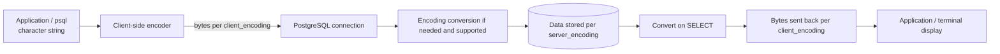
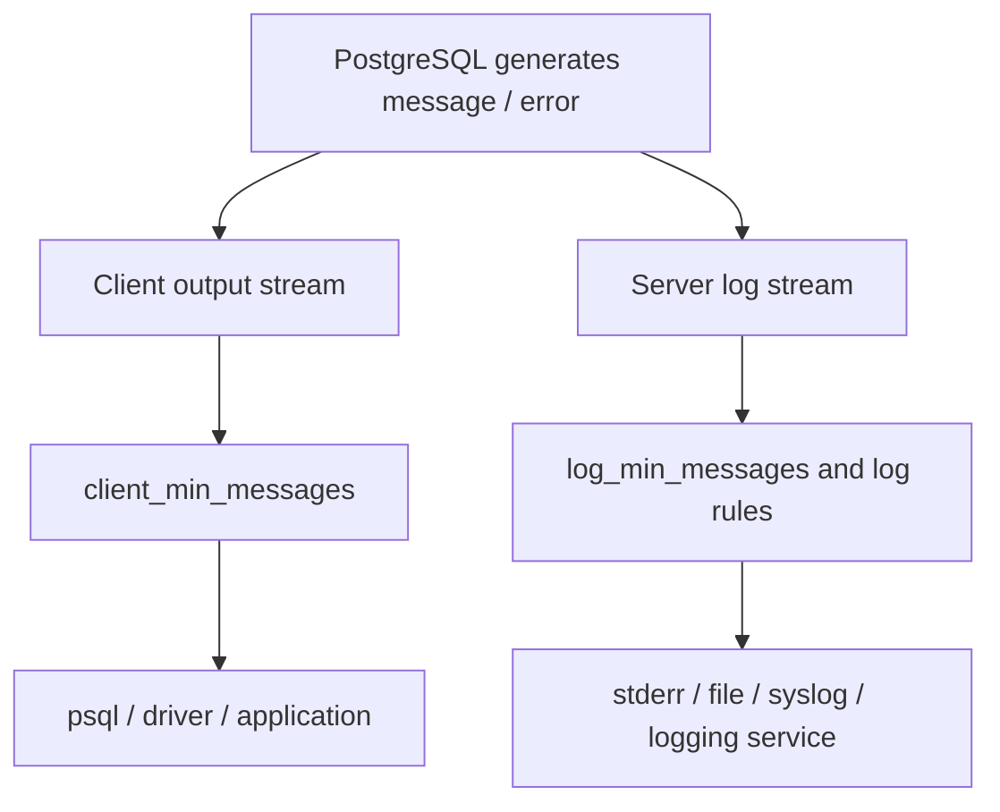

# Configuring Time Zones, Client Encoding, and Messages in PostgreSQL

## 1. Why Do These Three Configuration Groups Matter?

An application can store data accurately in PostgreSQL yet still display the wrong time, garble Unicode/Vietnamese characters, or emit overwhelming amounts of notices. These issues usually originate from **session and environment configuration**, not necessarily from table structure.

For example:

- A user in Vietnam schedules an event at 09:00, yet another service reads and displays it as 02:00 without explaining the time zone.
- A table stores valid Unicode strings, yet the terminal or application displays `Tiếng Việt` due to mismatched encodings across layers.
- A migration script emits hundreds of `NOTICE` messages that obscure real errors.
- A DBA changes `log_timezone` and mistakenly assumes that changed the time zone of date-time columns returned to applications.
- An application uses a connection pool, one request sets `TimeZone` for a customer, and accidentally leaves that setting affecting the next request.

The three configuration groups covered in this lesson:

| Group | Key Settings | Controls |
|---|---|---|
| **Time zone** | `TimeZone`, `log_timezone`, `DateStyle` | Time interpretation/display, log timestamps, and date formatting |
| **Client encoding** | `client_encoding`, `server_encoding`, `\encoding` | How text bytes are converted between PostgreSQL and clients |
| **Messages** | `client_min_messages`, `lc_messages`, `log_min_messages` | Message threshold sent to clients, message language, and server log level |

The goal after this lesson is to know how to **inspect active values**, **make changes at the appropriate scope**, **verify their impact**, and **diagnose configuration issues** without unintentionally altering stored data.

This lesson uses modern PostgreSQL syntax targeting PostgreSQL 15–18 and `psql`. Some settings require administrative privileges or OS-installed locales; examples explicitly state their scope and prerequisites.

## 2. Map of PostgreSQL Configuration Scopes

Before changing a time zone or message level, know **who** the setting applies to and **when** it takes effect.

PostgreSQL supports multiple configuration sources, commonly including:

1. PostgreSQL's built-in defaults.
2. Configuration files such as `postgresql.conf` and included files.
3. Configuration saved via `ALTER SYSTEM` in `postgresql.auto.conf`.
4. Database-level defaults set with `ALTER DATABASE ... SET`.
5. Role-level defaults set with `ALTER ROLE ... SET`.
6. Role-and-database-specific defaults set with `ALTER ROLE ... IN DATABASE ... SET`.
7. Connection startup options and `SET` commands within a session.
8. Temporary transaction-scoped settings via `SET LOCAL`.

**Not every parameter can be changed at every level.** PostgreSQL assigns each parameter a context; some change only at instance startup, some require a reload, some require superuser or delegated privileges, and others can be set by regular users inside a session.

### 2.1. Viewing Current Values

In an SQL connection:

```sql
SHOW TimeZone;
SHOW DateStyle;
SHOW client_encoding;
SHOW server_encoding;
SHOW client_min_messages;
SHOW lc_messages;
SHOW log_min_messages;
SHOW log_timezone;
```

Or inspect multiple at once via function calls:

```sql
SELECT
    current_setting('TimeZone') AS session_timezone,
    current_setting('DateStyle') AS date_style,
    current_setting('client_encoding') AS client_encoding,
    current_setting('server_encoding') AS server_encoding,
    current_setting('client_min_messages') AS client_message_level;
```

All results here reflect the **currently connected instance/database/session**; they do not automatically describe settings of other connections in the system.

### 2.2. Viewing Parameter Source and Context

The `pg_settings` view helps diagnose why a value differs from expectations:

```sql
SELECT
    name,
    setting,
    source,
    context,
    pending_restart
FROM pg_settings
WHERE lower(name) IN (
    'timezone',
    'datestyle',
    'client_encoding',
    'server_encoding',
    'client_min_messages',
    'lc_messages',
    'log_min_messages',
    'log_timezone'
)
ORDER BY lower(name);
```

Key fields:

| Field | Meaning |
|---|---|
| `name` | PostgreSQL parameter name |
| `setting` | Current value in the observed connection |
| `source` | Source of the effective setting, e.g., default, configuration file, user, database, or session |
| `context` | Scope/privileges required to change the parameter |
| `pending_restart` | Whether a change is waiting for a restart to take effect |

Do not guess causes from a single `SHOW` output. If the config file says UTC while a session shows `Asia/Ho_Chi_Minh`, check whether a role, database, startup option, or `SET` is overriding it.

## 3. Configuring Time Zones with `TimeZone`

### 3.1. What Does `TimeZone` Affect?

`TimeZone` is the **session's default time zone**. It notably affects:

- How PostgreSQL **displays** `timestamp with time zone` (abbreviated `timestamptz`) values.
- Interpretation of certain date-time inputs lacking an explicit time zone.
- Results of certain conversions and date functions, such as the date returned by `CURRENT_DATE`.
- The time zone used when converting an absolute instant to local wall-clock time.

Inspection example:

```sql
SHOW TimeZone;

SELECT now() AS current_instant;
```

Changing within a session:

```sql
SET TIME ZONE 'UTC';

SHOW TimeZone;

SELECT now() AS shown_in_utc;
```

Switching to a geographic time zone:

```sql
SET TIME ZONE 'Asia/Ho_Chi_Minh';

SHOW TimeZone;

SELECT now() AS shown_in_vietnam_time;
```

Names like `Asia/Ho_Chi_Minh` and `America/New_York` are **IANA time zone region names** supported by PostgreSQL's time zone database. In application data, region names are usually much more reliable than storing only a fixed offset `+07:00` or an ambiguous abbreviation.

**Important:** changing `TimeZone` does not cause PostgreSQL to rewrite all stored `timestamptz` values. It mainly changes how instants are **interpreted and formatted** for the session's time zone.

### 3.2. Example: Same Instant, Two Displays

Suppose we have an explicit instant in UTC:

```sql
SET TIME ZONE 'UTC';

SELECT TIMESTAMPTZ '2026-11-14 02:00:00+00'
       AS example_instant;

SET TIME ZONE 'Asia/Ho_Chi_Minh';

SELECT TIMESTAMPTZ '2026-11-14 02:00:00+00'
       AS example_instant;
```

In the UTC session, the result displays as 02:00 UTC. In the `Asia/Ho_Chi_Minh` session, the exact same instant displays as **09:00, offset +07**. This is **one instant**, not two events occurring seven hours apart.

When applications exchange instants across APIs, establish a clear contract: transmit in UTC or ISO 8601 with an explicit offset, and let the UI convert to the user's requested display time zone.

### 3.3. When Does Session `TimeZone` Matter?

| Use Case | Behavior to Watch |
|---|---|
| Storing payment timestamps | Use `timestamptz` to represent an absolute instant |
| Displaying times to customers | Convert the instant to the user's time zone |
| Computing current date | `CURRENT_DATE` depends on the session time zone |
| Filtering orders for a local day | Convert **local day boundaries** into corresponding instants |
| Storing a 09:00 meeting in a city's time zone | Preserve local-time semantics alongside the time zone region name |
| PostgreSQL server logging | Check `log_timezone`; do **not** infer from application `TimeZone` |

Distinguish three concepts:

- **Instant**: an unambiguous point on the timeline.
- **Local date/time**: wall-clock date and time at a location, which may not identify an instant without a time zone.
- **Time zone / zone identifier**: rules converting between instants and local times, potentially including DST in some regions.

## 4. `timestamp` vs. `timestamptz`: Similar Names, Different Semantics

This area is a very frequent source of bugs when configuring `TimeZone`.

| PostgreSQL Type | Full Name | Notes |
|---|---|---|
| `timestamp` | `timestamp without time zone` | Stores date and time components; the value itself carries no absolute instant |
| `timestamptz` | `timestamp with time zone` | Represents an absolute instant; output formatting depends on `TimeZone` |
| `date` | `date` | Calendar date, with no time or time zone |
| `time` | `time without time zone` | Time of day, does not identify an instant by itself |
| `timetz` | `time with time zone` | Includes an offset, though generally not preferred for schedules with DST rules |

PostgreSQL **does not store the original time zone name inside `timestamptz`**. If business logic needs to remember that a user entered `America/New_York`, store that region name in a separate column alongside the timestamp or model appointments accordingly.

### 4.1. Type Without Time Zone

```sql
SELECT
    TIMESTAMP '2026-11-14 09:00:00'
        AS local_wall_clock;
```

This value represents "2026-11-14 09:00:00" with **no attached time zone**. It could be Hanoi time, New York time, or a local-time schedule. The data type alone does not say.

If you change the session `TimeZone`, directly displaying a `timestamp without time zone` value preserves its stored date and time components.

### 4.2. Type With Time Zone

```sql
SELECT
    TIMESTAMPTZ '2026-11-14 09:00:00+07'
        AS absolute_instant;
```

The `+07` offset lets PostgreSQL determine the absolute instant, corresponding to 02:00 UTC on the same day.

Watch the literal syntax: the literal's data type is determined by `TIMESTAMP` or `TIMESTAMPTZ`, **not merely by including `+07` in the string**. Example:

```sql
SELECT
    TIMESTAMP '2026-11-14 09:00:00+07'
        AS timestamp_without_zone;
```

Because the literal specifies `TIMESTAMP` (without time zone), the trailing offset does not automatically turn it into `timestamptz`. When representing an instant, explicitly use `TIMESTAMPTZ` and supply an appropriate offset or zone name.

### 4.3. Practicing with a Small Table

In a **lab database where creating objects is permitted**, you can run:

```sql
CREATE SCHEMA IF NOT EXISTS config_lab;

CREATE TABLE IF NOT EXISTS config_lab.meetings (
    meeting_id bigint GENERATED ALWAYS AS IDENTITY PRIMARY KEY,
    meeting_name text NOT NULL,
    scheduled_at timestamptz NOT NULL,
    local_note_time timestamp without time zone
);
```

Insert a row:

```sql
INSERT INTO config_lab.meetings (
    meeting_name,
    scheduled_at,
    local_note_time
)
VALUES (
    'Project meeting',
    TIMESTAMPTZ '2026-11-14 09:00:00+07',
    TIMESTAMP '2026-11-14 09:00:00'
)
RETURNING meeting_id, scheduled_at, local_note_time;
```

Then compare:

```sql
SET TIME ZONE 'UTC';

SELECT meeting_id, scheduled_at, local_note_time
FROM config_lab.meetings
ORDER BY meeting_id;

SET TIME ZONE 'Asia/Ho_Chi_Minh';

SELECT meeting_id, scheduled_at, local_note_time
FROM config_lab.meetings
ORDER BY meeting_id;
```

**Expected observation:** `scheduled_at` displays according to the session time zone, whereas `local_note_time` keeps its stored date/time components. Running the insert multiple times adds more rows; row count does not change the principle.

## 5. Explicit Time Conversion with `AT TIME ZONE`

Do not rely solely on the session's implicit time zone in queries requiring consistent output across services.

PostgreSQL provides the `AT TIME ZONE` operator with **two conversion directions**:

| Input | Expression | Output | Meaning |
|---|---|---|---|
| `timestamp without time zone` | `local_time AT TIME ZONE zone` | `timestamptz` | Interprets local time in the given zone to produce an instant |
| `timestamptz` | `instant AT TIME ZONE zone` | `timestamp without time zone` | Converts an instant into local wall-clock time in that zone |

### 5.1. From Local Time to Instant

```sql
SELECT
    TIMESTAMP '2026-11-14 09:00:00'
        AT TIME ZONE 'Asia/Ho_Chi_Minh'
        AS instant_of_local_9am;
```

PostgreSQL interprets 09:00 as belonging to `Asia/Ho_Chi_Minh` and computes the corresponding instant. If the session displays UTC, the result shows 02:00 UTC; if the session displays Vietnam time, it appears as 09:00+07.

### 5.2. From Instant to Local Time

```sql
SELECT
    TIMESTAMPTZ '2026-11-14 02:00:00+00'
        AT TIME ZONE 'Asia/Ho_Chi_Minh'
        AS vietnam_local_time;
```

The result is the `timestamp without time zone` value **09:00** on that day. The zone was used for conversion, though the returned value itself carries no zone name.

### 5.3. Comparing Two Zones Independently of Session

```sql
SELECT
    TIMESTAMPTZ '2026-11-14 02:00:00+00'
        AT TIME ZONE 'Asia/Ho_Chi_Minh'
        AS hcm_clock,
    TIMESTAMPTZ '2026-11-14 02:00:00+00'
        AT TIME ZONE 'Europe/London'
        AS london_clock;
```

The two columns show local wall-clock views of **the exact same instant**. Using proper region names allows PostgreSQL to apply historical rules and daylight saving time (where applicable) rather than adding a fixed offset.

## 6. Daylight Saving Time (DST): Why Not Just Add or Subtract Hours?

Some regions shift offsets seasonally. For example, `America/New_York` transitions into and out of daylight saving time. This leads to:

- Local times that **do not exist** on spring-forward days.
- Local times that **occur twice** on fall-back days.
- A "local calendar day" lasting **23, 24, or 25 actual hours**, depending on region and date.

Example expressing an exact instant:

```sql
SELECT
    TIMESTAMPTZ '2026-11-01 01:30:00-04'
        AS first_occurrence,
    TIMESTAMPTZ '2026-11-01 01:30:00-05'
        AS second_occurrence;
```

These are two distinct instants, even though local clocks show 01:30 both times when New York changes clocks in autumn. Do not hardcode offsets based on abbreviations like `EST`/`EDT` when business requirements demand following a region's schedule year-round.

### 6.1. Filtering by a Local Calendar Day

Suppose `created_at` is `timestamptz` and the application wants all orders on 2026-11-14 in **Vietnam time**.

Instead of writing an ambiguous condition:

```sql
-- Fragile: depends on the session's time zone:
SELECT *
FROM config_lab.meetings
WHERE scheduled_at::date = DATE '2026-11-14';
```

compute **both local day boundaries** as instants:

```sql
SELECT *
FROM config_lab.meetings
WHERE scheduled_at >= (
        TIMESTAMP '2026-11-14 00:00:00'
        AT TIME ZONE 'Asia/Ho_Chi_Minh'
      )
  AND scheduled_at < (
        TIMESTAMP '2026-11-15 00:00:00'
        AT TIME ZONE 'Asia/Ho_Chi_Minh'
      );
```

This half-open interval `[start_of_day, start_of_next_day)`:

- Makes local-day semantics explicit.
- Does not rely on session `TimeZone` to interpret boundaries.
- Never misses records with fractional seconds near midnight.
- Typically works better with a regular B-tree index on `scheduled_at` than casting every column value.

For regions with DST, compute **both** boundaries from local time and the region name; never assume every day equals 24 hours in UTC.

### 6.2. Absolute Instants vs. Local-Time Schedules

"Send a report at 09:00 every day in New York" differs from "send a report every 24 hours from the first run." The first needs the **time zone region** to follow DST; the second can operate on an absolute interval.

When storing recurring schedules, you typically need local date/time, the IANA zone identifier, and recurrence rules. A single `timestamptz` column describing **one occurrence** cannot capture local-time recurrence semantics by itself.

## 7. `DateStyle` and Related Date-Time Functions

### 7.1. `DateStyle` Is Not `TimeZone`

`DateStyle` controls date/time output formatting and input parsing rules, such as ISO formatting and day/month/year ordering for ambiguous inputs.

```sql
SHOW DateStyle;

SET DateStyle TO 'ISO, DMY';

SHOW DateStyle;

SELECT DATE '2026-11-14' AS explicit_iso_date;
```

Always pass dates in ISO format `YYYY-MM-DD` or typed driver parameters rather than ambiguous strings like `'01/02/2026'` without specifying day-first or month-first ordering.

**Two different questions:**

- "Which time zone does 09:00 belong to?" → `TimeZone` / `AT TIME ZONE`.
- "In what day-month order is the string 01/02/2026 parsed?" → `DateStyle` and date parsing rules.

Changing `DateStyle` does not convert a `timestamp` column to `timestamptz`, does not normalize data to UTC, and does not fix time zone bugs in applications.

### 7.2. Commonly Used Time Functions

```sql
SELECT
    now() AS transaction_time,
    CURRENT_TIMESTAMP AS sql_transaction_time,
    statement_timestamp() AS statement_start,
    clock_timestamp() AS current_wall_clock,
    CURRENT_DATE AS calendar_date_in_session_zone,
    LOCALTIME AS local_time_only,
    LOCALTIMESTAMP AS local_timestamp_without_zone;
```

Interpretation:

| Expression | Core Meaning |
|---|---|
| `now()` / `CURRENT_TIMESTAMP` | Start time of the current transaction |
| `transaction_timestamp()` | Same transaction-start semantics |
| `statement_timestamp()` | Start time of the current SQL statement |
| `clock_timestamp()` | Current wall-clock time, which can advance even within a single SQL statement |
| `CURRENT_DATE` | Calendar date in the session's time zone |
| `LOCALTIMESTAMP` | Timestamp without time zone in the session's local time |

When measuring execution duration or event timestamps, do not use `now()` in place of `clock_timestamp()` without understanding the difference: within a long-running transaction, `now()` stays fixed at transaction start.

### 7.3. `log_timezone` Differs from `TimeZone`

`log_timezone` controls the time zone PostgreSQL uses when writing **timestamps in server logs**. For example, an operator may want all server logs in UTC for easy correlation across hosts.

```sql
SHOW TimeZone;
SHOW log_timezone;
```

The two values can differ without being an error:

```text
TimeZone     = Asia/Ho_Chi_Minh  -- how the session displays app times
log_timezone = UTC               -- timestamps in server logs
```

Changing `log_timezone` **does not alter instants stored in `timestamptz`**, and changing an application's `TimeZone` does not change server log timestamps.

`log_timezone` is a server-side operational parameter usually requiring administrative privileges. Regular application connections should not arbitrarily modify it.

## 8. Scopes for Setting Time Zone: Session, Transaction, Database, and Role

PostgreSQL allows defining defaults at multiple scopes.

### 8.1. Within a Session

```sql
SHOW TimeZone;

SET TimeZone TO 'UTC';

SELECT now();

RESET TimeZone;

SHOW TimeZone;
```

`SET` applies to the **current connection**; it does not change defaults for all users or databases. `RESET` restores the parameter to the session's applicable default across active configuration sources, not necessarily PostgreSQL's compiled-in default.

In `psql`, when using a dedicated test session, this has minimal impact on anyone else.

### 8.2. Only Within a Transaction via `SET LOCAL`

```sql
SHOW TimeZone;

BEGIN;

SET LOCAL TimeZone TO 'Asia/Ho_Chi_Minh';

SELECT now() AS shown_in_transaction;

COMMIT;

SHOW TimeZone;
```

`SET LOCAL` remains active until the transaction ends, after which the prior session setting is restored per PostgreSQL rules. Use it when one unit of work needs a temporary policy without leaking into subsequent operations.

If executed **outside a valid transaction block**, `SET LOCAL` does not have the persistent effect you might expect. In applications using connection pools, the transaction-local pattern is usually safer than long-lived session-level settings.

### 8.3. Database Default

Executed by an authorized administrator:

```sql
ALTER DATABASE app_db
SET TimeZone TO 'UTC';
```

This creates a **default for new sessions** connecting to `app_db`; it does not automatically alter existing open connections. `app_db` is an example only; never run this on a live production database without a change workflow.

To remove the database-specific setting:

```sql
ALTER DATABASE app_db RESET TimeZone;
```

### 8.4. Role Default

```sql
ALTER ROLE app_user
SET TimeZone TO 'Asia/Ho_Chi_Minh';
```

You can also scope it to a role connecting to a specific database:

```sql
ALTER ROLE app_user IN DATABASE app_db
SET TimeZone TO 'UTC';
```

A combined **role + database** setting applies to matching login sessions and typically takes precedence over role-only or database-only defaults. A session `SET` can still override it if the parameter allows.

Key rules:

- `ALTER ROLE`/`ALTER DATABASE` defaults generally take effect on **new session initialization**; test with a fresh connection.
- `SET ROLE` mid-session **does not automatically re-apply** defaults attached to the role you switched into.
- Appropriate privileges are required to run `ALTER ROLE` or `ALTER DATABASE`.
- With connection pools, default changes do not appear on previously opened connections until those connections are recycled.

### 8.5. Server-Level Default

In `postgresql.conf`, administrators can configure:

```conf
timezone = 'UTC'
log_timezone = 'UTC'
datestyle = 'iso, mdy'
```

Actual files and locations depend on the OS, containers, or cloud service. Changes may require a reload or restart depending on the parameter. Check `pg_settings.context` and `pending_restart` rather than assuming every change applies immediately.

With appropriate administrative privileges, PostgreSQL supports `ALTER SYSTEM` to write settings to `postgresql.auto.conf`:

```sql
-- Illustrative DBA action; do not run directly on production.
ALTER SYSTEM SET TimeZone = 'UTC';

-- Reload when supported by parameter and privileges.
SELECT pg_reload_conf();
```

Choose **one consistent configuration management workflow**: IaC/config-managed files or controlled `ALTER SYSTEM`, avoiding multiple overlapping layers that are hard to trace.

## 9. Encoding: Distinguishing Characters, Bytes, and Encodings

Text data travels between client systems and PostgreSQL. To prevent corrupted Unicode or Vietnamese characters, separate:

- **Unicode character**: e.g., the characters `ế`, `ệ`.
- **Bytes**: raw octets transmitted over the wire or stored at the encoding layer.
- **Encoding**: rules mapping character strings to bytes and back, such as UTF-8.

Two strings can look identical visually yet use different Unicode representations (precomposed characters vs. base characters with combining diacritics). **Valid UTF-8 does not automatically normalize Unicode** into a single canonical form; for consistent searching/sorting, applications may need explicit normalization and appropriate collations.

### 9.1. `server_encoding` and `client_encoding`

| Setting | Level | Meaning |
|---|---|---|
| `server_encoding` | Bound to the created database | Encoding of character data stored inside the database |
| `client_encoding` | Connection session setting | Client-side encoding PostgreSQL uses when receiving/sending text |
| Terminal encoding | Terminal/OS | How the terminal decodes bytes for display |
| CSV/SQL file encoding | File and generating tool | How text bytes inside the file are encoded |

Inspect:

```sql
SHOW server_encoding;
SHOW client_encoding;

SELECT
    current_setting('server_encoding') AS database_encoding,
    current_setting('client_encoding') AS connection_encoding;
```

A common configuration:

```text
server_encoding = UTF8
client_encoding = UTF8
```

Here Unicode text travels as UTF-8 between PostgreSQL and compatible clients. Even so, the terminal itself must use a matching encoding and font to render characters properly.

### 9.2. Character Conversion Flow



If a client declares `LATIN1` while actually sending UTF-8 bytes, PostgreSQL can **misinterpret bytes** or raise an error; changing display fonts cannot fix that. Conversely, even if both server and client use UTF-8, an application writing output files in another encoding can still corrupt text after data leaves PostgreSQL.

### 9.3. Does PostgreSQL Convert Encodings Automatically?

In many cases, PostgreSQL can convert between the client encoding and database encoding when the conversion pair is supported and all characters are representable in the target encoding.

If a character cannot be represented in the requested encoding, conversion fails with an encoding error. Never work around this by silently replacing unrepresentable characters with `?` if data integrity must be preserved.

### 9.4. Why `SQL_ASCII` Is Not a Fix for Unicode Errors

`SQL_ASCII` performs no Unicode validation or interpretation like UTF-8 and allows inconsistent byte sequences inside data. Using `SQL_ASCII` to "stop encoding errors" usually makes problems worse: bytes in the same column can end up interpreted under incompatible encodings.

For modern multilingual applications, **UTF8** is normally the right choice for both database and connections, unless specific legacy integration constraints dictate otherwise.

## 10. Setting `client_encoding` in SQL and `psql`

### 10.1. Changing Connection Encoding

In a permitted session:

```sql
SHOW client_encoding;

SET client_encoding TO 'UTF8';

SHOW client_encoding;
```

This changes **how text data is exchanged on the connection**; it does not re-encode values already stored on the server.

A common equivalent:

```sql
SET NAMES 'UTF8';
```

In PostgreSQL, `SET NAMES` sets `client_encoding`. Distinguish this from DBMSs that maintain multiple separate charset/collation variables for client, connection, and results.

Restore:

```sql
RESET client_encoding;
```

Like other session parameters, the value after `RESET` depends on the active default configuration.

### 10.2. Using the `psql` Meta-Command

Inside `psql`:

```text
\encoding
\encoding UTF8
```

- `\encoding` without arguments displays the client encoding.
- `\encoding UTF8` sets the client encoding to UTF8 for the `psql` connection.

This is a **psql client meta-command**, not standard SQL for JDBC. Sending `\encoding` through JDBC causes a syntax error because the driver forwards it to the server as SQL.

### 10.3. Using Environment Variables for libpq/psql

With libpq-based clients, the `PGCLIENTENCODING` environment variable can specify client encoding at connection startup.

POSIX shell example:

```sh
PGCLIENTENCODING=UTF8 psql \
  -h 127.0.0.1 -p 5432 \
  -U lab_user -d lab_db
```

This assumes the lab account and database already exist. In PowerShell, setting a per-process environment variable uses different syntax than a POSIX shell. Even when using environment variables, verify with `SHOW client_encoding;` after connecting.

### 10.4. Java/JDBC Applications

Modern PostgreSQL drivers manage string transmission over the wire using appropriate protocol encoding, typically UTF-8. Java applications work with Unicode `String` objects while the driver handles conversion to wire bytes.

Conceptual example:

```java
String sql = """
    INSERT INTO config_lab.messages(message_text)
    VALUES (?)
    """;

try (PreparedStatement statement = connection.prepareStatement(sql)) {
    statement.setString(1, "Vietnamese message: saved successfully");
    statement.executeUpdate();
}
```

This illustrative snippet assumes an existing JDBC `Connection` and matching `config_lab.messages` table. Never concatenate raw user strings into SQL to dodge encoding issues; `PreparedStatement` clarifies data types and prevents a class of SQL injection risks.

If results differ between `psql` and Java, inspect **each client's actual encoding**, console fonts, API serialization, source files, and driver behavior rather than assuming PostgreSQL corrupted the data.

## 11. Testing Multi-Byte Unicode Text in PostgreSQL

Create a dedicated table in a lab database if permitted:

```sql
CREATE SCHEMA IF NOT EXISTS config_lab;

CREATE TABLE IF NOT EXISTS config_lab.messages (
    message_id bigint GENERATED ALWAYS AS IDENTITY PRIMARY KEY,
    message_text text NOT NULL,
    created_at timestamptz NOT NULL DEFAULT now()
);
```

Set client encoding and insert sample rows:

```sql
SET client_encoding TO 'UTF8';

INSERT INTO config_lab.messages (message_text)
VALUES
    ('Xin chào'),
    ('Tiếng Việt có dấu'),
    ('Đơn hàng đã được xác nhận'),
    ('Nội dung có ký tự Unicode: ✓')
RETURNING message_id, message_text;
```

Inspect:

```sql
SELECT message_id, message_text
FROM config_lab.messages
ORDER BY message_id;
```

### 11.1. Distinguishing Character Length from Byte Length

```sql
SELECT
    message_text,
    char_length(message_text) AS character_count,
    octet_length(message_text) AS byte_count
FROM config_lab.messages
ORDER BY message_id;
```

`char_length()` counts characters semantically; `octet_length()` returns the number of bytes representing the string in the database encoding. In UTF-8, many accented characters occupy more than one byte. Hence, **byte count does not necessarily equal character count**.

To inspect the UTF-8 encoded bytes of a string in hexadecimal:

```sql
SELECT
    encode(convert_to('Tiếng Việt', 'UTF8'), 'hex')
        AS utf8_hex;
```

`convert_to(text, encoding)` produces a `bytea` representation in the requested encoding, and `encode(..., 'hex')` formats bytes cleanly for inspection. Do not compare this hex output directly against a CSV file without knowing what encoding the CSV uses.

### 11.2. Database Encoding Cannot Be Changed with `SET`

`server_encoding` is fixed when a database is created. The following command **cannot** change the data encoding of an existing database:

```sql
-- Invalid idea; server_encoding is not a changeable session setting:
-- SET server_encoding TO 'UTF8';
```

In an admin-managed lab environment, you can create a **new database** with the desired encoding, for example:

```sql
-- Illustrative; run only when you genuinely need a new lab database.
CREATE DATABASE unicode_lab
    WITH ENCODING 'UTF8'
         TEMPLATE template0;
```

This statement must also match cluster locale/`LC_COLLATE`/`LC_CTYPE` rules and may require specifying compatible locales or fail on some setups. Do not run `CREATE DATABASE` inside a transaction block.

If an existing database uses an undesirable encoding, switching normally requires **migrating data into a properly encoded database** using verified tooling and procedures—not simply tweaking a GUC.

## 12. Reading and Writing CSV/SQL with the Right Encoding

A common issue: data looks right in `psql`, yet becomes garbled after exporting to or importing from a file.

When a file uses UTF-8, you can declare encoding in `COPY` if supported by your version/syntax:

```sql
COPY config_lab.messages (message_text)
TO STDOUT
WITH (FORMAT csv, HEADER true, ENCODING 'UTF8');
```

When exporting to a local file with `psql`, use `\copy`:

```text
\copy config_lab.messages (message_text) TO 'messages_utf8.csv' WITH (FORMAT csv, HEADER true, ENCODING 'UTF8')
```

`\copy` executes through the **psql client**, so the file path belongs to the **machine running psql**. Conversely, `COPY ... TO '/path/file'` without `STDOUT` accesses the PostgreSQL server's filesystem and requires appropriate privileges.

To import a CSV file, verify:

1. Which encoding the file was actually saved in.
2. Whether the import tool reads the file on the client or server side.
3. That `COPY`'s `ENCODING` matches the file's bytes.
4. That columns and data types match the table schema.
5. That CSV fields containing commas, quotes, or newlines are properly escaped.
6. That imported text is verified afterward, not just row counts.

Example import structure in `psql`:

```text
\copy config_lab.messages (message_text) FROM 'messages_utf8.csv' WITH (FORMAT csv, HEADER true, ENCODING 'UTF8')
```

**Do not immediately run this import back into the same table after exporting unless duplicate rows are intended.** For test data, use a fresh target table or an intentional transaction followed by rollback.

### 12.1. The Bug Is Not Always Inside PostgreSQL

Suppose a CSV file was saved by a program using a Windows code page, yet the import tool declares UTF-8. PostgreSQL may report an invalid byte sequence. If it does not error yet text appears corrupted, the string was likely decoded incorrectly **before reaching the database**.

Layers to inspect:

```text
Source file -> File reader -> Unicode string in app
            -> Driver / client_encoding -> server_encoding
            -> SELECT -> Driver -> Terminal / API / exported CSV
```

Changing `client_encoding` cannot repair characters already turned into `?` or mojibake before arriving at PostgreSQL. If the original data still exists, fix the **faulty conversion step** and re-import through a controlled process.

## 13. Collation, Locale, and Encoding Are Distinct Concepts

Distinguish three concepts frequently lumped together:

| Concept | Controls | Examples |
|---|---|---|
| **Encoding** | How characters map to byte sequences | UTF8, LATIN1 |
| **Collation** | String comparison and sort ordering rules | libc/ICU collations per database/column |
| **Locale** | Cultural/formatting conventions or message language | `lc_messages`, `lc_time`, `lc_numeric` |

For example, two databases both using UTF-8 can produce different `ORDER BY name` results if they use different collations. That **does not** mean the data is encoded incorrectly.

In PostgreSQL, certain locale and collation settings depend on the OS or ICU provider. Changing `client_encoding` does not alter index collation, and changing `lc_messages` does not change how `ORDER BY` sorts text columns.

If collations change or comparison libraries upgrade, collation-dependent indexes may require inspection and reindexing. That is completely separate from client encoding conversion.

## 14. Messages in PostgreSQL: What Information Reaches the Client?

PostgreSQL defines **message severity levels** to classify SQL and system events.

Common levels:

| Level | Practical Meaning |
|---|---|
| `DEBUG1` … `DEBUG5` | Debugging details; `DEBUG5` can be extremely verbose |
| `INFO` | Informational output about an ongoing operation |
| `NOTICE` | Notable information that is not an error; e.g., skipping an existing object |
| `WARNING` | Warning about a condition that may need review |
| `ERROR` | Error causing the current statement to fail |
| `LOG` | Log-oriented information; follows special filtering rules |
| `FATAL` | Severe error terminating the current session/connection |
| `PANIC` | Critical error causing PostgreSQL to stop/restart per server mechanisms |

Not all levels are meant to be emitted arbitrarily by developers in regular SQL. For instance, PL/pgSQL `RAISE` supports levels like `NOTICE`, `WARNING`, and `EXCEPTION`, whereas `FATAL`/`PANIC` belong mainly to internal server error handling.

Crucial distinction: **the message level sent to clients is not the same as the message level written to server logs**. Each stream has its own settings.

## 15. `client_min_messages`: Filtering Messages for a Session

`client_min_messages` determines the severity threshold of messages sent by the server to the client in most cases.

Inspect:

```sql
SHOW client_min_messages;
```

For example, to show only warnings and errors (suppressing normal `NOTICE` output):

```sql
SET client_min_messages TO warning;
```

When you want normal notices again:

```sql
SET client_min_messages TO notice;
```

After practicing:

```sql
RESET client_min_messages;
```

### 15.1. Example Emitting Messages with PL/pgSQL

Using a `DO` block:

```sql
DO $$
BEGIN
    RAISE NOTICE 'Notice: lab exercise started';
    RAISE WARNING 'Warning: this is only an example';
END
$$;
```

Testing `notice` level:

```sql
SET client_min_messages TO notice;

DO $$
BEGIN
    RAISE NOTICE 'NOTICE level will be sent to client';
    RAISE WARNING 'WARNING level is also sent to client';
END
$$;
```

Testing `warning` level:

```sql
SET client_min_messages TO warning;

DO $$
BEGIN
    RAISE NOTICE 'This notice is normally filtered out';
    RAISE WARNING 'This warning is still sent';
END
$$;
```

Normally, when the threshold is `warning`, `RAISE NOTICE` is suppressed from the client while `RAISE WARNING` still arrives. Client tools present them differently: a terminal may print to stderr, while drivers expose them via warning/notice collections or callbacks.

**Important exception:** PostgreSQL handles `INFO` messages under special rules; `INFO` messages are sent to clients regardless of `client_min_messages` in standard PostgreSQL semantics. `LOG` also follows special ordering rules. Thus, never apply a naive linear comparison blindly across every severity name.

### 15.2. `client_min_messages` Does Not Hide SQL Errors

For example:

```sql
SET client_min_messages TO error;
```

does not make invalid SQL succeed. Constraint, syntax, or permission errors still fail the statement, and the application must handle them properly.

**Transaction note:** if SQL raises `ERROR` inside an open transaction, PostgreSQL puts the transaction into an aborted state until rollback. Message thresholds do not alter transaction atomicity or rollback behavior.

### 15.3. When Should You Suppress `NOTICE`?

Practical scenarios:

- A deployment script generates many `NOTICE` messages that clutter the operator's screen.
- A CLI tool wants to show only warnings/errors for clarity.
- A batch worker connection reduces noisy non-critical messages.

Avoid raising the threshold mechanically without thought. `NOTICE` messages often carry helpful details during index creation, migrations, or `IF NOT EXISTS` checks. For administrative operations requiring an audit trail, keep appropriate verbosity and capture logs separately.

## 16. `lc_messages`: Choosing the Message Language

`lc_messages` determines the **locale/language** used for PostgreSQL-generated messages when translations and required OS locales are installed.

Check:

```sql
SHOW lc_messages;
```

In some environments, the value is `C` or an OS locale name like `en_US.UTF-8`. Exact availability depends on how PostgreSQL was built, the operating system, and cluster configuration.

An administrator may set, for example:

```sql
-- Illustrative only for accounts with appropriate privileges.
SET lc_messages TO 'C';
```

The `C` locale typically produces PostgreSQL's default untranslated messages, usually in English. Other locales work only when supported/installed along with corresponding translation catalogs.

**Pitfalls to avoid:**

- `lc_messages` does not change `client_encoding`.
- `lc_messages` does not change time zones.
- `lc_messages` does not change message severity levels.
- Translations alter error message text, so **SQLSTATE** remains the stable way for applications to classify errors.

Changing `lc_messages` usually requires higher privileges than regular users hold; do not assume every application connection can set it freely.

### 16.1. Handle Errors by SQLSTATE, Not Message Text

For instance, a unique-key violation returns SQLSTATE `23505` (*unique_violation*).

Applications should never write:

```text
if error.message contains "duplicate key":
    ...
```

because message text varies by locale, PostgreSQL version, driver, and context.

Instead, drivers expose **SQLSTATE**. Java example:

```java
try {
    // Execute SQL statement.
} catch (java.sql.SQLException error) {
    String sqlState = error.getSQLState();
    if ("23505".equals(sqlState)) {
        // Handle UNIQUE constraint violation according to business logic.
    } else {
        throw error;
    }
}
```

This snippet illustrates exception-handling structure, not a standalone Java program. SQLSTATE classifies the error, yet the application still needs to identify the exact violated constraint and business context before deciding whether to retry or return an error.

## 17. Server Logging: Separate from Client Messages

Key server-side logging settings:

| Setting | Effect |
|---|---|
| `log_min_messages` | Severity threshold written to the server log |
| `log_min_error_statement` | Error threshold causing the offending SQL statement to be logged per config |
| `log_statement` | Selects statement categories logged per policy |
| `log_min_duration_statement` | Logs statements whose execution time exceeds the threshold |
| `logging_collector` | Background collector writing logs to files when enabled |
| `log_destination` | Log output destinations, depending on OS/configuration |
| `log_line_prefix` | Prefix containing timestamp, PID, user, database, application name, etc. |
| `log_timezone` | Time zone used for timestamps in server logs |

Inspection example:

```sql
SHOW log_min_messages;
SHOW log_min_error_statement;
SHOW log_statement;
SHOW log_min_duration_statement;
SHOW logging_collector;
SHOW log_destination;
SHOW log_timezone;
```

### 17.1. Two Independent Message Streams



For example, setting `client_min_messages = warning` reduces `NOTICE` messages sent to clients, which **does not mean** `NOTICE` entries are automatically removed from server logs under the same rule. Conversely, `log_min_messages = warning` controls the server log stream without changing the client's message filter.

`LOG`/`INFO` levels follow special rules in PostgreSQL's severity semantics; during operational investigations, consult documentation for your exact version instead of guessing ordering from level names.

### 17.2. Sample Config File Settings for DBAs

In administrator-managed configuration:

```conf
# Example, not a mandatory default configuration:
log_timezone = 'UTC'
log_min_messages = warning
client_min_messages = notice
```

To investigate slow queries, duration-based logging can help, while accounting for I/O load and sensitive data. Enabling `log_statement = 'all'` indiscriminately can produce massive logs and capture SQL statements containing private data.

### 17.3. `lc_messages` Differs from `log_timezone`

Example:

```text
lc_messages = C        -- message language
log_timezone = UTC     -- log timestamp time zone
```

These two settings are independent:

- `lc_messages` affects translated message text when available.
- `log_timezone` affects how timestamps are written in logs.
- `client_min_messages` affects messages delivered to applications.
- `TimeZone` affects date-time handling in sessions.

Seeing English log text paired with UTC timestamps is completely normal.

## 18. Which Level Should You Change in Real Deployments?

Choose the scope matching your requirement rather than editing `postgresql.conf` every time a single UI screen wants a different display time.

| Requirement | Scope to Consider | Why |
|---|---|---|
| One query displays Vietnam time | `AT TIME ZONE 'Asia/Ho_Chi_Minh'` inside the query | Explicit, independent of session state |
| One transaction processes in a business time zone | `SET LOCAL TimeZone` | Automatically restores when transaction ends |
| Entire app uses UTC for instants | Role/database default or pool session setup | Consistent across requests |
| All server logs use UTC | `log_timezone` in server config | Easy correlation across hosts |
| A terminal needs to display Vietnamese | UTF8 client encoding plus Unicode terminal | No need to change database encoding |
| CSV file uses a specific encoding | `COPY ... ENCODING` and file verification | Matches source bytes accurately |
| A script wants fewer NOTICE messages | `client_min_messages` in session | Does not affect the entire server |
| Operations wants more server error logging | `log_min_messages` and logging config | Supports monitoring systems |
| Need a different error language | `lc_messages` if locale and privileges allow | No need to change data charset |

### 18.1. Checking Configuration After Changes

In a new connection when testing defaults:

```sql
SELECT
    current_database() AS database_name,
    current_user AS role_name,
    current_setting('TimeZone') AS timezone_setting,
    current_setting('client_encoding') AS client_encoding_setting,
    current_setting('client_min_messages') AS client_messages_setting;
```

Then inspect sources:

```sql
SELECT name, setting, source, context
FROM pg_settings
WHERE lower(name) IN (
    'timezone',
    'client_encoding',
    'client_min_messages'
)
ORDER BY lower(name);
```

This verifies whether the application pool actually connects with the role and database whose defaults you updated.

### 18.2. Connection Pool Rules

A **connection pool** reuses connections across multiple requests. If request A runs:

```sql
SET TIME ZONE 'Asia/Ho_Chi_Minh';
```

and returns the connection to the pool without resetting it, request B may inherit the time zone left behind by A.

How to prevent state leakage:

- Use one fixed time zone convention per pool whenever possible.
- Use `SET LOCAL` inside a transaction for single-use-case settings.
- Reset connections to a clean baseline via pool/driver mechanisms.
- Never assume a transaction rollback undoes session-level `SET` commands executed outside that transaction.
- Test both fresh and reused connections in integration tests.

The same applies to `client_min_messages` and many other GUCs. One request must never accidentally alter the message threshold of a subsequent request.

### 18.3. Options at Connection Startup

With libpq-based tools, some server settings can be passed as startup options. POSIX shell example:

```sh
PGOPTIONS='-c TimeZone=UTC -c client_min_messages=warning' \
psql -h 127.0.0.1 -p 5432 -U lab_user -d lab_db
```

This example assumes the lab role and database exist. Startup options are still subject to each parameter's privilege rules and semantics. With JDBC, use driver/framework-compatible configuration options rather than appending arbitrary strings to a URL assuming every layer understands them.

## 19. Combined Two-Session Hands-On Lab

Objective: test time zones, UTF-8, and message filtering **without requiring superuser privileges**.

### 19.1. Prepare Session A

In `psql` connected to a lab database:

```sql
SELECT
    current_database(),
    current_user;

SHOW TimeZone;
SHOW client_encoding;
SHOW client_min_messages;
```

Set values for Session A:

```sql
SET TimeZone TO 'Asia/Ho_Chi_Minh';
SET client_encoding TO 'UTF8';
SET client_min_messages TO warning;
```

Verify:

```sql
SELECT
    current_setting('TimeZone') AS tz,
    current_setting('client_encoding') AS encoding,
    current_setting('client_min_messages') AS messages;
```

### 19.2. Test Time and Characters

```sql
SELECT
    TIMESTAMPTZ '2026-11-14 02:00:00+00'
        AS time_displayed_in_session,
    TIMESTAMPTZ '2026-11-14 02:00:00+00'
        AT TIME ZONE 'Asia/Ho_Chi_Minh'
        AS explicitly_local_time,
    char_length('Tiếng Việt') AS number_of_characters,
    octet_length('Tiếng Việt') AS number_of_bytes;
```

Observations:

- The two time expressions represent the **same instant** formatted in two ways.
- The byte count of UTF-8 text with diacritics can exceed its character count.
- None of these checks modify table data.

### 19.3. Test Messages

```sql
DO $$
BEGIN
    RAISE NOTICE 'This is a NOTICE';
    RAISE WARNING 'This is a WARNING';
END
$$;
```

At `warning` level, ordinary `NOTICE` messages are filtered out from the client while `WARNING` is still displayed.

Reset threshold:

```sql
SET client_min_messages TO notice;
```

Then re-run the `DO` block to compare.

### 19.4. Open an Independent Session B

Open another `psql` window with the same role and database. Run:

```sql
SHOW TimeZone;
SHOW client_encoding;
SHOW client_min_messages;
```

Unless role/database defaults were specially configured, Session B **does not inherit Session A's `SET` commands**. This directly demonstrates session scope.

### 19.5. Test `SET LOCAL` and Clean Up

Back in Session A:

```sql
SHOW TimeZone;

BEGIN;
SET LOCAL TimeZone TO 'UTC';
SELECT now() AS utc_during_transaction;
COMMIT;

SHOW TimeZone;
```

After `COMMIT`, the session's `TimeZone` returns to the value active before `SET LOCAL`.

At the end of the lab, you can reset the parameters set in the **lab session**:

```sql
RESET TimeZone;
RESET client_encoding;
RESET client_min_messages;
RESET DateStyle;
```

These `RESET` commands affect only the current connection; they do not drop tables, schemas, or alter anyone else's server configuration.

## 20. Troubleshooting Common Issues

### 20.1. "Same Timestamp Displays Differently on Two Machines"

**Possibility:** different session `TimeZone` values, or the application applies an extra time zone conversion.

Check:

```sql
SHOW TimeZone;

SELECT
    TIMESTAMPTZ '2026-11-14 02:00:00+00'
        AS session_output,
    TIMESTAMPTZ '2026-11-14 02:00:00+00'
        AT TIME ZONE 'UTC'
        AS explicit_utc_clock;
```

Never alter stored source data merely because two outputs show different hours; first check whether they represent the exact same instant.

### 20.2. "Record Stored 09:00 Yet Displays 02:00"

If the column is `timestamptz`, this may simply be 09:00 Vietnam time displaying as 02:00 UTC. If the column is `timestamp without time zone`, check whether an erroneous time zone conversion happened on insert.

Investigate **column type, session settings, input strings, and application layers** before running bulk `UPDATE` statements.

### 20.3. "Daily Queries Miss Late-Evening Orders"

Often caused by an imprecise end-of-day boundary timestamp or computing the calendar day in the wrong time zone.

Prefer half-open filtering:

```sql
WHERE event_time >= lower_boundary
  AND event_time < upper_boundary
```

with both boundaries converted from the desired local calendar day into instants in that region's time zone, rather than casting `event_time::date` under an uncontrolled session time zone.

### 20.4. "Unicode / Vietnamese Text Appears as Garbled Characters"

Check each layer:

```sql
SHOW server_encoding;
SHOW client_encoding;
```

Then verify:

- Is the source file actually UTF-8?
- Does the terminal render Unicode/UTF-8 properly?
- Which encoding is the driver using to send/receive text?
- Was the string already corrupted in the application **before insert** or only upon output?
- Was `client_encoding` altered mid-connection?

Never rush to migrate an entire database to another encoding just because a terminal lacks a font.

### 20.5. "invalid byte sequence for encoding UTF8"

This error indicates incoming bytes are not valid UTF-8 where checked, or a file/`bytea` value contains incompatible content. Identify the **source's real encoding** and convert cleanly with appropriate tools.

Do not switch to `SQL_ASCII` or silently replace invalid bytes with `?` on data that must remain intact.

### 20.6. "client_encoding = UTF8 Yet CSV Import Is Still Garbled"

`client_encoding` governs the connection, whereas bytes inside the CSV file may be saved in a different encoding. If the file is UTF-8, declare UTF8 during read; if not, declare its real encoding or transcode the file before importing.

### 20.7. "Not Seeing NOTICE in psql"

Check:

```sql
SHOW client_min_messages;
```

If the threshold is `warning`, ordinary `NOTICE` messages are not sent to the client. Use `SET client_min_messages TO notice;` in your lab session when you need to observe them.

Also distinguish server-emitted messages from psql client output—for example, `\echo` is client-side output.

### 20.8. "Set client_min_messages, Yet Log Files Still Record Messages"

That is expected behavior because server logs use separate settings: `log_min_messages`, `log_statement`, `log_min_error_statement`, and other logging parameters. Do not confuse **client display** with **server logging**.

### 20.9. "Changed lc_messages, Yet Messages Are Still in English"

The OS locale or translation catalog may be unavailable, the account may lack privileges, another config layer may override it, or that specific message has no translation. Verify `SHOW lc_messages` and OS/version support before making further changes.

Applications should handle errors via SQLSTATE rather than matching English or localized phrases in message text.

### 20.10. "ALTER DATABASE SET TimeZone Has No Effect"

You may be inspecting an **existing connection**, being overridden by `ALTER ROLE`/startup options/`SET`, or editing the wrong database. Open a new connection with the exact role/database and inspect:

```sql
SELECT current_database(), current_user;
SHOW TimeZone;

SELECT name, setting, source
FROM pg_settings
WHERE lower(name) = 'timezone';
```

Never arbitrarily restart PostgreSQL when the issue is merely a session override or an unrecycled connection pool.

## 21. Security and Operational Notes When Changing Configuration

1. **Change configuration at the narrowest required scope.** One screen needing local time should not force the entire server to change its time zone.
2. **Never grant superuser so an application can change `lc_messages` or log settings.** Separate admin and runtime responsibilities.
3. **Inspect the parameter's `source`.** Files, roles, databases, client startup, and sessions can produce different values.
4. **Keep session state clean in connection pools.** Never let one request's time zone or NOTICE threshold bleed into another request.
5. **Protect server logs.** Certain settings log SQL statements, error details, or sensitive literals. Restrict log access and retention.
6. **Never bulk-update timestamps before understanding the column type and original time zone.** Display bugs and stored-data corruption are two distinct issues.
7. **Avoid mixing file encodings with connection encodings.** Inspect source bytes and use verifiable conversion tools.
8. **Test in a lab database/session first.** Parameters like `log_timezone`, `log_min_messages`, or config file edits belong in controlled operational workflows.
9. **Keep offsets in business APIs and logs.** When integrating multiple systems, dropping offsets causes instants to be misinterpreted.
10. **Record before/after values for every change.** This supports config rollbacks and explains differences across environments.

## 22. Exercises with Solutions

### Exercise 1. Distinguish Two Time Types

Given:

```sql
SELECT
    TIMESTAMP '2026-11-14 09:00:00' AS local_value,
    TIMESTAMPTZ '2026-11-14 09:00:00+07' AS instant_value;
```

**Question:** When switching session `TimeZone` from UTC to `Asia/Ho_Chi_Minh`, how do the two columns differ?

**Solution:** The `timestamp without time zone` value retains its 09:00 date/time components; `timestamptz` represents an instant and formats according to the session, showing 02:00+00 or 09:00+07. The stored data was not updated twice.

### Exercise 2. Choosing the Right Scope

An API handles 500 requests/second, and only one endpoint needs to display Tokyo time.

**Question:** Should you change `postgresql.conf` to Tokyo for the entire server?

**Solution:** No. Prefer explicit conversion via `AT TIME ZONE 'Asia/Tokyo'` or format at the application layer. If transaction-local config is truly needed, use `SET LOCAL` inside that transaction to avoid leaking state through the connection pool.

### Exercise 3. Diagnosing a Unicode Issue

A database reports `server_encoding = UTF8` and `client_encoding = UTF8`, yet the terminal renders accented characters incorrectly.

**Solution:** Continue checking terminal encoding/font, source file bytes, how the application decodes bytes, and output in a different client. Do not jump to assuming PostgreSQL stored corrupted data.

### Exercise 4. Computing a Local Calendar Day

An application needs all orders on calendar day November 14 in a city that observes DST.

**Solution:** Construct two boundaries for 00:00 on Nov 14 and 00:00 on Nov 15 in that city's **IANA time zone name**, convert both to `timestamptz`, and apply a half-open range filter. Do not take one boundary and add a fixed 24 UTC hours for every day.

### Exercise 5. Distinguishing Client and Server Messages

Given:

```conf
client_min_messages = warning
log_min_messages = notice
```

**Question:** Will a `RAISE NOTICE` definitely print in `psql`?

**Solution:** No. `client_min_messages = warning` normally filters out `NOTICE` on the client side. `log_min_messages` is a separate server logging rule and does not force `NOTICE` to appear in `psql`.

### Exercise 6. Does `lc_messages` Solve SQLSTATE Handling?

An application searches for `"duplicate key"` inside error strings. After a system locale change, error classification breaks.

**Solution:** Error text can be translated or vary. For unique constraint violations, the application should inspect SQLSTATE `23505` and identify the violated constraint/business context instead of matching English text.

### Exercise 7. File Encoding on Import

A CSV file contains non-UTF-8 Vietnamese text, yet the import tool defaults to reading UTF-8.

**Solution:** Detect the file's real encoding, then either convert it to UTF-8 or declare the true encoding in `COPY`. Running `SET client_encoding = UTF8` does not turn invalid file bytes into valid UTF-8.

### Exercise 8. Why Does a New Session Show a Different TimeZone?

A DBA ran:

```sql
ALTER DATABASE app_db SET TimeZone TO 'UTC';
```

yet a connection as `app_user` still shows `Asia/Ho_Chi_Minh`.

**Solution:** The connection may have been opened prior to the change, or overridden by a role/role-in-database default, startup option, or session `SET`. Check using the exact role/database, open a new connection, and read `pg_settings.source`.

### Exercise 9. Consistent Log Timestamps

A system runs servers across multiple countries; the DBA wants all log timestamps in UTC.

**Solution:** Configure `log_timezone = 'UTC'` in server logging policy. This is independent of end users viewing local time via `TimeZone`/`AT TIME ZONE`.

### Exercise 10. Comparing Transaction Time and Wall-Clock Time

Inside a transaction running for several seconds, a developer calls `now()` twice and sees the exact same timestamp.

**Solution:** `now()`/`transaction_timestamp()` returns the start time of the transaction and does not advance continuously with the wall clock. When the actual timestamp at each call is needed, use `clock_timestamp()` where appropriate.

## 23. Quick Reference Table

| Task | SQL / Tool |
|---|---|
| View session time zone | `SHOW TimeZone;` |
| Set time zone in session | `SET TIME ZONE 'UTC';` |
| Set time zone only in transaction | `BEGIN; SET LOCAL TimeZone TO 'UTC'; ... COMMIT;` |
| Convert local time to instant | `timestamp_value AT TIME ZONE 'Area/City'` |
| Convert instant to local time | `timestamptz_value AT TIME ZONE 'Area/City'` |
| View date formatting style | `SHOW DateStyle;` |
| View server log time zone | `SHOW log_timezone;` |
| View database encoding | `SHOW server_encoding;` |
| View client encoding | `SHOW client_encoding;` |
| Set client encoding to UTF8 | `SET client_encoding TO 'UTF8';` |
| Check encoding in psql | `\encoding` |
| Set encoding in psql | `\encoding UTF8` |
| Count characters and bytes | `char_length(text)`, `octet_length(text)` |
| View client message threshold | `SHOW client_min_messages;` |
| Filter NOTICE in session | `SET client_min_messages TO warning;` |
| View message language | `SHOW lc_messages;` |
| View server log threshold | `SHOW log_min_messages;` |
| Inspect source, context, and restart | `SELECT ... FROM pg_settings;` |
| Set default time zone per DB | `ALTER DATABASE db SET TimeZone TO 'UTC';` |
| Set default per role | `ALTER ROLE role SET TimeZone TO 'UTC';` |
| Revert session SET | `RESET TimeZone;`, `RESET client_encoding;`, `RESET client_min_messages;` |

### Summary

Settings for **time zones**, **client encoding**, and **messages** operate across three separate layers of responsibility:

1. **`TimeZone`** defines how PostgreSQL interprets and formats time in a session. `timestamptz` represents an instant; `timestamp` has no time zone; `log_timezone` separately controls server log timestamps.
2. **`client_encoding`** defines the encoding of text exchanged with clients, while **`server_encoding`** is bound to the database. File and terminal encodings still require independent verification; UTF8 cannot repair data that was already decoded incorrectly.
3. **`client_min_messages`** filters messages sent to clients; **`log_min_messages`** governs server logs; **`lc_messages`** selects message language where supported. Applications should classify errors using SQLSTATE rather than matching error message strings.

When configuring PostgreSQL, **make changes at the smallest scope that satisfies the requirement**, verify effective values with `SHOW`/`pg_settings`, test with a new connection after changing defaults, and validate with concrete data, time zones, and Unicode inputs. This approach prevents silent bugs involving dates, Unicode text, and troubleshooting in applications.
