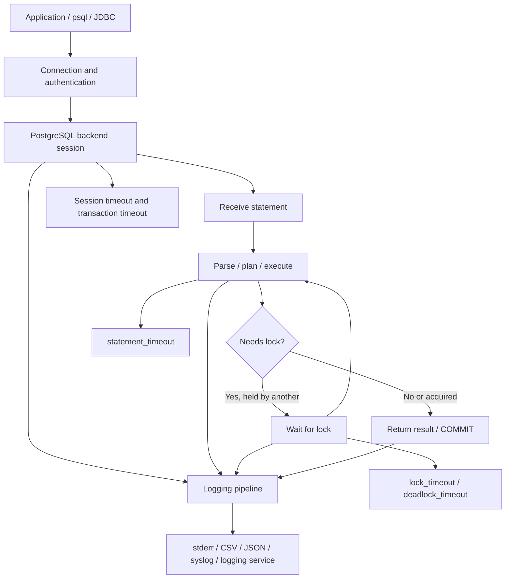
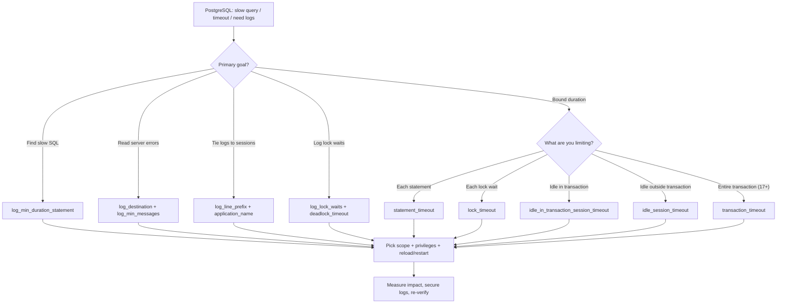

# Basic Logging and Timeout Configuration

When an application connecting to PostgreSQL slows down, hits timeout errors, or an `ALTER TABLE` hangs waiting, two configuration groups that help control and diagnose incidents are **logging** and **timeouts**. Logging answers "what happened, on which connection, and when?", while timeouts answer "how long should PostgreSQL allow a statement, a lock wait, or an idle session to persist before intervening?"

These two parameter groups serve different purposes and do not replace each other:

- Enabling `log_min_duration_statement` helps identify slow SQL queries; **it does not make them run faster**.
- Setting `statement_timeout` stops a statement that exceeds the threshold, **without making that SQL query optimal**.
- Enabling `log_lock_waits` logs long lock waits; `lock_timeout` limits how long a statement may wait for a lock.
- Enabling `logging_collector` manages certain file-based log destinations; it does not automatically create permanent log retention or alerting.
- `idle_in_transaction_session_timeout` handles sessions idle while keeping a transaction open, unlike `idle_session_timeout` which targets idle sessions outside any transaction.

This lesson explains how to inspect and change settings, choose balanced logging levels, understand each timeout, create controlled test scenarios, correlate logs with `pg_stat_activity`, and troubleshoot safely. The scope is modern PostgreSQL; **some parameters exist only in newer releases**, notably `transaction_timeout` from PostgreSQL 17 onward. Every production change must match the actual server version, administrative privileges, logging infrastructure, and business requirements.

## 1. Distinguishing Three Layers of Time and Observability

An SQL command passes through distinct layers:



Distinct timing intervals include:

1. **Statement execution duration:** includes any waits encountered during execution. `statement_timeout` caps statement execution time.
2. **Lock wait duration:** one specific phase during execution. `lock_timeout` caps how long each lock acquisition waits.
3. **Time a session stays idle or a transaction remains open:** `idle_in_transaction_session_timeout`, `idle_session_timeout`, and on supported versions `transaction_timeout` handle distinct cases.

Logging uses separate thresholds such as "log queries taking at least 500 ms" and "log lock waits exceeding 1 second." **The threshold to record** is not necessarily **the threshold to cancel work**.

## 2. Start from Server Version and Current Configuration

Before adjusting parameters, confirm the exact PostgreSQL server under investigation. In environments with multiple instances, primary/standby pairs, containers, or managed databases, running `ALTER SYSTEM` on the wrong machine is both useless and risky.

```sql
SELECT
    current_database() AS database_name,
    current_user AS user_name,
    inet_server_addr() AS server_address,
    inet_server_port() AS server_port,
    version() AS server_version;

SELECT pg_is_in_recovery() AS is_standby;
```

`inet_server_addr()` may return `NULL` over Unix-domain sockets; this does not mean the server is down. `pg_is_in_recovery()` distinguishes a replaying standby from a normal primary.

Quick checks:

```sql
SHOW log_destination;
SHOW logging_collector;
SHOW log_min_duration_statement;
SHOW log_statement;
SHOW statement_timeout;
SHOW lock_timeout;
SHOW idle_in_transaction_session_timeout;
```

Querying a parameter that does not exist in an older release raises an error. That differs from a parameter that exists and is set to its default value.

### 2.1. pg_settings: More Than Just Values

The `pg_settings` view shows configuration values along with their sources and modification contexts:

```sql
SELECT
    name,
    setting,
    unit,
    context,
    source,
    pending_restart
FROM pg_settings
WHERE name IN (
    'log_destination',
    'logging_collector',
    'log_min_duration_statement',
    'log_statement',
    'log_lock_waits',
    'statement_timeout',
    'lock_timeout',
    'idle_in_transaction_session_timeout',
    'idle_session_timeout',
    'deadlock_timeout',
    'transaction_timeout'
)
ORDER BY name;
```

If an older server lacks `transaction_timeout`, filtering with `name IN (...)` simply omits that row. This lets you inspect configuration safely across versions without calling `SHOW transaction_timeout` directly on an older server.

Notable fields:

| Field | How to Interpret |
|---|---|
| `name` | Parameter name |
| `setting` | Effective value in the querying session's context |
| `unit` | Base unit such as `ms`, `s`, `kB`, or `8kB`, if applicable |
| `context` | Conditions permitting changes, e.g., requires restart vs. changeable via `SET` |
| `source` | Value origin such as default, configuration file, database, role, or session |
| `pending_restart` | Whether a config change requires a restart to take effect, if applicable |

**`source = 'session'` does not represent the global value for all connections.** `SET` commands in one session change only that session's context. Another account, database, or previously opened backend may hold different values.

### 2.2. Where Configuration Lives

```sql
SHOW config_file;
SHOW data_directory;
SHOW hba_file;
```

- `postgresql.conf` and `include`d files typically store server configuration.
- `postgresql.auto.conf` typically stores values managed by `ALTER SYSTEM`.
- Settings may also be passed via startup command-line flags or management tools.
- Roles and databases can store dedicated defaults for new sessions.
- `pg_hba.conf` governs **authentication/connection rules**, not `statement_timeout` or log formatting.

File paths may be hidden depending on privileges. In Kubernetes or managed PostgreSQL, external controllers may manage files; manual edits can be overwritten by deployment reconciliation.

## 3. Where Does PostgreSQL Write Logs?

PostgreSQL emits messages from backends and auxiliary processes. Whether logs go to files, syslog, event logs, or a logging platform depends on **`log_destination`**, **`logging_collector`**, and how the server was started.

### 3.1. log_destination

```sql
SHOW log_destination;
```

Common destinations:

| Value | General Meaning | Notes |
|---|---|---|
| `stderr` | Writes messages to standard error | Often used with systemd, containers, or logging collector |
| `csvlog` | Writes structured CSV-formatted logs | Requires `logging_collector` in supporting setups |
| `jsonlog` | Writes structured JSON-formatted logs | Available in PostgreSQL 15+; requires appropriate collector config |
| `syslog` | Sends logs to system syslog on supported platforms | Requires file/retention management at the syslog layer |
| `eventlog` | Windows Event Log | Used when running on Windows with corresponding settings |

Multiple destinations can be combined as a comma-separated list:

```conf
# Example in postgresql.conf; not an SQL statement:
log_destination = 'stderr,csvlog'
```

When using multiple destinations, total log volume and sensitive data are duplicated across targets. Before increasing logging, confirm **which source** your centralized log collector ingests from to avoid missing or duplicating logs.

### 3.2. logging_collector

```sql
SHOW logging_collector;
```

When `logging_collector` is enabled, the collector process captures messages sent to stderr and writes them into PostgreSQL-managed log files; it is also required for structured file formats such as `csvlog` and `jsonlog`.

Example configuration:

```conf
logging_collector = on
log_destination = 'stderr'
log_directory = 'log'
log_filename = 'postgresql-%Y-%m-%d_%H%M%S.log'
```

**`logging_collector` requires a PostgreSQL restart to change.** Calling `SELECT pg_reload_conf();` alone cannot start an inactive collector. Furthermore, enabling the collector does not automatically configure old-log deletion or archival to external storage.

When the collector is off and the server runs under systemd or in a container, stderr is often captured by the platform's journal or container stdout. In that case, logs live there rather than in files inside `log_directory`.

### 3.3. Locating the Currently Active Log File

```sql
SELECT pg_current_logfile();
```

`pg_current_logfile()` returns the path of the active log file when the logging collector is running with a file-based destination. If it returns `NULL`, the system may be using syslog/journal, the collector may be off, or no matching file exists yet.

On supporting servers, you can request the path for a specific format:

```sql
SELECT pg_current_logfile('stderr');
```

This function helps locate the path; it **is not an API to bypass OS permissions and read arbitrary log files**. Actual read access and location on disk depend on OS permissions, containers, and monitoring setup.

## 4. Managing Log Filenames, Sizes, and Lifecycle

When PostgreSQL manages log files directly, relevant parameters typically include:

```sql
SHOW log_directory;
SHOW log_filename;
SHOW log_rotation_age;
SHOW log_rotation_size;
SHOW log_truncate_on_rotation;
SHOW log_file_mode;
```

| Parameter | Role |
|---|---|
| `log_directory` | Directory for log files when collector is enabled; relative to data directory or absolute |
| `log_filename` | Filename pattern supporting `strftime`-style time escapes |
| `log_rotation_age` | Time interval to rotate log files, e.g., `1d` |
| `log_rotation_size` | File size threshold to rotate log files, e.g., `100MB` |
| `log_truncate_on_rotation` | Controls truncating/overwriting existing files on certain time-based rotations |
| `log_file_mode` | File permissions for newly created log files on supported platforms |

Example:

```conf
log_directory = 'log'
log_filename = 'postgresql-%Y-%m-%d_%H%M%S.log'
log_rotation_age = '1d'
log_rotation_size = '100MB'
log_truncate_on_rotation = off
```

Using a filename pattern with sufficiently distinct timestamps avoids collisions during rotation. Notably, `log_truncate_on_rotation` only truncates under qualifying time-based rotation conditions; **never assume size-based rotation automatically deletes old logs**.

### 4.1. Rotation Is Not Retention

**Log rotation:** closes the current log file and opens a new one.

**Log retention:** governs how long logs are kept, when they are compressed, shipped, deleted, or archived centrally.

Rotating files daily can still leave hundreds of files accumulating indefinitely without a retention policy. When enabling detailed logging, manage:

- Disk capacity and filesystem-full alerts.
- Retention policies aligned with operational and compliance requirements.
- Compression and long-term archival if genuinely required.
- File read permissions, encryption, and log shipping pipelines.
- Redaction or deletion of sensitive data per organizational policy.

**Never delete log files or alter permissions in production with an ad-hoc shell command.** First verify which files PostgreSQL is actively writing to and how the logging agent holds them.

## 5. log_line_prefix: Adding Context for Readable Logs

A log line reading "duration: 800 ms" is hard to investigate without knowing which backend, user, database, and timestamp produced it. `log_line_prefix` prepends metadata to text-formatted log entries.

Example:

```conf
log_line_prefix = '%m [%p] user=%u db=%d app=%a client=%r session=%c line=%l '
```

Common escapes:

| Escape | Content |
|---|---|
| `%m` | Timestamp with milliseconds |
| `%p` | Backend Process ID |
| `%u` | Session username |
| `%d` | Database name |
| `%a` | `application_name` value |
| `%r` | Client address and port, if available |
| `%c` | Session ID |
| `%l` | Log line sequence number within the session |
| `%e` | SQLSTATE of the message |
| `%x` | Transaction ID, when assigned |

`log_line_prefix` applies primarily to text logs such as stderr. CSV and JSON logs already include structured fields; do not expect them to carry the exact same text prefix as stderr.

Illustrative example:

```text
2026-11-14 09:20:30.125 +07 [17231] user=app db=shop app=checkout client=10.0.0.5(55002) session=...
LOG:  duration: 843.210 ms  statement: SELECT ...;
```

This is a hypothetical sample log, **not real output captured from a server**.

### 5.1. application_name Connects Logs to Applications

`application_name` can be set by the client at connection startup or within a session:

```sql
SET application_name = 'order-service';
SHOW application_name;
```

When both the log prefix and `pg_stat_activity` display application names, operations teams can correlate issues to specific services much faster.

However, `application_name` is client-supplied, not an authentication mechanism. Never rely on it for authorization or treat it as proof that a connection truly belongs to the named service.

### 5.2. Log Time Zone

```sql
SHOW log_timezone;
SHOW TimeZone;
```

`log_timezone` controls how timestamps are formatted in server logs; `TimeZone` is the session setting governing SQL timestamp display and interpretation. The two do not have to match.

When correlating incidents across servers, applications, and centralized log platforms, standardize timestamps (e.g., UTC) and keep time zone information explicit. Otherwise, a "09:00" application transaction could be miscorrelated with a "02:00" server log entry.

## 6. Severity Levels: log_min_messages and client_min_messages

Not every PostgreSQL message needs to be written to log files or sent to clients. Common severity levels include `DEBUG`, `INFO`, `NOTICE`, `WARNING`, `ERROR`, `LOG`, `FATAL`, and `PANIC`.

Two easily confused parameters:

```sql
SHOW log_min_messages;
SHOW client_min_messages;
```

| Parameter | Primary Effect |
|---|---|
| `log_min_messages` | Filters which message levels are written to server logs per severity rules |
| `client_min_messages` | Filters which message levels are sent to the client/session |

Example:

```sql
SET client_min_messages = warning;
```

This changes which messages the **current session receives**; it does not stop the server from logging errors. Never raise the client message filter to "silence errors" or hide important warnings—fix the root cause.

The `LOG` level follows special severity ordering rules in PostgreSQL, so do not treat all severities as a single linear numeric scale shared identically by client and server logging.

### 6.1. log_min_error_statement: Recording Failing SQL Statements

```sql
SHOW log_min_error_statement;
```

This parameter controls logging of **the SQL statement associated with an error** at or above a specified severity threshold per PostgreSQL rules. A common setting is `error`.

Example:

```conf
log_min_error_statement = error
```

If a client sends invalid SQL, logs can capture the failing statement text to help identify the root cause. Keep in mind:

- SQL text may contain sensitive literals.
- Not all errors are logged identically or with full text across every protocol path.
- Server error logs do not replace application logging of SQLSTATE, request IDs, and business context.
- When statements use bind parameters, parameter logging detail depends on version and related settings.

## 7. Slow Query Logging: log_min_duration_statement

This is the core parameter for identifying statements taking too long:

```sql
SHOW log_min_duration_statement;
```

Typical semantics:

| Value | Meaning |
|---|---|
| `-1` | Disables duration-based statement logging |
| `0` | Logs execution duration of every completed statement via this mechanism |
| `500ms` | Logs statements taking roughly 500 ms or longer |
| `1s` | Logs statements taking roughly 1 second or longer |

Sample configuration:

```conf
log_min_duration_statement = '500ms'
```

Hypothetical log output:

```text
2026-11-14 09:20:31.500 UTC [17231] app=reporting
LOG:  duration: 1253.110 ms  statement: SELECT ... FROM don_hang ...;
```

Primary benefits:

- Spotting abnormally long statements.
- Capturing SQL text or metadata tied to the slow statement.
- Catching regressions after a deployment or traffic spike.
- Providing signals for deeper analysis with `EXPLAIN`, system stats, and application logs.

**Distinguish elapsed duration from CPU time.** A 2-second statement may have spent 1.8 seconds **waiting on a row lock**, rather than burning CPU for 2 seconds. Combine logs with `pg_stat_activity`, `pg_blocking_pids`, or other diagnostics to find the true cause.

### 7.1. Why Not Always Set It to 0?

Setting `log_min_duration_statement = 0` logs vast numbers of short statements, inflating formatting CPU, disk I/O, storage consumption, centralized log ingestion cost, and sensitive data exposure.

On busy production servers, start with a threshold aligned with business SLOs/latency targets—such as a few hundred milliseconds—and adjust based on log processing capacity and query rate.

### 7.2. log_duration vs. log_min_duration_statement

```sql
SHOW log_duration;
```

`log_duration = on` logs the duration of every completed statement via its own mechanism, without necessarily printing the SQL text of every statement the way `log_min_duration_statement` does. Combined with other statement logs, it can add context, though you must understand exact interactions.

Never leave both `log_duration = on` and `log_min_duration_statement = 0` enabled indefinitely under the assumption that "more logs are always better." Log volume and sensitivity grow dramatically.

### 7.3. Sampling Slow Queries

Supporting PostgreSQL versions provide `log_min_duration_sample` and `log_statement_sample_rate` to log a sampled fraction of statements exceeding a threshold, reducing overhead under heavy query volume.

```sql
SELECT name, setting, unit
FROM pg_settings
WHERE name IN (
    'log_min_duration_sample',
    'log_statement_sample_rate'
)
ORDER BY name;
```

Sampling choices must match observability goals. Sampled logs are incomplete records of slow queries and must not be relied upon as a complete audit trail.

## 8. log_statement: Logging Statements by Category

`log_statement` is not a duration threshold. It chooses which categories of statements to log by policy:

```sql
SHOW log_statement;
```

| Value | General Meaning |
|---|---|
| `none` | Logs no statements via `log_statement` alone |
| `ddl` | Logs supported DDL statements, such as schema changes |
| `mod` | Logs data-modifying statements and DDL; excludes read-only `SELECT`s |
| `all` | Logs very broadly across all statements covered by this mechanism |

Example for tracking DDL migrations:

```conf
log_statement = 'ddl'
```

During targeted troubleshooting, an administrator may temporarily raise logging and then revert to a sensible baseline. `all` is rarely suitable as an always-on production default.

### 8.1. log_statement Does Not Capture Every Syntax Error

Do not treat `log_statement = all` as capturing every raw SQL string regardless of whether the server could parse it. Errors occurring before the logging hook may not appear as expected; `log_min_error_statement` specifically complements it by logging errored statements.

For strict compliance auditing requiring completeness, integrity, and action scoping, core PostgreSQL logging does not replace a dedicated audit system. Extensions like `pgAudit` can be evaluated separately when needed, though they are not a built-in focus of this lesson.

### 8.2. Protecting Statement Contents

Logs can capture SQL containing:

- Emails, phone numbers, or customer identifiers.
- Tokens or session IDs stored in columns.
- Sensitive filter predicates.
- JSON payloads.
- Credentials written literally inside SQL statements.

A dangerous example is creating a role via an SQL statement containing a real password while verbose logging is enabled. **Never embed raw secrets into SQL statements or live examples when safer provisioning mechanisms exist.**

On supporting versions, `log_parameter_max_length` and `log_parameter_max_length_on_error` limit how much bind-parameter data is logged. However, **limiting parameter logging does not strip sensitive literals written directly inside SQL text**. Combine secure application coding, restricted log access, and data governance.

## 9. Logging Connections, Disconnections, Lock Waits, and Background Activity

PostgreSQL provides complementary logs useful during incident investigation:

```sql
SELECT name, setting, unit
FROM pg_settings
WHERE name IN (
    'log_connections',
    'log_disconnections',
    'log_lock_waits',
    'deadlock_timeout',
    'log_checkpoints',
    'log_temp_files',
    'log_autovacuum_min_duration'
)
ORDER BY name;
```

### 9.1. log_connections and log_disconnections

- **`log_connections`:** logs connection establishment details per version capabilities.
- **`log_disconnections`:** logs session disconnections, session duration, and related stats.

They help spot **connection storms**, pools churning connections rapidly, or unexpected login attempts. However, enabling them on systems with huge rates of short-lived connections can generate substantial log volume.

Example:

```conf
log_connections = on
log_disconnections = on
```

Newer versions support finer-grained selection of which connection stages are logged; check documentation and current server settings before applying sample templates.

### 9.2. log_lock_waits and deadlock_timeout

```conf
log_lock_waits = on
deadlock_timeout = '1s'
```

- `log_lock_waits` enables logging lock waits that last long enough per PostgreSQL's mechanism.
- `deadlock_timeout` is the duration PostgreSQL waits before running deadlock detection for a lock wait; **it is not the maximum time a query is allowed to wait for a lock**.
- When `log_lock_waits` is enabled, `deadlock_timeout` also acts as the threshold for emitting lock-wait log messages.

For example, if a statement waits 1.5 seconds for a lock with `deadlock_timeout = 1s`, PostgreSQL logs the wait even if the statement eventually acquires the lock and succeeds.

**Do not confuse `deadlock_timeout = 1s` with `lock_timeout = 1s`.** The first governs when deadlock detection and lock-wait logging trigger; the second **cancels the statement** if it fails to acquire the lock in time.

### 9.3. log_temp_files

`log_temp_files` logs temporary files created when PostgreSQL spills large sorts or hashes to disk.

Common values:

- `-1`: disables temp-file logging.
- `0`: logs all eligible temporary files.
- A positive size: logs only temporary files at or above that threshold.

Example:

```conf
log_temp_files = '100MB'
```

This helps identify queries causing heavy temporary disk I/O, though it does not replace `EXPLAIN (ANALYZE, BUFFERS)` and careful `work_mem` analysis. Never raise `work_mem` server-wide just because you saw one temp file without factoring in connection counts and concurrent operations.

### 9.4. log_checkpoints and log_autovacuum_min_duration

- `log_checkpoints`, on supporting versions, provides visibility into checkpoint frequency and write I/O cost.
- `log_autovacuum_min_duration` logs autovacuum runs exceeding the duration threshold, helping diagnose bloat and lagging `VACUUM`.

Parameter availability and defaults vary across PostgreSQL releases. They provide diagnostic visibility rather than automatically fixing overloaded checkpoints or autovacuum.

## 10. Core Timeouts to Master

Common timeout parameters serve distinct goals.

| Parameter | What Does It Limit? | Action When Expired | Typical Scope |
|---|---|---|---|
| `statement_timeout` | Execution time of a single statement | Cancels statement | Session, role, database, or server config |
| `lock_timeout` | Wait time for **acquiring a lock** | Cancels waiting statement | Typically set for session/job/DDL |
| `idle_in_transaction_session_timeout` | Session idle while keeping a transaction open | Terminates session, rolls back open transaction | Protects against abandoned transactions |
| `idle_session_timeout` | Session idle outside any transaction | Terminates session | Use carefully with connection pools |
| `deadlock_timeout` | Wait time before checking for deadlocks; threshold for lock-wait logs | Checks/detects deadlocks; does not cancel every lock wait | Lock management and observability |
| `transaction_timeout` | Total transaction lifetime including idle time, on supporting versions | Terminates session when exceeded | PostgreSQL 17 and newer |

By default, application timeouts such as `statement_timeout` and `lock_timeout` are typically `0`, meaning **disabled** for that mechanism. That does not prevent statements from failing due to errors, deadlocks, client disconnects, or other server conditions.

### 10.1. Time Units

String values with explicit units prevent misunderstandings:

```sql
SHOW statement_timeout;

SET statement_timeout = '5s';
SET lock_timeout = '1500ms';
SET idle_in_transaction_session_timeout = '2min';
```

PostgreSQL also accepts unitless numbers, in which case **the unit depends on the parameter**. Because many timeouts default to milliseconds, `5000` means 5000 ms, not 5000 seconds. Always write explicit units such as `'5s'`, `'1500ms'`, or `'2min'` when configuring.

## 11. statement_timeout: Bounding a Single Statement

`statement_timeout` helps stop runaway statements from executing indefinitely.

Example:

```sql
SET statement_timeout = '1s';

SELECT pg_sleep(3);
-- Expected: statement is canceled due to exceeding the time limit.

RESET statement_timeout;
```

`pg_sleep` is a deliberate wait helper for testing; never use it to benchmark real data throughput.

Common error message:

```text
ERROR:  canceling statement due to statement timeout
```

### 11.1. Does Timeout Include Wait Time?

Yes. A statement blocked on a lock or stalled during execution still counts toward `statement_timeout`. Seeing an `UPDATE` hit `statement_timeout` does not prove it was burning CPU or missing an index; it may have been waiting behind another transaction.

### 11.2. Start and End Timing Depends on Protocol

PostgreSQL measures statement timeout at statement execution level, with details depending on the query protocol. Under the simple query protocol, modern PostgreSQL versions enforce the timeout per individual statement in a multi-statement string according to version rules, rather than always treating the entire client packet as one single timeout block as in older versions.

Practical takeaway: **`statement_timeout` is not a timeout for an entire HTTP request or multi-statement workflow.** If a request executes five statements each under the threshold, total request time can still exceed that threshold.

To bound overall business-operation duration, combine application-level deadlines with transaction timeouts appropriate for your PostgreSQL version and data policy.

### 11.3. Behavior Inside a Transaction

```sql
BEGIN;

SET LOCAL statement_timeout = '1s';

SELECT pg_sleep(3);
-- Statement times out: transaction enters aborted state.

ROLLBACK;
```

When a statement throws an error inside a standard PostgreSQL transaction, the transaction enters an **aborted state** and subsequent SQL commands (other than transaction-control commands) are rejected until `ROLLBACK`. Applications must handle the error and roll back rather than blindly issuing `COMMIT`.

Savepoints allow partial rollback designs when explicitly built, though drivers should not be assumed to handle that automatically.

### 11.4. Avoid Very Short Cluster-Wide statement_timeout

Setting `statement_timeout = '100ms'` globally can kill legitimate migrations, reports, batch jobs, maintenance/VACUUM tasks, or startup queries. In most systems, **role-, database-, or session-level timeouts** make far more sense than a tiny cluster-wide cap.

Choose timeouts based on SLOs, load, and workload type: interactive OLTP, batch jobs, reporting, and migrations have different tolerances.

## 12. lock_timeout: Bounding Only Lock Waits

`lock_timeout` applies while a statement is **waiting to acquire a lock** in PostgreSQL. It does not cap total execution time once the lock is acquired.

```sql
SET lock_timeout = '2s';
SET statement_timeout = '10s';
```

Meaning:

- If an `ALTER TABLE` or `UPDATE` waits longer than 2 seconds for a lock, `lock_timeout` cancels the statement.
- If the statement acquires the lock and processes rows for 8 seconds, `lock_timeout` does not cancel it; `statement_timeout` still applies.
- `lock_timeout` applies per lock wait attempt inside a statement, rather than acting as a cumulative clock across unrelated phases.

### 12.1. Why Is lock_timeout Usually Set Lower Than statement_timeout?

If `statement_timeout` cancels a statement at or before the moment `lock_timeout` would expire, the lock timeout adds little extra value in that situation. Therefore, operations needing fail-fast behavior under lock contention commonly set `lock_timeout` shorter than `statement_timeout`.

Example:

```sql
BEGIN;

SET LOCAL lock_timeout = '3s';
SET LOCAL statement_timeout = '30s';

ALTER TABLE demo_pg_config.jobs
ADD COLUMN IF NOT EXISTS ghi_chu TEXT;

COMMIT;
```

This is a **lab table example**. In production, DDL requires careful planning because it can acquire strong locks, interact with long transactions, and queue subsequent queries behind it. With a short `lock_timeout`, a migration **fails fast** instead of sitting in the lock queue and blocking traffic behind it.

If DDL hits a lock timeout inside a transaction, `ROLLBACK` per deployment procedures rather than assuming subsequent commands in the transaction can proceed.

### 12.2. lock_timeout Does Not Replace Deadlock Detection

PostgreSQL includes **deadlock detection**, typically returning SQLSTATE `40P01`. It can abort a victim transaction in a lock cycle before `lock_timeout` expires once the deadlock is detected.

`lock_timeout` is primarily a policy to avoid waiting indefinitely under contention; it does not replace short transactions, consistent lock ordering, and safe retry logic.

## 13. idle_in_transaction_session_timeout: Guarding Against Forgotten Transactions

A session can stop sending SQL while leaving a transaction open:

```text
Application starts transaction
    │
    ▼
UPDATE jobs SET ...
    │
    ▼
Client stops sending SQL, hasn't COMMIT/ROLLBACK
    │
    ▼
PostgreSQL: idle in transaction
    │
    ├── May still hold locks
    ├── May hold snapshot/horizon affecting VACUUM
    └── Occupies a connection in the pool
```

`idle_in_transaction_session_timeout` caps how long a session can stay **idle inside an open transaction**:

```sql
SHOW idle_in_transaction_session_timeout;
```

Test session example:

```sql
SET idle_in_transaction_session_timeout = '10s';

BEGIN;

SELECT *
FROM demo_pg_config.jobs
WHERE id = 1
FOR UPDATE;

-- Stop sending commands on this session for more than 10 seconds.
-- PostgreSQL can terminate the session and roll back the transaction.
```

**Run this only on a dedicated test connection**; the session closes once the timeout triggers, causing client tools or pools to report a broken connection. In `psql`, you may need to reconnect.

### 13.1. "Idle" Time Differs from "Transaction Age"

A transaction executing SQL continuously for 30 seconds may never stay idle long enough to trigger `idle_in_transaction_session_timeout`; that parameter is not designed to kill active long-running transactions solely based on total transaction age.

Conversely, a transaction that runs a 10 ms `SELECT ... FOR UPDATE` and then sits idle for 2 minutes waiting on a client is very dangerous because it holds locks and snapshots. That is the exact case this parameter targets.

### 13.2. Impact on Applications

When PostgreSQL terminates a session with an open transaction:

- The uncommitted transaction is rolled back per standard rules.
- The client/JDBC driver receives a connection error and must handle it.
- Connection pools must discard the dead connection rather than returning it as healthy.
- Business logic may need to retry **the entire transaction** safely.
- If the transaction already called external APIs, database rollback cannot undo those external side effects.

Set the timeout high enough to avoid breaking valid interactive/batch flows while still catching abandoned transactions.

## 14. idle_session_timeout: Idle Sessions Outside Transactions

`idle_session_timeout` targets sessions with no open transaction and no recent activity for a configured duration.

```sql
SHOW idle_session_timeout;
```

Example:

```sql
SET idle_session_timeout = '15min';
```

This helps reclaim genuinely forgotten connections in some setups. However, with **connection pools** (HikariCP, PgBouncer, etc.), having the server silently drop idle connections can cause pool churn or errors if the pool attempts to reuse a closed socket before detecting it died.

Therefore, before enabling it broadly:

1. Check whether applications use connection pools.
2. Compare pool max lifetime, keepalive, idle timeout, and connection validation policies.
3. Test reconnect behavior.
4. Measure connection-creation log volume and CPU overhead when pools replenish dropped connections.
5. Scope it per role/application if needed rather than globally.

**Do not confuse `idle_session_timeout` with `idle_in_transaction_session_timeout`:** they target different session states and carry different operational trade-offs.

## 15. transaction_timeout: Bounding Total Transaction Lifetime (PostgreSQL 17+)

Starting in PostgreSQL 17, `transaction_timeout` caps the total duration of any transaction under server policy. It differs from `statement_timeout` (per-statement) and `idle_in_transaction_session_timeout` (idle gaps within a transaction).

Check support before using:

```sql
SELECT name, setting, unit
FROM pg_settings
WHERE name = 'transaction_timeout';
```

If no row is returned on an older PostgreSQL release, do not run `SET transaction_timeout` as it is unsupported.

Example **for PostgreSQL 17+ only**:

```sql
SET transaction_timeout = '2min';
```

General effect: a transaction exceeding the limit causes the session to terminate under this timeout mechanism, whether the transaction spent time executing SQL or sitting idle.

When combined with `idle_in_transaction_session_timeout` or `idle_session_timeout`, PostgreSQL follows precedence rules if `transaction_timeout` is less than or equal to those thresholds. Verify exact version behavior rather than stacking overlapping timeouts assuming all three fire sequentially.

**Do not set a very short `transaction_timeout` for every role** if legitimate batch jobs, maintenance, or reporting run long transactions; tailor limits by workload, application, and retry policy.

## 16. deadlock_timeout: Detection Delay, Not a Query Deadline

`deadlock_timeout` typically defaults to around 1 second, controlling how long PostgreSQL waits before actively checking for a deadlock during a lock wait.

```sql
SHOW deadlock_timeout;
SHOW log_lock_waits;
```

Consider two transactions:

- A holds a lock on row 1 and requests row 2.
- B holds a lock on row 2 and requests row 1.

This is a deadlock cycle. PostgreSQL checks and aborts one victim transaction with a deadlock error. If there is no deadlock and A is simply slow, reaching `deadlock_timeout` **does not cause PostgreSQL to cancel A or B**.

When `log_lock_waits` is enabled, this threshold also determines when a lock wait is logged. Setting it too low increases deadlock-detection CPU and log volume under contention; setting it too high delays deadlock detection and wait logging.

This is typically a DBA-managed operational parameter, not the first knob to turn for application `lock timeout` errors.

## 17. Connection, Authentication, and Network Timeouts: Don't Confuse Them with SQL Timeouts

Beyond SQL/session timeouts, the network connection path has its own thresholds.

| Parameter / Mechanism | Where Applied | Purpose |
|---|---|---|
| `connect_timeout` in libpq connection parameters | Client/libpq | Limits time waiting to establish a TCP connection to the server |
| `authentication_timeout` | PostgreSQL Server | Limits time allowed to complete connection authentication |
| `tcp_keepalives_idle` and related TCP keepalive settings | Network stack per OS & PostgreSQL | Helps detect dead TCP peers via keepalive probes |
| `tcp_user_timeout` where supported | TCP/network stack | Bounds how long unacknowledged TCP data waits before closing |
| Driver JDBC socket/read timeout | Client/driver | Controls network read/response waits in the driver |

Client connection parameter example:

```bash
psql "host=127.0.0.1 port=5432 dbname=postgres user=app_user connect_timeout=5"
```

`connect_timeout` here is a **libpq client option**, not a server GUC set with `ALTER SYSTEM SET connect_timeout`.

In Java/JDBC applications, driver timeouts, framework limits, HTTP request deadlines, and pool timeouts also exist. **An HTTP timeout error does not prove PostgreSQL triggered `statement_timeout`.** Inspect SQLSTATE, server logs, and client timing metrics.

Replication also has dedicated timeouts such as `wal_sender_timeout` and `wal_receiver_timeout`; these govern replication links, not normal `SELECT` queries.

## 18. At Which Level Should You Change Configuration?

PostgreSQL allows changing parameters at multiple scopes. Know **whether a parameter is permitted at that scope** and which value takes effect when a connection opens.

### 18.1. SET and RESET in the Current Session

```sql
SHOW statement_timeout;

SET statement_timeout = '8s';
SHOW statement_timeout;

RESET statement_timeout;
SHOW statement_timeout;
```

- `SET` updates the value in the current session for permitted parameters.
- `RESET` returns the parameter to the session's effective default, not necessarily PostgreSQL's compiled-in default.
- `RESET ALL` resets many session variables to defaults, which can disrupt settings an application expects; avoid using it casually in pooled connections without proper design.

If a connection pool reuses connections, `SET statement_timeout` can **persist on that connection** after a request finishes unless the pool or framework resets it. That causes unexpected timeouts for subsequent requests.

### 18.2. SET LOCAL Only Within a Transaction

```sql
BEGIN;

SET LOCAL statement_timeout = '15s';
SET LOCAL lock_timeout = '3s';

SELECT *
FROM demo_pg_config.jobs
WHERE id = 1;

COMMIT;
```

`SET LOCAL` applies only within the current transaction and expires on `COMMIT` or `ROLLBACK`. It is ideal when a specific operation needs custom timeouts without leaking into future requests on the same connection.

If run outside a valid transaction block, PostgreSQL does not retain it for subsequent statements. In application code, enforce the sequence **begin transaction → SET LOCAL → statements → COMMIT/ROLLBACK**.

### 18.3. ALTER ROLE and ALTER DATABASE

When an application uses a dedicated role, defaults can be set for **new** sessions:

```sql
-- Illustrative example; run only if role app_user exists
-- and the caller has privileges to alter role configuration.
ALTER ROLE app_user
SET statement_timeout = '10s';

-- Default for new sessions connecting to database shopdb:
ALTER DATABASE shopdb
SET idle_in_transaction_session_timeout = '2min';

-- Specifically for role app_user connecting to shopdb:
ALTER ROLE app_user IN DATABASE shopdb
SET lock_timeout = '3s';
```

These commands use hypothetical names `app_user` and `shopdb`. Never copy blindly into production. Role/database defaults take effect when **new** sessions are created; do not assume existing pooled connections pick them up immediately.

Precedence follows PostgreSQL rules, and a valid `SET` inside a session overrides role/database defaults. Check `pg_settings.source` inside an affected session.

### 18.4. ALTER SYSTEM and Reload

For server-wide settings:

```sql
-- DBA example on an authorized instance:
ALTER SYSTEM SET log_min_duration_statement = '750ms';

SELECT pg_reload_conf();
```

`ALTER SYSTEM` writes managed configuration to `postgresql.auto.conf`, and reloadable parameters require a reload to take effect. `pg_reload_conf()` asks the server to re-read configuration; returning `true` confirms the signal was sent, **not that every parameter applied cleanly**.

Verify:

```sql
SELECT
    name,
    setting,
    source,
    pending_restart
FROM pg_settings
WHERE name = 'log_min_duration_statement';
```

If a startup-only parameter (like `logging_collector`) changes, restart PostgreSQL following proper operational procedures. Never ignore `pending_restart = true`.

Do not hand-edit `postgresql.auto.conf` while using `ALTER SYSTEM` without consistent configuration governance; automation tools may overwrite it with another value.

### 18.5. Inspecting Configuration File Errors

Administrators with sufficient privileges can inspect `pg_file_settings`:

```sql
SELECT
    sourcefile,
    sourceline,
    name,
    setting,
    applied,
    error
FROM pg_file_settings
WHERE error IS NOT NULL
ORDER BY sourcefile, sourceline;
```

This view highlights problematic lines parsed from configuration files. Viewing file paths/contents may be restricted; regular users should never be granted broad privileges to read sensitive config files just to populate a dashboard.

## 19. Summary Table of Scope and Activation Timing

| Setting Method | Expected Scope | When It Takes Effect | Key Risk to Watch |
|---|---|---|---|
| `SET name = value` | Current session | Immediately for permitted parameters | Leaks across connection pool if not RESET |
| `SET LOCAL name = value` | Current transaction | Within the open transaction | No lasting effect outside transaction |
| `ALTER ROLE ... SET` | Role default | New sessions per rules | Does not retroactively alter open pooled connections |
| `ALTER DATABASE ... SET` | Database default | New sessions per rules | May affect multiple distinct applications |
| `ALTER ROLE ... IN DATABASE ... SET` | Role in a specific database | New sessions per rules | Must track config precedence |
| `ALTER SYSTEM SET` | Server config | Reload or restart depending on `context` | Broad impact; requires privileges and process |
| `postgresql.conf` | Cluster config | Reload or restart depending on parameter | May be overwritten by automation |
| Server startup command-line flags | Started instance | At process startup | Higher-precedence source to check |

A practical rule of thumb: **place business timeouts as close to the application workload as possible**, while baseline server logging and collector settings are best managed centrally by operations.

## 20. Baseline Reference Logging Configuration

This is a directional example for self-managed environments, **not a drop-in production template**:

```conf
# postgresql.conf -- reference example

# Log destination and file lifecycle, if using logging collector:
log_destination = 'stderr'
logging_collector = on
log_directory = 'log'
log_filename = 'postgresql-%Y-%m-%d_%H%M%S.log'
log_rotation_age = '1d'
log_rotation_size = '100MB'

# Metadata correlating logs with sessions and services:
log_line_prefix = '%m [%p] user=%u db=%d app=%a client=%r session=%c '

# Log errors and slow SQL statements:
log_min_messages = warning
log_min_error_statement = error
log_min_duration_statement = '500ms'
log_statement = 'ddl'

# Log notable lock waits:
log_lock_waits = on
deadlock_timeout = '1s'

# Complementary diagnostic signals:
log_temp_files = '100MB'
```

This configuration assumes:

- The server manages log files directly rather than relying solely on journald or container stdout.
- Query rate and log budget tolerate a 500 ms slow-query threshold.
- Operations wants DDL statements recorded in logs.
- An independent log retention/disk-cap mechanism is in place.
- Risks of sensitive SQL literals appearing in logs have been evaluated.
- `logging_collector` was enabled via a planned restart.

On managed PostgreSQL services, providers often expose only select parameters via parameter groups alongside dedicated log viewers rather than direct `postgresql.conf` edits.

### 20.1. Example Timeout Policies by Workload

Instead of applying one threshold to all connections, tailor policies by workload:

| Workload Group | Reasonable Direction | What to Verify |
|---|---|---|
| Interactive API | `statement_timeout` aligned with SLO and `idle_in_transaction_session_timeout` to stop hung transactions | Total request deadline, retries, pooling |
| Migrations / DDL | Relatively short `lock_timeout` to fail fast on contention | DDL locking plan, deploy rollback/retry |
| Reports / Batch | Larger yet bounded `statement_timeout` | I/O load, job duration, replica usage |
| Connection Pools | Avoid aggressive non-transaction idle timeouts if conflicting with pooler | Max lifetime, health checks, reconnects |
| DBA Diagnostics | `SET LOCAL` or dedicated session config for testing | Never alter application defaults |

Concrete thresholds must be tested on real workloads. A request with a 1-second SLO should not necessarily use `statement_timeout = 1s` once network overhead, serialization, app processing, and retries are factored in.

## 21. Creating Test Data for Timeouts and Logging

Open a test database in PostgreSQL and create a simple table. This prepares a safe sandbox for testing timeouts without touching production data.

```sql
CREATE SCHEMA IF NOT EXISTS demo_pg_config;

CREATE TABLE demo_pg_config.jobs (
    id INTEGER PRIMARY KEY,
    trang_thai TEXT NOT NULL,
    so_lan INTEGER NOT NULL DEFAULT 0,
    cap_nhat_luc TIMESTAMPTZ NOT NULL DEFAULT now()
);

INSERT INTO demo_pg_config.jobs
    (id, trang_thai, so_lan)
VALUES
    (1, 'READY', 0),
    (2, 'READY', 0);
```

This example assumes the table was just created and populated once. Re-running the `INSERT` with the same IDs fails on the primary key constraint, preventing accidental duplicate rows—not a timeout error.

### 21.1. Testing statement_timeout on One Connection

```sql
SHOW statement_timeout;

SET statement_timeout = '1s';

SELECT pg_sleep(2);

-- After an error in normal autocommit mode,
-- the session can still accept new statements.
RESET statement_timeout;
```

Key lesson: canceling a statement does not necessarily close the connection. If the statement ran inside an explicit transaction, you must `ROLLBACK` as explained in Section 11.

### 21.2. Testing Slow Statement Logging (When Permitted)

Regular sessions may lack privileges to `SET` administrative logging parameters. **Do not try to bypass privileges**; run only under authorized accounts and lab environments:

```sql
-- Example only in a lab environment with sufficient privileges:
SET log_min_duration_statement = '100ms';

SELECT pg_sleep(0.25);
```

If `SET` returns a permission error, security boundaries are working properly. Have a DBA apply it or use a privileged lab environment. Inspect logs at the configured destination rather than assuming `SELECT` output prints log lines to your terminal.

## 22. Two-Session Experiment: log_lock_waits and lock_timeout

Open two independent PostgreSQL connections: **Session A** and **Session B**. Optionally open Session C to observe.

### 22.1. Session A Holds a Lock

```sql
BEGIN;

UPDATE demo_pg_config.jobs
SET so_lan = so_lan + 1,
    cap_nhat_luc = clock_timestamp()
WHERE id = 1;

-- DO NOT COMMIT / ROLLBACK YET.
-- Keep Session A open so B must wait on the same row.
```

### 22.2. Session B Sets a Short lock_timeout

```sql
BEGIN;

SET LOCAL lock_timeout = '2s';
SET LOCAL statement_timeout = '10s';

UPDATE demo_pg_config.jobs
SET so_lan = so_lan + 1
WHERE id = 1;

-- If A still holds the lock, B hits lock timeout.
-- Transaction B fails and needs ROLLBACK.
ROLLBACK;
```

Expected error:

```text
ERROR:  canceling statement due to lock timeout
```

If A releases the lock before 2 seconds elapse, B succeeds; that is normal real-time concurrency behavior. To reproduce the error reliably in the lab, keep Session A uncommitted until B's `UPDATE` times out.

### 22.3. Session C Checks Who Is Blocking Whom

```sql
SELECT
    pid,
    usename,
    application_name,
    state,
    wait_event_type,
    wait_event,
    now() - xact_start AS transaction_age,
    pg_blocking_pids(pid) AS blockers,
    left(query, 150) AS query_preview
FROM pg_stat_activity
WHERE datname = current_database()
ORDER BY xact_start NULLS LAST;
```

To observe the lock wait live, run this while B is actively waiting; with `lock_timeout = 2s`, the observation window is brief. Use a longer timeout in the lab if you need more time to inspect.

When `log_lock_waits = on` and `deadlock_timeout` is exceeded, PostgreSQL logs the lock wait. If B cancels before `deadlock_timeout` is reached, no lock-wait log line is emitted—do not immediately assume logging is broken.

### 22.4. Cleaning Up Sessions

In **Session A**:

```sql
ROLLBACK;
```

In **Session B**, if still inside a failed transaction:

```sql
ROLLBACK;
```

Never leave Session A holding an open transaction for hours after the experiment. Idle transactions hold locks that disrupt later tests and `VACUUM`.

## 23. Why Does the Log Report a Slow Query While EXPLAIN Is Fast?

A log line reports a statement took 5 seconds. Yet when you copy the SQL into a test environment, `EXPLAIN ANALYZE` finishes in 50 ms. Possible explanations:

1. **The live run waited on a lock**, whereas your test run had no blocker.
2. **Data or statistics changed**, leading to a different execution plan.
3. **Cache/I/O warmth differed** between the two runs.
4. **Query parameters differed**, matching different row counts.
5. **Concurrent system load differed**, such as an active checkpoint or autovacuum.
6. **Measurement occurred at different layers**, such as client network waits vs. server execution.
7. **Timestamps/log entries were mismatched** because session or request IDs did not align.

Therefore, investigating slowness requires combining:

```sql
EXPLAIN (ANALYZE, BUFFERS)
SELECT *
FROM demo_pg_config.jobs
WHERE id = 1;
```

with `pg_stat_activity` snapshots, `pg_blocking_pids`, application timings, and server logs from the exact incident window.

**`EXPLAIN ANALYZE` actually executes the SQL.** For `UPDATE`/`DELETE`, wrap it in a test transaction with `ROLLBACK` when appropriate, and never run carelessly in production.

## 24. Reading Error Codes to Identify Where a Timeout Originated

Not all timeouts report the same error code. Common cases:

| Scenario | Typical Server/Driver Signal | What to Check |
|---|---|---|
| Statement canceled by `statement_timeout` | `canceling statement due to statement timeout`, typically SQLSTATE `57014` | Session settings, query plan, locks/I/O |
| Lock wait exceeded `lock_timeout` | `canceling statement due to lock timeout`, typically SQLSTATE `55P03` | Blockers, transactions holding locks |
| Deadlock | `deadlock detected`, SQLSTATE `40P01` | Lock acquisition order, transaction retries |
| Idle in transaction exceeded limit | Server terminates session; log records timeout message | Session lifecycle, pooling, unclosed transactions |
| Idle outside transaction closed | Connection closed by server while idle | `idle_session_timeout` and pool settings |
| Client connect timeout | Client fails to connect within time limit | Network, DNS, firewall, server, libpq timeout |
| Client socket timeout | Client waited too long for response/network | Driver, network path, server query state |

Drivers may wrap SQLSTATE codes inside higher-level exceptions, and abrupt connection drops may surface only as generic network errors on the client. Correlate **actual messages, error codes, timestamps, and session IDs** rather than guessing solely from the word "timeout" in an application log.

### 24.1. What Should Java/JDBC Log?

When Java catches `SQLException`, logging `getSQLState()`, `getErrorCode()`, and a request correlation ID distinguishes lock timeouts, canceled statements, and connection errors. Never log sensitive bind parameters or passwords into application logs.

Simple example:

```java
import java.sql.SQLException;

public final class PgErrorSummary {
    public static void report(SQLException error) {
        System.err.println("SQLSTATE=" + error.getSQLState());
        System.err.println("MESSAGE=" + error.getMessage());
    }
}
```

This illustrates reading error details only. In real systems, use a logging framework, correlation IDs, and sensitive-data masking. On errored transactions, perform `ROLLBACK` and controlled retries rather than logging and proceeding to `COMMIT`.

## 25. Diagnosing Sessions Waiting on Locks

`pg_stat_activity` and `pg_blocking_pids` let you inspect backend states directly.

```sql
SELECT
    pid,
    application_name,
    usename,
    state,
    wait_event_type,
    wait_event,
    now() - query_start AS query_age,
    now() - xact_start AS transaction_age,
    pg_blocking_pids(pid) AS blocking_pids,
    left(query, 200) AS sql_preview
FROM pg_stat_activity
WHERE datname = current_database()
ORDER BY xact_start NULLS LAST, query_start NULLS LAST;
```

Interpretation:

- `wait_event_type = 'Lock'` indicates the backend is waiting on a lock per wait instrumentation.
- `pg_blocking_pids(pid)` returns PIDs of backends blocking that PID's lock request at the moment of observation.
- `state = 'idle in transaction'` indicates an open transaction not currently executing a statement.
- `xact_start` and `query_start` mean different things; long transaction age does not necessarily mean a long-running current query.
- `query` shows the current or most recent query depending on state; do not assume it was the earlier statement that acquired the blocking lock.

This is a point-in-time snapshot. A blocker may commit before you run the monitoring query; seeing no waiters now does not mean a previous timeout never happened.

### 25.1. Cancel Query or Terminate Session?

PostgreSQL provides administrative functions such as:

```sql
-- Syntax illustration; DO NOT execute unconditionally:
SELECT pg_cancel_backend(12345);
SELECT pg_terminate_backend(12345);
```

- `pg_cancel_backend` requests canceling the currently running query.
- `pg_terminate_backend` requests terminating the entire session.
- Terminating a session with an uncommitted transaction forces a rollback and disrupts the client application.

**Never kill a backend solely because `query_age` looks high.** Verify the PID, owner, transaction state, business impact, and authorization first. An `idle in transaction` session can continue holding locks even after `pg_cancel_backend`, because the query stopped while the transaction stayed open.

## 26. Common Configuration Pitfalls

| Symptom | Possible Cause | How to Check / Fix |
|---|---|---|
| Enabled slow query logging, no log file appears | Logs go to journal/syslog or collector is off | `SHOW log_destination`, `SHOW logging_collector`, `pg_current_logfile()` |
| Edited `logging_collector` and reloaded, no effect | Parameter requires restart | `pg_settings.pending_restart`, plan a restart |
| Log files grow too rapidly | `log_statement = all`, duration threshold too low, noisy connection logs | Review volume, sampling, and retention policy |
| Logs lack service identification | `log_line_prefix` missing `%a`, app doesn't set `application_name` | Add appropriate metadata |
| Missing SQL text for logged errors | Logging limits, missing client context, or failure before logging hook | Inspect `log_min_error_statement` and app logs |
| `statement_timeout` set in pool affects other requests | Session-level `SET` persisted after request | Use `SET LOCAL` or pool reset |
| `lock_timeout` fails to cancel CPU-heavy query | Query is not waiting on a lock | Use `statement_timeout`, analyze EXPLAIN/I/O |
| `deadlock_timeout = 1s` yet query waits 10s | Not a total wait timeout | Inspect `lock_timeout`, blockers, and deadlocks |
| Connection pool hits repeated errors | `idle_session_timeout` closes pooled idle connections | Align pool and session timeout policies |
| Long transactions still persist | Only `statement_timeout` set while individual queries are fast or session sits idle | Check idle-in-transaction or `transaction_timeout` |
| `ALTER SYSTEM` succeeded, value unchanged | Missing reload/restart or overridden by higher source | Inspect `pg_settings.source`, `pending_restart` |
| Timeout test script behaves unexpectedly | Parameter unsupported on older version | Check `pg_settings` and server version first |

## 27. Safe Workflow for Applying Configuration Changes

### Step 1 — State a Clear Goal

Target one specific objective: "log queries over 500 ms for analysis," "prevent migrations from waiting on locks longer than 3 seconds," or "close sessions idle in transaction over 2 minutes." **Never change unrelated parameters simultaneously**, losing track of which change caused what effect.

### Step 2 — Record Baseline State

```sql
SELECT
    name,
    setting,
    unit,
    source,
    context,
    pending_restart
FROM pg_settings
WHERE name IN (
    'log_min_duration_statement',
    'log_statement',
    'log_lock_waits',
    'deadlock_timeout',
    'statement_timeout',
    'lock_timeout',
    'idle_in_transaction_session_timeout'
)
ORDER BY name;
```

Also record baseline application latency, connection counts, log volume, and log destination, noting timestamps with an explicit time zone.

### Step 3 — Pick the Least Invasive Scope

- Test a single statement/transaction: `SET LOCAL`.
- Tune one service: role or role-in-database defaults, paired with pool reset.
- Tune one database: `ALTER DATABASE` as needed.
- Tune server logging: instance-level configuration through DBA change control.

Never alter cluster-wide defaults just because a single query in one application needs a custom timeout.

### Step 4 — Apply via the Right Reload/Restart Mechanism

Check `pg_settings.context` and `pending_restart`. If a restart is needed, plan availability/failover and rollback. Never restart production during an active incident just to toggle a logging option without assessing impact.

### Step 5 — Verify Effective Values in the Right Session

```sql
SHOW statement_timeout;
SHOW lock_timeout;
SHOW log_min_duration_statement;

SELECT
    name,
    setting,
    source,
    pending_restart
FROM pg_settings
WHERE name IN (
    'statement_timeout',
    'lock_timeout',
    'log_min_duration_statement'
)
ORDER BY name;
```

If configured via `ALTER ROLE`, open a **new connection** using that exact role and database to confirm. Existing pooled connections may not reflect updated defaults.

### Step 6 — Monitor Impact

- Log lines/sec and file size growth.
- Rate of statement timeouts, lock timeouts, and transaction failures.
- Closed connections, retries, and reconnect spikes.
- Average and tail query latencies.
- Lock waits and long transactions.
- Any missing logs or accidental logging of sensitive data.

If the change causes a regression, revert to the recorded baseline via the corresponding workflow.

## 28. Exercises and Self-Check Questions

### Exercise 1 — Log Slow Queries Without Canceling Them

**Scenario:** You want to log statements slower than 750 ms without enforcing an execution limit on every query.

**Approach:** With appropriate privileges, set `log_min_duration_statement = '750ms'` and do not assume `statement_timeout` must also be enabled. The two parameters serve distinct goals.

### Exercise 2 — Abort Lock-Blocked DDL Without Cutting Off Legitimate Long Migrations

**Scenario:** A migration may legitimately run for 2 minutes after acquiring locks, yet must not wait in the lock queue for more than 5 seconds.

**Approach:** Set `lock_timeout = '5s'` in the migration transaction/session, while keeping `statement_timeout` large enough for the legitimate work (or managed separately). Do not set `statement_timeout = '5s'` if the migration is expected to run 2 minutes.

### Exercise 3 — Identifying Timeout Layers

A client reports "Read timed out" after 3 seconds, yet PostgreSQL logs show no `canceling statement due to statement timeout`. Does that prove the server did not execute the query for over 3 seconds?

**No.** A client socket timeout can occur independently of `statement_timeout`. Correlate driver settings, network, server logs, `pg_stat_activity`, and connection status.

### Exercise 4 — Why Didn't Reloading logging_collector Work?

An administrator sets `logging_collector = on` and runs `SELECT pg_reload_conf();`, yet logs still go to journald.

**Explanation:** `logging_collector` requires a restart. Inspect `pending_restart` and schedule a controlled restart; a reload alone is insufficient.

### Exercise 5 — Why Did a Session Hit statement_timeout Despite Setting lock_timeout?

A session has `lock_timeout = '10s'` and `statement_timeout = '2s'`. A statement waits over 2 seconds for a lock.

**Explanation:** `statement_timeout` cancels the statement before the 10-second `lock_timeout` expires. Order thresholds according to your diagnostic and business goals.

### Exercise 6 — Idle-in-Transaction Sessions Slowing VACUUM

An application leaves a connection `idle in transaction` for 30 minutes. Its last SQL statement took 5 ms, yet heavily updated tables accumulate dead tuples.

**Explanation:** Long transactions pin snapshots/horizons or hold locks, impeding cleanup of old row versions. `statement_timeout` does not catch idle gaps between statements. Consider `idle_in_transaction_session_timeout` and fix transaction closing in application code.

### Exercise 7 — Log History and Security

An operations team wants to set `log_statement = all` for several weeks to investigate occasional payment failures.

**Guidance:** Re-evaluate requirements, narrow scope and duration, consider slow-query logs alongside SQLSTATE and application correlation IDs, protect sensitive literals/bind parameters, enforce rotation/retention, and restrict log read permissions. Logging everything does not equal safe auditing or effective troubleshooting.

### Exercise 8 — Distinguishing Session Termination from Statement Cancellation

A connection pool holds a session that ran `SET statement_timeout = '2s'` during an earlier request. A new request runs an 8-second report and gets canceled.

**Approach:** The likely cause is a leaked session setting. Use `SET LOCAL` inside transactions where appropriate, or ensure the pool/framework resets parameters to defaults before reusing connections.

## 29. Quick Terminal Diagnostic Template

The commands below are **read-only**; use them to capture settings alongside symptoms before making changes:

```sql
-- Identify instance:
SELECT version(), current_database(), current_user, pg_is_in_recovery();

-- Log destination and file management:
SHOW log_destination;
SHOW logging_collector;
SHOW log_line_prefix;
SHOW log_min_duration_statement;
SHOW log_statement;

-- Timeouts:
SHOW statement_timeout;
SHOW lock_timeout;
SHOW idle_in_transaction_session_timeout;
SHOW idle_session_timeout;
SHOW deadlock_timeout;

-- Version-dependent parameters:
SELECT name, setting, unit, context, source, pending_restart
FROM pg_settings
WHERE name IN (
    'transaction_timeout',
    'log_min_duration_sample',
    'log_statement_sample_rate',
    'log_checkpoints'
)
ORDER BY name;

-- Active log file if logging collector supports it:
SELECT pg_current_logfile();

-- Observable connections and blockers:
SELECT
    pid,
    application_name,
    state,
    wait_event_type,
    wait_event,
    pg_blocking_pids(pid) AS blockers,
    now() - xact_start AS transaction_age,
    left(query, 100) AS query_preview
FROM pg_stat_activity
WHERE datname = current_database();
```

A monitoring query may return limited details if the role lacks permissions to view other sessions. Never conclude "there are no blockers" when the querying account lacks appropriate observability privileges.

## 30. Summary Decision Flowchart



Five core principles:

1. **Logging observes; timeouts enforce limits.** A slow-query threshold does not cancel SQL; a timeout alone does not provide enough data to explain root cause.
2. **Choose the right timeout layer.** `statement_timeout` bounds statements, `lock_timeout` bounds lock waits, the two idle timeouts address idle session states, and `deadlock_timeout` mainly governs deadlock checks and lock-wait logging.
3. **Choose the right configuration scope.** `SET LOCAL` fits a single transaction; role/database defaults fit new sessions for specific workloads; server-wide configuration governs global policy and may require reload or restart.
4. **Keep logs proportional and secure.** SQL text, literals, parameters, and client addresses can be sensitive. Excessive logging increases I/O, cost, and retention obligations.
5. **Verify with real evidence.** Check `pg_settings`, `pg_stat_activity`, error logs, network paths, and application timings after every change. Avoid sweeping edits before identifying what actually caused slowness or timeouts.

A good configuration is not the one with **the most logs or shortest timeouts**. It is the configuration that gives operations **enough visibility to find root causes**, sets sensible guardrails per workload, and preserves PostgreSQL's data safety, performance, and recoverability.
