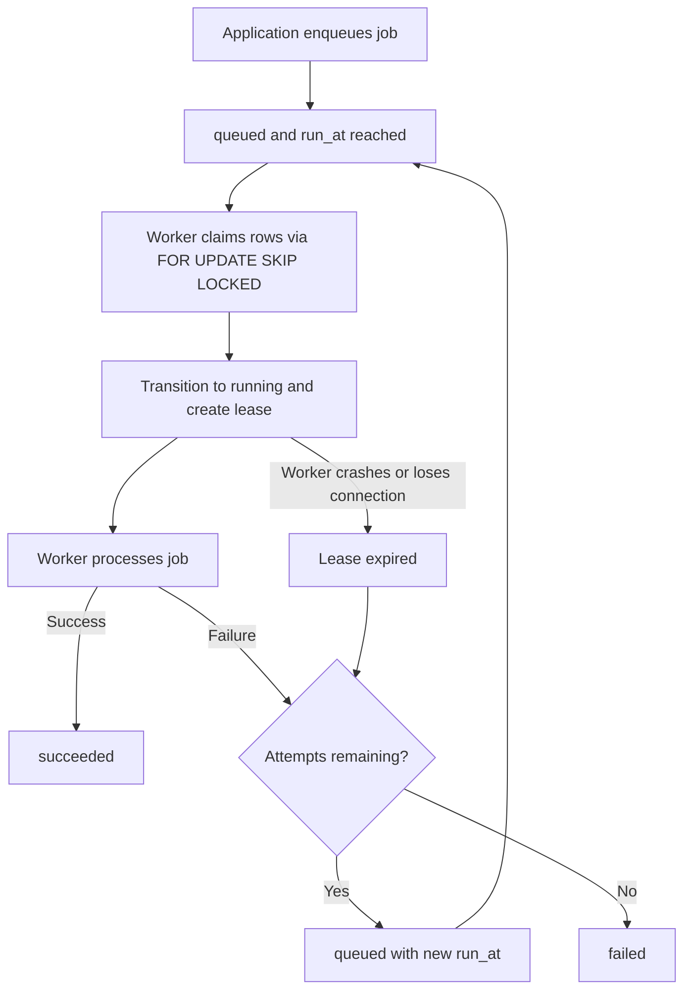

# Building a Job Queue with `SKIP LOCKED` and Retry Mechanisms

PostgreSQL can handle storing and distributing background jobs across multiple concurrent workers. Each job is stored as a row in a table. A worker fetches a batch of pending rows, marks them as running, and processes them. When multiple workers pull jobs concurrently, `FOR UPDATE SKIP LOCKED` lets each worker skip rows already locked by other workers and immediately claim available rows.

For the queue to operate reliably when a worker fails or crashes unexpectedly, row locking must be paired with job statuses, attempt counters, retry timestamps, and ownership leases. This design provides *at-least-once* delivery: a job can be reassigned after a failure, so job handlers must be idempotent.

## 1. How the Queue Works

Suppose an application has multiple workers sending emails, generating reports, or processing orders. If all workers run a plain `SELECT` to look for new jobs, they can read the same row before any worker updates its status. The result is that a single job gets processed multiple times simultaneously.

A PostgreSQL job queue typically follows this lifecycle:

1. The application inserts a job with status `queued` and an eligible execution time `run_at`.
2. A worker selects due jobs, locks the rows, and transitions their status to `running` in a single statement.
3. The worker commits the claim transaction, then processes the job outside that transaction.
4. If processing succeeds, the worker updates the status to `succeeded`.
5. If processing fails, the worker schedules a retry or transitions the job to `failed` once attempts are exhausted.
6. If a worker disappears without updating the status, a reaper process detects the expired lease and returns the job to the queue or marks it failed.

`SKIP LOCKED` solves concurrent distribution during the claim step. Statuses and leases handle tracking jobs after the claim transaction has committed.



## 2. Designing the Job Table

A foundational table can store the payload, status, priority, attempt counts, and information about the worker holding the job:

```sql
CREATE TABLE jobs (
    id                bigint GENERATED ALWAYS AS IDENTITY PRIMARY KEY,
    queue_name        text        NOT NULL DEFAULT 'default',
    payload           jsonb       NOT NULL,
    status            text        NOT NULL DEFAULT 'queued'
        CHECK (status IN ('queued', 'running', 'succeeded', 'failed')),
    priority          integer     NOT NULL DEFAULT 0,
    run_at            timestamptz NOT NULL DEFAULT clock_timestamp(),
    attempts          integer     NOT NULL DEFAULT 0 CHECK (attempts >= 0),
    max_attempts      integer     NOT NULL DEFAULT 5 CHECK (max_attempts > 0),
    locked_by         text,
    locked_at         timestamptz,
    lease_expires_at  timestamptz,
    last_error        text,
    idempotency_key   text UNIQUE,
    created_at        timestamptz NOT NULL DEFAULT clock_timestamp(),
    updated_at        timestamptz NOT NULL DEFAULT clock_timestamp(),
    completed_at      timestamptz,
    CHECK (
        (status = 'running'
            AND locked_by IS NOT NULL
            AND locked_at IS NOT NULL
            AND lease_expires_at IS NOT NULL)
        OR
        (status <> 'running'
            AND locked_by IS NULL
            AND locked_at IS NULL
            AND lease_expires_at IS NULL)
    )
);
```

Meaning of key columns:

| Column | Role |
|---|---|
| `queue_name` | Partitions jobs by queue, such as `email` or `reports`. |
| `payload` | Input data for the worker, typically stored as JSON. |
| `status` | Current status of the job. |
| `priority` | Job priority; higher values are picked first in the examples below. |
| `run_at` | Earliest timestamp at which the job is eligible to run, also storing the next retry schedule. |
| `attempts` | Number of times workers have claimed the job. A claim counts as an attempt even if the worker crashes mid-flight. |
| `max_attempts` | Maximum number of claims before the job transitions to `failed`. |
| `locked_by` | Identifier of the worker currently holding the job. |
| `locked_at` | Timestamp when the worker claimed the job. |
| `lease_expires_at` | Timestamp when current processing ownership expires unless renewed by the worker. |
| `last_error` | Most recent error details for diagnostics. |
| `idempotency_key` | Key preventing duplicate job creation when the application retries an enqueue request. |

The final `CHECK` constraint guarantees that rows in `running` status have complete lease metadata, while all other statuses clear these columns. This prevents partial updates from leaving a row in an inconsistent state.

Create indexes for the two most frequent queries: finding ready jobs and finding expired leases.

```sql
CREATE INDEX jobs_ready_idx
    ON jobs (queue_name, priority DESC, run_at, id)
    WHERE status = 'queued';

CREATE INDEX jobs_expired_lease_idx
    ON jobs (lease_expires_at)
    WHERE status = 'running';
```

These are *partial indexes*: PostgreSQL only indexes rows satisfying the index `WHERE` predicate. Consequently, the ready-job index does not carry completed jobs. Column order in the index must align with actual filters and `ORDER BY` clauses; verify with `EXPLAIN (ANALYZE, BUFFERS)` once data volume is representative.

## 3. Enqueueing Jobs

The application can enqueue a job with `INSERT`:

```sql
INSERT INTO jobs (
    queue_name,
    payload,
    priority,
    run_at,
    idempotency_key
)
VALUES (
    'email',
    '{"recipient":"user@example.com","template":"welcome"}'::jsonb,
    10,
    clock_timestamp(),
    'welcome-email:customer-1042'
)
ON CONFLICT (idempotency_key) DO NOTHING
RETURNING id, status, run_at;
```

If the application retries the same request with the same `idempotency_key`, the `UNIQUE` constraint prevents inserting a duplicate row. When `RETURNING` yields no rows, the application can look up the existing job by that key if it needs the job ID. This is particularly useful when a client does not know whether a prior request committed in the database.

`run_at` allows scheduling jobs immediately or deferring them. Workers only pick up rows whose `run_at` is less than or equal to the current timestamp.

## 4. Claiming Jobs Concurrently with `FOR UPDATE SKIP LOCKED`

The core of the queue is selecting and updating jobs in a single atomic statement:

```sql
WITH picked AS (
    SELECT id
    FROM jobs
    WHERE queue_name = $1
      AND status = 'queued'
      AND run_at <= clock_timestamp()
    ORDER BY priority DESC, run_at, id
    LIMIT $2
    FOR UPDATE SKIP LOCKED
)
UPDATE jobs AS j
SET status = 'running',
    attempts = j.attempts + 1,
    locked_by = $3,
    locked_at = clock_timestamp(),
    lease_expires_at = clock_timestamp() + $4::interval,
    updated_at = clock_timestamp()
FROM picked
WHERE j.id = picked.id
RETURNING
    j.id,
    j.payload,
    j.attempts,
    j.max_attempts,
    j.lease_expires_at;
```

Parameters in this example:

- `$1`: queue name, e.g. `email`.
- `$2`: batch size to claim in one round, e.g. `10`.
- `$3`: worker identifier, e.g. `worker-03`.
- `$4`: lease duration, e.g. `5 minutes`.

The `picked` CTE selects queued, due rows. `FOR UPDATE` locks those selected rows until the transaction ends. `SKIP LOCKED` instructs PostgreSQL to skip rows locked by other transactions instead of waiting for them to unlock. The `UPDATE` transitions those exact selected rows to `running`, increments the attempt counter, and records lease metadata. `RETURNING` delivers the payload and metadata needed by the worker.

Suppose worker A locks row ID 101 and has not committed yet. When worker B runs the same query, B skips row 101 and can claim row 102. Two workers therefore never claim the same locked row during job pickup.

Crucially, selecting and transitioning status must occur within a single atomic statement. If an application merely `SELECT`s a list of IDs and then runs `UPDATE` in a separate statement, two workers can read the same ID before either updates its status.

### Why Update Status Before Committing?

Row locks last only for the duration of the transaction. Once a transaction commits, locks are released. If a worker only selected rows with `FOR UPDATE SKIP LOCKED` and committed without changing status, those rows would immediately become candidates for the next worker. Setting `status = 'running'` in the same statement ensures subsequent workers no longer treat those rows as pending jobs.

In the application, a claim cycle should keep a short transaction boundary:

```sql
BEGIN;

-- Run the WITH picked ... UPDATE jobs ... RETURNING statement above.

COMMIT;
```

After committing, the worker processes the payload outside the claim transaction. Never hold a transaction open while calling external APIs, sending emails, or running long-lived tasks. Holding locks too long blocks other transactions, exhausts database connections, and makes recovery unpredictable.

## 5. Marking Jobs Complete

After successful processing, the worker updates the status. Filtering by `locked_by` and `attempts` confirms the worker still owns that specific claim attempt:

```sql
UPDATE jobs
SET status = 'succeeded',
    completed_at = clock_timestamp(),
    locked_by = NULL,
    locked_at = NULL,
    lease_expires_at = NULL,
    updated_at = clock_timestamp()
WHERE id = $1
  AND status = 'running'
  AND locked_by = $2
  AND attempts = $3
  AND lease_expires_at > clock_timestamp()
RETURNING id, status, completed_at;
```

`$1` is the job ID, `$2` is the worker identifier, and `$3` is the `attempts` value received during the claim statement. If the statement returns zero rows, the worker no longer owns the current execution attempt. The lease may have expired, the job may have been reclaimed, or another worker may have taken over. The worker must treat this as a loss of ownership rather than assuming the status update succeeded.

In this example, `attempts` increases monotonically per claim and acts as a claim-version token. If your system allows resetting the counter or reusing values, generate a dedicated random `lease_token` per claim and verify that token on renewal, completion, and failure reporting.

## 6. Retrying on Failure

Not every error should be retried. Transient network glitches, overloaded external services, or timeouts can recover. Invalid input data or business rule violations generally require investigation instead of endless retries. The application should classify errors before deciding how to update the queue.

For retryable errors, use *exponential backoff*: wait durations grow with consecutive failures. Adding randomness (*jitter*) prevents multiple workers from hammering a newly recovered downstream service simultaneously.

```sql
UPDATE jobs
SET status = CASE
        WHEN attempts >= max_attempts THEN 'failed'
        ELSE 'queued'
    END,
    run_at = CASE
        WHEN attempts >= max_attempts THEN run_at
        ELSE clock_timestamp() + make_interval(
            secs => LEAST(
                3600,
                (
                    5 * power(2, LEAST(attempts - 1, 10))
                    + random() * 5
                )::integer
            )
        )
    END,
    last_error = left($4, 4000),
    locked_by = NULL,
    locked_at = NULL,
    lease_expires_at = NULL,
    updated_at = clock_timestamp()
WHERE id = $1
  AND status = 'running'
  AND locked_by = $2
  AND attempts = $3
  AND lease_expires_at > clock_timestamp()
RETURNING id, status, attempts, max_attempts, run_at;
```

In the statement above, the base delay starts around 5 seconds, roughly doubles on each attempt, and caps at 3,600 seconds. `random() * 5` adds up to roughly 5 seconds of jitter. Tune these numbers to match the characteristics of the services your workers call.

If `attempts` has reached `max_attempts`, the job transitions to `failed`. If attempts remain, the job returns to `queued` with a future `run_at`. Clearing the lease columns happens atomically with the status update, so the row is no longer tied to the old worker.

If an error is classified as non-recoverable, the worker can transition directly to `failed`, record `last_error`, and clear the lease without scheduling a retry. Operational tooling can let administrators inspect errors, fix data, and requeue jobs to `queued` under an explicit policy.

## 7. Reclaiming Jobs When Workers Crash

A worker can be killed, lose network connectivity, or suffer host failure after committing a claim. In that case, the row remains in `running`. Leases place an upper bound on ownership: if the worker fails to renew before `lease_expires_at`, a reaper process can return the job to the queue.

The reaper should process small batches so it does not hold too many locks at once:

```sql
WITH expired AS (
    SELECT id
    FROM jobs
    WHERE status = 'running'
      AND lease_expires_at <= clock_timestamp()
    ORDER BY lease_expires_at
    LIMIT 100
    FOR UPDATE SKIP LOCKED
)
UPDATE jobs AS j
SET status = CASE
        WHEN j.attempts >= j.max_attempts THEN 'failed'
        ELSE 'queued'
    END,
    run_at = CASE
        WHEN j.attempts >= j.max_attempts THEN j.run_at
        ELSE clock_timestamp() + make_interval(
            secs => LEAST(
                3600,
                (
                    5 * power(2, LEAST(j.attempts - 1, 10))
                    + random() * 5
                )::integer
            )
        )
    END,
    last_error = 'Worker lease expired',
    locked_by = NULL,
    locked_at = NULL,
    lease_expires_at = NULL,
    updated_at = clock_timestamp()
FROM expired
WHERE j.id = expired.id
RETURNING j.id, j.status, j.attempts, j.run_at;
```

Here `SKIP LOCKED` also helps the reaper itself. If a worker happens to be renewing or completing a row right at that moment, the reaper skips the locked row and processes others. The next sweep will check that row again. Reclaimed jobs also apply backoff based on `attempts` so a repeatedly crashing worker does not thrash the queue with rapid retries.

Suppose a lease is set to 5 minutes. If a worker does not send a heartbeat within that window, the row can be reclaimed once expired. Leases that are too short cause healthy, slow-running tasks to be reassigned prematurely; leases that are too long leave crashed jobs stuck for extended periods before recovery. Choose lease durations based on actual processing time, latency, and heartbeat cadence.

## 8. Renewing Leases for Long-Running Jobs

For jobs taking longer than the initial lease, the worker must periodically renew the lease. Only the worker holding the active claim may renew it:

```sql
UPDATE jobs
SET lease_expires_at = clock_timestamp() + interval '5 minutes',
    updated_at = clock_timestamp()
WHERE id = $1
  AND status = 'running'
  AND locked_by = $2
  AND attempts = $3
  AND lease_expires_at > clock_timestamp()
RETURNING lease_expires_at;
```

If zero rows are returned, the worker has lost the lease or it has expired. The worker should abort processing if possible and avoid writing results under stale ownership. Including `lease_expires_at > clock_timestamp()` in renewal, completion, and failure updates prevents a worker from mutating a row using an expired lease.

For systems where an old worker might continue running past lease expiration, checking ownership on every status update is critical. For external side effects outside the database, add idempotency keys or fencing tokens at the target system; queue checks alone cannot recall an outbound request that was already dispatched.

## 9. Ensuring Idempotency and Understanding Delivery Guarantees

`SKIP LOCKED` prevents two transactions from locking the same row during a claim. However, it does not create an *exactly-once* guarantee for the entire job execution.

Consider a scenario where a worker sends an email successfully, and then the process crashes before updating `status = 'succeeded'`. Once the lease expires, the job is reassigned and the email may be sent a second time. The database cannot know for sure whether the email service executed the side effect before the connection dropped.

Ways to mitigate the impact of redelivery:

- Design idempotent handlers: processing the same `job_id` multiple times produces the exact same business outcome.
- Pass idempotency keys when calling external APIs whenever the target service supports them.
- For mutations within the same PostgreSQL database, apply the business change and mark the job `succeeded` in the same transaction when appropriate.
- Use unique constraints or a processed-events table to block duplicate effects.
- For event publishing flows, consider a transactional outbox to record business mutations and outbound events in the same transaction, with a separate worker dispatching events.

Accordingly, treat this pattern as *at-least-once* delivery: the system prioritizes never losing jobs and may redeliver when completion confirmation is missing. Idempotent handlers make redelivery safe.

## 10. Operational Characteristics to Keep in Mind

**No strict FIFO guarantee.** `ORDER BY priority DESC, run_at, id` orders eligible rows that a query can claim. When a row at the top of the list is locked, `SKIP LOCKED` skips it to pick up another row. A job may be processed after a job inserted later. Continuously arriving high-priority jobs can also starve low-priority jobs; implement priority aging or separate queues if needed.

**Choose an appropriate batch size.** A worker claiming too many rows holds responsibility for a long queue of work and can starve other workers. Small batches improve load balancing; large batches reduce query overhead but increase wait times and the number of leases to maintain.

**Keep claim transactions short.** Row locks are held until the transaction ends. Claim, update status, and commit—then process business logic afterward. Never hold a transaction open while waiting on network calls or users.

**Monitor operational metrics.** Track `queued` row counts, `running` row counts, age of the oldest queued job, average attempt count, `failed` row counts, expired leases, and processing duration by job type. These metrics expose dead workers, slow downstream dependencies, or queues growing faster than processing capacity.

**Prune data by policy.** Completed rows can cause tables and indexes to grow rapidly. Archive or delete old rows according to business retention policies while preserving enough history for auditing and troubleshooting. On high-throughput queues, continuous status updates also generate dead tuples; monitor autovacuum, table bloat, and index size.

**Do not use `SKIP LOCKED` for consistent read queries.** This option intentionally returns an incomplete set of rows by skipping locked ones. That behavior is ideal for work distribution, but unsuitable when an application needs a complete, consistent snapshot of all data.

**Understand the scope of `SKIP LOCKED`.** It skips row-level lock conflicts only. Queries still acquire table-level locks per PostgreSQL rules and will block if they encounter conflicting table locks. Thus, `SKIP LOCKED` does not bypass every lock type in the database.

## 11. Observing Behavior with Two Workers

You can test the locking mechanism yourself using two `psql` sessions. Prepare at least two `queued` rows in the same queue.

In session A, start a transaction and lock one row:

```sql
BEGIN;

SELECT id
FROM jobs
WHERE queue_name = 'email'
  AND status = 'queued'
ORDER BY priority DESC, run_at, id
LIMIT 1
FOR UPDATE;
```

Keep transaction A open. In session B, run the same query with `SKIP LOCKED` added:

```sql
SELECT id
FROM jobs
WHERE queue_name = 'email'
  AND status = 'queued'
ORDER BY priority DESC, run_at, id
LIMIT 1
FOR UPDATE SKIP LOCKED;
```

If another eligible row exists, session B receives that row immediately instead of waiting on the row locked by session A. Afterward, end session A with `COMMIT` or `ROLLBACK` to release the lock. In a real application, the full claim statement in Section 4 also updates `status` to `running`, ensuring the row does not re-enter the waiting pool after commit.

## 12. Reference Implementation Checklist

When adding this queue to an application, roll it out in the following order:

1. Create the `jobs` table, constraints, and partial indexes matching worker filters.
2. Implement enqueue operations with an `idempotency_key` to prevent duplicates on client retries.
3. Implement the claim query using `FOR UPDATE SKIP LOCKED`, transitioning to `running`, incrementing `attempts`, and setting the lease in one statement.
4. Commit immediately after claiming; execute payloads outside the claim transaction.
5. Implement completion, failure reporting, and lease renewal queries with conditions verifying the owning worker and claim attempt.
6. Run a batched reaper process for expired leases while enforcing max-attempt limits and backoff.
7. Make handlers idempotent, especially when jobs call external services or trigger non-rollbackable side effects.
8. Monitor backlog depth, queue latency, errors, retry counts, and expired leases to tune worker count, batch size, and lease duration.

This design leverages PostgreSQL row locking to distribute work across multiple workers without locking the entire table. `SKIP LOCKED` lets workers move past contended rows to available work, while statuses, leases, and retry policies enable recovery when processing fails.
