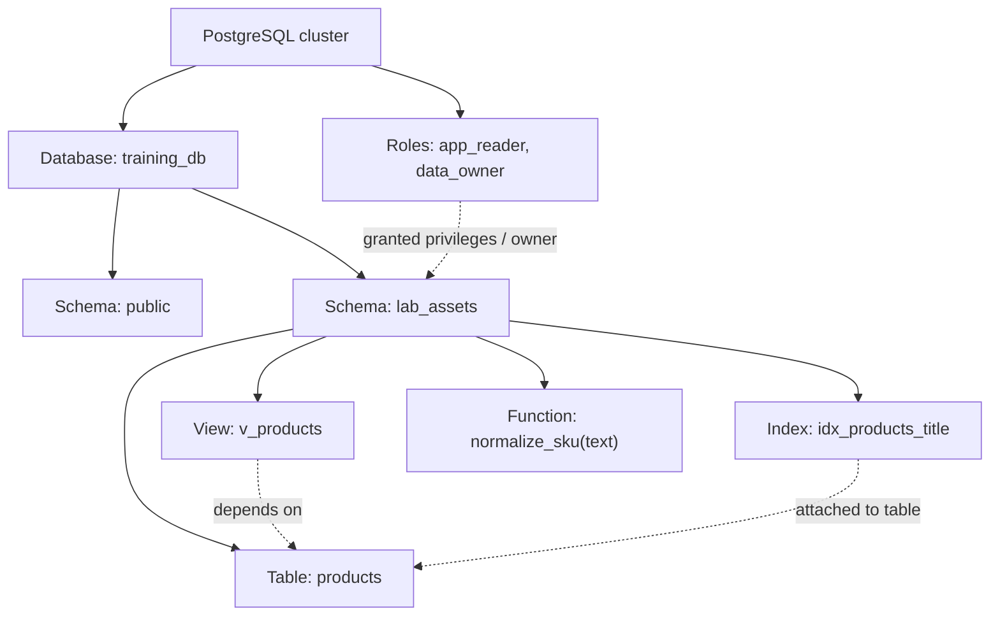
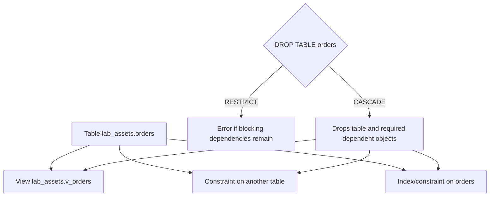

# Creating, renaming, changing ownership, and dropping objects in PostgreSQL

In PostgreSQL, data is organized under various **database objects**: databases, schemas, tables, views, materialized views, sequences, indexes, functions, types, roles, and more. Each object has a name, belongs to an appropriate namespace, has an owner when that object kind supports ownership, and may depend on other objects. Creating or modifying an object alters the **structure/configuration of the database** via SQL DDL (Data Definition Language).

This lesson focuses on four operation groups:

- **Creating** objects with `CREATE`.
- **Renaming** objects with variants of `ALTER ... RENAME`.
- **Changing ownership** with `ALTER ... OWNER TO` where the object kind supports it.
- **Dropping** objects with `DROP`, particularly how PostgreSQL handles dependencies.

Examples use a learning database and the `lab_assets` schema. Only run commands capable of altering or dropping objects in a **practice environment** you are authorized to manage—never run them wholesale in production.

## 1. Understanding the object model and qualified names

A PostgreSQL connection accesses one database at a time. Inside a database live schemas; inside schemas live tables, views, sequences, functions, and many other object kinds. Roles are cluster-wide PostgreSQL objects used as login identities, privilege groups, and owners.



A table should be referenced by its **qualified name** `schema_name.table_name` when administrative statements require clarity:

```sql
SELECT * FROM lab_assets.products;
```

If you write `SELECT * FROM products`, PostgreSQL relies on `search_path` to locate the table, leading to different outcomes across connections. For DDL changes, explicitly stating the schema helps prevent operating on the wrong object.

PostgreSQL automatically folds **unquoted identifiers** to lowercase: unquoted `Products` is interpreted as `products`. `"Products"` is a distinct, case-sensitive identifier. Consistently use lowercase names with underscores, such as `catalog_items`, to reduce the need to quote identifiers.

### Objects sharing administrative operations with different syntax

| Object | Create | Rename | Change owner | Drop |
| --- | --- | --- | --- | --- |
| Database | `CREATE DATABASE` | `ALTER DATABASE ... RENAME TO` | `ALTER DATABASE ... OWNER TO` | `DROP DATABASE` |
| Schema | `CREATE SCHEMA` | `ALTER SCHEMA ... RENAME TO` | `ALTER SCHEMA ... OWNER TO` | `DROP SCHEMA` |
| Table | `CREATE TABLE` | `ALTER TABLE ... RENAME TO` | `ALTER TABLE ... OWNER TO` | `DROP TABLE` |
| View | `CREATE VIEW` | `ALTER VIEW ... RENAME TO` | `ALTER VIEW ... OWNER TO` | `DROP VIEW` |
| Materialized view | `CREATE MATERIALIZED VIEW` | `ALTER MATERIALIZED VIEW ... RENAME TO` | `ALTER MATERIALIZED VIEW ... OWNER TO` | `DROP MATERIALIZED VIEW` |
| Sequence | `CREATE SEQUENCE` | `ALTER SEQUENCE ... RENAME TO` | `ALTER SEQUENCE ... OWNER TO` | `DROP SEQUENCE` |
| Index | `CREATE INDEX` | `ALTER INDEX ... RENAME TO` | Follows ownership of associated table | `DROP INDEX` |
| Function | `CREATE FUNCTION` | `ALTER FUNCTION ... RENAME TO` | `ALTER FUNCTION ... OWNER TO` | `DROP FUNCTION` |
| Role | `CREATE ROLE` | `ALTER ROLE ... RENAME TO` | No `ALTER ROLE ... OWNER TO` syntax | `DROP ROLE` |

There are many other object kinds such as types, domains, triggers, constraints, and extensions. For each kind, verify the exact `ALTER`/`DROP` variant; do not assume all objects support the same options.

## 2. Preparing the practice schema and inspecting metadata

Assume you are connected to the **`training_db`** database using a role with schema creation privileges. Run:

```sql
CREATE SCHEMA lab_assets;

CREATE TABLE lab_assets.products (
    product_id bigint GENERATED BY DEFAULT AS IDENTITY PRIMARY KEY,
    sku text NOT NULL UNIQUE,
    title text NOT NULL,
    unit_price numeric(12, 2) NOT NULL CHECK (unit_price >= 0)
);

INSERT INTO lab_assets.products (sku, title, unit_price)
VALUES
    ('BK-001', 'PostgreSQL Handbook', 250000.00),
    ('BK-002', 'SQL Exercises', 180000.00);

CREATE INDEX idx_products_title
    ON lab_assets.products (title);

CREATE VIEW lab_assets.v_products AS
SELECT product_id, sku, title, unit_price
FROM lab_assets.products;
```

In `psql`, inspect the created objects:

```text
\dn+ lab_assets
\dt+ lab_assets.*
\dv+ lab_assets.*
\di+ lab_assets.*
\d+ lab_assets.products
```

Commands beginning with a backslash are **commands specific to the `psql` client**, not SQL statements sent directly via JDBC.

You can query the catalog to see the names, kinds, and owners of tables, indexes, views, and sequences in the schema:

```sql
SELECT
    n.nspname AS schema_name,
    c.relname AS object_name,
    c.relkind AS object_kind,
    pg_get_userbyid(c.relowner) AS owner_name
FROM pg_class AS c
JOIN pg_namespace AS n ON n.oid = c.relnamespace
WHERE n.nspname = 'lab_assets'
ORDER BY c.relkind, c.relname;
```

`pg_class.relkind` uses codes such as `r` (ordinary table), `p` (partitioned table), `v` (view), `m` (materialized view), `S` (sequence), and `i` (index). Not every object lives in `pg_class`; for example, functions live in `pg_proc`, schemas in `pg_namespace`, and roles in `pg_roles`.

## 3. CREATE: creating objects with the right structure

### 3.1. Creating databases and schemas

```sql
-- Run while connected to another database, with CREATEDB privilege.
CREATE DATABASE training_db
    WITH ENCODING 'UTF8'
    TEMPLATE template0;

-- Then connect to training_db:
CREATE SCHEMA lab_assets;
```

`CREATE DATABASE` can only be executed while connected to an existing database, and **cannot run inside a transaction block**. Creating a new database requires superuser or appropriate `CREATEDB` privilege. The lines above describe initial setup from scratch and do not need to be rerun if `training_db` and `lab_assets` already exist.

`CREATE SCHEMA` creates a namespace to organize objects by function, business domain, or administrative boundary:

```sql
CREATE SCHEMA analytics;
CREATE TABLE analytics.daily_metrics (
    metric_date date PRIMARY KEY,
    total_orders bigint NOT NULL DEFAULT 0
);
```

A database can hold multiple schemas. **A schema is not a separate database**: tables across schemas within the same database can be queried together when privileges permit.

### 3.2. Creating tables, sequences, indexes, and views

Standalone example:

```sql
CREATE SEQUENCE lab_assets.invoice_number_seq
    START WITH 1000
    INCREMENT BY 1;

CREATE TABLE lab_assets.invoices (
    invoice_number bigint PRIMARY KEY
        DEFAULT nextval('lab_assets.invoice_number_seq'::regclass),
    customer_name text NOT NULL,
    issued_at timestamptz NOT NULL DEFAULT now()
);

CREATE INDEX idx_invoices_issued_at
    ON lab_assets.invoices (issued_at DESC);

CREATE VIEW lab_assets.v_recent_invoices AS
SELECT invoice_number, customer_name, issued_at
FROM lab_assets.invoices
WHERE issued_at >= now() - interval '30 days';
```

Note the distinctions:

- **Sequence** generates numbers on demand with its own state; `nextval` does not roll back merely because a transaction aborts. Do not rely on sequence numbers to infer that every transaction succeeded or that there are no gaps.
- **Index** accelerates lookups for certain query plans, but consumes disk space and incurs maintenance overhead on writes.
- **View** stores a query definition. Querying a view reads data from underlying tables at execution time; a regular view does not store a separate physical copy of data.
- **Materialized view** stores materialized results and requires `REFRESH MATERIALIZED VIEW` to update from source data.

For a sequence created separately as in the example, `DEFAULT nextval(...)` creates a dependency from the default expression to the sequence, yet the sequence itself is **not automatically declared `OWNED BY`** the column. You can bind the sequence's lifecycle to the column via:

```sql
ALTER SEQUENCE lab_assets.invoice_number_seq
    OWNED BY lab_assets.invoices.invoice_number;
```

Appropriate privileges are required, and the sequence must share the same schema and owner as the table per PostgreSQL rules. `OWNED BY` ties the sequence to the column's lifecycle: dropping the column or table can automatically drop the sequence. Therefore, only configure it when the sequence is truly dedicated to that column.

### 3.3. Functions and function signatures

Functions with the same name can differ in parameter type lists (function overloading). Example:

```sql
CREATE FUNCTION lab_assets.discount_price(
    amount numeric,
    discount_percent numeric
)
RETURNS numeric
LANGUAGE sql
IMMUTABLE
AS $fn$
    SELECT amount * (1 - discount_percent / 100);
$fn$;

SELECT lab_assets.discount_price(200.00, 10.00);
```

When renaming, changing ownership of, or dropping a specific function, always specify its **parameter type signature** so PostgreSQL can uniquely identify the target function.

### 3.4. IF NOT EXISTS: convenient, but not a migration strategy

Several CREATE commands support `IF NOT EXISTS`:

```sql
CREATE SCHEMA IF NOT EXISTS lab_assets;

CREATE TABLE IF NOT EXISTS lab_assets.import_jobs (
    job_id bigint GENERATED ALWAYS AS IDENTITY PRIMARY KEY,
    created_at timestamptz NOT NULL DEFAULT now()
);

CREATE INDEX IF NOT EXISTS idx_import_jobs_created_at
    ON lab_assets.import_jobs (created_at);
```

`IF NOT EXISTS` avoids raising an error simply because an object with that name already exists, but **does not validate that the existing structure matches expectations**. In particular, an existing index with that name might differ from your intended index definition. Evolving an application schema should normally use versioned migration tools such as Flyway or Liquibase alongside schema diff verification.

## 4. RENAME: renaming objects without recreating data

### 4.1. Renaming tables and columns

With `lab_assets.products` present:

```sql
ALTER TABLE lab_assets.products
    RENAME TO catalog_items;

ALTER TABLE lab_assets.catalog_items
    RENAME COLUMN sku TO product_code;

SELECT product_id, product_code, title
FROM lab_assets.catalog_items;
```

`RENAME TO` accepts only the **new object name**, not `schema.name`. Renaming `lab_assets.products` to `lab_assets.catalog_items` keeps the table in the same schema. Moving between schemas is a separate operation (`SET SCHEMA`).

Renaming a table does not automatically rename every index and constraint owned by that table. To standardize the name of the separately created index from the earlier example:

```sql
ALTER INDEX lab_assets.idx_products_title
    RENAME TO idx_catalog_items_title;
```

For constraints, the corresponding syntax is:

```sql
ALTER TABLE lab_assets.catalog_items
    RENAME CONSTRAINT products_sku_key TO catalog_items_product_code_key;
```

`products_sku_key` is the default constraint name **typically generated** for `sku UNIQUE` in the example table. In a real system, check `\d lab_assets.catalog_items` or the catalog before using this name.

Renaming a constraint-backing index can also rename the constraint, and renaming a constraint with a backing index can rename the index according to PostgreSQL rules. You do not need to operate twice if the system has already synchronized the name as desired.

### 4.2. Renaming schemas and moving objects across schemas

```sql
ALTER SCHEMA lab_assets
    RENAME TO training_assets;

-- Separate example: move table to an existing target schema.
CREATE SCHEMA archived_assets;

ALTER TABLE training_assets.catalog_items
    SET SCHEMA archived_assets;
```

After renaming the schema, use `training_assets.catalog_items`. After `SET SCHEMA`, the qualified name becomes `archived_assets.catalog_items`.

Dependent objects inside PostgreSQL typically link via internal identifiers rather than plain name text; thus, certain view/index/constraint definitions update to continue referencing properly. However, **SQL in application source code, dynamic SQL strings, connection configurations, reports, or external tools may still hold the old name** and must be updated in sync.

### 4.3. Renaming views, sequences, functions, and databases

Syntax examples for previously created objects:

```sql
ALTER VIEW lab_assets.v_recent_invoices
    RENAME TO v_invoices_recent;

ALTER SEQUENCE lab_assets.invoice_number_seq
    RENAME TO seq_invoice_numbers;

ALTER FUNCTION lab_assets.discount_price(numeric, numeric)
    RENAME TO apply_discount;
```

Object paths in these examples assume the schema is still `lab_assets`. If you executed the earlier schema rename, use **the new schema name**; the examples in this lesson demonstrate each operation independently to clarify syntax.

Renaming a database:

```sql
-- Connect via another database and ensure sufficient privileges.
ALTER DATABASE training_db RENAME TO training_archive;
```

You cannot rename **the database your current session is connected to**. Other active sessions using the database can also block the rename; plan maintenance windows, update connection strings, and avoid renaming in live application-serving environments.

### 4.4. Can RENAME be considered completely risk-free?

No. Data inside the table remains intact, yet renaming breaks **name contracts**. Callers using the old name will fail or query the wrong object. PostgreSQL also acquires locks for many `ALTER` commands; in a busy system, DDL can wait for locks or block other transactions.

When renaming objects used by a live application, execute controlled migrations with backward/forward compatibility where necessary and monitor query traffic afterward.

## 5. OWNER: changing object ownership

### 5.1. Owner differs from a role granted privileges

A table has an **owner**, usually the role that created it or a role specified at creation. The owner has privileges to alter definitions or drop the object per PostgreSQL rules, and controls privilege grants on that object.

For example, a role granted only `SELECT` does not become an owner:

```sql
GRANT SELECT ON TABLE lab_assets.products TO app_reader;
```

This command requires the table and role to exist; the `SELECT` privilege permits reading data under current policies, **not** arbitrarily running `ALTER TABLE` or `DROP TABLE`. Transferring ownership is a distinct operation:

```sql
ALTER TABLE lab_assets.products OWNER TO data_owner;
```

The examples above are presented standalone, assuming the table is still named `products`. When running sequentially in practice, use the actual names after any renames.

### 5.2. Requirements for transferring OWNER

In typical scenarios for schema objects, the executor must:

- Be the current owner (or effectively hold owner authority via role membership per PostgreSQL rules; superusers have special privileges).
- Be able to become the target owner role via role membership/`SET ROLE`.
- Ensure the new owner role has `CREATE` privilege on the containing schema if the object kind requires it.

Execute ownership changes under an administrative role granted proper privileges. Changing the owner does not automatically grant database connection rights or usage rights on related schemas to every member of the new role.

Example of an administrator preparing an object-owning role:

```sql
-- Requires appropriate role-management privileges.
CREATE ROLE data_owner NOLOGIN;

-- In this example, schema privileges are granted by an authorized role.
GRANT USAGE, CREATE ON SCHEMA lab_assets TO data_owner;

-- The role running ALTER must satisfy ownership/role membership rules.
ALTER TABLE lab_assets.products OWNER TO data_owner;
```

`NOLOGIN` prevents direct login while still allowing the role to own objects and act as a privilege group. Deployment/migration accounts can be granted appropriate membership per organizational access policies.

### 5.3. Changing OWNER for other object kinds

```sql
ALTER SCHEMA lab_assets OWNER TO data_owner;

ALTER VIEW lab_assets.v_products OWNER TO data_owner;

ALTER SEQUENCE lab_assets.invoice_number_seq
    OWNER TO data_owner;

ALTER FUNCTION lab_assets.discount_price(numeric, numeric)
    OWNER TO data_owner;

ALTER DATABASE training_db OWNER TO data_owner;
```

Each statement assumes the object and role exist, privilege requirements are met, and prior renames have not changed the names. `ALTER DATABASE ... OWNER TO` has its own privilege rules, typically requiring `CREATEDB` and appropriate role membership for the executor unless superuser.

**Common pitfall:** changing the owner of a **schema** does not automatically change the owner of every table, view, or function inside that schema. Likewise, changing a database's owner does not transfer ownership of all objects inside the database. Child objects must be managed individually or via scoped ownership transfer mechanisms.

Regular indexes belong to their parent table and have no standalone `ALTER INDEX ... OWNER TO` syntax; index ownership follows the associated relation's ownership. For sequences bound to a column via `OWNED BY` or identity, ownership changes have coupled constraints/updates; inspect metadata rather than inferring from sequence names.

### 5.4. REASSIGN OWNED: controlled bulk transfer

When retiring a role that owns many objects, PostgreSQL provides:

```sql
REASSIGN OWNED BY old_owner TO new_owner;
```

This transfers objects owned by `old_owner` inside the **current database**, as well as supported cluster-level shared objects like databases and tablespaces. It requires appropriate membership on both source and target roles. Its impact can extend beyond one schema and even affect shared objects across databases. Never use `REASSIGN OWNED` as a shortcut for `ALTER TABLE ... OWNER TO` when intending to update a single table.

Before dropping a role, you must first resolve objects and grants still referencing that role across relevant databases. `DROP OWNED BY role_name` can **delete objects** owned by the role in the current database and revoke privileges, so treat it as a potentially data-destructive operation rather than a safe variant of `REASSIGN OWNED`.

## 6. DROP: dropping the right object type

Common syntax:

```sql
DROP TABLE lab_assets.products;

DROP VIEW lab_assets.v_products;

DROP SEQUENCE lab_assets.invoice_number_seq;

DROP FUNCTION lab_assets.discount_price(numeric, numeric);

DROP SCHEMA lab_assets;
```

`DROP TABLE` removes the table definition and all data inside it; `DROP VIEW` deletes the view without directly deleting underlying table data. `DROP INDEX` removes a regular index without dropping its base table, though query performance may suffer. `DROP FUNCTION` deletes a specific function overload identified by signature, potentially impacting callers or dependent objects.

Objects with dependencies must be handled in order or via the `RESTRICT`/`CASCADE` policies covered next.

### 6.1. IF EXISTS and object names

```sql
DROP TABLE IF EXISTS lab_assets.import_jobs;
DROP VIEW IF EXISTS lab_assets.v_recent_invoices;
DROP SCHEMA IF EXISTS archived_assets;
```

`IF EXISTS` prevents errors when the **named object does not exist**, usually emitting a notice instead. However, it does not make dropping harmless: if an important object exists under that name, it will still be deleted. Moreover, `IF EXISTS` does not automatically handle dependent objects.

### 6.2. Specific restrictions when dropping databases and roles

```sql
-- Illustrative only, applies to a study database to be deleted.
DROP DATABASE training_archive;

-- Only when the role no longer owns objects or holds dependent grants.
DROP ROLE data_owner;
```

`DROP DATABASE` cannot run inside a transaction block and cannot execute while connected to the target database itself. Active sessions connected to the target database normally cause `DROP DATABASE` to fail; newer PostgreSQL versions support `WITH (FORCE)`, but this option has limitations and forcibly disconnects users, so consider it only within explicit operational procedures.

`DROP ROLE` deletes a cluster-level role. If the role still owns objects or participates in dependencies, PostgreSQL rejects it; resolve ownership and grants across relevant databases before dropping the role.

## 7. RESTRICT and CASCADE: dependencies govern DROP outcomes

Suppose we have:

```sql
CREATE TABLE lab_assets.orders (
    order_id bigint PRIMARY KEY,
    created_at timestamptz NOT NULL DEFAULT now()
);

CREATE VIEW lab_assets.v_orders AS
SELECT order_id, created_at
FROM lab_assets.orders;
```

View `v_orders` depends on table `orders`. If you run:

```sql
DROP TABLE lab_assets.orders;
```

PostgreSQL rejects it while dependencies remain. `RESTRICT` is the default behavior on `DROP` statements that support it:

```sql
DROP TABLE lab_assets.orders RESTRICT;
```

By contrast:

```sql
DROP TABLE lab_assets.orders CASCADE;
```

allows PostgreSQL to also drop **dependent objects that must be removed**, such as `v_orders`. Dependencies can cross schema boundaries: views in other schemas or related constraints may also be affected. For foreign keys from another table pointing to the target table, `CASCADE` drops the referencing constraint rather than dropping the referencing table itself; always read the actual notices to know precisely what was removed.



Distinguish clearly between:

- **Dependencies**: structural links known to PostgreSQL (view definitions, constraints, indexes, sequence ownership, etc.).
- **External applications**: may reference the table via SQL strings, yet PostgreSQL has no visibility into every query inside Java code or reporting systems. `DROP ... CASCADE` cannot check those external callers.
- Dropping an object can cause data loss or application outages even when PostgreSQL permits the statement.

### 7.1. Dropping step-by-step to retain control

Instead of immediately reaching for `CASCADE`, choose an explicit order:

```sql
DROP VIEW lab_assets.v_orders;
DROP TABLE lab_assets.orders;
```

For an unused schema, the following refuses to run if objects remain inside:

```sql
DROP SCHEMA lab_assets RESTRICT;
```

If you intentionally want to remove every object in the schema along with related dependents:

```sql
DROP SCHEMA lab_assets CASCADE;
```

This is a **multi-object destructive operation**: review the object list beforehand, ensure backups/recovery options exist, and verify authorization. `CASCADE` can affect objects outside the schema if they depend on objects being dropped; never guess the blast radius from the schema name alone.

### 7.2. Tracing dependencies before DROP

`psql` utilities reveal structure:

```text
\d+ lab_assets.orders
\dv+ lab_assets.*
\di+ lab_assets.*
```

To inspect which views reference a specific table in a small environment:

```sql
SELECT schemaname, viewname, definition
FROM pg_views
WHERE schemaname = 'lab_assets'
ORDER BY viewname;
```

Searching view text is an observational aid, **not** an exhaustive dependency algorithm. PostgreSQL stores structural dependencies in catalogs such as `pg_depend`, `pg_rewrite`, and `pg_constraint`; accurately querying these catalogs requires understanding dependency types and internal objects. Before dropping critical objects, combine metadata checks, migration planning, testing on a clone, and tracing external callers.

## 8. DDL inside transactions: rollback capability and exceptions

PostgreSQL supports transactions for **many** DDL commands:

```sql
BEGIN;

CREATE TABLE lab_assets.temp_experiment (
    id bigint PRIMARY KEY,
    note text
);

ALTER TABLE lab_assets.temp_experiment
    RENAME TO temp_experiment_v2;

-- Verify before deciding:
SELECT to_regclass('lab_assets.temp_experiment_v2');

ROLLBACK;

-- After rollback, the test table no longer exists.
SELECT to_regclass('lab_assets.temp_experiment_v2');
```

In this example, both `CREATE` and `RENAME` are undone by `ROLLBACK`. This is valuable when testing migrations in a practice environment and when a group of changes must execute atomically.

However, **not all DDL can run inside a transaction block**. Classic exceptions include:

- `CREATE DATABASE` and `DROP DATABASE`.
- `CREATE INDEX CONCURRENTLY` and `DROP INDEX CONCURRENTLY`.
- Certain other specialized commands depending on the PostgreSQL version.

Never assume a multi-DDL script will always roll back completely. Furthermore, even rollback-capable DDL can acquire strong locks and block other sessions while the transaction remains open.

### 8.1. Locks during ALTER or DROP

Many `ALTER TABLE` variants, renames, and `DROP TABLE` acquire strong locks on the relation. If application transactions hold conflicting locks, the DDL waits; while the DDL holds or waits for locks, application queries may queue behind it.

You can set a wait limit inside a practice transaction to avoid waiting indefinitely:

```sql
BEGIN;
    SET LOCAL lock_timeout = '2s';

    ALTER TABLE lab_assets.products
        RENAME COLUMN title TO product_title;

COMMIT;
```

This standalone example assumes `lab_assets.products` still exists and has not been renamed. If `ALTER` is aborted by `lock_timeout`, the transaction normally enters an error state and requires `ROLLBACK`; do not proceed to `COMMIT` and assume the change succeeded.

In production, you may need the **expand–migrate–contract** pattern: add the new compatible structure, gradually migrate code and data, verify, and only then remove the old object. This is generally far safer than immediately renaming or dropping a column still used by running application versions.

## 9. How renaming and ownership changes affect access privileges

### 9.1. Name changes do not mean dependencies and privileges are recreated

With `ALTER TABLE ... RENAME TO`, PostgreSQL renames the same underlying object. For many object kinds, previously granted ACLs/privileges and internal-ID-based references remain attached to that object. Yet **external SQL still needs the correct name**.

For example, if an application runs:

```sql
SELECT sku FROM lab_assets.products;
```

After renaming to `lab_assets.catalog_items` and column `product_code`, the query must be updated to:

```sql
SELECT product_code FROM lab_assets.catalog_items;
```

You cannot rely solely on PostgreSQL updating internal dependencies to keep the entire application running.

### 9.2. Transferring ownership can alter who holds administrative rights

When transferring ownership to `data_owner`, direct administrative authority follows ownership under the new role. Existing `GRANT` privileges are not necessarily stripped, though you should review:

- Whether the new role has sufficient privileges in the schema and database.
- Which `SELECT/INSERT/UPDATE/DELETE/EXECUTE` privileges application roles rely on.
- Whether default policies for **future objects** still match expectations.

`ALTER DEFAULT PRIVILEGES` controls default privileges for **future objects created** by a specified role, rather than retroactively altering all existing objects. Changing the owner of an existing object does not automatically update the entire future-grants strategy.

Check table access privileges via `psql`:

```text
\dp lab_assets.products
```

Or read owner metadata from the catalog as shown earlier. When running administrative commands with a read-only application role, a successful `SELECT` does not prove that role can change owners, rename, or drop the table.

## 10. A controllable object modification workflow

For any DDL change that may impact an application, a sensible workflow is:

1. **Identify object and scope**: connect to the right database; verify schema, qualified name, owner, object kind, and current definition.
2. **Identify dependencies**: views, functions, foreign keys, sequences, indexes, application code, or reports using it.
3. **Verify privileges**: executor role holds required privileges; new owner holds appropriate membership/schema rights if changing ownership.
4. **Plan migration and reversibility**: classify operations that can roll back in a transaction versus those needing backups or data recovery.
5. **Test in a staging/test environment**: run the migration, verify metadata, and run key application queries.
6. **Execute with monitoring**: watch locks, duration, application errors, migration tool exit codes, and post-change results.
7. **Update caller contracts**: Java/JPA code, table/column names in SQL, configurations, documentation, dashboards, and subsequent migrations.

Example of a rename runnable inside a transaction once the table and dependent views have been checked:

```sql
BEGIN;
    SET LOCAL lock_timeout = '3s';

    ALTER TABLE lab_assets.products
        RENAME TO catalog_items;

    ALTER TABLE lab_assets.catalog_items
        RENAME COLUMN sku TO product_code;

COMMIT;
```

Test this change in a replica of the real environment even when PostgreSQL completes the rename cleanly. For systems with many active application sessions, compatibility planning and deployment timing matter just as much as syntactically valid SQL.

## 11. Comprehensive hands-on lab

Use a dedicated learning database and choose a new schema so existing data is unaffected.

**Step 1 — Create objects and verify metadata**

```sql
CREATE SCHEMA ddl_practice;

CREATE TABLE ddl_practice.departments (
    department_id bigint GENERATED ALWAYS AS IDENTITY PRIMARY KEY,
    department_name text NOT NULL UNIQUE
);

CREATE VIEW ddl_practice.v_departments AS
SELECT department_id, department_name
FROM ddl_practice.departments;

INSERT INTO ddl_practice.departments (department_name)
VALUES ('Engineering'), ('Sales');
```

Use `\dt`, `\dv`, and `pg_class` to confirm the table and view exist.

**Step 2 — Rename objects and query using the new names**

```sql
ALTER TABLE ddl_practice.departments
    RENAME TO teams;

ALTER TABLE ddl_practice.teams
    RENAME COLUMN department_name TO team_name;

SELECT department_id, team_name
FROM ddl_practice.teams;
```

After renaming a source column, an existing view may still expose the old **output column name** (for example `department_name`), since a view's output column list is its own interface. Use `\d+ ddl_practice.v_departments` to inspect it, then proactively update the view interface via an appropriate migration when needed. Never assume renaming a table column automatically renames columns exposed by views.

**Step 3 — Observe RESTRICT and choose deletion order**

```sql
-- Expected to be rejected by PostgreSQL because the view still depends on it.
DROP TABLE ddl_practice.teams RESTRICT;
```

After observing the dependency error, clean up each object manually:

```sql
DROP VIEW ddl_practice.v_departments;
DROP TABLE ddl_practice.teams;
DROP SCHEMA ddl_practice;
```

Avoid `CASCADE` here so you can clearly see what is removed and the dependency order.

**Step 4 — Test DDL rollback**

```sql
BEGIN;
    CREATE TABLE ddl_practice_rollback (id integer PRIMARY KEY);
    ALTER TABLE ddl_practice_rollback RENAME TO ddl_practice_rollback_new;
ROLLBACK;

SELECT to_regclass('public.ddl_practice_rollback_new');
```

The final statement returns `NULL` if `public` is in `search_path` and the object does not exist; to be certain, run with the schema name matching your environment. This exercise shows that some DDL can be rolled back just like DML.

**Step 5 — Inspect ownership without role-admin privileges**

```sql
SELECT
    c.relname,
    pg_get_userbyid(c.relowner) AS owner_name
FROM pg_class AS c
JOIN pg_namespace AS n ON n.oid = c.relnamespace
WHERE n.nspname = 'public'
  AND c.relname LIKE 'ddl_practice%';
```

With roles provisioned by a DBA in an isolated practice environment, test `ALTER TABLE ... OWNER TO ...` and confirm `owner_name` updated. If the current role lacks privileges, explain the error message rather than granting elevated rights to an application role.

## 12. Key takeaways

- `CREATE` creates new objects; for existing objects, `IF NOT EXISTS` only suppresses name-collision errors and does not verify definitions.
- `RENAME` changes an object's name and can break external SQL calling the old name; `SET SCHEMA` moves an object to another namespace.
- `ALTER ... OWNER TO` changes the owning role, distinct from `GRANT` usage privileges; not every object kind has standalone owner-change syntax.
- `DROP` removes objects; `RESTRICT` guards against dropping while blocking dependencies exist, whereas `CASCADE` removes required dependent objects as well.
- Many DDLs are transactional, though `CREATE/DROP DATABASE` and concurrent index operations are exceptions; locks can cause major impact even if DDL is rolled back.
- For systems with Java/Spring Boot applications, treat object names and privileges as part of the contract with source code, migration tools, and integrated services.

Understanding object lifecycles and dependencies makes PostgreSQL data organization maintainable, deployable, and recoverable in a controlled way—rather than relying merely on a DDL statement completing without syntax errors.
