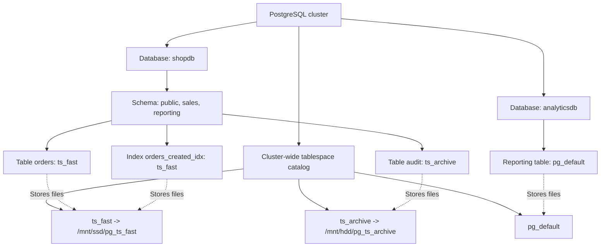

# Tablespaces and organizing storage locations in PostgreSQL

A PostgreSQL database may start on a single disk and eventually grow to the point where data must be split across different volumes. For example, a retail system might place frequently accessed transactional tables on high-speed SSDs, certain large indexes on a dedicated volume, and rarely accessed objects on lower-cost storage. **Tablespaces** are the mechanism PostgreSQL provides to control **the physical storage location of many database object types** without changing how applications query them via SQL.

However, a tablespace is not a database, schema, partition, virtual disk, or backup solution. A tablespace simply maps a logical name in PostgreSQL to **a directory on the filesystem accessible to the PostgreSQL process**. Which device that directory resides on, how much free space it has, and whether it is encrypted or replicated depend on the operating system and storage infrastructure.

This lesson in the *Data Organization* chapter explains:

- The relationship among **cluster, database, schema, tablespace, table, index, and physical files**.
- The role of `PGDATA`, `pg_default`, `pg_global`, and the `pg_tblspc` directory.
- Preparing directories, creating tablespaces, granting `CREATE` privileges, and placing tables/indexes in desired locations.
- Moving existing objects across tablespaces, and configuring `default_tablespace` and `temp_tablespaces`.
- Inspecting locations and sizes with `pg_tablespace`, `pg_class`, `pg_relation_filepath()`, and size functions.
- Impacts of tablespaces on performance, locking during moves, backups, replication, failover, and operations.

Examples target modern PostgreSQL with standard SQL syntax and a Linux operating system. Commands creating or dropping tablespaces are intended only for **practice environments authorized for modification**; never run them in production without a maintenance plan.

## 1. Understanding where tablespaces fit in PostgreSQL

First, distinguish the organizational layers:

| Concept | Role | Is it a physical storage location? |
|---|---|---|
| **PostgreSQL cluster/instance** | A dataset managed by a PostgreSQL system, holding multiple databases | Has a root data directory, typically called `PGDATA` |
| **Database** | Connection, catalog, and object space for one database | Has a default tablespace, and objects can reside in other tablespaces |
| **Schema** | Namespace for tables, views, functions, etc. inside a database | **No**: schemas do not specify disks |
| **Tablespace** | Logical name mapped to a storage directory path | **Yes**: a filesystem location |
| **Table** | Stores records; can specify a tablespace for table data | Has relation files when it is a physical storage table |
| **Index** | Data access structure; can reside in a separate tablespace | Has physical files independent from the table |
| **WAL** | Write-Ahead Log for crash recovery and certain replication mechanisms | Typically resides in `PGDATA/pg_wal`, not set by a table's `TABLESPACE` |

### 1.1. Logical and physical organization diagram



**A single tablespace can hold objects from multiple databases** in the same cluster. Conversely, **a single database can use multiple tablespaces** for different tables and indexes. A tablespace does not mean "each database is permanently pinned to exactly one disk".

### 1.2. Example motivation for use

Suppose a PostgreSQL host has two storage regions:

```text
/var/lib/postgresql/.../main/      -> System volume, holds PGDATA
/mnt/ssd/pg_ts_fast/               -> High-performance SSD
/mnt/archive/pg_ts_archive/        -> Infrequently accessed storage volume
```

The administrator wants to:

- Place frequently read/written order tables in `ts_fast`.
- Place infrequently accessed historical tables in `ts_archive` when tiered storage is required.
- Keep other tables in the database's default tablespace.

The path names above are **examples only**. PostgreSQL does not automatically provision an SSD or HDD when you run `CREATE TABLESPACE`; volumes must already be created and properly mounted beforehand.

## 2. Where does PostgreSQL store data when no custom tablespace is created?

When initializing a cluster, PostgreSQL creates a root data directory `PGDATA`. In a typical PostgreSQL layout:

```text
PGDATA/
  base/                    # Per-database data in pg_default
    <database_oid>/
      <relation_filenode>  # Table/index files and related forks
  global/                  # Cluster-wide shared catalogs
  pg_tblspc/               # Links to user-created tablespace directories
  pg_wal/                  # Write-Ahead Log
  pg_xact/
  postgresql.conf          # May reside outside PGDATA depending on installation
  ...
```

This is a **conceptual** layout, not an identical mandatory list for every package distribution. On some Linux systems, configuration files like `postgresql.conf` reside outside `PGDATA`; always verify actual locations from the server.

**Never manually move, edit, delete, or alter files inside `PGDATA`.** PostgreSQL manages filenames and internal structures. All object relocation operations should go through supported SQL commands or utilities.

### 2.1. Two built-in tablespaces: pg_default and pg_global

PostgreSQL includes two system tablespaces:

| Tablespace | Purpose | Characteristics |
|---|---|---|
| `pg_default` | Normal default location for database data when no other tablespace is selected | Maps to the default layout under `PGDATA/base` |
| `pg_global` | System catalogs shared across the cluster | Resides under `PGDATA/global`; never use as a freeform tablespace for application tables |

A new database normally defaults to `pg_default`, **unless** it was created in or moved to another tablespace. In that case, objects without an explicit choice use **that database's** default tablespace, not necessarily `pg_default`.

Never drop or relocate the two system tablespaces using normal tablespace administration commands. Nor should you select `pg_global` to store application tables.

### 2.2. pg_tblspc holds links, not where all data files live

When creating a custom tablespace, PostgreSQL records a link in `PGDATA/pg_tblspc` pointing to the declared filesystem directory. On Unix systems, these entries are typically **symbolic links** named after the tablespace's OID.

Conceptual model:

```text
PGDATA/pg_tblspc/24576  ---> /mnt/ssd/pg_ts_fast
                                    |
                                    +-- PG_<version>_<catalog-version>/
                                          +-- <database_oid>/
                                                +-- <relation_filenode>
```

Directory name segments tied to PostgreSQL version and catalog format are **internal details**; never hardcode them in application code. On Windows, link representation may differ from Unix.

If the target directory disappears because a volume fails to mount, files are modified outside PostgreSQL, or permissions change, the database may become unable to read or write objects stored in that tablespace.

## 3. Inspecting existing tablespaces

### 3.1. Using psql commands

In `psql`, enter:

```text
\db
```

The `\db` meta-command displays the list of tablespaces and basic details. You can use:

```text
\db+
```

for additional details if version and permissions allow.

**Note:** `\db` is a meta-command **specific to psql**, not SQL. In JDBC or standard SQL runners, use the query in the next section.

### 3.2. Querying the pg_tablespace catalog

```sql
SELECT
    oid,
    spcname,
    pg_get_userbyid(spcowner) AS owner_name,
    pg_tablespace_location(oid) AS location
FROM pg_tablespace
ORDER BY spcname;
```

Columns and functions:

- `oid`: internal OID of the tablespace.
- `spcname`: tablespace name used in SQL.
- `spcowner`: OID of the owning role; `pg_get_userbyid` translates it to a readable name.
- `pg_tablespace_location(oid)`: filesystem path of a user-defined tablespace.

For `pg_default` and `pg_global`, `pg_tablespace_location` normally returns an empty string because they follow internal layout rules rather than an external directory declared via `CREATE TABLESPACE`.

Illustrative output:

| oid | spcname | owner_name | location |
|---:|---|---|---|
| 1663 | pg_default | postgres | *(empty string)* |
| 1664 | pg_global | postgres | *(empty string)* |
| 24576 | ts_fast | postgres | /mnt/ssd/pg_ts_fast |

An OID like `24576` is illustrative only; each cluster assigns its own OIDs.

### 3.3. Checking the data directory and current database

```sql
SHOW data_directory;
SHOW default_tablespace;
SHOW temp_tablespaces;
SELECT current_database();
```

`SHOW data_directory` reflects the server's `PGDATA` path. It does not return a specific table's custom tablespace path.

To view the default tablespace **of the connected database**:

```sql
SELECT
    d.datname,
    t.spcname AS database_tablespace
FROM pg_database AS d
JOIN pg_tablespace AS t
    ON t.oid = d.dattablespace
WHERE d.datname = current_database();
```

Distinguish two concepts:

- `pg_database.dattablespace`: default tablespace **bound to the database**.
- `SHOW default_tablespace`: configuration parameter governing **creation of new objects** in the session; may be empty or set to a tablespace name.

These two can differ. Never inspect `SHOW default_tablespace` and infer the current physical location of all existing tables.

## 4. Preparing the physical directory before CREATE TABLESPACE

To create a tablespace, PostgreSQL requires an **absolute filesystem directory** properly prepared for the OS account running the server.

Basic requirements:

1. **The path must already exist** before running `CREATE TABLESPACE`.
2. The target directory must be **empty** when creating the tablespace.
3. The PostgreSQL process must be able to read/write the directory, normally via ownership by the service OS user.
4. Do not place the path **inside `PGDATA`**; tablespace layouts must remain separate, and never use manual symlinks to "move files".
5. The volume needs sufficient capacity and I/O, stable mounting, backup coverage, and monitoring.
6. When using multiple PostgreSQL hosts/standbys, physical tablespace paths across machines must align cleanly with backup and recovery procedures.

### 4.1. Preparation example on Linux

Suppose a high-performance volume is mounted at `/mnt/ssd` and the server runs under user `postgres`:

```bash
# Inspect the mount before making changes.
findmnt -T /mnt/ssd
df -hT /mnt/ssd

# Create a new, empty directory owned by the PostgreSQL user.
# Run only if this is the approved path.
sudo install -d \
    -o postgres -g postgres -m 700 \
    /mnt/ssd/pg_ts_fast

# Verify ownership, mode, and capacity.
stat -c '%U %G %a %n' /mnt/ssd/pg_ts_fast
df -hT /mnt/ssd/pg_ts_fast
```

On Linux, `install -d` creates the directory while setting owner and mode. If PostgreSQL runs under **another OS user** or uses SELinux/AppArmor, adapt according to the real package and security policies. Never assume every installation uses UID/GID `postgres`.

**Never manually create tables or copy PostgreSQL files into a tablespace directory**. The directory must start empty so PostgreSQL initializes its internal layout.

### 4.2. On Windows or other storage

Example Windows paths can be written as:

```sql
-- Syntax illustration for paths on Windows:
-- CREATE TABLESPACE ts_fast LOCATION 'D:/PostgreSQL/tablespaces/ts_fast';
```

In practice, grant **NTFS ACLs** to the account running the PostgreSQL Windows Service. Even with the same folder name, placing it on the wrong drive or lacking permissions causes failure. The path in the command must be visible on the **PostgreSQL server host**, not merely on a laptop running `psql`.

### 4.3. Paths to avoid

- Subdirectories inside `PGDATA` to create a "new tablespace" without actually changing volumes.
- A directory already holding files from another tablespace or cluster.
- Ephemeral volumes that lose data on reboot or instance replacement.
- Filesystems that do not fully support synchronous write semantics required by PostgreSQL.
- Directories writable by arbitrary local users, risking file tampering outside PostgreSQL.
- Network filesystems not certified by the provider/infrastructure team for PostgreSQL consistency and durability.

Tablespaces do not automatically verify all storage hardware guarantees. Underlying storage durability issues can cause data loss even if `CREATE TABLESPACE` succeeds.

## 5. Creating tablespaces and assigning privileges

### 5.1. CREATE TABLESPACE

Once the directory is prepared, connect as an administrative role with **superuser privilege** and run:

```sql
CREATE TABLESPACE ts_fast
    LOCATION '/mnt/ssd/pg_ts_fast';
```

Explanation:

- `ts_fast` is a unique logical name within **the cluster**, not a schema or database name.
- `LOCATION` is an absolute path on the **PostgreSQL server's** filesystem.
- The command registers the location and lets PostgreSQL initialize its structure; it does not copy existing tables onto the new disk.

`CREATE TABLESPACE` is a cluster-level administrative operation requiring elevated privileges, and **cannot run inside a transaction block**. Never place it inside a normal `BEGIN ... COMMIT`.

If PostgreSQL reports that the directory does not exist, is not empty, or lacks permissions, fix the **OS/filesystem condition**; database `GRANT` statements cannot fix incorrect directory ownership.

### 5.2. Distinguishing two privilege layers

| Privilege layer | What does it control? |
|---|---|
| **OS ownership and filesystem ACLs** | Whether the PostgreSQL process can access the physical directory/files |
| **SQL ownership and `GRANT CREATE ON TABLESPACE`** | Which database roles are permitted to create objects inside the tablespace |

A SQL role with `CREATE` on a tablespace **does not write OS files directly**. The PostgreSQL server writes files on that role's behalf, under the service's OS account, after checking SQL privileges.

Once an appropriate role `lab_writer` exists, an administrator can grant:

```sql
GRANT CREATE ON TABLESPACE ts_fast TO lab_writer;
```

`CREATE` on a tablespace lets the role use it when creating eligible objects, yet **does not replace** privileges to create tables in a schema or operate in a database.

For example, to create a table in `public`, the role also needs `CREATE` on the `public` schema. Those privileges must be designed and granted separately.

### 5.3. Checking privileges

```sql
SELECT
    spcname,
    spcacl
FROM pg_tablespace
WHERE spcname = 'ts_fast';
```

Or use the privilege-checking function:

```sql
SELECT
    has_tablespace_privilege(
        'lab_writer',
        'ts_fast',
        'CREATE'
    ) AS co_quyen_tao;
```

These examples assume role `lab_writer` already exists. In practice, avoid granting `CREATE` broadly just to "stop permission errors for everyone", since any role allowed to write heavily into a tablespace can fill the volume.

### 5.4. Changing owner, renaming, or revoking privileges

Depending on administrative privileges, PostgreSQL supports:

```sql
-- Illustrative only; requires target role to exist and sufficient privileges.
-- ALTER TABLESPACE ts_fast OWNER TO storage_admin;

-- Renames logically; does not alter the physical path.
-- ALTER TABLESPACE ts_fast RENAME TO ts_fast_new;

-- Revokes object creation privilege.
-- REVOKE CREATE ON TABLESPACE ts_fast FROM lab_writer;
```

These administrative commands **do not** change the Unix owner of the directory or automatically migrate data. Renaming a tablespace does not change volumes; moving data to a new volume requires an object-relocation plan or an appropriate recovery procedure.

## 6. Placing tables and indexes in a tablespace

Once the tablespace exists, open a practice database. Suppose `ts_lab` does not yet exist:

```sql
-- On a connection with CREATEDB or appropriate privileges:
CREATE DATABASE ts_lab;
```

`CREATE DATABASE` cannot run inside a transaction block. In `psql`, switch connections:

```text
\connect ts_lab
```

`\connect` is a `psql` meta-command; GUI/JDBC tools usually need to open a new connection to database `ts_lab` rather than sending this as SQL.

### 6.1. CREATE TABLE ... TABLESPACE

```sql
CREATE TABLE public.lab_orders (
    order_id BIGINT GENERATED ALWAYS AS IDENTITY PRIMARY KEY,
    customer_id BIGINT NOT NULL,
    created_at TIMESTAMPTZ NOT NULL DEFAULT now(),
    total_amount NUMERIC(14, 2) NOT NULL
) TABLESPACE ts_fast;
```

The `TABLESPACE ts_fast` clause specifies where **the table's physical data** is stored per PostgreSQL's mechanism. In SQL, the application still queries:

```sql
SELECT *
FROM public.lab_orders
WHERE customer_id = 1001;
```

There is no need to mention the tablespace name in `FROM`; table and schema names do not change just because file locations change.

A table may also spawn internal objects such as TOAST tables, auxiliary forks, sequences, or indexes. Those objects follow their own storage rules; never assume every related file lives on the same volume solely from the table's `TABLESPACE` clause. When certainty is needed, inspect the catalog and exact object paths.

### 6.2. CREATE INDEX ... TABLESPACE

Indexes can use their own tablespace:

```sql
CREATE INDEX lab_orders_created_at_idx
ON public.lab_orders (created_at DESC)
TABLESPACE ts_fast;
```

Or if you want to place **the index** in the cluster's `pg_default` location:

```sql
CREATE INDEX lab_orders_customer_id_idx
ON public.lab_orders (customer_id)
TABLESPACE pg_default;
```

This example demonstrates that **tables and indexes are distinct storage relations**. A table on `ts_fast` does not force every index onto `ts_fast`.

Note: `pg_default` is a specific cluster tablespace, not a keyword meaning "use the database's current default tablespace". In a database configured with another default tablespace, explicitly specifying `pg_default` versus **omitting the TABLESPACE clause** can produce different placements.

### 6.3. INSERT and queries do not depend on physical location

```sql
INSERT INTO public.lab_orders (
    customer_id,
    created_at,
    total_amount
)
VALUES
    (1001, '2026-10-03 09:00:00+07', 250000.00),
    (1002, '2026-10-03 10:15:00+07', 480000.00),
    (1001, '2026-10-04 11:30:00+07', 125000.00);

SELECT customer_id, SUM(total_amount) AS tong_tien
FROM public.lab_orders
GROUP BY customer_id
ORDER BY customer_id;
```

Specifying a tablespace does not alter the semantics of `INSERT`, `SELECT`, `UPDATE`, or `DELETE`. It affects **where PostgreSQL reads and writes physical files**, which can influence I/O and capacity.

## 7. Placing indexes separately from tables: benefits and limits

Suppose a table sits on a high-capacity volume with low random-read speed, while its index resides on SSD:

```text
Table orders                  -> /mnt/archive/pg_ts_archive
Index orders_customer_idx     -> /mnt/ssd/pg_ts_fast
```

During an index scan, PostgreSQL reads **both the index and table heap pages** whenever columns not covered by the index are needed. Therefore, moving only indexes to SSD does not guarantee faster queries overall if most I/O still hits the table on slow storage.

Some queries can reduce table I/O via **index-only scans** when conditions and the visibility map permit, yet you should never claim every indexed query reads only the index.

Actual gains depend on:

- The optimizer's execution plan.
- Cache hit ratio and working set size.
- Random vs. sequential read distribution.
- Whether the index is actually used.
- Whether storage truly sits on independent I/O hardware rather than separate folders on the same underlying volume.
- Write volume into both table and indexes.

**A new tablespace on the same physical drive** does not create extra IOPS, bandwidth, or data safety. Measure with `EXPLAIN (ANALYZE, BUFFERS)` and real storage metrics before drawing conclusions.

## 8. default_tablespace: per-session placement for new objects

PostgreSQL provides the **`default_tablespace`** setting, determining the tablespace for newly created objects **when a statement omits an explicit TABLESPACE clause**.

```sql
SHOW default_tablespace;
```

The default value is typically an empty string, meaning use **the current database's default tablespace**.

### 8.1. Setting for a practice session

```sql
SET default_tablespace = 'ts_fast';

CREATE TABLE public.lab_events (
    event_id BIGINT GENERATED ALWAYS AS IDENTITY PRIMARY KEY,
    message TEXT NOT NULL,
    occurred_at TIMESTAMPTZ NOT NULL DEFAULT now()
);

RESET default_tablespace;
```

When `lab_events` is created without an explicit `TABLESPACE`, PostgreSQL places the storage object according to the active `default_tablespace` value, provided the role has permission to use that tablespace.

**Distinguish carefully:** `SET default_tablespace` does not automatically move **existing** tables. It influences where **new objects** are placed. Nor does it alter `pg_database.dattablespace` or move all database data to another disk.

### 8.2. Configuring per role or database

With appropriate privileges:

```sql
-- Default for new connections of the specified role.
ALTER ROLE lab_writer
    SET default_tablespace = 'ts_fast';

-- Default for new connections to a database.
ALTER DATABASE ts_lab
    SET default_tablespace = 'ts_fast';
```

These commands alter **defaults for new sessions**, rather than physically relocating an entire database. The role must hold appropriate privileges to actually create objects in the selected tablespace.

In multi-application shared databases, clearly define which roles may select high-cost volumes. Setting `default_tablespace` per role can help segregate workloads, though unexpected overrides can complicate administration.

### 8.3. Inspecting active value and source

```sql
SELECT
    name,
    setting,
    source,
    context
FROM pg_settings
WHERE name IN ('default_tablespace', 'temp_tablespaces')
ORDER BY name;
```

`pg_settings` reports the effective value **in the current session**. If configured via `ALTER ROLE`, new connections from that role may see different values than an active admin session.

## 9. temp_tablespaces: where temporary objects and temp files live

PostgreSQL may write temporary data during execution:

- Temporary tables and indexes on temporary tables.
- Temporary disk files used when a sort or hash exceeds available RAM.
- Certain intermediate processing structures depending on the query plan.

The `temp_tablespaces` configuration specifies a **list of candidate tablespaces** for those temporary objects and files:

```sql
SHOW temp_tablespaces;
```

In a practice session permitted to use the tablespace:

```sql
SET temp_tablespaces = 'ts_fast';

CREATE TEMP TABLE temp_customers (
    customer_id BIGINT,
    note TEXT
);

INSERT INTO temp_customers
VALUES (1, 'Test customer');

SELECT * FROM temp_customers;

RESET temp_tablespaces;
```

**Do not over-interpret the example:** creating a one-row temporary table does not prove large temporary files were created. Many operations complete entirely in memory. `temp_tablespaces` matters only when temporary objects or files actually hit storage.

### 9.1. Listing multiple tablespaces

In an environment where two eligible tablespaces exist:

```sql
-- Illustrative when ts_temp_a and ts_temp_b actually exist.
SET temp_tablespaces = 'ts_temp_a, ts_temp_b';
```

PostgreSQL chooses among declared tablespaces for eligible temporary objects and files. This is not an exact capacity-proportional or disk-health-aware I/O balancer across volumes.

When `temp_tablespaces` is empty (the common default), PostgreSQL uses the database's default tablespace for temporary objects and files per the parameter's rules.

### 9.2. What does separating temporary files achieve?

For analytical workloads with large sorts and hashes, moving temp files to a dedicated volume can reduce I/O contention with primary data. However:

- If the temp volume fills up, queries can fail.
- Placing temp on non-durable volumes requires understanding risks during crashes/restarts and platform requirements; never pick unsafe filesystems casually.
- `CREATE` privileges and tablespace accessibility are still enforced.
- Changing `temp_tablespaces` does not alter RAM allocated to queries or automatically tune `work_mem`.

Never treat a fast temp volume as a cure-all for poor query plans; many queries need better indexes, statistics, SQL rewrites, or concurrency analysis.

## 10. Changing the tablespace of an existing table

When a volume fills up or data tiering changes, you may need to **move** an existing table to another tablespace.

### 10.1. ALTER TABLE ... SET TABLESPACE

Suppose `lab_events` currently resides elsewhere and needs moving to `ts_fast`:

```sql
ALTER TABLE public.lab_events
    SET TABLESPACE ts_fast;
```

This command instructs PostgreSQL to **relocate the table's storage** to the target tablespace via internal copy routines. It is not a simple metadata edit for a table holding substantial data.

**Operational impacts:**

- Can read and write large volumes of data across both source and destination.
- Normally acquires a strong lock on the object, blocking other queries and transactions during the move.
- Requires sufficient destination free space plus headroom for WAL and concurrent activity.
- Can run long and generate heavy I/O and WAL; schedule within an appropriate maintenance window.
- **Indexes are not automatically moved** by `ALTER TABLE ... SET TABLESPACE`; inspect and relocate each index separately if desired.

Never run this on a large transactional table during peak hours without assessing lock duration, I/O, and replica lag.

### 10.2. ALTER INDEX ... SET TABLESPACE

Indexes are independent objects:

```sql
ALTER INDEX public.lab_orders_customer_id_idx
    SET TABLESPACE ts_fast;
```

Moving an index can incur heavy I/O and concurrency impacts like any structural change. Plan carefully for critical indexes; never assume `ALTER INDEX ... SET TABLESPACE` is a "lock-free online" operation across all versions and workloads.

When moving both tables and indexes, verify total temporary disk headroom and query impact. In very large production scenarios, consider rebuilding indexes using concurrency-friendly mechanisms and staged cutovers rather than running raw moves ad hoc.

### 10.3. Moving does not change object names

After moving the table, applications still access it via its logical name:

```sql
SELECT COUNT(*) FROM public.lab_events;
```

Foreign keys, schemas, and normal SQL remain unaware that physical file paths changed. However, **file paths, `relfilenode`, and internal storage locations can change** after rewrites; applications must never treat internal file paths as a stable contract.

### 10.4. Can you manually copy directories while the server runs?

**No.** Cutting and pasting physical files of a live table to another volume is not a valid tablespace move. PostgreSQL maintains auxiliary files, WAL, and consistency invariants; moving files externally can prevent cluster startup or corrupt data.

Use supported PostgreSQL commands or properly engineered backup/restore and infrastructure procedures. If you need to relocate **an entire tablespace directory to a new drive** on a production cluster, treat that as a dedicated maintenance procedure, never a live manual symlink swap while PostgreSQL runs.

## 11. Database default tablespace and ALTER DATABASE SET TABLESPACE

A database has a **default tablespace** stored in `pg_database.dattablespace`. When creating a new database, you can select its default tablespace immediately:

```sql
-- Illustrative only if the role has CREATEDB and CREATE on ts_fast.
CREATE DATABASE archive_lab
    TABLESPACE ts_fast;
```

Objects created without an explicit location will then generally use the database's default tablespace.

### 11.1. Difference between ALTER DATABASE SET TABLESPACE and SET default_tablespace

These two commands are **not equivalent**:

```sql
-- A: Moves the database to a new default tablespace
-- via ALTER DATABASE. This is a major physical operation.
ALTER DATABASE ts_lab SET TABLESPACE ts_fast;

-- B: Sets the object-creation default for new connection sessions.
ALTER DATABASE ts_lab SET default_tablespace = 'ts_fast';
```

| Command | Primary effect |
|---|---|
| `ALTER DATABASE ts_lab SET TABLESPACE ts_fast` | Changes the **database's** default tablespace, potentially moving data residing in the old default tablespace |
| `ALTER DATABASE ts_lab SET default_tablespace = 'ts_fast'` | Sets only a **GUC for new sessions** when creating objects without an explicit tablespace |

Command A carries strict preconditions: it cannot run inside a transaction block, no active connections may be using the target database, and the executor needs appropriate privileges. Typically an administrator connects to **another database**, such as `postgres`, and executes it after blocking new connections and draining existing ones.

If the database already has tables or indexes placed **explicitly** in separate tablespaces, changing the database default tablespace does not automatically gather them all into one place. Inventory objects and verify their states afterward.

**Never run Command A in a practice environment with open connections to `ts_lab` or in production without planned downtime.** It can move huge volumes of data and cause service interruption.

### 11.2. When should you pick a tablespace during CREATE DATABASE?

If you want most objects in a database to live on a different volume from day one, specifying `TABLESPACE` at database creation reduces future data moves. Make this decision at the infrastructure level:

- Does the volume accommodate growth, with corresponding WAL/backup capacity?
- Will the database place certain tables or indexes elsewhere?
- Must standbys or physical backup tools access the same path?
- Have `CREATE` privileges on the tablespace been granted properly to the database owner?

Choosing a database tablespace does not replace choosing specific placements for individual indexes or partitions when needed.

## 12. Determining the tablespace of a table or index

Once multiple tablespaces exist, never rely on word of mouth like "that table is on SSD" or partial filenames. PostgreSQL lets you query the catalog for declared locations.

### 12.1. pg_class.reltablespace

Relation objects record `reltablespace` in `pg_class`.

```sql
SELECT
    c.oid::regclass AS relation_name,
    c.relkind,
    c.reltablespace,
    t.spcname AS explicit_tablespace
FROM pg_class AS c
LEFT JOIN pg_tablespace AS t
    ON t.oid = c.reltablespace
WHERE c.oid IN (
    'public.lab_orders'::regclass,
    'public.lab_orders_created_at_idx'::regclass,
    'public.lab_orders_customer_id_idx'::regclass
);
```

**Be careful:** `reltablespace = 0` normally means **the object uses the database's default tablespace**, rather than referring to a real tablespace with OID 0. Seeing `explicit_tablespace` as `NULL` and concluding "the relation has no tablespace" is wrong.

### 12.2. Resolving effective tablespace including database default

For ordinary tables and indexes in the current database:

```sql
SELECT
    c.oid::regclass AS relation_name,
    c.relkind,
    c.reltablespace AS explicit_ts_oid,
    t.spcname AS effective_tablespace,
    pg_relation_filepath(c.oid) AS relative_file_path
FROM pg_class AS c
CROSS JOIN pg_database AS d
JOIN pg_tablespace AS t
    ON t.oid = CASE
        WHEN c.reltablespace = 0 THEN d.dattablespace
        ELSE c.reltablespace
    END
WHERE d.datname = current_database()
  AND c.oid IN (
      'public.lab_orders'::regclass,
      'public.lab_orders_created_at_idx'::regclass
  )
ORDER BY relation_name;
```

This query illustrates resolving `reltablespace = 0` to the database's default tablespace. **Shared** system objects and certain specialized relation kinds follow separate rules; do not apply this formula blindly as a universal physical browser across every row in `pg_class` without checking object types.

### 12.3. pg_relation_filepath()

```sql
SELECT
    pg_relation_filepath('public.lab_orders'::regclass)
        AS path_cua_bang,
    pg_relation_filepath('public.lab_orders_created_at_idx'::regclass)
        AS path_cua_index;
```

The result is a **relative path under the PostgreSQL data directory**, for example:

```text
pg_tblspc/24576/PG_<version>_<catalog-version>/<database_oid>/<relfilenode>
```

Objects in `pg_default` typically look like `base/<database_oid>/<relfilenode>`. Physical filenames do not use the SQL table name; a relation may also span multiple segment files or auxiliary forks as it grows. Thus, the returned path is not a stable interface for applications to open directly.

### 12.4. pg_relation_filenode()

```sql
SELECT
    pg_relation_filenode('public.lab_orders'::regclass)
        AS file_node_hien_tai;
```

`relfilenode` can change after table or index rewrites. Never use it as a business key or stable external identifier outside PostgreSQL.

## 13. Measuring sizes by table, index, and tablespace

A successfully created tablespace does not automatically mean it holds data yet. Measure using size functions.

### 13.1. Table and index sizes

```sql
SELECT
    pg_size_pretty(
        pg_table_size('public.lab_orders'::regclass)
    ) AS table_size,
    pg_size_pretty(
        pg_indexes_size('public.lab_orders'::regclass)
    ) AS indexes_size,
    pg_size_pretty(
        pg_total_relation_size('public.lab_orders'::regclass)
    ) AS total_relation_size;
```

Meaning:

| Function | What it measures |
|---|---|
| `pg_table_size(relation)` | Table data size, including related storage such as TOAST as defined by PostgreSQL, excluding the table's indexes |
| `pg_indexes_size(relation)` | Total size of indexes attached to the table |
| `pg_total_relation_size(relation)` | Combined size of the table and its indexes |
| `pg_relation_size(relation)` | Size of the `main` fork of the relation when no other fork is specified |
| `pg_size_pretty(bytes)` | Formats byte counts into human-readable strings |

On small tables, values may be only a few kB or tens of kB. That does not mean the tablespace is "not working"; PostgreSQL allocates storage in pages and objects carry metadata overhead.

### 13.2. Total tablespace size

```sql
SELECT
    spcname,
    pg_size_pretty(
        pg_tablespace_size(oid)
    ) AS used_size
FROM pg_tablespace
ORDER BY spcname;
```

Or:

```sql
SELECT
    pg_tablespace_size('ts_fast') AS used_bytes,
    pg_size_pretty(
        pg_tablespace_size('ts_fast')
    ) AS used_pretty;
```

`pg_tablespace_size` reports **the space PostgreSQL currently uses in that tablespace**, not the total capacity or free space of the underlying volume. It may also include objects across **multiple databases** sharing that tablespace.

Calling certain size functions requires appropriate privileges; if permission errors occur, request proper monitoring privileges rather than granting superuser to application accounts.

### 13.3. pg_tablespace_size does not replace df -h

Compare:

```sql
SELECT pg_size_pretty(pg_tablespace_size('ts_fast'));
```

with checking on the **PostgreSQL host**:

```bash
df -hT /mnt/ssd/pg_ts_fast
```

The SQL value measures PostgreSQL data belonging to the tablespace. `df` reflects filesystem capacity, including other files, reservations, or programs sharing the volume. A tablespace with modest SQL size can still **run out of write space** if the physical volume is nearly full from other data.

### 13.4. Inspecting by database

```sql
SELECT
    datname,
    pg_size_pretty(pg_database_size(oid)) AS database_size
FROM pg_database
WHERE datallowconn
ORDER BY pg_database_size(oid) DESC;
```

`pg_database_size` measures the database's data size **across all associated tablespaces**, not on a single path. Therefore, never use it to assume a database resides on just one volume.

## 14. Tablespaces and partitioning: two separate problems

**Partitioning** divides a logical table into multiple partitions by key and data boundaries, such as by month. **Tablespaces** choose where physical files are stored.

They can be combined:

```sql
CREATE TABLE public.sales_by_month (
    sale_id BIGINT NOT NULL,
    sold_at DATE NOT NULL,
    amount NUMERIC(12, 2) NOT NULL
) PARTITION BY RANGE (sold_at);

CREATE TABLE public.sales_2026_10
    PARTITION OF public.sales_by_month
    FOR VALUES FROM ('2026-10-01') TO ('2026-11-01')
    TABLESPACE ts_fast;

CREATE TABLE public.sales_2026_11
    PARTITION OF public.sales_by_month
    FOR VALUES FROM ('2026-11-01') TO ('2026-12-01')
    TABLESPACE pg_default;
```

Each partition can reside in an appropriate tablespace. With range partitioning, PostgreSQL uses the `sold_at` bounds to route rows to partitions; **tablespaces do not route rows by date**.

### 14.1. When does combining partitions and tablespaces help?

- Keeping recent partitions on high-performance storage.
- Moving older partitions to another volume when rarely queried.
- Separating data groups by lifecycle and I/O profile.

However, account for partition indexes, free disk space, relocation impact, and backup plans. Operations like moving a partition across tablespaces still take time, acquire locks, and generate I/O; never treat partitioning as magic that makes all data movement "zero downtime".

### 14.2. Tablespaces are not sharding

Sharding distributes data and processing across multiple servers/instances. Tablespaces within a single PostgreSQL cluster **do not** create independent servers, balance CPU across hosts, or create extra copies of data. If a PostgreSQL server fails completely without backups or replicas, tablespaces spread across multiple disks will not restore service on their own.

## 15. Tablespaces and cost/performance optimization

Tablespaces are usually considered for two goals: **sufficient storage space** and **placing data on suitable devices**.

### 15.1. Hot – warm – cold storage tiering

| Storage tier | Suitable data | Considerations |
|---|---|---|
| Fast SSD/NVMe | Hot transactional tables, frequently accessed indexes | Great IOPS and latency, though capacity/cost may be constrained |
| Standard SSD | Active data, large tables with moderate access rates | Measure workload; not everything needs NVMe |
| High-capacity storage | Infrequently accessed data, history, older partitions | Can be slower for random reads; understand limits |
| Dedicated temp volume | Heavy sort/hash tasks spilling temporary files | Can reduce I/O contention; monitor disk-full risk |

**Do not blindly assume "indexes on SSD, tables on HDD" without measuring**. Index scans still read table pages; hot data often sits in RAM cache; and underlying storage pools may share physical hardware anyway.

### 15.2. Tuning planner cost parameters per tablespace

PostgreSQL allows setting certain planner parameters per tablespace, for example:

```sql
-- Illustrative for a test environment, not universal defaults.
ALTER TABLESPACE ts_fast
SET (
    random_page_cost = 1.1,
    seq_page_cost = 1.0
);
```

These values supply **cost estimates to the planner**; they do not speed up the disk and are not measured milliseconds. Poor values can lead the optimizer to pick worse plans.

When you no longer want the override, you can reset:

```sql
ALTER TABLESPACE ts_fast
RESET (random_page_cost, seq_page_cost);
```

Do not change these settings merely because a tablespace is named `ts_fast`; inspect `EXPLAIN (ANALYZE, BUFFERS)` on representative workloads and measure real I/O latency.

### 15.3. Don't tune volumes before checking SQL

A query that is slow due to missing indexes, stale statistics, or multiplicative joins will not become right merely by moving files to SSD. Conversely, when queries genuinely read vast numbers of pages and storage is the true bottleneck, tablespaces can be one tool in an I/O improvement strategy.

A solid workflow:

1. Identify queries/objects driving I/O load.
2. Measure query plans, buffer hits/reads, and storage latency.
3. Review indexes, partitioning, SQL structure, and vacuum health.
4. If relocation is genuinely needed, design tablespaces/volumes and evaluate locks and transfer sizes.
5. Re-measure the same workload afterward.

## 16. Backups, WAL, replication, and tablespaces

Because tablespaces belong to **the cluster's storage layout**, always evaluate them alongside recovery strategies.

### 16.1. WAL does not live inside a table's tablespace

When a table resides in `ts_fast`, table data sits on the `ts_fast` volume, yet PostgreSQL WAL normally remains managed in `PGDATA/pg_wal` (unless PostgreSQL's WAL directory was explicitly placed elsewhere via supported mechanisms).

```text
Transaction:
    INSERT into table in ts_fast
       |                     |
       v                     v
    Writes table data      Generates WAL
    ts_fast volume         pg_wal area
```

Creating a tablespace **does not move WAL** into that directory. If the WAL volume fills up or fails, transactions will still fail even if the table's volume has plenty of space left.

### 16.2. Physical backups must include tablespaces

A complete physical backup must be consistent across:

- Data in `PGDATA`.
- Contents of every tablespace located outside `PGDATA`.
- WAL required for recovery.

PostgreSQL-aware physical backup tools such as `pg_basebackup` or dedicated backup solutions handle tablespaces properly. Manually archiving only `PGDATA` via file copy **does not guarantee** capturing external tablespace contents.

Some physical backup/restore workflows allow remapping tablespace paths when restoring onto another host. Verify remapping behavior on your specific tool version and architecture; never modify symlinks or paths casually while PostgreSQL is running.

### 16.3. Logical backups differ from physical backups

`pg_dump` creates a **logical export** of objects and data in one database, not a byte-for-byte copy of files under `pg_tblspc`. A dump may include tablespace clauses when recreating objects, yet **does not automatically create tablespace definitions and OS directories on the target server**.

For logical restores, plan to:

- Pre-create target tablespaces or explicitly choose to omit tablespace clauses during restore.
- Hold privileges to create objects at the destination.
- Handle roles, owners, and grants properly.
- Back up cluster-wide global objects separately when needed using appropriate tools.

Never assume copying a dump file to another machine automatically creates identical volumes and paths as the source server.

### 16.4. Physical streaming replication

A physical standby receives cluster changes, including data tied to tablespaces. When designing standbys:

- Tablespace paths or mappings must be compatible with the standby environment.
- Target volumes must exist with adequate space and proper OS permissions.
- Standby provisioning/backup tools must handle tablespaces cleanly.
- Failover plans must confirm every standby volume is healthy before promotion.

Tablespaces do not create redundancy by themselves. If a tablespace on a single volume is lost on the source, replication or backups must handle recovery. Creating a second tablespace **does not** create a second copy of a table.

### 16.5. Archiving and point-in-time recovery (PITR)

If a system uses WAL archiving/PITR, recovery still requires all storage objects and WAL up to the target point. Splitting data across multiple volumes does not allow taking independent snapshots of each volume at arbitrary times and stitching them together. Snapshots/backups must be **PostgreSQL-consistent** to avoid time skew across components.

## 17. Monitoring capacity and filesystem failures

Splitting data across volumes requires administrators to monitor **every storage mount**, not just `PGDATA`.

### 17.1. Questions to answer regularly

- Which tablespace is growing fastest?
- Which volume is nearing capacity?
- Which large tables/indexes consume most of the space?
- Are upcoming `CREATE INDEX`, `VACUUM FULL`, `CLUSTER`, or table-move jobs going to need extra headroom?
- Are temp files, WAL, archives, or backups growing unexpectedly?
- Are mount points bound to the expected disks after a reboot?
- Have permissions, owners, SELinux/AppArmor, or storage policies changed?

### 17.2. Querying large tablespaces

```sql
SELECT
    t.spcname,
    pg_tablespace_location(t.oid) AS location,
    pg_tablespace_size(t.oid) AS used_bytes,
    pg_size_pretty(pg_tablespace_size(t.oid)) AS used
FROM pg_tablespace AS t
ORDER BY used_bytes DESC;
```

Reporting queries like this inspect filesystem metadata and are subject to privilege limits. On very large systems, poll at reasonable intervals rather than running continuously without need.

### 17.3. Viewing large tables in the current database

```sql
SELECT
    c.oid::regclass AS relation,
    pg_size_pretty(pg_total_relation_size(c.oid)) AS total_size,
    pg_total_relation_size(c.oid) AS bytes
FROM pg_class AS c
JOIN pg_namespace AS n
    ON n.oid = c.relnamespace
WHERE c.relkind IN ('r', 'm')
  AND n.nspname NOT IN ('pg_catalog', 'information_schema')
ORDER BY bytes DESC
LIMIT 20;
```

`relkind = 'r'` mostly represents ordinary tables; `'m'` is a materialized view. This ranks **relations plus their attached indexes**, not per-tablespace breakdowns if indexes live separately from tables.

To determine precisely which volume holds each index, inspect `pg_class` and `pg_relation_filepath()` for the indexes themselves.

### 17.4. OS-level checks

On Linux:

```bash
df -hT /mnt/ssd/pg_ts_fast
findmnt -T /mnt/ssd/pg_ts_fast
```

These commands run on the **PostgreSQL host**, not as SQL. If PostgreSQL runs inside a container or on cloud volumes, inspect the exact filesystem/volume layer where the server process writes.

Never delete files inside a tablespace to "free space quickly". PostgreSQL tracks catalog-to-file mappings; deleting files outside the database causes data loss or severe corruption.

## 18. Dropping tablespaces and cleaning up the lab

A tablespace can only be dropped when **no dependent objects remain inside it**. If any table, index, or database still uses it, `DROP TABLESPACE` fails.

### 18.1. Removing lab objects

In database `ts_lab`:

```sql
-- Run only in a practice environment holding these exact demo tables.
DROP TABLE IF EXISTS public.lab_events;
DROP TABLE IF EXISTS public.lab_orders;
DROP TABLE IF EXISTS public.sales_by_month CASCADE;
```

`DROP TABLE public.lab_orders` automatically removes its attached indexes. However, if any other objects still reside in `ts_fast`, remove or relocate them first.

**Note:** `CASCADE` drops dependent objects; use it only in labs with a clearly known scope. Never run it in production as a bulk "tablespace cleanup" shortcut.

### 18.2. If a database's default was moved into the tablespace

If you ran `ALTER DATABASE ts_lab SET TABLESPACE ts_fast` or `CREATE DATABASE archive_lab TABLESPACE ts_fast`, handle the database and its objects separately. You cannot drop a tablespace while it still serves as storage for a database.

Example strictly for labs assuming no open connections remain to the target databases:

```sql
-- Run from an administrative database like postgres, not the database being dropped.
-- DROP DATABASE ts_lab;
-- DROP DATABASE archive_lab;
```

These lines are commented out to prevent accidental execution. In real operations, always verify database names and contents before any `DROP DATABASE`.

### 18.3. DROP TABLESPACE

Once you have verified zero dependencies remain:

```sql
DROP TABLESPACE ts_fast;
```

`DROP TABLESPACE` cannot run inside a transaction block. After PostgreSQL drops the tablespace cleanly, check how the OS manages the physical directory; never assume the SQL command unmounts disks, deletes cloud volumes, or frees underlying infrastructure resources.

To reuse the volume, handle OS cleanup via a dedicated procedure, ensuring you do not delete directories belonging to another cluster or tablespace by mistake.

## 19. Common misconceptions

**1. "A tablespace is a schema."** False. Schemas organize object names; tablespaces choose physical file locations. Two tables in the same schema can use different tablespaces.

**2. "Creating a tablespace makes PostgreSQL create a new disk."** False. Volumes, filesystems, and directories must already be prepared at the OS/infrastructure level.

**3. "CREATE TABLESPACE creates the LOCATION directory automatically."** No. The target directory must already exist, be empty, and have appropriate permissions before running the command.

**4. "Putting a table in a tablespace moves its WAL there too."** False. WAL is managed separately by PostgreSQL, usually in `pg_wal`.

**5. "Tables and indexes always share the same tablespace."** False. They can be placed or moved independently. Check catalogs per relation.

**6. "pg_class.reltablespace = 0 means the table has no storage location."** False. For ordinary relations, 0 indicates using the database's default tablespace.

**7. "SHOW default_tablespace always shows where existing tables live."** False. It is the session default for new objects, not a physical attribute of all existing tables.

**8. "ALTER DATABASE SET default_tablespace moves the entire database."** False. That changes a GUC for new connections, unlike `ALTER DATABASE ... SET TABLESPACE`.

**9. "ALTER TABLE SET TABLESPACE only updates the catalog and finishes instantly."** False. It can rewrite large amounts of data, take strong locks, and generate heavy I/O.

**10. "Moving a table automatically moves its indexes."** False. Inspect and relocate required indexes explicitly.

**11. "A new tablespace on the same drive speeds up reads/writes."** No guarantee. Performance depends on real hardware, caching, I/O, and query plans.

**12. "A tablespace is a backup."** False. It creates no copy of data and does not replace backups or PITR.

**13. "pg_tablespace_size reports free space on the disk."** False. It measures space PostgreSQL uses in the tablespace, not filesystem free space.

**14. "Backing up PGDATA alone captures all external tablespaces."** Never assume this. Consistent physical backups must include tablespace contents and required WAL.

**15. "You can copy/move table files with OS tools while PostgreSQL is running."** No. Modifying files outside PostgreSQL corrupts data and catalogs.

**16. "Tablespaces automatically partition data by month."** False. Routing by month is partitioning; tablespaces merely choose storage locations for objects or partitions.

**17. "A role can run CREATE TABLESPACE because it has CREATEDB."** False. `CREATE TABLESPACE` requires superuser; `CREATEDB` and `CREATE ON TABLESPACE` govern different operations.

**18. "Setting temp_tablespaces speeds up every sort query."** Uncertain. It only affects temp files/objects per configuration semantics and actual volume performance.

## 20. Practice exercises with answers

### Exercise 1 — How does a tablespace differ from a schema?

An application has two tables `sales.orders` and `sales.order_logs` in the same `sales` schema, yet wants orders on SSD and logs on HDD.

**Answer:** Create two tablespaces mapped to the two volumes, then specify `TABLESPACE` or move each table individually. There is no need to split schemas to change file locations; schemas and tablespaces are separate organizational layers.

### Exercise 2 — Checking tablespaces with SQL

**Requirement:** retrieve the name, owner, and physical path of all tablespaces.

**Answer:**

```sql
SELECT
    spcname,
    pg_get_userbyid(spcowner) AS owner_name,
    pg_tablespace_location(oid) AS location
FROM pg_tablespace
ORDER BY spcname;
```

`pg_default` and `pg_global` return empty location strings because they use internal layouts.

### Exercise 3 — What privileges are needed for CREATE TABLESPACE?

Role `app_writer` has permission to create tables in schemas and holds `CREATEDB`. That role wants to run `CREATE TABLESPACE ts_new LOCATION '...'`.

**Answer:** `CREATEDB` or schema `CREATE` is insufficient. `CREATE TABLESPACE` requires superuser and a properly prepared OS directory. An administrator can create the tablespace and then run `GRANT CREATE ON TABLESPACE ts_new TO app_writer` so the role can create objects there.

### Exercise 4 — Interpreting reltablespace = 0

A database's default tablespace is `ts_archive`. Table `history_events` has `pg_class.reltablespace = 0`.

**Question:** Must this table live in `pg_default`?

**Answer:** No. For ordinary relations, `reltablespace = 0` means using the database's default tablespace, which here is `ts_archive`. Query `pg_database.dattablespace` or `pg_relation_filepath` to confirm.

### Exercise 5 — Moving a table and its index

Table `orders` and index `orders_created_idx` are both in `pg_default`. After:

```sql
ALTER TABLE orders SET TABLESPACE ts_fast;
```

**Question:** Has the index moved too?

**Answer:** Not by default. Moving a table does not automatically move its indexes. Check index location and run `ALTER INDEX orders_created_idx SET TABLESPACE ts_fast` if desired, with an appropriate lock/I/O plan.

### Exercise 6 — Does a tablespace replace WAL backups?

A team creates `ts_fast` on SSD and thinks backups aren't needed because data is "already on a separate drive".

**Answer:** False. Separating locations does not create redundant copies; WAL is also managed separately. Physical/logical backups and recovery workflows covering tablespaces and WAL are still required per system objectives.

### Exercise 7 — Why does CREATE TABLESPACE fail?

The command:

```sql
CREATE TABLESPACE ts_fast
LOCATION '/mnt/ssd/pg_ts_fast';
```

returns an error saying the directory does not exist or permission is denied.

**Answer:** The path must exist on the **server**, be empty, and be accessible by the OS account running PostgreSQL. Check `findmnt`, `df`, `stat`, ownership, and SELinux/AppArmor policies if active. Never work around this by granting `SUPERUSER` to application roles or running `chmod 777`.

### Exercise 8 — Separating temp from hot data

A reporting system regularly generates large temp files that contend for I/O with transactional tables.

**Suggested answer:** Consider a tablespace on a dedicated temp volume and configure `temp_tablespaces` for the relevant sessions/workloads while monitoring capacity and I/O. Also analyze `work_mem`, indexes, and query plans to avoid unnecessary temp-file spills.

### Exercise 9 — Calculating table and index sizes

**Requirement:** measure the data size and index size of `public.lab_orders`.

**Answer:**

```sql
SELECT
    pg_size_pretty(pg_table_size('public.lab_orders')) AS bang,
    pg_size_pretty(pg_indexes_size('public.lab_orders')) AS chi_muc,
    pg_size_pretty(pg_total_relation_size('public.lab_orders')) AS tong;
```

Do not use `pg_tablespace_size` to infer a single table's size, since a tablespace can hold many tables across multiple databases.

### Exercise 10 — Are these two ALTER DATABASE statements the same?

```sql
ALTER DATABASE ts_lab SET TABLESPACE ts_fast;
ALTER DATABASE ts_lab SET default_tablespace = 'ts_fast';
```

**Answer:** No. The first changes the database's actual default tablespace location and can physically move data, requiring strict operational preconditions. The second sets the new-object creation parameter for sessions in the database. Never use them interchangeably.

## 21. Workflow for selecting tablespaces in production systems

Before deciding to "move table A to drive B", follow this sequence:

1. **Define the goal:** more capacity, better I/O, or separating data tiers by lifecycle?
2. **Measure bottlenecks:** table/index sizes, query patterns, cache hit ratios, disk latency, IOPS, and growth rate.
3. **Design the volume:** capacity, filesystem, mount, durability, OS permissions, backups, path naming, and expansion headroom.
4. **Identify objects:** which tables, indexes, TOAST, partitions, database defaults, and temp files genuinely need relocating?
5. **Prepare privileges:** superuser creates the tablespace; application roles receive only required `CREATE` and separate schema grants.
6. **Verify via SQL and paths:** `pg_tablespace`, `pg_class`, `pg_relation_filepath`, and size functions.
7. **Plan the change:** lock duration, bytes copied, WAL volume, replication impact, maintenance window, and rollback strategy.
8. **Verify backups/standbys:** ensure external tablespaces are backed up and restorable, and replica paths are compatible.
9. **Deploy with observability:** monitor free space on every volume, transaction state, query latency, and error logs.
10. **Verify post-change:** logical names unchanged, relations in expected locations, data intact, indexes active, and performance targets met.

**Conclusion:** In PostgreSQL, **a tablespace is the mechanism mapping storage objects to physical directories**. `pg_default` and `pg_global` serve system locations; custom tablespaces can host tables, indexes, partitions, or act as a database default as needed. This tool helps manage disk capacity and I/O tiering, yet **does not automatically provide backups, replication, sharding, or universal performance gains**. Using tablespaces effectively requires understanding both OS and SQL permissions, data relocation mechanics, location/size inspection functions, and cluster-wide consistent recovery planning.
