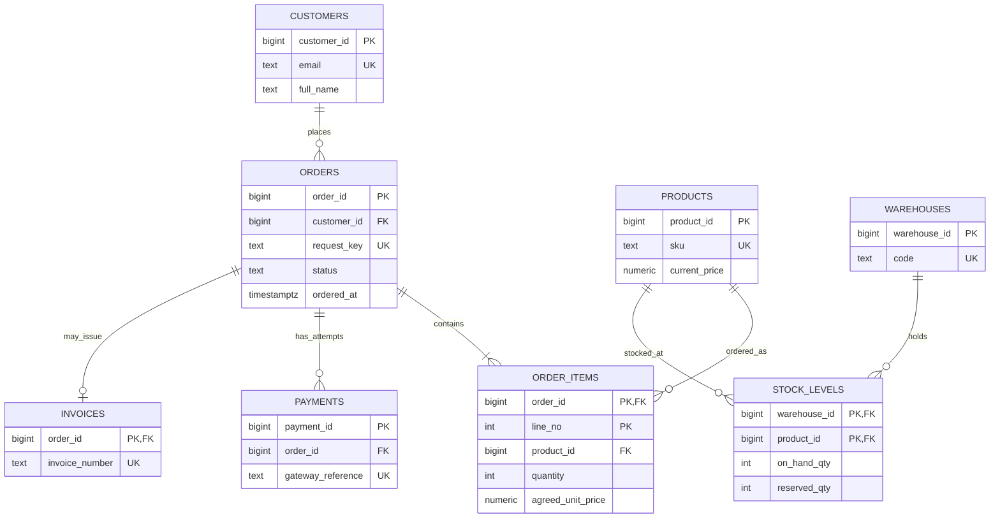

# Turning Business Requirements into Entities and Relationships in PostgreSQL

When starting database design, a business requirement is often written in natural language: "A customer places an order", "An order has multiple products", "Each warehouse stores different stock quantities", "Payments can be retried". These sentences are easy for business stakeholders to understand, yet **not specific enough to turn directly into SQL tables**.

The job of schema design is to determine **which objects need to be stored**, **which attributes belong to each object**, **how the objects relate to one another**, and **which rules must always hold true**. Only then do we translate the model into tables, keys, constraints, and indexes in PostgreSQL.

This lesson walks through an e-commerce sales example involving customers, products, orders, order items, warehouses, payments, and invoices. The focus is **business analysis → entity–relationship (ER) model → relational schema → PostgreSQL DDL → rule verification**. Assumed business choices will be stated explicitly so that design decisions are not mistaken for universal rules.

## 1. Why Shouldn't You Start with CREATE TABLE?

Suppose a user says:

> "I want to store the orders customers have placed. A customer can buy multiple items, and the system needs to know which warehouse has stock and record payment attempts."

If you rush to create a single table:

```text
order_id | customer_name | customer_email | product_1 | product_2 |
product_3 | warehouse_name | quantity | payment_status
```

several problems immediately appear:

- How many products can an order have? Three columns `product_1`, `product_2`, `product_3` cannot handle an arbitrary number of items.
- If a customer changes their name/email, across how many orders must the data be updated?
- One product can be in multiple warehouses; one warehouse holds multiple products. A single `warehouse_name` column cannot describe this relationship.
- If a payment fails and is retried, a single `payment_status` column cannot store the history of attempts.
- Could deleting an order line accidentally wipe out customer/product information?
- How do you force every order line to reference a real, existing product?

These are **data modeling flaws** that cannot be fundamentally fixed simply by adding a few `SELECT` queries or indexes.

The goal of this lesson is not to create as many tables as possible. The goal is to create **the right number of entities and relationships** to represent the required rules, while keeping the model easy to evolve and its correctness easy to enforce.

## 2. From Business Story to a Requirements List

Before drawing an ERD, convert narrative descriptions into statements that can be confirmed with business stakeholders. For example, after a requirements clarification session, the team agrees on:

| Code | Clarified Requirement |
| --- | --- |
| R1 | Each customer has a stable identifier, full name, and email; emails must be unique on a case-insensitive basis. |
| R2 | A customer may have placed zero or many orders; each order must belong to exactly one customer. |
| R3 | Every **confirmed** order must have at least one line item; each line describes one product and a positive quantity. |
| R4 | A product has a unique SKU, name, current price, and active/discontinued status. |
| R5 | The price on an order line must be the **agreed price locked at order placement**, unchanged when the product's current price changes. |
| R6 | A warehouse can store multiple products, and a product can exist in multiple warehouses; stock levels depend on the **warehouse–product pair**. |
| R7 | An order can have multiple payment attempts; each attempt has its own gateway transaction reference. |
| R8 | An order may not have an invoice yet; within this example's scope, at most one invoice is linked to an order. |
| R9 | An order's shipping address is a **snapshot at the time of placement**, and must not change automatically when the customer updates their profile address. |
| R10 | Negative quantities or monetary amounts are forbidden; order history must not be lost when a product is removed from active sale. |

The statements above are **specific assumptions for this lab**, not mandatory rules for every e-commerce platform. In practice, systems may support guest orders, multiple adjustment invoices, split shipments, or multiple currencies.

### 2.1. Questions to Ask Before Locking In Structure

Several questions often change the design:

1. **When is an order created?** Is there a `DRAFT` state with no line items yet, or is it only created upon customer confirmation?
2. **Can the same product appear multiple times in the same order?** If not, you can place `UNIQUE(order_id, product_id)`.
3. **What does "inventory/stock" mean?** Physical on-hand stock, available-to-sell stock, reserved quantity, or in-transit quantity?
4. **How are payments modeled?** Single attempt, multiple attempts, partial refunds, multiple payment sources?
5. **Does shipping address history need to be preserved?** If yes, referencing the customer's current address is usually insufficient.
6. **Can customers/products with transaction history be deleted?** Business and retention regulations may require anonymization or discontinuation instead of deletion.
7. **Is the system multi-company/multi-tenant?** If so, keys and constraints must prevent data in one tenant from mistakenly referencing another tenant.

When an answer is not yet known, explicitly mark it as "undecided" rather than turning a guess into a constraint that is hard to change later.

## 3. Identifying Entities, Attributes, and Events

An **entity** is a business object or concept with an identity and lifecycle distinct enough that the system needs to store it. An **attribute** describes a characteristic of an entity. A **relationship** expresses an association between two or more entities.

In the sales example:

| Candidate | Classification | Reason |
| --- | --- | --- |
| Customer | Entity `Customer` | Has its own identity and can exist before placing an order |
| Order | Entity `Order` | Has its own ID, timestamp, status, and lifecycle |
| Product | Entity `Product` | Has its own SKU; exists independently of individual orders |
| Order line | Dependent entity `OrderItem` | Tied to an order, product, quantity, and locked-in price |
| Warehouse | Entity `Warehouse` | Has its own code and managed location/facility |
| Stock balance | Associative entity `StockLevel` | Tied to a warehouse–product pair and carries quantity attributes |
| Payment attempt | Entity `Payment` | Has its own transaction reference and status; multiple attempts possible |
| Invoice | Entity `Invoice` | Has document number, issue date, and constraint linking to an order |
| Customer name | Attribute | Does not need a separate table in a simple model |
| Order status | Attribute/domain | A state of `Order`, not necessarily a separate entity |
| "Customer places order" | Relationship | One customer links to many orders |
| "Product is stocked in warehouse" | N:M relationship with attributes | Needs an associative entity to store per-warehouse quantities |

**Nouns** are a good hint for finding entities, and **verbs** are a good hint for finding relationships. However, this is not an automatic algorithm. For example, "payment" is both an action and an **event that must be stored separately**, because it has a payment gateway reference, timestamp, outcome, and retry capability.

### 3.1. When Does a Concept Deserve Its Own Table?

Consider splitting a concept into an entity if one or more signs apply:

- It has a **stable identity** and multiple other objects reference it.
- It has its **own lifecycle** (created, updated, cancelled, completed).
- **Multiple records** can relate to the same parent entity.
- It has **relationship-specific attributes** such as quantity, locked-in price, or timestamp.
- It has uniqueness rules, access permissions, or history that must be managed separately.

Not every value set needs a lookup table. For example, `order_status` can be enforced with a `CHECK` constraint in a small model; if statuses carry metadata, dynamic administration, or complex workflows, a separate table may be more appropriate.

## 4. Reading and Determining Relationship Cardinality

**Cardinality** indicates how many records of entity B can relate to one record of entity A. **Optionality** indicates whether that association is mandatory or may not exist.

| Type | Example | Meaning |
| --- | --- | --- |
| One-to-one (1:1) | An order has at most one invoice per R8 | Each invoice record links to exactly one order; an order may not have an invoice yet |
| One-to-many (1:N) | Customers and orders | A customer has 0..N orders; each order belongs to one customer |
| Many-to-many (N:M) | Orders and products | An order contains many products; a product appears in many orders |
| Many-to-many with attributes | Warehouses and products | Each warehouse–product pair has its own stock quantity |
| Recursive relationship | Employee and manager (another example) | An entity references the same entity type |

### 4.1. Distinguishing 0..N and 1..N

Per R2:

```text
Customer 1  ----  0..N Order

A customer may not have placed any orders yet.
An order must belong to exactly one customer.
```

Per R3:

```text
Confirmed Order 1  ----  1..N OrderItem
```

Note: a foreign key in the order-line table guarantees that **every line item belongs to an order**, but **does not automatically guarantee that every order has at least one line item**. The rule "a confirmed order has one or more line items" is a *cross-table* invariant that must be handled in a transaction/service or an advanced database mechanism.

### 4.2. Lab ERD



The ERD is a **conceptual/logical model**. The relationship `ORDERS ||--|{ ORDER_ITEMS` expresses the requirement "a confirmed order must have line items", but the DDL below does not enforce the minimum-one-line part via FK alone. Business rules not directly enforced by the DB will be listed separately.

## 5. Translating Entities to Tables and Attributes to Columns

A basic mapping:

```text
Entity Customer        -> customers table
  customerId           -> customer_id column, primary key
  email                -> email column, unique per business rule
  fullName             -> full_name column, NOT NULL

Entity Order           -> orders table
  orderId              -> order_id column, primary key
  belongsTo Customer   -> customer_id column, foreign key
  status               -> status column with CHECK
```

Every table should have a **key** that identifies each row. For new systems, an auto-generated `BIGINT GENERATED ... AS IDENTITY` key is usually suitable; SKUs, emails, or external order codes can still carry separate `UNIQUE` constraints.

### 5.1. Surrogate Keys vs. Natural Keys

A **natural key** is pre-existing business data, such as an SKU. A **surrogate key** is a system-assigned identifier, such as `product_id`.

| Choice | Pros | Considerations |
| --- | --- | --- |
| `sku` as primary key | Easy to recognize in business contexts | SKU formatting rules, length, or reassignment may change |
| `product_id` as primary key; `sku UNIQUE` | Stable relationship key, independent of SKU display format | Requires an extra unique constraint on SKU |
| `email` as customer primary key | No separate ID needed | Email can change; comparison/normalization rules are non-trivial |
| `customer_id` as primary key; unique index on email | No need to update FKs when email changes | Requires email normalization and identity management |

In this lesson, primary entities use **BIGINT identity** while keeping `UNIQUE` on their corresponding business codes. This is a convenient design choice, not a PostgreSQL requirement.

### 5.2. Choosing Data Types by Meaning, Not Habit

| Information | Recommended PostgreSQL Type | Reason |
| --- | --- | --- |
| Internal ID | `BIGINT GENERATED ALWAYS AS IDENTITY` | Stable, auto-generated identifier |
| Email, SKU, name | `TEXT` or `VARCHAR(n)` | Character data; restrict length when required |
| Quantity | `INTEGER` | Whole-number units |
| Unit price | `NUMERIC(12,2)` | Exact decimal rather than float for fixed two-decimal currency |
| Event timestamp | `TIMESTAMPTZ` | Stores an absolute point in time, displayed per time zone |
| Currently active | `BOOLEAN` | Two-state true/false |
| Simple workflow status | `TEXT` + `CHECK` | Restricts allowed status values |

`TIMESTAMPTZ` in PostgreSQL stores an instant normalized under timestamp-with-time-zone semantics; PostgreSQL **does not store the original time zone name string** for each value. Use it for order/payment timestamps while choosing display time zones in the application.

Do not use `REAL` or `DOUBLE PRECISION` to represent exact fixed monetary amounts without a clear rationale covering rounding, exchange rates, and currencies.

## 6. Translating 1:N Relationships with Foreign Keys

Requirement: each order belongs to exactly one customer, while a customer can have many orders.

Design:

```sql
CREATE TABLE orders (
    order_id BIGINT GENERATED ALWAYS AS IDENTITY PRIMARY KEY,
    customer_id BIGINT NOT NULL REFERENCES customers(customer_id)
);
```

This is an **illustrative DDL snippet**, not a standalone statement from the final lab schema. The `customer_id` column lives on the **N-side table**, namely `orders`. It points to the primary key of `customers`.

Effects:

- `NOT NULL`: every order must have a `customer_id`.
- `REFERENCES customers(customer_id)`: that ID must point to a valid customer.
- Does **not** require every customer to have an order: customers who have not purchased yet remain valid.

If you stored an `order_ids` list in a `customers` column, you would have to update an array of IDs whenever an order is added or removed; enforcing FKs from individual array elements to `orders` is also unnatural. Placing the foreign key on the N-side is typically clearer and easier to query.

### 6.1. ON DELETE Is a Business Decision

When deleting a customer who already has orders, you must decide:

- `ON DELETE RESTRICT`: prevents deleting a customer while referencing orders exist.
- `ON DELETE CASCADE`: deletes related rows as well; **dangerous for transaction history**.
- `ON DELETE SET NULL`: only suitable if business rules allow an optional FK and nullable column.

For order history, this lesson chooses `ON DELETE RESTRICT`. If personal data deletion requests must be fulfilled, you may need an **anonymization or policy-driven archival process**, not simply cascading deletes across all transactions.

## 7. Translating N:M Relationships into Junction Tables

### 7.1. Orders and Products

The "order contains products" relationship is N:M:

- An order can contain multiple products.
- A product can appear in many orders from many customers.
- The relationship also carries **quantity, locked unit price, and line position**.

The solution is `order_items`:

```text
orders (1) -> (N) order_items (N) <- (1) products
```

Each `order_items` row points to **one order** and **one product**. It simultaneously carries purchase-specific data such as `quantity` and `agreed_unit_price`.

This is an example of an **associative entity**: a business relationship that becomes a table entity because it carries important attributes.

### 7.2. Warehouses and Products

A product can be stored in multiple warehouses, and a warehouse stores multiple products. The `stock_levels` junction table has a composite key:

```text
PRIMARY KEY (warehouse_id, product_id)
```

The composite key ensures **at most one balance record per warehouse–product pair**. The columns `on_hand_qty` and `reserved_qty` describe attributes of that exact pair.

Do not place `product.warehouse_id` if the business allows a product in multiple warehouses; doing so accidentally turns an N:M relationship into 1:N.

### 7.3. Composite Primary Keys vs. Surrogate Keys in Junction Tables

Two common strategies exist:

| Approach | Example | When Suitable |
| --- | --- | --- |
| Composite primary key | `PRIMARY KEY(warehouse_id, product_id)` | The relationship's identity is purely the pair of entities |
| Surrogate key + composite UNIQUE | `stock_level_id PK`, `UNIQUE(warehouse_id, product_id)` | The junction record needs its own ID to be referenced by many other tables |

Even when using a surrogate key, you must still place **UNIQUE on the business pair** if the rule forbids two balance rows for the same warehouse and product. An auto-incrementing ID alone **does not prevent duplicate business data**.

## 8. Translating 1:1 Relationships and Optionality

Requirement R8: an order may not have an invoice yet; in this lesson, each order has at most one invoice.

Simple design:

```sql
CREATE TABLE invoices (
    order_id BIGINT PRIMARY KEY REFERENCES orders(order_id),
    invoice_number TEXT NOT NULL UNIQUE
);
```

This is an **illustrative DDL snippet**; the actual schema later uses full table definitions. `order_id` is both the **primary key** and a **foreign key**:

- An invoice always links to an existing order.
- Two invoices cannot share the same `order_id`.
- An order can still have **no** corresponding row in `invoices`.

If the business allows multiple adjustment invoices, document cancellations/replacements, or multiple issuing legal entities, this 1:1 model **no longer fits**. Clarify before enforcing the constraint.

## 9. Distinguishing Current Data from Historical Data

One of the most important decisions in transactional schema design is: **should certain data be duplicated?**

Suppose today product `BOOK-A5` costs 45,000 VND, and a customer buys two copies. A month later the catalog price rises to 50,000 VND. If you only stored:

```text
order_items: order_id, product_id, quantity
```

and recalculated old order totals using `products.current_price`, historical invoices would **change whenever the current price changes**.

Therefore, this lesson stores:

```text
products.current_price        = current catalog price
order_items.agreed_unit_price = locked-in price for the historical order line
```

Similarly, `orders` stores **the recipient name and shipping address at the time of placement**. If the customer updates their profile address later, old orders must retain the agreed shipping address.

### 9.1. Does This Violate Normalization?

Not all data that looks similar is bad duplication. Two values may originate from the same initial information yet have **different temporal semantics and lifecycles**:

- A product's current price is catalog management data.
- The locked price in an order is a **historical event**.
- A customer's current address serves future orders.
- The address on an order is the **snapshot used for delivery**.

Historical snapshots should be named clearly so they are not mistaken for data meant to stay synchronized when the source table changes.

### 9.2. Store or Compute Order Totals?

A simple order subtotal can be computed:

```sql
SELECT
    order_id,
    SUM(quantity * agreed_unit_price) AS items_subtotal
FROM order_items
GROUP BY order_id;
```

In a real application, totals also factor in discounts, taxes, shipping, currency, and rounding rules. You may **store a finalized total amount** for accounting documents and reconciliation; however, whenever storing an aggregate value, you must define when it is updated and how consistency with line items is guaranteed.

This lesson omits `orders.total_amount` in the basic DDL so learners can clearly see the distinction between **source data** and **derived data**.

## 10. Translating Business Rules into PostgreSQL Constraints

A solid logical model must be translated into constraints that PostgreSQL can enforce.

| Business Rule | PostgreSQL Mechanism | Limitation |
| --- | --- | --- |
| Customers/products have distinct IDs | `PRIMARY KEY` | Only protects table row identity |
| Unique email/SKU | `UNIQUE` or unique index | Requires clear comparison/normalization rules |
| Every order belongs to a customer | `customer_id NOT NULL REFERENCES customers` | Does not force a customer to have orders |
| Order line belongs to real order and product | Two `FOREIGN KEY` constraints | Does not force an order to have at least one line |
| Positive quantity | `CHECK (quantity > 0)` | Evaluates only the row being written |
| Non-negative price | `CHECK (price >= 0)` | Does not verify price against another table |
| Status within allowed set | `CHECK (status IN (...))` | Does not automatically govern valid **state transitions** |
| No duplicate warehouse–product pairs | `PRIMARY KEY(warehouse_id, product_id)` | Does not manage stock correctness under concurrency |
| At most one invoice per order | `invoices.order_id PRIMARY KEY` | Does not force every order to have an invoice |
| `PLACED` order has at least one line | Transaction/service or advanced trigger/constraint | Cannot be expressed directly with a simple `CHECK` |
| Total paid matches amount due | Transactions and reconciliation logic | May depend on refunds, fees, multiple currencies |

### 10.1. CHECK Cannot Arbitrarily Inspect Other Tables

A common misconception is writing:

```sql
-- This idea is NOT a valid way for CHECK to count rows in another table:
-- CHECK ((SELECT COUNT(*) FROM order_items
--          WHERE order_items.order_id = orders.order_id) >= 1)
```

PostgreSQL does not support subqueries in `CHECK` expressions that way. `CHECK` primarily expresses conditions on the **row being inserted/updated** and must not depend on arbitrary state in other tables.

To ensure a `PLACED` order has line items, the service can create the order, insert all line items, and then transition the status **within the same transaction**, verifying the line count and rolling back if unmet. If absolute protection against any SQL client with write privileges is required, consider **constraint triggers/deferred validation**, restricted write privileges, or stored-procedure APIs that control the workflow.

### 10.2. NULL and UNIQUE

In PostgreSQL, traditional `UNIQUE` constraints allow multiple `NULL` values, because `NULL`s are not considered equal by default. If a code must be both present and unique, specify both:

```sql
provider_reference TEXT NOT NULL UNIQUE
```

Modern PostgreSQL versions support `UNIQUE NULLS NOT DISTINCT` when `NULL`s should be treated as indistinct, but that is a different business rule and should be applied intentionally.

## 11. PostgreSQL DDL: Creating the Full Example Schema

This section can be run on a **dedicated practice database** using a role with privileges to create schemas and tables. Modern PostgreSQL supporting `GENERATED ALWAYS AS IDENTITY` is recommended. The script assumes no tables with these names exist in the schema; **run once only in a test environment**, never apply to production.

### 11.1. Initializing the Schema and Core Entities

```sql
CREATE SCHEMA IF NOT EXISTS order_design_lab;

CREATE TABLE order_design_lab.customers (
    customer_id BIGINT GENERATED ALWAYS AS IDENTITY PRIMARY KEY,
    email       TEXT NOT NULL,
    full_name   TEXT NOT NULL,
    created_at  TIMESTAMPTZ NOT NULL DEFAULT now(),
    CONSTRAINT chk_customers_full_name
        CHECK (length(btrim(full_name)) > 0)
);

-- Example rule: email must be unique under case-insensitive comparison.
CREATE UNIQUE INDEX ux_customers_email_lower
ON order_design_lab.customers (lower(email));

CREATE TABLE order_design_lab.products (
    product_id    BIGINT GENERATED ALWAYS AS IDENTITY PRIMARY KEY,
    sku           TEXT NOT NULL UNIQUE,
    product_name  TEXT NOT NULL,
    current_price NUMERIC(12, 2) NOT NULL,
    is_active     BOOLEAN NOT NULL DEFAULT true,
    CONSTRAINT chk_products_price
        CHECK (current_price >= 0),
    CONSTRAINT chk_products_name
        CHECK (length(btrim(product_name)) > 0)
);

CREATE TABLE order_design_lab.warehouses (
    warehouse_id   BIGINT GENERATED ALWAYS AS IDENTITY PRIMARY KEY,
    warehouse_code TEXT NOT NULL UNIQUE,
    warehouse_name TEXT NOT NULL
);
```

In `customers`, the unique expression index on `lower(email)` illustrates the case-insensitive uniqueness rule. **This is not a complete email validation or full normalization solution**: whitespace, Unicode, and internationalized email specifics require dedicated policies. `citext` or an appropriate collation can be used when system requirements and PostgreSQL version support it.

### 11.2. Orders and Order Items

```sql
CREATE TABLE order_design_lab.orders (
    order_id              BIGINT GENERATED ALWAYS AS IDENTITY PRIMARY KEY,
    customer_id           BIGINT NOT NULL,
    request_key           TEXT NOT NULL UNIQUE,
    order_status          TEXT NOT NULL DEFAULT 'DRAFT',
    ordered_at            TIMESTAMPTZ NOT NULL DEFAULT now(),
    shipping_recipient    TEXT NOT NULL,
    shipping_street       TEXT NOT NULL,
    shipping_city         TEXT NOT NULL,
    shipping_country_code TEXT NOT NULL,
    CONSTRAINT fk_orders_customer
        FOREIGN KEY (customer_id)
        REFERENCES order_design_lab.customers (customer_id)
        ON DELETE RESTRICT,
    CONSTRAINT chk_orders_status
        CHECK (order_status IN ('DRAFT', 'PLACED', 'PAID', 'CANCELLED')),
    CONSTRAINT chk_orders_country_code
        CHECK (char_length(shipping_country_code) = 2)
);

CREATE TABLE order_design_lab.order_items (
    order_id          BIGINT NOT NULL,
    line_no           INTEGER NOT NULL,
    product_id        BIGINT NOT NULL,
    quantity          INTEGER NOT NULL,
    agreed_unit_price NUMERIC(12, 2) NOT NULL,
    PRIMARY KEY (order_id, line_no),
    CONSTRAINT uq_order_items_product
        UNIQUE (order_id, product_id),
    CONSTRAINT fk_order_items_order
        FOREIGN KEY (order_id)
        REFERENCES order_design_lab.orders (order_id)
        ON DELETE RESTRICT,
    CONSTRAINT fk_order_items_product
        FOREIGN KEY (product_id)
        REFERENCES order_design_lab.products (product_id)
        ON DELETE RESTRICT,
    CONSTRAINT chk_order_items_line
        CHECK (line_no > 0),
    CONSTRAINT chk_order_items_qty
        CHECK (quantity > 0),
    CONSTRAINT chk_order_items_price
        CHECK (agreed_unit_price >= 0)
);
```

Design decisions explained:

- `orders.customer_id NOT NULL` requires every order to link to a customer.
- `request_key UNIQUE` represents a request identifier to support idempotency per application contract; this key **does not complete full retry handling on its own**.
- `order_items(order_id, line_no)` identifies lines sequentially within an order.
- `UNIQUE(order_id, product_id)` encodes the **assumption** that a product appears at most once per order. If the business allows the same product on separate lines due to promotions/batches/unit prices, remove or replace this constraint.
- `agreed_unit_price` holds the locked-in price; there is no FK to current price because price is not a keyed entity in this simple model.
- `ON DELETE RESTRICT` is chosen to preserve transaction history instead of cascading deletes.
- `order_status = 'DRAFT'` allows a temporary order to exist without line items; transitioning to `PLACED` requires verifying that line items exist.

### 11.3. Inventory per Warehouse and Product

```sql
CREATE TABLE order_design_lab.stock_levels (
    warehouse_id BIGINT NOT NULL,
    product_id   BIGINT NOT NULL,
    on_hand_qty  INTEGER NOT NULL DEFAULT 0,
    reserved_qty INTEGER NOT NULL DEFAULT 0,
    PRIMARY KEY (warehouse_id, product_id),
    CONSTRAINT fk_stock_levels_warehouse
        FOREIGN KEY (warehouse_id)
        REFERENCES order_design_lab.warehouses (warehouse_id)
        ON DELETE RESTRICT,
    CONSTRAINT fk_stock_levels_product
        FOREIGN KEY (product_id)
        REFERENCES order_design_lab.products (product_id)
        ON DELETE RESTRICT,
    CONSTRAINT chk_stock_levels_qty
        CHECK (
            on_hand_qty >= 0
            AND reserved_qty >= 0
            AND on_hand_qty >= reserved_qty
        )
);
```

Under the **simplified** definition in this lesson:

```text
on_hand_qty  = physical quantity currently recorded at the warehouse
reserved_qty = quantity currently reserved
available    = on_hand_qty - reserved_qty
```

Do not add a separately stored `available_qty` column if it always equals the subtraction above, unless performance requires it and a consistency mechanism is maintained. The rule `on_hand_qty >= reserved_qty` protects the invariant directly on each stock row.

Note that a real warehouse system may need an inbound/outbound ledger, multiple stock statuses, lots, expiration dates, bin locations, and transfer orders. A balance table is only **a summary view**, not a complete inventory accounting model.

### 11.4. Payments and Invoices

```sql
CREATE TABLE order_design_lab.payments (
    payment_id        BIGINT GENERATED ALWAYS AS IDENTITY PRIMARY KEY,
    order_id          BIGINT NOT NULL,
    gateway_reference TEXT NOT NULL UNIQUE,
    amount            NUMERIC(14, 2) NOT NULL,
    payment_status    TEXT NOT NULL,
    attempted_at      TIMESTAMPTZ NOT NULL DEFAULT now(),
    CONSTRAINT fk_payments_order
        FOREIGN KEY (order_id)
        REFERENCES order_design_lab.orders (order_id)
        ON DELETE RESTRICT,
    CONSTRAINT chk_payments_amount
        CHECK (amount > 0),
    CONSTRAINT chk_payments_status
        CHECK (payment_status IN ('INITIATED', 'SUCCEEDED', 'FAILED'))
);

CREATE TABLE order_design_lab.invoices (
    order_id       BIGINT PRIMARY KEY,
    invoice_number TEXT NOT NULL UNIQUE,
    issued_at      TIMESTAMPTZ NOT NULL DEFAULT now(),
    CONSTRAINT fk_invoices_order
        FOREIGN KEY (order_id)
        REFERENCES order_design_lab.orders (order_id)
        ON DELETE RESTRICT
);
```

Because `payments.order_id` is **not unique**, an order can have multiple payment attempts. Conversely, `invoices.order_id` is the **primary key**, so an order has at most one invoice.

Ensuring invoices are issued only after successful payment is a **cross-table workflow rule**; these PKs/FKs do not enforce it on their own. Real systems also have invoice numbering, document adjustments, and legal retention requirements that must be designed separately.

## 12. Indexes Supporting Relationships and Common Queries

PostgreSQL automatically creates indexes backing `PRIMARY KEY` and `UNIQUE` constraints, but **does not automatically create indexes on foreign key columns in referencing tables**. Foreign keys guarantee integrity; indexes on the referencing side help certain join queries and parent-table operations run efficiently.

For example:

```sql
CREATE INDEX idx_orders_customer_time
ON order_design_lab.orders (customer_id, ordered_at DESC);

CREATE INDEX idx_order_items_product
ON order_design_lab.order_items (product_id);

CREATE INDEX idx_stock_levels_product
ON order_design_lab.stock_levels (product_id);

CREATE INDEX idx_payments_order
ON order_design_lab.payments (order_id);
```

There is no need to add a redundant index solely on `order_items(order_id)` in every scenario, because the composite primary key `(order_id, line_no)` already starts with `order_id`. However, specific indexing decisions should be based on actual queries and execution plans.

### 12.1. Designing for Expected Queries

Sample queries derived from business requirements:

| Need | Table(s) Involved | Helpful Index |
| --- | --- | --- |
| Fetch a customer's most recent orders | `orders` by `customer_id` and `ordered_at` | `(customer_id, ordered_at DESC)` |
| Fetch line items for an order | `order_items` by `order_id` | Leading prefix of primary key `(order_id, line_no)` |
| Find orders that bought a product | `order_items` by `product_id` | `(product_id)` |
| View a product's balance across warehouses | `stock_levels` by `product_id` | `(product_id)` |
| View payment attempts for an order | `payments` by `order_id` | `(order_id)` |
| Look up an invoice by document number | `invoices` by `invoice_number` | Unique index created by `UNIQUE` |

Every index increases storage usage and `INSERT`/`UPDATE`/`DELETE` overhead. Therefore, do not create every possible index combination just because a schema has many columns.

## 13. Loading Executable Sample Data

The following statements match the DDL in section 11 and assume the tables are empty. They create one customer, two products, one warehouse, and one order with two line items.

### 13.1. Creating Catalog Data

```sql
INSERT INTO order_design_lab.customers (email, full_name)
VALUES ('lan@example.test', 'Lan Nguyen');

INSERT INTO order_design_lab.products
    (sku, product_name, current_price)
VALUES
    ('BOOK-A5', 'A5 Notebook', 45000.00),
    ('PEN-BLUE', 'Blue Ballpoint Pen', 8000.00);

INSERT INTO order_design_lab.warehouses
    (warehouse_code, warehouse_name)
VALUES ('HCM-01', 'Ho Chi Minh City Warehouse');
```

We do not need to know `customer_id`, `product_id`, or `warehouse_id` ahead of time because we have **unique business keys** to look up the exact records.

### 13.2. Creating Stock Balances per Warehouse–Product Pair

```sql
INSERT INTO order_design_lab.stock_levels
    (warehouse_id, product_id, on_hand_qty, reserved_qty)
SELECT
    w.warehouse_id,
    p.product_id,
    v.on_hand_qty,
    0
FROM (
    VALUES
        ('BOOK-A5', 20),
        ('PEN-BLUE', 50)
) AS v(sku, on_hand_qty)
JOIN order_design_lab.products AS p
  ON p.sku = v.sku
JOIN order_design_lab.warehouses AS w
  ON w.warehouse_code = 'HCM-01';
```

Two rows are inserted because there are two SKUs and one warehouse. A real system must handle existing balances via audited receiving/adjustment workflows; do not re-run this insert statement to implicitly "add stock".

### 13.3. Creating an Order and Its Lines in One Transaction

```sql
BEGIN;

INSERT INTO order_design_lab.orders (
    customer_id,
    request_key,
    order_status,
    shipping_recipient,
    shipping_street,
    shipping_city,
    shipping_country_code
)
SELECT
    c.customer_id,
    'REQ-DESIGN-001',
    'DRAFT',
    'Lan Nguyen',
    '12 Example Street',
    'Ho Chi Minh City',
    'VN'
FROM order_design_lab.customers AS c
WHERE c.email = 'lan@example.test';

INSERT INTO order_design_lab.order_items (
    order_id,
    line_no,
    product_id,
    quantity,
    agreed_unit_price
)
SELECT
    o.order_id,
    1,
    p.product_id,
    2,
    p.current_price
FROM order_design_lab.orders AS o
CROSS JOIN order_design_lab.products AS p
WHERE o.request_key = 'REQ-DESIGN-001'
  AND p.sku = 'BOOK-A5';

INSERT INTO order_design_lab.order_items (
    order_id,
    line_no,
    product_id,
    quantity,
    agreed_unit_price
)
SELECT
    o.order_id,
    2,
    p.product_id,
    3,
    p.current_price
FROM order_design_lab.orders AS o
CROSS JOIN order_design_lab.products AS p
WHERE o.request_key = 'REQ-DESIGN-001'
  AND p.sku = 'PEN-BLUE';

SELECT
    o.order_id,
    COUNT(i.line_no) AS item_line_count
FROM order_design_lab.orders AS o
LEFT JOIN order_design_lab.order_items AS i
  ON i.order_id = o.order_id
WHERE o.request_key = 'REQ-DESIGN-001'
GROUP BY o.order_id;

-- With fresh data matching the example, item_line_count must be 2.
-- Only transition the status and COMMIT after verifying all lines exist.
UPDATE order_design_lab.orders
SET order_status = 'PLACED'
WHERE request_key = 'REQ-DESIGN-001';

COMMIT;
```

**This is a lab exercise with a manual verification step, not a stored procedure that automatically aborts when lines are missing.** If the `SELECT` shows a count other than 2 or an insert fails, stop and run `ROLLBACK;` rather than continuing to `UPDATE`/`COMMIT`. In a real API, the service or procedure must **enforce the condition** and roll back automatically when unmet, because `INSERT ... SELECT` can insert 0 rows without throwing an error if the filter does not match an SKU.

From the two lines above, the subtotal before discounts/taxes/shipping is:

```text
2 × 45000 + 3 × 8000 = 114000 (VND)
```

Notice there is **no stock deduction statement here yet**. Entity and relationship design is the foundation; safe stock reservation/deduction when two buyers order concurrently must be implemented with transactions and conditional updates in a dedicated business workflow.

## 14. Verifying Relationships with Queries

### 14.1. Orders, Customers, and Line Totals

```sql
SELECT
    o.order_id,
    o.request_key,
    c.full_name,
    o.order_status,
    COUNT(i.line_no) AS line_count,
    COALESCE(
        SUM(i.quantity * i.agreed_unit_price),
        0
    ) AS items_subtotal
FROM order_design_lab.orders AS o
JOIN order_design_lab.customers AS c
  ON c.customer_id = o.customer_id
LEFT JOIN order_design_lab.order_items AS i
  ON i.order_id = o.order_id
GROUP BY
    o.order_id,
    o.request_key,
    c.full_name,
    o.order_status
ORDER BY o.order_id;
```

With the sample data, row `REQ-DESIGN-001` has `line_count = 2` and `items_subtotal = 114000.00`.

**Why LEFT JOIN?** It still returns orders without line items. This is useful for inspecting drafts or detecting confirmed orders that are missing line items.

### 14.2. Finding Confirmed Orders Without Line Items

```sql
SELECT
    o.order_id,
    o.request_key
FROM order_design_lab.orders AS o
WHERE o.order_status IN ('PLACED', 'PAID')
  AND NOT EXISTS (
      SELECT 1
      FROM order_design_lab.order_items AS i
      WHERE i.order_id = o.order_id
  );
```

In properly created data, the result must be empty. If any row appears, a business invariant has been violated. This query serves for **verification/monitoring**, not as a replacement for enforcing the rule on write.

### 14.3. Which Warehouses Store Each Product?

```sql
SELECT
    p.sku,
    w.warehouse_code,
    s.on_hand_qty,
    s.reserved_qty,
    s.on_hand_qty - s.reserved_qty AS available_qty
FROM order_design_lab.stock_levels AS s
JOIN order_design_lab.products AS p
  ON p.product_id = s.product_id
JOIN order_design_lab.warehouses AS w
  ON w.warehouse_id = s.warehouse_id
ORDER BY p.sku, w.warehouse_code;
```

This reflects the N:M relationship via `stock_levels`: each record represents **one product at one warehouse**.

### 14.4. Viewing Optional Payments and Invoices

Per R7/R8, an order may have no payments or invoice yet. To still display the order:

```sql
SELECT
    o.request_key,
    COUNT(DISTINCT p.payment_id) AS payment_attempts,
    i.invoice_number
FROM order_design_lab.orders AS o
LEFT JOIN order_design_lab.payments AS p
  ON p.order_id = o.order_id
LEFT JOIN order_design_lab.invoices AS i
  ON i.order_id = o.order_id
GROUP BY o.order_id, o.request_key, i.invoice_number
ORDER BY o.request_key;
```

In data where only the order was created, `payment_attempts = 0` and `invoice_number` will be `NULL`. This is a **valid state** because payments and invoices are modeled as optional at this stage.

## 15. Testing Constraints Instead of Just Looking at the Diagram

After creating the schema, test failure cases in a **practice database** to understand the model's real boundaries.

### 15.1. Blocking Duplicate SKUs

```sql
-- Intentionally violate UNIQUE(sku); expects a unique_violation error.
INSERT INTO order_design_lab.products
    (sku, product_name, current_price)
VALUES ('BOOK-A5', 'Duplicate SKU Notebook', 45000.00);
```

### 15.2. Blocking Invalid Quantities

```sql
-- Intentionally violate CHECK(quantity > 0) if order_id/product_id exist.
-- Technical note: replace IDs with real IDs from your practice database.
INSERT INTO order_design_lab.order_items
    (order_id, line_no, product_id, quantity, agreed_unit_price)
VALUES (1, 99, 1, -3, 45000.00);
```

With non-existent IDs, you may hit an FK error instead of the `CHECK` error; therefore, when testing a specific constraint precisely, ensure all other constraints on the input row are valid. PostgreSQL does not guarantee reporting errors in the order a learner might intuitively expect.

### 15.3. Blocking Duplicate Invoices for an Order

```sql
-- Assumes a valid order_id exists.
-- Two INSERTs into invoices with the same order_id will be rejected by PRIMARY KEY.
```

You do not need to create a real invoice solely to demonstrate `PRIMARY KEY(order_id)` if a safe invoice-issuance workflow is not yet built.

### 15.4. Blocking References to Non-Existent Customers

```sql
-- Intentional FK error; use only on a test schema.
INSERT INTO order_design_lab.orders (
    customer_id, request_key, order_status,
    shipping_recipient, shipping_street,
    shipping_city, shipping_country_code
)
VALUES (
    -999, 'REQ-INVALID-CUSTOMER', 'DRAFT',
    'Test Recipient', 'Test Street', 'Hanoi', 'VN'
);
```

If `customer_id = -999` does not exist, PostgreSQL raises a foreign key violation. This is how the database enforces **referential integrity**, rather than requiring every client application to run a `SELECT` check before inserting.

> The statements in section 15 **intentionally cause errors**. In PostgreSQL, after an error inside an explicit transaction, the transaction enters an aborted state and requires `ROLLBACK` before continuing. Run each statement individually in a safe environment or roll back explicitly.

## 16. Normalization and Update Anomalies

**Normalization** is a tool for identifying misplaced attributes, improper dependencies, and duplicated data that can cause bugs.

### 16.1. First Normal Form (1NF): Consistently Structured Values

Do not store a product list in a text column like:

```text
orders.items = "BOOK-A5:2;PEN-BLUE:3"
```

That makes enforcing FKs to products, validating quantities, and aggregating by product difficult. An `order_items` table where each row holds one product is the right relational structure for this requirement.

PostgreSQL supports arrays and JSONB, which are very useful, but **having complex data types does not mean every business relationship should be embedded in JSONB**. When you need FKs, element-level uniqueness, and join reporting, relational tables generally provide stronger rule enforcement.

### 16.2. Functional Dependencies and Composite Keys

In `stock_levels`:

```text
(warehouse_id, product_id)
    -> on_hand_qty, reserved_qty
```

Stock balances depend on the **entire key pair**, not on `warehouse_id` or `product_id` alone. Storing stock in `products` would lose the ability to represent distinct values across multiple warehouses.

### 16.3. Avoiding Unnecessary Transitive Dependencies

Suppose every order line stored all of:

```text
order_id, customer_id, customer_email, product_id, sku, product_name
```

In a standard model, `customer_email` depends on the customer, while `sku`/current name depend on the product. Repeating those attributes on every order line creates update anomalies: changing an email or SKU requires updating many rows.

Store the FK and join when current data is needed. The **intentional exception** is historical snapshots such as locked-in price, product name displayed on an invoice, or shipping address, because their semantics differ from current master data.

### 16.4. Avoid "Over-Normalizing" When the Business Doesn't Need It

Splitting every small field into its own table can complicate the model without improving data protection. For example, there is no need for a separate table just to store `is_active = true/false`. Consider lifecycle, value domain, relationships, and real queries rather than applying rules mechanically.

## 17. Rules That Cannot Be Handled by ERD and FK Alone

A solid ERD is a **starting point**, not a substitute for transaction and workflow design.

### 17.1. Reserving or Deducting Stock Under Concurrent Purchases

Two customers buying a product from the same warehouse can contend on the exact same `stock_levels` row. To deduct stock conditionally in PostgreSQL, an atomic pattern is:

```sql
-- Example: deduct 2 units only if available quantity is sufficient.
-- Replace IDs with actual values and run inside the order placement transaction.
UPDATE order_design_lab.stock_levels
SET on_hand_qty = on_hand_qty - 2
WHERE warehouse_id = 1
  AND product_id = 1
  AND on_hand_qty - reserved_qty >= 2
RETURNING
    warehouse_id,
    product_id,
    on_hand_qty,
    reserved_qty;
```

If the `UPDATE` returns **0 rows**, it did not deduct successfully; either stock was insufficient or the warehouse–product pair does not exist. The service must roll back or handle out-of-stock rather than marking the order `PLACED`.

This demonstrates conditional updates and row locking, **not a complete sales workflow**. Production systems also decide when to reserve, deduct, restock on cancellation, and write an inventory ledger. A schema with `CHECK(on_hand_qty >= reserved_qty)` does not know which order or invoice is authorized to consume stock.

### 17.2. Valid Order Status Transitions

`CHECK (order_status IN (...))` restricts values to an allowed set, but does not prevent jumping straight from `CANCELLED` to `PAID` if the business forbids it.

You may need:

- Explicit update conditions such as `WHERE order_status = 'PLACED'`.
- Transactions paired with affected-row count checks.
- Triggers or stored procedures when multiple SQL clients must follow a shared workflow.
- Audit logs for critical state transitions.

Similarly, `payments.payment_status = 'SUCCEEDED'` does not by itself prove the payment gateway actually confirmed the transaction; you must integrate provider verification and idempotency.

### 17.3. Time and Historical Immutability

Point-in-time data constraints do not guarantee that everyone will leave history untouched. If the rule says "agreed unit price must not be edited", beyond storing `agreed_unit_price`, you must define **which roles may UPDATE**, whether a trigger blocks edits once an order is `PAID`, and whether changes are audited. A schema reflects the business fully only when combined with permissions and write rules.

## 18. Design Process from Requirements to Database

A repeatable project workflow:

1. **Gather business language.** Record process descriptions, expected outputs, exceptions, and key terminology. Distinguish "created order" from "confirmed order", "physical stock" from "available-to-sell stock".

2. **Identify nouns and verbs.** Nouns suggest candidate entities/attributes; verbs suggest candidate relationships or events to store.

3. **Define identity and lifecycle.** Which objects need stable IDs? When are they created/edited/discontinued/deleted? Is history needed?

4. **Clarify cardinality and optionality.** Ask in both directions: how many orders can a customer have, can an order have no customer, can a confirmed order have no lines?

5. **Draw a conceptual ER model.** Don't rush into concrete SQL types; document assumptions and unresolved rules.

6. **Translate to a logical model.** Choose tables, primary keys, foreign keys, N:M junction tables, and business unique constraints.

7. **Review normalization and history.** Which attributes depend on which entities? Are there historical snapshots stored intentionally?

8. **Implement in PostgreSQL.** Choose data types, `NOT NULL`, `CHECK`, `UNIQUE`, `FOREIGN KEY`, indexes, and `ON DELETE` policies.

9. **Design safe write workflows.** Cross-table invariants, state transitions, and write contention require transactions, locks, privileges, and dedicated controls.

10. **Test both valid and invalid data.** Test duplicate email/SKU, missing FK, negative quantity, empty orders, multiple payment attempts, duplicate invoices, and concurrent purchases.

11. **Validate against real queries.** Create indexes for critical query paths; use `EXPLAIN (ANALYZE, BUFFERS)` appropriately to measure rather than guess.

12. **Manage schema changes.** Maintain versioned migrations, test on representative data, prepare rollback/forward fixes, and coordinate with dependent components.

### 18.1. Building a Requirements → Structure Traceability Table

A design document should maintain a traceability table:

| Requirement | Object / Constraint | Verification Method |
| --- | --- | --- |
| R2: each order belongs to a customer | `orders.customer_id NOT NULL FK` | Attempt to insert a non-existent `customer_id` |
| R3: confirmed order has lines | `orders + order_items`; transaction workflow | Attempt to create an empty order and transition to `PLACED` via API |
| R4: unique SKU | `products.sku UNIQUE` | Attempt duplicate SKU |
| R5: historical price | `order_items.agreed_unit_price` | Change catalog price, re-query old order |
| R6: stock per warehouse–product | `stock_levels PK(warehouse_id,product_id)` | Attempt duplicate key pair; read across multiple warehouses |
| R7: multiple payment attempts | non-unique `payments.order_id FK` | Create two payment attempts with same `order_id`, different references |
| R8: at most one invoice | `invoices.order_id PK/FK` | Attempt a second invoice for the same order |
| R9: address snapshot | Shipping columns on `orders` | Change profile address, confirm old order is unchanged |
| R10: non-negative quantities | `CHECK` and conditional update | Attempt negative quantity; run concurrency tests |

When requirements change, this table helps pinpoint which constraints, code, migrations, and tests must be updated.

## 19. Common Mistakes

| Mistake | Consequence | Better Design Approach |
| --- | --- | --- |
| Putting customer, order, and product in one table | Data duplication, hard updates, hard to enforce FKs | Split entities and link with keys |
| Having `product1`, `product2`, `product3` columns | Caps the number of order lines | 1:N `order_items` table |
| Storing ID lists in strings or JSONB regardless of business needs | Hard to enforce FKs and uniqueness per element | Junction table when relational integrity is needed |
| Placing `warehouse_id` directly on products | Cannot represent multiple warehouses | `stock_levels` with composite key |
| Not asking if relationships are mandatory or optional | Wrong nullable/NOT NULL FKs, invalid states represented | Define min/max on both sides |
| Assuming an FK forces the parent to have at least one child | Confirmed orders can still be empty | Design cross-table/workflow constraints |
| Storing order price via FK to current price | Old order prices change on catalog updates | Store locked-in price per order line |
| Cascading deletes on transaction history | Loss of data needed for reconciliation | `RESTRICT`, discontinued status, or anonymization |
| Using `FLOAT` for money | Unexpected rounding errors | `NUMERIC` and explicit currency policy |
| Creating surrogate IDs while forgetting uniqueness on business codes | Duplicate SKUs, emails, request keys | `UNIQUE`/unique index per specific rule |
| Using `CHECK` to inspect other tables' data | Outside `CHECK` capabilities | FK, transaction, trigger, or write workflow |
| Thinking a non-negative `CHECK` on stock suffices under concurrency | Orders may be over-confirmed if workflow is flawed | Atomic conditional updates and result checks |
| Indexing every FK without checking existing equivalent indexes | Wasted storage and write overhead | Base on PK/UNIQUE and workload |
| Treating every business rule as a single-row constraint | Misses state transitions, totals, history, concurrency | Layer DB constraints with transactions/services |

## 20. Practice Exercises

1. From the statement "a teacher teaches many classes, and a class has many students", identify the entities, keys, and relationships. Is an `enrollments` junction table needed? Why?
2. For an order with three lines, diagram the relationships among `orders`, `products`, and `order_items`. Which row stores quantity and locked price?
3. Distinguish cardinalities `0..N`, `1..N`, and `0..1`. Give one business example for each, and state which PostgreSQL constraints can enforce it directly.
4. Translate the requirement "each customer has one unique email under case-insensitive comparison" into a unique expression index. Explain which email normalization aspects the index still does not solve.
5. If a product is stocked in three warehouses with different balances, why is putting `available_qty` in `products` inappropriate? Design the key of the stock table.
6. Execute the DDL in section 11 on a test database. List the primary keys, foreign keys, unique constraints, and check constraints of each table.
7. Load the sample data and run the query returning orders, customers, and line totals. Update `products.current_price` and prove that `order_items.agreed_unit_price` on the old order does not change.
8. Try the error-inducing statements in section 15. Distinguish `UNIQUE`, `FOREIGN KEY`, and `CHECK` errors. Handle `ROLLBACK` properly after a failed transaction.
9. Present two designs for the relationship "an order has at most one invoice": which table holds the unique foreign key, and what are the pros/cons of each?
10. If each order can have multiple payment attempts, why shouldn't you put `UNIQUE(payments.order_id)`? Which column is needed to uniquely identify a payment attempt?
11. Design an additional `customer_addresses` table allowing a customer to save multiple addresses. Explain why storing a shipping snapshot in `orders` may still be necessary.
12. This lesson uses `UNIQUE(order_id, product_id)` on `order_items`. If the business allows the same product on two lines with different promotional tiers, how must the constraint and line identification be modified?
13. Suppose two buyers simultaneously purchase a product with only 1 unit in stock. Design an `UPDATE ... WHERE available >= 1 RETURNING ...` statement and how to roll back when 0 rows are updated.
14. Extend the system for multi-tenancy. Describe a cross-tenant relationship leak scenario if `orders.tenant_id` and `customers.tenant_id` are not constrained consistently; propose how composite keys or constraints protect tenant boundaries.
15. Add the requirement "a `PAID` order cannot have its agreed unit price edited". Is this a simple single-row constraint? How should it be enforced via permissions, triggers, or service/transactions?
16. Build a traceability table for five requirements of a library system, covering titles, physical copies, readers, loan slips, and return dates. Explain why "book title" and "physical copy" are two separate entities.

## 21. Summary

Turning business requirements into a PostgreSQL schema is not about turning every noun into a table and immediately writing `CREATE TABLE`. The proper process requires:

```text
Business description
    -> Clarify rules and exceptions
    -> Identify entities, attributes, events
    -> Determine 1:1, 1:N, N:M and optionality
    -> Draw ERD
    -> Translate into tables, PK, FK, UNIQUE, CHECK
    -> Separate current data from historical snapshots
    -> Design transactions for cross-table invariants
    -> Test valid/invalid data and real queries
```

**Key takeaway:** a model must protect **business semantics**, not merely store one sample dataset. `PRIMARY KEY` identifies records, `FOREIGN KEY` protects references, `UNIQUE` enforces uniqueness, and `CHECK` validates value domains; meanwhile, rules such as "confirmed orders must have line items", "valid payments", or "no overselling stock" require transactions and appropriate enforcement mechanisms. When you understand that boundary, you can build PostgreSQL schemas that are consistent, extensible, and verifiable as the business evolves.
