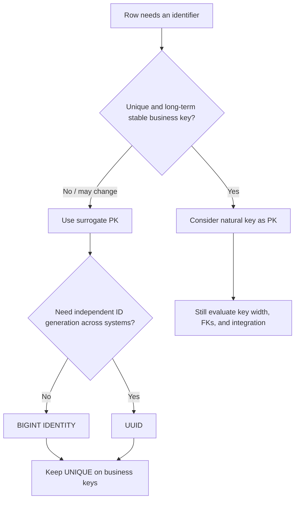

# Choosing Natural Keys, Surrogate Keys, and UUIDs in PostgreSQL

When designing a PostgreSQL table, deciding which column(s) to use as the primary key affects many parts of the system: uniqueness enforcement, index size, how tables link together, how business data changes are handled, and integration across multiple services. A value that looks "unique today" is not necessarily suitable as a stable identifier for years to come.

The three common approaches are **natural keys**, **surrogate keys**, and **UUIDs**. In practice, a UUID is also commonly used as a *surrogate key*; the difference with a UUID lies in its data type and generation method, not in automatically carrying business meaning.

This lesson guides key selection in the context of PostgreSQL relational schema design, including SQL examples and real-world scenarios when Java/Spring Boot applications interact with the data.

## 1. What Problem Do Keys Solve?

A data row must be identified unambiguously enough that an `UPDATE`, `DELETE`, or another table can reference that exact row. PostgreSQL provides fundamental constraints:

- **`PRIMARY KEY`**: defines the table's primary key. Key values cannot be `NULL` and must be unique; PostgreSQL creates a corresponding unique B-tree index. Each table has at most one primary key constraint, though that key may span multiple columns.
- **`UNIQUE`**: enforces uniqueness for a column or group of columns, suited for business identifiers that must not be duplicated. A table can have multiple `UNIQUE` constraints.
- **`FOREIGN KEY`**: requires referencing values to match a primary key, valid unique constraint, or supported set of columns in the target table, preserving referential integrity.
- **Candidate key**: a minimal set of attributes that uniquely identifies a row under business rules. The primary key is chosen from candidate keys; the remaining options are often called alternate keys.

For example, a countries table can be identified by a standard two-letter code, whereas a users table has emails that can change and have complex normalization rules; these two cases do not necessarily call for the same kind of key.



This diagram is a starting point for the decision, not a rigid formula. You still need to evaluate uniqueness scope, access patterns, data volume, and security policies.

## 2. Natural Keys

A **natural key** is an attribute (or set of attributes) that already carries meaning in the business domain and suffices to distinguish records. For example:

- A country code from an organizationally accepted code set, within a specific dataset scope.
- An institution-issued student ID, if processes guarantee codes are never reused and remain stable.
- The pair `(order_id, line_number)` to identify the line position within an order.
- The pair `(tenant_id, external_code)` if `external_code` is unique only within each tenant.

An attribute is a good choice only if these guarantees are **genuinely committed to by the business system**. For instance, "emails rarely change" is not the same as "an email will never change".

### 2.1. Single-Column Natural Key Example

Suppose an internal system uses two-letter country codes validated before writing:

```sql
CREATE SCHEMA IF NOT EXISTS key_lab;

CREATE TABLE key_lab.countries (
    country_code text PRIMARY KEY
        CHECK (country_code ~ '^[A-Z]{2}$'),
    country_name text NOT NULL
);

INSERT INTO key_lab.countries (country_code, country_name)
VALUES
    ('VN', 'Vietnam'),
    ('JP', 'Japan'),
    ('SG', 'Singapore');
```

Here `country_code` is already a meaningful identifier; adding `id bigint` does not always provide value. However, the regular expression constraint only checks *format*; it does not prove the code belongs to a valid country catalog. True code existence must be controlled through a trusted reference source.

Another table referencing that code:

```sql
CREATE TABLE key_lab.shipping_zones (
    zone_id bigint GENERATED ALWAYS AS IDENTITY PRIMARY KEY,
    country_code text NOT NULL
        REFERENCES key_lab.countries(country_code),
    zone_name text NOT NULL,
    UNIQUE (country_code, zone_name)
);
```

This structure fits when the country code is stable enough and meaningful for dependent tables. If the code catalog can change or is managed by an untrusted external system, consider adding a surrogate key.

### 2.2. Multi-Column Natural Key (Composite Key)

An order line item can be identified by **order + line sequence number**:

```sql
CREATE TABLE key_lab.orders (
    order_id bigint GENERATED ALWAYS AS IDENTITY PRIMARY KEY,
    ordered_at timestamptz NOT NULL DEFAULT now()
);

CREATE TABLE key_lab.order_lines (
    order_id bigint NOT NULL
        REFERENCES key_lab.orders(order_id),
    line_no integer NOT NULL CHECK (line_no > 0),
    product_code text NOT NULL,
    quantity integer NOT NULL CHECK (quantity > 0),
    PRIMARY KEY (order_id, line_no)
);
```

The primary key of `order_lines` is `(order_id, line_no)`. Line number `1` can exist in many orders, but a single order cannot have two lines with the same `line_no`.

For many-to-many junction tables, a composite key is often more natural than adding an `id`:

```sql
CREATE TABLE key_lab.students (
    student_id bigint GENERATED ALWAYS AS IDENTITY PRIMARY KEY,
    full_name text NOT NULL
);

CREATE TABLE key_lab.courses (
    course_id bigint GENERATED ALWAYS AS IDENTITY PRIMARY KEY,
    course_title text NOT NULL
);

CREATE TABLE key_lab.enrollments (
    student_id bigint NOT NULL REFERENCES key_lab.students(student_id),
    course_id bigint NOT NULL REFERENCES key_lab.courses(course_id),
    enrolled_at timestamptz NOT NULL DEFAULT now(),
    PRIMARY KEY (student_id, course_id)
);
```

The key pair `(student_id, course_id)` directly expresses the rule "each student enrolls in each course at most once". If the business allows re-enrolling across multiple terms, the model needs a term/cohort column or a surrogate key per enrollment event; never enforce a uniqueness rule that contradicts business requirements.

### 2.3. Strengths of Natural Keys

A natural key can:

1. Directly express the identification rule of the business domain.
2. Avoid adding an unnecessary identifier column, especially in small lookup tables with short keys.
3. Allow certain lookups/joins to directly use meaningful values already known externally.
4. Reduce the risk of creating two semantically duplicate records when the natural key is properly constrained in the database.

### 2.4. Risks When a Natural Key Changes

Consider an accounts table using email as its primary key:

```sql
CREATE TABLE key_lab.accounts_by_email (
    email text PRIMARY KEY,
    display_name text NOT NULL
);
```

This looks simple, but raises questions:

- Are users allowed to change their email?
- Can different accounts share an email at different points in time?
- What are the rules for case sensitivity, whitespace, and Unicode?
- How are unverified emails, reclaimed emails, or account transfers handled?
- How many child tables store email as a foreign key?

If an email changes, child tables holding email in an FK must be updated via `ON UPDATE` policies. This can rewrite many rows and indexes, consume locks, and impact the system. Moreover, email is personal contact information, generally unsuitable for spreading across all foreign keys, logs, and URLs.

Using a `UNIQUE` constraint for email (or a normalized email expression) while keeping a stable PK is a better fit in most user-facing systems.

## 3. Surrogate Keys in PostgreSQL

A **surrogate key** is an identifier created for technical purposes, usually carrying no business meaning about the record. For instance, `customer_id = 1042` tells you nothing about the customer's name, email, or region.

In PostgreSQL, a popular choice is a `bigint` integer generated via an **identity column**:

```sql
CREATE TABLE key_lab.customers (
    customer_id bigint GENERATED ALWAYS AS IDENTITY PRIMARY KEY,
    email text NOT NULL,
    full_name text NOT NULL,
    created_at timestamptz NOT NULL DEFAULT now(),
    CONSTRAINT uq_customers_email UNIQUE (email)
);
```

The table has two kinds of constraints serving two purposes:

- `customer_id`: **stable identifier** for the row and foreign keys.
- `email`: **business rule** forbidding two customers from sharing the same email under the active comparison rules.

Adding a surrogate key **does not automatically prevent duplicate business data**. If you omit `UNIQUE (email)` when the business requires unique emails, two rows with different `customer_id`s could still hold the same email.

### 3.1. GENERATED ALWAYS vs. BY DEFAULT AS IDENTITY

Two variants:

```sql
CREATE TABLE key_lab.identity_always_demo (
    id bigint GENERATED ALWAYS AS IDENTITY PRIMARY KEY,
    note text
);

CREATE TABLE key_lab.identity_default_demo (
    id bigint GENERATED BY DEFAULT AS IDENTITY PRIMARY KEY,
    note text
);
```

| Syntax | Behavior on INSERT |
| --- | --- |
| `GENERATED ALWAYS AS IDENTITY` | PostgreSQL normally generates the ID automatically; inserting an explicit ID requires override syntax such as `OVERRIDING SYSTEM VALUE` |
| `GENERATED BY DEFAULT AS IDENTITY` | Generates automatically when omitted, but accepts an ID supplied by the caller |
| Plain `bigint` | Does not auto-generate values without a `DEFAULT` or other logic |

Example:

```sql
INSERT INTO key_lab.identity_always_demo (note)
VALUES ('created normally')
RETURNING id;

INSERT INTO key_lab.identity_always_demo (id, note)
OVERRIDING SYSTEM VALUE
VALUES (500, 'explicit import')
RETURNING id;
```

With `BY DEFAULT`, callers can pass `id` directly. That capability is handy for imports/migrations, yet makes it easy for applications to accidentally supply IDs that collide with auto-generated ones. With `ALWAYS`, overrides must be explicit.

**Identity does not replace PRIMARY KEY/UNIQUE.** PostgreSQL lets you create an identity column without a primary key; to guarantee uniqueness and `NOT NULL` the way a PK is used, you must still define the appropriate constraint.

### 3.2. BIGINT, INTEGER, and BIGSERIAL

- `integer` uses 4 bytes, range from −2^31 to 2^31−1.
- `bigint` uses 8 bytes, range from −2^63 to 2^63−1.
- `smallint` uses 2 bytes, usually too small as a continuously incrementing ID for large tables.
- `serial` / `bigserial` are historical convenience syntax: they declare an integer/bigint with a sequence and `nextval` default, **not an independent data type**.
- `GENERATED ... AS IDENTITY` is modern SQL syntax that binds identity metadata to the column and its associated sequence.

If data has the potential to grow large, `bigint` is a common choice to avoid having to migrate a PK and all referencing FKs from `integer` to `bigint` when approaching exhaustion.

### 3.3. Sequences Do Not Guarantee Contiguous Commit Order

Identity values are typically drawn from a sequence. Sequences are optimized for concurrent generation, yet:

- A transaction that calls `nextval` and then rolls back can still advance the sequence.
- Two transactions may receive IDs 100 and 101 but commit in reverse order.
- Sequence caching and administrative operations can create gaps or non-contiguous visible orderings.

Example:

```sql
BEGIN;
INSERT INTO key_lab.customers (email, full_name)
VALUES ('example1@example.test', 'A')
RETURNING customer_id;
ROLLBACK;

INSERT INTO key_lab.customers (email, full_name)
VALUES ('example2@example.test', 'B')
RETURNING customer_id;
```

Do not expect the second ID to equal the first ID or row count plus one. If the business requires gapless document numbering, that is a dedicated business numbering problem requiring its own transactions and reconciliation, not something an identity PK should guarantee directly.

### 3.4. Surrogate Keys in Related Tables

```sql
CREATE TABLE key_lab.customer_addresses (
    address_id bigint GENERATED ALWAYS AS IDENTITY PRIMARY KEY,
    customer_id bigint NOT NULL
        REFERENCES key_lab.customers(customer_id),
    address_text text NOT NULL,
    is_default boolean NOT NULL DEFAULT false
);

CREATE INDEX idx_customer_addresses_customer_id
    ON key_lab.customer_addresses(customer_id);
```

The child table's `customer_id` FK does not need to store the email. When a customer changes their email, all addresses still point to the right customer. PostgreSQL automatically creates indexes for the parent table's primary/unique keys, but **does not automatically create indexes on FK columns in the child table**; an index on `customer_addresses(customer_id)` can speed up joins or referential checks when deleting/updating the parent. Whether to create an FK index depends on data volume and query patterns.

## 4. UUID: Identifiers Less Dependent on a Central Generator

A **UUID (Universally Unique Identifier)** is a 128-bit value used as an identifier. PostgreSQL has a native `uuid` type that stores 16 bytes for the value, whereas its standard text representation has 36 characters including hyphens.

Example:

```sql
CREATE TABLE key_lab.events (
    event_id uuid PRIMARY KEY DEFAULT gen_random_uuid(),
    event_type text NOT NULL,
    occurred_at timestamptz NOT NULL DEFAULT now(),
    payload jsonb NOT NULL
);

INSERT INTO key_lab.events (event_type, payload)
VALUES ('customer_created', '{"source":"web"}'::jsonb)
RETURNING event_id;
```

`gen_random_uuid()` generates a version 4 (random) UUID as a built-in function in modern PostgreSQL versions. Older PostgreSQL versions may require the `pgcrypto` extension for an equivalent function; verify your server version and extensions in the target environment before choosing a generation method.

UUIDs fit well when:

- Multiple services, devices, or nodes must generate IDs **independently** before writing to the same database.
- Data will be merged from multiple systems and avoiding ID collisions across sources matters.
- You want a uniform ID format across APIs, messages/events, or data synced between services.
- You do not need the properties of sequentially increasing integers.

UUIDs do not mathematically guarantee "never collide"; uniqueness depends on the algorithm and entropy source. With high-quality random UUIDs, collision probability is negligible at typical scales, yet the database must still enforce `PRIMARY KEY`/`UNIQUE` to reject collisions if one occurs.

### 4.1. Generating UUIDs in the Database vs. the Application

Two practical options:

**Database-generated ID**

```sql
CREATE TABLE key_lab.api_tokens_demo (
    token_row_id uuid PRIMARY KEY DEFAULT gen_random_uuid(),
    label text NOT NULL
);

INSERT INTO key_lab.api_tokens_demo (label)
VALUES ('integration test')
RETURNING token_row_id;
```

The application receives the ID via `INSERT ... RETURNING` or through JDBC/ORM mapping.

**Application-generated ID**

```java
import java.util.UUID;

UUID id = UUID.randomUUID();
```

Java's `UUID.randomUUID()` returns a version 4 random UUID. The application can attach the ID to an event, correlation object, or entity before writing to the database. The database still needs the constraint:

```sql
CREATE TABLE key_lab.external_messages (
    message_id uuid PRIMARY KEY,
    message_body jsonb NOT NULL
);
```

The client supplies `message_id` on insert. In distributed systems, nodes simply use compatible valid ID generation strategies and guard against duplicates via the primary key; no shared sequence across all nodes is needed.

Note that `UUID.randomUUID()` creates an identifier, not an authorization mechanism, and UUID values should not automatically be treated as secret security tokens. If you need an access token, design it around your system's entropy, expiration, and authentication requirements.

### 4.2. UUID v4 vs. Time-Ordered UUIDs

UUIDs exist in multiple versions. Two families are commonly weighed in key design:

| Family | Characteristics | Design Impact |
| --- | --- | --- |
| UUID v4 | Most bits are chosen randomly | Spreads keys across the index space; convenient for independent generation |
| Time-ordered UUIDs, e.g. v7 | Designed to preserve approximate chronological order when properly generated | Can improve B-tree insert locality compared to v4; actual ordering depends on generator, time resolution, and concurrency |

Support for UUID v7 generation functions in PostgreSQL/extensions/clients depends on version and environment. Do not hardcode a v7 function name into migrations without verifying the server provides it. PostgreSQL can **store** any UUID regardless of whether the server itself generates every version.

A UUID with a timestamp component can expose approximate creation time. If leaking timing metadata is a concern, evaluate this before choosing the format.

### 4.3. UUID v4 as a Primary Key Can Affect Indexes

In a B-tree, ascending `bigint` values typically append near the end of the key order, whereas random UUID v4 values scatter inserts more widely. Depending on index size, cache, concurrency load, and storage configuration, UUID v4 can cause more page operations, page splits, or lower locality than sequential IDs.

However, concluding "UUID is always slower than bigint" is overly simplistic. Real performance depends on read/write ratio, table size, accompanying indexes, query patterns, available RAM, concurrency, and UUID generation strategy. Benchmark against production-like workloads using `EXPLAIN (ANALYZE, BUFFERS)` and appropriate load tests.

### 4.4. Storing UUIDs with the Proper Type in PostgreSQL

Prefer:

```sql
customer_id uuid PRIMARY KEY
```

over:

```sql
customer_id varchar(36) PRIMARY KEY
```

Storing as `uuid` enables PostgreSQL syntax validation, compact 16-byte binary storage, and UUID-semantic comparisons. Storing as text allows multiple string representations of the same value and increases storage/index overhead.

In Java/JDBC queries, use `java.util.UUID` when the driver/ORM supports mapping to `uuid` instead of converting to and from strings unnecessarily.

## 5. Comparison Table of the Three Common Choices

| Criterion | Natural Key | `bigint` IDENTITY | `uuid` |
| --- | --- | --- | --- |
| Carries business meaning | Yes | No | No |
| Easy to keep stable when business attributes change | Depends on key stability | High | High |
| Key size | Depends on column count and types | 8 bytes for `bigint` value | 16 bytes for `uuid` value |
| Generate ID in app before insert | If app already knows the key | Needs pre-allocation or DB fetch | Usually convenient |
| Suits multiple independent writers | Depends on business uniqueness scope | Usually requires range/prefix allocation | Convenient when UUIDs are generated properly |
| B-tree locality | Depends on value distribution and insert order | Usually good with increasing sequence | v4 scatters randomly; v7 can improve locality |
| Readability when inspecting data | High if key is short and clear | High for technical debugging | Long, hard to read manually |
| Information leakage risk | May expose business data | May reveal ID sequence or relative scale | v4 is non-sequential; timestamped versions may reveal creation time |
| Main drawback | Business changes impact FKs | Relies on allocator if needed pre-DB | Larger indexes and FKs than `bigint`; UUID version management |

The "8 bytes / 16 bytes" figures refer to primitive value sizes, not the full size of a table row or index entry. PostgreSQL also incurs tuple/index overhead, alignment padding, and other columns.

### Do Not Trade Correctness for a Few Bytes

A long or mutable natural key can bloat many FKs/indexes and turn business changes into complex migrations. Conversely, a surrogate key without business `UNIQUE` constraints can allow duplicate data that the application fails to catch. **Enforcing the right business constraints** usually matters far more than the choice of ID generation algorithm.

## 6. Primary Keys and UNIQUE Constraints Must Be Designed Together

Using a surrogate key does not mean all other columns are allowed to duplicate.

```sql
CREATE TABLE key_lab.products (
    product_id bigint GENERATED ALWAYS AS IDENTITY PRIMARY KEY,
    sku text NOT NULL,
    title text NOT NULL,
    CONSTRAINT uq_products_sku UNIQUE (sku)
);
```

This stores two different kinds of IDs:

- `product_id` is used in `order_lines`, price lists, reports, and foreign keys.
- `sku` is entered by users/partners when searching products or receiving import files.

If an SKU changes due to a new coding policy, you do not have to update every FK pointing via `product_id`. Yet `UNIQUE (sku)` still prevents two rows from sharing the same SKU.

### 6.1. Upserting by Business Key

When syncing data from external systems, duplicate detection should match the appropriate business identifier:

```sql
INSERT INTO key_lab.products (sku, title)
VALUES ('BK-100', 'PostgreSQL in Practice')
ON CONFLICT (sku)
DO UPDATE SET title = EXCLUDED.title
RETURNING product_id, sku, title;
```

Conflict detection uses `sku` because that defines the same product in this example table, while `product_id` remains unchanged if the row already exists. If an SKU is genuinely allowed to be reused over time, you need a more precise product identity model; a global unique constraint on SKU would not fit then.

### 6.2. UNIQUE and NULL in PostgreSQL

By default, a `UNIQUE` constraint in PostgreSQL allows **multiple NULL values** because `NULL`s are not considered equal in standard uniqueness checks:

```sql
CREATE TABLE key_lab.contact_notes (
    note_id bigint GENERATED ALWAYS AS IDENTITY PRIMARY KEY,
    external_reference text UNIQUE,
    note_text text NOT NULL
);
```

Multiple rows with `external_reference IS NULL` can coexist.

If the rule requires "at most one NULL", PostgreSQL versions supporting `UNIQUE NULLS NOT DISTINCT` (PostgreSQL 15+) allow:

```sql
CREATE TABLE key_lab.unique_null_demo (
    id bigint GENERATED ALWAYS AS IDENTITY PRIMARY KEY,
    external_code text UNIQUE NULLS NOT DISTINCT
);
```

If the business requires every record to have an external code, `NOT NULL` together with `UNIQUE` is clearer than relying on implicit `NULL` semantics.

### 6.3. Emails and Case Normalization

Example:

```sql
CREATE TABLE key_lab.app_users (
    user_id bigint GENERATED ALWAYS AS IDENTITY PRIMARY KEY,
    email text NOT NULL,
    display_name text NOT NULL
);

CREATE UNIQUE INDEX uq_app_users_email_lower
    ON key_lab.app_users (lower(email));
```

This index blocks two emails differing only by letter case according to `lower` and the active collation. However, emails have their own technical and business rules; do not apply this normalization blindly to every system without defining an identity policy.

A **unique expression index** such as `lower(email)` is not a simple key column that can directly serve as an FK target in another table. When referencing a user via FK, reference `user_id`; keep email as an alternate business key for lookups and duplicate prevention.

## 7. Impact on FOREIGN KEYs, JOINs, and Indexes

Primary keys are repeated in child tables more often than you might expect. For instance, a system with millions of orders stores `customer_id` on every order.

```sql
CREATE TABLE key_lab.sales_orders (
    sales_order_id bigint GENERATED ALWAYS AS IDENTITY PRIMARY KEY,
    customer_id bigint NOT NULL
        REFERENCES key_lab.customers(customer_id),
    order_total numeric(14, 2) NOT NULL CHECK (order_total >= 0)
);

CREATE INDEX idx_sales_orders_customer_id
    ON key_lab.sales_orders(customer_id);
```

A `bigint` FK uses 8 bytes of key data per row and corresponding index entry. Using `uuid` uses 16 bytes per key value. If a natural key is a long string or multi-column composite key, storage and join costs can be higher; actual size should be measured for your specific schema, types, and indexes.

PostgreSQL guarantees valid references through foreign keys. Keep in mind:

- A PK or suitable `UNIQUE` constraint on the parent table normally gets an automatic index.
- The child table **does not automatically get an index just from declaring an FK**.
- Add an FK index when it benefits joins, filters, or parent update/delete checks; you do not have to index every FK if the table is tiny or never queried by that FK.
- An index on a composite key has a column order; queries filtering only on trailing columns may not use it as effectively as queries filtering on leading prefix columns.
- Changing key values referenced by FKs may require `ON UPDATE CASCADE` or be rejected by PostgreSQL under constraint rules.

### ON UPDATE CASCADE with Natural Keys

If a business key truly must change and was chosen as the primary key, cascading behavior can be defined:

```sql
CREATE TABLE key_lab.departments (
    department_code text PRIMARY KEY,
    department_name text NOT NULL
);

CREATE TABLE key_lab.employees (
    employee_id bigint GENERATED ALWAYS AS IDENTITY PRIMARY KEY,
    department_code text NOT NULL
        REFERENCES key_lab.departments(department_code)
        ON UPDATE CASCADE
);
```

When `department_code` changes in the parent table, PostgreSQL can update the FK column in dependent `employees` rows. This behavior can be useful, yet updating many records and indexes can cause significant load and locking. If department codes change frequently, a surrogate `department_id` usually gives a more stable design.

## 8. Multi-Tenant Design: Where Does Uniqueness Live?

Many applications share one database across multiple customers or organizations (**tenants**). A code like `EMP001` may be unique only *within* each tenant.

A common mistake is writing:

```sql
-- Unsuitable if employee_code is allowed to repeat across tenants.
UNIQUE (employee_code)
```

Replace it with a properly scoped constraint:

```sql
CREATE TABLE key_lab.tenants (
    tenant_id bigint GENERATED ALWAYS AS IDENTITY PRIMARY KEY,
    tenant_name text NOT NULL
);

CREATE TABLE key_lab.tenant_employees (
    tenant_id bigint NOT NULL REFERENCES key_lab.tenants(tenant_id),
    employee_id uuid NOT NULL DEFAULT gen_random_uuid(),
    employee_code text NOT NULL,
    full_name text NOT NULL,
    PRIMARY KEY (tenant_id, employee_id),
    UNIQUE (tenant_id, employee_code)
);
```

This table intentionally uses a composite PK `(tenant_id, employee_id)` even though `employee_id` is already a UUID. That expresses that identity is scoped to the tenant and allows FKs to verify the tenant simultaneously.

```sql
CREATE TABLE key_lab.employee_assignments (
    assignment_id bigint GENERATED ALWAYS AS IDENTITY PRIMARY KEY,
    tenant_id bigint NOT NULL,
    employee_id uuid NOT NULL,
    assigned_at timestamptz NOT NULL DEFAULT now(),
    FOREIGN KEY (tenant_id, employee_id)
        REFERENCES key_lab.tenant_employees(tenant_id, employee_id)
);
```

The two-column FK prevents an assignment from accidentally referencing an employee from another tenant via an invalid combination. Even so, **PK/FK constraints do not replace full tenant access control**. Authorization policies, query filtering, and potentially Row Level Security must still be designed separately.

### How Partitioning Affects Key Selection

For **partitioned tables**, PostgreSQL imposes restrictions when declaring `UNIQUE`/`PRIMARY KEY` on the parent table: partition key columns must be included in unique/primary key constraints per version rules so PostgreSQL can enforce uniqueness across partitions. Thus, for an events table partitioned by time, a standalone `PRIMARY KEY (event_id)` may be invalid or fail to guarantee what you expect; you may need a composite key including the partition column or an alternative identification strategy.

Do not pick UUID merely because data will be partitioned: **distributed UUIDs do not automatically create a global cross-partition unique index** where the engine lacks that mechanism. You must design uniqueness around partition boundaries and concrete query requirements.

## 9. What Should You Choose in Java/Spring Boot Applications?

A Java/JPA system typically maps the PK to an `@Id` field. Example of a PostgreSQL-generated integer identifier:

```java
import jakarta.persistence.Entity;
import jakarta.persistence.GeneratedValue;
import jakarta.persistence.GenerationType;
import jakarta.persistence.Id;
import jakarta.persistence.Table;

@Entity
@Table(name = "customers", schema = "key_lab")
public class Customer {
    @Id
    @GeneratedValue(strategy = GenerationType.IDENTITY)
    private Long customerId;

    private String email;
    private String fullName;

    protected Customer() {
    }
}
```

This is a foundational mapping example; align column names via Hibernate/JPA naming strategies or add `@Column(name = "...")` when exact column control is needed. Email uniqueness must still be enforced by the database via a matching `UNIQUE` constraint.

When using UUID keys, an entity can hold a `UUID` generated by the application:

```java
import java.util.UUID;

UUID orderId = UUID.randomUUID();
```

Depending on the Hibernate/JPA version, the framework can also generate UUIDs automatically. Choose **one clear ID generator owner** (database, application, or ORM), avoiding multiple implicit rules that complicate testing.

### Frequently Asked Design Questions

**Should APIs return surrogate IDs?** Yes, if the API needs stable identifiers and the system enforces authorization checks on resources. Never treat using a UUID instead of `1, 2, 3` as protection against unauthorized access. Every API must still verify user/tenant permissions.

**Should internal IDs and public IDs be separated?** Some systems use an internal `bigint` to optimize joins/indexes alongside a separate unique `uuid` exposed in URLs or integration events:

```sql
CREATE TABLE key_lab.public_customers (
    customer_id bigint GENERATED ALWAYS AS IDENTITY PRIMARY KEY,
    public_id uuid NOT NULL DEFAULT gen_random_uuid() UNIQUE,
    full_name text NOT NULL
);
```

This option adds an extra column, index, and mapping step. Choose it only when there is a concrete reason such as API compatibility, data merging, or separating public from internal identifiers.

**Should UUID be used as PK for every table?** There is no mandatory rule. Simple junction tables can use composite PKs; small lookup tables can use stable natural keys; centralized transactional tables can use `bigint`; data created independently across multiple nodes can suit UUIDs.

## 10. Migrating from a Natural Key to a Surrogate Key

In a running system, changing a PK is more than adding an `id` column and running `DROP CONSTRAINT`. Many foreign keys, APIs, caches, messages, or reports may depend on the old key.

Initial scenario example:

```sql
-- Legacy table shape for illustration; do not overwrite existing tables.
CREATE TABLE key_lab.legacy_accounts (
    email text PRIMARY KEY,
    display_name text NOT NULL
);
```

To migrate to `account_id bigint`, you can plan the following steps:

1. **Audit dependencies**: locate all FKs pointing to `legacy_accounts(email)`, indexes, queries, APIs, and data exported to external systems.
2. **Add the surrogate column**: create an appropriate identity/sequence column and backfill values for all existing rows using a tested approach, ensuring no `NULL`s or duplicates remain.
3. **Preserve business uniqueness**: before dropping the old PK, ensure a valid unique constraint/index exists on `email` if the business still requires uniqueness.
4. **Migrate child tables**: add `account_id` to referencing tables, backfill via email → ID mapping, and create the new FKs and needed indexes. For large tables, batch updates and control locks.
5. **Roll out application changes in phases**: updated code reads/writes via `account_id` while preserving temporary compatibility for legacy callers; update integrations and APIs.
6. **Switch the PRIMARY KEY**: only after FKs/apps are stable and a suitable rollback/data migration plan is ready, swap the PK formally. Drop old columns and constraints last once genuinely unused.

In PostgreSQL, swapping a PK can require heavy locks, index rebuilds, and foreign key changes; exact downtime depends on table size and deployment strategy. In production, use version-controlled migration scripts along with testing and recovery plans. **Never use `DROP ... CASCADE` as a "quick fix" for PK dependencies**, as it can drop unintended constraints and related objects.

### When a Natural Key Changes, Must the PK Always Change?

No. If a natural key is stable in practice, simple, and already widely adopted, migrating to a surrogate PK can incur major effort for unclear gain. Weigh business change risk, FK width, performance, and integration strategy rather than following a blanket rule like "every table must use UUID".

## 11. Choosing Keys by Scenario

| Scenario | Suggested Choice | Reason and Conditions |
| --- | --- | --- |
| Country lookup table with stable codes | Natural key `country_code` | Short, readable; stability rules must be confirmed |
| Customer table in a single-database application | `bigint GENERATED ... AS IDENTITY` | Easy to generate, compact FK; keep `UNIQUE` on email/customer code if needed |
| One-time student–course enrollment | Composite `(student_id, course_id)` | Directly models uniqueness of the relationship |
| Order with multiple line items | `order_id` + `line_no` or separate line ID | Depends on whether lines need independent identity when splitting/merging/reordering |
| Events created across multiple offline devices | UUID | Nodes generate IDs independently before syncing; handle collisions and business conflicts |
| Data imported/exported across multiple systems | UUID or external ID with appropriate uniqueness | Reduces dependence on local sequences; requires clear namespacing |
| Multi-tenant with codes repeated across tenants | Composite key or surrogate PK + `UNIQUE (tenant_id, code)` | Scopes uniqueness accurately to each tenant |
| Public API needing non-sequential IDs | Public UUID, optionally paired with internal `bigint` | Suits integration interfaces; authorization checks remain mandatory |
| Table partitioned by date | PK/UNIQUE including partition key per PostgreSQL rules | Ensures valid constraints and efficient queries |

This table is a design guide, not a substitute for evaluating actual workloads or business regulations.

## 12. Comprehensive Lab: Designing One Domain with Two Strategies

The exercises below run inside the `key_lab` schema created in section 2.

### Exercise 1: Natural Key for Region Codes

Design a shipping regions table where a region code can appear only once per country, yet may repeat across two different countries:

```sql
CREATE TABLE key_lab.regional_zones (
    country_code text NOT NULL REFERENCES key_lab.countries(country_code),
    zone_code text NOT NULL,
    zone_name text NOT NULL,
    PRIMARY KEY (country_code, zone_code)
);
```

Try inserting two regions with the same `zone_code` but different `country_code` values. Then try inserting two regions with both key columns identical and observe the unique violation.

### Exercise 2: Surrogate PK and Business UNIQUE

Use the `key_lab.products` table from earlier. Try two operations:

```sql
INSERT INTO key_lab.products (sku, title)
VALUES ('SKU-01', 'Keyboard')
RETURNING product_id;

-- Run again in your practice environment:
INSERT INTO key_lab.products (sku, title)
VALUES ('SKU-01', 'Another keyboard');
```

The second run must fail with a uniqueness error because `sku` already exists, even though the auto-generated ID would differ. Rewrite the second statement using `ON CONFLICT (sku) DO UPDATE ...` and verify that the existing row's `product_id` stays unchanged.

### Exercise 3: Database-Generated UUID

```sql
INSERT INTO key_lab.events (event_type, payload)
VALUES
    ('payment_requested', '{"order":"A01"}'::jsonb),
    ('payment_requested', '{"order":"A02"}'::jsonb)
RETURNING event_id, event_type;
```

Inspect the ID format, check the column type with `\d+ key_lab.events` in `psql`, and explain why you should not use `ORDER BY event_id` to infer exact creation time for UUID v4.

### Exercise 4: Impact on Child Tables

Create a child table using the `customer_id` FK instead of email:

```sql
CREATE TABLE key_lab.customer_preferences (
    customer_id bigint PRIMARY KEY
        REFERENCES key_lab.customers(customer_id),
    language_code text NOT NULL DEFAULT 'vi'
);
```

Insert a customer and a preference row. Then update the email in `customers` and confirm the `customer_preferences` row still references properly.

### Exercise 5: Decision and Justification

For a sales system with 10 million customers, editable emails, running on one primary PostgreSQL instance, and syncing events to multiple services, propose:

- What PK type should `customers` use? Should a `public_id uuid` be added?
- Which constraint should be on email and what normalization rules should apply?
- Should `orders` reference `customer_id` or email?
- Should event IDs be generated by the database or the producer service? How do you prevent duplicate event writes from creating duplicate records?
- How would benchmark results for indexes, RAM, and write throughput influence your decision?

There is no single right answer; a good design must **preserve business uniqueness**, **stay stable when data changes**, and **fit real-world operations**.

## 13. Key Takeaways for PostgreSQL Schema Design

- Choose a **natural key** as `PRIMARY KEY` only when the domain has clear uniqueness rules and sufficient stability. Multi-column natural keys remain sensible in junction or lookup tables.
- Choose a **surrogate key** when you need an identifier independent of emails, product codes, or mutable attributes. `BIGINT IDENTITY` is common, but always pair it with `UNIQUE` on business keys that must remain unique.
- Choose a **UUID** when independent ID generation, multi-system synchronization, or API requirements call for it. Use PostgreSQL's native `uuid` type, and understand the trade-offs between UUID v4 and time-ordered versions.
- Design **FOREIGN KEYs** and supporting indexes upfront. Wider PKs can increase storage and join costs across child tables and indexes.
- Define the **scope of uniqueness**: database-wide, per tenant, per version, over time, or across a combination of attributes. Getting uniqueness scope wrong means getting the data model wrong.
- When changing a PK in a live system, execute controlled migrations that preserve data and callers, with a proper rollback plan. Do not blindly alter or drop constraints just to force a migration through.

Primary key selection is part of the **identity model**: it must accurately express what an entity is, when two records represent the same entity, and which attribute changes must never break that identity. PostgreSQL provides all the constraints needed to safeguard these decisions right at the data layer.
