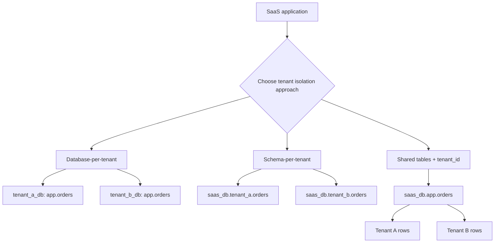

# Multi-Tenancy by Database, Schema, or Identifier Column in PostgreSQL

## 1. The Problem: One Application Serving Multiple Customers

In a SaaS product, a **renting customer organization** is commonly called a *tenant*. A tenant might be a company, store, organization, or team using the software. The system must serve multiple tenants while guaranteeing:

- Users of tenant A never accidentally read or mutate tenant B's data.
- Data and business constraints behave properly even if two tenants use the same order code or email.
- Resource consumption, storage cost, and operational effort scale appropriately with tenant count and load.
- Backup, restore, schema upgrades, debugging, and data deletion/export requests remain manageable.
- The application maintains consistency across queries, pooled connections, and asynchronous jobs.

PostgreSQL offers three common schema organization patterns:

1. **Database-per-tenant:** each tenant has its own separate database.
2. **Schema-per-tenant:** tenants share a database, while each tenant has its own schema.
3. **Shared schema, shared tables:** tenants share tables and rows are distinguished via a `tenant_id` column.

No single model fits every system. The right choice depends on data isolation requirements, tenant count, scalability, application architecture, migration frequency, and operational capacity.

### 1.1. Overview Diagram



In the database-per-tenant model, separate databases may still reside **on the same PostgreSQL instance/cluster**. That differs from giving each tenant an isolated server/instance. Isolating CPU, memory, WAL, restarts, and blast radius at the infrastructure tier requires **separate instances** or dedicated infrastructure, not just creating multiple databases in one cluster.

## 2. First: Distinguish Tenant, User, and Deployment Unit

A tenant is not necessarily a PostgreSQL database user.

| Concept | Role | Example |
|---|---|---|
| **Tenant** | Data/business unit requiring isolation | Company A |
| **Application user** | End user logging into the application | An employee of Company A |
| **PostgreSQL role** | Identity and privileges at the DB tier | `saas_runtime`, `tenant_a_reader` |
| **Database** | PostgreSQL connection space | `saas_db` or `tenant_a_db` |
| **Schema** | Namespace inside a database | `app` or `tenant_a` |
| **Row** | A concrete record in a table | Order `order_id = 1001`, `tenant_id = A` |

One tenant can have thousands of application users. Systems typically connect to the database through a few service roles and enforce tenant access rules. Still, when stronger isolation is demanded, dedicated per-tenant database roles or a combination of roles and Row-Level Security can be used.

**Never blindly trust a tenant ID taken from a URL, HTTP header, or JSON body.** The application must resolve the tenant from an authenticated identity and verified membership before selecting a database, schema, or `tenant_id`.

Example request flow:

```text
GET /tenants/11111111-1111-4111-8111-111111111111/orders

JWT / session:
    user = user-42
    allowed_tenants = [tenant A]

Application:
    authenticate user-42
    verify user-42 is authorized for tenant A
    create trusted tenant context
    select matching connection / schema / tenant_id
```

Reading the ID directly from the URL path without verifying user authorization leaves all three storage models vulnerable at the application tier.

## 3. Model 1: One Database per Tenant

### 3.1. Structure

```text
PostgreSQL instance
├── Database tenant_a_db
│   └── Schema app
│       ├── customers
│       └── orders
├── Database tenant_b_db
│   └── Schema app
│       ├── customers
│       └── orders
└── Database control_db
    └── tenant_registry
```

The application routes connections to the database matching the authenticated tenant. For example:

```text
Tenant A -> jdbc:postgresql://db.internal:5432/tenant_a_db
Tenant B -> jdbc:postgresql://db.internal:5432/tenant_b_db
```

A standard PostgreSQL connection operates within **a single database**. It cannot switch to another database mid-session via a SQL `USE ...` command as in some other DBMSs. To query another tenant, the application needs a connection to that tenant's database.

### 3.2. Initializing Databases in the Lab

Assuming an administrator is connected to a lab PostgreSQL instance with sufficient privileges:

```sql
CREATE DATABASE tenant_a_db;
CREATE DATABASE tenant_b_db;
```

`CREATE DATABASE` cannot run inside a transaction block. In production, manage ownership, roles, quotas, and connection grants carefully; never let the runtime application create databases using superuser credentials.

Connect using `psql`:

```text
\connect tenant_a_db
```

Create the schema for tenant A:

```sql
CREATE SCHEMA app;

CREATE TABLE app.orders (
    order_id bigint GENERATED ALWAYS AS IDENTITY PRIMARY KEY,
    total_amount numeric(12,2) NOT NULL CHECK (total_amount >= 0),
    status text NOT NULL DEFAULT 'NEW'
);
```

Then connect to tenant B:

```text
\connect tenant_b_db
```

And create the matching structure:

```sql
CREATE SCHEMA app;

CREATE TABLE app.orders (
    order_id bigint GENERATED ALWAYS AS IDENTITY PRIMARY KEY,
    total_amount numeric(12,2) NOT NULL CHECK (total_amount >= 0),
    status text NOT NULL DEFAULT 'NEW'
);
```

Both `app.orders` tables share the same name yet live in **two namespace-independent databases**. Running `SELECT * FROM app.orders` reads the table in whichever database the current connection targets.

This snippet illustrates a fresh lab setup. In real deployments, databases are provisioned via controlled automation/migrations, never by creating tables manually per tenant.

### 3.3. Benefits

**Namespace and access separation:** tenant A's role can be granted privileges to connect only to `tenant_a_db` and access its tables. Note that PostgreSQL roles remain cluster-wide objects, so `CONNECT` and schema/table grants must be configured properly; creating separate databases **does not automatically erect a boundary against high-privilege roles**.

**Per-tenant lifecycle management:** you can take a logical backup of database A, test restores, run controlled migrations on A, or move A's data onto a different PostgreSQL instance.

**Fewer naming and constraint collisions:** tenants A and B can both use `order_id = 1001` in their own databases without embedding tenant IDs into primary keys.

**Certain compliance requirements:** enterprise customers sometimes demand explicit separation of databases, access grants, or operational policies. Verify the exact isolation tier they require; separate databases on a shared host may not suffice.

### 3.4. Costs and Limitations

- Every database must be provisioned, schema-migrated, and upgraded.
- Applications may have to manage many connection pools or dynamic routing strategies.
- Maintaining a large pool per tenant can quickly exhaust connection limits.
- Cross-tenant aggregate queries cannot simply write `tenant_a_db.app.orders` over a normal SQL connection.
- PostgreSQL manages roles at the cluster level, not automatically isolated per database.
- Backups/WAL, storage, CPU, RAM, and instance-level failures remain **shared** if all databases sit on one instance.
- Migrations across many databases risk version drift if automation and rollback handling are weak.

Tools like `postgres_fdw`, `dblink`, or analytics pipelines can pull data across databases intentionally, though these are not default cross-database joins and carry separate security/transaction considerations.

### 3.5. Backup and Restore

Example logical backup of one database in a test environment:

```sh
pg_dump -h 127.0.0.1 -p 5432 -U backup_user \
  -d tenant_a_db -Fc -f tenant_a_db.dump
```

The custom-format archive can be restored with `pg_restore` into a **prepared target database**, using appropriate privileges and options:

```sh
pg_restore -h 127.0.0.1 -p 5432 -U restore_user \
  -d tenant_a_restore --no-owner tenant_a_db.dump
```

This example assumes the role, target database, and file exist, and runs in an **isolated recovery environment**, never directly over live customer traffic. Restores must also account for extensions, ownership, roles, permissions, dependent services, and external assets outside the dump.

**Warning:** PostgreSQL physical backups and WAL-based Point-in-Time Recovery normally operate at the **cluster/instance** scope—they are not as simple as "rewinding one database" inside a shared cluster. Being able to `pg_dump` one database does not imply physical PITR can restore a single database in place on a production instance.

## 4. Model 2: One Schema per Tenant in a Shared Database

### 4.1. Structure

```text
PostgreSQL instance
└── Database saas_db
    ├── Schema tenant_a
    │   ├── customers
    │   └── orders
    ├── Schema tenant_b
    │   ├── customers
    │   └── orders
    └── Schema shared
        └── application_settings
```

This sits between database-per-tenant and shared-tables. Each tenant gets its own namespace while all schemas live inside `saas_db`.

Notable advantage: within one connection to `saas_db`, PostgreSQL can access different schemas via qualified names `schema.table` when the role has privileges. Still, cross-tenant access must follow strict security policies; never grant a runtime role access to every schema merely because SQL supports qualified names.

### 4.2. Creating Schemas in the Lab

Connect to an existing `saas_db` test database:

```sql
CREATE SCHEMA tenant_a;
CREATE SCHEMA tenant_b;

CREATE TABLE tenant_a.orders (
    order_id bigint GENERATED ALWAYS AS IDENTITY PRIMARY KEY,
    status text NOT NULL DEFAULT 'NEW',
    total_amount numeric(12,2) NOT NULL CHECK (total_amount >= 0)
);

CREATE TABLE tenant_b.orders (
    order_id bigint GENERATED ALWAYS AS IDENTITY PRIMARY KEY,
    status text NOT NULL DEFAULT 'NEW',
    total_amount numeric(12,2) NOT NULL CHECK (total_amount >= 0)
);
```

Each schema owns its own `orders` table. Insert sample rows:

```sql
INSERT INTO tenant_a.orders (total_amount)
VALUES (100000.00);

INSERT INTO tenant_b.orders (total_amount)
VALUES (250000.00);
```

And query explicitly:

```sql
SELECT * FROM tenant_a.orders;
SELECT * FROM tenant_b.orders;
```

Both tables can hold `order_id = 1` without conflict because they are distinct relations.

### 4.3. `search_path` and Schema Routing

The `search_path` setting determines where PostgreSQL looks for unqualified table names.

```sql
SHOW search_path;

SET search_path TO tenant_a, pg_catalog;

SELECT * FROM orders;
```

Here `orders` resolves via the search path, typically to `tenant_a.orders` if the table exists and the role has privileges.

When switched:

```sql
SET search_path TO tenant_b, pg_catalog;

SELECT * FROM orders;
```

the exact same unqualified SQL string reads another tenant's table. This makes SQL reuse convenient, yet introduces a **major data-isolation risk** if the application misconfigures `search_path`.

Key rules:

1. Never take schema names directly from unverified HTTP headers or parameters.
2. Maintain a system-controlled tenant → schema mapping; never let users supply arbitrary names.
3. For sensitive operations, consider explicit qualified names `tenant_a.orders` rather than relying on session state.
4. When switching `search_path`, scope it to the **transaction** and ensure connection pools never leak prior tenant state.
5. Never grant untrusted tenants `CREATE` privileges on schemas appearing early in a privileged statement's `search_path`.

Example inside an application worker transaction:

```sql
BEGIN;

SET LOCAL search_path TO tenant_a, pg_catalog;

SELECT * FROM orders;

COMMIT;
```

Once the transaction ends, the `SET LOCAL` value is cleared from the session per PostgreSQL semantics.

**Never concatenate schema names from requests directly into SQL strings.** Bind parameters `$1` or `?` in prepared statements are for **values**, not schema or table identifiers. If dynamic identifiers are unavoidable, look them up from a verified allowlist/catalog and quote identifiers safely—e.g., `format('%I.%I', schema_name, table_name)` in PL/pgSQL or the driver's identifier-quoting API.

### 4.4. Per-Schema Access Control

Schema isolation matters only when permissions enforce it. One strategy is creating a dedicated role per tenant, such as `tenant_a_runtime`, and granting `USAGE`/table privileges only on schema A.

```sql
-- Execute as admin/migration owner in the lab database.
CREATE ROLE tenant_a_runtime LOGIN;

GRANT CONNECT ON DATABASE saas_db TO tenant_a_runtime;
GRANT USAGE ON SCHEMA tenant_a TO tenant_a_runtime;
GRANT SELECT, INSERT, UPDATE, DELETE
ON ALL TABLES IN SCHEMA tenant_a
TO tenant_a_runtime;
```

Configure authentication separately and audit privileges inherited via role memberships or `PUBLIC`. If the application connects with one shared role granted access to **every schema**, switching `search_path` is **not a strong security boundary**: any query writing `tenant_b.orders` explicitly can still read tenant B.

Thus, for database-enforced isolation in schema-per-tenant, consider **per-tenant database roles or tightly controlled privilege mechanisms**, not just distinct schema names.

**Note on sequences/identity:** some structures rely on underlying sequences, and insert privileges must align with how identity columns are declared. Future newly created tables do not automatically inherit prior grants; configure `ALTER DEFAULT PRIVILEGES` for the table-creating role as needed.

### 4.5. Advantages

- Each tenant's tables have separate physical structures/metadata without needing `tenant_id` in every table.
- Schemas can be migrated or have select objects customized per tenant.
- Privileges can be granted on specific schemas/tables per tenant.
- All schemas share one database, simplifying connection, extension, and shared resource management.
- A single schema can be logically dumped with `pg_dump -n tenant_a`, subject to tool limits and external dependencies.

### 4.6. Disadvantages

- The count of schemas, tables, sequences, indexes, and catalog entries grows linearly with tenant count.
- Every migration must execute across every schema; one failed schema causes **schema drift**.
- Applications risk cross-tenant reads if `search_path` or pooled connections retain stale state.
- Because the database/instance is shared, tenants still share compute, I/O, and WAL.
- Schema-level dumps may omit external dependencies such as extensions, roles, or objects in shared schemas.
- System-wide reporting queries must aggregate across many physical tables—harder than querying one shared table.

For tens or hundreds of tenants with similar schema needs, this can work well depending on schema size and automation maturity. At tens of thousands of tenants, multiplying tables and indexes places heavy catalog and operational strain. There is no single fixed tenant-count threshold for every workload.

## 5. Model 3: Shared Tables with a `tenant_id` Column on Every Row

### 5.1. Structure

```text
PostgreSQL instance
└── Database saas_db
    └── Schema app
        ├── tenants
        │   ├── tenant A
        │   └── tenant B
        ├── customers
        │   ├── tenant_id=A, customer_id=1
        │   └── tenant_id=B, customer_id=2
        └── orders
            ├── tenant_id=A, order_id=101
            ├── tenant_id=A, order_id=102
            └── tenant_id=B, order_id=103
```

One table holds multiple tenants, with every row explicitly tagged with its tenant. This pattern excels when tenant counts are high and many small tenants share the same schema.

Example query:

```sql
SELECT order_id, status, total_amount
FROM app.orders
WHERE tenant_id = '11111111-1111-4111-8111-111111111111'
ORDER BY order_id;
```

The `tenant_id` predicate is not an optional optimization detail. It is part of the **business and security boundary**. If a developer omits the filter, SQL can return another tenant's rows unless database-layer protection such as Row-Level Security is active.

### 5.2. Shared Schema Example with Composite Keys

In a lab database, create the schema and three tables:

```sql
CREATE SCHEMA app;

CREATE TABLE app.tenants (
    tenant_id uuid PRIMARY KEY,
    tenant_name text NOT NULL
);

CREATE TABLE app.customers (
    tenant_id uuid NOT NULL
        REFERENCES app.tenants(tenant_id),
    customer_id bigint GENERATED BY DEFAULT AS IDENTITY,
    full_name text NOT NULL,
    email text NOT NULL,
    PRIMARY KEY (tenant_id, customer_id),
    UNIQUE (tenant_id, email)
);

CREATE TABLE app.orders (
    tenant_id uuid NOT NULL,
    order_id bigint GENERATED BY DEFAULT AS IDENTITY,
    customer_id bigint NOT NULL,
    status text NOT NULL DEFAULT 'NEW',
    total_amount numeric(12,2) NOT NULL CHECK (total_amount >= 0),
    created_at timestamptz NOT NULL DEFAULT now(),
    PRIMARY KEY (tenant_id, order_id),
    FOREIGN KEY (tenant_id, customer_id)
        REFERENCES app.customers(tenant_id, customer_id)
);
```

This assumes `saas_db` was just prepared and schema `app` does not exist yet. If the lab already has the schema/tables, do not blindly re-run DDL; use a clean environment or controlled migrations.

**Key design decisions:**

- `tenant_id uuid NOT NULL` on every tenant-owned business table.
- Primary keys `(tenant_id, customer_id)` and `(tenant_id, order_id)` scope identity to the tenant.
- `UNIQUE (tenant_id, email)` lets two tenants both have `admin@example.test`, while blocking duplicate emails **within the same tenant**.
- Foreign key `(tenant_id, customer_id)` on orders points to a customer **in the same tenant**.
- The identity column draws IDs from one table-wide sequence; it does **not** promise contiguous per-tenant numbering.

Even when using a global `uuid` as `order_id`, you still need tenant predicates in queries and constraints, because a global ID does not enforce "never access another tenant's data".

### 5.3. Why Must Foreign Keys Carry `tenant_id`?

An error-prone design:

```sql
-- Design flaw illustration:
-- orders(tenant_id, customer_id)
-- FOREIGN KEY (customer_id) REFERENCES customers(customer_id)
```

If `customer_id` overlaps across tenants or the foreign key targets a global customer ID without checking tenant match, an order in tenant A could link to a customer in tenant B. Even when IDs are globally unique, a single-column FK fails to prove the "same tenant" invariant.

With the proper constraint:

```sql
FOREIGN KEY (tenant_id, customer_id)
    REFERENCES app.customers(tenant_id, customer_id)
```

PostgreSQL requires **both columns** to match one customer row, blocking cross-tenant reference bugs right at the database tier.

Apply the same rule between `order_items` and `orders`, `projects` and `tasks`, or any tenant-scoped relationship.

### 5.4. Sample Data

Create two tenants:

```sql
INSERT INTO app.tenants (tenant_id, tenant_name)
VALUES
    ('11111111-1111-4111-8111-111111111111', 'Company A'),
    ('22222222-2222-4222-8222-222222222222', 'Company B');
```

Add customers:

```sql
INSERT INTO app.customers (tenant_id, full_name, email)
VALUES
    ('11111111-1111-4111-8111-111111111111',
     'An Nguyen', 'admin@example.test'),
    ('22222222-2222-4222-8222-222222222222',
     'Binh Tran', 'admin@example.test')
RETURNING tenant_id, customer_id, email;
```

Both rows can share the same email because uniqueness is evaluated over `(tenant_id, email)`.

Create an order for tenant A:

```sql
INSERT INTO app.orders (
    tenant_id, customer_id, status, total_amount
)
SELECT tenant_id, customer_id, 'PAID', 150000.00
FROM app.customers
WHERE tenant_id = '11111111-1111-4111-8111-111111111111'
  AND email = 'admin@example.test';
```

And an order for tenant B:

```sql
INSERT INTO app.orders (
    tenant_id, customer_id, status, total_amount
)
SELECT tenant_id, customer_id, 'NEW', 80000.00
FROM app.customers
WHERE tenant_id = '22222222-2222-4222-8222-222222222222'
  AND email = 'admin@example.test';
```

Query only tenant A:

```sql
SELECT
    o.tenant_id,
    o.order_id,
    c.full_name,
    o.status,
    o.total_amount
FROM app.orders AS o
JOIN app.customers AS c
  ON c.tenant_id = o.tenant_id
 AND c.customer_id = o.customer_id
WHERE o.tenant_id = '11111111-1111-4111-8111-111111111111'
ORDER BY o.order_id;
```

In the `JOIN`, the **same-tenant** predicate is part of the data contract. Including `tenant_id` consistently both lowers leak risk and helps PostgreSQL use composite indexes.

## 6. Row-Level Security (RLS): Defense Layer for Shared Tables

### 6.1. The Problem with Relying Solely on `WHERE tenant_id = ...`

Suppose an API runs:

```sql
SELECT *
FROM app.orders
WHERE tenant_id = $1;
```

If one code path forgets the predicate or passes the wrong tenant, the database does not recognize the business mistake and may return the entire table.

PostgreSQL **Row-Level Security** lets you define **row-level policies**. Once RLS is enabled on a table with proper policies, PostgreSQL restricts which rows a role can read or modify, even if application SQL omits the tenant predicate.

RLS does not replace API authentication, schema/table grants, or data constraints, yet provides an essential **defense-in-depth layer**.

### 6.2. Transaction-Scoped Tenant Context Pattern

A common application flow:

1. Authenticate the user and resolve an authorized tenant.
2. Start a transaction on the application connection.
3. Set the verified tenant context.
4. Execute SQL inside the transaction.
5. Commit or roll back and return the connection to the pool.

PostgreSQL reads custom settings via:

```sql
SELECT current_setting('app.tenant_id', true);
```

The second parameter `true` returns `NULL` instead of throwing an error if the setting is unset. With pools/drivers, a setting may sometimes be reset to an empty string; wrap with `NULLIF(..., '')` before casting.

For example, an RLS predicate:

```sql
tenant_id = NULLIF(
    current_setting('app.tenant_id', true), ''
)::uuid
```

When no tenant context is set, the expression matches zero rows (`NULL` in equality comparison). If the context holds an invalid UUID string, the cast raises an error rather than returning rows. Both outcomes are far safer than **defaulting to returning all tenants**.

### 6.3. Creating a Non-Owner Runtime Role

As admin in the lab:

```sql
CREATE ROLE saas_runtime LOGIN;

-- In psql, set a password using the client command:
-- \password saas_runtime
```

In `saas_db`, grant only needed privileges:

```sql
GRANT CONNECT ON DATABASE saas_db TO saas_runtime;
GRANT USAGE ON SCHEMA app TO saas_runtime;

GRANT SELECT, INSERT, UPDATE, DELETE
ON app.customers, app.orders
TO saas_runtime;
```

Here the runtime role is **not** granted read access to `app.tenants`, does not own the tables, and has no superuser, `BYPASSRLS`, or DDL privileges.

If the application needs to `INSERT` into identity columns, verify sequence/identity permissions for your PostgreSQL version and declaration style rather than blindly granting all sequences in the database. The DDL snippets above are run by a controlled owner/migration role, **not** by `saas_runtime`.

### 6.4. Enabling RLS on Business Tables

As the table-owning role:

```sql
ALTER TABLE app.customers ENABLE ROW LEVEL SECURITY;
ALTER TABLE app.orders ENABLE ROW LEVEL SECURITY;
```

Once RLS is enabled, roles subject to RLS without matching permissive policies are **denied row access by default**. Remember critical exceptions:

- **Superusers** and roles with `BYPASSRLS` bypass Row-Level Security.
- **Table owners** normally bypass RLS as well unless `FORCE ROW LEVEL SECURITY` is enabled on the table.
- RLS policies do not replace table `GRANT`s, nor do they protect against high-privilege roles.

In real applications, **never run runtime traffic as the table owner**. When you also want the owner restricted by RLS during normal operations, consider:

```sql
-- Depending on security policy and ownership model:
ALTER TABLE app.orders FORCE ROW LEVEL SECURITY;
ALTER TABLE app.customers FORCE ROW LEVEL SECURITY;
```

`FORCE` still does not bind superusers or `BYPASSRLS` roles. It also affects owner maintenance tasks, so evaluate carefully before enabling in live systems.

### 6.5. Defining Policies for SELECT/INSERT/UPDATE/DELETE

On customers:

```sql
CREATE POLICY customers_tenant_policy
ON app.customers
FOR ALL
TO saas_runtime
USING (
    tenant_id = NULLIF(
        current_setting('app.tenant_id', true), ''
    )::uuid
)
WITH CHECK (
    tenant_id = NULLIF(
        current_setting('app.tenant_id', true), ''
    )::uuid
);
```

And on orders:

```sql
CREATE POLICY orders_tenant_policy
ON app.orders
FOR ALL
TO saas_runtime
USING (
    tenant_id = NULLIF(
        current_setting('app.tenant_id', true), ''
    )::uuid
)
WITH CHECK (
    tenant_id = NULLIF(
        current_setting('app.tenant_id', true), ''
    )::uuid
);
```

Distinguish the two clauses:

| Policy Clause | Role |
|---|---|
| `USING (...)` | Controls which existing rows the role can see or target depending on command type |
| `WITH CHECK (...)` | Validates whether **new or post-UPDATE rows** are permitted to be written |

For instance, a role restricted to seeing tenant A must not be allowed to run `UPDATE ... SET tenant_id = B`. `WITH CHECK` blocks post-update rows from crossing into another tenant.

PostgreSQL supports combining `PERMISSIVE` and `RESTRICTIVE` policies across commands and roles. When multiple policies exist, interaction rules can get subtle; test thoroughly for your version and policy set so an overly broad policy never accidentally widens access.

### 6.6. Testing Access Under the Runtime Role

Open a new connection as `saas_runtime` to `saas_db`, or switch to that role in the lab via your configured connection flow.

One unit of work:

```sql
BEGIN;

SELECT set_config(
    'app.tenant_id',
    '11111111-1111-4111-8111-111111111111',
    true
);

SELECT order_id, status, total_amount
FROM app.orders
ORDER BY order_id;

COMMIT;
```

The third argument `true` to `set_config` makes the setting **transaction-local**, equivalent to `SET LOCAL`. Once the transaction ends, the temporary setting is cleared per PostgreSQL rules.

**Expected result:** the runtime role sees only tenant A's orders. Even though `SELECT` omitted an explicit `tenant_id` filter, the policy restricts rows to the active tenant context.

Try another transaction for tenant B:

```sql
BEGIN;

SELECT set_config(
    'app.tenant_id',
    '22222222-2222-4222-8222-222222222222',
    true
);

SELECT order_id, status, total_amount
FROM app.orders
ORDER BY order_id;

COMMIT;
```

This time only tenant B's orders appear.

### 6.7. Testing Unauthorized Cross-Tenant Access

In a runtime connection using tenant A's context:

```sql
BEGIN;

SELECT set_config(
    'app.tenant_id',
    '11111111-1111-4111-8111-111111111111',
    true
);

SELECT *
FROM app.orders
WHERE tenant_id = '22222222-2222-4222-8222-222222222222';

ROLLBACK;
```

This query returns **0 rows**, because tenant A's policy restricts which rows the role may observe.

Attempt inserting into the wrong tenant in a separate transaction:

```sql
BEGIN;

SELECT set_config(
    'app.tenant_id',
    '11111111-1111-4111-8111-111111111111',
    true
);

INSERT INTO app.orders (
    tenant_id, customer_id, status, total_amount
)
VALUES (
    '22222222-2222-4222-8222-222222222222',
    2,
    'NEW',
    1000.00
);

-- Expected: ERROR due to RLS WITH CHECK violation.
ROLLBACK;
```

When `INSERT` raises an error inside a PostgreSQL transaction, the transaction enters an aborted state; `ROLLBACK` closes out the failed transaction. ID `2` here is illustrative—do not hardcode identity values if prior operations shifted sequences. Depending on data state, the RLS error may trigger before or alongside FK checks.

### 6.8. Security Limits of Custom GUCs

**Important warning:** a custom setting like `app.tenant_id` is a **context-passing mechanism**, not cryptographic proof of tenant identity. If the runtime role can execute `set_config`, an attacker who compromises a connection or achieves arbitrary SQL execution under that role can switch `app.tenant_id` to another tenant.

Therefore:

- The application must authenticate and verify tenant membership before setting context.
- Never allow clients to send `SET app.tenant_id` or pick arbitrary contexts.
- Use prepared statements for **values** to prevent SQL injection.
- Restrict database roles to minimum necessary privileges.
- Never run untrusted raw SQL queries under a role shared across all tenants.
- For tenants demanding isolation even against SQL injection or app compromise, consider **dedicated databases/roles**, or verifiable `SECURITY DEFINER`/context designs with strict privilege boundaries.

RLS with custom settings adds **defense in depth** against accidental missing filters, yet should never be marketed as absolute isolation if a single role can freely set any tenant ID.

## 7. Connection Pools, Transaction Context, and Cross-Tenant Leakage Risk

### 7.1. One Connection Can Serve Many Requests

Java/Spring, Node.js, or Python services typically use connection pools. If request A executes:

```sql
SET app.tenant_id = '11111111-1111-4111-8111-111111111111';
```

and returns the connection to the pool, request B may inherit the exact same session setting unless the pool resets state. That is a **tenant isolation breach**.

Safer pattern inside one transaction:

```sql
BEGIN;

SELECT set_config('app.tenant_id', $1, true);

-- Business queries for the authenticated tenant.
SELECT *
FROM app.orders;

COMMIT;
```

Here `$1` represents a valid bound parameter via driver or prepared statement, not a variable interpreted directly by raw SQL console commands without `PREPARE`. Always use your driver's parameter binding API in application code.

Key rules:

1. Start the transaction before setting context.
2. Set context on the **exact same connection** executing the queries.
3. Never spawn a new thread/connection and assume the context carries over.
4. Commit or roll back promptly and return the connection to the pool.
5. Never populate tenant context from unverified input.
6. For queries outside explicit transactions, define a clear default: a role without context should see zero rows or fail.

### 7.2. PgBouncer and Pooling Modes

When using PgBouncer:

- **Session pooling:** a server connection remains bound to a client session for its lifetime; session state must still be managed cleanly.
- **Transaction pooling:** a server connection can be reassigned to another client after every transaction. Never rely on session-level settings to preserve tenant context across transactions.
- **Statement pooling:** restricts transaction/session features even further; incompatible with multi-statement context patterns.

Under transaction pooling, set context **after `BEGIN` and before queries** using transaction-local settings, then run all work inside that transaction. Always test the exact setup with your ORM/driver, prepared statement settings, and timeouts.

### 7.3. With Schema-per-Tenant

The exact same caution applies to `search_path`:

```sql
BEGIN;
SET LOCAL search_path TO tenant_a, pg_catalog;
SELECT * FROM orders;
COMMIT;
```

If the app sets session-level `SET search_path` and forgets to reset before returning the connection to the pool, the next request can hit the wrong schema. In schema-per-tenant, **role permissions** remain a vital backup guard if a query accidentally targets another schema.

## 8. Indexing the `tenant_id` Shared-Table Model

### 8.1. Tenant ID Often Leads Composite Indexes

Most queries in a shared-table model filter by tenant. Example:

```sql
SELECT order_id, status, created_at
FROM app.orders
WHERE tenant_id = '11111111-1111-4111-8111-111111111111'
  AND status = 'PAID'
ORDER BY created_at DESC, order_id DESC
LIMIT 30;
```

An index to consider:

```sql
CREATE INDEX idx_orders_tenant_status_created
ON app.orders (
    tenant_id,
    status,
    created_at DESC,
    order_id DESC
);
```

Placing `tenant_id` first is commonly effective when nearly all queries target one tenant. Still, column ordering must reflect **actual workloads**, selectivity, predicates, sorts, and joins—not every index in every app must start with `tenant_id`.

Another index for looking up a customer's orders:

```sql
CREATE INDEX idx_orders_tenant_customer
ON app.orders (tenant_id, customer_id);
```

PostgreSQL **does not automatically index foreign-key referencing columns** in all cases. Appropriate child-table indexes speed up joins and parent foreign-key checks.

### 8.2. Tenant-Scoped Unique Constraints

Wrong for most SaaS apps:

```sql
-- Table-wide unique: blocks two tenants from using the same email.
UNIQUE (email)
```

Usually more appropriate:

```sql
UNIQUE (tenant_id, email)
```

If the business truly requires emails to be globally unique across all tenants, that is a deliberate global-identity model requiring its own policies. Never pick a global unique constraint accidentally by forgetting `tenant_id`.

### 8.3. RLS Does Not Replace Indexes or Business Filters

RLS policies inject tenant predicates into query plans, yet applications **should still write explicit tenant filters** where sensible for clarity, testability, and index alignment:

```sql
SELECT order_id, status
FROM app.orders
WHERE tenant_id = $1
  AND status = 'PAID';
```

RLS is a safety net, not a guarantee that queries omitting `WHERE tenant_id` will always optimize well. Verify with `EXPLAIN (ANALYZE, BUFFERS)` on representative data in a safe environment—remembering `ANALYZE` executes the query.

### 8.4. When a Few Tenants Are Huge

Suppose there are 50,000 tenants, and the top 5 tenants hold 70% of all rows:

- Giant tenants can skew cache residency, index bloat, and query planner estimates for small tenants.
- A query plan optimal for a small tenant may be terrible for a giant tenant.
- `VACUUM`, index maintenance, backup/restore, and concentrated I/O pressure can spike.
- Consider **partitioning**, migrating whale tenants to dedicated databases/instances, or a hybrid architecture.

Partitioning does not create security boundaries by itself. Partitioned tables still require grants and RLS; never create one partition per tenant at massive scale without evaluating catalog overhead, planner impact, and operational cost.

## 9. Partitioning and Hybrid Models

The three models are not mutually exclusive.

Example mixing many small tenants with a few large enterprise customers:

```text
SaaS Router
├── Shared DB / shared schema / tenant_id
│   ├── tenant C (small)
│   ├── tenant D (small)
│   └── tenant E (small)
├── Dedicated DB for tenant A
└── Dedicated DB for tenant B
```

**Hybrid tenancy** keeps small tenants cost-effective on shared infrastructure while isolating huge or compliance-heavy tenants in dedicated databases/instances.

A routing registry might store:

| Field | Example | Role |
|---|---|---|
| `tenant_id` | Tenant UUID | Immutable identifier |
| `storage_mode` | `SHARED` / `SCHEMA` / `DATABASE` | Storage topology |
| `cluster_ref` | Managed backend cluster code | Selects cluster/instance |
| `database_name` | `saas_db` / `tenant_a_db` | Selects database |
| `schema_name` | `app` / `tenant_a` | Selects schema if applicable |
| `schema_version` | Migration version | Tracks compatibility |
| `status` | `ACTIVE` / `MIGRATING` / `SUSPENDED` | Coordinates tenant lifecycle |

Protect the registry strictly. Anyone able to tamper with the tenant → database/schema mapping could bypass routing or redirect traffic to the wrong datastore.

### 9.1. Steps to Move a Tenant from Shared to Dedicated

A conceptual workflow:

1. Identify the target tenant, all related tables/data, and acceptable downtime window.
2. Provision the target database/schema at a compatible schema version.
3. Extract **exact tenant data**, including dependent rows and references.
4. Sync ongoing mutations occurring during copy via a controlled mechanism.
5. Verify row counts, constraints, totals, external files/objects, and business consistency.
6. Pause or coordinate writes during cutover and lock in the checkpoint.
7. Update the routing registry atomically.
8. Monitor new queries while keeping a viable rollback/cutback plan.
9. Purge old shared-table rows only after a verification period and per retention rules.

You cannot simply run `INSERT INTO new_database SELECT ... FROM old_database` on one normal SQL connection: PostgreSQL does not support direct cross-database queries that way. Use dedicated migration tools or data pipelines.

### 9.2. Partitioning Is Not Equivalent to Database-per-Tenant

PostgreSQL partitioning splits one logical table's storage for query and maintenance benefits, yet:

- Partitions still belong to the same table and database.
- Grants and RLS are still required to isolate tenants.
- Per-tenant partitions at large scale create excessive relation counts.
- Partition keys impose PostgreSQL rules on primary/unique keys, often requiring the partition key inside PK/`UNIQUE` constraints.

Never use partitioning expecting "tenant A won't see tenant B" without real access controls.

## 10. Comparing the Three Models Across Criteria

| Criterion | Dedicated Database | Dedicated Schema | Shared Tables + `tenant_id` |
|---|---|---|---|
| Namespace separation | Clear at database level | Clear at schema level | Shared |
| Default isolation from queries missing tenant filters | Strong if connection routing & grants are right | Good if role/schema grants are right; `search_path` must be safe | Leaks easily without RLS/filters |
| Needs `tenant_id` in every table? | Not required | Not required | Usually required in all tenant tables |
| Database count | Grows with tenants | Low, often one | Low, often one |
| Physical schema/table count | Multiplies by tenant | Multiplies by tenant | Driven by domain, not tenant count |
| Migrations | Per database | Per schema | One shared table set |
| Per-tenant logical backup | Straightforward per database | Possible via schema dump; watch dependencies | Requires filtering across all linked tables; complex |
| Cross-tenant reporting queries | Needs cross-DB aggregation or ETL | Needs aggregation across schemas | Directly queryable with proper roles |
| Connection management | Tends toward many pools/connections | Poolable, but `search_path` must be guarded | Easy pooling; needs safe context |
| Indexes & statistics | Per database | Per schema tables | Shared; vulnerable to giant-tenant skew |
| Blast radius of unfiltered query | Limited to connected DB | Limited to active or granted schemas | Can expose many tenants without RLS |
| Shared CPU/WAL/storage | Still shared if on one instance | Shared | Shared |
| Operational complexity at massive tenant counts | High | High due to object sprawl | Lower object count |
| Typical best fit | Large tenants needing isolation/backups | Moderate tenants needing separate namespaces | High volume of small, uniform tenants |

This table shows **general tendencies**. Placing each tenant on a separate instance raises infrastructure isolation and cost. Sharing broad role privileges weakens schema-per-tenant protection. Enforcing strict RLS cuts accidental filter bugs in shared tables, yet still requires protection against SQL injection and privileged roles.

## 11. Security Boundaries and Permissions by Model

### 11.1. Database-per-Tenant

- Registry authenticates tenant and selects database.
- Application role has privileges only on the target tenant's database.
- Separate owner/migration roles from runtime roles.
- With pools, never let tenant B reuse tenant A's connection.
- Superuser/backup roles still span databases and need strict governance.

### 11.2. Schema-per-Tenant

- Authenticate tenant, then resolve schema from a trusted mapping.
- Grant roles `USAGE`/DML only on their authorized schema when real isolation is required.
- Set `search_path` per transaction; guard against untrusted schemas.
- Never interpolate unverified request identifiers into dynamic SQL.
- Manage default privileges and per-schema migrations carefully.

### 11.3. Shared-Tables

- Require `tenant_id NOT NULL` on all tenant-owned business tables.
- Scope primary keys, unique constraints, and foreign keys to `tenant_id`.
- Always set verified tenant context in the application.
- Configure RLS with both `USING` and `WITH CHECK`; ensure runtime roles neither own tables nor hold `BYPASSRLS`.
- Keep explicit tenant filters in queries for clarity and index use, with RLS as backup.
- Restrict cross-tenant admin queries to audited roles/workflows with clear justification.

### 11.4. Special Case: Admin Accounts Bypass RLS

If you test shared-tables using a superuser connection, RLS policies do not block rows the way they do for application roles. Always run RLS tests using the **actual runtime role**, not only owner/admin accounts.

Check:

```sql
SELECT current_user, session_user;

SELECT rolname, rolsuper, rolbypassrls
FROM pg_roles
WHERE rolname = current_user;
```

In `psql`, inspect attached policies and RLS flags via `\d+ app.orders`. Never declare "RLS works" simply because `CREATE POLICY` ran without syntax errors.

## 12. Preventing Leaks Outside SQL Queries

Tenant isolation must span the entire data pipeline, not just PostgreSQL tables.

| Component | Risk | Mitigation |
|---|---|---|
| **Redis / in-memory cache** | Cache key `orders:1001` from tenant A served to B | Prefix keys with tenant ID and verify auth |
| **Object storage** | Attachments belonging to A exposed via shared URLs/ACLs | Scope paths by tenant, authorize access, short-lived URLs |
| **Search index** | Search index mixes documents across tenants | Mandatory tenant filters and access control |
| **Message queue** | Worker processes event without tenant context | Include tenant ID in event, verify source, set context per job |
| **Background jobs** | Job runs under broad admin role and writes to wrong tenant | Carry verified tenant ID in payload; restrict privileges |
| **Logs / tracing** | Sensitive tenant data logged across shared streams | Redact payloads, control log access, use correlation IDs |
| **CSV / exports** | Export query omits `WHERE tenant_id` | Tenant-scoped export pipelines, tests, and audits |
| **Analytics** | Cross-tenant dashboards leak individual records | Separate roles/permissions and policy-compliant aggregation |
| **Notifications / email** | Sending wrong recipient or template data from tenant B | Validate tenant ownership when producing/consuming events |

Example risky shared cache key:

```text
orders:1001
```

collides whenever two tenants both have order `1001`. Clearer naming:

```text
tenant:11111111-1111-4111-8111-111111111111:order:1001
```

Even then, tenant-prefixed keys **do not replace authorization checks** when reading caches or serving file downloads.

## 13. Migrations, Backups, Restores, and Data Deletion

### 13.1. Migrations

**Dedicated database:** run migrations per database, tracking version and state per tenant. Supports batched/canary rollouts and halting on failure.

**Dedicated schema:** run the same migration against verified schema names, recording version per tenant/schema. Be careful with dynamic DDL and `search_path`; wrong context creates objects in the wrong schema.

**Shared tables:** one migration updates all tenants at once, yet DDL locks affect everyone simultaneously. On huge tables, choose lock-safe/online migration techniques; `CREATE INDEX CONCURRENTLY` has specific rules and cannot run inside normal transaction blocks.

### 13.2. Backups

- Dedicated database: `pg_dump` exports a single database cleanly for per-tenant restores.
- Dedicated schema: `pg_dump -n schema_name` exports one schema, though external dependencies need attention.
- Shared tables: extracting one tenant requires **consistent filtered exports across all related tables**, preserving FKs, metadata, sequences, files, and invariants.

Do not assume cluster physical PITR can rewind one tenant inside shared tables without affecting others. Restoring a single tenant usually requires restoring the backup into a **staging environment**, extracting that tenant's consistent subset, and re-importing via controlled scripts.

### 13.3. On-Demand Deletion or Export

In shared-tables, "delete all data for tenant A" is never just:

```sql
DELETE FROM app.orders WHERE tenant_id = $1;
```

You must handle customers, line items, events, files, caches, replicas, backups, and retention obligations. In schema/database-per-tenant models, dropping the namespace can be convenient **after** verifying zero dependencies—yet still demands confirmation, backups, retention checks, and strict controls.

Never run `DROP DATABASE` or `DROP SCHEMA ... CASCADE` in production as a "quick tenant deletion" without dependency audits and formal approval.

## 14. Monitoring, Resource Fairness, and Noisy Neighbors

Shared infrastructure invites **noisy neighbor** problems: one heavy tenant degrades performance for others.

Symptoms:

- One tenant scans massive row counts or exports huge datasets.
- Heavy queries blow out shared buffers, CPU, disk I/O, and WAL.
- Shared tables accumulate dead tuples, forcing frequent `VACUUM`.
- Migrations or `CREATE INDEX` consume resources across all tenants.
- Connection pools and worker queues lack per-tenant limits.

Mitigations:

1. Enforce per-tenant concurrency, rate limits, and job quotas at the application tier.
2. Track latency, throughput, error rates, and row/byte volume per tenant without leaking sensitive payloads.
3. Tune indexes on `tenant_id` and common filters.
4. Monitor autovacuum, table bloat, query plans, and statistics.
5. Use fair queuing, quotas, and backpressure in worker pools.
6. Offload giant tenants to dedicated databases/instances when justified.
7. Apply `statement_timeout` and resource caps judiciously without leaking session state.

Even with separate databases on one instance, noisy neighbors **still occur**: CPU, I/O, WAL, checkpoints, and host memory remain shared. Strict resource isolation often requires separate instances or dedicated infrastructure.

## 15. Matching Strategy to Scale and Requirements

### 15.1. Few Tenants, High Per-Tenant Customization

Example: 10–30 enterprise clients, each demanding custom maintenance windows, restore SLAs, integrations, and large quotas.

**Consider database-per-tenant**, or instance-per-tenant for strict resource/security guarantees. The trade-off is managing many databases, migrations, backups, and connection routing.

### 15.2. Moderate Tenants, Similar Schema Needing Separate Namespaces

Example: a few hundred tenants with largely uniform schemas, occasionally needing isolated tables.

**Schema-per-tenant** can fit if the team automates object management, migrations, per-schema grants, and connection context cleanly—avoiding uncontrolled schema divergence.

### 15.3. Massive Volume of Small Uniform Tenants

Example: thousands to tens of thousands of small shops sharing identical features.

**Shared-tables + `tenant_id`** dramatically reduces object counts and migration effort. In exchange, invest carefully in composite keys, RLS, tenant context, indexing, and security testing.

### 15.4. Wide Disparity Between Huge and Tiny Tenants

**Hybrid** fits well: small tenants in a shared DB, huge tenants in dedicated DBs. However, routing, cross-mode migrations, recovery, and observability grow more complex. Avoid hybrid unless the team can reliably operate both models.

## 16. Lab Exercise: Watching RLS Block Wrong-Tenant Queries

Assume the shared-tables and policies from sections 5–6 are already created in the lab.

### Step 1: Connect with the Runtime Role

In `psql`, connect as `saas_runtime` to `saas_db`.

Verify:

```sql
SELECT current_user, current_database();

SELECT rolname, rolbypassrls, rolsuper
FROM pg_roles
WHERE rolname = current_user;
```

Expect `saas_runtime`, `rolbypassrls = false`, `rolsuper = false`.

### Step 2: Query Without Setting Tenant Context

```sql
SELECT order_id, tenant_id, status
FROM app.orders;
```

With no tenant context set and policies using `current_setting(..., true)`, this returns zero rows. If it returns rows from all tenants, stop and inspect RLS enablement, policies, role privileges, and target table.

### Step 3: Select Tenant A Inside a Transaction

```sql
BEGIN;

SELECT set_config(
    'app.tenant_id',
    '11111111-1111-4111-8111-111111111111',
    true
);

SELECT tenant_id, order_id, status
FROM app.orders
ORDER BY order_id;

COMMIT;
```

Expect only tenant A's rows.

### Step 4: Try Tenant B in Another Transaction

```sql
BEGIN;

SELECT set_config(
    'app.tenant_id',
    '22222222-2222-4222-8222-222222222222',
    true
);

SELECT tenant_id, order_id, status
FROM app.orders
ORDER BY order_id;

COMMIT;
```

Expect only tenant B's rows.

### Step 5: Attempt Cross-Tenant Writes

Set context A and try inserting a row for tenant B in a new transaction as in section 6.7. PostgreSQL must reject it via `WITH CHECK`. Similarly, an `UPDATE` targeting tenant B cannot silently modify tenant B's rows.

**Scope note on this test:** these steps prove the policy works when the runtime role and context are set properly; they do **not** prove a compromised role cannot switch its own context. Testing resistance against SQL injection requires a broader threat model and privilege design.

## 17. Pre-Launch Test Matrix

| Scenario | Expected Outcome |
|---|---|
| Tenant A user queries A's data | Returns only A's rows per app permissions |
| User A tampers URL to tenant B's ID | Rejected before setting DB context |
| Shared-table query omits `WHERE tenant_id` | RLS hides tenant B rows |
| `INSERT` tenant B row under context A | Blocked by `WITH CHECK` |
| `UPDATE` tries changing `tenant_id` from A to B | Blocked |
| `JOIN` orders with customers | Never links a customer from another tenant |
| Same email in A and B | Succeeds if scoped per tenant |
| Two identical emails within A | Rejected by `UNIQUE (tenant_id, email)` |
| Requests A then B share pooled connection | Zero context/`search_path` leak from A to B |
| Worker consumes message for tenant A | Sets context A after verifying event source |
| Cache lookup for matching order IDs across two tenants | Never serves cross-tenant data |
| Backup/restore of one tenant | Accurate point in time, intact dependencies, zero impact on others |
| Migration fails mid-way across schemas/DBs | Tracked state/retries; no silent version drift |
| Admin cross-tenant query | Runs via dedicated audited role and workflow |
| Heavy tenant runs expensive query | Quotas/limits protect other tenants |

Run tests using the **exact runtime role and connection path** of the application. Superuser tests bypass RLS and do not represent runtime behavior.

## 18. Common Mistakes

### 18.1. Assuming Separate Schemas Automatically Guarantee Security Isolation

If the application role holds `USAGE` and `SELECT` across all schemas, SQL can directly reference `tenant_b.orders` even when `search_path` points to A. Enforce schema/table grants—never treat `search_path` as a security sandbox.

### 18.2. Assuming Separate Databases Mean Dedicated Servers

Multiple databases on one PostgreSQL instance share CPU, RAM, WAL, and failure domains. When customers ask for dedicated infrastructure, clarify whether they mean database, instance, or physical host isolation.

### 18.3. Forgetting `tenant_id` on Child Tables

If `orders` carries `tenant_id` while `order_items` does not, joins and constraints may fail to block cross-tenant links. Enforce tenant ownership across all tenant-scoped tables.

### 18.4. Using Table-Wide Unique Constraints for Tenant-Scoped Data

`UNIQUE(email)` blocks two tenants from registering the same email, often breaking SaaS rules. Typically you need `UNIQUE(tenant_id, email)`.

### 18.5. Writing `USING` Without Understanding `WITH CHECK`

Write statements must verify that inserted or updated rows still belong to the permitted tenant. Design and test policies across `SELECT`, `INSERT`, `UPDATE`, and `DELETE`, not just `SELECT`.

### 18.6. Running Runtime Traffic as the Table Owner

Table owners bypass RLS unless `FORCE ROW LEVEL SECURITY` is set. Running APIs as the owner while assuming RLS blocks queries is dangerous; use a non-owner runtime role.

### 18.7. Reading Tenant Context Directly from Requests

If user A can pass tenant B as `app.tenant_id`, RLS obediently filters for the spoofed tenant. Always verify membership before setting context.

### 18.8. Using Session-Level Settings in Connection Pools Without Resetting

`SET app.tenant_id = ...` or `SET search_path = ...` persists across pooled reuses. Use transaction-local settings and test connection lifecycle carefully.

### 18.9. Assuming Partitioning Isolates Tenants

Partitioning helps storage layout and performance, not access control. Roles, grants, and RLS/safe query paths remain mandatory.

### 18.10. Lacking a Per-Tenant Restore Strategy

Shared tables are easy to back up as a whole, yet extracting one tenant cleanly is difficult due to foreign keys, files, and dependencies. Design backup/restore early if customers expect independent recovery.

## 19. Exercises with Solutions

### Exercise 1. Choosing a Model for 20 Enterprise Customers

A SaaS platform has 20 tenants, each demanding independent logical backups, custom upgrade schedules, and easy portability to another PostgreSQL instance.

**Solution:** database-per-tenant is a strong fit. Automate provisioning, migrations, roles, and backups. If dedicated compute/availability is needed, go further to instance-per-tenant. Do not assume separate databases on one instance satisfy all resource-isolation requirements.

### Exercise 2. Choosing a Model for 50,000 Small Tenants

All tenants share identical `customers` and `orders` tables, hold small datasets each, and receive frequent schema upgrades.

**Solution:** shared schema/tables with `tenant_id` drastically reduces object counts and migration overhead. Pair with composite keys/FKs, RLS, indexes, and strict tenant context. Tenant count is not the only factor—also evaluate size skew and restore SLAs.

### Exercise 3. Spotting the Foreign Key Flaw

Given:

```text
customers(tenant_id, customer_id) PRIMARY KEY (tenant_id, customer_id)
orders(tenant_id, order_id, customer_id)
```

Someone tries creating an FK from `orders.customer_id` to a global customer ID.

**Solution:** model the same-tenant relationship properly with:

```sql
FOREIGN KEY (tenant_id, customer_id)
REFERENCES app.customers(tenant_id, customer_id)
```

This checks both tenant and customer IDs. With a composite PK on `customers`, a single-column reference does not match the parent key anyway.

### Exercise 4. Why Did RLS Return All Rows in Testing?

A developer enables an RLS policy, runs `SELECT * FROM app.orders`, and still sees all tenants. The test connection uses a superuser role.

**Solution:** superusers bypass RLS. Test with a non-owner runtime role lacking `BYPASSRLS`, and verify `ENABLE ROW LEVEL SECURITY` and policies. If the table owner runs queries, remember the owner exception and `FORCE ROW LEVEL SECURITY`.

### Exercise 5. Why Isn't `SET search_path` Enough?

An app uses a shared role granted read access to both `tenant_a.orders` and `tenant_b.orders`. After running `SET search_path = tenant_a`, is a query naming `tenant_b.orders` blocked?

**Solution:** no, as long as the role retains privileges on schema/table B. `search_path` only governs **unqualified name resolution**, not privilege revocation. Use separate roles/`GRANT`s if the database must forbid cross-schema access.

### Exercise 6. What Pool Bug Occurs Here?

Request A sets `app.tenant_id = A` at session level and returns the connection to the pool. Request B receives that connection and queries before setting context B.

**Solution:** B may see A's data via leftover session context. Always set transaction-local context after authentication and run all queries on the same connection/transaction; never rely on cross-request session state.

### Exercise 7. A Customer Requests Restoring Data to Yesterday

A shared-tables system hosts 10,000 tenants; customer A asks to roll back their data to yesterday without altering other tenants.

**Solution:** cluster-wide physical PITR cannot restore tenant A alone. Typically you restore the backup to an isolated environment, extract tenant A's consistent slice at the target timestamp, validate dependencies, and re-import via controlled scripts. Factor this operational cost into shared-tables decisions.

### Exercise 8. Why Can `UNIQUE (email)` Be Wrong?

Tenants A and B both have `admin@example.test`, while the application scopes user identities per tenant.

**Solution:** scope the constraint to the tenant:

```sql
UNIQUE (tenant_id, email)
```

If the product wants one global identity usable across multiple tenants, that is a different account/membership model and must be designed explicitly upfront.

### Exercise 9. Which Index Fits Order Listings?

Query:

```sql
SELECT order_id, created_at
FROM app.orders
WHERE tenant_id = $1
  AND status = 'PAID'
ORDER BY created_at DESC, order_id DESC
LIMIT 20;
```

**Solution:** consider a composite index `(tenant_id, status, created_at DESC, order_id DESC)`. Benchmark with realistic tenant distributions and optimizer plans; indexes never substitute for RLS policies.

### Exercise 10. Why Aren't Custom GUCs an Absolute Security Boundary?

An app uses one shared role and policies comparing against `current_setting('app.tenant_id')`. Anyone able to run arbitrary SQL under that role can call `set_config` for another tenant.

**Solution:** custom GUCs only pass context; the runtime role can alter them itself. RLS relies on the application guarding that context. Prevent SQL injection, verify tenant membership, and consider per-tenant roles/databases or stricter trusted context mechanisms when stronger isolation is needed.

## 20. Key Takeaways When Choosing a Multi-Tenant Design

| Design Question | How to Think About It |
|---|---|
| How independent must tenant backups/restores be? | Dedicated DBs simplify logical restores compared to shared tables |
| Do tenants need diverging schemas? | Dedicated DB/schema fits better if drift is controlled |
| How many tenants and objects are expected? | Massive counts of small tenants favor shared-tables |
| Does the app need cross-tenant reporting? | Shared tables make it easier, with dedicated roles |
| Are strict CPU/I/O isolation guarantees required? | Consider dedicated instances/infra, not just separate DBs |
| Could code forget a tenant filter? | RLS and cross-tenant testing are essential |
| Can the runtime role change its own context? | Understand custom GUC limits and design trust boundaries |
| Are connections pooled and reused? | Use transaction-local context/`search_path` and clean resets |
| Do constraints stop cross-tenant references? | Include `tenant_id` in composite PK/UNIQUE/FK constraints |
| Might giant tenants need dedicated storage later? | Design routing registries and hybrid migration paths early |
| Does data outside PostgreSQL respect tenant boundaries? | Caches, files, search, queues, emails, and logs all need isolation |

**Core principle:** there are three primary ways to organize tenant data in PostgreSQL: **database-per-tenant**, **schema-per-tenant**, or **shared tables with `tenant_id`**. Dedicated databases/schemas isolate namespaces; shared tables minimize object sprawl and migration effort. Yet **no storage layout replaces authentication, authorization, and security testing**. Strong multi-tenancy designs account simultaneously for data modeling, queries, roles, connection pooling, RLS, indexes, backups, migrations, and day-to-day operations.
