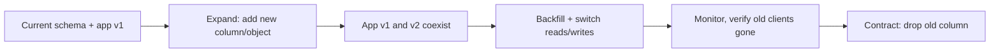

# Naming Conventions and Maintainable Schema Design

A PostgreSQL database can run fine today yet become painful to maintain a few years later: mixed-case quoted table names, ambiguous `id` columns, unnamed foreign keys, every object dumped into `public`, a single column rename breaking multiple deployed app versions, and status values encoded three different ways across three tables.

This is not merely about "pretty naming". **Schema names and structure form the shared interface between data, SQL queries, applications, migrations, reports, integrations, and operators.** When that interface is consistent, newcomers can predict table relationships accurately, SQL reviews move faster, migration tooling works smoothly, and changes cause fewer cascading breakages.

This lesson in the **Schema Design** chapter focuses on two practical questions:

1. **How should we name objects so they are readable, searchable, collision-resistant, and PostgreSQL-friendly?**
2. **How should we design and evolve schemas so data stays accurate as the system scales and multiple teams collaborate?**

We will follow a running e-commerce example to illustrate naming schemas, tables, columns, keys, constraints, indexes, views, and application objects—then cover data types, relationships, permissions, backward-compatible evolution, and a migration review checklist.

The SQL examples target modern PostgreSQL with standard heap tables. Features with specific version requirements are noted. Never run schema-changing snippets directly on a production database without a migration and rollout plan.

## 1. Why Are Naming Conventions Part of Architecture?

Compare two ways of modeling the exact same domain.

**Inconsistent style:**

```sql
-- Example of hard-to-maintain naming only; do not adopt.
CREATE TABLE "Users" (
    "UserID" BIGINT PRIMARY KEY,
    UserName TEXT,
    createDate TIMESTAMP
);

CREATE TABLE order_tbl (
    orderid BIGINT PRIMARY KEY,
    uid BIGINT,
    stat VARCHAR(10)
);
```

Reading this SQL forces developers to ask:

- Must `"Users"` always be wrapped in double quotes?
- Does `uid` reference `"UserID"` or a different concept?
- Which time zone does `createDate` use?
- What values are valid for `stat`?
- Is there an actual foreign key or only an informal assumption in code?
- Why is one table plural, another suffixed with `_tbl`, one column camelCase, and another abbreviated?

**Consistent convention:**

```sql
CREATE SCHEMA IF NOT EXISTS commerce;

CREATE TABLE commerce.customer (
    id BIGINT GENERATED ALWAYS AS IDENTITY,
    full_name TEXT NOT NULL,
    created_at TIMESTAMPTZ NOT NULL DEFAULT now(),
    CONSTRAINT pk_customer PRIMARY KEY (id)
);

CREATE TABLE commerce.sales_order (
    id BIGINT GENERATED ALWAYS AS IDENTITY,
    customer_id BIGINT NOT NULL,
    status TEXT NOT NULL DEFAULT 'NEW',
    placed_at TIMESTAMPTZ NOT NULL DEFAULT now(),
    CONSTRAINT pk_sales_order PRIMARY KEY (id),
    CONSTRAINT fk_sales_order_customer
        FOREIGN KEY (customer_id)
        REFERENCES commerce.customer(id),
    CONSTRAINT ck_sales_order_status
        CHECK (status IN ('NEW', 'PAID', 'CANCELLED'))
);
```

From this structure, a reader can reasonably infer:

- `commerce` is the namespace for the sales domain.
- `customer` and `sales_order` are entity tables, both using singular nouns.
- `id` is the primary key inside each table.
- `customer_id` is a foreign key referencing a customer.
- `created_at` and `placed_at` are instants using `TIMESTAMPTZ`.
- `pk_`, `fk_`, and `ck_` distinguish constraint types.
- Status rules are enforced by PostgreSQL, not merely a Java convention.

Note: this introductory snippet does not yet cover every design choice; later sections build out the fuller schema.

### 1.1. Goals of a Good Convention

| Goal | Check Question |
|---|---|
| **Predictable** | Looking at `customer_id`, can you guess the referenced table accurately? |
| **Searchable** | Searching `fk_sales_order_` finds the order's relationships? |
| **Readable** | Do readers have to decode cryptic abbreviations to understand the SQL? |
| **PostgreSQL-safe** | Does it avoid forcing quotes everywhere or colliding with SQL keywords? |
| **Extensible** | Does adding a new table follow a clear, consistent naming pattern? |
| **Evolvable** | Are migrations, multi-version deployments, and rollbacks accounted for? |
| **Enforces invariants** | Do FKs, unique constraints, checks, and NOT NULL protect data in the DB? |

A convention helps only when applied consistently and briefly documented. It does not need to match every other company's style; what matters is choosing a sensible standard and following it uniformly across the team.

## 2. How Object Naming Works in PostgreSQL

### 2.1. Unquoted Identifiers Fold to Lowercase

PostgreSQL **folds unquoted identifiers to lowercase**:

```sql
-- Both queries reference the same unquoted name:
CREATE TABLE commerce.demo_case (id INTEGER);

SELECT id FROM commerce.DEMO_CASE;
SELECT id FROM commerce.demo_case;
```

In contrast, double-quoted identifiers preserve exact casing:

```sql
CREATE TABLE commerce."DemoCase" (
    "OrderID" INTEGER
);

-- Must match exact case with quotes:
SELECT "OrderID"
FROM commerce."DemoCase";

-- Not equivalent:
-- SELECT orderid FROM commerce.DemoCase;
```

Single quotes `'...'` denote **string literals**; double quotes `"..."` quote **identifiers**. Never mix them up.

For this reason, the recommended convention for application schemas, tables, columns, and indexes is **lowercase, ASCII, `snake_case`, avoiding reserved keywords**. SQL then needs no quotes and stays ergonomic across `psql`, JDBC, migrations, and BI tools.

### 2.2. The 63-Byte Limit, Not 63 Unicode Characters

In default PostgreSQL builds, significant identifier length is capped at **63 bytes** (`NAMEDATALEN - 1`). Longer names get silently truncated at the identifier level, with exact warnings/behavior depending on context.

Example name to avoid:

```text
idx_customer_orders_with_multiple_optional_filters_and_complex_business_status
```

Even if two names differ at the end, truncation can make them collide unexpectedly. With multi-byte Unicode characters, one character takes multiple bytes, so visible character count does not match byte length.

You can check the active limit:

```sql
SHOW max_identifier_length;
```

**Best practice:** keep names concise and descriptive, put the key parts first, and avoid turning full English sentences into identifiers. Table, index, and constraint names should be easy to spot in error logs without hitting truncation.

### 2.3. Names to Avoid

- Names colliding with SQL keywords such as `order` or `user` where quoting becomes necessary; prefer `sales_order`, `app_user_account`, or explicit domain terms.
- Overly generic names: `data`, `object`, `record`, `table1`.
- Cryptic abbreviations: `u`, `st`, `dt`, `x_ref`.
- Names containing spaces, hyphens, special characters, or requiring quotes.
- Temporary technical suffixes that turn into permanent APIs, like `new_orders2` or `temp_customer_final`.
- Schema names starting with `pg_`, which PostgreSQL reserves for internal system catalogs and restricts.

**Conventions cannot fix already-published names simply by issuing a rename.** Live systems require backward-compatible migrations and client audits before renaming.

## 3. Recommended Naming Convention Set

Here is a consistent convention set used throughout this lesson. A team may prefer plural table names or different index prefixes—what matters is **picking one rule and sticking to it**.

| Object | Convention | Example |
|---|---|---|
| Business schema | `lower_snake_case`, domain name | `commerce`, `billing` |
| Entity table | Singular noun | `customer`, `product`, `sales_order` |
| Junction table | Two nouns describing the link | `user_role`, `product_category` |
| Primary key | `id` when a single surrogate key identifies the entity | `customer.id` |
| Foreign key | `<referenced_entity>_id` | `customer_id`, `sales_order_id` |
| Instant timestamp | `..._at` | `created_at`, `paid_at` |
| Calendar date without time | `..._date` or date-clear name | `due_date` |
| Boolean column | Reads as a predicate | `is_active`, `requires_review` |
| Quantity/count column | Explicitly names the quantity | `quantity`, `retry_count` |
| Money column | Amount/price semantics + separate currency code | `unit_price`, `amount`, `currency_code` |
| Primary key constraint | `pk_<table>` | `pk_customer` |
| Foreign key constraint | `fk_<table>_<target>` | `fk_sales_order_customer` |
| Unique constraint | `uq_<table>_<col/meaning>` | `uq_customer_email` |
| Check constraint | `ck_<table>_<rule>` | `ck_order_item_quantity_positive` |
| Standard index | `idx_<table>_<col/meaning>` | `idx_sales_order_customer_placed_at` |
| View | Descriptive result/semantics name | `customer_order_summary` |
| Materialized view | `mv_<meaning>` if prefixing is chosen | `mv_monthly_revenue` |
| Business function | Verb + object/effect | `calculate_order_total` |
| Trigger | `trg_<table>_<event>` | `trg_customer_set_updated_at` |
| Migration file | Version/timestamp + action description | `V014__add_customer_display_name.sql` |

**Prefixes `pk_`, `fk_`, `uq_`, `ck_`, `idx_` are not mandatory PostgreSQL syntax.** They are conventions that make error logs, catalog queries, and schema diffs much easier to read.

### 3.1. Do Not Rename Everything for Personal Preference

If an existing project consistently uses `customers`, `orders`, and `order_items` (plural), that is already a good convention. Switching to `customer`, `sales_order`, and `order_item` merely because one team member prefers singular nouns creates far more risk than value.

The criteria are **consistency, clarity, and maintenance cost**, not "singular is always right" or "plural is always right".

## 4. Schemas Are Namespaces, Not Just Decorative Prefixes

In PostgreSQL, a single database can hold multiple schemas. Schemas group tables, views, sequences, functions, types, and other objects into **namespaces**.

Example:

```sql
CREATE SCHEMA IF NOT EXISTS commerce;
CREATE SCHEMA IF NOT EXISTS billing;
```

Two schemas can hold objects with the same name:

```sql
CREATE TABLE commerce.event_log (
    id BIGINT PRIMARY KEY,
    description TEXT NOT NULL
);

CREATE TABLE billing.event_log (
    id BIGINT PRIMARY KEY,
    description TEXT NOT NULL
);
```

To avoid ambiguity, use schema-qualified names:

```sql
SELECT *
FROM commerce.event_log;

SELECT *
FROM billing.event_log;
```

Qualified names `schema.object` are especially valuable in migrations, DBA scripts, and multi-schema codebases.

### 4.1. search_path Controls Unqualified Name Resolution

```sql
SHOW search_path;

SELECT current_schema();
SELECT current_schemas(true);
```

When you run:

```sql
SELECT * FROM event_log;
```

PostgreSQL resolves the name using `search_path` and system search rules. If multiple schemas define `event_log`, the query may hit a different table than expected.

For critical application domains, two common approaches apply:

1. **Always use qualified names** (`commerce.customer`, `commerce.sales_order`) in SQL and migrations.
2. **Explicitly control `search_path`** per role/session, restricting which schemas are searched.

Never let production queries depend on whatever `search_path` happened to be configured in a developer's terminal.

### 4.2. search_path Is Also a Security Concern

If `search_path` includes a schema where an untrusted role can create objects, unqualified name resolution can redirect privileged code to an unexpected object in certain situations. Therefore:

- Include only trusted schemas in the `search_path` of privileged roles.
- Restrict `CREATE` privileges on application schemas.
- Use schema-qualified names in migrations and sensitive SQL paths.
- Audit grants on `public`, especially on databases upgraded from older PostgreSQL versions.

In newly created databases on PostgreSQL 15+, default object creation privileges in `public` changed relative to older versions; **never assume all existing databases share identical grants**. Inspect actual permissions instead of guessing from schema names.

### 4.3. A Schema Is Not an Independent Database

Schemas `commerce` and `billing` remain objects inside the **same PostgreSQL database**. They can participate in the same transactions and foreign keys where supported; they are not separate servers or completely isolated backup units.

Separating schemas helps organization and permissions, yet **does not automatically isolate workloads, resources, deployments, or tenants**. Stronger isolation boundaries require separate databases/clusters, strict roles, infrastructure isolation, and operational separation.

## 5. Naming Tables: Entities, Relationships, and Events

### 5.1. Table Names Should Name a Business Concept

Example for an e-commerce system:

| Name | Role |
|---|---|
| `customer` | A customer |
| `product` | A product |
| `sales_order` | A sales order |
| `order_item` | A product line item inside an order |
| `payment` | A payment attempt or record |
| `inventory_movement` | An inventory stock change event |
| `shipment` | A shipment |

These names convey domain meaning far better than `customer_tbl`, `order_data`, or `payment_info_table`.

When a word is ambiguous or collides with a keyword, add a qualifier. `sales_order` is clearer than `order` and avoids an SQL keyword that often forces quoting. `inventory_movement` clearly denotes a stock delta event, distinct from `inventory_balance` representing current stock on hand.

### 5.2. Many-to-Many Junction Tables

A product can belong to many categories and a category contains many products:

```sql
CREATE TABLE commerce.product_category (
    product_id BIGINT NOT NULL,
    category_id BIGINT NOT NULL,

    CONSTRAINT pk_product_category
        PRIMARY KEY (product_id, category_id),

    CONSTRAINT fk_product_category_product
        FOREIGN KEY (product_id)
        REFERENCES commerce.product(id),

    CONSTRAINT fk_product_category_category
        FOREIGN KEY (category_id)
        REFERENCES commerce.category(id)
);
```

This snippet **assumes `commerce.product` and `commerce.category` already exist**. The key takeaway is that the table name clearly expresses the association and the composite PK prevents duplicate pairs.

If a junction table gains many attributes and its own lifecycle—such as `assigned_at`, `assigned_by`, or status—it may evolve into a first-class entity with its own surrogate primary key. Base that decision on **data semantics**, not naming habits alone.

### 5.3. Avoid Overly Generic "Catch-All" Tables

A generic `entity` table with `type` and dozens of columns `field1`, `field2`, `extra1` storing unrelated entity types makes it hard to:

- Enforce integrity via `CHECK`, foreign keys, and `NOT NULL`.
- Know which columns apply to which entity type.
- Design effective indexes.
- Write clean reports and migrations.
- Analyze query performance.

Generic/EAV or JSONB designs have valid uses for dynamic schemas, yet should never be chosen **simply to avoid creating properly named tables and columns**.

## 6. Naming Columns: Right Meaning, Right Unit, Right Type

### 6.1. Primary Keys and Foreign Keys

A straightforward convention:

```sql
CREATE TABLE commerce.customer (
    id BIGINT PRIMARY KEY,
    full_name TEXT NOT NULL
);

CREATE TABLE commerce.sales_order (
    id BIGINT PRIMARY KEY,
    customer_id BIGINT NOT NULL,
    CONSTRAINT fk_sales_order_customer
        FOREIGN KEY (customer_id)
        REFERENCES commerce.customer(id)
);
```

Using `id` for each table's primary key pairs cleanly with `customer_id`, `sales_order_id`, or explicit role names in referencing tables.

When a table has **two relationships to the same target table**, never use `customer_id1` and `customer_id2`:

```sql
-- Example columns with distinct roles:
requested_by_customer_id BIGINT,
approved_by_customer_id BIGINT
```

Names should reveal the **role** of each relationship; foreign keys and indexes should mirror those roles.

### 6.2. Instants, Dates, and Durations

| Data | Typical Type | Suggested Name |
|---|---|---|
| Instant an event occurred | `TIMESTAMPTZ` | `created_at`, `paid_at` |
| Calendar date without time | `DATE` | `due_date`, `birth_date` |
| Time of day | `TIME` | `opening_time` |
| Duration | `INTERVAL` or numeric with explicit unit | `retry_delay`, `duration_ms` |

In PostgreSQL, `TIMESTAMPTZ` represents an **absolute point in time**, displayed in the session time zone; it does not preserve the original time zone name entered by the user per value. If the business needs the original or location time zone, store that separately.

**Do not name a `DATE` column `created_at`**, nor name a timestamp column `created_date`. Name and type must agree.

### 6.3. Booleans Should Read Like Predicates

Good names:

```text
is_active
is_verified
requires_review
has_consent
can_receive_email
```

Confusing names:

```text
flag
status_bool
enabled1
value_yes_no
```

For booleans, explicitly document the meaning of `NULL`. For example, nullable `has_consent BOOLEAN` allows three states: `true`, `false`, and `NULL`; if the domain only permits yes/no, enforce `NOT NULL` with an appropriate default.

Never turn a multi-valued mutually exclusive status like `NEW`, `PAID`, `CANCELLED` into three separate booleans `is_new`, `is_paid`, `is_cancelled`. One constrained status column expresses mutual exclusion cleanly.

### 6.4. Consistent Units of Measurement

A `weight` column mixing grams in some rows and kilograms in others causes silent bugs. Pick a clear rule:

```text
weight_grams
length_mm
duration_ms
storage_bytes
amount_minor_units
```

Not every unit must be embedded in the column name if the schema enforces one documented standard unit across the domain. However, **never let the same column name represent two incompatible units**.

### 6.5. Currencies and Precision

For monetary amounts, use `NUMERIC(p,s)` for exact decimal representation paired with an explicit currency code:

```sql
amount NUMERIC(14, 2) NOT NULL,
currency_code VARCHAR(3) NOT NULL
```

Multi-currency tables must define rounding rules, minor-unit policies, and aggregation rules; **never sum USD and VND rows together and label the result a single total**.

`NUMERIC(14,2)` holds two decimal places, which does not suit every currency, asset, or intermediate calculation. Match precision and scale to domain rules. Avoid `DOUBLE PRECISION` for exact financial sums without an explicit design rationale.

PostgreSQL's `money` type brings awkward locale and formatting quirks; `NUMERIC` gives far clearer control over financial rules.

## 7. Data Types Are Part of the Schema Contract

Even a well-named column with the wrong data type makes a schema hard to maintain.

| Need | Common Choice | Note |
|---|---|---|
| Incrementing integer ID | `BIGINT GENERATED ... AS IDENTITY` | Understand sequence behavior and range limits |
| Variable-length text | `TEXT` or `VARCHAR(n)` | Use `VARCHAR(n)` only when length has real domain meaning |
| Point in time | `TIMESTAMPTZ` | Display depends on session time zone |
| Calendar date | `DATE` | No time or time zone |
| Quantity/count | `INTEGER`/`BIGINT` | Add `CHECK` to forbid negatives if required |
| Exact decimal | `NUMERIC(p,s)` | Pick precision/scale per domain bounds |
| Two-state flag | `BOOLEAN NOT NULL` | Default must make sense |
| Distributed ID | `UUID` | Generation strategy owned by app or server |
| Flexible attributes | `JSONB` | Use only when schema flexibility is truly needed and queries/indexes are planned |

For instance, an email column does not blindly have to be `VARCHAR(255)` out of old habit. In PostgreSQL, `TEXT` and unbounded `VARCHAR` have very similar performance characteristics. When business rules require a length bound, enforce a meaningful constraint.

### 7.1. TEXT, VARCHAR, and Column Naming

`TEXT` does not mean "unstructured messy data". `full_name TEXT NOT NULL` is much clearer than `n VARCHAR(100)` when a 100-character limit was never confirmed.

To enforce non-blank text:

```sql
full_name TEXT NOT NULL,
CONSTRAINT ck_customer_full_name_nonempty
    CHECK (length(btrim(full_name)) > 0)
```

This constraint forbids whitespace-only strings under default `btrim` behavior. It does not automatically handle all Unicode whitespace characters or full name normalization rules.

### 7.2. JSONB Does Not Replace Relational Columns for Everything

`JSONB` works well for flexible metadata or category-specific product attributes. Yet if `customer_id`, `order_status`, and `paid_at` are buried inside JSONB while the app frequently joins, constrains, and filters on them, standard relational columns are much better.

Limits of putting everything in JSONB:

- Standard foreign keys cannot reference arbitrary nested JSON fields.
- Per-field constraints are harder to express and enforce.
- Data types and requiredness easily drift across rows.
- Indexing and querying depend on specific operators and document structure.
- Migrations and tests must handle multiple legacy payload shapes.

**Rule of thumb:** promote stable, frequently queried or constrained facts to typed relational columns; keep `JSONB` for genuinely dynamic attributes.

## 8. Primary Keys: Stable Entity Identity

A strong primary key is **unique, non-NULL, and stable** over the entity's lifecycle.

### 8.1. Identity Columns Instead of Manual Sequence Management

PostgreSQL supports SQL-standard identity columns:

```sql
CREATE TABLE commerce.example_identity (
    id BIGINT GENERATED ALWAYS AS IDENTITY,
    description TEXT NOT NULL,
    CONSTRAINT pk_example_identity PRIMARY KEY (id)
);
```

`GENERATED ALWAYS` blocks direct `INSERT` values unless explicit override syntax is used. `GENERATED BY DEFAULT` accepts caller-supplied values easily.

Identity columns rely on sequences. **Sequences do not guarantee gapless IDs**: rollbacks, sequence caching, aborted transactions, or other operations leave gaps. Never use an identity PK as a legally required gapless invoice number when compliance demands gapless sequential numbering.

### 8.2. Natural Keys vs. Surrogate Keys

Consider customers with unique emails in a current model:

- Using `email` as the primary key looks simple.
- Yet emails can change, need normalization, and carry complex rules.
- Using a stable `id` as primary key plus `UNIQUE(email)` for uniqueness minimizes cascading key updates.

A natural key still fits well when truly immutable and uniquely identifying. Just never add surrogate IDs out of habit while forgetting unique constraints on critical business codes.

### 8.3. UUIDs When Decoupling from a Central Sequence

`UUID` suits distributed generation, multi-source imports, or client-side ID assignment. Account for index size, insert locality, UUID generation version, ID exposure, and human debugging readability.

Never pick UUID solely thinking "hard-to-guess IDs make data secure": authorization checks on every request and query remain mandatory.

## 9. Data Constraints: Good Names Must Pair with Right Rules

Constraints let PostgreSQL enforce invariants that should never rely solely on application code.

### 9.1. Essential Constraint Types

| Type | Purpose | Suggested Name |
|---|---|---|
| `PRIMARY KEY` | Unique, non-NULL key | `pk_customer` |
| `FOREIGN KEY` | Referential link to valid target key | `fk_sales_order_customer` |
| `UNIQUE` | Uniqueness per comparison/null rules | `uq_product_sku` |
| `CHECK` | Row-level boolean expression | `ck_order_item_quantity_positive` |
| `NOT NULL` | Forbids NULL in column | Does not require assuming explicit table-style constraint names everywhere |

Example:

```sql
CONSTRAINT pk_product PRIMARY KEY (id),
CONSTRAINT uq_product_sku UNIQUE (sku),
CONSTRAINT ck_product_price_nonnegative CHECK (unit_price >= 0)
```

For `FOREIGN KEY` constraints, include both source table and target table/role so error messages are immediately recognizable.

### 9.2. CHECK and NULL: A Classic Trap

In SQL, a `CHECK` constraint passes whenever the expression evaluates to **true or unknown (NULL)**; only `false` fails.

Example:

```sql
quantity INTEGER,
CONSTRAINT ck_quantity_positive CHECK (quantity > 0)
```

That column still accepts `NULL`. To require a positive non-null integer:

```sql
quantity INTEGER NOT NULL,
CONSTRAINT ck_quantity_positive CHECK (quantity > 0)
```

Never rely on `CHECK (quantity > 0)` as a substitute for `NOT NULL`.

### 9.3. UNIQUE and NULL

In PostgreSQL, a standard unique constraint **allows multiple NULL rows** in a nullable column because `NULL`s are not treated as equal by default.

```sql
CREATE TABLE commerce.external_reference (
    id BIGINT GENERATED ALWAYS AS IDENTITY PRIMARY KEY,
    external_code TEXT UNIQUE
);
```

Multiple rows with `external_code IS NULL` are allowed. If business rules treat multiple `NULL`s as duplicates, PostgreSQL 15+ supports `UNIQUE NULLS NOT DISTINCT`.

Never add `NOT NULL` just to "fix uniqueness" when the business genuinely allows an optional external code. Clarify what may be absent and when.

### 9.4. Foreign Keys Do Not Automatically Index the Referencing Side

PostgreSQL creates backing indexes for primary key and unique constraints, yet **does not automatically create indexes on foreign key columns in child tables**.

Example:

```sql
CREATE INDEX idx_sales_order_customer_id
ON commerce.sales_order(customer_id);
```

An index on `sales_order.customer_id` is often beneficial for:

- Finding all orders of a customer.
- Joining from `customer` to `sales_order`.
- Checking child rows when updating/deleting parent rows on large tables.

Not every foreign key needs its own standalone single-column index. If a composite index already leads with `customer_id`, it may already serve those lookups. Evaluate query patterns, selectivity, write cost, and table size before adding redundant indexes.

## 10. A Complete Practice Sales Schema

This section brings the conventions together into runnable DDL for a test database. Use a **fresh schema** to avoid colliding with earlier short snippets; if `commerce` already holds tables from earlier exercises, run this on a clean database or rename the lab schema.

### 10.1. Create the Namespace

```sql
CREATE SCHEMA IF NOT EXISTS commerce;
```

Throughout this lab, all table references qualify with `commerce` to avoid `search_path` ambiguity.

### 10.2. Customer Table

```sql
CREATE TABLE commerce.customer (
    id BIGINT GENERATED ALWAYS AS IDENTITY,
    full_name TEXT NOT NULL,
    email TEXT NOT NULL,
    is_active BOOLEAN NOT NULL DEFAULT TRUE,
    created_at TIMESTAMPTZ NOT NULL DEFAULT now(),

    CONSTRAINT pk_customer PRIMARY KEY (id),
    CONSTRAINT uq_customer_email UNIQUE (email),
    CONSTRAINT ck_customer_full_name_nonempty
        CHECK (length(btrim(full_name)) > 0),
    CONSTRAINT ck_customer_email_nonempty
        CHECK (length(btrim(email)) > 0)
);
```

Notes:

- `id` is the internal surrogate identity; `email` carries its own uniqueness rule.
- `full_name` cannot be blank whitespace.
- `is_active` is a clear non-null boolean with no hidden `NULL` state.
- `created_at` is an instant, not a calendar date.
- Explicit constraint names make error logs and catalog inspection easy.

**Email case sensitivity:** `UNIQUE(email)` under standard column collation does not automatically treat `"abc@example.test"` and `"ABC@example.test"` as identical. If case-insensitive matching is required, choose an explicit normalization/collation policy or expression index and test against real data; never assume plain `lower()` covers all Unicode/email conventions.

### 10.3. Product Table

```sql
CREATE TABLE commerce.product (
    id BIGINT GENERATED ALWAYS AS IDENTITY,
    sku TEXT NOT NULL,
    product_name TEXT NOT NULL,
    unit_price NUMERIC(14, 2) NOT NULL,
    is_active BOOLEAN NOT NULL DEFAULT TRUE,
    created_at TIMESTAMPTZ NOT NULL DEFAULT now(),

    CONSTRAINT pk_product PRIMARY KEY (id),
    CONSTRAINT uq_product_sku UNIQUE (sku),
    CONSTRAINT ck_product_sku_nonempty
        CHECK (length(btrim(sku)) > 0),
    CONSTRAINT ck_product_name_nonempty
        CHECK (length(btrim(product_name)) > 0),
    CONSTRAINT ck_product_unit_price_nonnegative
        CHECK (unit_price >= 0)
);
```

`sku` is a clearly named business code. The current price in `product.unit_price` can change over time; **sold prices** must be captured on order lines rather than read from `product` during historical reporting.

### 10.4. Sales Order Table

```sql
CREATE TABLE commerce.sales_order (
    id BIGINT GENERATED ALWAYS AS IDENTITY,
    customer_id BIGINT NOT NULL,
    status TEXT NOT NULL DEFAULT 'NEW',
    currency_code VARCHAR(3) NOT NULL,
    placed_at TIMESTAMPTZ NOT NULL DEFAULT now(),
    paid_at TIMESTAMPTZ,

    CONSTRAINT pk_sales_order PRIMARY KEY (id),
    CONSTRAINT fk_sales_order_customer
        FOREIGN KEY (customer_id)
        REFERENCES commerce.customer(id)
        ON DELETE RESTRICT,
    CONSTRAINT ck_sales_order_status
        CHECK (status IN ('NEW', 'PAID', 'CANCELLED')),
    CONSTRAINT ck_sales_order_currency_code
        CHECK (currency_code ~ '^[A-Z]{3}$'),
    CONSTRAINT ck_sales_order_paid_after_placed
        CHECK (paid_at IS NULL OR paid_at >= placed_at)
);
```

Design notes:

- `sales_order` avoids keyword collisions.
- `customer_id` has an enforced foreign key.
- `currency_code` checks three uppercase ASCII letters; note this **only validates format**, not membership in an official currency list.
- `paid_at` is nullable because unpaid orders have no payment timestamp yet.
- The timestamp ordering check is a simple invariant; exact coupling between `status` and `paid_at` depends on domain rules (e.g., avoid over-constraining legacy imports or alternative payment states without checking).

Choosing `ON DELETE RESTRICT` is intentional: deleting a customer must not erase historical orders. Personal-data erasure requests need a dedicated policy-driven anonymization strategy rather than cascading deletes across transactions.

### 10.5. Order Item Table

```sql
CREATE TABLE commerce.order_item (
    id BIGINT GENERATED ALWAYS AS IDENTITY,
    sales_order_id BIGINT NOT NULL,
    product_id BIGINT NOT NULL,
    quantity INTEGER NOT NULL,
    unit_price NUMERIC(14, 2) NOT NULL,

    CONSTRAINT pk_order_item PRIMARY KEY (id),
    CONSTRAINT fk_order_item_sales_order
        FOREIGN KEY (sales_order_id)
        REFERENCES commerce.sales_order(id)
        ON DELETE RESTRICT,
    CONSTRAINT fk_order_item_product
        FOREIGN KEY (product_id)
        REFERENCES commerce.product(id)
        ON DELETE RESTRICT,
    CONSTRAINT ck_order_item_quantity_positive
        CHECK (quantity > 0),
    CONSTRAINT ck_order_item_unit_price_nonnegative
        CHECK (unit_price >= 0)
);
```

`order_item.unit_price` records the price at sale time, distinct from `product.unit_price` which holds the current list price. Reusing `unit_price` in two tables is valid when each table's context is clear; model docs must explicitly explain **effective timing** to prevent confusion.

Avoid adding `UNIQUE(sales_order_id, product_id)` unless confirmed by business rules: one product may appear on multiple lines due to promotions, shipment lots, custom configurations, or split pricing. Constraints should reflect confirmed rules only.

### 10.6. Payment Table

```sql
CREATE TABLE commerce.payment (
    id BIGINT GENERATED ALWAYS AS IDENTITY,
    sales_order_id BIGINT NOT NULL,
    provider_reference TEXT,
    amount NUMERIC(14, 2) NOT NULL,
    status TEXT NOT NULL DEFAULT 'PENDING',
    created_at TIMESTAMPTZ NOT NULL DEFAULT now(),
    settled_at TIMESTAMPTZ,

    CONSTRAINT pk_payment PRIMARY KEY (id),
    CONSTRAINT fk_payment_sales_order
        FOREIGN KEY (sales_order_id)
        REFERENCES commerce.sales_order(id)
        ON DELETE RESTRICT,
    CONSTRAINT uq_payment_provider_reference
        UNIQUE (provider_reference),
    CONSTRAINT ck_payment_amount_positive
        CHECK (amount > 0),
    CONSTRAINT ck_payment_status
        CHECK (status IN ('PENDING', 'SUCCEEDED', 'FAILED'))
);
```

Here `provider_reference` can be `NULL` before the gateway responds; standard `UNIQUE` allows multiple `NULL`s. If external references are unique only **per payment provider**, add `provider_code` and use a composite unique `(provider_code, provider_reference)` rather than assuming global uniqueness.

An order can have multiple payment attempts. The `sales_order` → `payment` relationship is one-to-many; do not place `UNIQUE` on `payment.sales_order_id` merely assuming an order is paid only once.

### 10.7. Workload-Driven Indexes

```sql
CREATE INDEX idx_sales_order_customer_placed_at
ON commerce.sales_order (customer_id, placed_at DESC);

CREATE INDEX idx_sales_order_status_placed_at
ON commerce.sales_order (status, placed_at DESC);

CREATE INDEX idx_order_item_sales_order_id
ON commerce.order_item (sales_order_id);

CREATE INDEX idx_order_item_product_id
ON commerce.order_item (product_id);

CREATE INDEX idx_payment_sales_order_id
ON commerce.payment (sales_order_id);
```

The `(customer_id, placed_at DESC)` index supports queries like:

```sql
SELECT id, status, placed_at
FROM commerce.sales_order
WHERE customer_id = 42
ORDER BY placed_at DESC
LIMIT 20;
```

This is a **query-driven index**, not blindly indexing every column. In practice, the planner chooses between index scans and sequential scans based on table size, value distribution, and cost estimates. Never treat `CREATE INDEX` as a magic guarantee that every query runs fast.

## 11. Verifying Consistency of the Sample DDL

Insert practice data on a clean database:

```sql
INSERT INTO commerce.customer (full_name, email)
VALUES ('Lan', 'lan@example.test')
RETURNING id;

INSERT INTO commerce.product (sku, product_name, unit_price)
VALUES
    ('BOOK-001', 'PostgreSQL Book', 150000.00),
    ('PEN-001', 'Pen', 10000.00)
RETURNING id, sku;
```

Assuming the first generated IDs are 1 and 2 in a fresh lab database:

```sql
BEGIN;

INSERT INTO commerce.sales_order (customer_id, currency_code)
VALUES (1, 'VND')
RETURNING id;

-- Assume the new sales_order.id is 1.
INSERT INTO commerce.order_item
    (sales_order_id, product_id, quantity, unit_price)
VALUES
    (1, 1, 1, 150000.00),
    (1, 2, 2, 10000.00);

COMMIT;
```

**Execution note:** hardcoded IDs `1` and `2` only hold on fresh tables/sequences with no prior inserts. In real application code, capture IDs from `RETURNING` and pass them into subsequent statements—never hardcode predicted sequence numbers.

Compute order totals from line items:

```sql
SELECT
    sales_order_id,
    SUM(quantity * unit_price) AS order_amount
FROM commerce.order_item
GROUP BY sales_order_id
ORDER BY sales_order_id;
```

One benefit of this design is avoiding storing a duplicate total on `sales_order` when caching/denormalization is unnecessary. If performance later justifies storing `sales_order.total_amount`, explicitly define who maintains it, which transaction updates it, how line edits propagate, and how drift is reconciled.

### 11.1. Meaningful Constraint Failures

Test in the lab environment:

```sql
-- Invalid because quantity must be positive:
INSERT INTO commerce.order_item
    (sales_order_id, product_id, quantity, unit_price)
VALUES (1, 1, 0, 150000.00);

-- Invalid because status is outside the allowed set:
INSERT INTO commerce.sales_order
    (customer_id, status, currency_code)
VALUES (1, 'UNKNOWN', 'VND');

-- Invalid because customer does not exist:
INSERT INTO commerce.sales_order
    (customer_id, status, currency_code)
VALUES (999999, 'NEW', 'VND');
```

These statements demonstrate constraint errors—**do not run them together inside a single transaction expecting later statements to proceed without savepoints/rollback**. Once an error puts a PostgreSQL transaction into an aborted state, handle the transaction before executing further commands.

Explicit names such as `ck_order_item_quantity_positive` and `fk_sales_order_customer` pinpoint failures far faster than cryptic auto-generated names.

## 12. Index Naming: Tied to Table and Query Pattern

Indexes are not free—they consume storage and add overhead on every write. Index names should clearly indicate **which table an index belongs to and what predicate/order it serves**.

### 12.1. Naming by Columns or Role

```sql
CREATE INDEX idx_sales_order_customer_placed_at
ON commerce.sales_order (customer_id, placed_at DESC);
```

The name identifies the table and leading columns. The full DDL still defines details not obvious from the name alone, such as:

- `ASC`/`DESC` sort direction.
- Operator classes and collations.
- Expression definitions or partial `WHERE` predicates.
- `INCLUDE` columns.
- Index access method (B-tree, GIN, GiST, BRIN, etc.).

Never cram the entire SQL index definition into an identifier exceeding 63 bytes. Concise purpose-based names work well:

```text
idx_sales_order_recent_open
idx_customer_email_normalized
idx_product_attributes_gin
```

paired with the full DDL stored in versioned migrations.

### 12.2. Unique Constraints vs. Unique Indexes

A `UNIQUE` constraint in PostgreSQL is backed by a unique index. Use constraints to express **data rules**, not merely as a speed trick.

```sql
ALTER TABLE commerce.product
ADD CONSTRAINT uq_product_sku_alias UNIQUE (sku);
```

This is solely a syntax example. Since `commerce.product` already has `uq_product_sku`, **do not execute a duplicate unique constraint**; redundant unique indexes waste maintenance overhead.

For partial uniqueness or expression-based uniqueness, PostgreSQL typically uses `CREATE UNIQUE INDEX`:

```sql
-- Illustrative example; audit existing duplicates before creating.
CREATE UNIQUE INDEX uq_customer_email_lower
ON commerce.customer (lower(email));
```

This index enforces a different comparison rule over existing data. If rows already exist differing only by case, index creation fails; clean data and define normalization policies first. Once a unique expression index is in place, avoid keeping redundant duplicate constraints unless they enforce a distinct rule.

### 12.3. Partial Indexes

An index covering only open orders:

```sql
CREATE INDEX idx_sales_order_new_placed_at
ON commerce.sales_order (placed_at DESC)
WHERE status = 'NEW';
```

This helps queries that consistently filter on `status = 'NEW'`. Remember the planner uses a partial index only when it can prove the query predicate implies the index predicate; parameterized queries or equivalent business conditions do not always match automatically.

**Partial index names should reflect their key filter**, while reviewers still inspect the exact `WHERE` predicate in DDL.

### 12.4. Indexes and Constraints Share Namespaces Carefully

In PostgreSQL, indexes are relations sharing the schema relation namespace. Therefore **two indexes or tables in the same schema cannot share the same name**, even when attached to different tables.

Constraint types have specific uniqueness rules by scope and object; to keep tooling and operations clean, name constraints distinctively using **source table + purpose** rather than relying on cross-table name reuse.

## 13. Views and Materialized Views: Names Must Reflect Output Semantics

A view acts as an SQL interface hiding underlying join/table structure:

```sql
CREATE VIEW commerce.customer_order_summary AS
SELECT
    c.id AS customer_id,
    c.full_name,
    COUNT(o.id) AS order_count
FROM commerce.customer AS c
LEFT JOIN commerce.sales_order AS o
    ON o.customer_id = c.id
GROUP BY c.id, c.full_name;
```

The name `customer_order_summary` signals a **customer-grain** result set. The column `order_count` names the exact metric rather than using a vague `total`.

Views can stabilize a read API while underlying tables evolve, yet **they do not guarantee automatic immunity to every schema change**. Column/type dependencies, permissions, and deployment ordering must still be verified in migrations.

### 13.1. Materialized Views Need Freshness Semantics

```sql
CREATE MATERIALIZED VIEW commerce.mv_daily_order_count AS
SELECT
    placed_at::date AS order_date,
    COUNT(*) AS order_count
FROM commerce.sales_order
GROUP BY placed_at::date;
```

When base data changes, a materialized view does not auto-update per row like a regular view; you need an appropriate `REFRESH MATERIALIZED VIEW` process.

Also note that `placed_at::date` casts `TIMESTAMPTZ` to `DATE` using the active session time zone. For business-day reporting, specify an explicit time zone so counts do not shift across environments.

Whenever a report uses a materialized view, document **refresh schedule, acceptable staleness, and ownership**—not just an `mv_` prefix.

## 14. Functions, Procedures, Triggers, and Sequences Need Clear Roles

### 14.1. Name Functions After Actions or Computations

Clear names:

```text
commerce.calculate_order_total(...)
commerce.normalize_sku(...)
commerce.is_customer_eligible(...)
```

Unclear names:

```text
commerce.fn1(...)
commerce.do_stuff(...)
commerce.helper(...)
```

You do not need `fn_` on every function if the schema namespace and verb-noun name are already clear. If the team uses `fn_` to distinguish catalog entries, apply it consistently.

In PostgreSQL, functions can be overloaded by parameter types; two functions with the same name and different signatures can coexist in one schema. When reviewing or renaming, always check the full **signature**, not just the name.

### 14.2. Triggers: Identify Table and Event

Example naming:

```text
trg_customer_set_updated_at
trg_sales_order_audit_changes
trg_payment_validate_transition
```

The trigger function and the trigger object are separate objects. If your convention covers both, you can pair:

```text
commerce.set_updated_at()
trg_customer_set_updated_at
```

Avoid hiding complex business workflows inside triggers when an explicit service/transaction function is easier to maintain. Triggers fit intentional data-level invariants or plumbing, yet can create surprising side effects for callers issuing direct SQL.

### 14.3. Sequences: Avoid Hardcoding Tool-Generated Names

Identity columns are backed by PostgreSQL sequences. A sequence gets a name derived from the table/column at creation time, yet applications should avoid constructing sequence names manually to call them unnecessarily.

Instead of predicting the next ID:

```sql
SELECT nextval('commerce.customer_id_seq');
```

let `INSERT` invoke the identity generator and return the result:

```sql
INSERT INTO commerce.customer (full_name, email)
VALUES ('Minh', 'minh@example.test')
RETURNING id;
```

The `nextval` snippet above is just an example name that **may not match your actual generated sequence name**; capturing IDs via `RETURNING` avoids coupling to internal object names and prevents wasted sequence gaps.

## 15. Organizing Schemas by Domain Without Over-Fragmenting

A clean multi-schema layout might look like:

```text
Database: shopdb

Schemas:
  commerce
    customer
    product
    sales_order
    order_item
    payment

  billing
    invoice
    invoice_line
    tax_rule

  reporting
    customer_order_summary
    mv_daily_order_count

  integration
    partner_import_batch
    external_mapping
```

This is only a sample blueprint. A small service may need only `public` or a single application schema. Creating 20 schemas for 10 tables does not yield better architecture—it adds friction to permissions, migrations, and qualified names.

Criteria for splitting schemas:

- Distinct ownership and object lifecycles.
- Clear functional domain boundaries.
- Separate access control requirements.
- Different change frequencies and deployment cadences.
- Preventing name collisions across independent domains.

Never use schemas to simulate microservice boundaries without clear rules on cross-schema access, transactions, migrations, and data ownership.

### 15.1. Ownership and Maintenance Roles

Use a dedicated migration role as object owner while granting application roles only minimum needed rights:

```sql
-- Illustrative example; DBA must create roles and schemas beforehand.
GRANT USAGE ON SCHEMA commerce TO app_reader;

GRANT SELECT ON ALL TABLES IN SCHEMA commerce
TO app_reader;
```

`USAGE ON SCHEMA` allows resolving object names within the schema subject to object grants—it does not grant `SELECT` on all tables by itself. `CREATE ON SCHEMA` is separate from `USAGE`.

To grant permissions on **future tables**, configure `ALTER DEFAULT PRIVILEGES` for the exact table-creating role and schema; `GRANT ... ON ALL TABLES` applies only to tables existing at execution time.

These are real privilege statements. **Never apply template grants to production** without auditing roles, least privilege, read/write paths, and audit policies.

### 15.2. Schemas Do Not Prevent SQL Injection

Even inside a `commerce` schema, string-concatenated SQL remains vulnerable to injection without proper parameter binding.

```java
// Illustrative principle, not a complete JDBC program:
PreparedStatement statement = connection.prepareStatement(
    "SELECT id, full_name FROM commerce.customer WHERE email = ?"
);
statement.setString(1, emailFromRequest);
```

Bind data values with parameters; table, column, and schema names **cannot be bound as values via `?`** in standard SQL. If dynamic identifiers are required, allowlist and quote identifiers safely via driver/library APIs—never concatenate raw user input.

## 16. Designing Relationships to Prevent Data Skew

### 16.1. Every Table Should Have One Clear Grain

**Grain** answers: "what does a single row represent?"

| Table | Grain |
|---|---|
| `customer` | One customer |
| `sales_order` | One sales order |
| `order_item` | One product line item in an order |
| `payment` | One payment attempt or payment record |
| `inventory_movement` | One inventory change event |

Check grain before writing aggregations. For example:

```sql
SELECT
    o.id AS sales_order_id,
    SUM(oi.quantity * oi.unit_price) AS items_amount
FROM commerce.sales_order AS o
JOIN commerce.order_item AS oi
    ON oi.sales_order_id = o.id
GROUP BY o.id;
```

If you also join multiple `payment` rows for that order and still run `SUM(oi.quantity * oi.unit_price)`, amounts get **multiplied**. That is a grain bug, not an index or PostgreSQL arithmetic issue.

### 16.2. Normalization and Duplicate Data

Normalization principles prevent storing the same fact in multiple places without synchronization rules.

Clean example:

- `customer.full_name` holds the customer's current name.
- `sales_order.customer_id` references the customer.
- `order_item.unit_price` holds the price at sale time.
- `product.unit_price` holds the current list price.

Storing `order_item.unit_price` is not bad duplication: it is a **historical price snapshot** with different temporal semantics from current catalog price. Document its meaning, source, and immutability rules clearly.

Conversely, storing both `sales_order.customer_email` and `customer.email` without clarifying whether it is "email at checkout" or "current email" causes confusion. If a historical snapshot is intended, name it `contact_email_snapshot` or document its semantics explicitly.

### 16.3. Constraints Must Reflect Real Rules, Not Guesses

Examples:

- `quantity > 0`: normally valid for purchased line items.
- `product.unit_price >= 0`: normally valid for list prices.
- `payment.amount > 0`: suits a positive payment record; **refunds** may belong in a separate table/event rather than negative payment amounts if the domain separates refunds.
- `paid_at >= placed_at`: useful, though verify legacy imported data and intentional exceptions.
- `status IN (...)`: fits small, stable status sets; complex state machines require explicit transition enforcement at the appropriate tier.

**The most maintainable schema is not the one with the most constraints**, but the one whose constraints accurately reflect agreed invariants and evolve cleanly via migrations.

## 17. Choosing How to Model Statuses

A status column can be modeled via `TEXT + CHECK`, a PostgreSQL `ENUM`, or a lookup table.

### 17.1. TEXT + CHECK

```sql
status TEXT NOT NULL,
CONSTRAINT ck_sales_order_status
CHECK (status IN ('NEW', 'PAID', 'CANCELLED'))
```

Pros: simple, readable, constrained at the DB tier. Cons: adding statuses requires altering the constraint/schema, and multiple tables must coordinate separately.

### 17.2. PostgreSQL ENUM

```sql
CREATE TYPE commerce.order_status AS ENUM (
    'NEW', 'PAID', 'CANCELLED'
);
```

Then use that type on columns. Enums help when statuses are well-defined and shared as one type, yet lifecycle updates (renaming/removing values across rolling app deployments) carry specific quirks. Do not create enums for every string merely for "type safety" if values change frequently.

### 17.3. Lookup Table

```sql
CREATE TABLE commerce.order_status_catalog (
    code TEXT PRIMARY KEY,
    description TEXT NOT NULL,
    is_active BOOLEAN NOT NULL DEFAULT TRUE
);
```

Reference `code` with a foreign key when statuses are managed as data, carry metadata, or need new values added without altering DDL types.

Decide based on:

- How often values change.
- Whether values need metadata, descriptions, or per-value rules.
- Whether multiple apps and code versions share the data.
- Where state transitions are enforced.

**A `status` column name alone is not enough**; document allowed values, lifecycles, and valid state transitions.

## 18. Designing for Change: Treat the Database Schema as a Versioned API

Once a schema is consumed by services, BI tools, and integrations, renaming a table or column resembles breaking a public API.

Suppose an older app version runs:

```sql
SELECT id, full_name
FROM commerce.customer
WHERE id = $1;
```

If a migration renames `full_name` to `display_name` while older app instances are still live during a rolling deploy, old instances crash with `column does not exist`.

PostgreSQL updates certain **in-database** dependencies on rename, yet **SQL embedded in Java services, BI scripts, external pipelines, ORM mappings, and third-party clients is not updated automatically**.

Therefore, plan for **compatibility across overlapping application and schema versions**.

### 18.1. The Expand → Migrate → Contract Pattern

Backward-compatible changes typically follow three stages:

1. **Expand:** add new structures without breaking old clients.
2. **Migrate:** update code and backfill data so old and new paths coexist safely during transition.
3. **Contract:** once zero old clients remain, drop legacy objects/logic in a separate migration.



This is a **strategy**, not a rigid ritual for every tiny change. Adding an index that does not alter SQL contracts rarely needs all three phases.

## 19. Example of a Safer Column Rename Migration

Suppose we want to move from `full_name` to `display_name`. Instead of renaming immediately, start with:

```sql
ALTER TABLE commerce.customer
ADD COLUMN display_name TEXT;
```

Next, roll out application changes in phases: new versions may dual-write both columns during transition or rely on controlled synchronization, avoiding independent uncoordinated updates to both columns.

Backfill in test data:

```sql
UPDATE commerce.customer
SET display_name = full_name
WHERE display_name IS NULL;
```

On tables with tens of millions of rows, **never run one giant monolithic `UPDATE`**: it generates massive WAL, holds locks, bloats dead tuples, and spikes replication lag. Batch updates, throttle rate, track progress, and ensure safe idempotent reruns.

Once all code reads/writes `display_name`, data is reconciled, and dependent objects are updated, schedule `NOT NULL` and column removal in later migrations:

```sql
-- Later phase example, only after zero NULLs remain:
ALTER TABLE commerce.customer
ALTER COLUMN display_name SET NOT NULL;
```

`SET NOT NULL` may perform table scans and acquire locks depending on constraints, PostgreSQL version, and table size. Assess impact before running on large tables.

Finally, in a subsequent release once zero dependencies remain:

```sql
ALTER TABLE commerce.customer
DROP COLUMN full_name;
```

**Do not execute all these steps back-to-back during a multi-version rollout.** They are separate migration milestones separated by code deploys, verification, and soak time.

### 19.1. Is a Direct Rename Ever Appropriate?

```sql
ALTER TABLE commerce.customer
RENAME COLUMN full_name TO display_name;
```

Short and clean in tightly controlled environments with no old clients and coordinated downtime. On live multi-consumer systems, it easily breaks compatibility.

Similarly:

```sql
ALTER TABLE commerce.sales_order
RENAME TO customer_order;
```

PostgreSQL tracks internal dependencies, yet **index and constraint names created under the old name do not automatically rename to match the new convention**. When renaming tables, review naming conventions, docs, and direct SQL consumers.

## 20. Migrations Need Versioning, Ownership, and Verification

Managing DDL via versioned migrations committed alongside application code prevents "staging schema drifted from production and nobody knows why".

Example directory layout:

```text
db/
  migrations/
    V001__create_commerce_schema.sql
    V002__create_customer_and_product.sql
    V003__create_sales_order_and_order_item.sql
    V004__create_payment.sql
    V005__add_sales_order_query_indexes.sql
    V006__add_customer_display_name.sql
```

This illustrates one migration naming convention; exact syntax varies across Flyway, Liquibase, and custom tooling.

Principles:

- Each migration has one clear scope, small enough to review carefully.
- Never edit a migration already applied across environments if checksum/version tracking requires immutability.
- Review both schema diffs and data/locking impact before deploying.
- Have a recovery plan for mid-flight migration failures.
- Never create ad-hoc columns/tables directly in production without capturing them in source control.
- Check privileges, downtime, locks, WAL, replication lag, and backfill duration.
- Keep migration state aligned with application rollout versions.

### 20.1. PostgreSQL DDL Is Mostly Transactional, with Key Exceptions

Many `CREATE TABLE`, `ALTER TABLE`, and `DROP TABLE` statements run safely inside PostgreSQL transactions:

```sql
BEGIN;

ALTER TABLE commerce.customer
ADD COLUMN internal_note TEXT;

COMMIT;
```

However, some statements follow special rules; notably, **`CREATE INDEX CONCURRENTLY` cannot run inside an explicit transaction block**:

```sql
CREATE INDEX CONCURRENTLY idx_sales_order_new_placed_at_v2
ON commerce.sales_order (placed_at DESC)
WHERE status = 'NEW';
```

This reduces write blocking under suitable conditions, yet takes longer, runs in multiple phases, consumes I/O, and can leave behind an `INVALID` index if it fails. Configure your migration tool explicitly for non-transactional steps.

Also avoid wrapping huge multi-step DDL batches in one giant long-running transaction just because PostgreSQL allows transactional DDL—holding metadata locks for long blocks live traffic.

### 20.2. Do Not Use IF NOT EXISTS to Mask Schema Drift

```sql
CREATE TABLE IF NOT EXISTS commerce.customer (
    id BIGINT PRIMARY KEY
);
```

If `commerce.customer` already exists with a **different** structure, this statement silently skips creation without verifying whether required columns or constraints match what code expects.

`IF NOT EXISTS` is handy for intentional idempotent bootstrap scripts, not a substitute for versioned migrations and schema verification. **A migration succeeding syntactically does not guarantee the database matches the intended design.**

## 21. Modifying Constraints on Large Tables

Adding a `CHECK` or foreign key constraint to a large existing table requires accounting for validating existing rows.

### 21.1. CHECK NOT VALID Followed by VALIDATE CONSTRAINT

Suppose you want to forbid negative prices on a table lacking that rule:

```sql
ALTER TABLE commerce.product
ADD CONSTRAINT ck_product_unit_price_nonnegative_v2
CHECK (unit_price >= 0) NOT VALID;
```

Audit and clean up legacy bad rows, then run:

```sql
ALTER TABLE commerce.product
VALIDATE CONSTRAINT ck_product_unit_price_nonnegative_v2;
```

**This is purely an operational example—`commerce.product` already has an equivalent constraint from earlier.** Do not add a duplicate constraint to the lab schema unnecessarily.

How it works:

- `NOT VALID` skips scanning existing rows when adding the constraint while still enforcing it on subsequent writes.
- `VALIDATE CONSTRAINT` scans existing rows afterward to verify compliance across the whole table.
- Both steps still take specific locks and resources per PostgreSQL rules; plan around table size and workload.

This enables **safer evolution**, not "zero-lock" magic.

### 21.2. Foreign Keys and Existing Data

When adding a foreign key to a huge table, consider `NOT VALID` followed by `VALIDATE CONSTRAINT` where supported. Beforehand, audit orphaned rows, cleanup rules, and error handling.

Never add a constraint and then blindly delete it the moment an error appears. Orphaned rows often reveal historical data bugs or unaligned business invariants that must be resolved.

## 22. Changes Carrying Breaking-Change Risk

| Change | Risk | Approach |
|---|---|---|
| Rename column/table | Old SQL/ORM/BI fails to find object | Expand–migrate–contract or coordinated rollout |
| Drop column | Clients still read/write it | Audit dependencies and usage first |
| Add `NOT NULL` | Legacy rows or old clients insert NULL | Backfill, update code, validate first |
| Add `UNIQUE` | Existing rows contain duplicates | Audit duplicates and resolve per business rules |
| Change column type | Cast errors, locks, table/index rewrite | Check compatibility and plan downtime/expand-contract |
| Change status set | Old apps crash on unknown values | Versioned contracts and unknown-state handling |
| Create index on large table | I/O, WAL, locks, replication lag | Consider `CONCURRENTLY` and rollout plan |
| Change `search_path` | Queries resolve to wrong objects | Use schema-qualified names and test |
| Change permissions | Apps lose access or gain excessive access | Test with exact runtime roles and least privilege |
| Move schema | Qualified names, grants, `search_path` shift | Audit all clients/consumers and grants |

### 22.1. Read Compatibility and Write Compatibility Are Different

An older app version may still **read** the new schema cleanly while failing to **write** because a newly added `NOT NULL` column has no default. Conversely, a new app writing a new enum/status value can break an older app when reading.

Therefore, migration reviews must check:

- `SELECT` queries of the older app version.
- `INSERT`/`UPDATE` statements of the older app version.
- Serialization/deserialization of types and statuses.
- Background jobs, ETLs, reports, replicas/subscribers, triggers/functions.
- Code rollback procedures once schema changes have moved forward.

## 23. Naming Conventions for Historical Data and Statuses

A common maintenance headache is having similar-looking columns without knowing **which point in time** they represent:

```text
customer.email
sales_order.contact_email
payment.status
sales_order.status
product.unit_price
order_item.unit_price
```

These pairs can be completely valid when defined explicitly:

- `customer.email`: current email in the customer profile.
- `sales_order.contact_email_snapshot`: email used at order placement.
- `payment.status`: status of the payment attempt, not the order lifecycle.
- `sales_order.status`: order lifecycle status.
- `product.unit_price`: current list price.
- `order_item.unit_price`: locked-in unit price at sale time.

When similar names carry very different semantics, add descriptive suffixes or document them in a data dictionary.

### 23.1. Minimal Data Dictionary

A design table can record:

| Column | Type | Nullable | Meaning | Source / Rule |
|---|---|---|---|---|
| `sales_order.status` | `TEXT` | No | Order status | `CHECK`; transitions managed by service |
| `sales_order.placed_at` | `TIMESTAMPTZ` | No | Order placement instant | Default at creation |
| `sales_order.paid_at` | `TIMESTAMPTZ` | Yes | Recorded payment instant | `NULL` until paid |
| `order_item.unit_price` | `NUMERIC(14,2)` | No | Unit price at sale time | Snapshot of agreed price |
| `payment.provider_reference` | `TEXT` | Yes | Gateway transaction reference | Unique when non-NULL per active rule |

A data dictionary does not have to be a 200-page external document. Key decisions can live right inside migrations, architecture docs, and PostgreSQL **`COMMENT ON`** metadata for direct SQL inspection.

```sql
COMMENT ON COLUMN commerce.order_item.unit_price
IS 'Locked-in unit price when the order line was created; does not automatically track current product price.';

COMMENT ON TABLE commerce.sales_order
IS 'One row represents one sales order; order status is distinct from individual payment attempt statuses.';
```

Database comments serve as helpful in-DB metadata; they complement rather than replace versioned docs and change review processes.

## 24. Partitioning, Multi-Tenancy, and Naming Requirements

### 24.1. Partitioned Tables

When large event tables are partitioned by time, names should indicate parent table and partition window:

```text
event_log
event_log_2026_11
event_log_2026_12
event_log_2027_01
```

Consistent naming simplifies retention automation, catalog inspection, and spotting missing partitions. Naming alone does not create partitions; you need `PARTITION BY`, `FOR VALUES` bounds, matching indexes/constraints, and lifecycle automation.

Avoid meaningless sequential names like `p1`, `p2` when operators need to tell at a glance which time range a partition holds.

### 24.2. Multi-Tenancy

Three common patterns:

1. Shared tables with `tenant_id`.
2. Schema per tenant.
3. Database/cluster per tenant.

Each carries trade-offs across isolation, querying, privileges, migrations, and operations. **Never prefix a schema with a tenant name and mistake that alone for complete security isolation.**

In shared tables, constraints and indexes must account for `tenant_id`—such as unique order numbers per tenant—paired with Row-Level Security where needed. In schema-per-tenant, manage `search_path`, permissions, object counts, and multi-schema migrations carefully.

Example per-tenant uniqueness:

```sql
-- Illustration for a table with tenant_id and external_order_no columns:
ALTER TABLE commerce.tenant_order
ADD CONSTRAINT uq_tenant_order_external_no
UNIQUE (tenant_id, external_order_no);
```

This assumes `commerce.tenant_order` exists with both columns; it solely illustrates **composite uniqueness semantics**, not part of the earlier runnable DDL set.

## 25. Inspecting Real Designs in PostgreSQL Catalogs

When taking over an existing system, never guess the schema from code filenames. Use PostgreSQL system catalogs to inspect live objects.

### 25.1. Listing Schemas and Tables

```sql
SELECT
    table_schema,
    table_name
FROM information_schema.tables
WHERE table_schema = 'commerce'
  AND table_type = 'BASE TABLE'
ORDER BY table_name;
```

In `psql`, you can also run:

```text
\dn
\dt commerce.*
\d commerce.customer
\d commerce.sales_order
```

Backslash meta-commands belong to `psql`, not standard SQL sent over JDBC.

### 25.2. Inspecting Columns, Types, and Nullability

```sql
SELECT
    table_name,
    ordinal_position,
    column_name,
    data_type,
    is_nullable,
    column_default
FROM information_schema.columns
WHERE table_schema = 'commerce'
ORDER BY table_name, ordinal_position;
```

`information_schema` works well for portable tooling yet hides some PostgreSQL-specific details. To inspect identity columns, index expressions, generated columns, or custom types, query `pg_catalog` directly.

### 25.3. Inspecting Constraints with Names and Definitions

```sql
SELECT
    con.conrelid::regclass AS table_name,
    con.conname AS constraint_name,
    con.contype AS constraint_type,
    pg_get_constraintdef(con.oid) AS definition
FROM pg_constraint AS con
WHERE con.connamespace = 'commerce'::regnamespace
ORDER BY table_name::text, con.conname;
```

In `pg_constraint`, `contype` codes denote constraint types—such as `p` (primary key), `f` (foreign key), `u` (unique), and `c` (check). Never assume a script checking only those four codes covers every PostgreSQL constraint feature.

The query above lists relation constraints within that schema; auditing domain constraints or other objects requires widening the query scope.

### 25.4. Inspecting Indexes

```sql
SELECT
    schemaname,
    tablename,
    indexname,
    indexdef
FROM pg_indexes
WHERE schemaname = 'commerce'
ORDER BY tablename, indexname;
```

Inspect index names and definitions to spot:

- Hard-to-read auto-generated index names.
- Redundant indexes sharing leading prefixes/columns.
- Missing support for critical query patterns.
- Unique indexes enforcing business rules.
- Legacy indexes still carrying pre-rename table/column names.

**Never drop an index solely because of an old name or low `idx_scan` counter.** It may back a unique constraint, an infrequent quarterly report, foreign-key checks, or emergency incident queries. Evaluate workload and dependencies first.

### 25.5. Auditing Non-Standard or Mixed-Case Names

A query flagging relation names with uppercase letters or non-standard characters:

```sql
SELECT
    n.nspname AS schema_name,
    c.relname AS object_name,
    c.relkind
FROM pg_class AS c
JOIN pg_namespace AS n ON n.oid = c.relnamespace
WHERE n.nspname = 'commerce'
  AND c.relname !~ '^[a-z][a-z0-9_]*$'
ORDER BY c.relname;
```

This is purely a **convention lint query**, not a PostgreSQL validity rule. A name failing that regex can still be completely valid; evaluate impact before renaming, especially for objects owned by extensions or third-party tools.

## 26. Team Schema and Migration Reviews

A structured review checks five areas:

**Semantics:**

- Do table names clearly state what one row represents?
- Are 1:1, 1:N, and N:M relationships modeled clearly?
- Do column names convey units, instants vs. dates, statuses, and scope?
- Are there duplicated columns lacking clear synchronization rules?

**Data Correctness:**

- Do primary keys, foreign keys, unique constraints, and checks reflect true rules?
- Is `NULL` permitted where the business forbids missing values?
- Are invariants left solely to Java validation instead of database constraints?
- Have parent-deletion rules and historical data retention been approved?

**Performance:**

- Do indexes match critical query paths?
- Do foreign-key referencing columns have indexes where needed?
- Are new indexes redundant or causing excessive write amplification?
- Could migrations hold locks long or generate heavy WAL?

**Evolution:**

- Do older app versions still depend on old names or types?
- Can backfills run safely in batches with retries?
- Could new constraints reject existing production rows?
- Are deployment, testing, and rollback steps documented?

**Operations and Security:**

- Who owns the schemas and objects?
- Do application roles follow least privilege?
- Are `search_path` and schema-qualified names clean?
- Are backups, replication, ETLs, dashboards, and logs accounted for?

Reviews like this elevate naming conventions from mere "coding style" into **active data quality and change-management governance**.

## 27. Common Anti-Patterns

### 27.1. Quoted MixedCase Everywhere

```sql
SELECT "CustomerID", "OrderDate"
FROM "Orders";
```

Valid in PostgreSQL, yet case-sensitive names cause constant friction in hand-written SQL, migrations, reporting, and `psql`. Unless bound by external compatibility, adopt `lower_snake_case` for new schemas.

### 27.2. Ending Every Table Name with `_tbl`

```text
customer_tbl
product_tbl
sales_order_tbl
```

Redundant suffixes add noise since catalogs already track object types. If an existing internal standard mandates it, follow consistently—yet never add `_tbl` just to distinguish tables from views when views can be named descriptively by role.

### 27.3. Generic Column Names Like `value`, `status`, or `type` Without Context

`status` works fine in `payment` when there is only one status. In a table tracking multiple lifecycles, plain `status` becomes ambiguous—prefer `payment_status`, `shipment_status`, or `review_status`.

### 27.4. Storing Everything as TEXT

```text
quantity TEXT
is_paid TEXT
created_at TEXT
amount TEXT
```

Sacrifices type validation, proper range comparisons, arithmetic, constraints, and indexing. String `'10'` does not sort like numeric `10`, and text timestamps drift in format.

### 27.5. Skipping Foreign Keys Because "The App Checks It"

When multiple services or maintenance scripts write to the database, app-tier checks get bypassed and orphan rows pile up. When relationships must hold inside the same database, foreign keys are strongly worthwhile—just pair them with thoughtful indexing and write-impact analysis.

### 27.6. Using `ON DELETE CASCADE` Without Checking Historical Data

Cascading deletes make sense for dependent child fragments with no independent lifecycle, yet for orders, payments, or audit trails, cascading deletes can destroy critical business records.

### 27.7. Renaming Directly and Fixing Code Afterward

`ALTER TABLE RENAME COLUMN` runs fast in the database while immediately breaking deployed apps and ETLs. Online systems need backward-compatible rollouts and consumer checks.

### 27.8. Constraint-Sounding Names Without Real Constraints

Naming a column `amount_positive` without `CHECK (amount > 0)` is just wishful thinking. If a rule must hold, add the real constraint and audit existing data.

### 27.9. Adding Excessive Indexes "Just in Case"

Indexes increase write latency, WAL volume, storage, and `VACUUM` work. Never blindly index every column and every column pair; measure workloads and index with purpose.

### 27.10. No Schema Ownership

When nobody owns naming and schema structure, each service adds columns ad hoc and manual hotfixes drift from source control. Assign clear ownership, review gates, and a single source of truth.

## 28. Practice Exercises

### Exercise 1 — Improving Column Names

A table has columns:

```text
UID, nm, dt, amount1, flag
```

Task: propose better names assuming the table stores customer payments.

**Guided Solution:**

```text
customer_id
customer_name_snapshot
paid_at
amount
is_confirmed
```

Remember these names are right only once each column's true semantics are confirmed. If `dt` actually means payment due date, pick `due_date` rather than guessing `paid_at`.

### Exercise 2 — Choosing Unquoted Names

You want a table for customer orders: `"Order"` or `sales_order`?

**Guidance:** `sales_order` causes far less friction because it is `lower_snake_case`, semantically specific, and avoids colliding with an SQL keyword. If an existing codebase follows a different consistent convention, weigh compatibility cost before switching.

### Exercise 3 — Creating Named Keys and Constraints

Task: create `commerce.discount_code` with `id`, `code`, and `discount_percent`. Codes must be unique and non-blank; percentage must lie between 0 and 100.

```sql
CREATE TABLE commerce.discount_code (
    id BIGINT GENERATED ALWAYS AS IDENTITY,
    code TEXT NOT NULL,
    discount_percent NUMERIC(5, 2) NOT NULL,

    CONSTRAINT pk_discount_code PRIMARY KEY (id),
    CONSTRAINT uq_discount_code_code UNIQUE (code),
    CONSTRAINT ck_discount_code_percent_range
        CHECK (discount_percent BETWEEN 0 AND 100),
    CONSTRAINT ck_discount_code_code_nonempty
        CHECK (length(btrim(code)) > 0)
);
```

Key reminder: if `discount_percent` were nullable, `CHECK BETWEEN` alone would not forbid `NULL`.

### Exercise 4 — Explaining Duplicate-Looking Money Columns

`product` has `unit_price` and `order_item` also has `unit_price`. Is this a normalization bug?

**Answer:** not necessarily. If `product.unit_price` is current catalog price and `order_item.unit_price` is the locked-in sale price, the two columns have distinct temporal semantics. Document their sources and update policies so historical orders are never overwritten when catalog prices change.

### Exercise 5 — Analyzing an Unindexed Foreign Key

`sales_order` has `customer_id` referencing `customer.id`, and the app frequently fetches a customer's 20 most recent orders.

**Guidance:** consider `(customer_id, placed_at DESC)`, serving both the customer filter and sort order. You do not automatically need a separate `customer_id` index if the composite index already covers the query patterns.

### Exercise 6 — Checking `search_path`

A database contains both `commerce.event_log` and `billing.event_log`. A script runs `SELECT * FROM event_log;`.

**Question:** which table does it read?

**Answer:** it depends on the session's `search_path` and resolution rules. Always write `commerce.event_log` when targeting a specific table. In migrations, schema-qualified names make intent unambiguous.

### Exercise 7 — Renaming a Column Without Downtime

You want to rename `customer.full_name` to `display_name`, while app v1 and v2 will coexist during rollout.

**Guidance:** expand by adding `display_name`, deploy transitional write sync, backfill existing rows, switch reads/writes to the new column, verify old clients are gone, and contract by dropping the old column in a later migration. Never rename in place hoping all clients redeploy instantaneously.

### Exercise 8 — Picking Appropriate Data Types

Requirements: payment timestamp, birth date, order quantity, money amount, active customer flag, and flexible JSON attributes.

**Suggested Answer:**

| Attribute | Typical Type |
|---|---|
| `paid_at` | `TIMESTAMPTZ`, nullable until paid |
| `birth_date` | `DATE` |
| `quantity` | `INTEGER NOT NULL CHECK (quantity > 0)` |
| `amount` | `NUMERIC(p,s)` paired with currency rules |
| `is_active` | `BOOLEAN NOT NULL` |
| `attributes` | `JSONB` when structure is truly dynamic |

Choose types from business semantics, not merely from JSON API field names.

### Exercise 9 — Designing Payment Uniqueness

`provider_reference` can collide across two different payment providers, yet must be unique **within a single provider**.

**Guidance:** store `provider_code` and enforce a composite unique `(provider_code, provider_reference)` with appropriate `NULL` semantics. A standalone unique on `provider_reference` would be overly strict and domain-incorrect.

### Exercise 10 — Naming Review vs. Schema Review

Two tables have clean names: `customer` and `sales_order`. Yet `sales_order.customer_id` lacks a foreign key, and `amount` is stored as `TEXT` allowing negatives.

**Answer:** good naming solves only half the problem. You still need a foreign key if the DB must enforce the link, an exact `NUMERIC` type, non-negative amount checks, and complete data rules. A maintainable schema demands **clear names + right types + right constraints + controlled migrations**.

## 29. Quick Checklist for Any New Table

Before approving a table-creation migration, verify:

1. **Names:** do table and column names use `lower_snake_case`, avoid quotes, and match domain terms?
2. **Grain:** what exact entity or event does one row represent?
3. **Keys:** is the primary key stable and well-chosen?
4. **Relationships:** do foreign keys target the right entities with appropriate `ON DELETE` rules?
5. **Nullability:** which columns are mandatory, and which carry valid meaning when `NULL`?
6. **Types:** are timestamps, dates, numerics, booleans, text, UUIDs, and JSONB chosen properly?
7. **Invariants:** which unique, check, and domain rules must PostgreSQL enforce?
8. **Indexes:** which `SELECT`/`JOIN`/`ORDER BY` patterns truly need index support?
9. **Security:** are schema ownership, grants, `search_path`, and runtime roles clear?
10. **Documentation:** are historical snapshots, units, and complex lifecycles documented?
11. **Migration:** can older app versions still read/write safely during deployment?
12. **Operations:** are locking, WAL, backfills, rollbacks, replication, and backups considered?

This checklist does not replace deep design reviews; it ensures you never miss the design layers that usually cause production incidents later.

## 30. Summary: A Good Schema Is a Long-Lived Contract

```text
           Consistent naming conventions
          lower_snake_case / meaningful names
                         │
                         ▼
          Schema → table → column → key
                         │
          ┌──────────────┼────────────────┐
          │              │                │
          ▼              ▼                ▼
      Data types     Constraints       Indexes
      and units      & invariants      & queries
          │              │                │
          └──────────────┼────────────────┘
                         ▼
               SQL / apps / ETLs
                         │
                         ▼
               Versioned migrations
              expand → migrate → contract
                         │
                         ▼
         Permissions / search_path / monitoring
                         │
                         ▼
                Maintainable schema
```

Five core principles:

1. **Use predictable, PostgreSQL-friendly names.** Lowercase `snake_case`, avoid quoted MixedCase and vague names, and respect the default 63-byte identifier limit.
2. **Design from data semantics, not just current UI screens.** Give every table a clear grain, exact column types/units/temporal meanings, and keys/constraints reflecting business invariants.
3. **Structure schemas and permissions deliberately.** Schemas are helpful namespaces and administrative boundaries, yet `search_path` and grants must be controlled; schemas alone are not full isolation sandboxes.
4. **Name indexes and constraints for diagnostics while sizing structures for workloads.** Keep FKs, unique rules, checks, and triggers accurate without creating redundant indexes that bloat writes.
5. **Treat schemas as versioned APIs.** Every change to names, types, constraints, or grants must consider older apps, backfills, migrations, rollbacks, and live traffic.

The ultimate goal is not checking off a formal naming style sheet. It is building a **clear, enforceable, queryable, and safely evolvable data contract** so engineers years from now can understand the database without having to track down whoever created each column.
