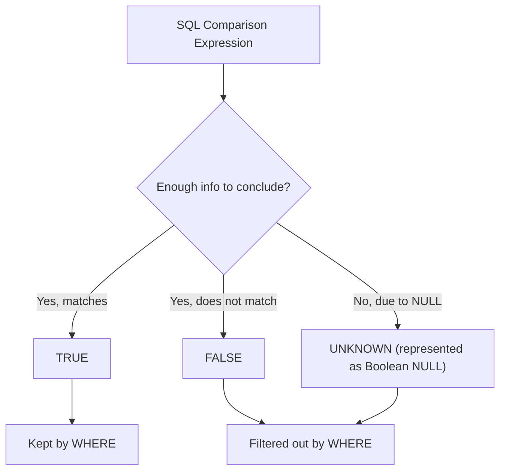

# Boolean, NULL, and Missing Data States in PostgreSQL

In relational databases, Boolean values are commonly used to represent attributes with two states—such as whether an account is active, whether a record is approved, or whether an option is enabled. However, PostgreSQL also supports **`NULL`**, representing the absence of an SQL value. Consequently, a nullable `boolean` column can actually hold three possibilities: `TRUE`, `FALSE`, and `NULL`.

This distinction matters greatly. `FALSE` is an explicit, meaningful value: the condition is false. `NULL` means the data is unknown, not provided, or not applicable, depending on how the system defines it. Conflating the two states can cause an application to miss records in filters, miscalculate reports, or make incorrect business decisions.

This lesson explains PostgreSQL's `boolean` type and three-valued logic, then applies them to `WHERE`, `JOIN`, constraints, aggregations, and Java/Spring Boot application design.

## 1. PostgreSQL's Boolean Type

`boolean` is a native SQL data type supported by PostgreSQL. Each definite Boolean value is true or false; a column of this type can still accept `NULL` unless constrained with `NOT NULL`.

```sql
SELECT
    TRUE AS approved,
    FALSE AS rejected,
    NULL::boolean AS not_yet_known;
```

PostgreSQL accepts several input representations for Boolean, such as `TRUE`/`FALSE`, `'yes'`/`'no'`, `'on'`/`'off'`, and `'1'`/`'0'`, case-insensitively for valid textual forms. In SQL scripts and migrations, use explicit `TRUE` and `FALSE` so readers are never misled.

```sql
SELECT
    'true'::boolean AS a,
    'false'::boolean AS b,
    'yes'::boolean AS c,
    '0'::boolean AS d;
```

PostgreSQL may display Boolean values as `t` and `f` in some query results or command-line tools. That is merely a presentation format for true/false values; the column type remains `boolean`.

A few things to distinguish:

| Value | Type and Meaning |
| --- | --- |
| `TRUE` | Boolean true |
| `FALSE` | Boolean false |
| `NULL::boolean` | No definite Boolean value |
| `'false'` | Text string unless in a Boolean casting context |
| `0`, `1` | Numbers; should not be treated as Boolean values in general SQL expressions |
| `''` | Empty string; not automatically treated as `NULL` |

In PostgreSQL, `boolean` occupies one byte of data per Boolean value; the actual storage footprint of a row also depends on row layout, the NULL bitmap, and other factors.

## 2. What Does NULL Represent?

`NULL` is a **marker for an absent value** in the SQL model. It is not synonymous with a default value such as `FALSE`, `0`, or an empty string. In real systems, a `NULL` column can represent several distinct situations:

- **Unknown**: whether a shipping address is valid has not been verified yet.
- **Not provided**: the customer has not chosen to opt in or opt out of the newsletter.
- **Not applicable**: the contract end date for an open-ended contract.
- **Not yet measured**: no reading has arrived from a device or measurement workflow.

All of these cases can be stored as `NULL`, yet their business meanings differ. If reports or workflows need to tell them apart, design explicit status columns instead of overloading one `NULL` value with multiple meanings.

For example, with an `email_verified` column:

| Data | Application-Defined Meaning |
| --- | --- |
| `TRUE` | Email has been verified |
| `FALSE` | Email was checked and failed / marked invalid, per workflow |
| `NULL` | No verification result yet |

If only "verified" and "not verified" exist, you can choose `boolean NOT NULL DEFAULT FALSE`. However, if you must distinguish "not checked yet" from "checked and failed", you need a three-state model or a separate status column.

**Design principle:** define the meaning of every state *before* choosing `NULL` or a default value. Never let frontend code, backend code, and reports interpret `NULL` in three different ways.

## 3. SQL Uses Three-Valued Logic: TRUE, FALSE, UNKNOWN

Comparisons in SQL can return `TRUE`, `FALSE`, or `UNKNOWN`. `UNKNOWN` is the **logical result** when there is insufficient information to decide true/false; when representing that result as an SQL Boolean, PostgreSQL yields `NULL`.

```sql
SELECT
    (5 = 5) AS definitely_true,
    (5 = 6) AS definitely_false,
    (5 = NULL) AS unknown_result,
    (NULL = NULL) AS also_unknown;
```

The last two expressions yield `NULL`, not `FALSE`. In particular, `NULL = NULL` does not return `TRUE` either: the fact that two values are both unknown does not prove they are equal.

Visualized as:



### 3.1. Truth Tables for AND and OR

Let `T = TRUE`, `F = FALSE`, `U = UNKNOWN`:

| A | B | `A AND B` | `A OR B` |
| --- | --- | --- | --- |
| T | T | T | T |
| T | F | F | T |
| T | U | U | T |
| F | T | F | T |
| F | F | F | F |
| F | U | F | U |
| U | T | U | T |
| U | F | F | U |
| U | U | U | U |

Key insight: `FALSE AND UNKNOWN` is `FALSE` because the combined condition is already guaranteed false; `TRUE OR UNKNOWN` is `TRUE` because the combined condition is already guaranteed true.

Negation:

| A | `NOT A` |
| --- | --- |
| T | F |
| F | T |
| U | U |

SQL example:

```sql
SELECT
    TRUE AND NULL::boolean  AS true_and_unknown,
    FALSE AND NULL::boolean AS false_and_unknown,
    TRUE OR NULL::boolean   AS true_or_unknown,
    FALSE OR NULL::boolean  AS false_or_unknown,
    NOT NULL::boolean      AS not_unknown;
```

The results are `NULL`, `FALSE`, `TRUE`, `NULL`, and `NULL`, respectively.

### 3.2. WHERE Only Keeps Rows Where the Condition Is TRUE

For a `WHERE` clause, PostgreSQL only keeps a row when the predicate evaluates to **`TRUE`**. Both `FALSE` and `UNKNOWN` exclude the row from the result set.

```sql
SELECT *
FROM some_table
WHERE nullable_boolean_column;
```

This query returns only rows with `TRUE`, excluding both `FALSE` and `NULL` rows. Thus, three-valued logic is integral to how SQL filters data, not just a display detail.

## 4. Creating a Practice Table with TRUE, FALSE, and NULL

Use a sandbox database; never execute `DROP` statements against real data. Create a new schema and table:

```sql
CREATE SCHEMA IF NOT EXISTS boolean_lab;

CREATE TABLE boolean_lab.customer_preferences (
    customer_id bigint GENERATED ALWAYS AS IDENTITY PRIMARY KEY,
    email text NOT NULL UNIQUE,
    is_active boolean NOT NULL DEFAULT TRUE,
    wants_newsletter boolean,
    reviewed_at timestamptz,
    CONSTRAINT chk_newsletter_review
        CHECK (wants_newsletter IS NULL OR reviewed_at IS NOT NULL)
);
```

In this illustrative model:

- `is_active` is a two-state attribute, required to have a value; if omitted, it defaults to `TRUE`.
- `wants_newsletter` is a three-state decision: `TRUE` opted in, `FALSE` declined, `NULL` not answered yet.
- `reviewed_at` records when the decision was captured. The `CHECK` constraint requires a timestamp once a definite answer exists.

Insert records:

```sql
INSERT INTO boolean_lab.customer_preferences
    (email, is_active, wants_newsletter, reviewed_at)
VALUES
    ('alice@example.test', TRUE,  TRUE,  now()),
    ('bob@example.test',   TRUE,  FALSE, now()),
    ('chris@example.test', FALSE, NULL,  NULL);

-- Omit is_active to use DEFAULT TRUE;
-- omit wants_newsletter so it defaults to NULL.
INSERT INTO boolean_lab.customer_preferences (email)
VALUES ('dana@example.test');

SELECT email, is_active, wants_newsletter, reviewed_at
FROM boolean_lab.customer_preferences
ORDER BY customer_id;
```

Resulting states:

| Email | `is_active` | `wants_newsletter` |
| --- | --- | --- |
| alice@example.test | TRUE | TRUE |
| bob@example.test | TRUE | FALSE |
| chris@example.test | FALSE | NULL |
| dana@example.test | TRUE (default) | NULL |

The sample data is intentionally simple for observing SQL behavior. In production systems, fields representing newsletter consent must follow proper consent capture and verification workflows; never infer consent from omitted data.

## 5. Filtering Booleans: = TRUE, IS TRUE, IS FALSE, IS UNKNOWN

The filters below carry different meanings when a column allows `NULL`.

### 5.1. Selecting Rows That Are Definitely TRUE

```sql
SELECT email
FROM boolean_lab.customer_preferences
WHERE wants_newsletter IS TRUE;
```

With the sample data, only `alice@example.test` matches. These two forms also select `TRUE` rows:

```sql
WHERE wants_newsletter = TRUE

-- In a full SELECT statement:
SELECT email
FROM boolean_lab.customer_preferences
WHERE wants_newsletter;
```

However, `IS TRUE` clearly communicates "must definitely be true" and improves readability in queries dealing with three-valued states.

### 5.2. Selecting Rows That Are Definitely FALSE

```sql
SELECT email
FROM boolean_lab.customer_preferences
WHERE wants_newsletter IS FALSE;
```

Only `bob@example.test` matches.

Negation also selects rows that are definitely `FALSE`:

```sql
SELECT email
FROM boolean_lab.customer_preferences
WHERE NOT wants_newsletter;
```

**Note:** `NOT NULL` remains `NULL` in three-valued logic, so `WHERE NOT wants_newsletter` **does not** select Chris's or Dana's rows.

### 5.3. Selecting Rows with Missing Information

```sql
SELECT email
FROM boolean_lab.customer_preferences
WHERE wants_newsletter IS NULL;
```

Chris's and Dana's rows are selected. For Boolean expressions, PostgreSQL also supports:

```sql
SELECT email
FROM boolean_lab.customer_preferences
WHERE wants_newsletter IS UNKNOWN;
```

For a Boolean column, `IS UNKNOWN` is equivalent to checking that no definite Boolean value is present. Use `IS NULL` when emphasizing the missing-data state.

### 5.4. Selecting Rows That Are Not Definitely TRUE

```sql
SELECT email
FROM boolean_lab.customer_preferences
WHERE wants_newsletter IS NOT TRUE;
```

This predicate matches both `FALSE` and `NULL`—namely Bob, Chris, and Dana. That differs sharply from `WHERE NOT wants_newsletter`, which matches only Bob.

| Condition | TRUE | FALSE | NULL |
| --- | --- | --- | --- |
| `WHERE flag` | Keep | Drop | Drop |
| `WHERE NOT flag` | Drop | Keep | Drop |
| `WHERE flag IS TRUE` | Keep | Drop | Drop |
| `WHERE flag IS FALSE` | Drop | Keep | Drop |
| `WHERE flag IS NULL` | Drop | Drop | Keep |
| `WHERE flag IS NOT TRUE` | Drop | Keep | Keep |
| `WHERE flag IS NOT FALSE` | Keep | Drop | Keep |
| `WHERE flag IS NOT NULL` | Keep | Keep | Drop |

Filter selection must align with the business goal. For instance, to **send** announcements only to users who explicitly opted in, use `IS TRUE`; do not use `IS NOT FALSE`, because that includes users who have not yet answered.

## 6. Comparing Against NULL: Why = NULL Does Not Work

In standard SQL, never use `= NULL` or `<> NULL` to detect missing values:

```sql
-- Semantically wrong: evaluates to UNKNOWN and finds no NULL rows.
SELECT email
FROM boolean_lab.customer_preferences
WHERE wants_newsletter = NULL;
```

Correct way:

```sql
SELECT email
FROM boolean_lab.customer_preferences
WHERE wants_newsletter IS NULL;
```

Similarly:

```sql
-- Not the right way to check "has a value".
WHERE wants_newsletter <> NULL

-- Correct:
WHERE wants_newsletter IS NOT NULL
```

The reason is that `=` and `<>` represent comparisons between definite values. Whenever at least one operand is `NULL`, standard comparison operators return `UNKNOWN`.

### 6.1. IS DISTINCT FROM: Null-Safe Comparisons

PostgreSQL supports these operators:

- `a IS DISTINCT FROM b`: two values differ, **treating NULL as comparable**.
- `a IS NOT DISTINCT FROM b`: two values are equal under the rule that two `NULL`s are not distinct.

```sql
SELECT
    NULL::boolean IS NOT DISTINCT FROM NULL::boolean AS both_missing,
    TRUE IS DISTINCT FROM NULL::boolean AS known_vs_missing,
    FALSE IS NOT DISTINCT FROM FALSE AS equal_false,
    TRUE IS NOT DISTINCT FROM FALSE AS unequal_values;
```

The results are `TRUE`, `TRUE`, `TRUE`, and `FALSE`, respectively. Unlike `=`, these two operators always return a definite Boolean value for data types with appropriate comparison rules.

If an application needs to filter exact matches against a potentially `NULL` parameter, it can use:

```sql
-- $1 is a prepared statement parameter of type boolean.
PREPARE find_preferences(boolean) AS
SELECT customer_id, email, wants_newsletter
FROM boolean_lab.customer_preferences
WHERE wants_newsletter IS NOT DISTINCT FROM $1;

EXECUTE find_preferences(NULL);
EXECUTE find_preferences(TRUE);
DEALLOCATE find_preferences;
```

This lets you pass `NULL` and match rows where no choice has been made. Even so, an API contract should clarify whether passing `NULL` means **"find NULL records"** or **"do not apply this filter"**, as those are two different requirements.

## 7. AND, OR, NOT, and Combined Conditions in WHERE

Suppose you need customers who are both active and opted in to the newsletter:

```sql
SELECT email
FROM boolean_lab.customer_preferences
WHERE is_active IS TRUE
  AND wants_newsletter IS TRUE;
```

Only rows satisfying both true conditions are returned.

If you need active users **who have never opted in**, there are two distinct business formulations:

```sql
-- Includes both users who declined and users who have not answered.
SELECT email
FROM boolean_lab.customer_preferences
WHERE is_active IS TRUE
  AND wants_newsletter IS NOT TRUE;

-- Only users who explicitly declined.
SELECT email
FROM boolean_lab.customer_preferences
WHERE is_active IS TRUE
  AND wants_newsletter IS FALSE;
```

Do not write:

```sql
WHERE is_active AND NOT wants_newsletter
```

if the requirement must include `NULL` states as well. That expression only matches an explicit `FALSE` in the second column.

### 7.1. NOT IN with NULL: A Common Pitfall

Example:

```sql
SELECT 3 NOT IN (1, 2, NULL) AS result;
```

The result is `NULL` (UNKNOWN), **not `TRUE`**. Because comparing against the `NULL` element in the list is inconclusive, `NOT IN` can filter out far more rows than expected.

When selecting rows without a matching entry in a related table, `NOT EXISTS` usually expresses the intent more accurately:

```sql
-- Fetch customers with no record in events by customer_id.
-- Assumes boolean_lab.customer_events(customer_id, event_type) exists.
SELECT p.customer_id, p.email
FROM boolean_lab.customer_preferences AS p
WHERE NOT EXISTS (
    SELECT 1
    FROM boolean_lab.customer_events AS e
    WHERE e.customer_id = p.customer_id
);
```

This `NOT EXISTS` example assumes a separate `customer_events` table exists; it illustrates the query pattern and is not part of the Section 4 setup script. For nullable join keys, clarify the business meaning of missing values.

### 7.2. How Does CASE WHEN Handle UNKNOWN?

`CASE WHEN` takes a branch only when the condition is `TRUE`. If the condition is `FALSE` or `UNKNOWN`, execution proceeds to the next branch or `ELSE`:

```sql
SELECT
    email,
    CASE
        WHEN wants_newsletter IS TRUE  THEN 'accepted'
        WHEN wants_newsletter IS FALSE THEN 'declined'
        ELSE 'not_answered'
    END AS newsletter_status
FROM boolean_lab.customer_preferences
ORDER BY customer_id;
```

Do not write a two-branch `WHEN flag THEN 'yes' ELSE 'no'` if `FALSE` and `NULL` must be distinguished; that collapses distinct states together.

## 8. DEFAULT, NOT NULL, and CHECK: Protecting Data Meaning

### 8.1. DEFAULT Does Not Prohibit NULL

`DEFAULT` applies when a column is omitted from an `INSERT` statement or explicitly specified with the `DEFAULT` keyword:

```sql
CREATE TABLE boolean_lab.feature_flags (
    flag_id bigint GENERATED ALWAYS AS IDENTITY PRIMARY KEY,
    name text NOT NULL UNIQUE,
    enabled boolean DEFAULT FALSE
);

-- Omitting enabled sets the value to FALSE.
INSERT INTO boolean_lab.feature_flags (name)
VALUES ('new_checkout');

-- Explicitly specifying NULL still stores NULL.
INSERT INTO boolean_lab.feature_flags (name, enabled)
VALUES ('beta_search', NULL);
```

In this table, `enabled` remains nullable. `DEFAULT FALSE` does not automatically turn explicit `NULL` values sent by an application into `FALSE`.

If the business allows strictly two states, use `NOT NULL`:

```sql
CREATE TABLE boolean_lab.strict_feature_flags (
    flag_id bigint GENERATED ALWAYS AS IDENTITY PRIMARY KEY,
    name text NOT NULL UNIQUE,
    enabled boolean NOT NULL DEFAULT FALSE
);
```

When the application explicitly sends `NULL` for `enabled`, PostgreSQL rejects it with a `NOT NULL` violation; that is far better than silently accepting an invalid state.

### 8.2. CHECK Can Accept UNKNOWN

For a `CHECK` constraint, PostgreSQL **rejects a row only when the check expression evaluates to `FALSE`**. If the expression evaluates to `TRUE` or `UNKNOWN`, the row is accepted. This is a key contrast with `WHERE`, which only keeps rows when the expression is `TRUE`.

Example:

```sql
CREATE TABLE boolean_lab.age_checks (
    id bigint GENERATED ALWAYS AS IDENTITY PRIMARY KEY,
    age integer CHECK (age >= 18)
);

-- Accepted because age >= 18 evaluates to UNKNOWN when age is NULL.
INSERT INTO boolean_lab.age_checks (age) VALUES (NULL);
```

If age is mandatory, combine constraints:

```sql
CREATE TABLE boolean_lab.required_age_checks (
    id bigint GENERATED ALWAYS AS IDENTITY PRIMARY KEY,
    age integer NOT NULL CHECK (age >= 18)
);
```

Similarly, `CHECK (approved = TRUE)` is **not enough** to block `approved IS NULL`. You can use `approved boolean NOT NULL CHECK (approved = TRUE)` or, depending on the goal, `CHECK (approved IS TRUE)`; yet the clearest pattern for a two-state field remains `boolean NOT NULL` paired with appropriate logic.

### 8.3. When Is a Nullable Boolean a Good Choice?

A nullable `boolean` column fits when *there are exactly three business states* and the missing-data state is clearly explainable. If there are actually four or more states, use a dedicated status column.

For instance, an application review workflow might have:

- `draft` — not yet submitted.
- `pending` — submitted, awaiting review.
- `approved` — approved.
- `rejected` — rejected.

An `approved boolean` column with `NULL` cannot easily distinguish `draft` from `pending`. A clearer state model:

```sql
CREATE TABLE boolean_lab.applications (
    application_id bigint GENERATED ALWAYS AS IDENTITY PRIMARY KEY,
    decision_status text NOT NULL DEFAULT 'draft',
    CONSTRAINT chk_application_status
        CHECK (decision_status IN ('draft', 'pending', 'approved', 'rejected'))
);
```

For stable state sets, you can consider PostgreSQL enum types or a reference lookup table, depending on how states evolve and relate to other tables. A single Boolean should not be forced to encode a multi-step workflow.

## 9. UNIQUE and NULL: Multiple Missing Values Are Permitted

In PostgreSQL, a standard `UNIQUE` constraint treats `NULL` values as **distinct for uniqueness checks**. Therefore, a nullable `UNIQUE` column can contain multiple rows with `NULL`.

```sql
CREATE TABLE boolean_lab.external_links (
    link_id bigint GENERATED ALWAYS AS IDENTITY PRIMARY KEY,
    external_code text UNIQUE,
    link_name text NOT NULL
);

INSERT INTO boolean_lab.external_links (external_code, link_name)
VALUES
    (NULL, 'not assigned A'),
    (NULL, 'not assigned B');
```

Both rows can be inserted because neither has a code assigned yet. This rule applies not only to Booleans, but to any nullable column.

When the business wants `NULL`s treated as duplicates in a unique constraint, PostgreSQL **15 and later** supports `NULLS NOT DISTINCT`:

```sql
CREATE TABLE boolean_lab.one_unknown_slot (
    slot_id bigint GENERATED ALWAYS AS IDENTITY PRIMARY KEY,
    reservation_code text,
    CONSTRAINT uq_reservation_code
        UNIQUE NULLS NOT DISTINCT (reservation_code)
);
```

Under this constraint, two rows with `reservation_code = NULL` conflict. This is a specialized rule, not a reason to default to `UNIQUE NULLS NOT DISTINCT` on every nullable column.

If a code is mandatory, `NOT NULL UNIQUE` is usually better. If a code can be left unassigned across multiple rows, standard uniqueness is usually right.

## 10. GROUP BY, COUNT, and Aggregate Functions with NULL

When reporting three-state data, different counting approaches yield different numbers.

### 10.1. COUNT(*) vs. COUNT(column)

```sql
SELECT
    count(*) AS total_customers,
    count(wants_newsletter) AS answered_customers
FROM boolean_lab.customer_preferences;
```

With the four sample rows from Section 4:

- `count(*) = 4`: counts every row.
- `count(wants_newsletter) = 2`: counts only rows where the column value is **not `NULL`**, including both `TRUE` and `FALSE`.

Using `count(wants_newsletter)` as the count of subscribers who opted in would be wrong: that function also counts customers who declined.

### 10.2. Counting Three States with FILTER

```sql
SELECT
    count(*) AS total,
    count(*) FILTER (WHERE wants_newsletter IS TRUE) AS accepted,
    count(*) FILTER (WHERE wants_newsletter IS FALSE) AS declined,
    count(*) FILTER (WHERE wants_newsletter IS NULL) AS not_answered
FROM boolean_lab.customer_preferences;
```

The results are: total 4, accepted 1, declined 1, not answered 2.

You can also use `GROUP BY`:

```sql
SELECT wants_newsletter, count(*) AS row_count
FROM boolean_lab.customer_preferences
GROUP BY wants_newsletter
ORDER BY wants_newsletter NULLS LAST;
```

In `GROUP BY`, rows with a `NULL` grouping key are grouped together for aggregation, even though `NULL = NULL` does not evaluate to `TRUE`. That is SQL's specific grouping rule; do not infer that `NULL` has become an ordinary comparable value.

### 10.3. bool_and, bool_or, and NULL

PostgreSQL provides two Boolean aggregate functions:

- `bool_and(flag)`: `TRUE` if every **non-NULL** value in the group is `TRUE`; `FALSE` if any value is `FALSE`.
- `bool_or(flag)`: `TRUE` if at least one value is `TRUE`; `FALSE` if every **non-NULL** value in the group is `FALSE`.

These aggregates ignore `NULL` inputs. If there are no non-NULL values to aggregate, the result is typically `NULL`, not `FALSE` by default.

```sql
SELECT
    bool_and(wants_newsletter) AS all_known_accepted,
    bool_or(wants_newsletter) AS any_known_accepted
FROM boolean_lab.customer_preferences;
```

Because the sample data contains both `TRUE` and `FALSE`, `bool_and` is `FALSE` and `bool_or` is `TRUE`.

If the business wants to verify "all customers answered and all opted in", `bool_and` alone is insufficient because it ignores `NULL`. You can combine conditions:

```sql
SELECT
    count(*) > 0
    AND count(*) = count(wants_newsletter)
    AND bool_and(wants_newsletter) AS all_answered_and_accepted
FROM boolean_lab.customer_preferences;
```

This expression requires at least one row, no `NULL`s, and every answer to be `TRUE`. Defining the right semantics for empty sets (e.g., vacuous truth in mathematical logic) must follow product requirements.

## 11. COALESCE, NULLIF, and CASE: Handling Missing Data Intentionally

### 11.1. COALESCE Returns the First Non-NULL Value

```sql
SELECT
    email,
    COALESCE(wants_newsletter, FALSE) AS newsletter_for_display
FROM boolean_lab.customer_preferences;
```

For rows without an answer, the displayed expression evaluates to `FALSE`. That may suit a UI default of "not enabled", yet **it does not mean the database confirmed the user declined**. The underlying column still holds `NULL`; interpreting it in a SELECT does not alter stored data.

Keep two goals separate:

- **Driving actions**: process only users with `wants_newsletter IS TRUE`.
- **Displaying status**: use `CASE` to distinguish opted in, declined, and not answered.

Do not overuse `COALESCE(flag, FALSE)` across every expression; it can mask uncollected data.

### 11.2. NULLIF Converts a Sentinel Value to NULL

`NULLIF(a, b)` returns `NULL` if `a = b` is `TRUE`, and otherwise returns `a`:

```sql
SELECT
    NULLIF('', '') AS blank_becomes_null,
    NULLIF('hello', '') AS preserved_text;
```

A common data-entry pattern is converting empty strings to `NULL` to indicate "not provided", when the business treats those two states as equivalent:

```sql
SELECT NULLIF(trim('   '), '') AS optional_text;
```

Do not apply this rule blindly where an empty string carries its own distinct meaning.

### 11.3. CASE to Keep All Three States Explicit

```sql
SELECT
    email,
    CASE
        WHEN wants_newsletter IS TRUE  THEN 'Accepted'
        WHEN wants_newsletter IS FALSE THEN 'Declined'
        ELSE 'Not answered'
    END AS decision_label
FROM boolean_lab.customer_preferences;
```

Here each output carries a clear business label, reducing the risk of reports mixing up `FALSE` and `NULL`.

## 12. ORDER BY and NULLS FIRST / NULLS LAST

When sorting on a nullable column, PostgreSQL lets you specify where missing values appear:

```sql
SELECT email, wants_newsletter
FROM boolean_lab.customer_preferences
ORDER BY wants_newsletter ASC NULLS LAST, email;
```

For Booleans, `ASC` order on known values places `FALSE` before `TRUE`. `NULLS LAST` places unanswered rows at the end.

```sql
SELECT email, wants_newsletter
FROM boolean_lab.customer_preferences
ORDER BY wants_newsletter DESC NULLS FIRST, email;
```

In PostgreSQL, when omitted, `ORDER BY ... ASC` defaults to `NULLS LAST`, and `ORDER BY ... DESC` defaults to `NULLS FIRST`. However, when display ordering matters, write it explicitly so readers never have to memorize defaults.

To sort by business priority rather than raw Boolean ordering, use `CASE`:

```sql
SELECT email, wants_newsletter
FROM boolean_lab.customer_preferences
ORDER BY
    CASE
        WHEN wants_newsletter IS NULL  THEN 0
        WHEN wants_newsletter IS FALSE THEN 1
        ELSE 2
    END,
    email;
```

This example puts unanswered rows first, then declined, then opted in. That is an application-defined ordering, not a general PostgreSQL rule.

## 13. NULL in JOINs and Data Relationships

`NULL` affects not only Boolean filters, but also joins.

Example creating a preference-reviews table:

```sql
CREATE TABLE boolean_lab.preference_reviews (
    review_id bigint GENERATED ALWAYS AS IDENTITY PRIMARY KEY,
    customer_id bigint
        REFERENCES boolean_lab.customer_preferences(customer_id),
    review_note text NOT NULL
);
```

When joining with standard equality:

```sql
SELECT p.email, r.review_note
FROM boolean_lab.customer_preferences AS p
LEFT JOIN boolean_lab.preference_reviews AS r
    ON r.customer_id = p.customer_id;
```

`LEFT JOIN` preserves all rows from `p` even without a matching `r` row. Columns from `r` become `NULL` when no right-hand row matches. These are **join-generated NULLs**, distinct from an actual row in `r` having a nullable column. Reports and APIs must understand the origin of missing data.

A common mistake is filtering a right-hand table column in `WHERE`:

```sql
SELECT p.email, r.review_note
FROM boolean_lab.customer_preferences AS p
LEFT JOIN boolean_lab.preference_reviews AS r
    ON r.customer_id = p.customer_id
WHERE r.review_note = 'reviewed';
```

This predicate eliminates all unmatched rows because `r.review_note = 'reviewed'` becomes `UNKNOWN` when `r.review_note` is `NULL`; in practice it defeats the "keep all left-hand rows" intent. To keep all customers while joining only matching reviews, move the filter into `ON`:

```sql
SELECT p.email, r.review_note
FROM boolean_lab.customer_preferences AS p
LEFT JOIN boolean_lab.preference_reviews AS r
    ON r.customer_id = p.customer_id
   AND r.review_note = 'reviewed';
```

Placing a condition in `ON` versus `WHERE` depends on the desired result. What matters is anticipating how `UNKNOWN` interacts with joins and filters.

## 14. Indexes and Boolean/NULL Queries

A Boolean column has at most three states (if nullable), so its value cardinality is usually low. A standalone B-tree index on a Boolean column **is not always helpful**, especially when most rows share one state and queries select a large fraction of the table.

However, a **partial index** can make solid sense:

```sql
-- Suitable when very few records are awaiting a response.
CREATE INDEX idx_preferences_pending
ON boolean_lab.customer_preferences (customer_id)
WHERE wants_newsletter IS NULL;
```

This index only includes unanswered rows and can accelerate:

```sql
SELECT customer_id, email
FROM boolean_lab.customer_preferences
WHERE wants_newsletter IS NULL
ORDER BY customer_id;
```

Or a partial index for active records:

```sql
CREATE INDEX idx_preferences_active_email
ON boolean_lab.customer_preferences (email)
WHERE is_active IS TRUE;
```

For a query like:

```sql
SELECT email
FROM boolean_lab.customer_preferences
WHERE is_active IS TRUE
  AND email = 'alice@example.test';
```

PostgreSQL may use the corresponding index if the planner deems it beneficial. **There is no guarantee** every query uses an index: the planner relies on statistics, table size, selectivity, and estimated cost. In real schemas, measure with `EXPLAIN (ANALYZE, BUFFERS)` in an authorized environment with representative data and workloads.

Especially with partial indexes, the query's `WHERE` condition must match the index predicate so the planner recognizes eligibility. Two expressions can be logically similar without the planner proving them equivalent across all plans or parameterizations.

## 15. Java, JDBC, and Spring Boot: Preserving NULL at the Application Layer

SQL has three states, whereas Java's primitive `boolean` only has `true` and `false`. When a PostgreSQL column can be `NULL`, the appropriate Java type is **`Boolean`** (wrapper) or a dedicated domain status type.

### 15.1. Reading Nullable Booleans with JDBC

When using `ResultSet.getBoolean(...)`, JDBC returns a primitive boolean. When the SQL value is `NULL`, it returns `false`; you must call `wasNull()` immediately afterward to tell them apart:

```java
boolean rawValue = rs.getBoolean("wants_newsletter");
boolean missing = rs.wasNull();

Boolean decision = missing ? null : rawValue;
```

You can also use the `getObject` API supporting wrapper types when supported by the driver:

```java
Boolean decision = rs.getObject("wants_newsletter", Boolean.class);
```

With the standard PostgreSQL JDBC driver, reading as `Boolean.class` yields `true`, `false`, or `null`. If an application must support multiple drivers or versions, verify actual mappings.

### 15.2. Writing NULL Safely with PreparedStatement

Never concatenate user input into SQL strings. Use parameters:

```java
import java.sql.Connection;
import java.sql.PreparedStatement;
import java.sql.SQLException;
import java.sql.Types;

public void updateNewsletterDecision(
        Connection connection,
        long customerId,
        Boolean decision
) throws SQLException {
    String sql = """
        UPDATE boolean_lab.customer_preferences
        SET wants_newsletter = ?,
            reviewed_at = CASE
                WHEN ? IS NULL THEN NULL
                ELSE now()
            END
        WHERE customer_id = ?
        """;

    try (PreparedStatement ps = connection.prepareStatement(sql)) {
        if (decision == null) {
            ps.setNull(1, Types.BOOLEAN);
            ps.setNull(2, Types.BOOLEAN);
        } else {
            ps.setBoolean(1, decision);
            ps.setBoolean(2, decision);
        }
        ps.setLong(3, customerId);
        ps.executeUpdate();
    }
}
```

This example updates `reviewed_at` alongside the decision value, remaining consistent with the table's constraint. If the business needs **full decision history** or consent proof, use a separate event/audit table; overwriting a single column does not preserve history.

### 15.3. JPA/Hibernate: boolean and Boolean

Example entity:

```java
import jakarta.persistence.Column;
import jakarta.persistence.Entity;
import jakarta.persistence.GeneratedValue;
import jakarta.persistence.GenerationType;
import jakarta.persistence.Id;
import jakarta.persistence.Table;

@Entity
@Table(name = "customer_preferences", schema = "boolean_lab")
public class CustomerPreference {
    @Id
    @GeneratedValue(strategy = GenerationType.IDENTITY)
    @Column(name = "customer_id")
    private Long customerId;

    @Column(name = "is_active", nullable = false)
    private boolean active;

    @Column(name = "wants_newsletter")
    private Boolean wantsNewsletter;

    protected CustomerPreference() {
    }
}
```

- `boolean` fits when the database enforces `NOT NULL` and the application always supplies a valid value on write.
- `Boolean` represents all three possibilities when SQL allows `NULL`.
- A primitive Java field initializes to `false` by default. That differs from the database's **DEFAULT TRUE**: an ORM may explicitly send `FALSE` on INSERT, bypassing the SQL default.
- `@Column(nullable = false)` describes the mapping and may participate in schema generation depending on configuration, yet in migration-managed systems, the real PostgreSQL `NOT NULL` constraint is the ultimate safeguard.

To let the database default apply on row creation, align how the ORM generates `INSERT` statements and how entities are initialized. Do not assume `DEFAULT TRUE` runs if the ORM always sends the column value.

### 15.4. Avoiding NullPointerException with the Boolean Wrapper

```java
Boolean wantsNewsletter = preference.getWantsNewsletter();

// Null-safe:
if (Boolean.TRUE.equals(wantsNewsletter)) {
    sendNewsletter();
}

// Prone to NullPointerException on unboxing:
if (wantsNewsletter) {
    sendNewsletter();
}
```

The second snippet is only safe if `wantsNewsletter` is guaranteed non-null. With three-state data, handle each case with explicit logic or a dedicated status model.

### 15.5. PATCH APIs: Omitting a Field Differs from Sending null

When designing partial-update APIs, distinguish:

- Request **omitting** `wantsNewsletter`: usually means **leave unchanged**.
- Request with `"wantsNewsletter": null`: may mean **clear current choice** or "unknown".
- Request with `"wantsNewsletter": false`: explicit **decline**.
- Request with `"wantsNewsletter": true`: explicit **opt-in**.

Two example JSON payloads:

```json
{}
```

```json
{"wantsNewsletter": null}
```

These two payloads mean different things, even though a plain DTO with `Boolean wantsNewsletter` might map both to Java `null` if field presence is not tracked. For PATCH endpoints, use a presence-aware type or update mechanism to avoid accidentally wiping data when a client simply omits a field.

## 16. JSONB: SQL NULL Differs from JSON null and a Missing Field

PostgreSQL provides the `jsonb` type. Inside JSON, there is a distinct `null` value, different from SQL `NULL`. Additionally, a JSON object may **lack the key** being queried.

```sql
SELECT
    '{}'::jsonb -> 'flag' AS missing_key,
    '{"flag":null}'::jsonb -> 'flag' AS json_null_value,
    '{"flag":false}'::jsonb -> 'flag' AS json_false_value;
```

Distinguish when analyzing results:

- `'{}'::jsonb -> 'flag'`: key does not exist, so the operator returns **SQL `NULL`**.
- `'{"flag":null}'::jsonb -> 'flag'`: returns the **JSONB value `null`**, not SQL `NULL`.
- `'{"flag":false}'::jsonb -> 'flag'`: returns the JSONB Boolean `false`.

Inspect with:

```sql
SELECT
    jsonb_typeof('{}'::jsonb -> 'flag') AS missing_type,
    jsonb_typeof('{"flag":null}'::jsonb -> 'flag') AS json_null_type,
    jsonb_typeof('{"flag":false}'::jsonb -> 'flag') AS json_boolean_type;
```

The three expressions evaluate to **SQL `NULL`**, the string `'null'`, and the string `'boolean'`, respectively. The `->>` operator extracts JSON values as text; both a missing field and a JSON `null` evaluate to SQL `NULL` under `->>`, making `->>` alone unsuitable if you must distinguish all three cases purely from text output.

Applications using JSONB for configuration or payloads should clearly define "missing key", "key with JSON null", and "key with Boolean false", especially during patch/merge logic.

## 17. Migrating a Nullable Boolean Column to NOT NULL

In legacy systems, a `boolean` column might allow `NULL` even though the business now mandates only `TRUE` or `FALSE`. Do not convert `NULL` directly to `FALSE` before determining what the missing data actually means.

A typical process includes:

1. **Assess current state**: count `TRUE`, `FALSE`, and `NULL` rows, and identify which business segments have missing values.
2. **Decide replacement values** with domain owners; you may need to collect missing data rather than defaulting automatically.
3. **Backfill data per policy** and ensure new application code never writes `NULL`.
4. **Add constraints** (`NOT NULL`) once data conforms, and set `DEFAULT` if omitting the column should assign a known value.
5. **Monitor post-migration** and confirm APIs/ORMs/reports no longer expect `NULL`.

The following example **is valid only if the business decides NULL must be interpreted as FALSE**:

```sql
-- Illustrated on a separate sandbox table.
CREATE TABLE boolean_lab.old_settings (
    setting_id bigint GENERATED ALWAYS AS IDENTITY PRIMARY KEY,
    enabled boolean
);

INSERT INTO boolean_lab.old_settings (enabled)
VALUES (TRUE), (FALSE), (NULL);

-- Inspect before changing:
SELECT
    count(*) AS total,
    count(*) FILTER (WHERE enabled IS NULL) AS missing
FROM boolean_lab.old_settings;

-- Execute after business approval:
UPDATE boolean_lab.old_settings
SET enabled = FALSE
WHERE enabled IS NULL;

ALTER TABLE boolean_lab.old_settings
    ALTER COLUMN enabled SET DEFAULT FALSE;

ALTER TABLE boolean_lab.old_settings
    ALTER COLUMN enabled SET NOT NULL;
```

On large tables, `UPDATE` can generate substantial WAL volume, and `ALTER TABLE ... SET NOT NULL` may scan rows and acquire locks affecting traffic. Plan batching and migrations for your production environment; never run them casually in production.

If `NULL` means "unknown" and cannot safely be assumed `FALSE`, keep the column nullable or migrate to an explicit status model rather than forcing every `NULL` to a fabricated value.

## 18. Common Issues and How to Handle Them

| Symptom | Common Cause | Resolution |
| --- | --- | --- |
| `WHERE flag = NULL` returns no rows | Equality with `NULL` evaluates to UNKNOWN | Use `flag IS NULL` |
| `WHERE NOT flag` skips `NULL` rows | `NOT UNKNOWN` remains UNKNOWN | Use `IS NOT TRUE` when you want both `FALSE` and `NULL` |
| `CHECK (age >= 18)` allows `NULL` age | CHECK only rejects rows where expression is FALSE | Add `NOT NULL` if age is required |
| `DEFAULT FALSE` yet rows still get `NULL` | Caller explicitly sends `NULL` | Add `NOT NULL` when domain has strictly two states |
| `count(flag)` lower than `count(*)` | `count(column)` ignores `NULL` | Choose `count(*)` or `FILTER` per intent |
| `bool_and` reports `TRUE` when some haven't answered | Aggregate ignores `NULL` inputs | Also check `count(*) = count(flag)` |
| `NOT IN` gives unexpected results | List or subquery contains `NULL` | Consider `NOT EXISTS` and verify join keys |
| Java receives `false` for both `FALSE` and `NULL` | `getBoolean` does not distinguish without `wasNull` | Use `getObject(..., Boolean.class)` or `wasNull` |
| PATCH API accidentally clears decision | Fails to distinguish missing field from JSON null | Track field presence explicitly |
| Report merges unanswered with declined | `COALESCE(flag, FALSE)` erases missing state | Use `CASE` or group three states separately |

## 19. Practice Exercises: From SQL Booleans to Business Modeling

The following exercises use `boolean_lab.customer_preferences` created in Section 4.

**Exercise 1 – Predict Results Under Three-Valued Logic**

Without running immediately, fill in `TRUE`, `FALSE`, or `NULL` for each expression:

```sql
SELECT
    TRUE AND NULL::boolean AS a,
    FALSE AND NULL::boolean AS b,
    FALSE OR NULL::boolean AS c,
    NULL::boolean IS NOT TRUE AS d,
    NULL::boolean = NULL::boolean AS e;
```

Then run the SQL and compare with the truth table in Section 3.

**Exercise 2 – Choose the Right Filter**

Write three separate queries to fetch: (1) only customers who opted in; (2) only customers who declined; (3) only customers who have not answered. Hint: use `IS TRUE`, `IS FALSE`, and `IS NULL`, respectively.

**Exercise 3 – Count All Three States Without Conflating Them**

Create a single-row report showing active customer count, opted-in count, declined count, and unanswered count. Compare `count(*)` with `count(wants_newsletter)`.

**Exercise 4 – Verify DEFAULT and NULL Behavior**

```sql
INSERT INTO boolean_lab.customer_preferences (email)
VALUES ('eva@example.test');

SELECT email, is_active, wants_newsletter
FROM boolean_lab.customer_preferences
WHERE email = 'eva@example.test';
```

Predict why `is_active` is `TRUE` while `wants_newsletter` is `NULL`. Then try explicitly sending `NULL` for `is_active` in your sandbox environment and observe the `NOT NULL` constraint.

**Exercise 5 – CHECK and Missing Values**

Use the `age_checks` table from Section 8 to test inserting `NULL`. Compare with `required_age_checks` which has `NOT NULL`. Explain why the exact same `CHECK (age >= 18)` expression permits the first row.

**Exercise 6 – Modeling State in Java**

Design a DTO reflecting the three possibilities of `wants_newsletter`. Handle `Boolean.TRUE.equals(value)` when executing tasks exclusively for opted-in users. In a partial-update API, clearly define all three actions: leave unchanged, clear choice, write `TRUE`/`FALSE`.

## 20. Key Principles to Remember

- PostgreSQL `boolean` stores `TRUE` and `FALSE`; nullable columns add a `NULL` state. **`NULL` is not `FALSE`**, nor an empty string or 0.
- SQL uses three-valued logic. `WHERE` keeps rows only when the condition is `TRUE`, discarding both `FALSE` and `UNKNOWN`. `NOT` does not turn `UNKNOWN` into `TRUE`.
- Use `IS NULL`/`IS NOT NULL` to check for missing values; use `IS TRUE`, `IS FALSE`, `IS NOT TRUE` to express three-state Boolean logic clearly.
- `IS DISTINCT FROM` and `IS NOT DISTINCT FROM` are helpful when comparing two potentially `NULL` values while guaranteeing a definite true/false result.
- `DEFAULT` applies only when requested or omitted and does not forbid `NULL`; `NOT NULL` enforces required presence. `CHECK` accepts UNKNOWN, and `UNIQUE` has its own rules for NULLs.
- `COUNT(column)`, `bool_and`, and `bool_or` ignore `NULL` inputs; reports must count missing records separately.
- In Java/JDBC/JPA, use `Boolean` when distinguishing `true`, `false`, and `null`. For PATCH APIs or JSONB, also account for property presence.
- If a business domain has more than three states, use a clearly constrained status column. Never cram multiple distinct meanings into a single nullable `boolean`.

Good Boolean design is more than picking a column type. More importantly, it clarifies whether an event has been confirmed true, confirmed false, or **lacks enough data to conclude**. PostgreSQL gives you the SQL tools needed to preserve that distinction from storage through queries and applications.
