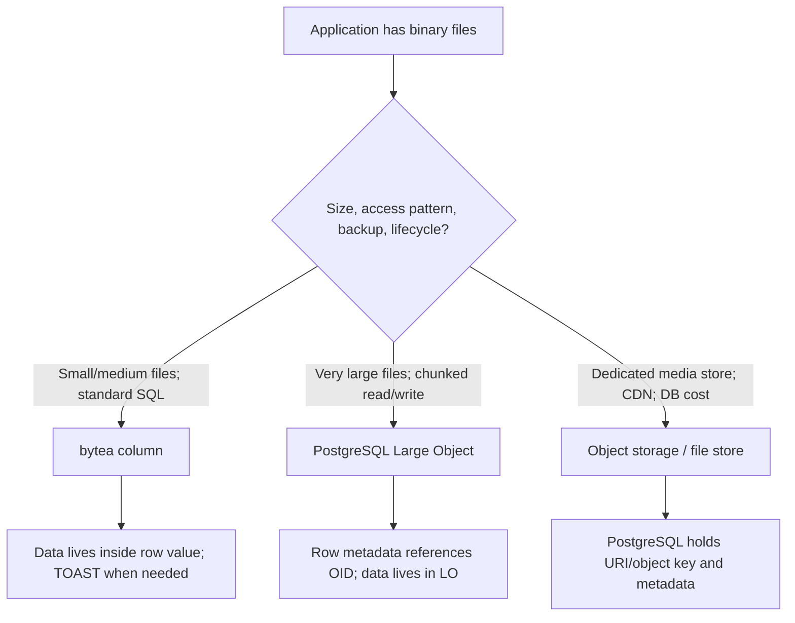
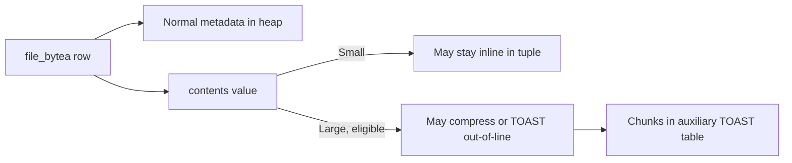
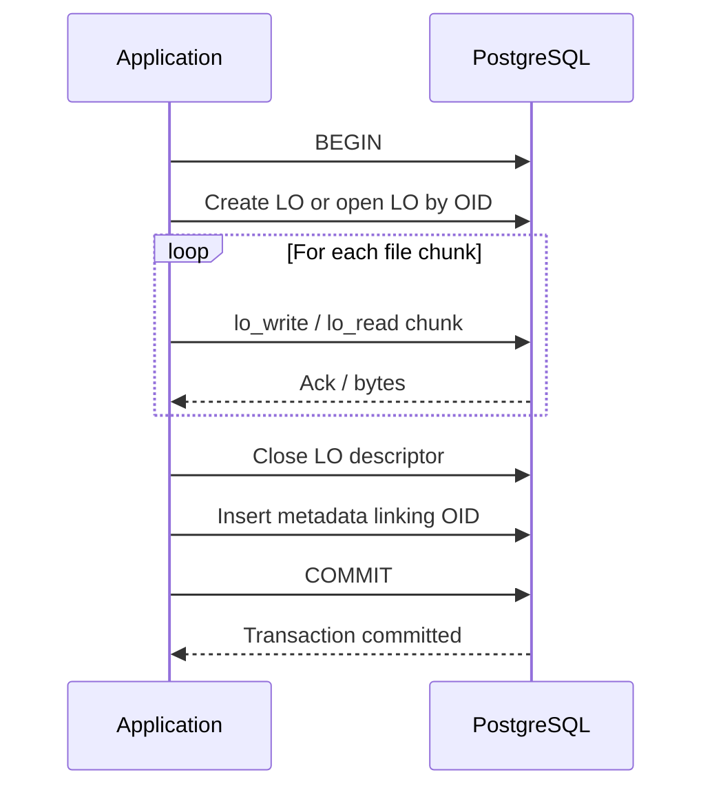

# Binary Data: bytea and Large Objects in PostgreSQL

Most SQL lessons begin with character strings, numbers, dates/times, and relationships between tables. In real applications, PostgreSQL can also store **binary data**: avatars, PDF documents, digital signatures, file attachments, audio recordings, digitized vouchers, or payloads that cannot safely be represented as an ordinary `TEXT` string.

PostgreSQL provides two primary mechanisms:

1. **`bytea`**: a column type storing a byte sequence directly as **a row's value**. It can be inserted, queried, updated, and deleted using standard SQL.
2. **Large Object (LO)**: a mechanism storing separately managed binary objects inside PostgreSQL, referenced by an **`oid`** identifier, along with an API for reading/writing in chunks.

They are not equivalent. A `bytea` column holds the data itself; an `oid` column holds only a **reference** to a Large Object. The storage model impacts transactions, backups, permissions, client memory, garbage collection, and size limits.

This lesson explains both mechanisms, illustrates them with SQL and `psql`, compares them with external file storage, and offers guidance on choosing the right option in PostgreSQL/Java applications.

## 1. How Does Binary Data Differ from Text Data?

With text data, we can write:

```sql
SELECT 'Hello PostgreSQL'::text;
```

However, a PNG, PDF, or ZIP file consists of **arbitrary bytes** that may contain `0x00`, invalid UTF-8 byte sequences, control bytes, or characters with special meaning in SQL. Trying to force an entire binary file into `TEXT` can cause PostgreSQL to reject invalid byte sequences for the database encoding or corrupt data during transcoding.

Meanwhile, `bytea` stores an exact **sequence of bytes**, for example:

```text
00 FF 10 20 41 42 43
```

This is **7 bytes**, not a string of seven printable characters. Byte `FF` is not required to be a valid UTF-8 character, yet it is completely valid in `bytea`.

| Type / Mechanism | Stored Content | When to Use |
| --- | --- | --- |
| `TEXT` | Text in PostgreSQL's database encoding | Names, descriptions, textual content |
| `JSONB` | Parsed JSON data structure | Dynamic attributes, JSON documents queried by structure |
| `bytea` | Byte sequence not required to be text | Small/medium images, hashes, small documents, binary payloads |
| Large Object | Binary data managed via the LO API | Large files requiring chunked streaming |
| External Object Storage | Bytes stored in file/object service; PostgreSQL stores metadata | High file volume, CDN delivery, media processing |

**Base64 or hex are not optimal binary storage formats in a database.** They are **text encodings of bytes** for transmission over text-only channels. When data can be stored directly in `bytea`, there is no reason to Base64-encode it into `TEXT` unless a specific integration requires it.

## 2. Overview: bytea, Large Objects, and External File Storage



### 2.1. Quick Comparison Table

| Criterion | `bytea` | Large Object |
| --- | --- | --- |
| Representation in table | `bytea` column directly holds the content | Column is typically `oid` referencing a separate LO |
| Mechanism maximum size | A single `bytea` value is bounded by PostgreSQL's field size limit, ~**1 GB** and practically smaller | Large Objects can reach around **4 TB** per mechanism limit |
| Standard SQL read/write | Very convenient | SQL functions exist, but streaming requires the LO API |
| Chunked transfer of large files | Slices can be queried, yet the full value still obeys `bytea` limits | Designed for chunked reads and writes |
| Relationship to referencing row | Data is managed with the column/row | Deleting the referencing row **does not automatically delete the LO** |
| Referential integrity | No external reference: bytes live in the row | `oid` does not automatically guarantee the LO exists |
| Access permissions | Via table/column privileges and RLS policies if any | Has its own LO permission system separate from the referencing table |
| Transactions | Column changes follow standard transactions | LO create/write/delete are transactional, but metadata sync must be managed |
| Backup/restore | Included in standard table data | Must ensure backup tools/options include Large Objects |
| Convenience with ORMs | Usually simpler | Requires compatible driver/API and explicit transaction management |

The "1 GB" and "4 TB" figures are **theoretical/mechanism limits**, not recommendations to push files near those ceilings. Application memory, WAL volume, backup times, queries, replication, and performance usually impose much lower operational limits.

## 3. How Does bytea Store Data?

`bytea` is PostgreSQL's standard data type for storing a **byte string**. Each `bytea` value can:

- Contain any byte from `0x00` through `0xFF`.
- Have variable length, including **0 bytes**.
- Be `NULL` if the column allows it and the value is unknown or omitted.
- Be compared, concatenated, sliced, or accessed byte-by-byte using PostgreSQL functions and operators.
- Leverage **TOAST** storage when values grow large enough per storage thresholds.

### 3.1. Empty Differs from NULL

```sql
SELECT
    octet_length(''::bytea) AS empty_size,
    octet_length(NULL::bytea) AS null_size,
    ''::bytea IS NULL AS empty_is_null,
    NULL::bytea IS NULL AS null_is_null;
```

Semantic results:

| Field | Value |
| --- | --- |
| `empty_size` | `0` |
| `null_size` | `NULL` |
| `empty_is_null` | `false` |
| `null_is_null` | `true` |

If the system requires a file to have non-empty content, `NOT NULL` is not enough; add a constraint such as `CHECK (octet_length(contents) > 0)` or validate in the application.

### 3.2. Displaying bytea in Hex Format

PostgreSQL typically displays `bytea` in **hex format** prefixed with `\x`:

```sql
SELECT decode('00FF1020414243', 'hex') AS data;
```

Typical text representation of that `bytea` value:

```text
\x00ff1020414243
```

Note: the characters printed on screen are a **display representation**, not that the database stores literal characters `\`, `x`, `0`, `0`... instead of actual raw bytes.

The `bytea_output` setting controls text formatting of `bytea`, with `hex` as the common default. Inspect it with:

```sql
SHOW bytea_output;
```

### 3.3. Creating bytea Values Unambiguously

Use `decode(text, format)` to convert hex or Base64 text into actual bytes:

```sql
SELECT decode('DEADBEEF', 'hex') AS binary_payload;

SELECT decode('SGVsbG8=', 'base64') AS hello_payload;
```

Or use a hex-format `bytea` literal:

```sql
SELECT '\xDEADBEEF'::bytea;
```

In the literal example, `\x` denotes hex data in PostgreSQL's input syntax. Because backslash escaping can vary across SQL files, shell strings, and Java source code, **`decode(..., 'hex')` is a clear, reproducible approach** when embedding fixed byte samples in lessons.

**Do not use `'DEADBEEF'::bytea` if your goal is the four bytes `DE AD BE EF`.** Without the hex prefix or corresponding decoding, that literal is interpreted as the raw bytes of eight ASCII characters.

## 4. Common Functions and Operators for bytea

PostgreSQL offers tools to manipulate bytes without converting to text.

| Function / Operator | Example | Meaning |
| --- | --- | --- |
| `octet_length(bytea)` | `octet_length(decode('00FF', 'hex'))` | Length in **bytes** |
| `bit_length(bytea)` | `bit_length(decode('00FF', 'hex'))` | Length in **bits** |
| `get_byte(data, n)` | `get_byte(decode('00FF', 'hex'), 1)` | Read byte at offset `n`, starting from **0** |
| `set_byte(data, n, value)` | `set_byte(decode('00FF', 'hex'), 1, 1)` | Return a bytea with byte at offset `n` replaced |
| `substring(data FROM start FOR count)` | `substring(data FROM 2 FOR 3)` | Slice byte string; `start` position begins at **1** |
| `encode(bytea, 'hex')` | `encode(decode('00FF','hex'),'hex')` | Encode bytes to hex text |
| `decode(text, 'hex')` | `decode('00FF','hex')` | Decode hex text to bytes |
| `encode(bytea, 'base64')` | `encode(decode('00FF','hex'),'base64')` | Encode bytes to Base64 text |
| `bytea || bytea` | `decode('00','hex') || decode('FF','hex')` | Concatenate two byte strings |
| `convert_to(text, encoding)` | `convert_to('Hello','UTF8')` | Encode text to bytes |
| `convert_from(bytea, encoding)` | `convert_from(data,'UTF8')` | Decode bytes to text per encoding |

### 4.1. Example: Reading Bytes, Slicing Bytes, and Changing Encoding

```sql
WITH sample AS (
    SELECT decode('00FF1020414243', 'hex') AS data
)
SELECT
    octet_length(data) AS size_bytes,
    bit_length(data) AS size_bits,
    get_byte(data, 0) AS first_byte,
    get_byte(data, 1) AS second_byte,
    encode(substring(data FROM 2 FOR 3), 'hex') AS middle_hex,
    encode(data, 'base64') AS as_base64
FROM sample;
```

Result interpretation:

- `size_bytes = 7`; `size_bits = 56`.
- `first_byte = 0`; `second_byte = 255`.
- `substring(data FROM 2 FOR 3)` extracts **bytes 2, 3, and 4** (1-indexed), so `middle_hex` is `ff1020`.

**Indexing warning:** `get_byte` uses **0-based offsets**, whereas `substring` uses **1-based positions**. When parsing binary formats, mixing these up causes off-by-one byte bugs.

### 4.2. Keep Bytes as Bytes; Only Decode to Text When the Encoding Is Known

```sql
SELECT
    encode(convert_to('Xin chào', 'UTF8'), 'hex') AS utf8_hex,
    convert_from(convert_to('Xin chào', 'UTF8'), 'UTF8') AS restored_text;
```

`convert_from` works only when the input bytes actually represent **text in the specified encoding**. For a ZIP archive or arbitrary byte sequence, `convert_from(...,'UTF8')` will fail because the bytes are not valid UTF-8. Never use this function to "peek inside an image" as if binary images were text.

### 4.3. When Signatures or Checksums Are Needed

An application may store checksums alongside files to detect transmission corruption or verify content. PostgreSQL offers hash functions and extensions for this, though you must distinguish an **integrity checksum** from a **cryptographic authentication code** used to prove sender authenticity.

A common metadata layout:

```text
sha256_hex TEXT or a bytea column storing a 32-byte digest
size_bytes BIGINT
media_type TEXT
created_at TIMESTAMPTZ
```

Using `digest(..., 'sha256')` requires the `pgcrypto` extension and appropriate installation privileges; a Java application can also compute the digest before sending. Wherever hashes are stored, **never use hashes as a substitute for access control**.

## 5. Complete Example: Table Storing Files with bytea

In a separate practice database, create a schema and table:

```sql
CREATE SCHEMA IF NOT EXISTS binary_lab;

CREATE TABLE binary_lab.file_bytea (
    file_id       BIGINT GENERATED ALWAYS AS IDENTITY PRIMARY KEY,
    object_key    TEXT NOT NULL UNIQUE,
    original_name TEXT NOT NULL,
    media_type    TEXT NOT NULL,
    contents      BYTEA NOT NULL,
    created_at    TIMESTAMPTZ NOT NULL DEFAULT now(),
    CONSTRAINT chk_file_bytea_key
        CHECK (length(btrim(object_key)) > 0),
    CONSTRAINT chk_file_bytea_name
        CHECK (length(btrim(original_name)) > 0),
    CONSTRAINT chk_file_bytea_size
        CHECK (octet_length(contents) BETWEEN 1 AND 10485760)
);
```

In this lesson, `octet_length(contents) BETWEEN 1 AND 10485760` limits files to **1 byte through 10 MiB**. That is a **synthetic business bound for practice**, not PostgreSQL's system limit for `bytea` and not a universal configuration for every application.

### 5.1. Inserting a Sample Binary File

```sql
INSERT INTO binary_lab.file_bytea
    (object_key, original_name, media_type, contents)
VALUES
    ('sample-001', 'bytes.bin', 'application/octet-stream',
     decode('00FF1020414243', 'hex'))
RETURNING
    file_id,
    object_key,
    octet_length(contents) AS size_bytes;
```

With the fresh demo data, the inserted row's payload is **7 bytes**. Because `file_id` is an auto-generated identity, its actual value may differ if the sequence was previously incremented.

`original_name` and `media_type` are merely **received metadata**. Do not assume a file is safe based on them; filenames can contain special characters and client-supplied MIME types can be inaccurate or spoofed.

### 5.2. Reading Metadata Without Returning the Payload

```sql
SELECT
    file_id,
    object_key,
    original_name,
    media_type,
    octet_length(contents) AS size_bytes,
    created_at
FROM binary_lab.file_bytea
ORDER BY file_id;
```

This query **omits `contents` from the output list**, avoiding transferring entire files to the client just to render a listing. PostgreSQL may still need to inspect storage metadata or detoast depending on how `octet_length(contents)` is evaluated; in applications with many large files, storing a validated `size_bytes` column separately ensures predictable listing performance.

### 5.3. Reading a Small Payload

```sql
SELECT
    object_key,
    encode(contents, 'hex') AS contents_hex
FROM binary_lab.file_bytea
WHERE object_key = 'sample-001';
```

Expected output for `contents_hex`:

```text
00ff1020414243
```

In real applications, read `bytea` using your driver's **byte array or binary stream API** rather than calling `encode(...,'hex')` on every file. Converting to hex roughly **doubles the text representation size** compared to raw bytes (excluding overhead).

### 5.4. Updating and Deleting

```sql
UPDATE binary_lab.file_bytea
SET contents = decode('89504E470D0A1A0A', 'hex'),
    original_name = 'signature.bin'
WHERE object_key = 'sample-001'
RETURNING object_key, octet_length(contents) AS size_bytes;

DELETE FROM binary_lab.file_bytea
WHERE object_key = 'sample-001'
RETURNING file_id, object_key;
```

With `bytea`, deleting a row places its binary value into standard **MVCC/VACUUM** cleanup just like ordinary PostgreSQL data. There is no need to call `lo_unlink` because **no Large Object** was created here.

## 6. The TOAST Mechanism Behind bytea

When a row contains large values such as `TEXT`, `JSONB`, or `bytea`, PostgreSQL can use **TOAST** (*The Oversized-Attribute Storage Technique*) to store them more efficiently.

Key points:

1. PostgreSQL has a page-size limit and cannot place a huge binary value directly inline inside an ordinary heap tuple.
2. For TOAST-capable types, PostgreSQL can **compress** data and/or move oversized values **out-of-line into an auxiliary TOAST table** split into chunks.
3. The main table row keeps a pointer to locate the out-of-line value.
4. When a query actually needs the full value, PostgreSQL must **detoast** it—fetching, reassembling (and decompressing if compressed) the data.



**Automatic TOASTing does not turn `bytea` into a Large Object.** A TOASTed `bytea` column remains a column value belonging to the main table row, governed by MVCC and row DML. By contrast, a Large Object is an independent object with its own `oid`, lifecycle, and permissions.

### 6.1. When Does TOAST Compression Help?

Compressible byte payloads—such as long text stored as bytes—benefit from compression. Conversely, already-compressed JPEG/PNG images and ZIP files rarely shrink significantly under extra compression because their data already has high entropy.

Do not expect TOAST alone to shrink a 20 MB image down to a few MB. Benchmark on representative data.

### 6.2. Observing Storage Cost

After loading sizable practice data, inspect total table storage:

```sql
SELECT
    pg_size_pretty(
        pg_total_relation_size('binary_lab.file_bytea'::regclass)
    ) AS total_table_size;
```

`pg_total_relation_size` includes table heap data and associated storage such as indexes and TOAST. It is **not the exact sum of raw file bytes alone**; storage overhead, metadata, indexes, unvacuumed dead tuples, and other structures also contribute.

### 6.3. Replacing a Large Payload Can Be Expensive

With a `bytea` column, rewriting the payload creates a new row/value version under MVCC. Updating large values increases:

- WAL volume and replication load.
- Temporary disk usage while old row versions remain.
- VACUUM and table/TOAST maintenance overhead.
- Network bandwidth between database and application.

Therefore, a large file modified **repeatedly in small chunks** may be a better candidate for Large Objects or a specialized file store, depending on transactional and infrastructure requirements.

## 7. bytea in Transactions and Access Control

Because `bytea` is a table column, modifications are managed inside standard transactions:

```sql
BEGIN;

INSERT INTO binary_lab.file_bytea
    (object_key, original_name, media_type, contents)
VALUES
    ('rollback-test', 'temporary.bin', 'application/octet-stream',
     decode('01020304', 'hex'));

-- If the user cancels the operation:
ROLLBACK;
```

After rollback:

```sql
SELECT COUNT(*) AS matching_rows
FROM binary_lab.file_bytea
WHERE object_key = 'rollback-test';
```

The expected count is **0**, because the uncommitted row and payload were rolled back. Similarly, deleting a row inside a transaction and rolling back keeps the row intact.

Access control for `bytea` follows **table/column privileges**:

```sql
-- Syntax illustration for an existing read-only role:
-- GRANT USAGE ON SCHEMA binary_lab TO app_reader;
-- GRANT SELECT ON binary_lab.file_bytea TO app_reader;
```

If an application only needs to read metadata, do not grant full-table `SELECT` to roles unauthorized to download sensitive payloads. Use **column-level privileges**, column-restricted views, or an authenticated API layer with proper authorization checks.

Never rely solely on the UI "hiding the download button": if a database role still has `SELECT` on `contents`, sensitive payloads can leak via other access paths.

## 8. When Is bytea Not the Best Choice?

`bytea` is convenient, yet not free:

- Single values face PostgreSQL's varlena size limit (~**1 GB**).
- APIs/ORMs may buffer the entire payload in RAM, spiking heap usage or triggering `OutOfMemoryError`.
- Database dumps and restores must carry large media volumes.
- Serving large files increases WAL, I/O, replication, and backup pressure.
- Streaming files directly out of PostgreSQL to many users is less convenient than caching/CDNs and object storage.

For **small avatars, size-bounded documents, and payloads needing strict transactional atomicity with metadata**, `bytea` is usually simple and easy to maintain.

For very large files or chunked streaming, consider Large Objects or external storage. Do not jump to Large Objects merely because a payload is binary; **every `bytea` value is already binary**.

## 9. What Is a Large Object?

PostgreSQL's **Large Object (LO)** is a binary storage object identified by an **OID** (*object identifier*). The bytes do not live directly inside the `oid` column of your application table.

PostgreSQL manages Large Objects via system catalogs such as:

- `pg_largeobject_metadata`: object metadata, including owner and privilege info.
- `pg_largeobject`: stores the data pages/chunks of Large Objects.

Applications typically pair this with a metadata table:

```text
file_lobs
  asset_id       BIGINT
  original_name  TEXT
  content_oid    OID  --------->  PostgreSQL Large Object
  media_type     TEXT                    |
  created_at     TIMESTAMPTZ              +-- binary data pages
```

**Crucially:** `content_oid` is just a **numeric identifier**. PostgreSQL does not treat `content_oid` as a foreign key protecting the Large Object, and **does not automatically delete the Large Object when the metadata row is deleted**. Without lifecycle management, databases accumulate **orphan large objects** (objects no longer referenced by any row).

### 9.1. Why Can a Large Object Be Larger Than bytea?

Instead of requiring the entire payload as one monolithic `bytea` value, Large Objects use paged storage and an **offset-based** API. Clients can open an object, read a slice, write a slice, seek to an offset, and close it.

Large Objects have a mechanism limit commonly cited at **up to ~4 TB**, far beyond `bytea`'s limit. Even so, disk capacity, backups, client libraries, and operational policy determine practical sizes in production.

### 9.2. OID Differs from a Table Primary Key

`oid` is a specialized integer type for object identifiers in PostgreSQL. In this lesson:

- `asset_id` is the primary key **of the application table**.
- `content_oid` is the identifier **of the PostgreSQL Large Object**.

They serve two distinct purposes; never conflate them or assume `asset_id = content_oid`.

## 10. Creating a Metadata Table for Large Objects

Create a dedicated table for LO storage, **independent of the `bytea` table**:

```sql
CREATE TABLE binary_lab.file_lobs (
    asset_id       BIGINT GENERATED ALWAYS AS IDENTITY PRIMARY KEY,
    object_key     TEXT NOT NULL UNIQUE,
    original_name  TEXT NOT NULL,
    media_type     TEXT NOT NULL,
    content_oid    OID NOT NULL UNIQUE,
    created_at     TIMESTAMPTZ NOT NULL DEFAULT now(),
    CONSTRAINT chk_file_lobs_key
        CHECK (length(btrim(object_key)) > 0),
    CONSTRAINT chk_file_lobs_name
        CHECK (length(btrim(original_name)) > 0)
);
```

Why place `UNIQUE(content_oid)` on the demo table?

- Prevents **two rows in the same table** from accidentally pointing to the same Large Object.
- Makes the "each asset owns one LO" rule explicit within this table.

However, uniqueness in `file_lobs` **does not prevent** another table or program from referencing the same OID. To clean up LOs safely and automatically, you must track every place that may hold a reference.

### 10.1. The oid Type Does Not Guarantee Referential Integrity

This statement:

```sql
INSERT INTO binary_lab.file_lobs
    (object_key, original_name, media_type, content_oid)
VALUES
    ('invalid-ref', 'missing.bin', 'application/octet-stream', 999999::oid);
```

can succeed structurally if no unique or other constraint blocks it, **even if Large Object 999999 does not exist**. Avoid running such broken inserts outside test environments. The `OID` type does not imply a `FOREIGN KEY` to Large Object metadata.

This contrasts with `bytea`: you never face a "row exists but the blob at some OID is missing" anomaly when the payload lives directly inside the column.

## 11. Creating and Reading Large Objects with SQL Functions

PostgreSQL provides SQL functions to create, read, modify, or unlink Large Objects.

| Function | Purpose |
| --- | --- |
| `lo_create(0)` | Create an empty Large Object and let PostgreSQL allocate a new OID |
| `lo_from_bytea(0, data)` | Create a Large Object from a `bytea` value, returning a new OID |
| `lo_get(oid)` | Fetch the entire LO contents as a single `bytea` value |
| `lo_get(oid, offset, length)` | Fetch a slice of bytes starting at offset |
| `lo_put(oid, offset, data)` | Write data at the specified offset |
| `lo_unlink(oid)` | Delete the Large Object from the database |

These functions require appropriate privileges. `lo_get(oid)` returns the entire payload as **one `bytea`**, so it is **not suitable for streaming very large LOs**; for files exceeding `bytea` limits, use a chunked streaming API.

### 11.1. Creating an LO in a Transaction and Storing the Reference

The following runs after creating the schema/tables in Sections 5 and 10:

```sql
BEGIN;

WITH new_object AS (
    SELECT lo_from_bytea(
        0,
        decode('00FF1020414243', 'hex')
    ) AS new_oid
)
INSERT INTO binary_lab.file_lobs
    (object_key, original_name, media_type, content_oid)
SELECT
    'lo-sample-001',
    'large-object-demo.bin',
    'application/octet-stream',
    new_oid
FROM new_object
RETURNING asset_id, object_key, content_oid;

COMMIT;
```

In `lo_from_bytea(0, data)`:

- Argument `0` tells PostgreSQL to **allocate a new OID**.
- `data` is a `bytea` value containing 7 sample bytes.
- The return value is the new Large Object's OID, stored into `file_lobs.content_oid`.

Both actions—**creating the Large Object** and **inserting the metadata row**—occur in the same transaction. If the row insert fails and the transaction rolls back, the LO creation inside the transaction is undone too.

**Do not confuse:** `lo_from_bytea` is handy for demos or small/medium payloads. Because its input is `bytea`, it is not a solution for passing a multi-TB file through an SQL parameter. For very large files, use the streaming Large Object interface.

### 11.2. Reading a Slice of Bytes from a Large Object

```sql
SELECT
    object_key,
    content_oid,
    encode(lo_get(content_oid, 0, 4), 'hex') AS first_four_bytes
FROM binary_lab.file_lobs
WHERE object_key = 'lo-sample-001';
```

The offset in `lo_get(oid, offset, length)` is **0-based**. Thus, the expected value of `first_four_bytes` is:

```text
00ff1020
```

Reading the first four bytes is a helpful illustration. For large files, applications should read in appropriate chunks without buffering the whole file in RAM.

### 11.3. Updating a Slice Inside an LO

Suppose you want to change the byte at offset 2 from `10` to `AA`:

```sql
BEGIN;

SELECT lo_put(
    content_oid,
    2,
    decode('AA', 'hex')
)
FROM binary_lab.file_lobs
WHERE object_key = 'lo-sample-001';

SELECT
    encode(lo_get(content_oid, 0, 7), 'hex') AS after_update
FROM binary_lab.file_lobs
WHERE object_key = 'lo-sample-001';

COMMIT;
```

Expected output:

```text
00ffaa20414243
```

This differs from supplying a brand-new `bytea` value for the whole column. Even so, updating an LO still generates writes/WAL and must be wrapped in a transaction; **modifying large files is not free**.

### 11.4. Creating an Empty Large Object and Writing Content Afterward

Multi-step example:

```sql
BEGIN;

WITH new_object AS (
    SELECT lo_create(0) AS new_oid
)
INSERT INTO binary_lab.file_lobs
    (object_key, original_name, media_type, content_oid)
SELECT
    'lo-empty-001',
    'initially-empty.bin',
    'application/octet-stream',
    new_oid
FROM new_object
RETURNING content_oid;

SELECT lo_put(
    content_oid,
    0,
    decode('01020304', 'hex')
)
FROM binary_lab.file_lobs
WHERE object_key = 'lo-empty-001';

COMMIT;
```

The object is created empty, then the first four bytes are written at offset 0. The entire workflow runs inside **one transaction**, preventing metadata from committing before the expected content is written.

## 12. Large Objects and psql: Importing, Exporting, Listing

In `psql`, there are **meta-commands** starting with `\lo_`. They are handy when experimenting with files on the machine running `psql`.

| Meta-Command | Meaning |
| --- | --- |
| `\lo_import '/path/to/file'` | Read a file on the **psql client**, create a Large Object, and print its OID |
| `\lo_export OID '/path/to/output'` | Export LO contents to a file on the **psql client** |
| `\lo_list` | List Large Objects and metadata visible to you |
| `\lo_unlink OID` | Delete a Large Object |

Example on Linux/macOS inside a `psql` session:

```text
\lo_import '/home/student/demo.pdf'
\lo_list
\lo_export 12345 '/home/student/demo-copy.pdf'
```

**`12345` is merely an example OID.** Replace it with the actual OID returned by `\lo_import`. The path must also exist on the **machine running psql**, not necessarily on the PostgreSQL server host.

On Windows, use file paths valid for `psql`/Windows and ensure the target directory is writable. Do not paste the Linux path verbatim.

### 12.1. Distinguishing Client-Side vs. Server-Side File Access

This is one of the most important security distinctions:

| Operation | Where Does the File Live? | Key Consideration |
| --- | --- | --- |
| `psql`'s `\lo_import` | File on the **client** running psql | Client reads the file and streams bytes over the connection |
| `psql`'s `\lo_export` | Output file on the **client** | Client receives bytes and writes the file |
| SQL function `lo_import('/path')` | File on the **PostgreSQL server filesystem** | Gated by server-side file access privileges |
| SQL function `lo_export(oid, '/path')` | File on the **PostgreSQL server filesystem** | Can write files on the database server machine if permitted |

The SQL functions `lo_import`/`lo_export` access the **database server's filesystem** directly, so privileges are strictly restricted—typically to superusers or roles granted specific server-file privileges.

**Never grant `pg_read_server_files` or `pg_write_server_files` to an application role just to upload images.** Those roles have very broad scope and pose serious security risks. Applications should transfer files over the driver/LO API or offload uploads/downloads to object storage.

### 12.2. When psql Runs Inside a Container or Remote Host

Paths passed to `\lo_import` are resolved by the **psql process**. If `psql` runs inside a container, the file must exist inside that container's filesystem or a mounted volume. If `psql` runs on a jump host, you cannot directly reference a path on your laptop without transferring the file to the jump host first.

Never work around "No such file or directory" by copying arbitrary sensitive files into PostgreSQL's data directory.

## 13. Large Object Streaming Interface in libpq and Applications

When a file is large enough, loading it entirely into RAM for a single `INSERT` or `lo_from_bytea` may be unfeasible. PostgreSQL provides the **Large Object API** for chunked access.

Conceptual workflow:



In **libpq** (PostgreSQL's C client library), commonly used functions include:

| API | Purpose |
| --- | --- |
| `lo_creat` / `lo_create` | Create a Large Object; calling convention varies by API |
| `lo_open` | Open a descriptor for reading/writing an LO |
| `lo_read` | Read a chunk of bytes |
| `lo_write` | Write a chunk of bytes |
| `lo_lseek64` | Seek to a 64-bit offset |
| `lo_tell64` | Read current offset position |
| `lo_close` | Close the descriptor |
| `lo_unlink` | Delete the object |

**With libpq's LO streaming interface, descriptor operations must occur inside an explicit SQL transaction.** A Large Object descriptor cannot remain open across `COMMIT` and be reused like a persistent OS file handle. In PgJDBC and similar drivers, transaction/auto-commit management is mandatory when using Large Objects.

### 13.1. Pseudocode for Reading an LO in Chunks

```text
BEGIN TRANSACTION
  descriptor = openLargeObject(contentOid, READ)

  while not endOfObject:
      bytes = readLargeObject(descriptor, chunkSize)
      writeBytesToDestination(bytes)

  closeLargeObject(descriptor)
COMMIT
```

This is **pseudocode**, not copy-pasteable SQL or Java syntax. Choose an appropriate chunk size per read—for example tens or hundreds of KiB depending on driver and system load; never treat one fixed chunk size as universally optimal.

Advantages:

- No need to buffer the entire LO payload in application memory.
- Supports offset/range operations when protocols and permissions allow.
- Supports upload/download streaming for huge files within bounded RAM.

Trade-offs:

- A transaction and database connection stay open for the duration of the file transfer.
- Mid-transfer disconnects require rollback/retry handling.
- Timeout, pool sizing, and descriptor lifecycle management become more complex.
- Large files transferred through the database still drive database I/O, network, and backup load.

### 13.2. Considerations When Streaming

A multi-GB download request can pin a database connection for as long as a slow client takes to download. This can cause:

- Connection pool exhaustion when many users download concurrently.
- Long-running transactions interfering with VACUUM/MVCC.
- Database network traffic dwarfing ordinary SQL query loads.

Therefore, even though Large Objects support streaming, **not all large media should be served directly from the database**. For high download volumes and CDN needs, object storage is usually a better fit.

## 14. Transactions, Permissions, and Lifecycle of Large Objects

A Large Object is a separate object, which introduces three extra responsibilities:

1. **Transactional consistency** between the LO and its referencing metadata row.
2. **Permissions** for both the metadata table and the LO itself.
3. **Cleanup of unreferenced objects**.

### 14.1. Creating an LO Without Saving Its Reference

Suppose an application does:

```text
1. Create LO, COMMIT.
2. Insert file_lobs row with content_oid in a second transaction.
3. Step 2 fails.
```

Now the LO exists and is committed, with no metadata row pointing to it. That is an **orphan LO**.

A better approach:

```text
BEGIN
  create LO
  write LO data
  INSERT INTO file_lobs(content_oid, ...)
COMMIT
```

If any step fails, roll back the whole unit of work. Even then, applications must handle edge cases caused by operators manually deleting rows, replacing OIDs, or multiple tables referencing one object.

### 14.2. Deleting a Row Does Not Automatically Delete the LO

This statement:

```sql
DELETE FROM binary_lab.file_lobs
WHERE object_key = 'lo-sample-001';
```

deletes only the **metadata row**. It does not call `lo_unlink(content_oid)`, leaving an unreferenced LO behind.

In a test environment, if a sample LO should be removed too, perform both inside one transaction:

```sql
BEGIN;

-- Lock the metadata row before cleanup to prevent concurrent modifications.
SELECT content_oid
FROM binary_lab.file_lobs
WHERE object_key = 'lo-sample-001'
FOR UPDATE;

-- Only do this when the LO is not referenced by any other table/object.
SELECT lo_unlink(content_oid)
FROM binary_lab.file_lobs
WHERE object_key = 'lo-sample-001';

DELETE FROM binary_lab.file_lobs
WHERE object_key = 'lo-sample-001';

COMMIT;
```

With this pattern, `lo_unlink` deletes the binary object and `DELETE` removes the referencing row. If the transaction rolls back, both changes are undone.

**Warning:** this SQL does not verify whether another table references the same LO. If OIDs are shared, `lo_unlink` can leave remaining rows pointing to a nonexistent object. Establish clear LO ownership rules before automating cleanup.

### 14.3. Replacing a File with a New OID Can Also Leave Orphans

Example:

```sql
UPDATE binary_lab.file_lobs
SET content_oid = lo_from_bytea(0, decode('010203', 'hex'))
WHERE object_key = 'lo-sample-001';
```

When run like this, the **old OID is not automatically deleted**. A replacement workflow must capture the old OID, create/write the new LO, update metadata, and unlink the old LO inside the same transaction or via a controlled cleanup process.

### 14.4. Large Object Permissions Differ from Table Permissions

Large Objects have their own **owner** and privileges. Depending on application roles and PostgreSQL configuration:

- Reading an LO may require **SELECT** privilege on the Large Object.
- Writing/modifying an LO may require **UPDATE** privilege on the Large Object.
- Unlinking an LO generally requires ownership or appropriate privileges.

Example syntax granting privileges on an existing OID:

```sql
-- Illustrative example. Replace 12345 with a real OID.
-- GRANT SELECT ON LARGE OBJECT 12345 TO app_reader;
-- GRANT UPDATE ON LARGE OBJECT 12345 TO app_writer;
```

Granting `SELECT` on `file_lobs` only permits reading the **`content_oid` column** per table privileges. It **does not grant** permission to read LO contents when LO privilege checks are enforced.

Conversely, if a role holds LO read privileges while blocked from seeing metadata, you must still guard against OID exposure and unauthorized object access. Table/RLS policies and LO privileges must be designed together; **do not assume RLS on the referencing table automatically protects standalone LOs**.

### 14.5. The lo Extension and Automatic Cleanup

PostgreSQL ships the `lo` extension providing support for managing Large Object references, including the `lo_manage` trigger. This is an option when applications want LOs automatically unlinked upon reference updates or deletions.

However:

- The extension must be installed/enabled per privileges and environment policy.
- The trigger works properly only if **reference ownership rules** hold—specifically, never arbitrarily sharing one LO across multiple rows.
- Unlink effects must be understood within transactions and row updates/deletions.

Do not attach mass LO-cleanup triggers in production before auditing every table and process referencing those OIDs.

## 15. Backup and Restore: How Does bytea Differ from LO?

With `bytea`, data resides inside table rows, so table dumps/restores normally carry the byte payloads along. LOs are stored independently from metadata tables:

```text
file_lobs.content_oid = 12345
           |
           v
Large Object with OID 12345
```

When backing up, ensure **both metadata rows and Large Objects** are included in the archive. If you restore `file_lobs` while omitting LOs, OID columns still hold numbers while the underlying binary objects no longer exist.

### 15.1. Full Database Backup

Example in an environment where you have access:

```bash
pg_dump -h 127.0.0.1 -U backup_user -d learning_pg \
  -Fc -f learning_pg.backup
```

In a **full database** dump, `pg_dump` generally includes Large Objects by default. Options such as `--large-objects` / `--blobs` exist to control LO inclusion when needed.

Be especially cautious when dumping with **schema or table filters**: certain filters and flags can exclude Large Objects unexpectedly. Always inspect the backup table of contents and **test restores** before assuming data is protected.

### 15.2. Avoid Misinterpreting "Backup Succeeded"

A backup command can exit cleanly yet still fail recovery requirements:

- LOs were excluded by scope filters.
- The dump has LOs, yet restore lacks proper owners or permissions.
- Metadata tables were restored with OIDs whose LOs are missing.
- Backups omit external files when the app uses object storage.

Perform real recovery drills—including downloading binary payloads and verifying checksums/lengths—rather than only counting restored tables.

## 16. Working with bytea in Java/JDBC

For Java and JDBC applications, `bytea` is typically straightforward when payload sizes are well-bounded.

### 16.1. Writing bytea with PreparedStatement

Assuming `binary_lab.file_bytea` exists, a Java example:

```java
byte[] payload = new byte[] {
    (byte) 0x00, (byte) 0xFF, (byte) 0x10, (byte) 0x20
};

String sql = """
    INSERT INTO binary_lab.file_bytea
        (object_key, original_name, media_type, contents)
    VALUES (?, ?, ?, ?)
    """;

try (PreparedStatement ps = connection.prepareStatement(sql)) {
    ps.setString(1, "java-demo-001");
    ps.setString(2, "java-demo.bin");
    ps.setString(3, "application/octet-stream");
    ps.setBytes(4, payload);
    ps.executeUpdate();
}
```

This illustrates the **JDBC API** on modern Java supporting text blocks, assuming an open `java.sql.Connection` and standard imports. Full programs must also handle datasources, exceptions, transactions, and duplicate keys.

**Use `setBytes` for `bytea`** so the driver sends raw bytes rather than text or URL strings prone to encoding issues.

### 16.2. Reading bytea

```java
String sql = """
    SELECT contents
    FROM binary_lab.file_bytea
    WHERE object_key = ?
    """;

try (PreparedStatement ps = connection.prepareStatement(sql)) {
    ps.setString(1, "java-demo-001");
    try (ResultSet rs = ps.executeQuery()) {
        if (rs.next()) {
            byte[] contents = rs.getBytes("contents");
            // Pass to the appropriate handler per application policy.
        }
    }
}
```

`ResultSet.getBytes` allocates a byte array in application memory. This is convenient for small/medium payloads, yet unsuitable if thousands of large files are downloaded simultaneously.

For multi-MB payloads, inspect driver binary-stream support, enforce HTTP-layer payload limits, and monitor heap/GC usage. Identical JDBC method names across different database drivers do not guarantee identical storage backends.

### 16.3. Be Careful with Blob and OID

In JDBC, `java.sql.Blob` is an API abstraction—**it does not mean every JDBC Blob is stored by PostgreSQL as `bytea`**. PostgreSQL JDBC supports Large Objects via dedicated APIs or `Blob` mappings depending on usage.

If the SQL column is `bytea`, use driver/ORM mappings for **binary bytes**. If the SQL column is `oid` referencing a Large Object, understand how the driver opens/reads LOs, its transaction requirements, and OID lifecycle. Never switch an ORM field from `byte[]` to `Blob` mechanically expecting the schema and storage behavior to stay unchanged.

### 16.4. Principles for HTTP Upload/Download

- Enforce upload size limits **before** buffering the full payload in memory.
- Authenticate and authorize every request; never check `file_id` alone.
- Never blindly trust client-supplied filenames or MIME types.
- Inspect file contents per security policy (e.g., malware scanning, magic-byte/format validation).
- Never build output file paths directly from unsanitized filenames.
- Configure sensible timeouts for database connections and HTTP requests.
- On download, send proper `Content-Type`, `Content-Disposition`, and cache headers; avoid serving untrusted uploads as executable HTML.

These are application-layer responsibilities regardless of whether you choose `bytea` or Large Objects.

## 17. Storing in PostgreSQL vs. Object Storage?

A common third option stores bytes in an external object store or file store while PostgreSQL retains management metadata:

```sql
CREATE TABLE binary_lab.file_metadata_external (
    asset_id      BIGINT GENERATED ALWAYS AS IDENTITY PRIMARY KEY,
    object_key    TEXT NOT NULL UNIQUE,
    original_name TEXT NOT NULL,
    media_type    TEXT NOT NULL,
    size_bytes    BIGINT NOT NULL CHECK (size_bytes >= 0),
    created_at    TIMESTAMPTZ NOT NULL DEFAULT now()
);
```

Here `object_key` identifies the object in external storage. Since the database does not hold the payload, design for:

1. Who is authorized to access files by `object_key`?
2. If metadata commits but external upload fails, what state remains?
3. When metadata is deleted, when is the external file deleted?
4. How are orphan files or dangling metadata cleaned up?
5. What versioning, checksums, encryption, retention, and backups are required?

**PostgreSQL transactions do not automatically span external object storage atomically.** Usually you need a state workflow such as `UPLOADING` → `READY`, idempotent retries, and an outbox/cleanup mechanism.

### 17.1. Decision Matrix by Requirement

| Requirement | Usually Reasonable Choice | Why |
| --- | --- | --- |
| 20–200 KiB avatar always tied to a profile | `bytea` or object storage | Simple; decide based on traffic cost and API design |
| Business document of a few MiB needing atomic commit with record | `bytea` | Standard DML and transactions are easy to control |
| Binary data near/past a single `bytea` value limit | Large Object or external storage | Avoids the ~1 GB `bytea` ceiling |
| Multi-GB file needing offset reads/writes | Large Object or external storage | Provides appropriate streaming/range APIs |
| Video or images served via CDN | External object storage | Simplifies CDN, caching, and media scaling |
| Highly sensitive data where backups rely strictly on PostgreSQL | Consider `bytea` or LO | Keeps backups unified when permissions/retention are designed properly |
| Millions of tiny payloads | Benchmark on representative workload | DB storage may fit; total size and index/WAL cost matter |
| File modified continuously in small segments | LO or range/multipart-capable store | Evaluate write amplification and API needs |

There is no single size threshold where **every application** should switch from `bytea` to LO. Access frequency, file count, latency, RAM, RPO/RTO, and backup operations often matter just as much as individual file size.

## 18. Common Mistakes

| Mistake or Misconception | Accurate Understanding |
| --- | --- |
| "Images/PDFs can always be stored in TEXT because everything is data." | Binary files may contain invalid text-encoding bytes; use `bytea` or LO. |
| "Hex output of bytea means data is stored as hex characters." | Hex is a display format; `bytea` stores raw bytes. |
| "A NULL bytea is a 0-byte file." | `NULL` differs from `''::bytea` which has length 0. |
| "bytea cannot hold 00 bytes." | `bytea` holds zero bytes normally. |
| "bytea and OID Large Objects are the same thing." | `bytea` is an inline/TOASTed column payload; OID references a separate object. |
| "TOAST turns bytea into a Large Object." | TOAST is column value storage; LO is a separate subsystem. |
| "Using LO means files auto-delete when rows are deleted." | You must call `lo_unlink` or use explicit lifecycle management. |
| "An OID column guarantees the object exists." | The `oid` type creates no foreign key to an LO. |
| "lo_get(oid) streams terabytes into the application." | `lo_get(oid)` returns `bytea`, constrained by memory and value limits; read in chunks instead. |
| "lo_from_bytea completely bypasses the 1 GB limit." | Its input is still `bytea`; use streaming APIs for huge data. |
| "Unlinking any LO cannot affect other rows." | Other rows or tables may share the same OID. |
| "psql's \lo_import reads files from the server." | The meta-command reads files on the **psql client**. |
| "SQL lo_import has the same safety scope as \lo_import." | The server-side SQL function accesses the database server filesystem and is strictly privileged. |
| "Granting SELECT on the OID table allows reading every Large Object." | LO privileges are enforced separately. |
| "Backups only need pg_dump of the metadata table." | With LOs, verify backups include the binary objects too. |
| "Base64 in TEXT always saves space." | Base64 inflates size and misses direct `bytea` benefits. |
| "Client-sent MIME type proves a file is a safe PDF." | MIME types and filenames can be spoofed; validate per security policy. |
| "External storage lets PostgreSQL roll back uploads automatically." | PostgreSQL transactions do not cover object storage. |

## 19. End-to-End Practice Workflow

To connect all concepts, run these steps on a **dedicated sandbox database with no production data**:

### Step 1 — Create Schema and Both Tables

Run the DDL from **Section 5** to create `binary_lab.file_bytea` and from **Section 10** to create `binary_lab.file_lobs`.

### Step 2 — Insert bytea

```sql
INSERT INTO binary_lab.file_bytea
    (object_key, original_name, media_type, contents)
VALUES
    ('exercise-bytea', 'hello.bin',
     'application/octet-stream',
     decode('48656C6C6F00FF', 'hex'))
RETURNING
    file_id,
    octet_length(contents) AS file_size;
```

Expected size is **7 bytes**: five bytes for `Hello`, followed by `00` and `FF`.

### Step 3 — Inspect Using Byte Functions

```sql
SELECT
    encode(contents, 'hex') AS hex_text,
    get_byte(contents, 5) AS null_byte,
    get_byte(contents, 6) AS ff_byte,
    octet_length(contents) AS bytes
FROM binary_lab.file_bytea
WHERE object_key = 'exercise-bytea';
```

Expected: `hex_text = 48656c6c6f00ff`, `null_byte = 0`, `ff_byte = 255`, and `bytes = 7`.

### Step 4 — Create a Standalone Large Object Inside a Transaction

```sql
BEGIN;

INSERT INTO binary_lab.file_lobs
    (object_key, original_name, media_type, content_oid)
VALUES
    ('exercise-lo', 'hello-lo.bin',
     'application/octet-stream',
     lo_from_bytea(0, decode('48656C6C6F00FF', 'hex')))
RETURNING asset_id, content_oid;

COMMIT;
```

### Step 5 — Read a Slice from the LO

```sql
SELECT
    object_key,
    content_oid,
    encode(lo_get(content_oid, 0, 5), 'hex') AS first_five,
    encode(lo_get(content_oid, 5, 2), 'hex') AS last_two
FROM binary_lab.file_lobs
WHERE object_key = 'exercise-lo';
```

Expected: `first_five = 48656c6c6f` and `last_two = 00ff`.

### Step 6 — Compare Deletion Behavior

For `bytea`:

```sql
DELETE FROM binary_lab.file_bytea
WHERE object_key = 'exercise-bytea';
```

For LO, to delete **both the LO and metadata**:

```sql
BEGIN;

SELECT content_oid
FROM binary_lab.file_lobs
WHERE object_key = 'exercise-lo'
FOR UPDATE;

SELECT lo_unlink(content_oid)
FROM binary_lab.file_lobs
WHERE object_key = 'exercise-lo';

DELETE FROM binary_lab.file_lobs
WHERE object_key = 'exercise-lo';

COMMIT;
```

Verify the results after deletion. In production systems, enforce checks for whether an OID is referenced elsewhere and handle exceptions/rollbacks rather than executing unguarded ad-hoc steps.

### Step 7 — Verify Transactionality

Create a new LO inside a transaction and then **ROLLBACK** before committing metadata. Verify that no metadata row was committed and no new LO from that transaction remains. This experiment highlights the difference between **placing both operations in one transaction** versus creating LOs and metadata in two separate transactions.

## 20. Extended Questions and Exercises

1. Why can `bytea` store `00` and `FF`, whereas `TEXT` is unsuitable for storing an arbitrary ZIP file?
2. Write SQL converting hex string `000102FEFF` to `bytea`, then returning byte length, first byte, and last byte using `octet_length`/`get_byte`.
3. Explain the difference between 0-based indexing in `get_byte` and 1-based indexing in `substring`. Retrieve the third byte of `decode('AABBCCDD','hex')` using both functions.
4. Starting from a `bytea` holding valid UTF-8, use `convert_from` to produce text. What happens if the bytes are not valid UTF-8?
5. Create a `documents` table with `bytea NOT NULL` and a constraint allowing files from 1 byte to 2 MiB. Try inserting an empty value and explain which constraint fails.
6. Why should `contents` not be returned when listing 1,000 documents if the API only needs name, MIME type, and size?
7. Explain how TOAST helps store a large `bytea` value in PostgreSQL **without** creating a Large Object with its own OID.
8. Create an LO with `lo_from_bytea`, store its OID in a metadata row, and read the first 16 bytes with `lo_get(content_oid,0,16)`. Why is `lo_get(oid)` unsuitable for downloading an entire 3 TB LO?
9. What consequence arises from running `DELETE` on a `file_lobs` row without calling `lo_unlink`? Design a transactional cleanup workflow.
10. If two rows across two tables point to the same OID, what can go wrong if one row is deleted and a trigger automatically calls `lo_unlink`? Propose an ownership rule to prevent this failure.
11. Distinguish `psql`'s `\lo_import` from the SQL function `lo_import`. From which machine is the file read, and which privileges matter?
12. A Java app stores `bytea` via `setBytes` yet uses `getBytes` to serve 500 concurrent 20 MiB image downloads. Roughly estimate RAM usage for the byte arrays alone and propose how to reduce risk.
13. An app downloads files via the LO API and keeps a transaction open throughout a multi-minute download. What impacts can arise on connection pools, VACUUM, and timeouts?
14. Design a `metadata_reader` role allowed to read filenames and creation timestamps, but not bytes. Compare column/view privileges for `bytea` against separate LO privileges.
15. A system dumps only metadata tables using `-t` and skips Large Objects. What happens on restore? Design a restore verification check to catch broken OID references.
16. Compare storing 10,000 small product images in `bytea` versus object storage. Consider read throughput, backups, CDN/caching, transactions, security, and operations.
17. Design an idempotency rule for large file uploads: if an upload finishes yet the client loses the response, how should a retry determine whether the object already exists?
18. Explain why adding `sha256_hex` and `size_bytes` columns does not eliminate the need for uploader authentication, content inspection, or retention policies.

## 21. Summary

PostgreSQL provides **two binary storage mechanisms with distinct architectures**:

```text
BYTEA
  -> Content is a column value
  -> Standard SQL / transactions / table privileges
  -> Automatic TOAST for large values
  -> Easy to use for small/medium payloads

LARGE OBJECT
  -> Data is a separate object
  -> OID column holds only a reference
  -> Chunked read/write API suited for very large data
  -> Must manage permissions, transactions, and lo_unlink
  -> Backups must include referenced LOs
```

For most cases involving **small/medium files tightly coupled to business records**, start with `bytea` for simplicity and clean SQL/ORM integration. Choose **Large Objects** when you specifically need **streaming, offset-based access, or sizes beyond a single `bytea` value**, and design the complete OID lifecycle carefully. When the primary goal is serving large media at high traffic, external object storage is often the better fit.

**Key takeaway:** storing a file is not the same as managing it properly. Whether you choose `bytea`, Large Objects, or external storage, your system still needs clearly defined **size limits, access controls, content validation, transactional guarantees, backup/recovery, and deletion policies**.
