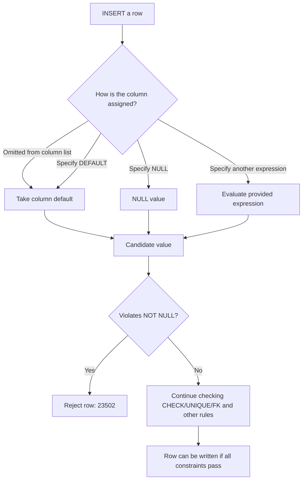

# NOT NULL, DEFAULT, and Distinguishing Default Values from Constraints

When designing tables in PostgreSQL, two phrases very commonly appear together: `NOT NULL` and `DEFAULT`:

```sql
status TEXT NOT NULL DEFAULT 'NEW'
```

They appear on the same column, but they **do not do the same thing**. `DEFAULT` answers the question **“if the statement does not provide a value, what should be used?”**; `NOT NULL` answers the question **“is the final value being written allowed to be NULL?”**. A column can have a default and still contain NULL, or have no default and always require the application to supply a value.

Confusing these two mechanisms leads to many real-world bugs: an API sends `NULL` expecting PostgreSQL to automatically use the default; a migration adds a default and assumes existing NULL data was fixed; a `CHECK (amount > 0)` column still allows NULL; or an ORM tries to write `NULL` into a column designed for PostgreSQL to generate a value.

This lesson belongs to the **Constraints** chapter and focuses on:

1. The exact semantics of `NULL`, `NOT NULL`, and `DEFAULT` during `INSERT`, `UPDATE`, and `COPY`.
2. The difference between a **fallback value when data is omitted** and a **constraint enforcing validity**.
3. Expression defaults, evaluation timing, identity columns, and generated columns.
4. Intentional table design: when to use defaults and when to force the client to provide values explicitly.
5. Changing defaults / `NOT NULL` on tables that already contain data without breaking applications.
6. Observing metadata, handling SQLSTATE errors, using JDBC/ORM, and hands-on exercises runnable in a test database.

The examples target modern PostgreSQL. Version-dependent points, especially the `ADD COLUMN ... DEFAULT` optimization and special constraint types, are noted separately. Do not run practice DDL statements directly against production tables.

## 1. Core Differences in a Comparison Table

| Property | `DEFAULT` | `NOT NULL` |
|---|---|---|
| Nature | Expression supplying a value when a statement uses the default | Rule forbidding the final column value from being `NULL` |
| Goal | Improve convenience and provide an initial value | Protect data integrity |
| When `INSERT` omits the column | Uses the default if defined; otherwise usually `NULL` | Checks that the final value is not `NULL` |
| When `INSERT` explicitly passes `NULL` | Does **not** automatically substitute the default | Rejects the row containing `NULL` |
| When `UPDATE` omits the column | Does not automatically recompute the default | Existing value must still satisfy data rules |
| When `UPDATE ... SET c = DEFAULT` | Evaluates the column's default at the time needed | Rejects if the default evaluates to `NULL` |
| Historical stored values | `SET DEFAULT` does not automatically update existing rows | `SET NOT NULL` succeeds only when existing data satisfies the condition |
| Can exist independently? | Yes | Yes |
| Typical error behavior | The default itself may raise an error during evaluation | `23502 not_null_violation` when a row violates it |

Declaration example:

```sql
name TEXT NOT NULL,
note TEXT DEFAULT 'No note yet',
status TEXT NOT NULL DEFAULT 'NEW',
closed_at TIMESTAMPTZ
```

- `name`: a non-NULL value must be provided; there is no default value.
- `note`: if omitted, PostgreSQL chooses the default string; an explicit `NULL` can still be written.
- `status`: if omitted, `'NEW'` is used; `NULL` is disallowed even if the application passes `NULL`.
- `closed_at`: has no default and allows `NULL`, making it suitable for representing “not yet closed”.

**Rule of thumb:** `DEFAULT` is not a data validation filter. It is **a value source** for situations where a statement requests the default.

## 2. What NULL Is and What It Is Not

In PostgreSQL, `NULL` represents **an absent / unknown / not-applicable value**, depending on business semantics. It is not synonymous with:

- An empty string `''`.
- Zero `0`.
- Boolean `FALSE`.
- A text string `'NULL'`.
- Whitespace `' '`.
- A sentinel timestamp such as `'1970-01-01'`.
- The column's default value.

Example:

```sql
SELECT
    NULL IS NULL AS is_null_value,
    '' IS NULL AS empty_text_is_null,
    0 IS NULL AS zero_is_null,
    FALSE IS NULL AS false_is_null;
```

Logical result: the first expression is true, and the remaining three are false.

### 2.1. Comparing with NULL Using IS NULL

```sql
-- Correct way:
SELECT *
FROM demo_defaults.task
WHERE note IS NULL;

-- Do not use to find NULL:
SELECT *
FROM demo_defaults.task
WHERE note = NULL;
```

The expression `note = NULL` normally evaluates to `UNKNOWN` rather than `TRUE`, so it does not select rows the way beginners often expect.

If you need a comparison that treats two `NULL` values as equivalent:

```sql
SELECT
    NULL IS NOT DISTINCT FROM NULL AS both_null_are_equivalent,
    NULL IS DISTINCT FROM 'text' AS null_differs_from_text;
```

`IS [NOT] DISTINCT FROM` is useful when business logic requires explicit `NULL`-aware comparison semantics.

### 2.2. Three-Valued Logic Related to CHECK

SQL has `TRUE`, `FALSE`, and `UNKNOWN` in logical expressions. A PostgreSQL `CHECK` constraint is violated when the expression returns **FALSE**; expressions returning **TRUE or UNKNOWN/NULL** are accepted.

Therefore:

```sql
quantity INTEGER CHECK (quantity > 0)
```

**can still contain `NULL`**. To make the column truly required and positive:

```sql
quantity INTEGER NOT NULL CHECK (quantity > 0)
```

This is an important connection between `NOT NULL` and other constraint types: do not assume `CHECK` automatically replaces `NOT NULL`.

## 3. Decision Matrix: Omitting the Column, Passing NULL, or Using DEFAULT

Suppose a column has one of four configurations:

| Column Configuration | `INSERT` omits column | `INSERT` passes `NULL` | `INSERT` passes `DEFAULT` |
|---|---|---|---|
| `value TEXT` | Stores `NULL` | Stores `NULL` | Stores `NULL` |
| `value TEXT DEFAULT 'X'` | Stores `'X'` | **Stores `NULL`** | Stores `'X'` |
| `value TEXT NOT NULL` | Error `23502` | Error `23502` | Error `23502` because implicit default is NULL |
| `value TEXT NOT NULL DEFAULT 'X'` | Stores `'X'` | Error `23502` | Stores `'X'` |

This matrix is enough to dispel a common misconception:

> When an `INSERT` statement **names the column and supplies `NULL`**, PostgreSQL does not treat that as “left blank so use DEFAULT”.

Behavior can differ if the table has a trigger designed to substitute values or a rewrite rule, but that is **additional logic**, not the standard semantics of `DEFAULT`.

### 3.1. Column Processing Flow During INSERT



This diagram is simplified to highlight `DEFAULT` and `NOT NULL` semantics and does not depict the full ordering of triggers, generated columns, partition routing, or every constraint type in the executor.

## 4. Preparing the Test Database

Use a test database and create a dedicated schema so existing tables are not mixed in:

```sql
CREATE SCHEMA IF NOT EXISTS demo_defaults;

CREATE TABLE demo_defaults.task (
    task_id BIGINT GENERATED ALWAYS AS IDENTITY,
    task_code TEXT NOT NULL,
    title TEXT NOT NULL,
    status TEXT NOT NULL DEFAULT 'NEW',
    priority SMALLINT NOT NULL DEFAULT 3,
    retry_count INTEGER NOT NULL DEFAULT 0,
    note TEXT DEFAULT 'No note yet',
    created_at TIMESTAMPTZ NOT NULL DEFAULT CURRENT_TIMESTAMP,
    completed_at TIMESTAMPTZ,

    CONSTRAINT pk_task PRIMARY KEY (task_id),
    CONSTRAINT uq_task_code UNIQUE (task_code),
    CONSTRAINT ck_task_code_not_blank
        CHECK (length(btrim(task_code)) > 0),
    CONSTRAINT ck_task_title_not_blank
        CHECK (length(btrim(title)) > 0),
    CONSTRAINT ck_task_status
        CHECK (status IN ('NEW', 'RUNNING', 'DONE', 'FAILED')),
    CONSTRAINT ck_task_priority
        CHECK (priority BETWEEN 1 AND 5),
    CONSTRAINT ck_task_retry_count
        CHECK (retry_count >= 0)
);
```

Design rationale:

| Column | Policy | Reason |
|---|---|---|
| `task_id` | Identity + primary key | PostgreSQL generates IDs and guarantees primary key uniqueness |
| `task_code` | NOT NULL + UNIQUE + CHECK | Business code must be provided, unique, and not blank/whitespace-only |
| `title` | NOT NULL + CHECK | Primary content must be supplied by the caller |
| `status` | NOT NULL + DEFAULT + CHECK | New tasks default to `NEW` and accept only valid states |
| `priority` | NOT NULL + DEFAULT + CHECK | Default priority is 3, restricted to 1 through 5 |
| `retry_count` | NOT NULL + DEFAULT + CHECK | Initial retry count is 0 and cannot be negative |
| `note` | DEFAULT but nullable | Omitting the column gets the default note; callers may still explicitly indicate “none” with NULL |
| `created_at` | NOT NULL + timestamp DEFAULT | Automatically populated at creation if the client omits it |
| `completed_at` | Nullable, no default | Incomplete tasks may have no completion timestamp |

In practice, `note TEXT DEFAULT 'No note yet'` is not always a good design: keeping `NULL` often represents “no note” more cleanly. Here it is chosen **intentionally to prove that DEFAULT does not forbid NULL**.

The exercises assume the table was just created once. If a table named `demo_defaults.task` already exists, do not run `DROP TABLE ... CASCADE` on a database with important data just to re-run examples.

## 5. INSERT Omitting Columns: DEFAULT Is Applied

Insert two tasks, specifying only the required fields without defaults:

```sql
INSERT INTO demo_defaults.task (task_code, title)
VALUES
    ('TASK-001', 'Check orders table'),
    ('TASK-002', 'Run daily report')
RETURNING
    task_id,
    task_code,
    title,
    status,
    priority,
    retry_count,
    note,
    created_at,
    completed_at;
```

Expected values:

- `task_id`: PostgreSQL generates IDs via identity.
- `status`: `NEW`.
- `priority`: `3`.
- `retry_count`: `0`.
- `note`: `No note yet`.
- `created_at`: timestamp from default.
- `completed_at`: `NULL`, because it has no default and allows `NULL`.

`RETURNING` lets you inspect the generated data **without guessing the next ID** from the sequence.

If the same statement is executed again, the unique constraint `uq_task_code` will reject the duplicate task code. That is expected behavior unrelated to `DEFAULT`.

### 5.1. No DEFAULT Implicitly Means NULL

For `completed_at TIMESTAMPTZ`, if `INSERT` omits the column:

```sql
INSERT INTO demo_defaults.task (task_code, title)
VALUES ('TASK-003', 'Prepare data')
RETURNING task_code, completed_at;
```

`completed_at` receives `NULL`. PostgreSQL does not infer that it should use the current timestamp just because the column name ends with `_at`.

This is why semantics must be designed clearly: **not yet completed** usually needs to differ from **completed at task creation time**.

## 6. INSERT with the Explicit DEFAULT Keyword

In addition to omitting columns, PostgreSQL allows using the `DEFAULT` keyword in the `VALUES` position:

```sql
INSERT INTO demo_defaults.task
    (task_code, title, status, priority, note)
VALUES
    ('TASK-004', 'Test the difference of DEFAULT',
     DEFAULT, DEFAULT, DEFAULT)
RETURNING task_code, status, priority, note;
```

Columns assigned `DEFAULT` receive the same default expressions declared on the table. The `DEFAULT` keyword is **different from the string literal `'DEFAULT'`**.

Example:

```sql
-- The query below passes the string 'DEFAULT' as status and is rejected by CHECK:
INSERT INTO demo_defaults.task (task_code, title, status)
VALUES ('TASK-BAD-STATUS', 'Invalid', 'DEFAULT');
```

On a connection in autocommit mode and outside an explicit transaction, the failing statement is rolled back individually. If running inside `BEGIN`, you must handle the aborted transaction before continuing.

### 6.1. INSERT DEFAULT VALUES

PostgreSQL supports the syntax:

```sql
INSERT INTO table_name DEFAULT VALUES;
```

For `demo_defaults.task`, however, this statement is **invalid** because `task_code` and `title` are `NOT NULL` without defaults.

To see a valid case, create another table:

```sql
CREATE TABLE demo_defaults.system_event (
    event_id BIGINT GENERATED ALWAYS AS IDENTITY PRIMARY KEY,
    event_type TEXT NOT NULL DEFAULT 'PING',
    created_at TIMESTAMPTZ NOT NULL DEFAULT now()
);

INSERT INTO demo_defaults.system_event DEFAULT VALUES
RETURNING event_id, event_type, created_at;
```

All required columns in `system_event` have a way to obtain a value, so a row can be inserted without passing any column values.

**Key point:** `DEFAULT VALUES` does not “disable” `NOT NULL`. If a required column has no default or its default evaluates to `NULL`, the statement still fails.

## 7. INSERT Explicitly Providing NULL: Does Not Trigger DEFAULT

Try passing `NULL` to `note`:

```sql
INSERT INTO demo_defaults.task
    (task_code, title, note)
VALUES
    ('TASK-005', 'Test explicit NULL value', NULL)
RETURNING task_code, note;
```

The resulting `note` is `NULL`, **not** `'No note yet'`, even though the column has a default.

Try passing `NULL` to `status`:

```sql
-- INTENTIONAL NOT NULL ERROR:
INSERT INTO demo_defaults.task
    (task_code, title, status)
VALUES
    ('TASK-FAIL-NULL', 'NULL is not allowed', NULL);
```

PostgreSQL reports an error similar to:

```text
ERROR: null value in column "status" of relation "task" violates not-null constraint
SQLSTATE: 23502
```

`status` has `DEFAULT 'NEW'`, but that does not help this `INSERT`, because the client explicitly stated that the value it wants to write is `NULL`.

### 7.1. A Non-NULL Invalid Value Can Still Violate CHECK

```sql
-- INTENTIONAL CHECK ERROR:
INSERT INTO demo_defaults.task
    (task_code, title, status)
VALUES
    ('TASK-FAIL-CHECK', 'Not in valid status set', 'UNKNOWN');
```

`status` is not NULL, so it **passes NOT NULL**, but `'UNKNOWN'` is not in `NEW/RUNNING/DONE/FAILED`, so it violates `ck_task_status`.

A `CHECK` violation typically has SQLSTATE `23514`. This directly demonstrates that **a NOT NULL column can still contain invalid business data** without additional constraints or proper validation logic.

## 8. DEFAULT Is Not a Validity Constraint

Consider the column:

```sql
priority SMALLINT DEFAULT 3
```

This configuration only says: when a value is omitted, pick 3. It does **not** forbid values such as:

```text
NULL
-10
0
100
```

With `SMALLINT`, values outside the numeric range are rejected by the data type, but that is a **type** constraint, not a `DEFAULT` constraint.

In the demo table, we chose:

```sql
priority SMALLINT NOT NULL DEFAULT 3,
CONSTRAINT ck_task_priority CHECK (priority BETWEEN 1 AND 5)
```

Three mechanisms work together:

1. **DEFAULT 3:** if the caller omits it, the task starts at priority 3.
2. **NOT NULL:** no task can store a NULL priority.
3. **CHECK BETWEEN 1 AND 5:** every stored priority falls within the valid range.

Conversely, a valid default does not make arbitrary values passed by the caller automatically valid.

### 8.1. A Default Must Be Compatible with Constraints

Example of a contradictory configuration:

```sql
-- Illustrating unreasonable DDL:
CREATE TABLE demo_defaults.bad_policy (
    id INTEGER NOT NULL DEFAULT -1,
    CONSTRAINT ck_bad_policy_id CHECK (id > 0)
);
```

The DDL can be created, but `INSERT ... DEFAULT VALUES` will fail because the default `-1` does not satisfy `CHECK (id > 0)`. DDL succeeding **does not prove that the default will insert valid data**.

Therefore, during reviews, ask not only “what is the default?” but also “does the default satisfy NOT NULL, CHECK, unique, foreign key constraints, and business semantics?”.

## 9. NOT NULL Columns Without DEFAULT: Forcing the Writer to Decide

This is a **good** choice when no safe fallback value exists.

```sql
CREATE TABLE demo_defaults.customer (
    customer_id BIGINT GENERATED ALWAYS AS IDENTITY PRIMARY KEY,
    email TEXT NOT NULL,
    full_name TEXT NOT NULL,
    joined_at TIMESTAMPTZ NOT NULL DEFAULT now(),
    CONSTRAINT uq_customer_email UNIQUE (email)
);
```

New customers must provide `email` and `full_name`; PostgreSQL should not silently set `email = 'unknown@example.test'` for everyone.

```sql
-- Valid:
INSERT INTO demo_defaults.customer (email, full_name)
VALUES ('lan@example.test', 'Lan')
RETURNING customer_id;

-- INTENTIONAL ERROR: full_name has no default:
INSERT INTO demo_defaults.customer (email)
VALUES ('minh@example.test');
```

The second statement implicitly gives `full_name` a NULL value and violates `NOT NULL`.

**Not every NOT NULL column needs a DEFAULT.** A required value that expresses business intent from the client should generally be **supplied explicitly**, avoiding misleading implicit values.

### 9.1. When Is an Overly “Convenient” Default Dangerous?

Example payment table:

```sql
amount NUMERIC(14, 2) NOT NULL DEFAULT 0
```

This configuration allows a payment insert that forgot the amount **to succeed with 0**. If business rules require the caller to specify a positive amount, a better design may be:

```sql
amount NUMERIC(14, 2) NOT NULL,
CONSTRAINT ck_payment_amount_positive CHECK (amount > 0)
```

A “technically safe” value is not necessarily “business-correct”. Similarly, `is_verified BOOLEAN NOT NULL DEFAULT TRUE` can be a security flaw if the system must verify before marking something verified.

## 10. NOT NULL Is Different from “Cannot Be Empty”

A `TEXT NOT NULL` column still allows:

```text
''
' '
'   '
```

To require content with at least one non-whitespace character (under standard trimming):

```sql
title TEXT NOT NULL,
CONSTRAINT ck_title_not_blank
    CHECK (length(btrim(title)) > 0)
```

In the demo table, `title` uses this two-layer protection.

Note that `btrim` by default handles certain whitespace characters according to the function's rules; it is not a full normalization library for all Unicode whitespace or meaningful text validation. If the domain requires complex validation for names, emails, or identifiers, define more precise rules.

### 10.1. NOT NULL and Boolean FALSE

```sql
CREATE TABLE demo_defaults.feature_flag (
    flag_code TEXT PRIMARY KEY,
    enabled BOOLEAN NOT NULL DEFAULT FALSE
);
```

In this table:

- `FALSE` is a valid value, **not NULL**.
- `DEFAULT FALSE` keeps new features disabled if the caller omits the column.
- `NOT NULL` prevents clients from storing an unknown state.

Do not use `CHECK (enabled IN (TRUE, FALSE))` without `NOT NULL` and assume NULL is forbidden: the check condition can evaluate to `UNKNOWN` when `enabled IS NULL`.

## 11. DEFAULT on UPDATE: Does Not Automatically Reset Columns

A default is not a function that PostgreSQL automatically re-runs on every row update.

Suppose `TASK-001` currently has `status = 'NEW'`:

```sql
UPDATE demo_defaults.task
SET title = 'Re-check orders table'
WHERE task_code = 'TASK-001'
RETURNING task_code, title, status, priority, created_at;
```

Only `title` changes. `status` does not reset to `NEW` just because it has a default; `priority` does not reset to 3; `created_at` does not change to the current timestamp.

### 11.1. UPDATE SET column = DEFAULT

If you genuinely want to reset columns to their default expressions:

```sql
UPDATE demo_defaults.task
SET status = DEFAULT,
    priority = DEFAULT,
    note = DEFAULT
WHERE task_code = 'TASK-001'
RETURNING task_code, status, priority, note;
```

This is an **explicit** directive. It tells PostgreSQL to evaluate the current default for the specified columns, which still must satisfy all constraints.

If the default definition changed between two points in time, `UPDATE ... SET c = DEFAULT` uses **the default definition in effect when the statement executes**, not a remembered snapshot from when the row was created.

### 11.2. UPDATE ... SET c = NULL

```sql
-- INTENTIONAL ERROR:
UPDATE demo_defaults.task
SET status = NULL
WHERE task_code = 'TASK-001';
```

Even though `status` has `DEFAULT 'NEW'`, the statement still violates `NOT NULL`.

An `UPDATE` that omits the column keeps the existing value, whereas `SET c = DEFAULT` asks to re-apply the default. All three cases must be clearly distinguished.

### 11.3. An “updated_at” Value Does Not Auto-Update via DEFAULT

```sql
updated_at TIMESTAMPTZ NOT NULL DEFAULT now()
```

Declaring a column like this typically only supplies a timestamp **when INSERT omits the column**; subsequent `UPDATE` statements **do not automatically update `updated_at`**.

If the application needs last-modified timestamps updated automatically, you can choose:

- Assign `updated_at = now()` in every business `UPDATE` statement.
- Use a trigger that is properly designed, tested, and migration-managed.
- Use a consistent persistence layer that understands time sources and bulk update behavior.

Pick one convention and document it in the data dictionary; never infer from the `_at` suffix that the database updates it automatically.

## 12. DEFAULT Expressions: Not Just Constant Values

PostgreSQL allows many **valid expressions** in `DEFAULT`, such as arithmetic, function calls, timestamps, or ID generation.

```sql
CREATE TABLE demo_defaults.default_expression_demo (
    id BIGINT GENERATED ALWAYS AS IDENTITY PRIMARY KEY,
    source TEXT NOT NULL DEFAULT 'manual',
    created_at TIMESTAMPTZ NOT NULL DEFAULT now(),
    observed_at TIMESTAMPTZ NOT NULL DEFAULT clock_timestamp(),
    random_sample DOUBLE PRECISION NOT NULL DEFAULT random(),
    score INTEGER NOT NULL DEFAULT (10 + 5)
);
```

A single insert:

```sql
INSERT INTO demo_defaults.default_expression_demo DEFAULT VALUES
RETURNING id, source, created_at, observed_at, random_sample, score;
```

The columns are initialized by **evaluating expressions when PostgreSQL needs the default**, not necessarily as fixed literals copied verbatim into the DDL.

### 12.1. CURRENT_TIMESTAMP and now() Use Transaction Time

In PostgreSQL, `now()` and `CURRENT_TIMESTAMP` return the start time of the current transaction (per their semantics), not the exact moment the CPU executes each individual SQL line.

```sql
BEGIN;

SELECT now() AS first_time;

SELECT pg_sleep(1);

SELECT now() AS second_time;

COMMIT;
```

The two `now()` values inside the same transaction are normally identical. That is very useful when multiple rows created in the same transaction need a consistent timestamp.

By contrast, `clock_timestamp()` returns the real wall-clock time and can change within the same statement or transaction:

```sql
SELECT
    now() AS transaction_time,
    statement_timestamp() AS statement_start_time,
    clock_timestamp() AS actual_clock_time;
```

Choose the function matching your intent:

| Need | Recommended Function |
|---|---|
| Common logical timestamp of a transaction | `now()` / `CURRENT_TIMESTAMP` |
| Start time of the current statement | `statement_timestamp()` |
| Actual wall-clock time near when the function is called | `clock_timestamp()` |

If the application stores timestamps within a business workflow, standardize timezone handling. `TIMESTAMPTZ` represents an absolute instant in time but **does not preserve the original input timezone name**; display formatting depends on the session `TimeZone`.

### 12.2. random() and Volatile Default Values

With:

```sql
random_sample DOUBLE PRECISION DEFAULT random()
```

each time PostgreSQL evaluates the function it can produce a different number. Never treat `DEFAULT` as a value “computed once at `CREATE TABLE` time” for all expressions.

The difference between `STABLE` and `VOLATILE` functions also affects the `ALTER TABLE ADD COLUMN DEFAULT` optimization on existing tables, discussed in the migration section.

### 12.3. A Default Cannot Directly Reference Other Columns of the Same Row

The statement below is not a valid way to compute a total column:

```sql
-- INVALID example:
CREATE TABLE demo_defaults.invalid_total (
    quantity INTEGER NOT NULL,
    unit_price NUMERIC(12, 2) NOT NULL,
    total_amount NUMERIC(12, 2)
        DEFAULT (quantity * unit_price)
);
```

A column's default expression cannot directly reference other columns of the same row in that way.

If you want data always derived from other columns, consider a **generated column**:

```sql
CREATE TABLE demo_defaults.order_line (
    order_line_id BIGINT GENERATED ALWAYS AS IDENTITY PRIMARY KEY,
    quantity INTEGER NOT NULL CHECK (quantity > 0),
    unit_price NUMERIC(12, 2) NOT NULL CHECK (unit_price >= 0),
    line_total NUMERIC(14, 2)
        GENERATED ALWAYS AS (quantity * unit_price) STORED
);
```

`GENERATED ALWAYS AS (...) STORED` is a different mechanism from `DEFAULT`: PostgreSQL computes it from source columns and maintains it according to generated column rules. This example uses stored generated columns supported in modern PostgreSQL versions; do not assume all expressions or volatile functions are valid in generated columns.

## 13. DEFAULT, Identity, and Sequence Are Different Mechanisms

A common column definition:

```sql
task_id BIGINT GENERATED ALWAYS AS IDENTITY
```

This is an **identity column**, backed by a sequence in PostgreSQL with special rules regarding explicit value assignment. It is not synonymous with writing `DEFAULT 1`.

Comparison:

| Declaration | Meaning |
|---|---|
| `id BIGINT NOT NULL DEFAULT 1` | If omitted, uses 1; no auto-increment, likely causes duplicates |
| `id BIGSERIAL` | Historical shorthand creating a sequence and `nextval(...)` default with associated behavior |
| `id BIGINT GENERATED BY DEFAULT AS IDENTITY` | PostgreSQL generates an ID when omitted, but allows clients to supply explicit IDs per rules |
| `id BIGINT GENERATED ALWAYS AS IDENTITY` | PostgreSQL prioritizes system generation; explicit IDs normally require `OVERRIDING SYSTEM VALUE` |

Identity example:

```sql
INSERT INTO demo_defaults.task (task_code, title)
VALUES ('TASK-IDENTITY', 'Let database generate task_id')
RETURNING task_id;
```

If you use `GENERATED ALWAYS AS IDENTITY` and need to supply IDs coming from another system, that is a special migration/import case requiring override syntax and sequence/uniqueness checks:

```sql
-- Syntax illustration on test table only:
INSERT INTO demo_defaults.task
    (task_id, task_code, title)
OVERRIDING SYSTEM VALUE
VALUES
    (900001, 'TASK-IMPORTED', 'Task imported from legacy system');
```

Do not overuse overrides in normal daily business flows. When importing explicit IDs, the sequence may fall behind the maximum ID; you need a controlled procedure to synchronize it if automatic ID generation continues afterward.

### 13.1. Sequences Do Not Guarantee Gapless Numbers

A sequence can consume values even when the inserting transaction rolls back or the `INSERT` fails. Therefore, IDs can have gaps.

A common design mistake is using `task_id` or `payment_id` as a “gapless legal document number”. If special gapless numbering rules are required, you must design a dedicated numbering mechanism with appropriate transaction and concurrency handling; an identity column alone does not meet that requirement.

## 14. Adding or Changing DEFAULT Does Not Modify Existing Data

This is one of the most misunderstood areas in schema maintenance.

Create an existing table with rows:

```sql
CREATE TABLE demo_defaults.legacy_job (
    job_id INTEGER PRIMARY KEY,
    job_name TEXT NOT NULL,
    state TEXT,
    owner_team TEXT
);

INSERT INTO demo_defaults.legacy_job
    (job_id, job_name, state, owner_team)
VALUES
    (1, 'Import customers', NULL, NULL),
    (2, 'Export report', 'RUNNING', 'reporting'),
    (3, 'Clean temporary records', NULL, NULL);
```

Now add a default:

```sql
ALTER TABLE demo_defaults.legacy_job
ALTER COLUMN state SET DEFAULT 'NEW';
```

Observe:

```sql
SELECT job_id, state
FROM demo_defaults.legacy_job
ORDER BY job_id;
```

Rows `job_id = 1` and `3` **still have `state IS NULL`**. `SET DEFAULT` only changes the value used for future writes that request the default; it is not an `UPDATE` on old rows.

Insert a new row:

```sql
INSERT INTO demo_defaults.legacy_job (job_id, job_name)
VALUES (4, 'New task')
RETURNING job_id, state;
```

Now the new row gets `state = 'NEW'` because the column was omitted.

### 14.1. Changing the Default Again Does Not Change Existing Rows

```sql
ALTER TABLE demo_defaults.legacy_job
ALTER COLUMN state SET DEFAULT 'QUEUED';
```

- Row `4`, which stored `'NEW'`, remains `'NEW'`.
- Rows `1` and `3` remain NULL.
- New `INSERT` statements omitting the column will use `'QUEUED'`.

Defaults are applied during write behavior, not as a dynamic query transformation rewriting historical data on every `SELECT`.

### 14.2. DROP DEFAULT Also Does Not Erase Stored Values

```sql
ALTER TABLE demo_defaults.legacy_job
ALTER COLUMN state DROP DEFAULT;
```

After dropping the default, rows already storing `NEW` or `RUNNING` are untouched. Only future inserts or explicit `DEFAULT` assignments change; for a nullable column without a default, omitting it on `INSERT` produces `NULL`.

To restore the default for subsequent exercises:

```sql
ALTER TABLE demo_defaults.legacy_job
ALTER COLUMN state SET DEFAULT 'NEW';
```

## 15. Adding a Column with DEFAULT vs. SET DEFAULT on an Existing Column

Distinguish two operations:

**A — setting a default on an already existing column:**

```sql
ALTER TABLE demo_defaults.legacy_job
ALTER COLUMN state SET DEFAULT 'NEW';
```

Does not update existing rows.

**B — adding a new column with a default:**

```sql
ALTER TABLE demo_defaults.legacy_job
ADD COLUMN source TEXT NOT NULL DEFAULT 'internal';
```

When queried again, existing rows will **read `source = 'internal'`** according to the semantics of adding a column with a default. Why does this not contradict the previous section?

- In **A**, old rows already had a specific value for `state` (including NULL). `SET DEFAULT` does not rewrite them.
- In **B**, the `source` column **did not exist** in the old schema; PostgreSQL must establish its logical value on existing rows at the time the column is added.

In PostgreSQL 11 and later, when `ADD COLUMN` has a **non-volatile** default, PostgreSQL can optimize this to avoid rewriting the entire table at add-column time. The logical value still appears on old rows even though physical storage uses metadata to avoid a rewrite.

**Do not infer from “old rows show the default” that every heap tuple was physically updated.** PostgreSQL's optimization limits the cost in many cases.

### 15.1. Volatile Defaults Can Trigger a Large Rewrite

If you add a column with a volatile expression, such as a random number or wall-clock time:

```sql
-- Illustration on test table only:
ALTER TABLE demo_defaults.legacy_job
ADD COLUMN random_marker DOUBLE PRECISION DEFAULT random();
```

PostgreSQL may have to evaluate the expression for existing rows, resulting in a table rewrite and much higher cost than a constant default. On tables with millions of rows, such a change can consume significant I/O, generate heavy WAL, and hold locks for a long time.

Therefore, **do not choose a volatile default for a large `ALTER TABLE` assuming it is always metadata-only**. Check your version, table size, default type, lock scope, and migration plan.

### 15.2. Function Defaults Are Not Always Evaluated the Same Way

- A constant default like `'internal'` has one fixed value.
- An expression like `now()` is tied to the transaction timestamp and is stable within a transaction.
- An expression like `random()` can yield a different result per row.

Do not assume adding a new column with `DEFAULT now()` reconstructs the exact historical creation timestamp of each old row. It supplies the time **when the migration ran**, with no knowledge of when each row actually occurred in business history.

## 16. SET NOT NULL on an Existing Table: Handle Existing NULLs First

In `demo_defaults.legacy_job`, the `owner_team` column still has NULL rows. If you run:

```sql
-- INTENTIONAL ERROR while NULL data still exists:
ALTER TABLE demo_defaults.legacy_job
ALTER COLUMN owner_team SET NOT NULL;
```

PostgreSQL rejects it because existing rows violate the new requirement. That is right: `NOT NULL` must not silently invent an owner team for incomplete records.

### 16.1. Step 1: Measure the Scope of Missing Data

```sql
SELECT
    COUNT(*) AS total_rows,
    COUNT(*) FILTER (WHERE owner_team IS NULL) AS missing_owner_team
FROM demo_defaults.legacy_job;
```

Before updating, ask:

- Must old rows truly have an owner team?
- Can the owner be determined from logs, application records, or related tables?
- Should some records remain NULL because it is “not applicable”?
- If assigning a fallback like `'legacy'`, is that an approved business value or just masking missing data?

Do not backfill with fake data merely to make `SET NOT NULL` succeed.

### 16.2. Step 2: Backfill According to Approved Rules

In the lab environment, suppose the team agrees that legacy records with an unknown owner are assigned to `'legacy_ops'`:

```sql
UPDATE demo_defaults.legacy_job
SET owner_team = 'legacy_ops'
WHERE owner_team IS NULL;
```

On very large tables, a single massive `UPDATE` can generate heavy WAL and dead tuples, increase replica lag, and create a long transaction. Production requires batching, throttling, idempotent re-runnability, and monitoring.

### 16.3. Step 3: Set NOT NULL

```sql
ALTER TABLE demo_defaults.legacy_job
ALTER COLUMN owner_team SET NOT NULL;
```

PostgreSQL must ensure no rows violate the rule. In many cases, verification may require a table scan and a strong lock per `ALTER TABLE` semantics. Some versions can leverage an already-validated `CHECK` constraint to avoid a full table scan; do not assume this optimization applies to every version or every expression.

Once applied, both `INSERT` omitting `owner_team` and `INSERT` passing `NULL` are rejected because the column has no default and is `NOT NULL`.

### 16.4. Adding a DEFAULT After SET NOT NULL Is a Separate Decision

You could add a default:

```sql
ALTER TABLE demo_defaults.legacy_job
ALTER COLUMN owner_team SET DEFAULT 'legacy_ops';
```

But **should** you? If every new job must be routed accurately by a service, a default of `'legacy_ops'` could let an application that forgot the owner succeed silently and create misrouted data. In that case, keeping `NOT NULL` **without a default** is better.

**Conclusion:** backfill, `NOT NULL`, and `DEFAULT` are three separate decisions. Never add a default automatically just to stop migration errors.

## 17. Low-Disruption Migration Strategy for Large Tables

On large, high-traffic tables, adding `NOT NULL` should not be an ad-hoc single SQL statement. One approach depending on the scenario:

1. **Expand:** add the new column as nullable if compatibility with older application versions is required.
2. **Update writers:** deploy application code that writes valid values.
3. **Backfill:** update legacy rows in batches while monitoring locks and WAL.
4. **Validate:** verify no missing data remains.
5. **Constrain:** transition to `NOT NULL` once ready.
6. **Clean up:** remove temporary defaults or helper constraints if no longer needed.

### 17.1. NOT VALID CHECK as an Intermediate Step

In PostgreSQL versions/configurations that support it, you can add a `CHECK` constraint without immediately validating all existing rows:

```sql
-- On the example table with an added nullable external_reference column:
ALTER TABLE demo_defaults.legacy_job
ADD COLUMN external_reference TEXT;
```

Then the new application starts writing `external_reference`. To prevent new rows from missing a value without scanning old rows during the `ADD` step:

```sql
ALTER TABLE demo_defaults.legacy_job
ADD CONSTRAINT ck_legacy_job_external_reference_present
CHECK (external_reference IS NOT NULL)
NOT VALID;
```

`NOT VALID` avoids checking every existing row when adding the `CHECK`, while still enforcing the constraint on subsequent writes/updates within its scope. Therefore, coordinate writers before enabling it so older applications do not fail.

Once you have a rule to backfill existing rows, populate the data, then run:

```sql
ALTER TABLE demo_defaults.legacy_job
VALIDATE CONSTRAINT ck_legacy_job_external_reference_present;
```

Finally, you can convert it into a native `NOT NULL` constraint:

```sql
ALTER TABLE demo_defaults.legacy_job
ALTER COLUMN external_reference SET NOT NULL;
```

In PostgreSQL versions that support inferring non-nullability from a validated `CHECK` constraint, `SET NOT NULL` can avoid an extra scan checking for NULLs; however, it still requires a lock to update the catalog. Only after confirming that native `NOT NULL` is in effect and nothing depends on the temporary check should you consider dropping it:

```sql
ALTER TABLE demo_defaults.legacy_job
DROP CONSTRAINT ck_legacy_job_external_reference_present;
```

This approach does not mean the migration is completely lock-free. Its goal is to **separate the heavy data validation scan from a sensitive metadata change**, and it should be tested on your actual PostgreSQL version and data volume.

### 17.2. When Should You Avoid a Temporary DEFAULT?

Suppose a new column `external_reference` requires a partner-supplied ID; a default like `'unknown'` would let old `INSERT` statements keep running, but if the reference must be unique, thousands of `'unknown'` rows are both semantically wrong and break `UNIQUE`.

In that situation, consider:

- Updating APIs/workers to pass the real ID.
- Allowing controlled nullability during the transition period.
- Adding the constraint after data is complete.
- Separating legacy records into a distinct status if the business domain allows.

**Do not use DEFAULT to hide the fact that critical data has not been determined.**

## 18. Changing DEFAULT in a System with Multiple Application Versions

A seemingly small change:

```sql
ALTER TABLE demo_defaults.task
ALTER COLUMN status SET DEFAULT 'RUNNING';
```

can affect every application inserting tasks without passing `status`. Older applications assuming every new task starts in `NEW` will suddenly receive `RUNNING`, even though their code did not change.

Thus, a default is part of the **data contract** between PostgreSQL and its clients, not just a “storage detail”.

### 18.1. Distinguishing Syntactic Compatibility from Business Compatibility

After changing the default, this statement:

```sql
INSERT INTO demo_defaults.task (task_code, title)
VALUES ('TASK-AFTER-CHANGE', 'Task after migration');
```

remains syntactically valid, yet the new state differs. A migration can **succeed at the DDL level** while still introducing a business regression.

A safe process should include:

- Identifying clients that intentionally omit the column to rely on the default.
- Reviewing query/filter logic tied to statuses.
- Expanding the allowed status set beforehand if needed.
- Deploying code that understands both old and new states.
- Changing the default at the appropriate rollout milestone.
- Monitoring data and ensuring a rollback plan if anomalies appear.

### 18.2. Identifying the Source of Truth for Initial Values

Defaults often exist in three places:

1. The frontend pre-fills a value in a form.
2. A Java service constructs an object and assigns a field when input is absent.
3. PostgreSQL defines a `DEFAULT` on the column.

If all three specify different values, what actually gets stored depends on **the final INSERT statement**. When the service sends an explicit value, the DB default is usually bypassed. Decide clearly which layer is the **source of truth** and which is merely a UI suggestion.

For instance, with task status, PostgreSQL `DEFAULT 'NEW'` can serve as a solid line of defense, but the service must also align and avoid sending a bad string due to missing mapping logic.

## 19. JDBC: Omitting a Column Differs from setNull()

This scenario occurs frequently in Java applications.

### 19.1. INSERT Allowing PostgreSQL to Use DEFAULT

```java
String sql = """
    INSERT INTO demo_defaults.task (task_code, title)
    VALUES (?, ?)
    RETURNING task_id, status, priority
    """;

try (PreparedStatement ps = connection.prepareStatement(sql)) {
    ps.setString(1, "TASK-JAVA-001");
    ps.setString(2, "Task created from JDBC");
    try (ResultSet rs = ps.executeQuery()) {
        if (rs.next()) {
            long taskId = rs.getLong("task_id");
            String status = rs.getString("status"); // NEW
            int priority = rs.getInt("priority");   // 3
        }
    }
}
```

This statement **does not include `status` or `priority` in the column list**, so PostgreSQL applies their respective defaults.

### 19.2. INSERT Calling setNull() Does Not Use DEFAULT

```java
String sql = """
    INSERT INTO demo_defaults.task (task_code, title, status)
    VALUES (?, ?, ?)
    """;

try (PreparedStatement ps = connection.prepareStatement(sql)) {
    ps.setString(1, "TASK-JAVA-002");
    ps.setString(2, "Task with explicit NULL");
    ps.setNull(3, java.sql.Types.VARCHAR);
    ps.executeUpdate(); // PostgreSQL rejects: 23502
}
```

Even if a Java object has `status == null`, that does not automatically mean “omit the column in SQL”. If an ORM or JDBC code generates `status = NULL` in `INSERT`, the DB default will **not** be applied.

Decide explicitly:

- If `null` at the API layer means “use the DB default”, the service must build an `INSERT` that **omits the column** or places the `DEFAULT` keyword in the appropriate SQL position.
- If `null` means “the user wants to store an absent value”, the column must be nullable, or the service must return a validation error.
- If an omitted field differs from a field explicitly provided as `null`, the API should represent that distinction rather than conflating the two cases.

### 19.3. ORM Annotations Do Not Replace Checking the Real Schema

In JPA/Hibernate, annotations and DDL generation can influence column names, nullability, and values populated by Java. However:

- A Java field initializer is **not** a PostgreSQL `DEFAULT`.
- `@Column(nullable = false)` may affect ORM-generated DDL, but does not guarantee the actual database was migrated accordingly.
- An ORM may send every column including NULLs, preventing DB defaults from taking effect.
- Options such as dynamic insert are framework-specific, so inspect the final generated SQL carefully.
- When values are generated by the database, prefer reading the actual values via `RETURNING` or an appropriate generated-value fetch mechanism.

To diagnose issues, do not inspect only the Java entity; **inspect the SQL actually sent and the real DDL in PostgreSQL**.

## 20. INSERT ... SELECT, COPY, and Bulk Data Loading

Defaults apply according to the structure of the **write statement**, not just `INSERT ... VALUES`.

### 20.1. INSERT ... SELECT Omitting Columns

```sql
INSERT INTO demo_defaults.task (task_code, title)
SELECT
    'TASK-BULK-' || n::text,
    'Task generated from generate_series ' || n::text
FROM generate_series(1, 3) AS n
RETURNING task_code, status, priority, retry_count;
```

Because `status`, `priority`, and `retry_count` are omitted, they receive their defaults for the inserted rows.

If you need an explicit value for a column, include it in the `INSERT` column list and return the corresponding expression from `SELECT`. Do not use `DEFAULT` as an arbitrary expression anywhere inside `SELECT`; the `DEFAULT` keyword has specific syntactic positions.

### 20.2. COPY FROM with a Column List

Example client-side CSV file:

```csv
task_code,title
TASK-COPY-001,Task imported from CSV
TASK-COPY-002,Second imported task
```

In `psql`, you can run:

```text
\copy demo_defaults.task (task_code, title) FROM 'tasks.csv' WITH (FORMAT csv, HEADER true)
```

Columns not included in the `COPY` column list receive their defaults. For nullable columns without defaults, the result can be `NULL`.

**Key difference:** if the CSV includes a `status` column and a value parses as NULL, that is an **explicit NULL** during import; `NOT NULL` may reject it rather than converting it to `'NEW'`.

In PostgreSQL's CSV format, empty strings and NULL markers follow `COPY`, `NULL`, `FORCE_NULL`, and `FORCE_NOT_NULL` rules; do not assume every empty field is `''` or automatically triggers a default. Choose format and import options deliberately.

### 20.3. Historical Data May Lack Later-Added Fields

During an import from a legacy system, a newly added column with a default may allow rows to load, but the default does not reflect historical reality if each row had its own original value that was not recovered.

For example, `created_at DEFAULT now()` records the **import time**, not the time an order was placed three years ago. For historical data, import the real timestamp or name a separate `imported_at` column for the load timestamp.

## 21. INSERT ... ON CONFLICT and DEFAULT

An UPSERT statement consists of an insert attempt branch and an update branch when a unique or primary key conflict occurs.

```sql
INSERT INTO demo_defaults.task
    (task_code, title)
VALUES
    ('TASK-001', 'Task title updated by UPSERT')
ON CONFLICT (task_code)
DO UPDATE SET
    title = EXCLUDED.title
RETURNING task_code, title, status, priority;
```

In the attempted insert branch, omitted columns can receive their defaults. However, if a conflict occurs and `DO UPDATE` runs as above, **existing `status` and `priority` values on the matched row are not automatically reset**.

If you want to reset them, state so explicitly:

```sql
INSERT INTO demo_defaults.task
    (task_code, title)
VALUES
    ('TASK-001', 'Task with intentional status reset')
ON CONFLICT (task_code)
DO UPDATE SET
    title = EXCLUDED.title,
    status = DEFAULT,
    priority = DEFAULT
RETURNING task_code, status, priority;
```

Only use this kind of reset when business logic calls for it. For example, a task that is already `DONE` should not be reverted to `NEW` just because a sync job updates its title.

**UPSERT is not a way to bypass constraints.** `NOT NULL` and `CHECK` are still enforced along the corresponding write path.

## 22. COALESCE Does Not Store a DEFAULT in the Table

A query expression:

```sql
SELECT
    task_code,
    COALESCE(note, 'No note') AS note_display
FROM demo_defaults.task
ORDER BY task_code;
```

displays a fallback string in place of `NULL` in query output. However, `note` in the table **can still be `NULL`**.

Comparing three mechanisms:

| Mechanism | Effect |
|---|---|
| `DEFAULT 'X'` | Supplies `'X'` when INSERT/UPDATE requests the default |
| `COALESCE(note, 'X')` in SELECT | Chooses a display value for the read expression without altering stored data |
| `UPDATE task SET note = 'X' WHERE note IS NULL` | Actually updates rows currently storing NULL |

An application may display `'No note'` while still keeping `NULL` in the database to distinguish **having no note** from **the user literally typing that string**.

### 22.1. NULLIF Is the Expression-Level Inverse

```sql
SELECT NULLIF('', '') AS empty_becomes_null;
```

`NULLIF` can convert a matching value into `NULL`, which is useful when normalizing input, but passing that result into a `NOT NULL` column will still be rejected. It is not a way around constraints.

## 23. NOT NULL, DEFAULT, and UNIQUE: Three Different Questions

Consider this table:

```sql
CREATE TABLE demo_defaults.external_record (
    record_id BIGINT GENERATED ALWAYS AS IDENTITY PRIMARY KEY,
    external_key TEXT DEFAULT 'UNASSIGNED',
    CONSTRAINT uq_external_record_external_key
        UNIQUE (external_key)
);
```

- `DEFAULT 'UNASSIGNED'`: when `external_key` is omitted, PostgreSQL chooses that string.
- `UNIQUE`: prevents two rows from sharing `'UNASSIGNED'` when uniqueness applies.
- Without `NOT NULL`: clients can still insert `NULL`.

Typical outcomes:

1. The first row omits `external_key` → `'UNASSIGNED'`, succeeds.
2. The second row also omits the column → `'UNASSIGNED'` again, **violates UNIQUE**.
3. Two rows explicitly passing `NULL` can coexist under PostgreSQL's default unique semantics.

Starting in PostgreSQL 15, `UNIQUE NULLS NOT DISTINCT` can be used if business rules treat NULLs as non-distinct within a unique constraint. Do not apply this mechanically; clarify what `NULL` means first.

**Design lesson:** a fixed constant default on a column that must be unique per row is usually **unreasonable**. If a unique key is required, use identity, UUID, or a dedicated code-generation mechanism.

## 24. NOT NULL and Foreign Keys

Example:

```sql
CREATE TABLE demo_defaults.task_comment (
    comment_id BIGINT GENERATED ALWAYS AS IDENTITY PRIMARY KEY,
    task_id BIGINT NOT NULL,
    body TEXT NOT NULL,
    CONSTRAINT fk_task_comment_task
        FOREIGN KEY (task_id)
        REFERENCES demo_defaults.task(task_id),
    CONSTRAINT ck_task_comment_body_not_blank
        CHECK (length(btrim(body)) > 0)
);
```

`NOT NULL` and `FOREIGN KEY` protect two different invariants:

- `task_id NOT NULL`: a comment **must specify a task**.
- Foreign key: that task **must exist** under PostgreSQL's referential rules.

If `NOT NULL` is omitted, a single-column foreign key normally permits `NULL` without requiring a matching parent row.

Setting `DEFAULT 0` on `task_id` does not make task 0 exist; if task 0 does not exist, the foreign key will reject it. Never use a dummy ID as a default just to avoid `NULL`.

## 25. NOT NULL and CHECK: Expressing Business Conditions Accurately

Consider a percentage column:

```sql
discount_percent NUMERIC(5, 2)
    CHECK (discount_percent BETWEEN 0 AND 100)
```

This allows `NULL` even though some assume `CHECK` “constrains values to 0..100”. To always enforce a valid percentage:

```sql
discount_percent NUMERIC(5, 2) NOT NULL
    DEFAULT 0
    CHECK (discount_percent BETWEEN 0 AND 100)
```

Still, ask: **is 0% the right default?** If customers receive no discount by default, it may be right. If the discount is only determined after approval, `NULL` may mean “not yet calculated”; forcing a default of 0 loses that distinction.

### 25.1. DEFAULT Does Not Replace Status Checks

```sql
status TEXT NOT NULL DEFAULT 'NEW'
```

still allows clients to send `'NEWWW'` or `'UNKNOWN'`. If the set of statuses is finite, you can use:

```sql
CONSTRAINT ck_task_status
CHECK (status IN ('NEW', 'RUNNING', 'DONE', 'FAILED'))
```

Besides `TEXT + CHECK`, there are PostgreSQL ENUMs or status lookup tables; each option has trade-offs when adding statuses, versioning, and administering schemas. This lesson uses `CHECK` to clearly highlight the difference between **initial values** and **validity rules**.

### 25.2. NULL Can Carry Valid Semantics

Not every nullable column should automatically be made `NOT NULL`.

Columns that are often legitimately nullable:

- `completed_at`: not yet completed.
- `cancelled_reason`: not cancelled.
- `approved_by_id`: not yet approved.
- `external_reference`: partner has not issued a code yet.
- `middle_name`: no middle name information.

Forcing sentinel values such as `'N/A'`, `0`, or `'1970-01-01'` forces applications to write special-case logic everywhere to recognize fake values and easily skews aggregations.

Choosing `NULL` vs. `NOT NULL` is a **data modeling decision**, not merely a code-style preference.

## 26. Inspecting Real Metadata in PostgreSQL

When an ORM or service reports an error, check the actual definition in the database.

### 26.1. information_schema.columns

```sql
SELECT
    column_name,
    data_type,
    is_nullable,
    column_default,
    is_identity,
    identity_generation
FROM information_schema.columns
WHERE table_schema = 'demo_defaults'
  AND table_name = 'task'
ORDER BY ordinal_position;
```

Key fields:

- `is_nullable`: describes column nullability per the view's metadata.
- `column_default`: stored default expression, if any.
- `is_identity` / `identity_generation`: identity column metadata where supported.
- `data_type`: data type at the `information_schema` level.

`information_schema` is highly portable across tools, though some PostgreSQL-specific features and privileges affect what the views expose. For deep diagnostics, use `pg_catalog`.

### 26.2. pg_attribute and pg_attrdef

```sql
SELECT
    a.attname AS column_name,
    a.attnotnull AS is_not_null,
    pg_get_expr(d.adbin, d.adrelid) AS default_expression,
    a.attidentity AS identity_kind,
    a.attgenerated AS generated_kind
FROM pg_attribute AS a
JOIN pg_class AS c ON c.oid = a.attrelid
JOIN pg_namespace AS n ON n.oid = c.relnamespace
LEFT JOIN pg_attrdef AS d
    ON d.adrelid = a.attrelid
   AND d.adnum = a.attnum
WHERE n.nspname = 'demo_defaults'
  AND c.relname = 'task'
  AND a.attnum > 0
  AND NOT a.attisdropped
ORDER BY a.attnum;
```

This query distinguishes the **NOT NULL flag** (`attnotnull`), the default expression stored in `pg_attrdef`, and identity/generated columns.

Internal catalog representations can vary slightly across versions, so in long-lived scripts prefer supported functions/catalogs and test on your target version.

### 26.3. Inspecting Other Constraints

```sql
SELECT
    conname AS constraint_name,
    contype AS constraint_type,
    pg_get_constraintdef(oid) AS definition
FROM pg_constraint
WHERE conrelid = 'demo_defaults.task'::regclass
ORDER BY conname;
```

Constraints such as primary key, unique, check, and foreign key are represented in the catalog. How `NOT NULL` is represented in metadata may differ in detail across PostgreSQL versions; do not conclude a column lacks `NOT NULL` solely because a `pg_constraint` query does not return a row of an expected type. Use `pg_attribute.attnotnull` or the corresponding column metadata view to confirm.

In `psql`, a quick inspection command is:

```text
\d demo_defaults.task
```

`\d` is a `psql` meta-command, not raw SQL usable directly over JDBC.

## 27. Handling Errors Properly in Transactions

Suppose we start a transaction and insert a row missing `title`:

```sql
BEGIN;

-- INTENTIONAL ERROR:
INSERT INTO demo_defaults.task (task_code)
VALUES ('TASK-TX-FAIL');

-- Subsequent normal statements in the same transaction
-- may fail with: current transaction is aborted.

ROLLBACK;
```

In PostgreSQL, a failing statement inside an ordinary transaction block puts the transaction into an aborted state until it is rolled back or handled with an appropriate savepoint. You cannot simply run a valid `INSERT` right afterward and expect the transaction to self-recover.

### 27.1. Using SAVEPOINT in the Lab

If you want to test an invalid statement while preserving a larger transaction, use a savepoint:

```sql
BEGIN;

SAVEPOINT before_invalid_insert;

-- INTENTIONAL NOT NULL ERROR:
INSERT INTO demo_defaults.task (task_code)
VALUES ('TASK-SAVEPOINT-FAIL');

ROLLBACK TO SAVEPOINT before_invalid_insert;

INSERT INTO demo_defaults.task (task_code, title)
VALUES ('TASK-SAVEPOINT-OK', 'Task created after rollback to savepoint');

COMMIT;
```

This only rolls back the failed statement to the savepoint scope. Do not use it to mask business errors; you still need to handle SQLSTATE and know what data was modified.

### 27.2. SQLSTATE Is More Useful Than Parsing Error Text

| SQLSTATE | Common Violation Type | Hint |
|---|---|---|
| `23502` | `not_null_violation` | Required column received NULL or was omitted without a default |
| `23514` | `check_violation` | A CHECK expression evaluated to FALSE |
| `23505` | `unique_violation` | Duplicate key or business identifier |
| `23503` | `foreign_key_violation` | Reference to a nonexistent/invalid target |

Localized or driver error messages can vary; SQLSTATE is the structured signal applications should use to classify errors. However, the error code alone is not enough to pick a fallback value: the service must understand the business requirement and the specific column.

### 27.3. Do Not “Fix” Error 23502 by Stuffing in a Fake Default

If an API lacks `customer_id` and the service tries to write to an orders table, returning a clear validation error is far better than setting `DEFAULT 0` to silence the error. A default must carry real business meaning; it is not a trick to “make every INSERT succeed”.

## 28. Risky Changes to Evaluate Before Production

| Change | Affects Existing Rows? | Main Risk |
|---|---|---|
| `ALTER COLUMN SET DEFAULT 'X'` | Does not backfill existing column values | Future INSERT logic changes |
| `ALTER COLUMN DROP DEFAULT` | Does not delete stored data | Clients omitting the column may start getting NULL/errors |
| `ALTER COLUMN SET NOT NULL` | Must ensure existing data has no NULLs | Locks, scan/validation, old clients sending NULL |
| `ALTER COLUMN DROP NOT NULL` | Does not alter stored data | New clients may unexpectedly write NULL |
| `ADD COLUMN c TEXT DEFAULT 'X'` | Existing rows logically read the default for the new column | DDL lock, default behavior with older clients |
| `ADD COLUMN c TEXT NOT NULL` on non-empty table | No default to populate existing rows | May fail immediately because existing rows lack a value |
| `ADD COLUMN c ... DEFAULT volatile_expr` | May need evaluation across existing rows | Table rewrite, I/O, WAL, and lock duration |
| Changing `CHECK`/`UNIQUE`/`FK` | May require checking existing data | Invalid existing data, locks, rollout coordination |

### 28.1. Empty Tables vs. Populated Tables

On an **empty** table, adding a `NOT NULL` column without a default can succeed because no old rows violate it; however, future `INSERT` statements must supply a value.

On a table **that already has rows**, adding such a column can fail because existing rows have no value. If the migration targets a populated table, use an expand/backfill/constrain plan or add a valid default.

### 28.2. Do Not Rely on DDL Rollback as Your Only Plan

PostgreSQL supports transactional DDL for many commands, but operations such as `CREATE INDEX CONCURRENTLY` have transaction-block restrictions, and side effects outside the database do not automatically roll back with SQL.

A safe migration needs:

- Verified backups and restore capability.
- Audits of constraints and SQL used by older application versions.
- Estimates of table size, scan time, and WAL volume.
- Appropriate `lock_timeout` settings to avoid unexpected lock queues.
- Monitoring for replication lag and long-running transactions.
- Coordinated application deploy/rollback plans aligned with schema changes.

Never run a chain of `ALTER TABLE` statements in production just because the commands look short.

## 29. Maintaining DEFAULT Rules Over Time

A default value that was once correct can become outdated as business rules evolve.

Example:

```sql
status TEXT NOT NULL DEFAULT 'NEW'
```

If the system moves to a new workflow starting at `DRAFT`, changing the default affects new rows while rows storing `NEW` and older clients still exist. Check:

- Does the `CHECK` status list accept the new value?
- Do old clients know how to display/process the new status?
- Will background jobs filtering `WHERE status = 'NEW'` miss newly created rows?
- Do reports counting “pending tasks” need updated filter criteria?
- Should the migration backfill existing rows, or only alter behavior for new ones?

**A default is part of the semantic contract**, so it should be reviewed like an API change.

### 29.1. Connection-User Defaults May Not Represent End Users

You can define:

```sql
created_by_db_role TEXT DEFAULT current_user
```

However, if the application uses a shared PostgreSQL role via a connection pool, `current_user` is typically the service's DB role, not the end customer authenticated over HTTP. Distinguish between the **database principal** and the **business actor**.

Similarly, `DEFAULT now()` records server/transaction time and cannot reconstruct the exact moment a user clicked a button on a client device if that timestamp is needed separately.

### 29.2. Functions Used as DEFAULT Must Be Managed

A default such as `DEFAULT some_schema.make_code()` depends on the function existing and behaving properly. Modifying the function changes values written to future rows even without altering the table definition.

Treat a default function as a schema dependency:

- Versioned and managed through migrations.
- Appropriate `EXECUTE` privileges, ownership, and `search_path`.
- No unnecessary side effects.
- Easily testable under realistic data and transactions.

Do not assume a default expression is always a static literal just from habits formed with `SHOW CREATE TABLE` in other DBMSs; in PostgreSQL, inspect the DDL/catalog.

## 30. Practice Exercise 1: Distinguishing Four INSERT Cases

Create a minimal table:

```sql
CREATE TABLE demo_defaults.training_one (
    id INTEGER GENERATED ALWAYS AS IDENTITY PRIMARY KEY,
    label TEXT NOT NULL,
    note TEXT DEFAULT 'default',
    score INTEGER NOT NULL DEFAULT 10
);
```

Run four independent statements in a lab session in autocommit mode:

```sql
-- A. Omit note and score: uses DEFAULT:
INSERT INTO demo_defaults.training_one (label)
VALUES ('A');

-- B. Explicit NULL for nullable note: keeps NULL:
INSERT INTO demo_defaults.training_one (label, note)
VALUES ('B', NULL);

-- C. Explicit DEFAULT keyword:
INSERT INTO demo_defaults.training_one (label, note, score)
VALUES ('C', DEFAULT, DEFAULT);

-- D. INTENTIONAL ERROR: score is NOT NULL, explicit NULL:
INSERT INTO demo_defaults.training_one (label, score)
VALUES ('D', NULL);
```

Read the data:

```sql
SELECT id, label, note, score
FROM demo_defaults.training_one
ORDER BY id;
```

Semantically expected results:

| Label | Note | Score |
|---|---|---|
| `A` | `default` | `10` |
| `B` | `NULL` | `10` |
| `C` | `default` | `10` |
| `D` | No row due to NOT NULL violation | Not applicable |

**Do not assume the IDs of A/B/C are always contiguous**, because sequences can skip numbers after failed statements or rolled-back transactions.

## 31. Practice Exercise 2: Distinguishing CHECK and NOT NULL

```sql
CREATE TABLE demo_defaults.training_check (
    id INTEGER GENERATED ALWAYS AS IDENTITY PRIMARY KEY,
    quantity INTEGER CHECK (quantity > 0)
);
```

Try:

```sql
-- CHECK still permits NULL:
INSERT INTO demo_defaults.training_check (quantity)
VALUES (NULL);

-- INTENTIONAL CHECK ERROR:
INSERT INTO demo_defaults.training_check (quantity)
VALUES (-1);
```

Then:

```sql
-- INTENTIONAL ERROR while NULL rows still exist:
ALTER TABLE demo_defaults.training_check
ALTER COLUMN quantity SET NOT NULL;
```

Clean/fix old data according to business meaning before adding `NOT NULL`. In the lab, you can delete the test NULL row and retry:

```sql
DELETE FROM demo_defaults.training_check
WHERE quantity IS NULL;

ALTER TABLE demo_defaults.training_check
ALTER COLUMN quantity SET NOT NULL;
```

Conclusion: `CHECK (quantity > 0)` blocks invalid numbers, `NOT NULL` blocks missing values, and the two complement each other.

## 32. Practice Exercise 3: SET DEFAULT Does Not Backfill

Reuse `legacy_job` created in Section 14 or create a similar new table.

```sql
SELECT job_id, state
FROM demo_defaults.legacy_job
ORDER BY job_id;
```

If you run:

```sql
ALTER TABLE demo_defaults.legacy_job
ALTER COLUMN state SET DEFAULT 'PENDING';
```

**Question:** Does `state` on rows `1` and `3` automatically become `PENDING`?

**No.** Those rows already hold `NULL`. `SET DEFAULT` only changes the value used for future writes that request the default.

To fix existing data according to an approved business rule:

```sql
UPDATE demo_defaults.legacy_job
SET state = 'PENDING'
WHERE state IS NULL;
```

This is an actual data write operation, distinct from a metadata change.

## 33. Practice Exercise 4: UPDATE with DEFAULT

```sql
UPDATE demo_defaults.task
SET priority = 5,
    note = NULL
WHERE task_code = 'TASK-002'
RETURNING task_code, priority, note;
```

Then:

```sql
UPDATE demo_defaults.task
SET priority = DEFAULT,
    note = DEFAULT
WHERE task_code = 'TASK-002'
RETURNING task_code, priority, note;
```

Question: why does the second update restore `priority` to `3` and `note` to the default string?

**Answer:** `SET c = DEFAULT` explicitly requests evaluating the column's current default. It is not applied automatically when a column is omitted in `UPDATE`.

## 34. Practice Exercise 5: Designing for a Transactional Application

A planned payments table has the columns:

```text
payment_id
order_id
amount
currency_code
status
created_at
settled_at
```

Choose `NOT NULL`/`DEFAULT` for each column.

**One reasonable option** if the business allows incomplete payments:

```sql
CREATE TABLE demo_defaults.payment_example (
    payment_id BIGINT GENERATED ALWAYS AS IDENTITY PRIMARY KEY,
    order_id BIGINT NOT NULL,
    amount NUMERIC(14, 2) NOT NULL,
    currency_code VARCHAR(3) NOT NULL,
    status TEXT NOT NULL DEFAULT 'PENDING',
    created_at TIMESTAMPTZ NOT NULL DEFAULT now(),
    settled_at TIMESTAMPTZ,
    CONSTRAINT ck_payment_example_amount
        CHECK (amount > 0),
    CONSTRAINT ck_payment_example_currency_code
        CHECK (currency_code ~ '^[A-Z]{3}$'),
    CONSTRAINT ck_payment_example_status
        CHECK (status IN ('PENDING', 'SUCCEEDED', 'FAILED'))
);
```

Explanation:

- `amount` has no default because the amount must be determined by business logic.
- `currency_code` has no default if the system supports multiple currencies and the caller must specify the code.
- `status` has a sensible default for new, unprocessed payments.
- `settled_at` is nullable because settlement time does not exist yet.
- If `order_id` is a foreign key to an orders table, add the referential constraint pointing to the right table; this standalone example does not assume an orders table exists yet.

Do not treat the DDL above as the single canonical design for all payment providers: refunds, captures, partial payments, idempotency, and ledger systems have their own requirements.

## 35. Practice Exercise 6: Diagnosing an ORM-Generated INSERT Error

An ORM sends:

```sql
INSERT INTO demo_defaults.task
    (task_code, title, status, priority)
VALUES
    ('TASK-ORM-001', 'Task created by ORM', NULL, NULL);
```

**Question:** why didn't PostgreSQL automatically use `status = 'NEW'` and `priority = 3`?

**Answer:** the SQL statement **explicitly supplied NULL** for both columns. `DEFAULT` is only used when the column is omitted or the `DEFAULT` keyword is validly specified. Because both columns are `NOT NULL`, the statement is rejected.

Alternative SQL generation:

```sql
INSERT INTO demo_defaults.task
    (task_code, title)
VALUES
    ('TASK-ORM-001', 'Task created by ORM');
```

Or explicitly:

```sql
INSERT INTO demo_defaults.task
    (task_code, title, status, priority)
VALUES
    ('TASK-ORM-001', 'Task created by ORM', DEFAULT, DEFAULT);
```

If the client genuinely intends to store NULL, the model/schema must change per business requirements; do not silently convert NULL into DEFAULT without an API contract agreement.

## 36. Practice Exercise 7: Choosing Defaults Without Corrupting Data

Consider three proposals:

1. `customer.email TEXT NOT NULL DEFAULT 'unknown@example.test'`.
2. `payment.amount NUMERIC(14,2) NOT NULL DEFAULT 0`.
3. `task.retry_count INTEGER NOT NULL DEFAULT 0 CHECK (retry_count >= 0)`.

**Guidance:**

- (1) Usually inappropriate: all customers missing an email share the same dummy address, potentially breaking `UNIQUE` and corrupting contact data.
- (2) Requires serious caution: 0 can mask payment requests missing an amount, violating positive-charge business rules.
- (3) Usually reasonable if a newly created task has 0 retries by system definition.

There is no single “universal set of right defaults for every domain”. Every value must describe **the true state of the entity at creation time**.

## 37. Quick Self-Check Questions

### Question 1. Can a column declared as TEXT DEFAULT 'A' without NOT NULL store NULL?

**Yes.** A client can pass an explicit `NULL`, or a valid expression can evaluate to `NULL`. A default does not forbid `NULL`.

### Question 2. A column is INTEGER NOT NULL with no DEFAULT; is an INSERT omitting it valid?

**No.** When omitted without an applicable default, the value becomes `NULL` under normal behavior and violates `NOT NULL`.

### Question 3. Does changing DEFAULT from 'A' to 'B' update rows already storing 'A' to 'B'?

**No.** This DDL only changes the value selected by future writes that request the default.

### Question 4. When adding a new column with DEFAULT 'B', do existing rows read 'B'?

**Yes, according to ADD COLUMN with default semantics.** Newer PostgreSQL versions can do this without physically rewriting the entire table when the default qualifies.

### Question 5. Does CHECK (quantity > 0) forbid NULL?

**No.** `CHECK` accepts `UNKNOWN`. To forbid `NULL`, add `NOT NULL` or an intentionally written `CHECK` condition that evaluates to false on `NULL`.

### Question 6. Does an UPDATE changing only title automatically reset status to its default?

**No.** `status` retains its existing value unless explicitly assigned, such as `SET status = DEFAULT`.

### Question 7. Does an updated_at DEFAULT now() column automatically change after each UPDATE?

**No.** Explicit update logic or an appropriate trigger is required.

### Question 8. Why is NOT NULL not enough to guarantee title has content?

Because empty strings and whitespace-only strings are not `NULL`. Additional data rules are needed, such as a non-blank `CHECK` constraint.

### Question 9. Does PostgreSQL automatically apply DEFAULT when PreparedStatement#setNull() is called?

**No.** SQL receives an explicit `NULL`; for the default to apply, the SQL must omit the column or use `DEFAULT` where syntax permits.

### Question 10. Is a constant default on a UNIQUE column always reasonable?

**No.** Rows omitting the column will receive the same default and can collide on uniqueness. You need a generated unique value, a client-supplied value, or an intentional nullable policy.

## 38. Checklist for Reviewing a New Column

When adding a column to a PostgreSQL schema, before choosing `NOT NULL` or `DEFAULT`, answer in order:

1. **What fact does the column represent?** Is it user-provided data, system-derived data, or an initial state?
2. **Does NULL have business meaning?** Unknown, not applicable, or genuinely invalid data?
3. **If no value is provided, is there a business-correct default?** Avoid `0`, `FALSE`, `'UNKNOWN'`, or fake timestamps just for convenience.
4. **Are there domain rules to enforce?** `CHECK`, `UNIQUE`, `FOREIGN KEY`, data types, and other constraints.
5. **What will existing clients' INSERTs do?** Omit the column, send `NULL`, or send a value?
6. **How will legacy data be handled?** Do not expect `SET DEFAULT` to backfill silently.
7. **How large is the table?** Will `ADD COLUMN`, validation, or a volatile default cause scans/rewrites and locks?
8. **How many application versions must be compatible?** Is an expand/backfill/constrain rollout needed?
9. **How will it be verified?** Use `information_schema`, `pg_catalog`, `RETURNING`, plus valid and invalid test cases.
10. **What is the rollback plan?** If dropping the default or `NOT NULL`, could clients write unexpected data?

### 38.1. Inspection with Read-Only SQL Queries

```sql
-- Current column definitions and defaults:
SELECT
    column_name,
    is_nullable,
    column_default,
    is_identity
FROM information_schema.columns
WHERE table_schema = 'demo_defaults'
  AND table_name = 'task'
ORDER BY ordinal_position;

-- Number of rows currently having NULL in a column:
SELECT COUNT(*) FILTER (WHERE note IS NULL) AS note_null_count
FROM demo_defaults.task;

-- Current status value distribution:
SELECT status, COUNT(*) AS row_count
FROM demo_defaults.task
GROUP BY status
ORDER BY status;
```

These results help assess the current state; they are not an automated QA suite for every business rule. On large tables, `COUNT(*)` and table scans can consume significant resources, so run them at an appropriate time.

## 39. Summary Mental Model

```text
                    An INSERT statement
                           │
                 ┌─────────┴─────────┐
                 │                   │
                 ▼                   ▼
           Column assigned      Column omitted
           explicitly                │
                 │                   ▼
          ┌──────┴──────┐       DEFAULT expression
          │             │       if defined; otherwise
          ▼             ▼            use NULL
     Other value       NULL           │
     or expression       │            │
          │              └──────┬─────┘
          └─────────────────────┤
                                ▼
                    Final candidate value
                                │
                  ┌─────────────┴────────────┐
                  ▼                          ▼
              NOT NULL                  CHECK/UNIQUE/FK
           forbids NULL               checks extra rules
                  │                          │
                  └─────────────┬────────────┘
                                ▼
                        Valid row is written

UPDATE statement:
  - Column untouched       → keeps current value.
  - SET c = expression     → uses expression value.
  - SET c = NULL           → NULL, may violate NOT NULL.
  - SET c = DEFAULT        → evaluates current default.

ALTER TABLE statement:
  - SET DEFAULT            → changes future write rule, does not backfill existing column.
  - ADD COLUMN ... DEFAULT → existing rows have logical value for the new column.
  - SET NOT NULL           → must ensure both existing and new data are non-NULL.
```

Keep five final distinctions in mind:

1. **DEFAULT is a value source; NOT NULL is a rule forbidding missing data.** They are independent mechanisms that work together but do not replace each other.
2. **Omitting a column differs from supplying NULL.** When a client sends explicit `NULL`, the standard default is not used.
3. **A default does not replace CHECK, UNIQUE, or FOREIGN KEY.** It does not prove a value is valid, unique, or referentially intact.
4. **Changing a default does not retroactively fix old data.** `SET DEFAULT` and `ADD COLUMN DEFAULT` have different semantics; applying `NOT NULL` to an existing table requires handling existing data first.
5. **Choose defaults based on business semantics and deploy safely.** An easy-to-write value is not necessarily the right value; verify actual SQL from JDBC/ORM and plan migrations carefully once a schema serves multiple clients.

When designing a new PostgreSQL column, ask in order: **“Is NULL valid?”, “If a value is missing, what is business-correct?”, and “What rules must non-NULL values satisfy?”** Answering those three questions separately makes choosing `NOT NULL`, `DEFAULT`, and other constraints clear, reduces data bugs, and eases long-term maintenance.
