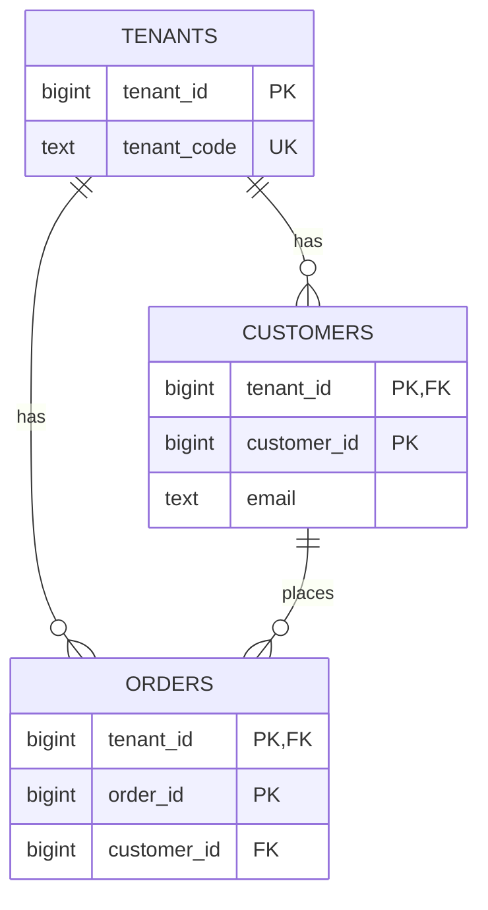

# Composite Keys and Multi-Column Constraints in PostgreSQL

In a relational database, a row is not always uniquely identified by **a single column**. For instance, products can be stored across multiple warehouses: `warehouse_id` alone does not identify an inventory balance row, and `product_id` alone does not identify one either. Yet the **pair** `(warehouse_id, product_id)` uniquely identifies the stock balance of a product at a specific warehouse.

Similarly, when software serves multiple companies (*multi-tenant*), `customer_id = 10` can validly exist in two different tenants. Here the **pair** `(tenant_id, customer_id)` forms the complete identity. Multi-column keys and constraints let PostgreSQL enforce those invariants directly rather than relying solely on application checks.

This lesson belongs to the **Constraints** chapter and focuses on:

- **Composite primary keys**: `PRIMARY KEY (col_a, col_b)`.
- **Multi-column unique constraints**: `UNIQUE (col_a, col_b)` and `NULL` semantics.
- **Composite foreign keys**: `FOREIGN KEY (a, b) REFERENCES parent (x, y)`.
- **Multi-column CHECK constraints**: enforcing relationships among values **within the same row**.
- How PostgreSQL handles `MATCH SIMPLE`, `MATCH FULL`, `DEFERRABLE`, indexes, updates/deletes, and migrations.

We will build runnable SQL examples, test valid and invalid data, and analyze common design pitfalls.

## 1. From Single Keys to Composite Keys

A **key** is a set of attributes that can uniquely identify a row. With one attribute, it is a simple key; when two or more attributes are required, it is a **composite key**.

Consider an inventory table:

| warehouse_id | product_id | on_hand_qty |
| ---: | ---: | ---: |
| 1 | 100 | 20 |
| 1 | 200 | 15 |
| 2 | 100 | 8 |

Notice:

- `warehouse_id = 1` appears **twice**.
- `product_id = 100` appears **twice**.
- The **pair** `(warehouse_id, product_id)` never repeats in valid data.

Thus, the appropriate constraint is:

```sql
PRIMARY KEY (warehouse_id, product_id)
```

A composite key does not mean “concatenating two numbers into a string”; rather, PostgreSQL evaluates **uniqueness across the tuple of columns**. Two rows collide when all corresponding values across the key tuple match according to constraint rules.

### 1.1. A Composite Key Is a Joint Constraint

Do not confuse:

```sql
-- One composite primary key:
PRIMARY KEY (warehouse_id, product_id)
```

with:

```sql
-- Two independent UNIQUE constraints: completely different meaning.
UNIQUE (warehouse_id),
UNIQUE (product_id)
```

Two separate `UNIQUE` constraints would prevent two products from existing in warehouse 1 and prevent product 100 from existing in two warehouses. That violates the business model. A single `UNIQUE (warehouse_id, product_id)` only forbids **duplicate pairs**, fitting many-to-many relationships.

### 1.2. Candidate Key, Primary Key, and Alternate Key

A **candidate key** is a minimal attribute set sufficient to uniquely identify a row under logical design. A table can have several candidate keys. The designer selects **one** as the `PRIMARY KEY`, while remaining candidate keys can be protected with `UNIQUE`.

Product example:

```text
product_id: system-generated internal key
sku:        business-unique SKU code
```

You can choose `product_id` as the PK and `sku` as `UNIQUE`. Conversely, if products are identified per `(tenant_id, sku)`, that pair can serve as either the primary key or an alternate candidate key depending on requirements.

**Having multiple columns in a table does not automatically mean you need a composite key.** The decision comes from **business identity and uniqueness rules**.

## 2. Multi-Column PRIMARY KEY Syntax

In PostgreSQL, a composite primary key is declared at the **table** level:

```sql
CREATE TABLE stock_levels (
    warehouse_id BIGINT NOT NULL,
    product_id   BIGINT NOT NULL,
    on_hand_qty  INTEGER NOT NULL DEFAULT 0,
    PRIMARY KEY (warehouse_id, product_id),
    CHECK (on_hand_qty >= 0)
);
```

PostgreSQL guarantees:

1. Both primary key columns **cannot be NULL**.
2. The `(warehouse_id, product_id)` combination **cannot repeat**.
3. The primary key is backed by an automatically created **unique B-tree index**.
4. Other tables can reference it with a **composite foreign key**.

A table has **only one `PRIMARY KEY` constraint**, though that key may span multiple columns. You cannot declare two separate primary keys and treat them as one composite key.

### 2.1. Naming Constraints

Instead of letting PostgreSQL pick an automatic name, you can name it explicitly:

```sql
CREATE TABLE stock_levels_named (
    warehouse_id BIGINT NOT NULL,
    product_id   BIGINT NOT NULL,
    on_hand_qty  INTEGER NOT NULL CHECK (on_hand_qty >= 0),
    CONSTRAINT pk_stock_levels_named
        PRIMARY KEY (warehouse_id, product_id)
);
```

Explicit names make errors easier to identify in migrations and logs:

```text
duplicate key value violates unique constraint "pk_stock_levels_named"
```

In large systems, concise and consistent naming such as `pk_*`, `fk_*`, `uq_*`, `chk_*` eases operations. Still, **the constraint name does not determine semantics**; the column list does.

### 2.2. Never Write Separate PRIMARY KEYs on Individual Columns

The following is **invalid for creating a composite key**:

```sql
-- WRONG: attempts to define two separate PRIMARY KEYs on the same table.
CREATE TABLE wrong_example (
    warehouse_id BIGINT PRIMARY KEY,
    product_id BIGINT PRIMARY KEY
);
```

PostgreSQL forbids two PK constraints on one table. The right syntax groups the columns together:

```sql
CREATE TABLE correct_example (
    warehouse_id BIGINT NOT NULL,
    product_id BIGINT NOT NULL,
    PRIMARY KEY (warehouse_id, product_id)
);
```

`wrong_example` and `correct_example` above are syntax illustrations only; **do not run intentionally failing statements** inside a transaction you plan to commit.

## 3. Multi-Column UNIQUE: Tuple-Level Uniqueness

You do not always need a composite key as the `PRIMARY KEY`. Many tables use a single internal ID alongside a **multi-column business uniqueness constraint**.

For example, a product SKU must be unique **within each tenant**, while another tenant may reuse the same SKU:

```sql
CREATE TABLE tenant_products_example (
    id BIGINT GENERATED ALWAYS AS IDENTITY PRIMARY KEY,
    tenant_id BIGINT NOT NULL,
    sku TEXT NOT NULL,
    name TEXT NOT NULL,
    CONSTRAINT uq_tenant_products_sku UNIQUE (tenant_id, sku)
);
```

Outcome:

| tenant_id | sku | Allowed to Insert? |
| ---: | --- | --- |
| 1 | BOOK-A5 | Yes |
| 1 | PEN-01 | Yes |
| 2 | BOOK-A5 | Yes, different tenant |
| 1 | BOOK-A5 again | **No**, duplicate tuple |

Writing `UNIQUE (sku)` instead would force SKUs to be unique **system-wide**, stricter than “unique per tenant”.

### 3.1. How Do PRIMARY KEY and UNIQUE Differ?

| Criterion | `PRIMARY KEY (a, b)` | `UNIQUE (a, b)` |
| --- | --- | --- |
| Forbids duplicate tuples | Yes | Yes |
| Forbids NULL in all columns by default | **Yes** | **No**, unless `NOT NULL` or special NULL rules are used |
| Constraints allowed per table | At most one PK | Multiple `UNIQUE` constraints allowed |
| Valid foreign key target | Yes | Yes, if meeting PostgreSQL requirements |
| Automatic supporting index | Yes | Yes |
| Modeling role | Primary row identifier | Alternate key / additional uniqueness rule |

Therefore, do not treat `UNIQUE (a, b)` and `PRIMARY KEY (a, b)` as completely interchangeable when columns can contain `NULL`.

## 4. NULL in Multi-Column UNIQUE

This detail matters because data can look “duplicate” while PostgreSQL permits it.

In PostgreSQL, default `UNIQUE` behavior treats `NULL` values as **distinct** during uniqueness checks. Hence multiple rows can coexist like:

```text
tenant_id | external_code
----------+--------------
1         | NULL
1         | NULL
```

if declared simply as:

```sql
UNIQUE (tenant_id, external_code)
```

### 4.1. Runnable Example

```sql
CREATE TABLE unique_null_demo (
    demo_id BIGINT GENERATED ALWAYS AS IDENTITY PRIMARY KEY,
    tenant_id BIGINT NOT NULL,
    external_code TEXT,
    UNIQUE (tenant_id, external_code)
);

INSERT INTO unique_null_demo (tenant_id, external_code)
VALUES
    (1, NULL),
    (1, NULL),
    (1, 'EXT-001');

-- Attempting to insert (1, 'EXT-001') again violates UNIQUE.
```

Note: `NULL` in SQL means **unknown/absent value**, not the empty string `''`. An empty string is a concrete value, so two `(1, '')` rows will collide under a standard `UNIQUE` constraint.

### 4.2. UNIQUE NULLS NOT DISTINCT in PostgreSQL 15+

If business rules require **at most one row with a NULL external code per tenant**, PostgreSQL 15 and later support:

```sql
CREATE TABLE unique_nulls_not_distinct_demo (
    demo_id BIGINT GENERATED ALWAYS AS IDENTITY PRIMARY KEY,
    tenant_id BIGINT NOT NULL,
    external_code TEXT,
    CONSTRAINT uq_tenant_external_code
        UNIQUE NULLS NOT DISTINCT (tenant_id, external_code)
);
```

Then:

- First `(1, NULL)`: valid.
- Second `(1, NULL)`: **rejected**.
- `(2, NULL)`: valid because the tenant differs.

`NULLS NOT DISTINCT` on a unique constraint does not make SQL's general `NULL = NULL` comparison return `TRUE`. It is **specific to uniqueness checking on that constraint or index**, leaving SQL's three-valued `=` logic unchanged.

On PostgreSQL versions prior to 15, design an alternative such as an appropriate partial/expression unique index or disallow `NULL`, depending on the domain. Never use `NULLS NOT DISTINCT` syntax on unsupported versions.

## 5. Composite Foreign Keys: Linking Multiple Columns Accurately

If the parent table has primary key:

```sql
PRIMARY KEY (tenant_id, customer_id)
```

then the child table must reference **the entire pair** to enforce tenant–customer identity:

```sql
FOREIGN KEY (tenant_id, customer_id)
REFERENCES customers (tenant_id, customer_id)
```

Watch **column matching order**: the first column in the child list is compared against the first column in the parent `REFERENCES` list, and likewise for the second and third. Never accidentally swap `tenant_id` and `customer_id` just because both have type `BIGINT`.

### 5.1. Relationship Diagram



If you only declare:

```sql
-- Insufficient to enforce tenant isolation in this model:
FOREIGN KEY (customer_id) REFERENCES customers (customer_id)
```

first, PostgreSQL **rejects it** because `customer_id` alone is not unique in the parent table; second, even if you added a global single key just to make the FK compile, that design **fails to enforce the tenant scope of the relationship**. The invariant to protect is “this order belongs to a customer of the **same tenant**”.

### 5.2. Requirements for a Multi-Column Foreign Key Target

Target FK columns must have qualifying uniqueness: typically a `PRIMARY KEY`, a **non-deferrable `UNIQUE` constraint**, or a **non-partial unique index** meeting PostgreSQL rules.

For example, if the parent has `PRIMARY KEY (warehouse_id, product_id)`, a child can write `REFERENCES parent(warehouse_id, product_id)`. It cannot reference `product_id` alone unless that column has its own qualifying unique constraint or index.

A **partial unique index** like:

```sql
CREATE UNIQUE INDEX ux_active_codes
ON some_table (tenant_id, code)
WHERE active;
```

only protects rows with `active = true`; it is **not a table-wide unique key** usable as an ordinary FK target. This example illustrates the limitation only—do not run it if `some_table` does not exist.

### 5.3. Foreign Keys Do Not Auto-Create Child Indexes

PostgreSQL creates indexes for the **parent table's** PK/UNIQUE constraints, but **does not automatically create indexes on referencing columns in child tables**.

Example:

```sql
CREATE INDEX idx_orders_customer_scope
ON orders (tenant_id, customer_id);
```

A child-side index can help:

- Querying orders for a customer.
- Finding child rows when updating or deleting parent keys.
- Reducing referential check overhead under large workloads.

However, if the child table's PK already leads with those columns or the workload is tiny, an extra index may not be needed. Inspect existing indexes, real queries, and `EXPLAIN` before creating duplicates.

## 6. Practice Model: Multi-Tenant Customers and Orders

This DDL block is **runnable in a dedicated PostgreSQL learning database**. Create a fresh schema so existing business tables are untouched. The script assumes none of these tables exist yet in `composite_lab`; when re-running exercises, use a clean test database or schema rather than accidentally deleting live data.

### 6.1. Creating Tenants

```sql
CREATE SCHEMA IF NOT EXISTS composite_lab;

CREATE TABLE composite_lab.tenants (
    tenant_id   BIGINT PRIMARY KEY,
    tenant_code TEXT NOT NULL UNIQUE,
    tenant_name TEXT NOT NULL
);
```

To make sample values easy to follow, this lesson assigns integer IDs explicitly. Real applications may use identity, UUIDs, or another ID generator; that choice does not change the meaning of **composite keys** in child tables.

### 6.2. Customers with a Composite Primary Key

```sql
CREATE TABLE composite_lab.customers (
    tenant_id   BIGINT NOT NULL,
    customer_id BIGINT NOT NULL,
    email       TEXT NOT NULL,
    full_name   TEXT NOT NULL,
    CONSTRAINT pk_customers
        PRIMARY KEY (tenant_id, customer_id),
    CONSTRAINT uq_customers_tenant_email
        UNIQUE (tenant_id, email),
    CONSTRAINT fk_customers_tenant
        FOREIGN KEY (tenant_id)
        REFERENCES composite_lab.tenants (tenant_id)
        ON DELETE RESTRICT,
    CONSTRAINT chk_customers_name
        CHECK (length(btrim(full_name)) > 0)
);
```

Meaning:

- Two tenants can share the same `customer_id`.
- Within one tenant, each `customer_id` can appear only once.
- Email must be unique **per tenant** in this model, not necessarily across the entire platform.
- Every customer must belong to an existing tenant.

**Note:** `UNIQUE (tenant_id, email)` here is case-sensitive under standard text comparison/collation. If business rules require case-insensitive emails, add an explicit design such as an expression unique index on `lower(email)`, `citext`, or an appropriate collation with confirmed normalization rules.

### 6.3. Orders Referencing Customers by Both Columns

```sql
CREATE TABLE composite_lab.orders (
    tenant_id   BIGINT NOT NULL,
    order_id    BIGINT NOT NULL,
    customer_id BIGINT NOT NULL,
    request_key TEXT NOT NULL,
    status      TEXT NOT NULL DEFAULT 'DRAFT',
    placed_at   TIMESTAMPTZ NOT NULL DEFAULT now(),
    CONSTRAINT pk_orders
        PRIMARY KEY (tenant_id, order_id),
    CONSTRAINT uq_orders_request
        UNIQUE (tenant_id, request_key),
    CONSTRAINT fk_orders_customer
        FOREIGN KEY (tenant_id, customer_id)
        REFERENCES composite_lab.customers (tenant_id, customer_id)
        ON UPDATE RESTRICT
        ON DELETE RESTRICT,
    CONSTRAINT chk_orders_status
        CHECK (status IN ('DRAFT', 'PLACED', 'CANCELLED'))
);

-- customer_id does not lead the orders PK.
-- This index supports customer-order queries and FK checks.
CREATE INDEX idx_orders_customer
ON composite_lab.orders (tenant_id, customer_id);
```

Key point of `fk_orders_customer`: an `orders` row with `tenant_id = 1` and `customer_id = 10` is valid only if **the exact pair** `(1, 10)` exists in `customers`. Having `customer_id = 10` under tenant 2 does not satisfy tenant 1's order.

### 6.4. Products and Order Items in the Same Tenant

```sql
CREATE TABLE composite_lab.products (
    tenant_id   BIGINT NOT NULL,
    product_id  BIGINT NOT NULL,
    sku         TEXT NOT NULL,
    name        TEXT NOT NULL,
    price       NUMERIC(12, 2) NOT NULL,
    CONSTRAINT pk_products
        PRIMARY KEY (tenant_id, product_id),
    CONSTRAINT uq_products_sku
        UNIQUE (tenant_id, sku),
    CONSTRAINT fk_products_tenant
        FOREIGN KEY (tenant_id)
        REFERENCES composite_lab.tenants (tenant_id),
    CONSTRAINT chk_products_price
        CHECK (price >= 0)
);

CREATE TABLE composite_lab.order_items (
    tenant_id   BIGINT NOT NULL,
    order_id    BIGINT NOT NULL,
    line_no     INTEGER NOT NULL,
    product_id  BIGINT NOT NULL,
    quantity    INTEGER NOT NULL,
    unit_price  NUMERIC(12, 2) NOT NULL,
    CONSTRAINT pk_order_items
        PRIMARY KEY (tenant_id, order_id, line_no),
    CONSTRAINT uq_order_items_product
        UNIQUE (tenant_id, order_id, product_id),
    CONSTRAINT fk_items_order
        FOREIGN KEY (tenant_id, order_id)
        REFERENCES composite_lab.orders (tenant_id, order_id)
        ON DELETE RESTRICT,
    CONSTRAINT fk_items_product
        FOREIGN KEY (tenant_id, product_id)
        REFERENCES composite_lab.products (tenant_id, product_id)
        ON DELETE RESTRICT,
    CONSTRAINT chk_items_line
        CHECK (line_no > 0),
    CONSTRAINT chk_items_quantity
        CHECK (quantity > 0),
    CONSTRAINT chk_items_unit_price
        CHECK (unit_price >= 0)
);

CREATE INDEX idx_order_items_product
ON composite_lab.order_items (tenant_id, product_id);
```

This model protects two invariants simultaneously:

1. Line item `(tenant_id, order_id, line_no)` belongs to the matching order `(tenant_id, order_id)`.
2. Product `(tenant_id, product_id)` belongs to the **same tenant** as the line item.

If you placed an FK on `product_id` alone to a global ID without `tenant_id`, “never put another company's product into this order” would not be enforced by the database.

`UNIQUE (tenant_id, order_id, product_id)` here means **each product appears at most once per order**. If business rules allow multiple lines of the same product with different discounts, batches, or tax rates, remove or revise that constraint; `line_no` already distinguishes each line.

### 6.5. Inserting Valid Data

```sql
INSERT INTO composite_lab.tenants
    (tenant_id, tenant_code, tenant_name)
VALUES
    (1, 'SHOP-A', 'Shop A'),
    (2, 'SHOP-B', 'Shop B');

-- Both tenants can share customer_id = 10.
INSERT INTO composite_lab.customers
    (tenant_id, customer_id, email, full_name)
VALUES
    (1, 10, 'lan@shop-a.test', 'Nguyen Lan'),
    (2, 10, 'lan@shop-b.test', 'Tran Lan'),
    (2, 20, 'minh@shop-b.test', 'Tran Minh');

INSERT INTO composite_lab.products
    (tenant_id, product_id, sku, name, price)
VALUES
    (1, 100, 'BOOK-01', 'Notebook A', 45000),
    (2, 100, 'BOOK-01', 'Notebook B', 50000),
    (2, 200, 'PEN-02', 'Ballpoint Pen B', 8000);

INSERT INTO composite_lab.orders
    (tenant_id, order_id, customer_id, request_key, status)
VALUES
    (1, 500, 10, 'REQUEST-A-500', 'PLACED'),
    (2, 500, 10, 'REQUEST-B-500', 'PLACED');

INSERT INTO composite_lab.order_items
    (tenant_id, order_id, line_no, product_id, quantity, unit_price)
VALUES
    (1, 500, 1, 100, 2, 45000),
    (2, 500, 1, 200, 1, 8000);
```

In this dataset, both tenants **share**:

- `customer_id = 10`.
- `order_id = 500`.
- `product_id = 100` (even though each tenant defines different product details).

No PK collision occurs because **`tenant_id` is part of the key**. If a query filters only by `order_id = 500` and forgets `tenant_id`, it can return orders from **both tenants**. That is also why applications need **authorization/RLS and explicit tenant scoping** in queries; composite keys protect relationships, not read access control.

### 6.6. Querying Composite Relationships Properly

```sql
SELECT
    o.tenant_id,
    o.order_id,
    c.full_name,
    i.line_no,
    p.sku,
    i.quantity,
    i.unit_price
FROM composite_lab.orders AS o
JOIN composite_lab.customers AS c
  ON c.tenant_id = o.tenant_id
 AND c.customer_id = o.customer_id
JOIN composite_lab.order_items AS i
  ON i.tenant_id = o.tenant_id
 AND i.order_id = o.order_id
JOIN composite_lab.products AS p
  ON p.tenant_id = i.tenant_id
 AND p.product_id = i.product_id
WHERE o.tenant_id = 1
  AND o.order_id = 500
ORDER BY i.line_no;
```

Every `JOIN` must match **all columns defining the relationship**. Joining only on `customer_id` or `order_id` without `tenant_id` can cross-join two tenants, causing duplicate rows or data leaks.

## 7. Testing Multi-Column Constraints

Statements in this section **intentionally violate constraints**. Run them only in your practice database; inside an explicit transaction, a failure puts the transaction into an aborted state until `ROLLBACK`.

### 7.1. Duplicate Composite Key

```sql
-- customers (1, 10) already exists; this must fail with duplicate key.
INSERT INTO composite_lab.customers
    (tenant_id, customer_id, email, full_name)
VALUES (1, 10, 'another@shop-a.test', 'Duplicate ID customer');
```

Meanwhile `(2, 10)` exists validly because it is **a different combination**.

### 7.2. Duplicate Tenant-Scoped UNIQUE

```sql
-- (1, 'lan@shop-a.test') already exists; this must fail unique.
INSERT INTO composite_lab.customers
    (tenant_id, customer_id, email, full_name)
VALUES (1, 11, 'lan@shop-a.test', 'Duplicate email in tenant');
```

The same email in tenant 2 **is valid** provided no other key collides, because `UNIQUE (tenant_id, email)` applies to the pair.

### 7.3. Order Referencing a Customer from the Wrong Tenant

```sql
-- Customer (2, 20) exists, but (1, 20) does not exist.
INSERT INTO composite_lab.orders
    (tenant_id, order_id, customer_id, request_key, status)
VALUES
    (1, 501, 20, 'WRONG-CUSTOMER-TENANT', 'DRAFT');
```

The expected error is **`foreign_key_violation`**, SQLSTATE `23503`. Having `customer_id = 20` in tenant 2 does not allow an order in tenant 1 to reference it.

### 7.4. Ordering a Product from Another Tenant

```sql
-- Product (2, 200) exists, but (1, 200) does not.
INSERT INTO composite_lab.order_items
    (tenant_id, order_id, line_no, product_id, quantity, unit_price)
VALUES
    (1, 500, 2, 200, 1, 8000);
```

`fk_items_product` rejects it because `(1, 200)` is required in `products`. **This is the direct payoff of composite foreign keys in multi-tenant applications.**

### 7.5. Missing One Component of a Composite Primary Key

```sql
-- A composite primary key forbids NULL in any component.
INSERT INTO composite_lab.customers
    (tenant_id, customer_id, email, full_name)
VALUES
    (1, NULL, 'missing-id@shop-a.test', 'Missing ID customer');
```

The error is `not_null_violation`, SQLSTATE `23502`.

### 7.6. Duplicate Product Within the Same Order

```sql
-- Line 1 of (1, 500) already uses product_id = 100.
-- A different line_no does not bypass UNIQUE(tenant_id, order_id, product_id).
INSERT INTO composite_lab.order_items
    (tenant_id, order_id, line_no, product_id, quantity, unit_price)
VALUES
    (1, 500, 3, 100, 1, 45000);
```

The error comes from the **triple's `UNIQUE` constraint**, not from the PK `(tenant_id, order_id, line_no)`. A table can enforce multiple uniqueness constraints for **distinct rules**.

## 8. Multi-Column CHECK: Protecting Intra-Row Relationships

`CHECK` does more than compare one column against a constant. It can validate **relationships among multiple columns in the same row**.

Inventory balance example:

```sql
CREATE TABLE composite_lab.stock_levels (
    warehouse_id BIGINT NOT NULL,
    product_id   BIGINT NOT NULL,
    on_hand_qty  INTEGER NOT NULL DEFAULT 0,
    reserved_qty INTEGER NOT NULL DEFAULT 0,
    CONSTRAINT pk_stock_levels
        PRIMARY KEY (warehouse_id, product_id),
    CONSTRAINT chk_stock_levels_balances
        CHECK (
            on_hand_qty >= 0
            AND reserved_qty >= 0
            AND reserved_qty <= on_hand_qty
        )
);
```

This lesson uses this table to illustrate warehouse stock balances; in production schemas, `warehouse_id` and `product_id` typically also reference warehouse and product tables. Here we focus on **cross-column constraints**.

Cases:

| warehouse_id | product_id | on_hand_qty | reserved_qty | Valid? |
| ---: | ---: | ---: | ---: | --- |
| 1 | 100 | 20 | 5 | Yes |
| 1 | 200 | 10 | 10 | Yes |
| 2 | 100 | 3 | 4 | **No**, reserved exceeds on-hand |
| 2 | 200 | -1 | 0 | **No**, negative stock |

Test:

```sql
INSERT INTO composite_lab.stock_levels
    (warehouse_id, product_id, on_hand_qty, reserved_qty)
VALUES (1, 100, 20, 5);

-- Intentional CHECK violation:
INSERT INTO composite_lab.stock_levels
    (warehouse_id, product_id, on_hand_qty, reserved_qty)
VALUES (2, 100, 3, 4);
```

This is a **per-row invariant**: for every product in every warehouse, reserved quantity cannot exceed physical on-hand quantity.

### 8.1. CHECK on Time Intervals

A standalone example:

```sql
CREATE TABLE composite_lab.room_bookings (
    booking_id BIGINT GENERATED ALWAYS AS IDENTITY PRIMARY KEY,
    room_id BIGINT NOT NULL,
    starts_at TIMESTAMPTZ NOT NULL,
    ends_at TIMESTAMPTZ NOT NULL,
    CONSTRAINT chk_booking_interval
        CHECK (ends_at > starts_at)
);
```

This only requires each booking's end time to be **after** its start time. It **does not prevent two different bookings for the same room from overlapping**; that is a **multi-row** invariant requiring another mechanism such as an exclusion constraint.

### 8.2. CHECK with NULL: UNKNOWN Is Accepted

In PostgreSQL, a `CHECK` expression fails only when it evaluates to **FALSE**. If it evaluates to **TRUE or NULL/UNKNOWN**, the row is accepted.

Example:

```sql
CREATE TABLE composite_lab.discount_example (
    discount_id BIGINT PRIMARY KEY,
    subtotal NUMERIC(12,2),
    discount NUMERIC(12,2),
    CONSTRAINT chk_discount_bounds
        CHECK (discount >= 0 AND discount <= subtotal)
);
```

If either `subtotal` or `discount` is `NULL`, the expression can evaluate to `UNKNOWN`, allowing the row through. If business rules require both values, add:

```sql
-- Schema fix idea when existing data allows:
ALTER TABLE composite_lab.discount_example
    ALTER COLUMN subtotal SET NOT NULL,
    ALTER COLUMN discount SET NOT NULL;
```

**Never use CHECK instead of NOT NULL** when values are mandatory. The difference between `FALSE` and `UNKNOWN` is a common reason multi-column constraints fail to behave as beginners expect.

### 8.3. CHECK Cannot Arbitrarily Query Other Tables

A flawed idea:

```sql
-- DO NOT RUN: CHECK does not support subqueries like this.
-- CHECK (
--     quantity <= (SELECT available_qty FROM stock_levels ...)
-- )
```

`CHECK` in PostgreSQL is designed for conditions on **the row being written**, not arbitrary cross-table or cross-row invariants. Preventing overselling across concurrent orders requires transactions and guarded `UPDATE ... WHERE ... RETURNING` statements or equivalent synchronization—**not a quantity `CHECK` alone**.

## 9. MATCH SIMPLE and MATCH FULL on Composite Foreign Keys

When a foreign key has nullable columns, how PostgreSQL treats `NULL` matters greatly.

### 9.1. MATCH SIMPLE: The Default

With a composite foreign key `(a, b)` under `MATCH SIMPLE` (the default), if **any referencing column is NULL**, PostgreSQL does not require finding a matching parent row for that pair.

This is helpful for optional relationships, yet it can allow **half-populated references**:

```text
a = 10, b = NULL
```

Such a row is not rejected by a `MATCH SIMPLE` FK itself, even though half of the key is populated.

### 9.2. MATCH FULL: Either Complete Pair or All NULL

`MATCH FULL` requires:

- **All FK columns are NULL**: accepted, representing “no reference”.
- **All FK columns are non-NULL**: must match a parent row.
- **Mixed NULL and non-NULL**: rejected.

Standalone runnable example:

```sql
CREATE TABLE composite_lab.storage_locations (
    warehouse_id BIGINT NOT NULL,
    location_id BIGINT NOT NULL,
    location_name TEXT NOT NULL,
    PRIMARY KEY (warehouse_id, location_id)
);

CREATE TABLE composite_lab.location_requests (
    request_id BIGINT PRIMARY KEY,
    warehouse_id BIGINT,
    location_id BIGINT,
    note TEXT,
    CONSTRAINT fk_location_requests_location
        FOREIGN KEY (warehouse_id, location_id)
        REFERENCES composite_lab.storage_locations (warehouse_id, location_id)
        MATCH FULL
);

INSERT INTO composite_lab.storage_locations
    (warehouse_id, location_id, location_name)
VALUES (1, 10, 'Shelf A');
```

Outcomes by case:

| warehouse_id | location_id | `MATCH FULL` |
| --- | --- | --- |
| 1 | 10 | Valid when parent (1, 10) exists |
| NULL | NULL | Valid: no location referenced |
| 1 | NULL | **Error**, incomplete pair |
| NULL | 10 | **Error**, incomplete pair |
| 1 | 99 | **Error**, no matching parent row |

Test:

```sql
-- Valid:
INSERT INTO composite_lab.location_requests
    (request_id, warehouse_id, location_id, note)
VALUES
    (1, 1, 10, 'Full reference'),
    (2, NULL, NULL, 'No location selected');

-- Intentional MATCH FULL error:
INSERT INTO composite_lab.location_requests
    (request_id, warehouse_id, location_id, note)
VALUES
    (3, 1, NULL, 'Missing location_id');
```

### 9.3. When Should You Use MATCH FULL?

If an optional relationship must follow **“all identifier parts or nothing”**, `MATCH FULL` expresses that rule cleanly.

However, with a relation like:

```text
tenant_id NOT NULL
optional_manager_id NULLABLE
```

and FK `(tenant_id, optional_manager_id)`, using `MATCH FULL` would **reject** any row with a non-NULL `tenant_id` and NULL `manager_id`. In that case, `MATCH SIMPLE` is better: when no manager is assigned, the composite FK skips validation; when `manager_id` is provided, it must match a manager within the same tenant.

Choosing `MATCH SIMPLE` vs. `MATCH FULL` depends on **whether the whole group of columns is optional**, rather than treating one mode as universally better.

## 10. Column Order in Composite Keys and B-tree Indexes

PostgreSQL backs PK/UNIQUE constraints with indexes—typically **B-trees ordered by the declared column sequence**.

Example:

```sql
PRIMARY KEY (tenant_id, order_id)
```

creates an index ordered by `tenant_id` first, then `order_id`. That affects how well the index serves specific query predicates.

| Query | Typical Fit with `(tenant_id, order_id)` Index |
| --- | --- |
| `WHERE tenant_id = 1 AND order_id = 500` | Good: uses both columns |
| `WHERE tenant_id = 1` | Good: uses the left prefix |
| `WHERE order_id = 500` | Not optimal via standard prefix lookup; depends on planner/version and stats |
| `ORDER BY tenant_id, order_id` | Can leverage index sort order where appropriate |
| `WHERE customer_id = 10` | Not served by this PK index because `customer_id` is not in the key |

Do not claim an `(a, b)` index can **never** assist a predicate on `b` alone: newer planner features and cost estimates may pick alternative scan paths. Still, **you cannot expect the same efficiency as leading-column predicates** across all workloads.

### 10.1. Choose Column Order Based on Key Queries

In multi-tenant systems, `tenant_id` is required in almost every query, so placing it ahead of `order_id` or `customer_id` usually makes sense.

Example:

```sql
SELECT *
FROM composite_lab.orders
WHERE tenant_id = 1
ORDER BY order_id DESC
LIMIT 20;
```

The `(tenant_id, order_id)` primary key supports reading orders by tenant in ID order. If your workload also runs many `WHERE order_id = ...` queries **without knowing the tenant**, re-examine both query identification and extra indexes—while watching out for accidental cross-tenant access.

### 10.2. Overly Wide Composite Keys Have Costs

Composite keys with many wide columns, especially `TEXT`, can:

- Inflate index sizes and referencing foreign keys.
- Force joins to compare multiple wide values.
- Increase data transfer and key-update costs.
- Force child tables to carry many foreign key columns.

When a natural tuple is too wide or prone to change, a **surrogate primary key** such as `BIGINT` or `UUID` paired with `UNIQUE` on the business columns is often easier to manage.

**However, a surrogate key never replaces business constraints.** If a student may enroll in a course at most once per semester, you still need `UNIQUE(student_id, course_id, semester_id)` even if the table has its own `enrollment_id`.

## 11. Composite Keys vs. Surrogate Keys: Two Different Designs

### 11.1. Approach A: Composite Key as PK

```sql
CREATE TABLE composite_lab.enrollments_a (
    student_id BIGINT NOT NULL,
    course_id BIGINT NOT NULL,
    semester_code TEXT NOT NULL,
    enrolled_at TIMESTAMPTZ NOT NULL DEFAULT now(),
    PRIMARY KEY (student_id, course_id, semester_code)
);
```

Each student has at most one record for **one course in one semester**, while still able to retake the same course in another semester.

### 11.2. Approach B: Surrogate PK Plus Composite UNIQUE

```sql
CREATE TABLE composite_lab.enrollments_b (
    enrollment_id BIGINT GENERATED ALWAYS AS IDENTITY PRIMARY KEY,
    student_id BIGINT NOT NULL,
    course_id BIGINT NOT NULL,
    semester_code TEXT NOT NULL,
    enrolled_at TIMESTAMPTZ NOT NULL DEFAULT now(),
    CONSTRAINT uq_enrollments_b_business
        UNIQUE (student_id, course_id, semester_code)
);
```

In Approach B, `enrollment_id` is simple for other tables to reference, while business uniqueness is still enforced by the triple.

| Criterion | Composite PK | Surrogate PK + Composite UNIQUE |
| --- | --- | --- |
| Identity derived directly from domain | Yes | Separate technical identifier |
| FK columns in referencing tables | Multiple columns | Usually one column |
| Expressing business uniqueness | Direct | Still requires declaring `UNIQUE` |
| When business codes change | May require PK/FK updates | Surrogate PK usually stays unchanged |
| Index footprint | Potentially fewer indexes | Separate PK index and UNIQUE index |
| Best fit | Junction tables, stable natural keys | Entities with complex lifecycles or many child references |

There is no universal rule that “every table uses BIGSERIAL” or “every junction table uses a composite key”. Weigh **key stability, mutation frequency, downstream references, and primary query patterns**.

## 12. DEFERRABLE: Validating Constraints at Transaction End

Certain constraints can be declared **`DEFERRABLE`**, meaning validation can be **postponed** until later in the transaction.

This helps when statements temporarily produce an invalid state **mid-transaction**, while the final state before commit is valid.

### 12.1. Deferrable Composite Foreign Keys

Example of employees and managers within the same organization:

```sql
CREATE TABLE composite_lab.employees (
    org_id BIGINT NOT NULL,
    employee_id BIGINT NOT NULL,
    manager_id BIGINT,
    full_name TEXT NOT NULL,
    CONSTRAINT pk_employees
        PRIMARY KEY (org_id, employee_id),
    CONSTRAINT fk_employee_manager
        FOREIGN KEY (org_id, manager_id)
        REFERENCES composite_lab.employees (org_id, employee_id)
        DEFERRABLE INITIALLY DEFERRED
);
```

Here `manager_id` is **optional**, so default `MATCH SIMPLE` skips the FK when it is `NULL`. When a manager is specified, the FK requires the manager to belong to the **same `org_id`**.

Try inserting two mutually referencing employees in one transaction:

```sql
BEGIN;

INSERT INTO composite_lab.employees
    (org_id, employee_id, manager_id, full_name)
VALUES (1, 100, 200, 'Employee A');

INSERT INTO composite_lab.employees
    (org_id, employee_id, manager_id, full_name)
VALUES (1, 200, 100, 'Employee B');

COMMIT;
```

With the FK deferred until transaction end, both rows exist at final check time so the transaction succeeds **referentially**. Of course, a management cycle A ↔ B is usually **invalid in business logic**; an FK does not prevent organizational cycles on its own. This example illustrates deferrability, not an HR model to copy as-is.

If you inserted only Employee A without manager 200, `COMMIT` would fail on the FK even though the `INSERT` statement had already run.

### 12.2. INITIALLY IMMEDIATE and INITIALLY DEFERRED

| Declaration | Meaning |
| --- | --- |
| `NOT DEFERRABLE` | Checked at default timing; cannot be postponed with `SET CONSTRAINTS` |
| `DEFERRABLE INITIALLY IMMEDIATE` | Checked immediately by default; can switch to DEFERRED inside a transaction |
| `DEFERRABLE INITIALLY DEFERRED` | Deferred to transaction end by default unless switched |

Example:

```sql
BEGIN;

SET CONSTRAINTS fk_employee_manager IMMEDIATE;

-- Subsequent operations are checked under the new FK mode.

ROLLBACK;
```

In real applications, constraint names may collide across schemas/tables; use `SET CONSTRAINTS` deliberately with awareness of PostgreSQL's name resolution. Switching from DEFERRED to IMMEDIATE checks all pending deferred violations immediately and raises an error if the current state is invalid.

### 12.3. Which Constraints Can Be DEFERRABLE?

In PostgreSQL, **PRIMARY KEY**, **UNIQUE**, **FOREIGN KEY**, and **EXCLUDE** support deferrable modes per their constraint rules. **NOT NULL** and **CHECK** cannot be declared `DEFERRABLE` in standard constraint syntax.

Another important difference: **DEFERRABLE unique constraints cannot serve as conflict arbiters** in `INSERT ... ON CONFLICT`. If your application upserts on a multi-column key, keep that unique constraint/index non-deferrable per PostgreSQL rules rather than assuming a deferrable `UNIQUE` works identically in upserts.

### 12.4. When Should You Avoid Deferring?

Deferred constraints allow errors to surface **at `COMMIT`** rather than on the offending `INSERT` or `UPDATE`. Applications must then:

- Handle commit-time errors and rollbacks.
- Never report “saved successfully” before `COMMIT` returns.
- Avoid keeping long transactions open waiting to reach a valid final state.

Use deferrability only when business flows genuinely require it; default **early checking** is much easier to debug.

## 13. ON DELETE and ON UPDATE with Multi-Column Foreign Keys

Composite foreign keys follow the same referential actions as single-column FKs:

- `ON DELETE RESTRICT`: prevents deleting a parent row while referencing child rows exist.
- `ON DELETE NO ACTION`: default behavior, differing significantly from `RESTRICT` in deferrability where applicable.
- `ON DELETE CASCADE`: deletes matching child rows when the parent row is deleted.
- `ON DELETE SET NULL` / `SET DEFAULT`: sets supported referencing columns per configuration.
- `ON UPDATE CASCADE`: updates child FK columns when the parent key changes, per constraint rules.

### 13.1. Be Careful with SET NULL on Composite Keys

Suppose an FK is `(tenant_id, manager_id)` and `tenant_id` is `NOT NULL`. If `ON DELETE SET NULL` clears **both** columns, it violates `NOT NULL` on `tenant_id`.

In PostgreSQL versions supporting a column list on `ON DELETE SET NULL`, you can nullify only the optional column:

```sql
-- Syntax illustration; do not run on the example table without
-- adjusting the existing constraint:
FOREIGN KEY (tenant_id, manager_id)
REFERENCES employees (org_id, employee_id)
ON DELETE SET NULL (manager_id)
```

That keeps the employee in their existing tenant while clearing their manager when the manager is deleted. Still, whether **deleting a manager and leaving an unassigned gap** is allowed is a business decision; many systems prefer `RESTRICT` or reassigning reports before deletion.

### 13.2. CASCADE Can Spread Very Broadly

In a chain:

```text
tenants -> customers -> orders -> order_items
```

If every FK uses `CASCADE`, deleting one tenant wipes all customer, order, and line-item history. For transactional data, that can violate reconciliation, accounting retention, and audit requirements.

Choose `ON DELETE` according to true entity lifecycles: `RESTRICT` for critical history, `CASCADE` only when child rows have no standalone meaning and deletion is business-approved, or controlled archival/anonymization workflows.

## 14. UPSERT with Composite Keys

When inserting inventory levels and updating if the warehouse–product pair already exists, PostgreSQL supports `INSERT ... ON CONFLICT` on composite keys.

Using `composite_lab.stock_levels`:

```sql
INSERT INTO composite_lab.stock_levels
    (warehouse_id, product_id, on_hand_qty, reserved_qty)
VALUES
    (1, 100, 20, 0)
ON CONFLICT (warehouse_id, product_id)
DO UPDATE
SET on_hand_qty = EXCLUDED.on_hand_qty,
    reserved_qty = EXCLUDED.reserved_qty;
```

`EXCLUDED` holds the proposed values from the `INSERT`. Conflict target `(warehouse_id, product_id)` matches the composite PK's uniqueness constraint.

**Important caution:** the example above *overwrites the balance from an authoritative snapshot*, not “add 20 units to stock”. In real warehouse systems, overwriting balances can lose concurrent updates unless properly designed; use inventory ledgers, transactions, and atomic increment/decrement operations aligned with business semantics.

### 14.1. ON CONFLICT Does Not Bypass Foreign Keys

`ON CONFLICT` handles collisions on a matching unique constraint/index. It **never bypasses FK or CHECK errors**. If an UPSERT sets `reserved_qty > on_hand_qty`, `CHECK` still rejects it. If an order item references a product from the wrong tenant, the FK still rejects it.

### 14.2. A Multi-Column UNIQUE Constraint Can Act as Arbiter

```sql
INSERT INTO composite_lab.orders
    (tenant_id, order_id, customer_id, request_key, status)
VALUES (1, 502, 10, 'REQUEST-A-500', 'DRAFT')
ON CONFLICT ON CONSTRAINT uq_orders_request
DO NOTHING;
```

Because `(tenant_id, request_key) = (1, 'REQUEST-A-500')` already exists, the insert is skipped via the matching unique arbiter.

However, for order-API **idempotency**, `DO NOTHING` does not verify whether the retried payload matches the original request. The application must still validate payload equivalence, quantities, amounts, and return the original response.

## 15. Indexes and Performance of Composite Constraints

A composite key both protects data integrity and shapes query execution.

### 15.1. Viewing Existing Constraints

In `psql`:

```text
\d composite_lab.customers
\d composite_lab.orders
\d composite_lab.order_items
```

`\d` is a **`psql` meta-command**, not standard SQL sent across every driver.

With SQL, inspect constraints:

```sql
SELECT
    conname,
    contype,
    condeferrable,
    condeferred,
    pg_get_constraintdef(oid) AS definition
FROM pg_constraint
WHERE conrelid = 'composite_lab.order_items'::regclass
ORDER BY conname;
```

Common `contype` values:

| Value | Constraint |
| --- | --- |
| `p` | Primary key |
| `u` | Unique |
| `f` | Foreign key |
| `c` | Check |
| `x` | Exclusion |

`pg_get_constraintdef` shows PostgreSQL's stored constraint definition, useful for verifying column order and referential actions.

### 15.2. Viewing Indexes

```sql
SELECT
    indexname,
    indexdef
FROM pg_indexes
WHERE schemaname = 'composite_lab'
  AND tablename = 'order_items'
ORDER BY indexname;
```

You will see the indexes backing the PK/UNIQUE constraints plus the extra index created by our script. Never create an identical redundant index on `(tenant_id, order_id, line_no)` on top of the PK; it only adds maintenance cost.

### 15.3. Reading EXPLAIN

```sql
EXPLAIN
SELECT *
FROM composite_lab.order_items
WHERE tenant_id = 1
  AND order_id = 500;
```

On a tiny sample table with just a few rows, the planner may choose `Seq Scan` because scanning a tiny table is cheapest. That **does not mean the composite PK is ignored as a constraint**. PostgreSQL always enforces uniqueness on writes, while the planner picks read plans by estimated cost.

On large tables, the PK index `(tenant_id, order_id, line_no)` naturally serves `tenant_id = ? AND order_id = ?` because those columns form the index's leading prefix.

### 15.4. Child-Side Foreign Keys and Deadlocks

When updating or deleting a parent key with many child rows, PostgreSQL checks the FK and may lock or scan many rows. Missing an appropriate child-side index makes those checks slow.

Multi-table, multi-row transactions can also deadlock if sessions acquire locks in opposite orders. **Never assume composite keys prevent deadlocks automatically.** Keep lock acquisition order consistent, keep transactions short, and implement proper retry policies for `40P01`.

## 16. Adding Composite Constraints to Populated Tables

In live systems, adding a PK, FK, or UNIQUE constraint is more than a few lines of DDL: you must audit existing data, understand locking, and account for active writers.

### 16.1. Find Duplicate Pairs Before Adding UNIQUE

Suppose you want to protect `(tenant_id, external_ref)` on an existing table:

```sql
SELECT
    tenant_id,
    external_ref,
    COUNT(*) AS duplicate_count
FROM some_existing_table
GROUP BY tenant_id, external_ref
HAVING COUNT(*) > 1;
```

This is a **query template**—run it only when `some_existing_table` actually exists. Check `NULL` semantics before concluding duplicates violate standard `UNIQUE`: two rows with `external_ref IS NULL` are allowed under default `UNIQUE`, but rejected under `NULLS NOT DISTINCT`.

### 16.2. Adding a Foreign Key with NOT VALID

For large tables, PostgreSQL lets you add a `FOREIGN KEY` as `NOT VALID` to avoid scanning **all historical rows immediately on creation**:

```sql
-- Migration syntax example assuming tables and keys already exist.
ALTER TABLE some_child
    ADD CONSTRAINT fk_child_parent
    FOREIGN KEY (tenant_id, parent_id)
    REFERENCES some_parent (tenant_id, parent_id)
    NOT VALID;

-- After cleaning legacy data and scheduling an appropriate window:
ALTER TABLE some_child
    VALIDATE CONSTRAINT fk_child_parent;
```

With a `NOT VALID` FK, PostgreSQL still enforces the constraint on new writes and updates, while **existing rows** are not verified until `VALIDATE CONSTRAINT` completes.

**Do not assume** every constraint type supports `NOT VALID` the same way foreign keys do. In PostgreSQL, `NOT VALID` applies to `FOREIGN KEY` and `CHECK`; adding `UNIQUE`/`PRIMARY KEY` on large tables requires a different strategy.

### 16.3. Creating a Unique Index CONCURRENTLY and Attaching the Constraint

For large tables, you can run `CREATE UNIQUE INDEX CONCURRENTLY` across the composite columns (once data has no duplicates) to avoid long write locks while building the index:

```sql
-- Migration template only; table and columns must exist.
CREATE UNIQUE INDEX CONCURRENTLY ux_existing_tenant_external
ON some_existing_table (tenant_id, external_ref);

ALTER TABLE some_existing_table
    ADD CONSTRAINT uq_existing_tenant_external
    UNIQUE USING INDEX ux_existing_tenant_external;
```

Key caveats:

- `CREATE INDEX CONCURRENTLY` **cannot run inside an explicit transaction block**.
- It takes time and resources; if duplicates exist, building the unique index fails.
- Not every expression index, partial index, or index configuration can be converted into a `UNIQUE` constraint via `USING INDEX`.
- `ALTER TABLE ... ADD CONSTRAINT ... USING INDEX` still acquires locks and has operational cost to review in a runbook.
- For **`PRIMARY KEY`**, participating columns must also be `NOT NULL`; migrations may require ensuring non-nullability beforehand.

If a concurrent index build fails, it may leave an invalid index that must be inspected and cleaned up per PostgreSQL procedures; never blindly re-run in a loop on production.

### 16.4. Do Not Change a Primary Key Without Checking Dependent Tables

Migrating from a single-column PK `id` to a composite PK `(tenant_id, id)` can cascade into:

- Adding `tenant_id` to child tables.
- Backfilling `tenant_id` from trusted sources.
- Verifying referenced rows share the same tenant.
- Building supporting indexes/unique keys.
- Converting single-column FKs into composite FKs.
- Updating `JOIN` queries and ORM/JPA mappings.
- Updating APIs, cache keys, idempotency keys, and event schemas.

Such a change requires a multi-phase migration, testing on representative data, and backward-compatible rollouts—never rewrite every constraint at once without checking the application.

## 17. Multi-Column Constraints in Multi-Tenant Systems

Multi-tenant designs make composite keys very useful, yet you must distinguish **referential integrity** from **authorization**.

### 17.1. Composite FKs Help Prevent Cross-Tenant Data Corruption

Example:

```text
orders(tenant_id, customer_id)
    -> customers(tenant_id, customer_id)

order_items(tenant_id, order_id)
    -> orders(tenant_id, order_id)

order_items(tenant_id, product_id)
    -> products(tenant_id, product_id)
```

All three FKs force links to stay **within the same tenant** at the key level. That reduces the risk of an application bug missing a filter and linking records across tenants.

### 17.2. FKs Do Not Automatically Block Cross-Tenant SELECTs

If an application role is allowed to query every row:

```sql
SELECT * FROM composite_lab.orders;
```

composite keys do not filter results to the logged-in tenant. Protecting multi-tenant data requires **explicit tenant scoping in queries**, proper privileges, and potentially **Row-Level Security (RLS)** aligned with your threat model and architecture.

Never trust a `tenant_id` from an HTTP request without binding it to the user's authenticated identity.

### 17.3. Idempotency Keys Usually Need Tenant Scope

Example constraint:

```sql
UNIQUE (tenant_id, request_key)
```

lets tenants A and B both use request key `REQ-001`, while preventing two identical keys within the **same tenant** from creating two orders. Still, an idempotent API must also verify retry payload matching, commit status, and cached responses; a `UNIQUE` constraint alone is not the entire retry contract.

## 18. When Do You Need Another Constraint Instead of Multi-Column CHECK?

Not every multi-attribute rule fits PK, FK, UNIQUE, or CHECK:

| Rule | Appropriate Mechanism |
| --- | --- |
| `(warehouse_id, product_id)` pairs cannot repeat | Composite `PRIMARY KEY` or `UNIQUE` |
| Order line points to a product in the same tenant | `FOREIGN KEY (tenant_id, product_id)` |
| `reserved_qty <= on_hand_qty` within **one row** | `CHECK` combined with `NOT NULL` |
| Two bookings for the same room **never overlap in time** | **EXCLUDE constraint** with range type and matching index operator class |
| A `PLACED` order has **at least one line item** | Transaction/service logic or appropriate constraint trigger / deferred check |
| Total sold quantity across concurrent transactions never exceeds stock | Guarded `UPDATE` / row locking + transaction |
| At most one `active = true` record per group | Partial unique index where semantics fit |
| “Order total equals sum of line items” | Transactions, update logic, and cross-table verification |

### 18.1. EXCLUDE Example for Two Time Intervals

Suppose no room may have two overlapping bookings. `CHECK (ends_at > starts_at)` only confirms **each booking is valid on its own**, without comparing it to other bookings.

PostgreSQL offers **exclusion constraints** to express conflicts across rows:

```sql
-- Extended example: requires privileges to install extensions and operator classes.
CREATE EXTENSION IF NOT EXISTS btree_gist;

CREATE TABLE composite_lab.room_reservations (
    reservation_id BIGINT GENERATED ALWAYS AS IDENTITY PRIMARY KEY,
    room_id BIGINT NOT NULL,
    period TSTZRANGE NOT NULL,
    CHECK (NOT isempty(period)),
    EXCLUDE USING gist (
        room_id WITH =,
        period WITH &&
    )
);
```

In short, this forbids two rows with equal `room_id` from having `period` ranges that **overlap** under the `&&` operator. The `btree_gist` extension provides GiST operator classes for equality on scalar types like `BIGINT`. This differs from `UNIQUE` because it detects **interval overlap**, not just full-value equality.

When defining reservation intervals, also establish boundary inclusivity policies: for instance, back-to-back bookings touching at checkout time are allowed with half-open `[)` ranges. If your domain requires turnaround buffers between bookings, encode that rule explicitly.

## 19. Common Misconceptions

| Misconception | Accurate Explanation |
| --- | --- |
| “A composite key is two separate PRIMARY KEYs.” | A table has **one PK**, though that PK can contain multiple columns. |
| “`UNIQUE(a, b)` is the same as `UNIQUE(a)` and `UNIQUE(b)`.” | Composite `UNIQUE` only protects the **tuple**, not each column individually. |
| “A composite PRIMARY KEY can contain NULL.” | Every PK column is `NOT NULL`. |
| “Composite UNIQUE always rejects two rows with NULL in the same column.” | By default `NULL` is distinct; PostgreSQL 15+ adds `NULLS NOT DISTINCT` when needed. |
| “A foreign key on `customer_id` alone is enough in multi-tenant schemas.” | If IDs can repeat across tenants, reference **both `tenant_id` and `customer_id`**. |
| “If FK columns share names, PostgreSQL matches them automatically.” | You must list columns explicitly in matching ordinal order. |
| “If the parent has a composite PK, the child FK gets an index automatically.” | PostgreSQL **does not auto-create** indexes for child FK columns. |
| “A partial unique index can always be an FK target.” | An FK needs a qualifying full-table unique target, not an arbitrary partial index. |
| “`MATCH SIMPLE` blocks half-populated references.” | By default it skips the FK check when **any** FK column is NULL. |
| “`MATCH FULL` is always better than `MATCH SIMPLE`.” | With `tenant_id NOT NULL` and an optional referenced column, `MATCH FULL` rejects valid business rows. |
| “`CHECK` can inspect balances across all other rows.” | `CHECK` evaluates a single row; multi-row invariants need other mechanisms. |
| “`CHECK (a <= b)` guarantees `a` and `b` are non-NULL.” | `CHECK` permits `UNKNOWN`; add `NOT NULL` if values are required. |
| “Indexes `(a, b)` and `(b, a)` always perform identically.” | Index column order affects query selectivity and prefix access. |
| “Using an auto-increment ID eliminates the need for business UNIQUE rules.” | Surrogate keys do not prevent duplicate business keys. |
| “`DEFERRABLE` means FKs are never checked.” | Constraints must still hold at check time, typically `COMMIT`. |
| “`DEFERRABLE UNIQUE` always works as an `ON CONFLICT` arbiter.” | Deferrable PK/UNIQUE constraints are not supported as `ON CONFLICT` arbiters. |
| “`ON DELETE CASCADE` is always the most convenient choice.” | It can wipe historical records that must be preserved. |
| “Composite keys alone stop cross-tenant reads.” | Referential integrity is not authorization; use tenant scoping or RLS. |
| “Create indexes on every column regardless of the PK index.” | Easily creates redundant indexes and slows down writes. |

## 20. Practice Exercises

1. For an inventory table with `(1, 100)`, `(1, 200)`, and `(2, 100)`, explain why `PRIMARY KEY(warehouse_id, product_id)` fits better than two independent `UNIQUE` constraints.
2. Create `student_course_term` with composite primary key `(student_id, course_id, term_id)`. Insert the same course across **two different terms**, then try inserting a duplicate within the same term.
3. Create a version using surrogate `enrollment_id` and `UNIQUE(student_id, course_id, term_id)`. Compare how an exam-results table references both designs.
4. Create `tenants/customers/orders/order_items` from Section 6. Prove two tenants can share `customer_id = 10` and `order_id = 500`.
5. Try inserting an order for tenant 1 referencing customer `(2, 20)` via `customer_id = 20`. Identify the failing constraint and SQLSTATE.
6. Try inserting `order_items(tenant_id=1, product_id=200)` when product 200 belongs only to tenant 2. Explain how the composite FK stops the bug.
7. Write a `JOIN` across `orders`, `customers`, and `order_items` matching **all key columns**, then intentionally drop the tenant condition in a test query. Compare returned row counts and the risk of mismatched data.
8. Create `UNIQUE (tenant_id, external_ref)` with nullable `external_ref`. Are two `(1, NULL)` rows accepted? On PostgreSQL 15+, try `UNIQUE NULLS NOT DISTINCT` to observe the difference.
9. Test `location_requests` with `MATCH FULL`: both columns NULL, one column NULL, and both columns valid. Explain the outcome.
10. Create a warehouse table with `CHECK(on_hand_qty >= reserved_qty)`. What happens when one value is NULL? Fix the schema so values are required.
11. Contrast a two-column `CHECK` within one row against “room bookings for the same room cannot overlap”. Describe how to use `EXCLUDE USING gist` and operator `&&` for intervals.
12. Run `EXPLAIN` filtering by `tenant_id`, then by `order_id` alone. Explain the role of composite key column order.
13. Inspect constraints on `composite_lab.order_items` with `pg_constraint`, identifying the PK, UNIQUE, two FKs, and CHECKs. View supporting indexes with `pg_indexes`.
14. Add an index on `orders(tenant_id, customer_id)`, then analyze customer-order lookups and potential benefits for FK checks. Avoid claiming the planner must use the index on a tiny table.
15. Define a `DEFERRABLE INITIALLY DEFERRED` FK, create two mutually referencing rows in one transaction, and test what happens if only one row is inserted before `COMMIT`.
16. Build an UPSERT on `stock_levels` targeting `(warehouse_id, product_id)`. Explain the difference between “resetting stock balance” and “adding incoming quantity”.
17. Find duplicate tuples in a hypothetical table using `GROUP BY ... HAVING COUNT(*) > 1`. Explain special handling when a column can be `NULL`.
18. Write a migration adding a composite FK with `NOT VALID` followed by `VALIDATE CONSTRAINT`. Explain its limits and why existing rows must still be audited.
19. Design `bookings` keyed by `(hotel_id, booking_id)` and `booking_lines` referencing the same hotel. Propose constraints preventing references to a booking in another hotel.
20. A new requirement allows the same product to appear on multiple lines due to tiered pricing. Adjust `order_items` to permit that while still identifying each line by a composite key.

## 21. Summary

**Composite keys and multi-column constraints** let the database enforce invariants that single columns alone cannot express:

```text
PRIMARY KEY (a, b)
    -> Identifies rows by the full tuple; all components NOT NULL.

UNIQUE (a, b)
    -> Prevents duplicate tuples; watch NULL semantics carefully.

FOREIGN KEY (a, b) REFERENCES parent (x, y)
    -> Protects links across matching value pairs.

CHECK (a >= 0 AND b >= 0 AND b <= a)
    -> Enforces relationships across columns within the same row.
```

In PostgreSQL, choose keys from **business semantics**, understand **`NULL` across UNIQUE, FK, and CHECK**, get **column order** right, evaluate **`DEFERRABLE`** and `ON DELETE`/`ON UPDATE` actions deliberately, and validate **indexes and migrations** on realistic data. Especially in multi-tenant systems, composite foreign keys carrying `tenant_id` provide a strong integrity barrier—when paired with proper authorization and query scoping.

Good design is not about choosing the most complex constraint; it is about choosing **constraints precise enough for PostgreSQL to reject bad data right where data lives**.
