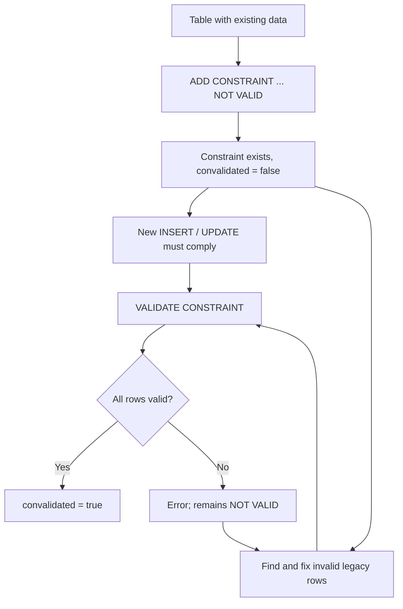

# Adding Constraints with NOT VALID and VALIDATE CONSTRAINT in PostgreSQL

When designing a PostgreSQL table from scratch, we typically declare constraints (`CONSTRAINT`) right inside `CREATE TABLE`. Yet a live system may already hold millions of rows before you discover a new rule is needed—such as order totals never being negative, or `orders.customer_id` referencing an existing customer.

If you add the constraint normally, PostgreSQL must **verify all existing rows** while executing `ALTER TABLE`. On large tables, that takes time and can hold locks that block concurrent transactions. PostgreSQL provides a two-phase workflow for eligible constraint types:

1. **`ADD CONSTRAINT ... NOT VALID`**: registers the rule and starts enforcing it on new writes, without verifying all historical rows yet.
2. **`VALIDATE CONSTRAINT`**: scans existing data and marks the constraint validated once it succeeds.

This is especially valuable for **`CHECK`** and **`FOREIGN KEY`** constraints when evolving the schema of a live system. It is **not a way to skip data validation permanently** and does not turn every constraint type into a lock-free operation.

## 1. Why Adding Constraints to Large Tables Needs a Separate Strategy

Suppose `sales.orders` already stores years of data, and you want to add the rule:

```sql
ALTER TABLE sales.orders
ADD CONSTRAINT orders_amount_nonnegative
CHECK (total_amount >= 0);
```

Without `NOT VALID`, PostgreSQL must verify that existing rows satisfy the rule before completing the `ALTER TABLE`. On a large table or alongside long-running transactions, this consumes heavy I/O, waits on locks, and slows down the system.

If some rows have `total_amount < 0`, adding the constraint directly also fails. To fix legacy rows in batches while blocking any new invalid writes, separate declaration from validation.



The key benefit is **decoupling the legacy-data scan from adding the rule**. Meanwhile, PostgreSQL enforces the rule on any data changes made after the constraint is added, so the table stops accumulating new violations under normal writes.

However, PostgreSQL **does not repair old records automatically**, and validation itself still consumes significant resources.

## 2. Scope of Applicability and Basic Syntax

Pattern for `CHECK`:

```sql
ALTER TABLE schema_name.table_name
ADD CONSTRAINT constraint_name
CHECK (boolean_expression)
NOT VALID;

ALTER TABLE schema_name.table_name
VALIDATE CONSTRAINT constraint_name;
```

Pattern for `FOREIGN KEY`:

```sql
ALTER TABLE schema_name.child_table
ADD CONSTRAINT constraint_name
FOREIGN KEY (parent_id)
REFERENCES schema_name.parent_table(id)
NOT VALID;

ALTER TABLE schema_name.child_table
VALIDATE CONSTRAINT constraint_name;
```

With standard constraint addition, PostgreSQL validates existing data before finishing `ALTER TABLE` whenever the constraint type requires a table-wide check. With `NOT VALID`, that verification is deferred until `VALIDATE CONSTRAINT`.

### Which Constraints Support NOT VALID?

| Constraint Type | Role | Deployment Notes |
| --- | --- | --- |
| `CHECK` | Validates a Boolean expression per row | Supports `NOT VALID` followed by `VALIDATE CONSTRAINT` |
| `FOREIGN KEY` | Ensures referenced keys exist in the target table | Supports two-phase workflow; validation checks referential integrity |
| `UNIQUE` | Prevents duplicate values per unique semantics | Does not use `ADD CONSTRAINT ... UNIQUE NOT VALID` like `CHECK`/FK; consider building a unique index concurrently and attaching it when eligible |
| `PRIMARY KEY` | Unique and non-NULL row identifier | Does not use `ADD CONSTRAINT ... PRIMARY KEY NOT VALID` like `CHECK`/FK |
| `EXCLUDE` | Forbids conflicting combinations under specified operators | Do not mechanically apply the `CHECK`/FK `NOT VALID` pattern |
| `NOT NULL` | Requires a column to have a value | Syntax and validation support vary by version; many versions use `CHECK (col IS NOT NULL) NOT VALID` before switching to `SET NOT NULL` |

This lesson uses `CHECK` and `FOREIGN KEY` because they are the most common and long-supported cases. For newer PostgreSQL versions or partitioned tables, verify exact syntax and limits against your **server major version**, especially for `NOT NULL`, partitioning, and constraint state changes. Never assume every `CONSTRAINT` accepts the same `NOT VALID` syntax.

### Three States to Distinguish

- **No constraint yet**: PostgreSQL does not enforce the rule.
- **Constraint present, `NOT VALID`**: the rule is registered and enforced for new/updated writes; legacy data is not fully verified yet.
- **Constraint present, validated**: PostgreSQL has verified existing rows at validation time and continues enforcing the rule on writes.

`NOT VALID` is a **historical-data validation status**—it does not mean the constraint is disabled.

## 3. Full Walkthrough: Adding CHECK on a Table with Invalid Data

We will create test data containing an order with a negative amount to see the workflow clearly. All examples run in a **learning database**; never apply sample table creation/deletion scripts directly to production.

### 3.1. Preparing the Table and Historical Data

```sql
CREATE SCHEMA IF NOT EXISTS constraint_lab;

CREATE TABLE constraint_lab.orders (
    order_id bigint PRIMARY KEY,
    customer_id bigint,
    total_amount numeric(12, 2),
    created_at timestamptz NOT NULL DEFAULT now()
);

INSERT INTO constraint_lab.orders
    (order_id, customer_id, total_amount)
VALUES
    (1001, 1, 120000.00),
    (1002, 999, 80000.00),
    (1003, 1, -5000.00),
    (1004, NULL, 10000.00);
```

The table currently has no `CHECK` on amount and no `FOREIGN KEY` on customer, so `-5000.00` and `customer_id = 999` are stored.

Inspect the current state:

```sql
SELECT order_id, customer_id, total_amount
FROM constraint_lab.orders
ORDER BY order_id;
```

### 3.2. Adding CHECK as NOT VALID

```sql
ALTER TABLE constraint_lab.orders
ADD CONSTRAINT orders_total_nonnegative_chk
CHECK (total_amount >= 0)
NOT VALID;
```

PostgreSQL creates the constraint without scanning all existing rows right away. Thus row `order_id = 1003` can still retain its negative amount in the table.

Immediately after adding the constraint, try inserting a new invalid order:

```sql
-- Error illustration: PostgreSQL rejects it because CHECK is already active.
INSERT INTO constraint_lab.orders
    (order_id, customer_id, total_amount)
VALUES (1005, 1, -10.00);
```

This fails with a check violation (SQLSTATE `23514`). **You do not have to wait for `VALIDATE CONSTRAINT` to block new violating rows.**

Updating a legacy row in a way that leaves it violating `CHECK` will also be rejected. Therefore, when fixing invalid rows, updates must bring the row into compliance rather than touching an unrelated column alone.

### 3.3. Finding Violating Legacy Rows

```sql
SELECT order_id, total_amount
FROM constraint_lab.orders
WHERE (total_amount >= 0) IS FALSE;
```

The result includes row `1003`. Using `IS FALSE` here matches `CHECK` semantics accurately: in PostgreSQL, a `CHECK` rejects a row only when the expression evaluates to **FALSE**, while **TRUE** or **UNKNOWN** (often due to `NULL`) is accepted.

If business rules also forbid `NULL`, add `NOT NULL` or an explicit `CHECK` expression (Section 7).

### 3.4. Running VALIDATE While Violations Still Exist

```sql
ALTER TABLE constraint_lab.orders
VALIDATE CONSTRAINT orders_total_nonnegative_chk;
```

Because row `1003` has a negative amount, validation fails. The constraint **remains in place in an unvalidated state**, and new writes must still obey `CHECK`.

This is very practical: you can keep investigating and repairing historical rows without dropping the constraint after each failed validation attempt.

### 3.5. Repairing Data per Business Rules, Then Re-Validating

In real datasets, negative amounts might stem from data-entry errors, refunds, or a model that mixed orders with adjustment entries. **Never automatically zero out negative values** without clarifying their business meaning.

In this learning dataset, suppose we confirm order `1003` should have a positive amount of `5000.00`:

```sql
UPDATE constraint_lab.orders
SET total_amount = 5000.00
WHERE order_id = 1003;
```

Then run again:

```sql
ALTER TABLE constraint_lab.orders
VALIDATE CONSTRAINT orders_total_nonnegative_chk;
```

With no violating rows left and validation complete, PostgreSQL marks the constraint valid. The rule is now guaranteed for existing rows and remains enforced for future writes.

## 4. Inspecting Status in pg_constraint

PostgreSQL stores constraint metadata in `pg_constraint`. The `convalidated` column shows whether the constraint has been marked validated.

```sql
SELECT
    con.conname,
    con.contype,
    con.convalidated,
    pg_get_constraintdef(con.oid, true) AS definition
FROM pg_constraint AS con
WHERE con.conrelid = 'constraint_lab.orders'::regclass
ORDER BY con.conname;
```

Notable columns:

| Column | Meaning |
| --- | --- |
| `conname` | Constraint name |
| `contype` | Constraint type; `c` = CHECK, `f` = FOREIGN KEY, `p` = PRIMARY KEY, `u` = UNIQUE |
| `convalidated` | `false` while unvalidated; `true` once validated |
| `conrelid` | OID of the owning table, useful when querying CHECK/FK constraints |
| `pg_get_constraintdef(...)` | Reconstructed constraint definition from PostgreSQL metadata |

In `psql`, this command is also useful:

```text
\d+ constraint_lab.orders
```

The output notes constraints marked `NOT VALID`.

Example lifecycle of `orders_total_nonnegative_chk`:

| Stage | `convalidated` | Can New Writes Violate It? |
| --- | --- | --- |
| Right after `ADD ... NOT VALID` | `false` | No |
| After a failed `VALIDATE` | `false` | No |
| After data cleanup and successful `VALIDATE` | `true` | No |

For constraints added normally and validated on creation, `convalidated` is `true`.

## 5. FOREIGN KEY: Adding Referential Enforcement Without Scanning All Legacy Data

Another common scenario: `orders` already stored `customer_id` values before formal referential integrity was added.

### 5.1. Creating the Target Table

```sql
CREATE TABLE constraint_lab.customers (
    customer_id bigint PRIMARY KEY,
    full_name text NOT NULL
);

INSERT INTO constraint_lab.customers (customer_id, full_name)
VALUES
    (1, 'Customer One'),
    (2, 'Customer Two');
```

In our `orders` data, `customer_id = 1` is valid, `999` has no matching customer, and `NULL` has not been decided yet.

### 5.2. Adding a NOT VALID FOREIGN KEY

```sql
ALTER TABLE constraint_lab.orders
ADD CONSTRAINT orders_customer_fk
FOREIGN KEY (customer_id)
REFERENCES constraint_lab.customers(customer_id)
NOT VALID;
```

The constraint is registered without immediately proving every historical `customer_id` exists in `customers`.

Once added, try inserting an order referencing a nonexistent customer:

```sql
-- Error illustration: customer_id = 888 does not exist in customers.
INSERT INTO constraint_lab.orders
    (order_id, customer_id, total_amount)
VALUES (1006, 888, 10000.00);
```

PostgreSQL rejects it with a foreign key violation (SQLSTATE `23503`). For a `FOREIGN KEY`, beyond `INSERT`/`UPDATE` on the child table, updates or deletes of referenced keys on the parent table also respect referential rules and configured `ON UPDATE`/`ON DELETE` actions.

**`NOT VALID` does not disable FK enforcement triggers for new data.**

### 5.3. Finding Orphan Rows Before Validation

```sql
SELECT
    o.order_id,
    o.customer_id
FROM constraint_lab.orders AS o
LEFT JOIN constraint_lab.customers AS c
    ON c.customer_id = o.customer_id
WHERE o.customer_id IS NOT NULL
  AND c.customer_id IS NULL
ORDER BY o.order_id;
```

This returns `order_id = 1002` with `customer_id = 999`. That is an **orphan row**: a child record pointing to a parent key that does not exist.

An equivalent query using `NOT EXISTS`:

```sql
SELECT o.order_id, o.customer_id
FROM constraint_lab.orders AS o
WHERE o.customer_id IS NOT NULL
  AND NOT EXISTS (
      SELECT 1
      FROM constraint_lab.customers AS c
      WHERE c.customer_id = o.customer_id
  );
```

Both check data before running `VALIDATE CONSTRAINT`. For multi-column, nullable, `MATCH FULL`, or specialized FKs, detection queries must match the exact FK semantics rather than blindly copying a single-column query.

### 5.4. Resolving Orphan Rows and Validating

Business options include:

- Correcting `customer_id` to the true customer key identified from source records.
- Creating the missing customer record when authoritative data confirms the customer is legitimate.
- If the business allows unlinked orders, considering `NULL` while preserving data meaning and related rules.
- Removing or quarantining the record if confirmed erroneous and authorized for cleanup.

In this lab only, assume order `1002` actually belongs to customer `2`:

```sql
UPDATE constraint_lab.orders
SET customer_id = 2
WHERE order_id = 1002;

ALTER TABLE constraint_lab.orders
VALIDATE CONSTRAINT orders_customer_fk;
```

Once validation succeeds, `convalidated` for `orders_customer_fk` becomes `true`.

### 5.5. NULL in FOREIGN KEY

A standard single-column FK allows `NULL` when the column is not `NOT NULL`. Thus order `1004` with `customer_id IS NULL` does not violate this example foreign key.

If every order must have a customer, add a separate `NOT NULL` constraint. Never assume `FOREIGN KEY` forbids `NULL` automatically.

For multi-column foreign keys, default `MATCH SIMPLE` skips parent checking when any referencing column is `NULL`, whereas `MATCH FULL` requires all columns `NULL` or all columns non-NULL. Choose the mode matching your data model.

## 6. Table Locks and Operational Cost

The `NOT VALID` workflow is used to **reduce how long strong locks are held**, which does not mean the commands are free or non-blocking.

### 6.1. ADD CONSTRAINT ... NOT VALID

When adding `CHECK ... NOT VALID`, PostgreSQL still alters the table definition and acquires DDL locks. For many `ALTER TABLE` commands, the default lock can be **`ACCESS EXCLUSIVE`**, even though this step does not scan old rows for verification.

When adding `FOREIGN KEY ... NOT VALID`, PostgreSQL normally acquires **`SHARE ROW EXCLUSIVE`** on both the referencing and referenced tables during declaration. That lock can conflict with concurrent write transactions.

Keeping the `ADD` step short and committing promptly minimizes how long those locks are held.

### 6.2. VALIDATE CONSTRAINT

`VALIDATE CONSTRAINT` typically acquires **`SHARE UPDATE EXCLUSIVE`** on the table being validated. For foreign keys, PostgreSQL also locks the referenced table, typically at **`ROW SHARE`**. These lock modes allow normal concurrent reads and writes to continue during validation.

Validation still reads historical data, consuming I/O, CPU, and adding latency. It can wait on locks or conflict with other DDL/maintenance jobs. Never equate “does not block normal writes for the entire scan” with “zero performance impact”.

### 6.3. Separating ADD and VALIDATE into Distinct Transactions

A typical deployment uses two independent transactions:

```sql
-- Phase 1: register the constraint without scanning legacy rows.
BEGIN;
    SET LOCAL lock_timeout = '3s';

    ALTER TABLE constraint_lab.orders
    ADD CONSTRAINT orders_verified_rule
    CHECK (total_amount IS NULL OR total_amount >= 0)
    NOT VALID;
COMMIT;

-- Phase 2: after legacy data has been audited and repaired.
BEGIN;
    SET LOCAL lock_timeout = '3s';
    SET LOCAL statement_timeout = '10min';

    ALTER TABLE constraint_lab.orders
    VALIDATE CONSTRAINT orders_verified_rule;
COMMIT;
```

This example uses a **different constraint name** to avoid colliding with the earlier constraint in the lab. In a real application, create only the constraint matching your business requirement.

These timeout values are illustrative and should be tuned for data volume and maintenance windows. If validation exceeds `statement_timeout`, the statement is canceled; the constraint remains unvalidated if `ADD` already committed.

Crucially, **never keep the `ADD` transaction open throughout data investigation, repair, and validation**. If `ADD` and `VALIDATE` share one transaction and validation fails, rolling back undoes the `ADD` as well, removing the constraint.

## 7. CHECK and NULL: Expressing the True Requirement

A `CHECK` constraint rejects a row only when the condition evaluates to `FALSE`. If it evaluates to `NULL` (`UNKNOWN`), the row is accepted.

```sql
CHECK (total_amount >= 0)
```

If `total_amount` is `NULL`, `NULL >= 0` evaluates to `UNKNOWN`, so `CHECK` **does not reject** the row. That is intentional SQL behavior.

When business rules require `total_amount` to be both present and non-negative, there are two common patterns:

```sql
-- Option 1: separate NOT NULL and CHECK constraints.
total_amount numeric(12, 2) NOT NULL,
CONSTRAINT orders_amount_nonnegative CHECK (total_amount >= 0)
```

Or a single `CHECK` enforcing both rules:

```sql
ALTER TABLE constraint_lab.orders
ADD CONSTRAINT orders_amount_required_nonnegative_chk
CHECK (total_amount IS NOT NULL AND total_amount >= 0)
NOT VALID;
```

Here `NULL` makes `total_amount IS NOT NULL` evaluate to `FALSE`, so the whole `CHECK` fails and rejects the row.

However, `CHECK (... IS NOT NULL ...)` does not set the column's native `NOT NULL` metadata flag expected by ORMs, introspection tools, or the planner. If the final goal is `ALTER COLUMN ... SET NOT NULL`, a dedicated step is needed.

### 7.1. Path to Adding NOT NULL on Populated Columns

Across many PostgreSQL versions, a common deployment technique is:

```sql
-- 1. Block new NULL values with an unvalidated CHECK.
ALTER TABLE constraint_lab.orders
ADD CONSTRAINT orders_total_amount_nn_chk
CHECK (total_amount IS NOT NULL)
NOT VALID;

-- 2. Resolve legacy NULL rows per business rules.
-- Never blindly assign 0 if NULL carries a distinct meaning.

-- 3. Once data complies, validate the CHECK.
ALTER TABLE constraint_lab.orders
VALIDATE CONSTRAINT orders_total_amount_nn_chk;

-- 4. Convert to native NOT NULL.
ALTER TABLE constraint_lab.orders
ALTER COLUMN total_amount SET NOT NULL;

-- 5. Drop the helper CHECK once native NOT NULL is confirmed.
ALTER TABLE constraint_lab.orders
DROP CONSTRAINT orders_total_amount_nn_chk;
```

A validated `CHECK` proving the column has no `NULL`s can let PostgreSQL skip a full table scan during `SET NOT NULL` in supported versions and conditions. Even so, `ALTER COLUMN SET NOT NULL` is still DDL requiring locks; verify exact behavior for your server version, table type, and query plan before deploying.

Newer PostgreSQL versions may add direct validation-state management for `NOT NULL` with different syntax; never assume availability from `CHECK` examples without checking docs for your exact version.

## 8. Planning Batched Data Repairs

On tables with millions of rows, never assume a single massive `UPDATE` will safely fix all bad records. It can generate massive WAL, hold extensive row locks, and force `VACUUM` to clean up huge numbers of dead tuples.

First, measure the scope:

```sql
SELECT
    count(*) AS total_orders,
    count(*) FILTER (
        WHERE (total_amount >= 0) IS FALSE
    ) AS invalid_amount_count,
    count(*) FILTER (
        WHERE customer_id IS NULL
    ) AS missing_customer_count
FROM constraint_lab.orders;
```

Identify primary keys of rows needing repair and establish the authoritative source of truth. Then process small chunks in short transactions. Illustrative example:

```sql
-- Illustration only if a verified reconciliation table exists.
-- correction_id / corrected_amount represent validated source values.
UPDATE constraint_lab.orders AS o
SET total_amount = c.corrected_amount
FROM constraint_lab.amount_corrections AS c
WHERE c.order_id = o.order_id
  AND o.total_amount IS DISTINCT FROM c.corrected_amount;
```

`constraint_lab.amount_corrections` is a **hypothetical reconciliation table** not created automatically in this lesson; do not run this query without preparing a real correction source. In practice, chunk batches by primary key, log affected counts, commit after each batch, and keep updates idempotent.

**Bad-data warning:** never delete violating rows or fabricate dummy customers just to make `VALIDATE` pass. The constraint might look “green” while business data is corrupted. Remediation requires domain ownership and agreed rules.

### 8.1. Should You Run Validation Before Data Is Clean?

You can run `VALIDATE CONSTRAINT` to check whether violations remain, though on large dirty tables running validation repeatedly wastes resources. Targeted diagnostic queries and source reconciliation usually come first; once repairs are done, `VALIDATE` serves as PostgreSQL's final confirmation.

Inspecting `pg_constraint.convalidated` distinguishes a registered constraint from a fully verified one.

## 9. Which Indexes Does FOREIGN KEY Need?

An FK involves two sides:

- **Parent/target table**: referenced columns must match a primary key, unique constraint, or qualifying unique index. Usually the parent already has that index.
- **Child/referencing table**: PostgreSQL **does not automatically index FK columns** just because a constraint was added. A child-side index often speeds up joins as well as parent key updates/deletes that check child rows.

For `constraint_lab.orders`:

```sql
CREATE INDEX CONCURRENTLY IF NOT EXISTS
    idx_orders_customer_id
ON constraint_lab.orders (customer_id);
```

`CREATE INDEX CONCURRENTLY` reduces write-blocking compared to standard index builds on large tables, though it still uses I/O and CPU and carries key caveats:

- `CREATE INDEX CONCURRENTLY` cannot run inside a transaction block.
- If it fails (e.g., due to deadlock or cancellation), PostgreSQL can leave an invalid index needing inspection and cleanup.
- `IF NOT EXISTS` only skips errors if an index name already exists; **it does not verify the existing index definition matches what you intended**.

This index is not syntactically required for the FK in our lab, yet should be evaluated against real workloads. During FK validation scanning child rows and probing the parent table, performance depends on parent indexes, data distribution, and server capacity.

## 10. Does Validation Require Full Application Downtime?

Full downtime is usually unnecessary, though online feasibility depends on:

- Table size and read/write throughput.
- Long-running transactions holding locks on the table.
- Contention with `VACUUM`, other migrations, or DDL jobs.
- Scan I/O cost and probes into referenced tables.
- Application timeout budgets and latency SLAs.
- Schema features: partitioned tables, inheritance, multi-column constraints, or concurrent changes.

You can monitor sessions waiting on locks:

```sql
SELECT
    pid,
    usename,
    state,
    wait_event_type,
    wait_event,
    now() - query_start AS elapsed,
    pg_blocking_pids(pid) AS blocking_pids,
    left(query, 160) AS query_sample
FROM pg_stat_activity
WHERE datname = current_database()
  AND state <> 'idle'
ORDER BY query_start;
```

Visibility of other sessions' queries depends on monitoring privileges. `pg_blocking_pids(pid)` shows which sessions are blocking a query; never run `pg_terminate_backend` automatically without assessing impact.

There is no guaranteed universal `pg_stat_progress_*` view dedicated solely to every `VALIDATE CONSTRAINT` operation. Combine I/O metrics, statement duration, lock checks, statement timeouts, and `convalidated` inspection to track progress.

### 10.1. Using Timeouts as Guardrails

Example timeout settings in a deployment session:

```sql
BEGIN;
    SET LOCAL lock_timeout = '3s';
    SET LOCAL statement_timeout = '15min';

    ALTER TABLE constraint_lab.orders
    VALIDATE CONSTRAINT orders_customer_fk;
COMMIT;
```

If the lock cannot be acquired within 3 seconds, the statement aborts instead of queuing indefinitely behind traffic. If validation exceeds 15 minutes, `statement_timeout` cancels it. When a statement fails inside a transaction, issue `ROLLBACK` if your migration runner does not already handle it.

Space out and bound any retries rather than letting multiple jobs validate a busy table simultaneously.

## 11. When VALIDATE Fails: What Remains in the Database?

Suppose `ADD CONSTRAINT ... NOT VALID` **committed successfully**, and some old batch of rows has not been fixed yet. When you run:

```sql
ALTER TABLE constraint_lab.orders
VALIDATE CONSTRAINT orders_customer_fk;
```

if invalid FK values remain, PostgreSQL raises an error and does not set `convalidated = true`.

State after the failure:

1. The constraint remains in the catalog (because the earlier `ADD` committed).
2. New `INSERT`/`UPDATE` statements must obey the constraint.
3. Unrepaired legacy rows can still remain in the table.
4. You can inspect the failures, repair the data, and re-run `VALIDATE CONSTRAINT`.

Never `DROP CONSTRAINT` and re-add it after a validation failure. Dropping it opens a window where new invalid writes can slip in, defeating the main advantage of the two-phase workflow.

### 11.1. If ADD and VALIDATE Share the Same Transaction

```sql
BEGIN;
    ALTER TABLE constraint_lab.orders
    ADD CONSTRAINT orders_example_chk
    CHECK (total_amount >= 0)
    NOT VALID;

    ALTER TABLE constraint_lab.orders
    VALIDATE CONSTRAINT orders_example_chk;
ROLLBACK;
```

This snippet illustrates transaction behavior—**do not use it as a real migration**. If validation or any statement inside the transaction fails and rolls back, `ADD` is rolled back too. Set explicit transaction boundaries in your migration tool.

### 11.2. Data Errors Differ from Lock or Timeout Errors

When `VALIDATE` fails, check SQLSTATE and server logs:

| Error Category | Example | Action |
| --- | --- | --- |
| Data violates CHECK | `23514` | Find rows where CHECK predicate is FALSE; fix per business rules |
| Data violates FK | `23503` | Find orphan rows; restore or repair valid references |
| Lock acquisition failed | `55P03` under `lock_timeout` | Reschedule, shorten long transactions, adjust timing |
| Statement timed out | `57014` when canceled | Review scan duration, system load, timeout, and window |
| Permission error | Lacks ALTER privilege on table | Run with an authorized migration role rather than granting excessive privileges |

Never blindly retry every error: violating rows will not become valid just by re-running the command.

## 12. Distinguishing NOT VALID from DEFERRABLE and DISABLE TRIGGER

`NOT VALID`, `DEFERRABLE`, and disabling triggers solve completely different problems.

| Mechanism | Primary Purpose | Effect on Existing Data |
| --- | --- | --- |
| `NOT VALID` on ADD | Postpone verifying all existing rows | Skips full legacy scan on add; new writes still enforced |
| `VALIDATE CONSTRAINT` | Verify existing rows | Scans/checks rows and marks valid if none violate |
| `DEFERRABLE` | Allow postponing check timing of eligible constraints within a transaction | Does not skip checking historical data |
| `SET CONSTRAINTS ... DEFERRED` | Switch check timing for deferrable constraints inside a transaction | Does not replace `NOT VALID` / `VALIDATE` |
| Intentionally disabling triggers | Alters trigger execution in specialized admin contexts | Can let invalid data enter; requires extreme caution |

Example of an FK that is also deferrable:

```sql
ALTER TABLE constraint_lab.orders
ADD CONSTRAINT orders_customer_deferrable_fk
FOREIGN KEY (customer_id)
REFERENCES constraint_lab.customers(customer_id)
DEFERRABLE INITIALLY IMMEDIATE
NOT VALID;
```

Inside a transaction, with proper privileges and supported constraint:

```sql
BEGIN;
    SET CONSTRAINTS orders_customer_deferrable_fk DEFERRED;

    -- Related changes must be valid by end-of-transaction check time.
COMMIT;
```

This uses a **distinct FK name** solely to demonstrate the `DEFERRABLE` option; there is no need to create duplicate equivalent FKs in the lab. `CHECK` in PostgreSQL does not support deferral the way FKs do, and `NOT VALID` is not synonymous with `DEFERRABLE`.

Avoid using `session_replication_role` or disabling FK triggers to “push through” ordinary migrations; those are specialized mechanisms that can compromise data integrity if misused.

## 13. UNIQUE and PRIMARY KEY: A Different Approach

You may want to add `UNIQUE(email)` or `PRIMARY KEY(id)` to a large table. Do not write:

```sql
-- Not supported identically to CHECK/FK:
ALTER TABLE constraint_lab.orders
ADD CONSTRAINT some_unique UNIQUE (order_id) NOT VALID;
```

For eligible columns, PostgreSQL allows building a unique index **concurrently** and then attaching a constraint to that index:

```sql
-- Illustrative example on a table already cleaned of duplicates.
-- CREATE INDEX CONCURRENTLY runs outside a transaction block.
CREATE UNIQUE INDEX CONCURRENTLY
    idx_users_email_unique
ON constraint_lab.users(email);

-- Once the index is valid, attach the unique constraint.
ALTER TABLE constraint_lab.users
ADD CONSTRAINT users_email_unique
UNIQUE USING INDEX idx_users_email_unique;
```

Table `constraint_lab.users` is a **hypothetical table** not created in the orders/customers dataset above. This is a conditional pattern—do not run it without the table, clean data, and required privileges.

Keep in mind:

- Creating a unique index fails if duplicate values exist; there is no `NOT VALID` option to silently allow duplicate legacy rows.
- `CREATE INDEX CONCURRENTLY` cannot run inside a transaction block and can leave an invalid index if it fails.
- `ALTER TABLE ... ADD CONSTRAINT ... USING INDEX` requires an eligible index (such as a standard unique B-tree index, not an expression or partial index for a normal `UNIQUE` constraint).
- For `PRIMARY KEY`, participating columns must also be `NOT NULL`; if not yet marked `NOT NULL`, adding the PK may trigger extra table scans and locks.
- Indexes/constraints on partitioned tables follow separate rules and cannot copy every concurrent command verbatim from regular tables.

Therefore, choose your online rollout strategy based on the **specific constraint type**, not just table size.

## 14. Applying This to Partitioned Tables and Multi-Service Systems

A partitioned table consists of physical partitions, while constraints may be declared at the parent level or per partition depending on type. Adding and validating constraints may need to account for individual partitions, inheritance relationships, and version-specific PostgreSQL support.

Before deploying, verify:

- Is the constraint declared on the partitioned parent or on specific partitions?
- Does your PostgreSQL version permit `NOT VALID` there?
- Which child tables/partitions will validation scan?
- Are there FKs pointing to or from the partitioned table?
- Does a `CHECK` constraint interact with partition bounds or row routing behavior?

Never assume `VALIDATE CONSTRAINT` on a partitioned parent behaves identically to validation on a regular table. Test migrations on a staging copy with representative partitioned schema and data.

In multi-service architectures, repairing historical rows solves only half the problem. Every writer must comply with the new rule: APIs, workers, ETL jobs, message consumers, imports, and ops scripts. Any writer still sending bad values will begin failing as soon as `NOT VALID` is added.

## 15. Deploying with Flyway, Liquibase, or SQL Migrations

A rollout can be split cleanly into three phases:

**Migration A — Register the constraint to block new violations**

```sql
ALTER TABLE constraint_lab.orders
ADD CONSTRAINT orders_total_nonnegative_chk
CHECK (total_amount >= 0)
NOT VALID;
```

**Data task — Find and repair existing violations**

```sql
SELECT order_id, total_amount
FROM constraint_lab.orders
WHERE (total_amount >= 0) IS FALSE;
```

Repairs must follow real data reconciliation and run in controlled batches. Never embed a multi-million-row `UPDATE` inside a DDL migration without accounting for locks and runtime.

**Migration B — Validate once data is clean**

```sql
ALTER TABLE constraint_lab.orders
VALIDATE CONSTRAINT orders_total_nonnegative_chk;
```

These snippets represent workflow stages, not three rigid files tied to a specific tool. When using Flyway or Liquibase:

- Ensure each migration runs once or is properly versioned and tracked.
- Align transaction boundaries with separating `ADD` and `VALIDATE`.
- Do not treat “migration SQL exited 0” as complete: verify `pg_constraint.convalidated` after validation.
- Ensure no application still relies on writing invalid legacy values once the rule blocks new writes.
- Prepare a recovery plan if deployment pauses in the `NOT VALID` state.

PostgreSQL has no general `ADD CONSTRAINT IF NOT EXISTS` syntax like some `CREATE` statements. For re-runnable migrations, rely on migration history or targeted catalog checks—never silently ignore a constraint that shares a name but has a different definition.

## 16. Common Mistakes

| Mistake | Consequence | Accurate Understanding |
| --- | --- | --- |
| Thinking `NOT VALID` disables the constraint | App still fails on invalid new writes | `NOT VALID` only defers checking legacy rows |
| Thinking `VALIDATE` fixes bad data | Validation fails on existing violations | Find and repair data per business rules first |
| Putting `ADD` and `VALIDATE` in one huge transaction | Holds strong `ADD` locks far too long | Commit `ADD` quickly, then validate in a separate transaction |
| Using `CHECK (col > 0)` to forbid NULL | `CHECK` permits `UNKNOWN` | Add `NOT NULL` or an explicit NULL check |
| Using `FOREIGN KEY` to forbid NULL | Single-column FKs usually permit `NULL` | Separate presence rules from referential rules |
| Dropping the constraint after `VALIDATE` fails | Reopens a gap for bad new writes | Keep `NOT VALID` active, repair rows, then re-validate |
| Using `UNIQUE ... NOT VALID` like an FK | Different syntax and support rules | Use an appropriate unique index strategy |
| Ignoring indexes and workload | Validation or writes become slow/heavy | Check parent unique indexes, child FK indexes, and load |
| Not checking `convalidated` | Unclear whether migration finished or only registered the rule | Query `pg_constraint` after each phase |
| Assuming validation is lock-free | Can wait on DDL/locks or spike I/O | Use timeouts, monitor locks, and pick safe windows |
| Blindly setting all bad values to 0 or NULL | Corrupts business meaning | Reconcile from authoritative sources and approved rules |

## 17. Guided Practice Exercises

Run these in a test database using schema `constraint_lab`. The goal is to clearly observe **unvalidated constraints blocking new writes** and **validation succeeding only after historical data complies**.

### Exercise 1 — Create CHECK NOT VALID

1. Create `constraint_lab.orders` and insert row `1003` with `total_amount = -5000.00` as in Section 3.
2. Add `orders_total_nonnegative_chk` using `ADD CONSTRAINT ... NOT VALID`.
3. Query `pg_constraint.convalidated` and predict the result.
4. Try `INSERT`ing a new order with a negative amount and observe error `23514`.

### Exercise 2 — Validation Failure and Retry

1. Call `VALIDATE CONSTRAINT orders_total_nonnegative_chk` while row `1003` is still negative.
2. Confirm the constraint still exists and `convalidated` remains `false`.
3. Repair row `1003` based on confirmed sample truth.
4. Re-run validation and verify `convalidated = true`.

### Exercise 3 — Add FOREIGN KEY NOT VALID

1. Create `constraint_lab.customers` with customers `1` and `2`.
2. Add FK `orders_customer_fk` as `NOT VALID`.
3. Find orders whose `customer_id` is missing from the parent table using `NOT EXISTS`.
4. Try inserting a new order with `customer_id = 888` and observe error `23503`.
5. Fix the reference on `order_id = 1002` and validate.

### Exercise 4 — NULL in CHECK and FK

Answer:

- Does an order with `total_amount = NULL` violate `CHECK(total_amount >= 0)`?
- Does an order with `customer_id = NULL` violate a standard single-column FK?
- If the business forbids NULL in both columns, what additional rule/constraint is required?

Write a query using `COUNT(*) FILTER (WHERE ...)` to count NULL rows and explain why validating the current `CHECK`/FK alone is not enough to enforce `NOT NULL`.

### Exercise 5 — Lock Expectations and Rollout Plan

Suppose `orders` holds 50 million rows under continuous writes. Outline the sequence:

1. Measure violating rows and identify remediation sources.
2. Add the `NOT VALID` constraint in a short transaction.
3. Update all writers to comply.
4. Repair historical rows in batches while monitoring WAL, locks, and server load.
5. Run `VALIDATE` with sensible `lock_timeout` and `statement_timeout`.
6. Confirm `convalidated` and monitor write errors post-rollout.

Explain why splitting phases reduces strong DDL lock duration without eliminating the data-scan cost during validation.

## 18. Conclusion and Practice Principles

`ADD CONSTRAINT ... NOT VALID` paired with `VALIDATE CONSTRAINT` is an essential tool when **introducing new constraints to populated tables**. It lets PostgreSQL start protecting new writes immediately while engineers investigate and repair legacy rows.

Three principles to remember:

- **A `NOT VALID` constraint still enforces new writes.** It simply has not been certified across all historical rows yet.
- **`VALIDATE` neither repairs data nor eliminates operational cost.** It scans and checks legacy rows; account for locks, I/O, timeouts, partitions, and violation counts.
- **Every migration needs a verifiable finish line.** Confirm `pg_constraint.convalidated = true`, keep the constraint active, align all writers, and repair historical violations per business rules.

By pairing the right constraint type with batched data cleanup, disciplined transactions, and monitoring, PostgreSQL can progressively tighten integrity in live systems while avoiding many risks of single-step constraint migrations.
