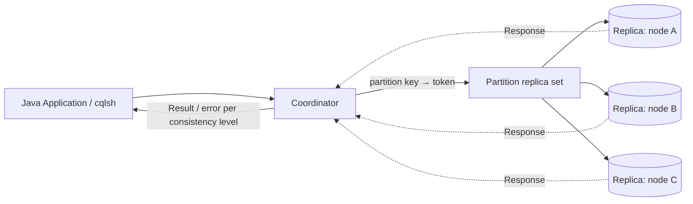

# What is Apache Cassandra and Which Distributed Problems Was It Designed to Solve?

> **Chapter:** Cassandra Foundations  
> **Scope:** Apache Cassandra fundamentals, why it exists, distributed architecture, the wide-column model, consistency choices, and system design trade-offs.

## 1. Learning Objectives

After this lesson, you will be able to:

1. Explain what type of database Cassandra is and why a system might need it instead of simply scaling a relational database.
2. Describe how Cassandra distributes data by **partition key**, stores multiple copies according to the **replication factor**, and handles requests through a **coordinator**.
3. Distinguish between fault tolerance, availability, and consistency; understand the practical meaning of `ONE`, `QUORUM`, `LOCAL_QUORUM`, and `ALL`.
4. Identify well-suited problems, ill-suited problems, and trade-offs across querying, operations, and storage.
5. Read a small CQL example to see why query-driven table design is a core mindset in Cassandra.

## 2. What is Cassandra?

**Apache Cassandra** is an open-source, distributed NoSQL database management system in the **wide-column** family. Cassandra was built to distribute data across many machines, tolerate the failure of part of the cluster, and serve high read/write volumes with scalability achieved by adding nodes.

Imagine a platform ingesting events from millions of devices, each continuously sending temperature, location, or status. A single server can run into three problems:

- **Capacity and throughput:** the number of events grows rapidly, exceeding a single machine's write or storage capacity.
- **Single point of failure:** a machine or disk failure leaves part of the service unable to access data.
- **Geographic distance:** users and applications in multiple regions need local access close to where they operate, while cross-region networks have latency and can experience disconnects.

Cassandra solves these problems by **partitioning** data across multiple nodes and **replicating** each partition onto multiple nodes, which can span multiple data centers. Nodes in the cluster have symmetric roles in serving requests; Cassandra does not require a single primary server to receive all write operations.

This does **not** mean Cassandra is always faster than SQL or automatically guarantees strictly consistent data at all times. Speed, availability, and result correctness depend on partition key selection, consistency level, replica configuration, access patterns, and failure conditions.

### 2.1. What is Cassandra Optimized For?

| System need | How does Cassandra support it? | What is the cost? |
| --- | --- | --- |
| Very large, distributed data | Splits partitions across many nodes; add nodes to distribute load and capacity | Must manage data distribution, nodes, networking, and load balancing |
| Continuous event writes | Write path uses a commit log, memtable, then writes SSTables sequentially to disk | Old data, tombstones, and SSTables require compaction and repair |
| Continue serving when some nodes fail | Stores multiple replicas; the coordinator can accept requests at many nodes | High consistency levels can cause requests to fail when enough replicas are unavailable |
| Serve users across multiple data centers | Declares replica counts per data center and uses local consistency levels | Requires understanding latency, replication state, and failover strategies |
| Queries with clear access patterns | Tables and clustering columns are organized for specific queries | Less flexible for JOINs, ad-hoc queries, and complex aggregations |

## 3. Distributed Problems Cassandra Was Designed to Solve

### 3.1. Horizontal Scaling When One Machine Is No Longer Enough

In **vertical scaling**, a system upgrades CPU, RAM, or disks on a single machine. This approach has physical and cost limits. In **horizontal scaling**, data and requests are spread across multiple machines. Cassandra is designed around the second approach.

Cassandra uses the **partition key** to compute a token (typically via the Murmur3 partitioner); the token determines which token ranges in the cluster the data belongs to. Nodes are responsible for token ranges and hold replicas according to the replication strategy. When nodes are added, data can be moved or streamed to redistribute load, though this still consumes network, disk, and operational time.

**Key takeaway:** adding nodes only helps when the partition key distributes data well. If 90% of writes hit the same partition, adding ten nodes will not necessarily solve that hotspot.

### 3.2. Tolerating Machine, Rack, or Data Center Failures

If a partition only has a single copy, losing the node holding that partition can make the data inaccessible. Cassandra allows placing multiple **replicas** on different nodes; when the topology is configured appropriately, replicas can also reside in different racks or data centers.

For example, a data center with `replication factor (RF) = 3` means each partition has three replicas in that data center. If one node goes down, the remaining two replicas can still serve requests at `LOCAL_QUORUM`. However, if only one replica remains active, `LOCAL_QUORUM` cannot be met and requests may fail, even though `LOCAL_ONE` could still answer in some cases.

**Fault tolerance does not mean invincibility:** losing too many nodes, simultaneous disk failures, topology misconfiguration, or having no replicas in an active region can still cause outages or data loss.

### 3.3. Multi-Region Access While Controlling Latency

An application with users in Vietnam and Singapore can deploy Cassandra across two data centers. **`NetworkTopologyStrategy`** allows specifying a separate RF for each data center. Applications typically read and write in their local data center with `LOCAL_QUORUM` so they do not have to wait for acknowledgments from a remote data center on every request.

In return, immediately after a write is acknowledged locally, replicas in the other data center **may not yet see the latest value**. Routing applications to a fallback region, choosing consistency levels, and handling conflicts must be explicitly designed; simply creating multiple data centers is not enough for a complete disaster recovery strategy.

### 3.4. Maintaining Service Under Imperfect Network Conditions

In distributed systems, high latency, network partitions, or a slow replica are normal conditions to anticipate. Cassandra lets applications choose the **consistency level** per operation to balance responsiveness against how many replicas must participate.

For example, `ONE` can still accept writes when one replica responds, while `QUORUM` requires a majority of replicas. Under network failure conditions, choosing a lower level allows some requests to keep running at the cost of a higher chance of reading stale values; choosing a higher level increases the likelihood of seeing fresh values but reduces how many failures can be tolerated while still succeeding.

## 4. Structure of a Cassandra Cluster

Four concepts should be distinguished:

| Concept | Meaning | Question it answers |
| --- | --- | --- |
| **Node** | A Cassandra process/machine participating in the cluster | Which machine is storing and serving data? |
| **Partition** | A group of rows sharing the same partition key; the key unit of data distribution | By which key is this data grouped and routed? |
| **Replica** | A copy of a partition on a node | Which copies can serve requests when a node fails? |
| **Coordinator** | The node that receives a client request, locates the appropriate replicas, and coordinates the read/write | Who receives and aggregates the result for this request? |



The diagram illustrates RF = 3. The coordinator is **not a master**: any eligible node receiving a request from a client can act as coordinator. The coordinator knows the target replicas via cluster metadata, forwards the request, and waits for the number of responses required by the consistency level. Not every replica always has to respond before the client receives a result.

A few supporting components:

- **Token ring and vnodes:** help divide the token range across multiple nodes and distribute partitions across the cluster.
- **Gossip and topology information:** help nodes exchange state; seed nodes should not be mistaken for a master that receives all data operations.
- **Snitch and replication strategy:** help determine replica placement by data center, rack, and token range.

## 5. How Is Data Written and Read?

### 5.1. Write Path: Fast Ingestion, Reorganized Later

At a high level, a write request goes through these steps:

1. The client sends a CQL statement to the coordinator; the coordinator determines the partition key and the replicas that need to be written.
2. Each replica receives the mutation, appends to the **commit log**, and updates the **memtable** in memory. Exact durability guarantees depend on commit log sync settings.
3. Once enough replicas respond according to the consistency level, the coordinator returns the result to the client; other replicas may continue syncing.
4. The memtable is **flushed** into immutable **SSTable** files on disk. Later, **compaction** merges SSTables, resolves data versions, and purges expired data according to safety rules.

This structure suits continuous writes because it avoids in-place updates scattered across disk for every operation. However, fast writes come with a cost: compaction generates background I/O, temporarily consumes extra disk space, and can affect query latency.

### 5.2. Read Path: Locating the Right Partition and Reconciling Versions

The coordinator identifies replicas based on the partition key, sends read requests to the appropriate replicas, and merges the results. Depending on the consistency level and replica health, the coordinator may need to compare results or contact additional replicas. Cassandra uses timestamps and tombstones to determine the valid value when different versions exist; background **repair** helps replicas converge.

A successful read should not be treated as proof that **every** replica in **every** data center is synchronized. Likewise, a client timeout does not prove the write never happened: some replicas may have applied the write before the response was lost. Therefore, applications need to consider **safe retries and idempotency**.

### 5.3. Three Easily Confused Concepts

| Mechanism | Primary purpose | Common misconception to avoid |
| --- | --- | --- |
| **Hinted handoff** | Helps replay some mutations to a replica that temporarily missed writes | Does not replace long-term anti-entropy repair |
| **Repair** | Compares replicas and synchronizes remaining discrepancies | Does not automatically fix a partition key design that causes hotspots |
| **Compaction** | Merges SSTables and purges old versions/tombstones when eligible | Does not replace replication or backups |

## 6. The Wide-Column Model and Query-Driven Table Design

In Cassandra, CQL uses familiar terms like `KEYSPACE`, `TABLE`, `INSERT`, and `SELECT`, but you should not infer that a CQL table behaves like a relational table.

A **primary key** has two logical parts:

- **Partition key** determines which rows reside in the same partition and which replicas they are distributed to.
- **Clustering column** orders rows **within a partition**, enabling ordered range reads. It does not create a global order across all partitions.

For example, a monitoring application wants to view the 100 most recent events for **one device on a single day**. We can design the table to match that exact query:

```sql
-- Assume the cluster has a data center named dc1 and at least 3 suitable nodes.
CREATE KEYSPACE IF NOT EXISTS telemetry
WITH replication = {'class': 'NetworkTopologyStrategy', 'dc1': 3};

CREATE TABLE IF NOT EXISTS telemetry.device_events (
    device_id text,
    event_day date,
    event_time timestamp,
    event_id uuid,
    event_type text,
    payload text,
    PRIMARY KEY ((device_id, event_day), event_time, event_id)
) WITH CLUSTERING ORDER BY (event_time DESC, event_id ASC);

INSERT INTO telemetry.device_events (
    device_id, event_day, event_time, event_id, event_type, payload
) VALUES (
    'sensor-42', '2026-11-21', '2026-11-21T01:00:00Z',
    11111111-1111-1111-1111-111111111111,
    'temperature', '{"celsius":27.4}'
);

SELECT event_time, event_type, payload
FROM telemetry.device_events
WHERE device_id = 'sensor-42'
  AND event_day = '2026-11-21'
  AND event_time >= '2026-11-21T00:00:00Z'
  AND event_time < '2026-11-22T00:00:00Z'
LIMIT 100;
```

Here, `((device_id, event_day), event_time, event_id)` has a very specific meaning:

| Component | Role |
| --- | --- |
| `(device_id, event_day)` | Composite partition key: each device/day pair creates a logical partition |
| `event_time` | First clustering column: orders events newest-first within the partition |
| `event_id` | Second clustering column: disambiguates multiple events sharing the same timestamp |
| `WHERE device_id = ... AND event_day = ...` clause | Targets a specific partition cleanly, avoiding random cluster-wide scans |

**Why add `event_day`?** If only `device_id` were used as the partition key, a device running for years could produce an oversized partition. Bucketing by day bounds size over time, provided the number of events per day per device remains manageable. Systems with extremely chatty devices may need smaller buckets or an extra sharding dimension; no single bucket size fits every workload.

**Why not design normalized relational tables first and write queries afterward?** Cassandra is usually effective when the application knows its query patterns upfront and models tables accordingly. If you need to look up the same data by `event_type` across all devices, you may need a second table or an appropriate search/aggregation pipeline. Duplicating data for multiple read patterns is an intentional trade-off; you must accept the cost of maintaining those records.

You should not patch a query missing its partition key by defaulting to `ALLOW FILTERING`. That directive can push filtering across large datasets and cause slowness, especially as data grows. The availability of indexes across Cassandra versions also does not eliminate the need to understand access paths and query selectivity.

## 7. Replication and Consistency Levels: Why Can You Trade Them Off?

**Replication factor (RF)** is the number of replicas configured for each partition in a data center (with an appropriate topology strategy). **Consistency level (CL)** specifies how many or which group of replicas must respond successfully before an operation is considered satisfied at that level. They answer two different questions:

- **RF:** How many copies is the data stored on?
- **CL:** How many acknowledgments from those copies does a request require?

For a data center with RF = 3:

| CL | Response requirement, simplified | Typical trade-off |
| --- | --- | --- |
| `ONE` | 1 replica | Easy to serve during node failures; may read stale values if a replica is not yet updated |
| `QUORUM` | 2/3 replicas | Requires a majority; reduces the chance of reading stale data when paired with quorum writes |
| `LOCAL_QUORUM` | 2/3 replicas **in the local data center** | Useful for multi-data-center deployments because it does not wait for a remote quorum |
| `ALL` | 3/3 replicas | Requires every replica to respond; prone to failing when any single replica is unavailable |

In `cqlsh`, you can set the consistency level for subsequent commands:

```sql
CONSISTENCY LOCAL_QUORUM;

SELECT event_time, payload
FROM telemetry.device_events
WHERE device_id = 'sensor-42' AND event_day = '2026-11-21'
LIMIT 10;
```

In a Java application, the driver also allows choosing the CL per statement or via session configuration; API details belong to the Java connectivity lab.

### 7.1. Quorum Condition and Its Limits

Intuitively, if the replica set acknowledging a write and the replica set answering a read **are guaranteed to overlap**, the read has a chance to see the latest successfully written version. With RF = 3, a `QUORUM` write requires 2 replicas and a `QUORUM` read requires 2 replicas, so the two sets cannot be completely disjoint:

\[
W + R > RF \quad \text{(for example: } 2+2>3\text{)}
\]

This is a useful rule of thumb for reasoning about quorums **within the same replica scope**. However, it does **not** automatically turn every Cassandra read/write into a linearizable transaction: concurrent writes, timestamps and clock skew, timeouts, version conflicts, or cross-partition operations still require analysis. For conditional updates such as "write only if it does not exist," Cassandra provides **lightweight transactions (LWT)** like `IF NOT EXISTS` using a consensus mechanism, which carries higher cost than regular writes.

### 7.2. When the Network Splits: Reading CAP in Context

The **CAP** theorem addresses the trade-off between strict consistency and availability **when a network partition occurs**. There is no accurate blanket answer like "Cassandra is always AP so every operation always responds" or "Cassandra is always CP." Cassandra lets you choose the consistency level per operation; when part of the cluster is unreachable, `ONE` and `QUORUM` requests can have different outcomes.

For example, suppose a partition with RF = 3 is split into two sides with 2 replicas and 1 replica:

- On the side with **2 replicas**, `QUORUM` can succeed if both respond in time.
- On the side with **1 replica**, `QUORUM` cannot be achieved, but `ONE` can succeed if the remaining replica is alive and meets the operation's requirements.
- The two sides may not immediately see each other's updates; they must converge when connectivity returns. If both sides write conflicting updates, timestamp-based conflict resolution may let one value win over another.

## 8. What Types of Systems Is Cassandra Suitable For?

### Typically Well-Suited Cases

**Example A — Telemetry and IoT:** ingesting event streams per device, querying the last few hours or days, with high write volume and a clear retention policy. Partitioning by device and time bucket routes queries accurately.

**Example B — Activity logs for an account:** fetching a user's most recent activities, continuous writes, querying primarily by `user_id` and time. Time buckets can be used to bound oversized partitions; if a single account becomes too hot, the design must be adjusted.

**Example C — Services requiring multi-region operation:** some requests can use local consistency and tolerate cross-region replication lag in exchange for lower access latency and better regional fault tolerance when deployed properly.

What these examples share is **predictable query patterns**, the ability to choose a good partition key, and data that needs wide distribution.

### Cases Where Other Technologies or Hybrid Architectures Should Be Considered

| Problem | Why Cassandra is usually not the first choice |
| --- | --- |
| Frequently changing reports, multi-table JOINs, ad-hoc queries | Cassandra's model is not optimized for JOINs or arbitrary cluster-wide scans/aggregations |
| Multi-record, multi-partition transactions with strong ACID guarantees | Regular writes and batches do not replace general-purpose relational transactions; LWT only addresses specific conditions |
| Small data, low load, simple operations | The overhead of cluster management, repair, and replica monitoring can outweigh the benefits |
| Immediate exact global counts or very high-contention updates | Counters and distributed aggregations have specific semantics and costs; correctness and load must be evaluated carefully |

A practical architecture might use PostgreSQL for business transactions, Cassandra for large-scale event streams, and a search/OLAP system for analytical queries. Decisions should stem from the data, query requirements, and operational constraints rather than labeling NoSQL or SQL as inherently better.

## 9. Operational Trade-Offs to Know From the Start

1. **Oversized or hot partitions:** a partition holding too many rows or receiving most of the traffic turns one replica group into a bottleneck. Measure partition size, access frequency, and partition key distribution before locking in a schema.
2. **Tombstones and TTL:** deletes or data expirations create tombstones so replicas know data was removed. Many tombstones can slow down reads; reclaiming them must be coordinated with repair schedules and retention settings rather than arbitrarily lowering collection thresholds.
3. **Compaction:** compaction policies affect read latency, I/O volume, and disk space. Time-series workloads may need a different strategy from update-heavy workloads.
4. **Repair:** replication does not guarantee every replica automatically stays fully synchronized after every failure. You need a repair schedule and monitoring to prevent long-lived replica drift.
5. **Client design:** a timeout does not confirm that a write failed completely. Retries need to consider idempotency, latency sensitivity, CL, and the risk of duplicate writes. Multi-data-center setups also require region routing configuration.
6. **Monitoring and capacity:** track p95/p99 latency, timeouts, pending compactions, disk usage, node/replica health, repair status, tombstone counts, and hot partition signals. High RF increases storage costs and write traffic.

Reading these metrics together is what reveals whether "adding nodes" actually solves the right problem.

## 10. Thought Exercise: Choosing a Model for an Event Service

An application ingests 50 million events/day from 200,000 devices. The UI has two requirements:

1. Display the 100 most recent events of a single device on a selected day.
2. Aggregate error event counts every month across **all** devices by city, device type, and firmware version.

Try answering on your own before reading the hints:

- Which query naturally fits the `device_events` table in Section 6?
- Why should the other query not be forced to scan the entire events table every time a user opens the dashboard?
- If one device spikes to millions of events per day, what needs to be measured or adjusted?
- With RF = 3 and one node down, can `LOCAL_QUORUM` still be achieved? What if two nodes are lost simultaneously?

**Solution hints:**

- Requirement (1) matches the `(device_id, event_day)` partition key and ordering by `event_time`; the query is bounded to a single partition and uses `LIMIT`.
- Requirement (2) is a multi-dimensional analytical problem across the entire dataset. Consider stream processing or ETL into an analytics store/controlled summary table instead of scanning the entire cluster for every dashboard load.
- You need to measure row count, byte size, and writes/second per partition; consider bucketing by hour or adding a logical shard key when needed, while redesigning how queries merge results.
- If one node in a three-replica set is lost, two nodes remain so `LOCAL_QUORUM` can still succeed; if two nodes are lost, one replica is not enough for quorum. This answer assumes the three replicas belong to the data center in question and the remaining two nodes can actually respond.

## 11. Knowledge Self-Check

1. **By which field does Cassandra distribute data?** By the declared partition key, via token calculation and replica placement; not arbitrarily by `INSERT` order.
2. **Does RF = 3 mean three independent records for three different requests?** No. It denotes three replicas of each partition within the corresponding configured scope.
3. **Does adding nodes always fix slow writes?** No. Hot partitions, overloaded compaction, poorly suited queries, or network/disk bottlenecks may be the actual cause.
4. **How many local replicas does `LOCAL_QUORUM` require on RF = 3?** Two replicas responding successfully.
5. **Why shouldn't you default to `ALLOW FILTERING` for every query?** Because filtering across wide datasets can make queries very expensive and scale poorly.
6. **Can a timed-out write still have been applied?** Yes. Some replicas may have received the write before the client timed out.

## 12. Takeaways Before Moving to the Next Lessons

The Cassandra mindset starts from a chain of decisions:

**Query patterns to serve → partition key and clustering columns → load/capacity distribution → replication → consistency level → operational and failure-handling strategy.**

Cassandra is especially valuable when a system needs to distribute large datasets, scale horizontally, continue serving after partial failures, and operate across multiple regions. In return, designers must know their query paths upfront, control partition sizes, and accept tunable consistency. The following lessons will dive into hands-on CQL, replication, compaction, repair, failure scenarios, and Java application connectivity.
