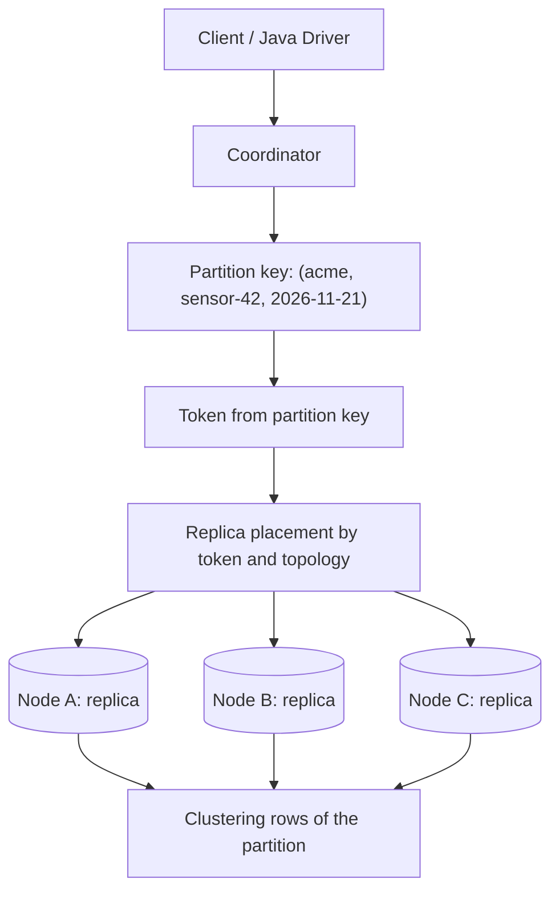
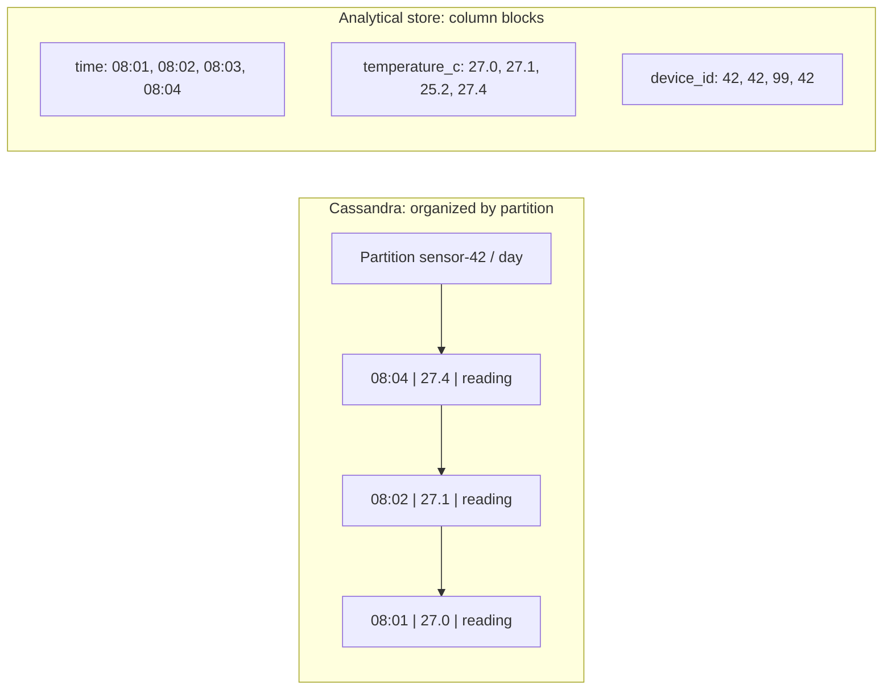
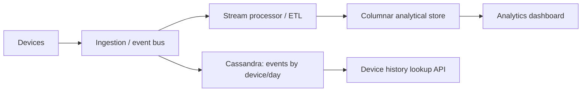

# The Wide-Column Model, Data Partitioning, and Differences From Columnar Analytical Stores

> **Chapter:** Cassandra Foundations  
> **Context:** Apache Cassandra is a distributed NoSQL database system geared toward storing and accessing high-volume data across multiple nodes. This lesson explains how to view data in terms of partitions and clustering, and distinguishes Cassandra's **wide-column** model from **columnar** physical storage in analytical systems.

## 1. Learning Objectives

After this lesson, you will be able to:

1. Accurately describe `keyspace`, CQL table, partition, row, cell, partition key, and clustering column.
2. Explain why the partition key governs both data placement in the cluster and query performance, while clustering columns only order rows **within** a partition.
3. Distinguish the **wide-column data model** (Cassandra) from **column-oriented physical storage** (e.g., analytical stores using columnar formats), even though both names contain the word "column".
4. Design and read a CQL table serving a clear query, recognize oversized or hot partitions, and know when to split data by time buckets.
5. Choose the right processing layer for real-time key-based lookups versus aggregate reports over millions of records.

## 2. The Problem Statement: One Dataset, Two Access Patterns

Suppose an IoT platform ingests events from hundreds of thousands of devices:

- **Operational screen:** "Fetch the 100 most recent events for device `sensor-42` on 2026-11-21".
- **Analytical screen:** "Compute the average temperature by hour, city, and device model across the entire system over 30 days".

Both queries touch the same kind of data, yet have very different shapes. The first query already knows the **device key and date**, and only needs a few adjacent rows. The second query reads **one attribute across vast numbers of rows** and then groups and aggregates them. Cassandra excels at the first type when the schema is properly designed. A columnar analytical store is typically better suited for the second type.

To understand that choice, you first need to understand what "wide-column" in Cassandra **actually** refers to.

## 3. The Cassandra Data Model: From Keyspace to Cell

Cassandra was historically described using the concepts of column families and wide rows. With modern CQL, we work with schema-defined tables and rows similar to SQL syntax; however, the critical unit for **routing, co-location, and efficient access** is the **partition**, not a single row.

| Concept | Meaning in Cassandra | IoT Example |
| --- | --- | --- |
| **Keyspace** | Namespace containing tables and replication configuration | `telemetry` |
| **Table** | Data structure defined using CQL | `device_events_by_day` |
| **Partition key** | One or more columns identifying a partition; used to compute tokens and locate the replicas storing the data | `(tenant_id, device_id, event_day)` |
| **Partition** | Set of rows sharing the **same partition key value** | All events for one device on one day |
| **Clustering column** | Column determining row position and ordering **inside a partition** | `event_time`, `event_id` |
| **Row** | A record identified by the full primary key (partition key + clustering columns, if any) | A specific event |
| **Cell** | Value of a column in a row, along with associated metadata such as timestamp/TTL if applicable | `temperature_c = 27.4` |

### 3.1. A Partition and a Row Are Not the Same

Suppose the table is defined as follows:

```sql
CREATE TABLE telemetry.device_events_by_day (
    tenant_id text,
    device_id text,
    event_day date,
    event_time timestamp,
    event_id uuid,
    temperature_c double,
    event_type text,
    payload text,
    PRIMARY KEY ((tenant_id, device_id, event_day), event_time, event_id)
) WITH CLUSTERING ORDER BY (event_time DESC, event_id ASC);
```

Some illustrative rows:

| Partition key (tenant, device, day) | Clustering key (time, event_id) | temperature_c | event_type |
| --- | --- | ---: | --- |
| (acme, sensor-42, 2026-11-21) | (08:05, id-3) | 27.4 | reading |
| (acme, sensor-42, 2026-11-21) | (08:02, id-2) | 27.1 | reading |
| (acme, sensor-42, 2026-11-21) | (07:59, id-1) | — | reconnect |
| (acme, sensor-99, 2026-11-21) | (08:04, id-4) | 25.2 | reading |

The first three rows share the **same partition key**, so they belong to the same logical partition; the fourth row belongs to a different partition. Inside the first partition, rows are traversed in descending `event_time` order, then ascending `event_id` order when two rows share the same timestamp.

The "—" value in the example table means there is no temperature value for that event; it does not imply Cassandra automatically creates infinite physical columns. CQL still has a **declared column schema**; data sparsity is expressed by some cells having no value. Distinguish the wide-column model from the misconception of a "schemaless table" or "adding arbitrary ad-hoc columns in any query".

### 3.2. "Wide" Does Not Mean Partitions Should Be Made as Large as Possible

In the history of the wide-column model, related rows could be organized under the same partition key and scanned in order. In CQL, modeling a partition containing **many clustering rows** remains useful for event histories, inboxes, or activity logs.

However, a partition containing millions of rows and growing unboundedly can cause problems with memory, reads, compaction, repair, and unbalanced load. **Wide partitions are a data modeling capability, not a performance goal.**

## 4. From Partition Key to Data Placement in the Cluster

The partition concept in Cassandra is directly tied to its distributed architecture:

1. The application writes or queries by a **partition key**.
2. Cassandra computes a **token** from the partition key value using the configured partitioner (commonly Murmur3).
3. The token and cluster metadata determine which nodes are responsible for storing **replicas** of the partition according to the replication strategy.
4. The **coordinator** receives the client request, locates the required replicas, and aggregates responses based on the consistency level.



The diagram illustrates a replication factor of 3 in a standard setup; it does not mean each row is split into three pieces. **Each replica stores a copy of the partition.** Nodes typically manage multiple token ranges (vnodes), so in practice you cannot deduce the target node merely from a device's sequence number.

### 4.1. Hash the Partition Key; Do Not Hash Clustering Columns for Distribution

Given the key:

```sql
PRIMARY KEY ((tenant_id, device_id, event_day), event_time, event_id)
```

- **Composite partition key** is the tuple `(tenant_id, device_id, event_day)`. The order and values of all three components identify the partition.
- **Clustering columns** are `event_time` and `event_id`. They identify rows **within** that partition and their traversal order, and are not used to distribute individual rows to different nodes.
- Two devices at the same timestamp with different `device_id` values can land on different tokens. Two events with different `event_time` values but the same partition key tuple will reside in the **same partition**.

This is why partition key choice simultaneously affects load distribution, per-partition size, and the shape of the `WHERE` clause.

### 4.2. "Distributing Data by Partition" Differs From "Splitting Data by Column"

When Cassandra distributes partitions across nodes, you can picture it as **placing groups of rows** onto different replicas based on the partition key. Cassandra does **not** assign node A to store only `temperature_c`, node B to store only `event_type`, and node C to store only `payload` for the same row.

Confusing these two types of data splitting leads to the false expectation that querying `AVG(temperature_c)` across all devices automatically reads very little data just because Cassandra is called "wide-column".

## 5. How Do Wide-Column and Columnar Analytics Differ?

The word "column" appears in both terms, yet refers to **two different dimensions**.

### 5.1. Wide-Column: How Data Is Modeled and Accessed

In Cassandra, data is modeled as partitions containing clustering rows and cells. An **SSTable** is an immutable on-disk structure storing data ordered by partition and clustering key, accompanied by index/auxiliary structures to locate the right partition and rows. It is **not** a format that stores every `temperature_c` value across all rows contiguously as a single separate physical column for aggregate scans.

The write path typically goes through the commit log and memtable, then flushes to SSTables; compaction merges SSTables later. This supports distributed writes and key-based reads while introducing its own operational overhead.

### 5.2. Columnar: Physical Data Layout for Column-Oriented Reads

A **column-oriented analytical store** typically arranges and compresses data **column by column within a row group or data part**: `temperature_c` values sit together, while `device_id` values sit in another column stream/block. When a query only needs a few columns across millions of rows, the engine can read only the required columns and process them in batches (vectorized execution). Partitioning, clustering/sorting, and indexing still determine how much data actually gets read.

For example, **ClickHouse** is an analytical database system that commonly uses columnar storage. **Apache Parquet** is a **columnar file format**, not a standalone database management system or query service; engines such as Spark, Trino, or other query engines can read Parquet.

### 5.3. Visual Comparison Using the Same Four Events

Suppose we have these rows:

| device_id | time | temperature_c | event_type |
| --- | --- | ---: | --- |
| sensor-42 | 08:01 | 27.0 | reading |
| sensor-42 | 08:02 | 27.1 | reading |
| sensor-99 | 08:03 | 25.2 | reading |
| sensor-42 | 08:04 | 27.4 | reading |

**Cassandra partition mindset:** locate the `(sensor-42, day)` group, then traverse rows by `time`; no full scan across all devices is needed.

**Columnar analytical scan mindset:** scan the `temperature_c` and `time` value blocks of the target dataset; only load `device_id` if the query filters or groups by device. This operation can leverage compression and vectorized batch execution.



The diagram only illustrates **how to think about the access path**, not the exact byte layout of SSTables, ClickHouse, or Parquet.

### 5.4. Comparison Table for Tool Selection

| Criterion | Cassandra (wide-column) | Columnar analytical store (columnar OLAP) |
| --- | --- | --- |
| Dominant access organization | Partitioned by partition key; rows sorted by clustering columns inside each partition | Reads required columns across large data blocks, optionally combined with partition pruning and physical sort order |
| Strongest queries | Fetching data from a few known partitions, bounded by order/time | `GROUP BY`, `SUM`, `AVG`, filtering and aggregating over large record sets |
| Typical workload | Many small, continuous, key-distributed reads/writes | Complex aggregate queries, large data scans; batch or streaming ingestion depending on the engine |
| Data localization | Partition key hashed to token; replicas placed by topology | Engine-dependent: partitions, shards, sort keys, zone maps/min-max, projections, etc. |
| Queries without primary key | Usually requires auxiliary tables, selective indexes, or another pipeline; avoid ad-hoc scans | Typically a core part of analytical workloads |
| JOINs and dynamic reports | Not CQL's strength; design tables per query | Many engines support analytical SQL and JOINs, with capabilities varying by engine |
| Continuous updates/writes | Designed to ingest mutations across a distributed cluster with tunable consistency | Update/upsert capabilities and visibility latency for new data vary significantly across engines |
| Trade-offs | Schema tied to access patterns; hot/large partitions; repair/compaction/tombstones | Ingest/merge overhead, late-arriving data, partition/sort design, storage and scan resources |

There is no rule saying "NoSQL writes well, OLAP cannot write." Both families have many variants. The distinction here is **optimal access path** and **execution characteristics**, not an absolute claim about every product.

## 6. Designing CQL Tables Around the Query Path

Returning to the problem of the **100 most recent events for one device on one day**. We create a table for this query rather than forcing every type of report onto a single table.

### 6.1. Creating the Keyspace and Table

```sql
-- Illustration: the data center is actually named dc1 and has enough nodes for RF = 3.
-- In deployment, use the data center name and RF matching your cluster.
CREATE KEYSPACE IF NOT EXISTS telemetry
WITH replication = {
  'class': 'NetworkTopologyStrategy',
  'dc1': 3
};

CREATE TABLE IF NOT EXISTS telemetry.device_events_by_day (
    tenant_id text,
    device_id text,
    event_day date,
    event_time timestamp,
    event_id uuid,
    temperature_c double,
    event_type text,
    payload text,
    PRIMARY KEY ((tenant_id, device_id, event_day), event_time, event_id)
) WITH CLUSTERING ORDER BY (event_time DESC, event_id ASC);
```

Here:

- `tenant_id` ensures different customers' data never accidentally share the same partition key.
- `device_id` scopes the data to a single device.
- `event_day` is the **time bucket**. The application standardizes the date in **UTC** from `event_time` so events near midnight are not written into mismatched buckets across timezones.
- Descending `event_time` lets newer events be read first; `event_id` ensures uniqueness when multiple events share the same timestamp.
- `temperature_c`, `event_type`, and `payload` are regular data columns; they do **not** automatically create an efficient cluster-wide search path.

### 6.2. Writing Events

```sql
INSERT INTO telemetry.device_events_by_day (
    tenant_id, device_id, event_day, event_time,
    event_id, temperature_c, event_type, payload
) VALUES (
    'acme', 'sensor-42', '2026-11-21',
    '2026-11-21T08:05:00Z',
    11111111-1111-1111-1111-111111111111,
    27.4, 'reading', '{"battery_pct":86}'
);
```

When a Java application uses the driver, prepare statements and **bind parameters** for input values; never concatenate user input into CQL strings. If retrying after a timeout, preserve the same event key for the same logical event to avoid creating unintended new rows. System-wide idempotency also depends on the application's update and event-emission semantics.

### 6.3. Querying a Single Partition

```sql
SELECT event_time, event_id, event_type, temperature_c
FROM telemetry.device_events_by_day
WHERE tenant_id = 'acme'
  AND device_id = 'sensor-42'
  AND event_day = '2026-11-21'
LIMIT 100;
```

The statement supplies the **full partition key** and retrieves the leading rows according to the declared clustering order. A query with a time-range condition can also be routed within the partition:

```sql
SELECT event_time, temperature_c
FROM telemetry.device_events_by_day
WHERE tenant_id = 'acme'
  AND device_id = 'sensor-42'
  AND event_day = '2026-11-21'
  AND event_time >= '2026-11-21T08:00:00Z'
  AND event_time < '2026-11-21T09:00:00Z';
```

Because the partition is known, the number of rows scanned is typically bounded by the data design and clustering predicates. `LIMIT 100` caps the number of returned rows, yet **does not guarantee** every query is fast: oversized partitions, dense tombstones, overloaded storage, or high consistency levels can still raise latency.

### 6.4. Queries Ill-Suited for This Table

The following requirements are not well served by the primary key above alone:

```sql
-- Business idea, NOT an efficient query pattern for the table above:
-- Find all events with event_type = 'alarm' across all devices.
-- SELECT ... FROM telemetry.device_events_by_day
-- WHERE event_type = 'alarm';

-- Compute AVG(temperature_c) across all devices over 30 days.
-- SELECT AVG(temperature_c) ... GROUP BY city, hour;
```

CQL does not provide arbitrary `GROUP BY` capabilities like a general-purpose analytical store. The system cannot derive a partition's replicas from `event_type` alone; it may have to read a massive number of partitions. `ALLOW FILTERING` does not change the underlying cost of a wide scan. Secondary indexes, Storage-Attached Indexes (SAI) in supported versions, or auxiliary tables can help **some** query patterns, but require evaluating selectivity, value distribution, result counts, and real load.

If the requirement is "fetch the latest alarms for *one device*", a dedicated table can be added for that query:

```sql
CREATE TABLE IF NOT EXISTS telemetry.device_alarms_by_day (
    tenant_id text,
    device_id text,
    event_day date,
    event_time timestamp,
    event_id uuid,
    description text,
    PRIMARY KEY ((tenant_id, device_id, event_day), event_time, event_id)
) WITH CLUSTERING ORDER BY (event_time DESC, event_id ASC);
```

The application writes alarm events to this dedicated table through a workflow consistent with business rules. It still does **not** automatically solve alarm reporting across all devices or cities. That kind of query calls for designing a separate data store or an appropriate aggregation pipeline.

## 7. Choosing a Partition Key: Match the Query, Balance Load, Bound Size

A good partition key must balance **three simultaneous requirements**:

1. **Targeting:** queries typically know the full partition key value.
2. **Distribution:** traffic and data are spread fairly evenly across many partitions/replicas rather than piling onto a few hot keys.
3. **Sizing:** a single partition stays reasonably bounded across the data lifecycle and read/write load.

### 7.1. Designs Prone to Issues

| Key design | What can happen? | When to consider changing it? |
| --- | --- | --- |
| `PRIMARY KEY ((event_day), device_id, event_time)` | All devices on a day pile into one partition; creates a huge hotspot | When writes come from many devices on the same day |
| `PRIMARY KEY ((device_id), event_time)` | One device accumulates unbounded data over time; partition grows indefinitely | When data is retained long-term and write rates are significant |
| `PRIMARY KEY ((tenant_id, device_id, event_day), ...)` | Each device/day is one partition; balances better when devices are relatively uniform | When queries know all three values and daily traffic per device is moderate |
| `PRIMARY KEY ((event_id), ...)` | Distributes by individual event, but makes reading "100 most recent events for one device" very hard | Only suitable if the primary query is lookup by event ID |

**No single key is optimal for every requirement.** If the system looks up data along two independent dimensions, you usually have to accept multiple query-specific tables, an appropriate indexing system, or a separate analytical system.

### 7.2. Why Add Time Buckets?

Suppose a device writes 20,000 events/day and each event averages roughly 500 bytes before storage overhead; logical payload alone is around **10 MB/day**. If multiple years are grouped into the same partition, the size keeps growing regardless of how many nodes are added to the cluster.

With daily bucketing, size is bounded by **one day's** load; however, if a device emits millions of events/day, a daily bucket can still become too large or too hot. You can bucket by hour or use controlled logical sharding, in exchange for the application knowing how to query multiple buckets/shards and merge results in the right order.

Therefore, base your bucket choice on row count, actual byte size, write rate, traffic skew across devices, latency targets, and retention period. The 10 MB example above is only to illustrate scale, **not a partition limit guaranteed by Cassandra**.

### 7.3. Pitfalls of "Too Many Partitions" and "Too Many Rows"

- **Many small partitions** may distribute well, yet a query wanting all data in a day across *every* device will touch a huge number of partitions.
- **One very large partition** may be convenient for a single `WHERE` predicate, yet pushes heavy traffic onto the same replica group and increases read/write and maintenance pressure.
- **A high-cardinality key** is not enough by itself if traffic distribution is heavily skewed: 100,000 quiet devices and one hyperactive device can still create a bottleneck.
- **Clustering order** is only useful after locating the partition; it does not create cluster-wide chronological ordering.

## 8. Query Thinking: How Do Cassandra and an Analytical Store Work Together?

Suppose an application has three data consumption flows:

| Requirement | Typical suitable tool/modeling approach | Reason |
| --- | --- | --- |
| Display the 100 most recent events for a device | Cassandra, table keyed by `(tenant, device, day)` | Explicit key-based read, bounded by clustering order |
| Look up a device's latest state by ID | Cassandra, current-state table keyed by `(tenant, device)` or another state service | Point lookup, keyed updates |
| Compute average temperature by city, device type, and hour over 30 days | Columnar analytical store, summary tables, or streaming pipeline | Must group across many devices; reads only the columns needed for analysis |

One deployment architecture might look like this:



This is a **reference pattern**, not a mandatory layout. You can feed analytics from an event bus, from a CDC stream if the infrastructure supports it, or via controlled ETL. You must define clear rules for deduplication, late-arriving data, timezones, deletes/TTL, and acceptable synchronization lag.

### 8.1. Why Not Ask Cassandra to Run Every Report?

A query for "the 100 most recent events for sensor-42" usually knows which partitions it needs. Conversely, "compute average across 200,000 devices" may touch many partitions, transfer large amounts of data over the network, and aggregate in the application. Even with many Cassandra nodes, horizontal scaling does not turn a cluster-wide scan into a cheap query.

To make reporting fast, analytical engines can use compressed columns, partition pruning, materialized aggregates, pre-aggregation, or time-level caches. These techniques require intentional design and do not appear automatically just by switching database labels.

### 8.2. When Does Computing on Cassandra Still Make Sense?

If the question is **scoped to a small partition**—for instance, reading a series of measurements for one device over one hour and having the application compute an average—Cassandra can still be a reasonable data source. The issue is not that any calculation requires OLAP; the issue is **the volume of data read, the number of partitions accessed, latency requirements, and query repetition frequency**.

## 9. Operational Trade-Offs Directly Tied to Partitioning

The partition model and SSTable storage lead to several impacts every schema designer must know:

### 9.1. Replication and Consistency Do Not Replace Partition Design

Replication factor increases copy count and supports fault tolerance. Consistency levels (`ONE`, `LOCAL_QUORUM`, `ALL`, etc.) specify how many responses must be received before an operation is considered complete. They do **not** split a hot partition into multiple partitions. If one key receives most of the traffic, that key's replicas can still become overloaded.

With RF = 3 in one data center, `LOCAL_QUORUM` typically requires 2 local replicas to respond. If insufficient replicas respond, the operation can fail or time out; the application must understand that a timeout does not necessarily mean zero replicas wrote the data.

### 9.2. Tombstones, TTL, Compaction, and Repair

- **TTL/deletes:** expired or deleted data is represented via tombstones so replicas know the deletion state. Reading across many tombstones can be resource-intensive.
- **Compaction:** immutable SSTables are merged according to the configured strategy. Event workloads with fixed lifetimes often require evaluating time-based compaction strategies; no single option fits every table.
- **Repair:** compares and synchronizes data across replicas, especially after failures or prolonged disconnects. Hinted handoff covers some temporary replica absences but does not replace a repair schedule.
- **Storage overhead:** RF, tombstones, data rewritten during compaction, and temporary disk space all impact capacity planning.

Time bucket design, TTL, and retention duration must align with repair and compaction workflows. Do not arbitrarily lower `gc_grace_seconds` just to purge tombstones early; without safe conditions, deleted data risks resurrecting when an old replica returns.

### 9.3. Reading Data Across Multiple Days

If a history page requires 7 days, a daily-bucketed schema makes the application query up to the relevant buckets and merge them chronologically. You need concurrency bounds, pagination, and bucket count controls. CQL pagination uses the driver's paging state and is not equivalent to relational SQL `OFFSET`. An API returning "the 100 most recent events across 7 days" must manage global ordering across partitions itself.

## 10. Hands-On Scenario: Choosing a Schema Before Writing CQL

A delivery system has 50,000 vehicles, each reporting location every 10 seconds; administrators want to:

1. View the GPS history of one vehicle over the past 15 minutes.
2. View the latest GPS point of one vehicle.
3. Build a nationwide district-level vehicle density heatmap over 90 days.

**Question A.** Does using `vehicle_id` as the sole partition key for the history table make sense?

**Question B.** Does a history table partitioned by `(vehicle_id, event_day)` directly solve the 90-day dashboard?

**Question C.** If one anomalous vehicle sends 1,000 messages/second, will adding nodes automatically cool down that partition?

**Question D.** If the UI needs the latest coordinates by ID, must it scan the entire history inside the partition to find them?

### Solution Hints

**A.** Not by default. Unbounded history for one vehicle would accumulate in a single partition. Bucketing by day/hour based on load and query windows helps bound partition size.

**B.** No. The dashboard needs aggregations across many vehicles, many buckets, and many days. Build an aggregation pipeline, target analytics tables, or use a columnar analytical store.

**C.** No. A hot partition is tied to its corresponding replica group; you must revisit partitioning strategy, write rate, backpressure capability, and query requirements. Sharding can help, though it increases read and sorting complexity.

**D.** Not necessarily. You can design a `latest_location_by_vehicle` table keyed by `vehicle_id` for point lookups; define update rules, late-arriving event handling, and correctness requirements before deploying.

## 11. Misconceptions to Avoid

| Misconception | Accurate understanding |
| --- | --- |
| "Wide-column means Cassandra stores all values of the same column contiguously like Parquet." | Wide-column refers to the data model organized by partition and clustering; Cassandra's SSTables serve key-based access. Parquet uses a columnar layout for analytics. |
| "A primary key is a single value." | A primary key can include a **composite partition key** and multiple clustering columns; each part has a distinct role. |
| "Having an `event_time` order means the entire table is globally ordered." | Clustering order exists only within each partition. |
| "Larger partitions are more economical." | Oversized or hot partitions can cause bottlenecks and raise operational costs. |
| "`LIMIT 100` makes every scan cheap." | The cost of locating and filtering data before returning results can still be high. |
| "Increasing replication is enough to fix a hot key." | Replication increases copy count; partition key design still determines which replica group absorbs the load. |
| "Cassandra and columnar stores are mutually exclusive." | Within one data architecture, Cassandra can serve key-based access while an analytical store serves scans and aggregations. |

## 12. Self-Check

1. Given `PRIMARY KEY ((account_id, day), created_at, message_id)`, what is the partition key and what are the clustering columns? **Answer:** `(account_id, day)`; `created_at` and `message_id`.
2. Can two rows with the same partition key but different clustering keys live on two unrelated nodes like two different partitions? **Answer:** They belong to the same logical partition, placed on the same replica set for that partition; they are not hashed separately for independent distribution.
3. If you want to find the 50 most recent events for a device on a given day, what should the `WHERE` clause contain? **Answer:** All components of the partition key, optionally followed by a time range on clustering columns and `LIMIT`.
4. Why do columnar analytical stores efficiently read a few attributes across huge numbers of rows? **Answer:** They typically store data column-wise in compressed blocks and optimize for column scans, vectorized batch processing, and aggregation; actual efficiency also depends on layout and filter predicates.
5. Does adding the date to the partition key automatically sort data by date across the whole cluster? **Answer:** No. The date component feeds into the partition key value, which is hashed for routing; it does not create a cluster-wide date-sorted list of rows.
6. Must a system needing both per-device event lookups and nationwide statistics force a single database to do both? **Answer:** No. You can separate the operational query path and the analytical path, connecting them with an appropriate pipeline.

## 13. Core Takeaways

Cassandra modeling starts with **which queries need to be answered**. Choose the **partition key** to locate data and distribute load; choose **clustering columns** to traverse rows in order **within a partition**; then evaluate partition size, hotspots, replication, consistency, compaction, and repair.

**Cassandra's wide-column model describes how data is organized by keys and partitions. Columnar analytics describes how columns are stored and processed for scanning and aggregating across many rows.** Both terms share the word "column" yet optimize for two different access patterns.

In practice, treat **CQL and query-driven table design** as part of distributed system design, not merely another SQL dialect. These partitioning fundamentals will continue to govern how you configure replication, choose consistency levels, handle failures, operate compaction/repair, and write queries from Java applications.
