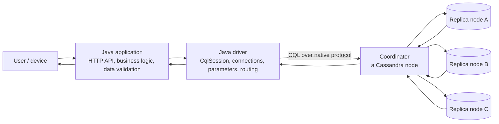
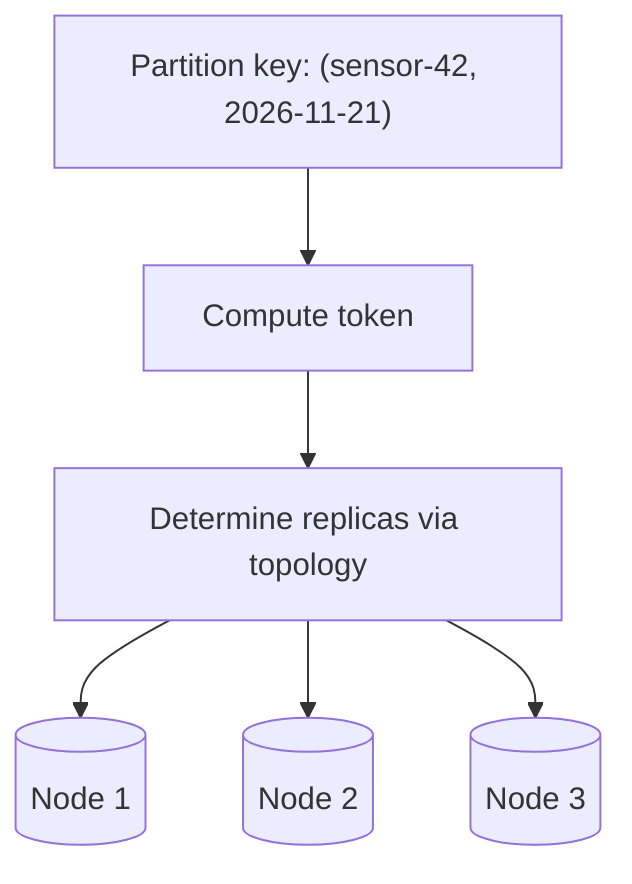
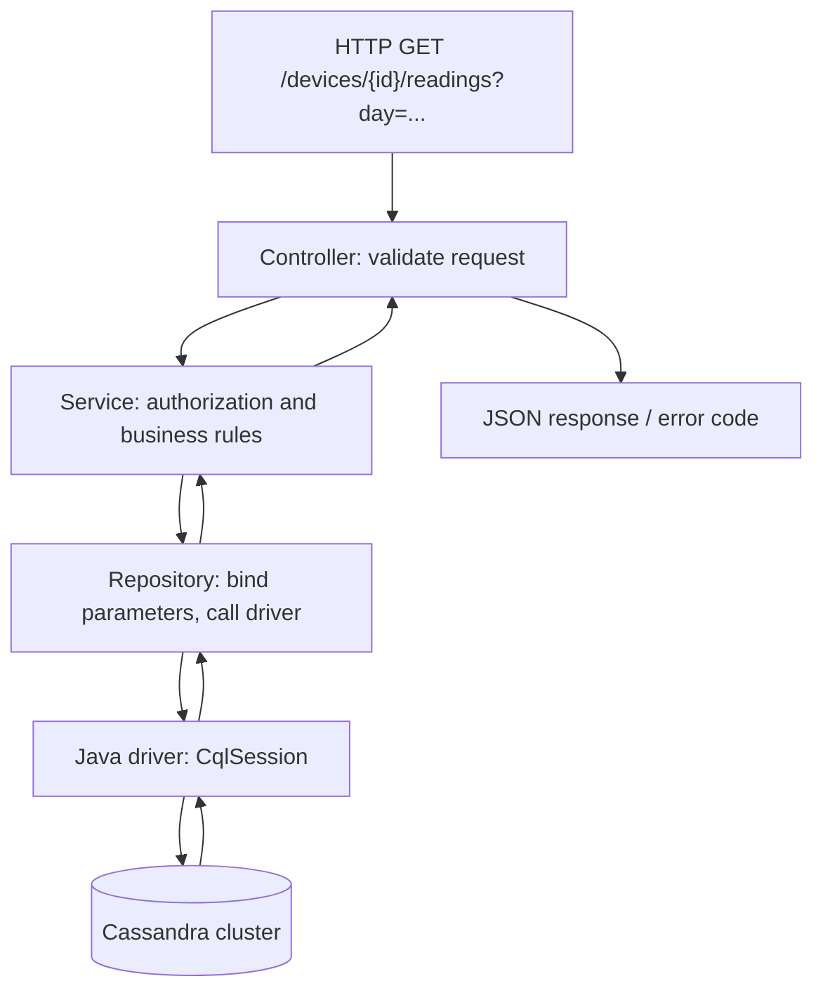

# Distinguishing Cassandra, CQL, the Driver, and the Java Application

> **Chapter:** Cassandra Foundations  
> **Scope:** Accurately identifying the responsibilities of Apache Cassandra, the CQL language, the Java driver, and the Java application in a system using a distributed wide-column database. This lesson includes CQL and Java examples, along with reasoning about partitioning, replication, consistency, network failures, and operations.

## 1. Learning Objectives

After this lesson, you will be able to:

1. Explain the four terms **Cassandra**, **CQL**, **driver**, and **Java application** without conflating them.
2. Trace the path of a read/write command from the application through the driver and coordinator to the replicas and back to the application.
3. Identify each layer's responsibility regarding schema, partition key, consistency level, retries, business correctness, and error handling.
4. Write a paired **CQL + Java driver** example accessing the same table by partition key, while understanding the role of `cqlsh`.
5. Recognize misconceptions such as "CQL is a Java API", "the driver shards data itself", "a timeout means nothing was written", and "using a driver means you don't need to care about schema".

## 2. One Application, Four Distinct Concepts

Suppose a temperature monitoring service ingests thousands of events per second. The UI asks: "Show the 10 most recent measurements for device `sensor-42` today." A developer writes Java code, sends CQL statements through the Java driver, and receives data stored by the Cassandra cluster.

| Component | Nature | Which question does it answer? | Example |
| --- | --- | --- | --- |
| **Apache Cassandra** | Distributed NoSQL database management system in the wide-column family | **Where is data stored, how is it replicated, and how is it served?** | Node, partition, replica, coordinator, memtable, SSTable |
| **CQL (Cassandra Query Language)** | Cassandra's schema definition and data manipulation language | **Which table do we create, or which data do we write or read?** | `CREATE TABLE`, `INSERT`, `SELECT` |
| **Java driver** | Client library for Java communicating with Cassandra over the native protocol | **How does Java code connect, send statements, pass parameters, and receive results?** | `CqlSession`, `PreparedStatement`, `Row` |
| **Java application** | Software containing business rules, APIs, input validation, and workflow orchestration | **Why do we need the data, how do we process results, and how do we respond to users?** | `GET /devices/{id}/readings` API, service, controller |

A simple way to remember:

- **Cassandra is where data is managed and served.**
- **CQL is the language describing operations on that data.**
- **The driver is the programmatic bridge between Java and the Cassandra cluster.**
- **The Java application decides which operations the business needs and how to use the results.**

These layers are closely linked yet cannot substitute for one another: with a Cassandra cluster and no Java application yet, you can still operate from `cqlsh`; with CQL but no server, statements cannot execute; with a driver but an incorrect schema/query, you still will not build a good system.

## 3. Architecture Diagram: Each Layer Does One Part of the Work



The diagram uses three replicas for illustration and does not claim every cluster always has a replication factor of 3. The coordinator is the Cassandra node receiving a specific request, **not a fixed master machine**. How many replicas must respond depends on the replication factor and the operation's consistency level; the coordinator does not necessarily wait for all three replicas in the example above.

### 3.1. Network Boundaries and Responsibilities

The Java application typically connects via the driver to the **CQL native protocol** port of Cassandra nodes, commonly TCP **9042**, optionally secured with TLS depending on deployment. The driver maintains connections and serializes data into protocol messages. The Cassandra server processes queries, locates replicas by partition key, reads/writes data, and returns results.

A CQL command is the **request payload**, not a standalone service running outside Cassandra. The Java driver does not "run the database inside the JVM"; Cassandra consists of separate server processes. Nor does the Java application become a replica simply because it knows the partition key.

## 4. What Is Cassandra Responsible For?

Cassandra is a distributed data management system. Its main **server-side** responsibilities include:

1. **Storing data in the table/partition model:** each row belongs to a partition identified by the **partition key**; clustering columns define row ordering within the partition.
2. **Distributing partitions across the cluster:** a token is computed from the partition key, and cluster topology plus replication strategy determine which nodes hold replicas.
3. **Maintaining copies and coordinating requests:** the coordinator node communicates with replicas and waits for the required responses per the **consistency level**.
4. **Writing to and reading from storage structures:** commit log, memtable, SSTables, internal indexes, and version reconciliation steps during reads.
5. **Managing data over time:** compaction, tombstones/TTL, anti-entropy repair, and handling temporarily unavailable replicas.

These responsibilities deliver Cassandra's benefits when a system needs high write throughput, horizontal scaling, and tolerance of node or data center failures.

**Cassandra does not inherently know business rules** such as "only the customer owning the device may view its data", "reports must convert timestamps to the user's timezone", or "a payment command must emit an event exactly once." Those must be designed in the application and surrounding systems.

### 4.1. Cassandra Is Not Synonymous With a Single Machine



For a given partition, each replica stores a copy of that partition's data; clustering rows in the same partition are not independently hashed and scattered onto new nodes. Therefore, adding nodes **does not automatically resolve** an overloaded hot partition. Choosing the partition key is a design responsibility of the system builder, even though Cassandra performs token calculation and routing.

## 5. What Is CQL Responsible For?

**CQL (Cassandra Query Language)** is the language for defining and manipulating data in Cassandra. Its syntax borrows familiar keywords from SQL, while its access semantics rely heavily on the primary key and how data is partitioned.

| Operation group | CQL example | Purpose |
| --- | --- | --- |
| Declare keyspace | `CREATE KEYSPACE ... WITH replication = ...` | Set namespace and replication strategy |
| Declare table | `CREATE TABLE ... PRIMARY KEY (...)` | Define partition key and clustering columns |
| Write data | `INSERT INTO ... VALUES (...)` | Insert or update a row by key |
| Read data | `SELECT ... WHERE ... LIMIT ...` | Retrieve rows matching conditions supported by the table model |
| Delete data | `DELETE FROM ... WHERE ...` | Delete data by valid key/conditions; typically creates tombstones |
| Conditional statements | `INSERT ... IF NOT EXISTS` | Use lightweight transactions (LWT) when consensus conditions are needed, at extra cost |

### 5.1. CQL Is Not Full Relational SQL

Cassandra favors queries that already know the partition key and appropriate clustering conditions. CQL does not offer general relational JOINs, arbitrary multi-table ACID transactions, or arbitrary cluster-wide `GROUP BY`/aggregations like an analytical store.

If the application wants "the 10 most recent measurements for device X on day Y", we design a table so the pair `(device_id, reading_day)` pinpoints the partition and `occurred_at` orders measurements inside it. If you want to compute `AVG(temperature_c)` by city across all devices, consider an aggregation pipeline or analytical store instead of expecting the driver to turn CQL into a cheap cluster-wide scan.

### 5.2. CQL Differs From `cqlsh`

**`cqlsh`** is a command-line tool that lets humans connect to a cluster and submit CQL queries. Convenience commands like `CONSISTENCY` or `DESCRIBE` are features of the `cqlsh` environment; do not mistake every shell command for a CQL statement sent verbatim by a Java application.

Crucially: **both `cqlsh` and the Java driver are clients** talking to Cassandra. They have different interfaces, yet both interact with schemas and data on the server.

## 6. What Is the Java Driver Responsible For?

In JVM applications, Java driver 4.x provides APIs such as `CqlSession`, `PreparedStatement`, `BoundStatement`, and `ResultSet`. The examples below use APIs from this driver series; specific artifacts and versions depend on your project environment and must be compatible with the running Cassandra version.

### 6.1. What the Driver Typically Does

- **Connections:** establishes and maintains connections to nodes, supplying credentials, TLS, and configured timeouts.
- **Topology discovery:** receives cluster, data center, node, and token metadata to choose suitable nodes for requests.
- **Request encoding:** transmits CQL and parameter values over the native protocol; converts between Java types and CQL types.
- **Prepared statements:** prepares parameterized statements and binds properly typed values. This enables statement reuse and avoids concatenating untrusted input into query strings.
- **Result handling:** maps returned rows to Java values; provides pagination and asynchronous APIs per driver capabilities.
- **Request policies:** applies timeouts, load balancing, retries, consistency levels, and idempotence per configuration/statement.

### 6.2. What the Driver Does **Not** Decide For You

- It cannot pick the right partition key for business needs if the schema is poorly designed.
- It does not automatically create an optimal replication strategy, repair schedule, or compaction policy.
- It cannot turn a `SELECT` missing its partition key into a cheap query.
- It cannot verify a business invariant like "charged exactly once" on behalf of the application.
- It cannot guarantee a retry is safe if the statement has non-idempotent effects or generates a new ID on every attempt.
- It does not replace end-user authorization checks in your API/service.

A `CqlSession` is typically a **long-lived, reusable** application object capable of serving many concurrent requests; opening and closing a session per HTTP request wastes connections and adds latency. Managing lifecycle and closing the session on shutdown is the application's responsibility.

## 7. What Is the Java Application Responsible For?

The Java application translates business requirements into concrete data operations. For instance, an API reading device history must:

1. Authenticate the user and verify authorization to view `device_id`.
2. Normalize dates and timestamps, such as adopting a UTC bucket convention.
3. Call a repository/service that sends a CQL query with the full partition key.
4. Handle timeouts and errors according to the API contract; retry only when operation semantics permit.
5. Map `Row` objects into DTOs/domain objects, filter exposed attributes, and return HTTP responses.
6. Emit metrics, structured logs, and traces to investigate latency or incidents.



Splitting into controller, service, and repository is just one code-organization example. Smaller applications may use a different structure, yet the responsibilities still exist. Whether using Spring Boot, Micronaut, or plain Java, the HTTP framework and the Java driver are **two separate library layers**.

## 8. An End-to-End Example From CQL to Java

Let's build a feature to write and read temperatures by **device + day**, then compare each line of CQL with how the Java driver invokes the same statement.

### 8.1. Environment Assumptions

The example below targets a **single-node lab** or cluster with a data center named `dc1` and a replication factor of 1 for ease of execution. In real environments, confirm your data center name and proper replication configuration; when enough nodes exist, you can use RF = 3 and higher local consistency as required.

- Cassandra is running and reachable from the Java host at `127.0.0.1:9042` in the lab.
- `cqlsh` can send commands to the cluster to create the keyspace/table.
- The Java project has a compatible **Java driver 4.x** dependency configured; the exact artifact/version depends on the release used by your project.
- The example data does not require Docker, Maven, or Gradle to understand the flow of responsibilities. Actual setup and execution steps depend on your lab infrastructure.

### 8.2. CQL: Creating the Storage Structure

Run the following statements in `cqlsh` or a compatible CQL client:

```sql
-- Lab: the data center name must match 'dc1', RF = 1.
CREATE KEYSPACE IF NOT EXISTS telemetry
WITH replication = {
    'class': 'NetworkTopologyStrategy',
    'dc1': 1
};

CREATE TABLE IF NOT EXISTS telemetry.readings_by_device_day (
    device_id text,
    reading_day date,
    occurred_at timestamp,
    reading_id uuid,
    temperature_c double,
    PRIMARY KEY ((device_id, reading_day), occurred_at, reading_id)
) WITH CLUSTERING ORDER BY (occurred_at DESC, reading_id ASC);
```

**Why does the primary key have this structure?**

| Component | Role | Consequence |
| --- | --- | --- |
| `(device_id, reading_day)` | Composite partition key | Readings for the same device on the same day are routed to one partition |
| `occurred_at` | First clustering column | Traverses newest readings first when reading history in the partition |
| `reading_id` | Second clustering column | Disambiguates readings sharing the same timestamp |
| `temperature_c` | Regular data column | Read alongside the row; does not automatically become a cluster-wide index |

Partitioning by day keeps partition size from growing indefinitely. If a device writes very heavily within a day, you still need to consider smaller buckets, measure hot partitions, and adjust multi-bucket reads.

### 8.3. CQL: Manual Operations to Understand the Schema

```sql
INSERT INTO telemetry.readings_by_device_day (
    device_id, reading_day, occurred_at, reading_id, temperature_c
) VALUES (
    'sensor-42', '2026-11-21', '2026-11-21T08:00:00Z',
    11111111-1111-1111-1111-111111111111, 27.4
);

SELECT occurred_at, reading_id, temperature_c
FROM telemetry.readings_by_device_day
WHERE device_id = 'sensor-42'
  AND reading_day = '2026-11-21'
LIMIT 10;
```

The `WHERE` clause provides the **full partition key**, allowing Cassandra to identify the replicas of the exact partition to read. `LIMIT` caps the number of returned rows; it does **not** fix an oversized partition or a query requiring a cluster-wide filter.

### 8.4. Java: Sending the Same Operations Through the Driver

Java 11+ example using Java driver 4.x APIs:

```java
import java.net.InetSocketAddress;
import java.time.Instant;
import java.time.LocalDate;
import java.util.UUID;

import com.datastax.oss.driver.api.core.CqlSession;
import com.datastax.oss.driver.api.core.DefaultConsistencyLevel;
import com.datastax.oss.driver.api.core.cql.BoundStatement;
import com.datastax.oss.driver.api.core.cql.PreparedStatement;
import com.datastax.oss.driver.api.core.cql.ResultSet;
import com.datastax.oss.driver.api.core.cql.Row;

public class CassandraReadingsExample {
    public static void main(String[] args) {
        try (CqlSession session = CqlSession.builder()
                .addContactPoint(new InetSocketAddress("127.0.0.1", 9042))
                .withLocalDatacenter("dc1")
                .build()) {

            PreparedStatement insert = session.prepare(
                "INSERT INTO telemetry.readings_by_device_day " +
                "(device_id, reading_day, occurred_at, reading_id, temperature_c) " +
                "VALUES (?, ?, ?, ?, ?)"
            );

            // Generate the ID once per logical event; reuse it if safe retries are needed.
            UUID readingId = UUID.randomUUID();
            BoundStatement insertBound = insert.bind(
                    "sensor-42",
                    LocalDate.of(2026, 11, 21),
                    Instant.parse("2026-11-21T08:05:00Z"),
                    readingId,
                    28.1
                )
                .setConsistencyLevel(DefaultConsistencyLevel.LOCAL_ONE);
            session.execute(insertBound);

            PreparedStatement select = session.prepare(
                "SELECT occurred_at, reading_id, temperature_c " +
                "FROM telemetry.readings_by_device_day " +
                "WHERE device_id = ? AND reading_day = ? LIMIT 10"
            );

            ResultSet results = session.execute(
                select.bind("sensor-42", LocalDate.of(2026, 11, 21))
                    .setConsistencyLevel(DefaultConsistencyLevel.LOCAL_ONE)
            );

            for (Row row : results) {
                System.out.printf(
                    "%s | %s | %.1f C%n",
                    row.getInstant("occurred_at"),
                    row.getUuid("reading_id"),
                    row.getDouble("temperature_c")
                );
            }
        }
    }
}
```

In a lab with RF = 1, `LOCAL_ONE` only needs one local replica to respond. Using RF = 1 does **not** provide node fault tolerance like systems with higher RF. In production with RF = 3 in the local data center, `LOCAL_QUORUM` typically requires two replicas to respond; CL selection should be based on consistency and availability requirements.

**Mapping the four layers in the example:**

| Observable action | Which layer owns it? |
| --- | --- |
| Initializing `CqlSession`, creating `PreparedStatement`, binding `LocalDate` and `Instant` | Java driver API invoked by the application |
| Strings `INSERT INTO ...` and `SELECT ... WHERE ...` | CQL statements |
| Token from `(device_id, reading_day)`, replica placement, writing to memtable/commit log | Cassandra server |
| Selecting the device, defining "day", generating a stable event ID, deciding how to display output | Java application / business logic |

**Note on the sample code:** `UUID.randomUUID()` creates a new event each time the **entire program runs again**. To retry the same logical operation, the application must preserve the same ID and payload across attempts. Do not assume that a timed-out `session.execute(...)` call means the data was definitely not written.

### 8.5. Why Use PreparedStatement?

```java
PreparedStatement readByDevice = session.prepare(
    "SELECT occurred_at, temperature_c " +
    "FROM telemetry.readings_by_device_day " +
    "WHERE device_id = ? AND reading_day = ? LIMIT 10"
);

// Reuse the statement for different parameter sets.
session.execute(readByDevice.bind("sensor-42", LocalDate.of(2026, 11, 21)));
session.execute(readByDevice.bind("sensor-99", LocalDate.of(2026, 11, 21)));
```

Prepared statements allow **typed** parameter binding, avoiding bugs from manual quoting, string escaping, or date/time formatting. They also enable reusing the statement when sending many parameter sets. **A prepared statement does not guarantee an optimal query** if the partition key or data schema is unsuitable.

## 9. Complete Read/Write Flow: From HTTP to Replicas

Let's connect the layers into a processing sequence.

### 9.1. When the Application Writes a Measurement

1. The device sends data to the **Java application's** API.
2. The application authenticates, validates input, determines `reading_day` per the time convention, and assigns `reading_id`.
3. The repository binds parameters into a prepared **CQL** statement; the application may set the consistency level on the statement.
4. The **driver** encodes parameters, chooses a target node based on metadata/policies, and transmits the request over the native protocol.
5. The receiving Cassandra node acts as **coordinator**, locating replicas by partition key and replication strategy.
6. Replicas process the mutation (including commit log and memtable on the write path) and reply to the coordinator.
7. Once the **consistency level** condition is satisfied, the coordinator returns the result; the driver decodes the response.
8. The **Java application** decides whether to return HTTP success, handle an error, or record an uncertain state.

### 9.2. When the Application Reads Device History

1. The application confirms the caller is authorized to view `sensor-42`.
2. It normalizes `reading_day` and bounds the data range.
3. The driver sends the `SELECT` statement with the full partition key.
4. The coordinator locates the partition's replicas, executes the read, and reconciles results according to the CL and relevant mechanisms.
5. The driver returns rows/values to Java; the application maps them to DTOs and sends the response.

Note: the driver can use token metadata to pick an optimal node upfront (token-aware routing), yet **replica and data processing still belong to the Cassandra server**. The node the driver connects to serves as the coordinator for the request; the application does not send a separate command directly to each replica itself.

## 10. Which Layer Owns Replication and Consistency?

This is where newcomers frequently misassign responsibilities:

| Decision | Where it is declared/controlled | Where it is enforced |
| --- | --- | --- |
| Partition key, clustering columns | **CQL** schema chosen by the schema designer | **Cassandra** organizes and routes data |
| Replication factor and strategy | Keyspace configuration via **CQL** or schema administration | **Cassandra** places and maintains replicas |
| Consistency level for a request | Specified by **application/driver** (or `cqlsh`), or defaulted | **Cassandra coordinator and replicas** satisfy the required acknowledgment count |
| Timeouts, retry policy, load balancing | Configured and decided by **driver/application** | Driver retries/picks nodes per policy; Cassandra processes received requests |
| Data retention, TTL | Schema/CQL and application business decisions | Cassandra stores tombstones, runs compaction, and handles expiration |
| Error messages, HTTP codes, UI messaging | **Java application** | Application returns responses to clients |

### 10.1. Consistency Level Example

Suppose a data center has **RF = 3**, and a partition's three replicas are A, B, and C:

- Writing at `LOCAL_ONE` requires one local replica to respond successfully.
- Writing at `LOCAL_QUORUM` typically requires two of the three local replicas to respond.
- Writing at `ALL` requires all three replicas to respond, making it sensitive to any single replica outage.

With quorum reads and writes in the same replica scope, the participating replica sets overlap whenever the sum of read and write acknowledgments exceeds RF. This is a helpful intuition about the chance of observing the latest value, **not a guarantee that every Cassandra operation is linearizable**: concurrent writes, timestamps, conflicts, and LWT semantics must be analyzed separately.

The driver **merely conveys the CL choice in the request**; it cannot turn RF = 1 into three copies. Conversely, a server with RF = 3 does not automatically infer a business policy such as "this request must use LOCAL_QUORUM" on behalf of the system builder.

## 11. Failures and Retries: Who Handles Which Part?

In distributed systems, failures do not always yield a clean "written" or "not written" answer. A timeout can occur after replicas have written the data but before the acknowledgment reaches the client.

| Scenario | Cassandra/server | Driver | What the Java application must do |
| --- | --- | --- | --- |
| Cannot connect to initial contact point | Node did not receive connection, or network failed | May try other nodes per configuration/policy | Return appropriate error, log, and monitor cluster reachability |
| Insufficient replicas to satisfy CL | Coordinator cannot meet request requirement | Receives unavailable/timeout or corresponding error | Decide whether to surface error, retry, or degrade gracefully |
| Write times out after some replicas received it | Part of the mutation may already be written | May throw an exception to the application | Do not assume "not written"; use idempotent operations or reconciliation |
| Table/schema does not exist | Server rejects CQL invalid against schema | Propagates query error | Fix migration, configuration, or deployment state; blind retries do not help |
| Hot partition | Replicas of that partition may overload | Picking another coordinator does not fix root cause | Measure per-partition load, redesign keys/buckets, and control write sources |
| Invalid end-user permissions | Server only checks configured Cassandra account privileges | Uses credentials provided to the application | Enforce business authentication/authorization before accessing data |

### 11.1. Idempotency Must Be Defined at the Business Level

An `INSERT` with the **same primary key and values** may be suitable to retry in many cases. However, if each retry generates a new `reading_id`, the table gains duplicate rows. If an operation increments counters, uses conditional LWTs, or depends on writing to another system, retry rules become even more nuanced.

The application should attach a stable ID per logical event, distinguish retryable errors from errors requiring fixes, and cap retry attempts. The driver has statement-level idempotence/retry mechanisms, but that flag **cannot verify** whether an operation is genuinely idempotent in business terms.

### 11.2. When High Throughput Is Needed

`session.execute(...)` in the example is a synchronous call, suitable for learning the flow. High-throughput applications can use asynchronous APIs, concurrency limits, case-appropriate batching, backpressure, and latency measurement. **CQL `BATCH` is not a general-purpose speedup tool across many different partitions**, nor does it replace multi-table relational transactions.

## 12. Boundaries With JDBC, JPA, and Spring

Java developers sometimes encounter JDBC, JPA, and Spring Data and assume Cassandra behaves like an RDBMS once you swap a dependency. Keep the layers separate:

| Technology | Role | Relationship to Cassandra |
| --- | --- | --- |
| **JDBC** | Standard Java interface for working with databases via a JDBC driver | Not the native Cassandra driver API used in this example |
| **JPA/Hibernate** | ORM, entity and relationship mapping typically tied to RDBMS | Does not make Cassandra support relational SQL JOINs and transactions |
| **Spring Boot** | Application organization framework, DI, APIs, configuration | Can manage services and Cassandra client lifecycle |
| **Spring Data Cassandra** | Repository/template abstraction for Cassandra in the Spring ecosystem | Typically built atop the Java driver and remains subject to Cassandra's query model limits |
| **Cassandra Java driver** | Client API speaking the native protocol with Cassandra | Foundation for connecting, sending CQL, binding parameters, and reading rows |

You can use Spring Data Cassandra for more concise code, but partition key design, replication, CL, and distributed error handling still require active design. A repository method named `findByTemperatureCGreaterThan(...)` does not mean Cassandra has a cheap built-in access path for cluster-wide temperature queries.

## 13. Operations and Security Span Multiple Layers

Merely connecting from Java is not enough to evaluate a production Cassandra system:

- **Cassandra side:** topology design, replication, data distribution, node monitoring, repair, compaction, tombstones, backup/restore, and capacity.
- **Driver side:** contact points/metadata configuration, local data center, TLS, authentication, timeouts, retries, paging, pooling, and metrics.
- **Application side:** business authorization, validation, load control, logging/tracing, request IDs, sensitive data handling, and incident responses.
- **Schema/CQL side:** partition keys, time buckets, TTL, clustering, appropriate indexes, and safe migrations.

In a lab, `127.0.0.1:9042` may suffice; in real environments, use endpoints, authentication, and TLS according to system policy. Never hard-code passwords in source code or log sensitive payloads. `withLocalDatacenter("dc1")` must match the data center name reported by the cluster; `dc1` in the example is not a guaranteed default in every installation.

## 14. Scenario Exercise: Diagnosing Errors in the Right Layer

A development team runs a Java service displaying user action history. They encounter four incidents:

1. **Error A:** Upon starting the app, an error states "unable to connect to cluster"; port 9042 is unreachable.
2. **Error B:** `SELECT ... WHERE action_type = 'login'` does not perform efficiently on a table designed around `(user_id, day)`.
3. **Error C:** When one replica is shut down, queries at CL `ALL` frequently fail even though two replicas remain healthy.
4. **Error D:** After a timeout, the API automatically retries a write but generates a new UUID, causing one event to appear twice.

Identify the layer that **detects the issue**, the layer holding the **root cause**, and the remediation path:

| Incident | Where is it detected? | Core root cause | Remediation path |
| --- | --- | --- | --- |
| A | Driver / Java application | Connectivity, topology, network, endpoint, TLS/auth, or cluster not ready | Check network/ports, contact points, local DC, security settings, and Cassandra health |
| B | CQL query / application | Schema and partition key do not serve lookups by `action_type` | Design a query-driven table, evaluate an appropriate index after measurement, or use a search/aggregation system |
| C | Driver receives error from coordinator | `ALL` requires every replica, which cannot succeed when one replica is down | Choose a CL matching SLA and correctness needs; do not blindly lower CL for every case |
| D | Java application | Non-idempotent retry because the ID changes | Keep a stable event key across attempts; consider deduplication and reconciliation |

### Extended Practice

Propose two APIs: `GET /devices/{id}/readings?day=...` and `GET /analytics/daily-average?city=...`. For each API, answer:

- Does the application know the full **partition key** to query Cassandra directly?
- Does it need a query-specific **Cassandra table**, a pre-aggregated summary table, or a **columnar analytical store**?
- If a request times out, how does the application distinguish read errors from write errors?
- What can the Java driver help with, and what still must be solved in business code?

A sound solution is that per-device/day history lookups fit Cassandra if the schema has the corresponding partition key. City-level daily averages across many devices usually fit an aggregation pipeline and analytical store. The driver sends queries and surfaces errors, yet **does not decide business aggregations** or source-of-truth correctness on behalf of the application.

## 15. Misconceptions to Avoid

| Misconception | Accurate understanding |
| --- | --- |
| "Cassandra is a query language." | Cassandra is the database system; CQL is its query language. |
| "CQL is a Java library." | CQL is the language; the Java driver is the library sending CQL over the protocol to the server. |
| "The driver shards data by key itself." | Cassandra computes tokens, determines replicas, and stores data; the driver can perform smart routing based on metadata. |
| "With Spring Data, Cassandra behaves like PostgreSQL." | Java abstractions do not alter Cassandra's query or transaction model constraints. |
| "Prepared statements make every SELECT fast." | Prepared statements help with reuse and parameter binding; performance depends on schema and read path. |
| "RF = 3 means every write must wait for three nodes." | RF is the replica count; required acknowledgments depend on the consistency level. |
| "A timeout means definitely not written." | Mutations may already have been written on some replicas while the client never received the acknowledgment. |
| "The Java driver handles end-user authorization itself." | The driver uses credentials to authenticate to Cassandra; the application must still enforce business permissions. |
| "CQL BATCH is an SQL transaction and always speeds up bulk inserts." | Cassandra batches have different semantics and costs; evaluate per operation type and partitioning. |

## 16. Knowledge Self-Check

1. **Who decides which replicas hold a row?** The Cassandra server using the partition key, token, and replication strategy; the driver can pick a favorable initial contact node.
2. **Is CQL a server, an API, or a language?** It is a language for defining schemas and querying data.
3. **Is `cqlsh` the Java driver?** No. `cqlsh` is a command-line client tool, whereas the Java driver is a library embedded in Java applications.
4. **Is it reasonable for an application to keep one `CqlSession` across many requests?** Yes. A session is typically reused across the application's lifecycle.
5. **Why must `device_id` and `reading_day` be bound?** Because they form the composite partition key, allowing Cassandra to locate the exact partition for the query.
6. **Can RF = 1 survive losing the node holding a partition without interruption?** There is no other replica to serve that partition; RF = 1 is a simple lab configuration and does not provide the fault tolerance of higher RF.
7. **Why must a timed-out write be retried carefully?** Because some replicas may already have written it; a retry generating a new key or causing side effects can produce duplicates or divergence.
8. **Who is responsible for knowing whether a user is allowed to view sensor-42?** The Java application and business authorization logic, alongside Cassandra connection/credential security.
9. **When a table lacks an access path by `event_type`, will replacing JDBC with the Java driver solve it?** No. You must adjust the query/schema model or pick a system supporting that query.
10. **When two nodes remain alive under RF = 3, which CL typically still achieves local quorum?** `LOCAL_QUORUM` requires two replicas in the local data center, provided those replicas respond on time.

## 17. Connecting to the Cassandra Learning Path

You can trace the entire chain as follows:

**Java application defines business logic → driver sends CQL and parameters → Cassandra coordinator locates partition/replicas → Cassandra performs read/write per consistency level → driver returns results/errors to Java → application decides response and next step.**

Distinguishing these four layers is the foundation for studying the subsequent parts of the **DATABASE_ENGINE_WIDE_COLUMN_CASSANDRA** module: query-driven table design, replication and read/write consistency levels, compaction, repair, failure scenarios, and Java application integration. Whenever a real issue arises, pinpoint whether it belongs to **schema/CQL**, **distributed server**, **connectivity/driver**, or **application business logic** before changing configuration or source code.
