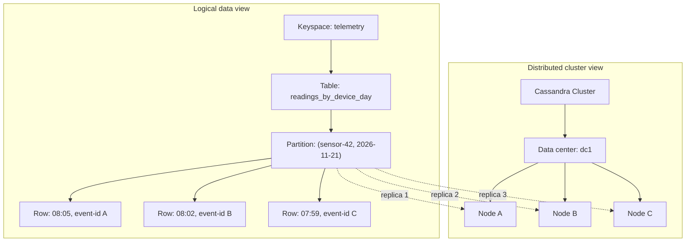
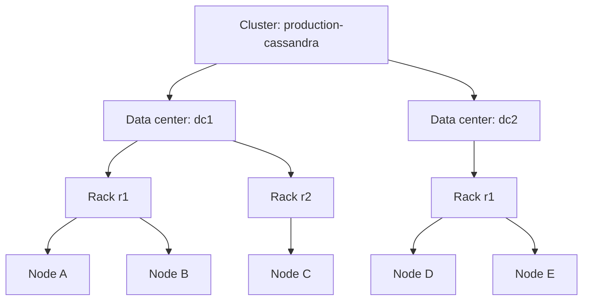
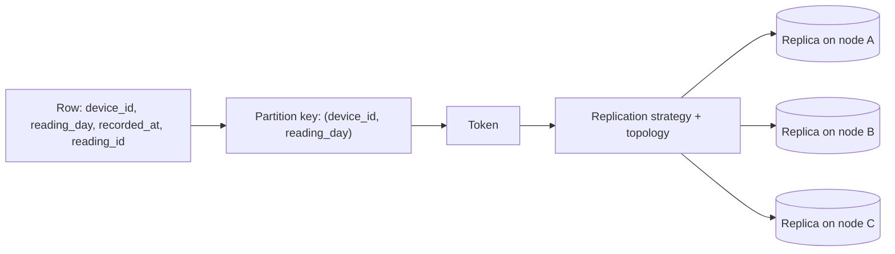
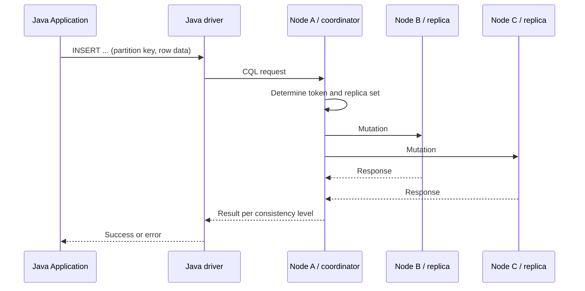

# Terminology Map: Keyspace, Table, Partition, Row, Node, Replica, and Cluster

> **Chapter:** Cassandra Foundations  
> **Scope:** Foundational terminology map for **Apache Cassandra** in the **DATABASE_ENGINE_WIDE_COLUMN_CASSANDRA** module. This lesson connects wide-column data structures to distributed architecture, partition keys, query-driven table design, replication, and read/write consistency levels. CQL examples and a Java application perspective help turn terminology into practical operations.

## 1. Learning Objectives

After this lesson, you will be able to:

1. Accurately define **keyspace, table, partition, row, node, replica, and cluster** and place them onto the same mental diagram.
2. Inspect a `PRIMARY KEY` declaration to identify the **partition key**, **clustering columns**, and how a row is uniquely identified.
3. Distinguish a **logical partition** from its **physical replicas**; understand why adding nodes does not mean splitting individual rows of a single partition onto different nodes.
4. Explain the basic path of a read/write command through the **coordinator** and the response requirements at `LOCAL_QUORUM` when the replication factor is 3.
5. Use CQL to create a keyspace, create a table, write data, and query the right partition; recognize the boundaries that Java applications and drivers must respect.

## 2. The Big Picture: Two Kinds of "Maps"

When reading Cassandra documentation, many terms appear together, yet they describe **two perspectives**:

- **Logical map:** how is data named, grouped, and identified? This is the world of **keyspace → table → partition → row → cell**.
- **Infrastructure map:** where is data distributed and replicated? This is the world of **cluster → data center/rack → node**, along with each partition's **replicas**.

A partition is defined **logically** by the partition key inside a table. Cassandra can store **multiple physical copies** of that partition across different nodes. Thus, "one partition" and "three replicas" do not contradict each other.



The diagram illustrates a data center with **replication factor (RF) = 3** and three eligible nodes holding replicas. **Each of nodes A, B, and C stores a copy of the same partition containing the corresponding rows**—not A holding the first row, B the second, and C the third. In a real cluster, each node also holds replicas of **many other partitions**.

## 3. Quick Glossary: Names, Levels, and Responsibilities

| Term | Short definition | Which view? | Question it answers |
| --- | --- | --- | --- |
| **Cluster** | Set of Cassandra nodes operating together as one distributed group | Infrastructure | Which machines jointly serve this dataset? |
| **Data center (DC)** | Group of nodes by deployment/topology domain for organizing replication and local access | Infrastructure | In which deployment region are replicas placed? |
| **Rack** | Topology group within a DC assisting replica placement, usually reflecting fault domains | Infrastructure | Can we avoid placing all replicas in the same fault domain? |
| **Node** | A Cassandra instance participating in the cluster, storing data and able to accept requests | Infrastructure | Which machine/instance receives and stores data? |
| **Replica** | A **copy of a partition** stored on a node | Logical ↔ infrastructure link | How many copies of this partition exist and where are they? |
| **Keyspace** | Namespace containing tables and the keyspace's replication configuration | Logical + distribution config | Which tables share the same replication strategy? |
| **Table** | CQL schema comprising columns, primary key, and storage options | Logical | How are rows modeled for which query? |
| **Partition** | Set of rows sharing the **same partition key value** in a table | Logical, with replicas on nodes | Which data group does a query with this key reach? |
| **Row** | Record uniquely identified by the **full primary key** of the table | Logical | Which record is this within the partition? |
| **Cell** | Value of a column in a row (along with related metadata, if any) | Logical/storage | What is this specific attribute of the record? |

### 3.1. Why Can't Everything Fit Into a Single Tree?

We can say **a keyspace contains tables**, **a table contains partitions**, and **a partition contains rows**. Likewise, **a cluster comprises multiple nodes** (organized by DC/rack). However, **a replica is not the parent of a row in the logical model**, nor is it a new kind of machine.

A replica is a **relationship**: partition P has copies on nodes A, B, and C. Node A may simultaneously hold replicas for partitions Q, R, and S; partitions from different tables or keyspaces can have different replica sets.

## 4. Keyspace: Scope of Schema and Replication

A **keyspace** is the top-level namespace for Cassandra data. It groups tables and holds the **replication strategy** and **replication factor** configuration. You can loosely compare it to a "database" in some DBMSs, though a keyspace carries explicit distributed replication semantics.

Example:

```sql
-- Illustration for a cluster with a data center named dc1
-- and at least 3 eligible nodes for placing replicas.
CREATE KEYSPACE IF NOT EXISTS telemetry
WITH replication = {
    'class': 'NetworkTopologyStrategy',
    'dc1': 3
};
```

Here:

- `telemetry` is the **keyspace name**.
- `NetworkTopologyStrategy` is the topology-aware replica placement strategy.
- `'dc1': 3` means for partitions in this keyspace, Cassandra is configured to maintain **three replicas in data center dc1**, provided the infrastructure supports it.
- This statement does **not** create three tables, three partitions, or three clusters.

In a multi-data-center cluster, one keyspace can declare an RF for each DC, for example:

```sql
-- Configuration example, use only when the cluster actually has dc1 and dc2.
CREATE KEYSPACE IF NOT EXISTS telemetry_multiregion
WITH replication = {
    'class': 'NetworkTopologyStrategy',
    'dc1': 3,
    'dc2': 3
};
```

Each partition is then configured with **three replicas in dc1 and three replicas in dc2**. This is a single shared keyspace configured to replicate across DCs in the same cluster, not two independent keyspaces synchronized manually by the application.

**Deployment note:** `dc1` and `dc2` are illustrative names only. You must use the actual DC names advertised by your cluster, ensure sufficient suitable nodes/racks, and monitor replica status. RF = 3 on a single-node cluster **cannot produce three fault-tolerant copies across three machines**.

## 5. Table: Modeling Data Around Queries

A **table** is a CQL structure declaring column names, data types, the primary key, and options. In Cassandra, table design begins with **the queries to serve**, especially the predicates used to locate a partition.

For example, suppose the system wants:

> Fetch the 20 most recent measurements of a device on a selected day.

The schema might be:

```sql
CREATE TABLE IF NOT EXISTS telemetry.readings_by_device_day (
    device_id text,
    reading_day date,
    recorded_at timestamp,
    reading_id uuid,
    temperature_c double,
    status text,
    PRIMARY KEY ((device_id, reading_day), recorded_at, reading_id)
) WITH CLUSTERING ORDER BY (recorded_at DESC, reading_id ASC);
```

The table's full name is **`telemetry.readings_by_device_day`**:

- `telemetry`: **keyspace**.
- `readings_by_device_day`: **table**.
- `device_id` and `reading_day`: components of the **composite partition key**.
- `recorded_at` and `reading_id`: **clustering columns**.
- `temperature_c` and `status`: regular data columns.

If you also create `telemetry.latest_reading_by_device`, that is a **second table** in the same keyspace. It can have a different primary key to serve "latest reading" queries without scanning history. Creating an extra table **does not automatically replicate** data into the new table; the application or a pipeline must maintain data consistent with the model.

### 5.1. A Table Is Not a Single File

At the storage layer, each node stores replicas of many partitions/tables using structures such as memtables, commit logs, and immutable SSTables. Therefore, a logical table does not necessarily correspond to a single file, a single node, or a single physical shard.

In distributed databases, thinking "table X sits on machine Y" is usually an oversimplification: **a table's partitions are distributed**, and **each partition can be replicated**.

## 6. Partition: Grouping Data by Partition Key

A **partition** consists of rows sharing the **same partition key value** within a table. It is the central concept of Cassandra design because:

1. The partition key value is hashed/tokenized to determine **replica placement**.
2. Rows belonging to the same partition can be accessed in order via **clustering columns**.
3. The volume of data and traffic hitting a partition affects the group of nodes holding its replicas.

Given the declaration:

```sql
PRIMARY KEY ((device_id, reading_day), recorded_at, reading_id)
```

A specific partition might look like:

```text
Table: telemetry.readings_by_device_day
Partition key: (device_id = sensor-42, reading_day = 2026-11-21)

recorded_at              reading_id   temperature_c   status
2026-11-21T08:05:00Z     id-C         27.8            normal
2026-11-21T08:02:00Z     id-B         27.5            normal
2026-11-21T07:59:00Z     id-A         29.1            alert
```

The three lines above are **three rows in one partition**. If a measurement has `device_id = sensor-99` or `reading_day = 2026-11-22`, it belongs to a **different partition**.

### 6.1. A Composite Partition Key Is a Tuple of Values

In the example, the partition key is **the entire `(device_id, reading_day)` tuple**, not just `device_id`. Cassandra uses the values of both components to compute the token. Therefore:

| Partition key value | Logical partition |
| --- | --- |
| `(sensor-42, 2026-11-21)` | P1 |
| `(sensor-42, 2026-11-22)` | P2, distinct from P1 |
| `(sensor-99, 2026-11-21)` | P3, distinct from P1/P2 |

Date ordering does not automatically place a device's daily partitions adjacent to one another across the cluster: tokens are typically generated by hashing the partition key. **Clustering order only sorts rows within each partition.**

### 6.2. Large Partitions and Hot Partitions Differ

- **Large partition:** has many rows or many bytes; can make reads, compaction, repair, and memory usage expensive.
- **Hot partition:** receives too many reads/writes relative to its replica group's capacity; can be hot even if its current byte size is small.

If a device records millions of measurements per day, the `reading_day` bucket may still be too large. Hourly buckets or logical sharding may be needed to spread load; in that case, the application must query multiple partitions and merge the results.

**There is no single partition size threshold right for every workload.** Measure row counts, byte size, per-partition QPS, latency, and key distribution before altering the schema.

## 7. Row: A Record Identified by the Full Primary Key

A **row** is a record uniquely identified by the **full primary key**. For the table under consideration:

```text
PRIMARY KEY = (partition key, clustering columns)
            = ((device_id, reading_day), recorded_at, reading_id)
```

This means:

- Same `device_id` and `reading_day` but **different `recorded_at`**: distinct rows in the same partition.
- Same `recorded_at` but **different `reading_id`**: still distinct rows in the same partition.
- Same **full** primary key: `INSERT`/`UPDATE` operations on that key affect the same row; Cassandra has **upsert** semantics for regular writes.

For instance, two measurements arriving at the same timestamp need `reading_id` so they do not overwrite each other into a single row. In the application, the event ID must be generated and preserved stably if retrying the same logical operation.

### 7.1. A Row Is Not a Replica

A **row** answers "which record?"; a **replica** answers "which node holds a copy of this partition?". With RF = 3, a row in a partition is typically stored inside the partition's copies on three nodes within the configured topology scope. This does not create three logical rows for `SELECT` to return three times.

### 7.2. Cells and Missing Values

Within a row, `temperature_c` is a data column. The specific value of a column in a row can be viewed as a **cell**. Some rows may lack a value for `status` or `temperature_c`; that does not mean CQL is schemaless.

Cassandra uses timestamps/TTL and tombstones to manage versions, expiration, and deletion. These details affect reads, repair, and compaction, but do not alter the hierarchical definition: **partitions contain rows; rows contain cells**.

## 8. Cluster: The Set of Nodes Serving Data Together

A **Cassandra cluster** is a set of nodes participating together in a distributed storage system. Nodes exchange state and topology information to locate data, serve requests, and adapt to cluster changes. Cassandra's architecture **does not require a single master for all read/write operations**.

A cluster can contain:

- **Multiple data centers:** e.g., different deployment locations or infrastructure domains.
- **Multiple racks per DC:** supports placing replicas across distinct fault domains when topology is configured accordingly.
- **Multiple nodes per rack/DC:** each node can accept requests and store replicas of many partitions.



The diagram only illustrates cluster organization; real deployments can have many nodes/racks and need sufficient fault domains to meet availability goals. Drawing nodes in separate racks does not make placement automatically correct; Cassandra needs topology metadata and a replication strategy consistent with the underlying infrastructure.

**Common misconception:** "One keyspace corresponds to one cluster." False. One cluster can hold many keyspaces, each with many tables and potentially its own replication configuration.

## 9. Node: A Cassandra Instance, Not a Data Table

A **node** is typically a Cassandra process running on a server or suitable deployment environment participating in the cluster. A node can:

1. Store replicas of many partitions across many tables.
2. Accept CQL connections and requests from clients.
3. Act as **coordinator** for a request it receives.
4. Read/write local data and communicate with other nodes.
5. Participate in operational tasks such as gossip/cluster state, streaming, compaction, and repair.

Node A can hold replicas of partitions P, Q, and R; node B holds replicas of P, S, and T. A node **is not bound to correspond to one table or one partition**.

### 9.1. Coordinator Is a Per-Request Role of a Node

The **coordinator** is the Cassandra node receiving a request from a client/driver and coordinating access to the replicas. It is neither an extra layer outside the cluster nor a hard-coded fixed master.

A Java application using the driver might send a request to node A; for that request, A is the coordinator. The next request might go to node B, and B becomes the coordinator. The driver can leverage token/topology metadata to pick a favorable target node, yet data placement and replica handling remain responsibilities of the Cassandra server.

## 10. Replica: A Copy of a Partition, Not a Separate Node

A **replica** is a **physical copy of a partition on a node**. When we say "partition P has three replicas," we mean **three copies of the same logical data** per the RF/topology configuration.

Suppose we consider only data center `dc1` with RF = 3:

| Logical partition | Node A | Node B | Node C |
| --- | --- | --- | --- |
| P = `(sensor-42, 2026-11-21)` | Replica of P | Replica of P | Replica of P |
| Q = `(sensor-99, 2026-11-21)` | May hold replica of Q | May hold replica of Q | May hold replica of Q |

The table depicts a small-node example; larger clusters have many nodes, and each partition's replica set is chosen by token/topology. **Do not infer that every partition must sit on the exact same A, B, C**, or that RF = 3 means three nodes in the entire cluster.

### 10.1. What RF Is and What It Is Not

**Replication factor (RF)** is the configured number of copies of each partition for a scope under the replication strategy. With `NetworkTopologyStrategy`, copy counts are specified **per data center**.

| Statement | True or false? | Explanation |
| --- | --- | --- |
| "RF=3 in dc1 means a partition has three configured replicas in dc1." | True | Provided the cluster has enough nodes/conditions for topology placement |
| "RF=3 means three different partitions." | False | One logical partition has three copies |
| "RF=3 means `SELECT` returns three identical records." | False | Replicas are physical copies; results return logical rows |
| "RF=3 means there are three nodes in the entire cluster." | False | A cluster can have many more nodes; different partitions have different replica sets |
| "RF=3 means every write must wait for three replicas." | False | Required acknowledgments also depend on the **consistency level** |

### 10.2. Replicas Support Fault Tolerance, Yet Do Not Replace Repair

When a node becomes unresponsive, surviving replicas can keep serving if the consistency level allows. However, when a replica misses mutations, is isolated for a long time, or drifts, synchronization mechanisms are needed; **hinted handoff** helps within limits, and **repair** plays a vital role in converging copies.

Additionally, **compaction** processes SSTables on each node per storage policies; compaction does not create replicas, nor does it replace backups.

## 11. Connecting Both Maps via Partition Key and Token

The core question is: **which nodes should store partition P of table T?**

The reasoning path:

1. From the schema, Cassandra identifies the row's **partition key**.
2. It computes a **token** from the partition key value using the cluster's partitioner.
3. Using the token, topology information, and **replication strategy**, it determines the **set of nodes holding replicas** of the partition.
4. For a read/write operation, the coordinator contacts the necessary replicas and returns results per the consistency level.



The clustering columns `recorded_at` and `reading_id` are **not** hashed separately to scatter individual rows of P. They determine row placement/order **inside** P. Consequently, adding nodes can distribute many distinct partitions better, yet **does not automatically split one hot partition** into multiple new partitions.

## 12. Reads and Writes: Terminology Appearing in a Single Request

### 12.1. Write Flow From a Java Application



This is a simplified diagram: the coordinator can also be a replica itself and participate in local write handling; actual request dispatch and response order depend on topology, node health, and consistency level. The diagram does not mean node A is always the coordinator or that only B/C hold replicas.

**Example:** in a DC with RF = 3, a write at `LOCAL_QUORUM` requires **two local replicas** to respond successfully (assuming no other special conditions). It does not necessarily wait for the third replica. If only one replica is available, quorum is not met, even though the same operation at `LOCAL_ONE` might still succeed.

### 12.2. Read Flow by Partition

Suppose the application calls:

```sql
SELECT recorded_at, reading_id, temperature_c
FROM telemetry.readings_by_device_day
WHERE device_id = 'sensor-42'
  AND reading_day = '2026-11-21'
LIMIT 20;
```

The query includes the **full partition key**. The coordinator locates the exact partition's replicas, executes the read, processes responses from replicas according to the consistency level, and returns the resulting rows. The driver delivers the data to Java, where the application maps it to DTOs or JSON.

If a user needs data spanning **multiple days**, the application may have to query **multiple partitions** and merge results. Cassandra does not create cluster-wide chronological order simply because each partition declares `CLUSTERING ORDER BY`.

### 12.3. A Timeout Does Not Define Whether Data Was Written

A Java application may observe a timeout even though some replicas already received the mutation. The driver reports an error based on what it actually observed; it cannot definitively confirm "no replica wrote the data" merely because the client received no response.

For event writes, generate and retain a **stable ID** for the same logical event across retries; also consider idempotency, reconciliation mechanisms, and conditional writes. This is a coordinated responsibility across the application, driver, and Cassandra semantics—not a property of a single term.

## 13. CQL Practice: Clarifying Partitions and Rows

The commands in this section use the keyspace and table defined above. Assume a connection to a cluster with data center `dc1`, appropriate RF, and schema-creation privileges.

### 13.1. Inserting Three Rows Into One Partition

```sql
INSERT INTO telemetry.readings_by_device_day (
    device_id, reading_day, recorded_at, reading_id, temperature_c, status
) VALUES (
    'sensor-42', '2026-11-21', '2026-11-21T08:05:00Z',
    11111111-1111-1111-1111-111111111111, 27.8, 'normal'
);

INSERT INTO telemetry.readings_by_device_day (
    device_id, reading_day, recorded_at, reading_id, temperature_c, status
) VALUES (
    'sensor-42', '2026-11-21', '2026-11-21T08:02:00Z',
    22222222-2222-2222-2222-222222222222, 27.5, 'normal'
);

INSERT INTO telemetry.readings_by_device_day (
    device_id, reading_day, recorded_at, reading_id, temperature_c, status
) VALUES (
    'sensor-42', '2026-11-21', '2026-11-21T07:59:00Z',
    33333333-3333-3333-3333-333333333333, 29.1, 'alert'
);
```

Because all three `INSERT` statements share `(device_id, reading_day)`, they write **three rows into the same logical partition**. Because `recorded_at` and `reading_id` differ, the rows do not overwrite one another.

### 13.2. Inserting a Row Into Another Partition

```sql
INSERT INTO telemetry.readings_by_device_day (
    device_id, reading_day, recorded_at, reading_id, temperature_c, status
) VALUES (
    'sensor-99', '2026-11-21', '2026-11-21T08:04:00Z',
    44444444-4444-4444-4444-444444444444, 25.0, 'normal'
);
```

This is a different partition **because the partition key differs**, even though it is in the same table and keyspace. Both partitions can be distributed to different replica sets according to token and topology.

### 13.3. Reading Rows From the Right Partition

```sql
SELECT recorded_at, reading_id, temperature_c, status
FROM telemetry.readings_by_device_day
WHERE device_id = 'sensor-42'
  AND reading_day = '2026-11-21'
LIMIT 20;
```

The logical result will contain **three rows for sensor-42**, ordered by descending `recorded_at`; it does not triple the rows simply because RF = 3. The row for `sensor-99` does not appear because it belongs to a different partition.

You can filter a time range **after** identifying the partition:

```sql
SELECT recorded_at, temperature_c
FROM telemetry.readings_by_device_day
WHERE device_id = 'sensor-42'
  AND reading_day = '2026-11-21'
  AND recorded_at >= '2026-11-21T08:00:00Z'
  AND recorded_at < '2026-11-21T09:00:00Z';
```

In `cqlsh`, you can set the consistency level for subsequent commands with the shell command:

```sql
CONSISTENCY LOCAL_QUORUM;
```

**Distinction:** `CONSISTENCY` here is a `cqlsh` utility; in a Java application, the driver lets you configure the CL per statement or execution profile. It does not change the keyspace's RF.

## 14. Failure Map: Which Term Helps Locate the Root Cause?

| Symptom | Which terms to examine first? | Line of reasoning |
| --- | --- | --- |
| One device has very high read/write latency | **Partition, partition key, replica** | A hot partition may be concentrating load on the nodes holding its replicas |
| One node is unreachable, most requests keep working | **Node, replica, RF, CL** | Are enough replicas still available to satisfy the consistency level? |
| Fewer than two acknowledgments for `LOCAL_QUORUM`, RF=3 | **Replica, DC, CL** | Health and count of local replicas currently responding |
| Query filtering only by `status='alert'` is very slow | **Table, partition key** | The table lacks an efficient cluster-wide access path by status |
| Adding many nodes leaves one partition still slow | **Partition, token, replica** | Adding nodes does not automatically split a hot partition |
| Report needs weekly aggregation across all devices | **Table, partition, query shape** | Needs a summary model, pipeline, or OLAP system instead of broad scans |
| Replicas have drifted data after a prolonged disconnect | **Replica, repair, operations** | Check recovery strategy, hinted handoff, and anti-entropy repair |
| Java app hits write timeout then creates duplicate records | **Row, primary key, retry** | Did the retry reuse the key of the same logical event? |

This table suggests starting points for investigation and does not replace checking metrics, logs, or live cluster status.

## 15. Seven Easily Confused Pairs of Concepts

### 15.1. Keyspace vs. Cluster

A keyspace is a **namespace/schema + replication configuration**; a cluster is the **infrastructure set of nodes**. One cluster can hold many keyspaces. Creating a keyspace does not create a new cluster.

### 15.2. Table vs. Partition

A table defines the **schema and primary key**; a partition is the **set of rows sharing the same partition key value** in that table. One table typically has vast numbers of partitions distributed across the cluster.

### 15.3. Partition vs. Row

One partition can contain multiple rows if the table has clustering columns. The partition key identifies the **group**, whereas the full primary key identifies the **row**.

### 15.4. Node vs. Replica

A node is a **Cassandra instance**; a replica is a **copy of a partition stored on a node**. One node can store replicas of many different partitions.

### 15.5. Replica vs. Coordinator

Replica relates to **where data is stored**; coordinator is the **role of handling a request**. The coordinator can simultaneously be a replica for the accessed partition, though it does not have to be.

### 15.6. Replication Factor vs. Consistency Level

RF specifies **how many copies are placed**; CL specifies **how many or which group of replicas must respond** for an operation to succeed. RF and CL must be designed together with fault-tolerance and consistency goals.

### 15.7. "Wide-Column" vs. "Each Node Holds One Column"

Cassandra is a wide-column database because of its partition/clustering data model and access pattern. It does **not** split each attribute of a row onto a separate node by column name as a default sharding mechanism, nor should it be confused with columnar analytical stores optimized for aggregate scans.

## 16. Scenario Exercise: Drawing the Map of a Service Yourself

An ordering application stores state transition history by customer and day. Schema:

```sql
CREATE TABLE order_events_by_customer_day (
    customer_id text,
    event_day date,
    occurred_at timestamp,
    event_id uuid,
    order_id text,
    state text,
    PRIMARY KEY ((customer_id, event_day), occurred_at, event_id)
) WITH CLUSTERING ORDER BY (occurred_at DESC, event_id ASC);
```

Assume the table belongs to a keyspace with RF = 3 in `dc1` and partition P's three replicas are on nodes A, B, and C.

**Answer on your own:**

1. For customer `customer-7` on `2026-11-21`, what is the partition key?
2. If that customer has 25 events on that day, how many logical partitions and how many logical rows correspond in this example?
3. Do nodes A, B, and C each store only a subset of those 25 events, or does each replica hold the data of partition P?
4. If node B disconnects, can `LOCAL_QUORUM` (RF=3 in dc1) still succeed? Under what condition?
5. Does the query "find all orders with `order_id='O-900'` across all customers" fit the partition key above directly?

### Solution Hints

1. The partition key is the tuple **`(customer-7, 2026-11-21)`**.
2. Assuming the events have distinct full primary keys: **one logical partition containing 25 logical rows**.
3. **Each replica** stores a copy of partition P; it does not automatically split the 25 rows into three chunks so each node only holds a portion.
4. **Yes, it can**, if the remaining two replicas in `dc1` are healthy and respond on time, because local quorum for RF=3 requires two acknowledgments.
5. **It does not fit directly** because `order_id` does not identify the partition. Consider a dedicated lookup table keyed by `order_id`, an appropriate index after evaluation, or a pipeline/search tier depending on requirements.

## 17. Quick Self-Check

1. **Is a keyspace a node?** No. A keyspace holds tables and replication configuration; a node is a Cassandra instance.
2. **Does a table have only a single partition?** Not necessarily; typically it has many partitions distributed by partition key values.
3. **Can a partition key consist of two columns?** Yes, such as `(device_id, reading_day)`.
4. **Are clustering columns hashed separately to scatter rows?** No. They organize row ordering **inside** the partition.
5. **Are two rows with the same partition key but different clustering keys two partitions?** No. They are two rows in the same partition.
6. **Can one node hold replicas of many partitions?** Yes.
7. **Does RF = 3 mean three rows are returned for one record?** No. There are three physical copies, but one logical row.
8. **Is the node receiving a CQL request always a master?** No. It acts as coordinator for the request; Cassandra does not require a fixed master for all operations.
9. **With RF = 3 in dc1 and `LOCAL_QUORUM`, how many dc1 replicas must answer?** Two, assuming topology properly satisfies RF.
10. **Does reading well by partition key mean Cassandra automatically optimizes cluster-wide reports?** No. Query patterns spanning many partitions require dedicated design.

## 18. Takeaways Before Diving Deeper

You can remember the terminology map via two chains:

**Logical data:** `keyspace → table → partition (partition key) → row (clustering columns) → cell`.

**Distributed infrastructure:** `cluster → data center/rack → node`, where a **replica** is a **copy of each partition** placed on nodes selected by token, topology, and replication strategy.

In a real Cassandra system, these two chains meet at the **partition key** decision. The key determines query paths and load distribution; RF determines replica count; consistency level governs read/write success criteria; compaction and repair keep the cluster sustainable; and the Java application plus driver must send proper CQL, handle timeouts, and interpret results according to business semantics. Getting the terminology right from the start gives you a firmer foundation for designing tables, practicing CQL, and handling distributed failures.
