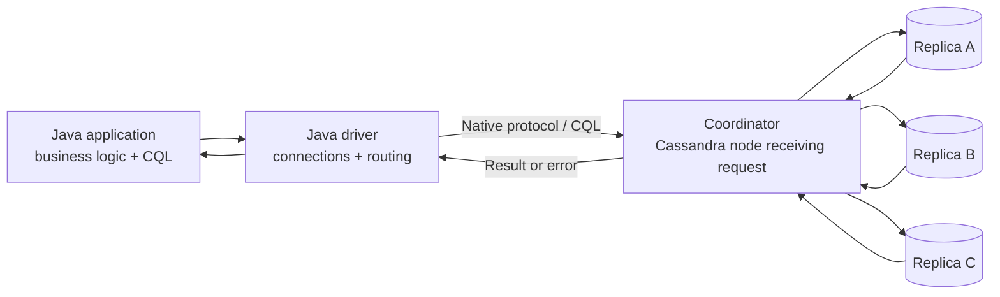
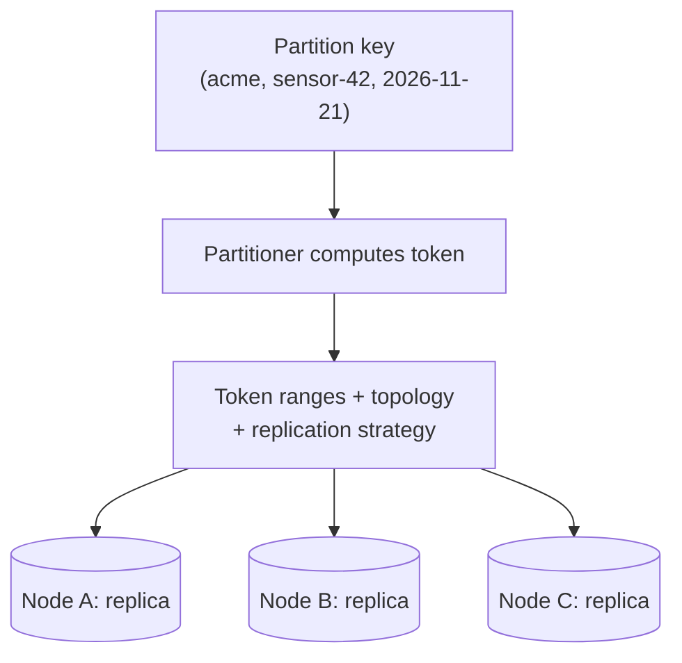
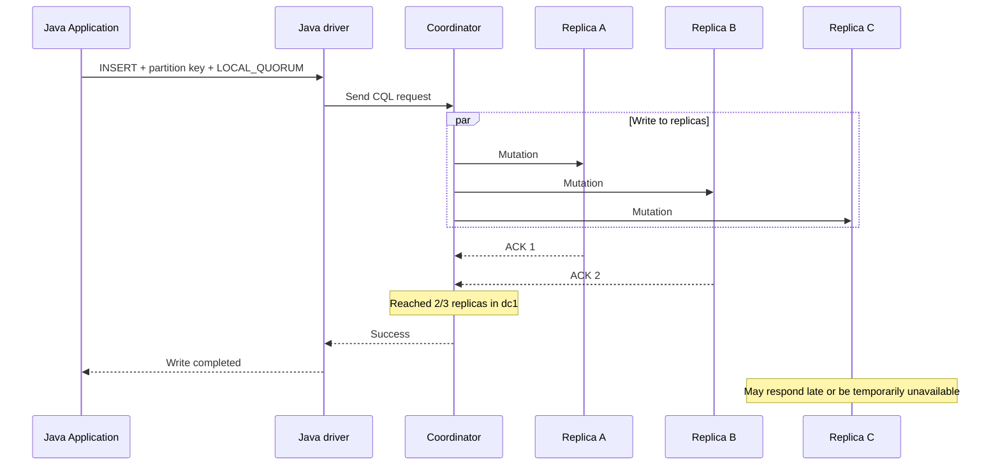
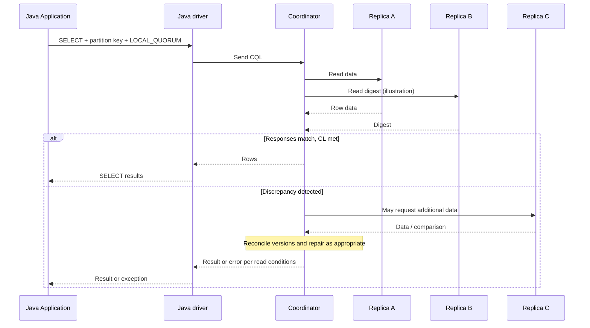
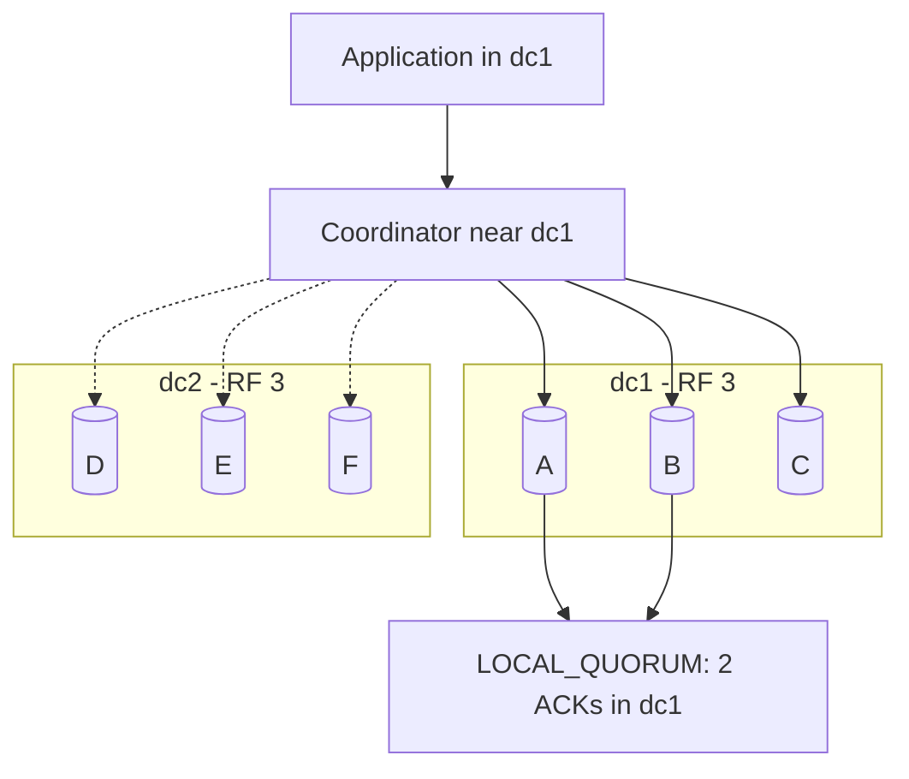

# Flow From Application Query to Coordinator Node and Replicas

> **Chapter:** Cassandra Foundations  
> **Lesson scope:** Tracing a Java application read/write operation from building a CQL statement, through the Java driver and coordinator node, to the replicas in an Apache Cassandra cluster. This lesson clarifies data partitioning, replication, consistency levels, success responses, timeouts, and troubleshooting steps.

## 1. Learning Objectives

After this lesson, you will be able to:

1. Describe the roles of the **application**, **CQL**, **driver**, **coordinator**, and **replicas** in a single request.
2. Explain why **partition key → token → replica placement** is Cassandra's crucial decision chain.
3. Distinguish the write flow, read flow, participating replicas, and required responses by **consistency level (CL)**.
4. Trace an **RF = 3, CL = LOCAL_QUORUM** scenario, including when one replica temporarily fails to respond.
5. Understand the effects of two data centers, stale reads, timeouts, retries, and anti-entropy repair.
6. Read CQL and Java driver examples and observe errors/latency without drawing wrong conclusions about write state.

## 2. Where Does a Business Request Actually Travel?

Suppose an IoT monitoring service writes a temperature event and then displays the 10 most recent events for device `sensor-42` on 2026-11-21. The application stores data in Apache Cassandra, a **distributed wide-column NoSQL** database.

From the top down, there are two operations:

1. Java receives device data, constructs a CQL `INSERT` with an appropriate partition key, and calls the driver.
2. Java serves a history API, constructs a CQL `SELECT`, sends it via the driver, and reads the returned rows.

The application does not need to know which physical machine holds each device's data. However, to operate effectively, the designer **must understand** how the driver and Cassandra route requests across those nodes.



The diagram illustrates a partition with three replicas. **The coordinator is not a master**: any eligible Cassandra node receiving a client request can act as coordinator for that specific request. The coordinator may simultaneously be one of the replicas holding the partition. In other cases, it may act purely as coordinator.

### 2.1. Who Is Responsible for What?

| Component | What it does | What should not be mistaken as its job |
| --- | --- | --- |
| **Java application** | Defines business logic, target partition key, parameters, desired consistency level, and result/error handling | Does not copy SSTables to nodes itself |
| **CQL** | Expresses requests: `INSERT`, `SELECT`, schema, `WHERE` conditions | Not a separate server or Java-specific protocol |
| **Java driver** | Maintains connections; binds parameters; picks a target node using routing policies; receives results, timeouts, and exceptions | Does not decide replica placement in place of Cassandra |
| **Coordinator** | Receives request; identifies replicas; forwards requests, gathers responses, and enforces CL for the request | Does not necessarily store every partition or wait for every replica |
| **Replica** | Stores a copy of the partition and executes reads/writes requested by the coordinator | Does not inherently know the application's HTTP business rules |

*Driver routing* and *Cassandra placement* are two related yet distinct decisions: the driver selects **the node receiving the request**, whereas Cassandra uses tokens and the replication strategy to determine **the nodes storing the data**.

## 3. Preparation Step: Partition Key Leads to the Replica Set

Consider an event table designed for the query "fetch events for one device on one day":

```sql
CREATE TABLE telemetry_flow.device_events_by_day (
    tenant_id text,
    device_id text,
    event_day date,
    event_time timestamp,
    event_id uuid,
    temperature_c double,
    PRIMARY KEY ((tenant_id, device_id, event_day), event_time, event_id)
) WITH CLUSTERING ORDER BY (event_time DESC, event_id ASC);
```

In the primary key:

- **Composite partition key:** `(tenant_id, device_id, event_day)`.
- **Clustering columns:** `event_time` and `event_id`, ordering and distinguishing rows **within the partition**.

For the tuple `('acme', 'sensor-42', '2026-11-21')`, Cassandra uses a partitioner—typically **Murmur3**—to compute a **token**. Token ranges, topology configuration, and the replication strategy determine which nodes hold replicas of the partition. Rows of the same partition reside on the same replica set; the system does not compute a new token for each `event_time`.



The illustration assumes **RF = 3** in data center `dc1`, and the partition's token maps to nodes A, B, and C. The cluster can have more than three nodes; that does **not** cause every partition to automatically have a copy on every node.

### 3.1. Does the Driver Use Tokens?

It can. The Java driver supports *token-aware routing* when it has metadata and appropriate routing key information, especially with prepared statements containing full partition key values. The driver can prefer a replica in the local data center as coordinator to reduce extra hops and latency.

If the driver cannot determine the routing key, lacks metadata, or a preferred node is unavailable, it can still send the request to another eligible node per its load-balancing policy. The receiving node can still act as coordinator and locate target replicas. **Token-aware routing is a path optimization**, not something that changes the partition key or replication factor.

### 3.2. Distributed Parameters Determining Behavior

| Parameter | Question answered | Example |
| --- | --- | --- |
| **Partition key** | Which partition is this? | `(acme, sensor-42, 2026-11-21)` |
| **Token** | Which token range does the partition belong to? | Value computed by partitioner; cannot be guessed from device string |
| **Replication strategy** | How are replicas placed across topology? | `NetworkTopologyStrategy` |
| **Replication factor (RF)** | How many replicas exist in the configured scope? | Three replicas in `dc1` |
| **Consistency level (CL)** | How many replicas must respond successfully for a request? | `LOCAL_ONE` or `LOCAL_QUORUM` |
| **Timeout** | Within what time limit do client/coordinator wait? | Governed by driver and server config; not derived from RF |

**RF and CL are not the same:** RF defines the number of copies; CL is the completion criterion for a read/write operation.

## 4. Write Flow: From INSERT to Acknowledgment

Suppose the client requests an event write with **CL = LOCAL_QUORUM** and **RF = 3 in dc1**:

```sql
INSERT INTO telemetry_flow.device_events_by_day (
    tenant_id, device_id, event_day, event_time, event_id, temperature_c
) VALUES (
    'acme', 'sensor-42', '2026-11-21',
    '2026-11-21T08:05:00Z',
    11111111-1111-1111-1111-111111111111, 27.4
);
```

### 4.1. Step by Step

1. **Application** normalizes the event: identifies tenant, device, day under the agreed timezone (e.g., UTC), timestamp, and a stable event ID.
2. **Driver** sends the CQL command or bound prepared statement to a chosen node; the request carries the desired CL.
3. The receiving node becomes **coordinator**, inspects token metadata, and identifies replicas A, B, and C.
4. The coordinator forwards the mutation to the relevant replicas. Each receiving replica executes Cassandra's write path, typically including the **commit log** and **memtable**; exact durability guarantees also depend on commit log settings.
5. Each replica completing its required work replies to the coordinator. A slow or disconnected replica might not reply in time.
6. Once the coordinator receives **two local acknowledgments** under RF = 3, the `LOCAL_QUORUM` condition is satisfied. The coordinator returns success to the driver and then the application.
7. A replica that missed the write can catch up later through appropriate mechanisms, such as hinted handoff in certain cases and **repair** to synchronize long-lived divergence.



**Note:** The diagram shows an illustrative observable sequence. The coordinator may itself be a replica; actual mutation dispatch and internal response timing depend on version, topology, and network conditions. The key condition here is that **CL requires two acknowledgments**, not sequential writes to A, then B, then C.

### 4.2. What Does Write Success Mean?

With `LOCAL_QUORUM` on RF = 3 in `dc1`, success means the coordinator received enough local responses per the CL for that operation. It **does not prove** every replica in every data center holds the same version, does not guarantee an external analytics job has processed the event, and is not a cross-system business transaction guarantee.

In distributed architecture, you must distinguish:

- **Acknowledged per CL:** enough replicas responded for the coordinator to return success.
- **All copies converged:** every replica is eventually consistent after synchronization.
- **Business flow completed:** API, event bus, external systems, and all business invariants have executed properly.

These three states are not identical.

### 4.3. What If Only One Replica Responds?

- With `LOCAL_ONE`, one local response can satisfy the operation.
- With `LOCAL_QUORUM` and RF = 3, one response is **not enough**. The request may time out or fail depending on cluster state and detection timing.
- With `ALL` in the single-DC RF = 3 example, all three replicas must respond.

Thus, raising CL increases the required number of available replicas and can reduce request completion rates during failures.

## 5. Read Flow: Where Does a SELECT Travel?

Reads are not simply "the coordinator asks one node and replies," especially when CL requires multiple replicas.

```sql
SELECT event_time, event_id, temperature_c
FROM telemetry_flow.device_events_by_day
WHERE tenant_id = 'acme'
  AND device_id = 'sensor-42'
  AND event_day = '2026-11-21'
LIMIT 10;
```

### 5.1. Step-by-Step Read at LOCAL_QUORUM

1. **Application** determines `tenant_id`, `device_id`, and `event_day` and calls the driver.
2. **Driver** selects a target node and sends the SELECT along with the CL.
3. **Coordinator** locates the partition's replicas using token and topology.
4. Coordinator requests data from appropriate replicas. In a typical quorum read path, it may request **full data from one replica** and a **digest** (summary for comparison) from another replica. Exact selection, request counts, and handling depend on version/policies.
5. If required responses match and CL is met, the coordinator returns the resulting rows to the driver.
6. If a mismatch is detected, the coordinator may fetch full data from additional replicas, reconcile versions, and perform read repair as appropriate before completing or per version rules.
7. Driver decodes rows and returns results to the application; the application maps DTOs, enforces permissions, and renders output.



The diagram highlights the distinction between a **data response** and a **digest response**, rather than guaranteeing Cassandra always sends exactly three requests in that manner. Some real read paths also include mechanisms to contact extra replicas when a replica is slow or data is inconsistent.

### 5.2. Why Can Stale Values Be Read?

Suppose A and B just received a new write while C was temporarily down and lacked that version. If a client reads at `ONE` from C after C comes back online before syncing, it may receive stale data. At `LOCAL_QUORUM` within the same RF = 3 scope, the two-replica read set must overlap the two-replica write set; that enables seeing the written version assuming no conflicting concurrent writes and proper reconciliation.

However, **quorum does not guarantee every operation is linearizable**. Concurrent writes, client/server timestamps, clock skew, conflicting updates, tombstones, and multi-partition operations all add complexity. When conditional updates are required, Cassandra provides **lightweight transactions (LWT)** such as `IF NOT EXISTS`, with different mechanics and higher cost than regular writes.

### 5.3. At Which Step Does the Partition Key Predicate Matter?

The condition `WHERE tenant_id = ... AND device_id = ... AND event_day = ...` routes the query to the exact partition. `LIMIT 10` only caps rows returned from the selected partition; it **does not fix** a cluster-wide scan or a partition key creating hotspots. Clustering order only sorts rows within a single partition, not across the entire cluster.

## 6. Counting Acknowledgments: RF = 3 and CL Levels

Consider a cluster with one data center `dc1` and three replicas A, B, and C for a partition:

| CL | Required responses, in RF = 3 example | When one replica does not respond | Remarks |
| --- | --- | --- | --- |
| `ONE` | 1 replica | Can still succeed | Allows response from minimal replicas; risks stale reads |
| `LOCAL_ONE` | 1 replica in local DC | Can still succeed | Suits requests prioritizing local availability |
| `QUORUM` | 2/3 replicas across full RF scope of the request | Can succeed if two replicas respond | With multiple DCs, global quorum differs from local quorum |
| `LOCAL_QUORUM` | 2/3 replicas in `dc1` | Can succeed if two local replicas respond | Common in multi-DC setups to avoid cross-region latency |
| `ALL` | All 3 replicas | Fails if any required replica is missing | Strict availability requirement across all replicas |

**Quorum formula** for RF in the relevant scope:

\[
Q = \left\lfloor\frac{RF}{2}\right\rfloor + 1
\]

With RF = 3, `Q = 2`. The overlap rule between the write replica set (W) and read replica set (R) is:

\[
W + R > RF
\]

Simple example: when both write and read use quorum with RF = 3, `2 + 2 > 3`. This condition is a reasoning model for **replica sets within the same scope**, not a substitute for analyzing concurrency, timestamps, conflicts, and LWTs.

### 6.1. Three Outcomes to Distinguish

| State at request time | What the client may observe |
| --- | --- |
| Enough replicas satisfy the requirement within limits | **Success**: read returns results or write is acknowledged per CL |
| Coordinator determines immediately that insufficient replicas are alive for CL | May return an **`Unavailable`**-type error |
| Request was sent, yet insufficient responses arrived before wait limit | May return **`ReadTimeout`** / **`WriteTimeout`** or a driver/network timeout |

A timeout does not definitively determine final write state. Even if the client receives an error because the network dropped after the coordinator responded, the server may still have completed the operation.

## 7. With Multiple Data Centers: What Does "Local" Mean?

Suppose the keyspace uses `NetworkTopologyStrategy` with two data centers:

```sql
CREATE KEYSPACE IF NOT EXISTS telemetry_multi_dc
WITH replication = {
    'class': 'NetworkTopologyStrategy',
    'dc1': 3,
    'dc2': 3
};
```

Each partition has **three replicas in dc1 and three replicas in dc2** (assuming each data center has sufficient nodes). An application running near `dc1` can set `LOCAL_QUORUM` to require **two responses in dc1**. The system still propagates mutations to relevant replicas in `dc2` per Cassandra's mechanisms, yet operation success at `LOCAL_QUORUM` does not wait for quorum in `dc2`.



Dashed arrows indicate **acknowledgments not required before returning success at LOCAL_QUORUM**, not that the coordinator skips replicating to `dc2`. Replicas in `dc2` may temporarily not reflect a record just acknowledged in `dc1`. When failing over an application to another region, you must define freshness requirements and cross-region synchronization expectations.

With total cluster RF = 6 in this example, global `QUORUM` normally requires **4** replicas; `LOCAL_QUORUM` in each region still relies on local RF = 3, meaning **2**. Do not treat both levels as equivalent merely because both contain the word "quorum".

## 8. CQL Example: Creating Data and Observing the Flow

### 8.1. Creating the Schema for the Lab

Assume the lab has a data center named `dc1` with at least three active nodes suitable for RF = 3. If you only have one node, use RF = 1 and adjust CL accordingly so the lab runs; in that case, 3-replica quorum fault-tolerance examples remain theoretical illustrations.

```sql
CREATE KEYSPACE IF NOT EXISTS telemetry_flow
WITH replication = {
    'class': 'NetworkTopologyStrategy',
    'dc1': 3
};

CREATE TABLE IF NOT EXISTS telemetry_flow.device_events_by_day (
    tenant_id text,
    device_id text,
    event_day date,
    event_time timestamp,
    event_id uuid,
    temperature_c double,
    PRIMARY KEY ((tenant_id, device_id, event_day), event_time, event_id)
) WITH CLUSTERING ORDER BY (event_time DESC, event_id ASC);
```

The name `dc1` is illustrative: it must match the data center actually advertised by your cluster. Setting RF higher than the number of nodes capable of holding replicas does not create extra physical nodes.

### 8.2. Sending Requests With cqlsh

In `cqlsh`, `CONSISTENCY` and `TRACING` are **client tool commands**, not CQL keywords embedded verbatim in every application query:

```sql
CONSISTENCY LOCAL_QUORUM;
TRACING ON;

INSERT INTO telemetry_flow.device_events_by_day (
    tenant_id, device_id, event_day, event_time, event_id, temperature_c
) VALUES (
    'acme', 'sensor-42', '2026-11-21',
    '2026-11-21T08:05:00Z',
    11111111-1111-1111-1111-111111111111, 27.4
);

SELECT event_time, event_id, temperature_c
FROM telemetry_flow.device_events_by_day
WHERE tenant_id = 'acme'
  AND device_id = 'sensor-42'
  AND event_day = '2026-11-21'
LIMIT 10;

TRACING OFF;
```

Tracing can show the coordinator, involved replicas, and execution steps depending on version/execution path; trace output is not guaranteed to print the exact ordering or wording of an illustrative diagram. Enable it only as needed for diagnostics, as collecting traces adds overhead.

### 8.3. Reading Statements to Predict the Path

We can answer before checking a trace:

1. Which **partition key** is sent to the server? The tuple `('acme', 'sensor-42', '2026-11-21')`.
2. Does `event_time` participate in selecting replicas? **No**, it is a clustering column.
3. How many responses does `LOCAL_QUORUM` require with RF = 3 in `dc1`? **Two**.
4. What if one replica hasn't answered yet while the other two confirmed the write? **The write can succeed** per CL.
5. What if the request targets the right partition, yet replicas are slow? **It can still time out** due to wait limits, resources, or insufficient timely responses.

## 9. Java Driver Example: Calling From an Application

Java driver 4.x provides `CqlSession`, prepared statements, bound statements, and result APIs. This example illustrates **one query flow**; it omits pinned dependency versions because packaging, Maven coordinates, and compatibility vary by environment.

```java
import java.net.InetSocketAddress;
import java.time.Instant;
import java.time.LocalDate;
import java.util.UUID;

import com.datastax.oss.driver.api.core.CqlSession;
import com.datastax.oss.driver.api.core.DefaultConsistencyLevel;
import com.datastax.oss.driver.api.core.cql.BoundStatement;
import com.datastax.oss.driver.api.core.cql.PreparedStatement;
import com.datastax.oss.driver.api.core.cql.ResultSet;
import com.datastax.oss.driver.api.core.cql.Row;

public class CassandraFlowDemo {
    public static void main(String[] args) {
        // Lab: contact point and local data center must match the actual cluster.
        try (CqlSession session = CqlSession.builder()
                .addContactPoint(new InetSocketAddress("127.0.0.1", 9042))
                .withLocalDatacenter("dc1")
                .build()) {

            PreparedStatement insert = session.prepare(
                "INSERT INTO telemetry_flow.device_events_by_day " +
                "(tenant_id, device_id, event_day, event_time, " +
                "event_id, temperature_c) VALUES (?, ?, ?, ?, ?, ?)"
            );

            // Stable ID for this logical event; do not regenerate inside a retry loop.
            UUID eventId = UUID.fromString(
                "11111111-1111-1111-1111-111111111111"
            );
            BoundStatement writeRequest = insert.bind(
                    "acme",
                    "sensor-42",
                    LocalDate.of(2026, 11, 21),
                    Instant.parse("2026-11-21T08:05:00Z"),
                    eventId,
                    27.4
                ).setConsistencyLevel(DefaultConsistencyLevel.LOCAL_QUORUM);

            session.execute(writeRequest);

            PreparedStatement select = session.prepare(
                "SELECT event_time, event_id, temperature_c " +
                "FROM telemetry_flow.device_events_by_day " +
                "WHERE tenant_id = ? AND device_id = ? " +
                "AND event_day = ? LIMIT 10"
            );

            BoundStatement readRequest = select.bind(
                    "acme", "sensor-42", LocalDate.of(2026, 11, 21)
                )
                .setConsistencyLevel(DefaultConsistencyLevel.LOCAL_QUORUM)
                .setIdempotent(true);

            ResultSet result = session.execute(readRequest);
            for (Row row : result) {
                System.out.printf("%s | %s | %.1f C%n",
                    row.getInstant("event_time"),
                    row.getUuid("event_id"),
                    row.getDouble("temperature_c"));
            }
        }
    }
}
```

The code reuses one session for multiple requests because the driver manages connections and metadata over the application lifecycle. A real application should separate services and repositories by responsibility, externalize endpoint/TLS/auth configuration instead of hard-coding secrets, and close the session on shutdown.

**Key points to watch:**

- `insert.bind(...)` supplies the values forming the partition key. The driver can leverage this to choose a coordinator close to replicas.
- `setConsistencyLevel(LOCAL_QUORUM)` expresses the client's requirement; **Cassandra** checks replica response counts.
- `setIdempotent(true)` is set on the **SELECT** because a pure read query creates no mutation. Do not blindly mark every INSERT as idempotent; write retries must evaluate IDs, timestamps, TTL, and business side effects.
- `session.execute(...)` can throw exceptions when unable to connect, lacking replicas, timing out, or executing invalid CQL. An exception on a write does **not** automatically prove the data does not exist.
- The example assumes the keyspace/table already exist. The Java driver does not automatically run schema-creation DDL just because code calls `session.prepare(...)`.

## 10. Timeouts, Replica Errors, and Retries: Assessing State Accurately

When a read/write path fails, ask **which layer failed** and **which replicas may already have received the request**.

| Scenario | Application symptom | Meaning and action |
| --- | --- | --- |
| Cannot connect to intended coordinator | Connection error or client request timeout | Driver may try another node if policy permits; check network, TLS, contact points, and cluster status |
| Too few replicas recognized as up before execution | `Unavailable`-style error | CL cannot be satisfied with current replica health; inspect topology/RF/CL and node states |
| Coordinator sent mutation yet lacked timely responses | `WriteTimeout`-style error | **May have written partially**; retry cautiously and reconcile using a stable event key |
| Coordinator read yet lacked required responses | `ReadTimeout`-style error | Read did not finish per CL; investigate load, replicas, network, and wait limits |
| One replica slower than others | Elevated latency; speculative/extra replica contact may occur | Inspect p95/p99, node resources, compaction, tombstones, and network |
| Replica goes down then returns | Risk of divergent versions across replicas | Hinted handoff covers some short outages; repair resolves long-term drift |
| Partition key concentrates load on a few replicas | Slow despite adding nodes | Analyze hot partitions and design buckets/shards rather than merely switching coordinators |

### 10.1. A Timeout Does Not Mean Rollback

For instance, after the coordinator dispatches a write, A and B succeed, yet the response drops on its way back to the client. The application sees a timeout and cannot be sure whether the request finished. If it retries with a **new UUID**, two rows may be created. If business rules allow rewriting with the **same primary key** and identical values, retrying can be safer, though timestamps, TTL, counters, LWTs, and interactions with external systems still require analysis.

Do not retry infinitely. Enforce attempt caps, backoff, sensible timeouts, error-rate monitoring, and explicit rules for when results need **reconciliation** by logical key.

### 10.2. Hinted Handoff, Read Repair, and Anti-Entropy Repair

- **Hinted handoff:** assists replaying some mutations to a replica that temporarily missed requests, within configuration scope and limits. It is not proof that all missed data will always be recovered automatically.
- **Read repair:** on certain read paths, Cassandra can detect differing replica versions and trigger appropriate repair per version/configuration.
- **Anti-entropy repair:** compares data across replicas to converge, especially after prolonged outages or when reads do not trigger repair.

**Replication does not replace a repair schedule or backups.** A write acknowledged at `LOCAL_QUORUM` also does not prove replicas in a remote region have converged.

## 11. How to Observe and Diagnose a Real Request

When investigating "API is slow" or "occasional write timeouts," observe from the outside in:

1. **Application:** which query ran, which partition key was used, which CL was set, and what were the timeout and request ID?
2. **Driver:** which node acted as coordinator, are connections stable, did the request retry or switch nodes, and what exception category occurred?
3. **Coordinator:** did it see the request, identify replicas, and receive enough responses within the wait window?
4. **Replica:** are read/write latency, commit log/memtable, SSTables, tombstones, compaction, network, GC, or disk bottlenecked?
5. **Topology:** are the partition's replicas failing within the same rack/DC, is RF configured properly, when did repair last run, and is capacity sufficient?

Observation tools/sources can include `cqlsh TRACING` when diagnosing queries, `nodetool status` to view node states, Cassandra metrics/logs, and application/driver metrics/tracing. **Do not guess the coordinator from a contact point name** or guess replicas from device index numbers; inspect live topology and actual requests.

### 11.1. Useful Diagnostic Signals

| Signal | What to inspect |
| --- | --- |
| Timeouts limited to specific partition keys | Hot partitions, oversized partitions, tombstones, or skewed traffic |
| Timeouts rising cluster-wide | Network, CPU, disk, GC, compaction, or overall overload |
| `LOCAL_ONE` succeeds while `LOCAL_QUORUM` fails | Possibly fewer than two local replicas responding on time |
| Reading stale values after a successful write | Read/write CL, DC scope, concurrent writes, replica convergence timing |
| Failover increases latency or misses fresh data | DC routing, cross-region replication, CL, and failover mechanics |

Every conclusion should be verified against logs/metrics while separating application, driver, coordinator, and replica causes.

## 12. Scenario Exercise: Counting ACKs to Reason Correctly

Use the model **RF = 3 in dc1**, with replicas A, B, and C for one partition.

### Scenario A: One Replica Temporarily Down

The application writes at `LOCAL_QUORUM`. A and B finish writing and reply in time; C does not reply.

**Question:** Does the application receive success or failure? Does C definitely have the data?  
**Explanation:** Two responses satisfy local quorum so success can be returned. You cannot guarantee C received the mutation; convergence mechanisms are needed if it missed it.

### Scenario B: One ACK to the Coordinator Is Delayed

A receives the mutation yet replies very slowly; B acknowledges; C is temporarily down. The coordinator receives only **one** ACK before timeout.

**Question:** What does the client see, and can you conclude A did not write?  
**Explanation:** `LOCAL_QUORUM` was not met, so the request may time out. A may have written before its ACK was delayed or lost, so the client must not infer "no data written."

### Scenario C: Reading With Low CL Right After a Replica Recovers

A new write was acknowledged by A and B while C remained unsynced; the client reads at `LOCAL_ONE` from C.

**Question:** Can the data be stale?  
**Explanation:** Yes. A replica may not yet have the latest mutation. To reduce this risk, design read/write CLs within the appropriate replica scope and handle conflicts/synchronization.

### Scenario D: Changing Coordinator

The driver sends the same `SELECT` to node D, which does not hold the partition. D is healthy and connected to replicas A, B, and C.

**Question:** Must the request fail because D does not store the data?  
**Explanation:** No. D can act as coordinator, forward the request to the right replicas, and gather results. Replica-preferring routing reduces hops, yet is not required for correctness.

### Scenario E: Two Data Centers

The keyspace has RF = 3 in `dc1` and RF = 3 in `dc2`. An application running in `dc1` writes at `LOCAL_QUORUM`, confirmed by A and B in `dc1`, while connectivity to `dc2` is disrupted.

**Question:** Can it return success, and will an immediate read in `dc2` definitely see the record?  
**Explanation:** It can succeed because local CL was satisfied. You cannot guarantee the new record has appeared in `dc2` until cross-region replication converges.

## 13. Common Misconceptions

| Misconception | Accurate understanding |
| --- | --- |
| "The driver knows the replicas, so the driver writes directly to all replicas itself." | The driver picks a suitable node/coordinator; Cassandra coordinates the replicas. |
| "The coordinator is the master of the whole cluster." | Coordinator is a per-request role, not a fixed primary server. |
| "RF = 3 always means three ACKs are needed." | Required ACKs are determined by CL; `LOCAL_QUORUM` with RF = 3 requires two local replicas. |
| "Coordinator returning success means every DC is synchronized." | Success proves the request's CL was satisfied, not that all copies have converged. |
| "SELECT always reads a single replica." | Quorum read paths may request data and digests from multiple replicas and reconcile differences. |
| "A timeout means no replica wrote." | Mutations may already have been written even if the client never got the confirmation. |
| "Adding nodes automatically relieves a hot partition." | The partition key determines the replica group; address actual data distribution and traffic load. |
| "Lowering CL is always the right error fix." | Lowering CL changes application guarantees; weigh correctness requirements carefully. |

## 14. Knowledge Self-Check

1. **Is the node chosen by the driver always a replica of the partition?** No. It can act as coordinator even without storing the partition; token-aware routing can prefer replicas to reduce hops.
2. **What does Cassandra rely on to locate replicas for a `SELECT` with a full partition key?** Partition key, token, token ranges, topology, and replication strategy.
3. **Do clustering columns determine which replicas store a row?** No. Rows sharing the same partition key map to the same replica set.
4. **With RF = 3 in `dc1`, how many ACKs does `LOCAL_QUORUM` need?** Two ACKs from local replicas.
5. **When two ACKs arrive and the third ACK is lost, can a `LOCAL_QUORUM` write succeed?** Yes.
6. **Why can reading at `ONE` after a `QUORUM` write sometimes return stale values?** The read replica might not have received the newest value yet; a one-replica read set need not overlap the quorum write set.
7. **Are `QUORUM` and `LOCAL_QUORUM` always identical in a multi-DC cluster?** No. Global quorum depends on the full relevant RF total, whereas local quorum depends on the local DC's RF.
8. **Does a write timeout prove the server rolled back?** No. Cassandra does not turn every timeout into a rollback of mutations already applied.
9. **How do prepared statements help the query flow?** Typed parameter binding, statement reuse, and giving the driver routing keys for smarter routing.
10. **Does hinted handoff replace anti-entropy repair?** No. Repair is still required to verify and synchronize lingering discrepancies among replicas.

## 15. Takeaways and Connection to Labs

The core takeaway of a Cassandra request's path is:

**Application chooses query and partition key → Java driver selects target node → that node acts as coordinator → Cassandra locates replicas via token and topology → replicas execute read/write → coordinator waits for sufficient responses per CL → driver returns results or error to the application.**

Whenever you want to explain why a request is **fast, slow, successful, or timing out**, trace this exact chain and identify the influencing factors at each step. This forms the basis for continuing into CQL practice, query-driven partition key design, replication, read/write consistency, compaction, repair, failure handling, and Java application integration in the **DATABASE_ENGINE_WIDE_COLUMN_CASSANDRA** module.
