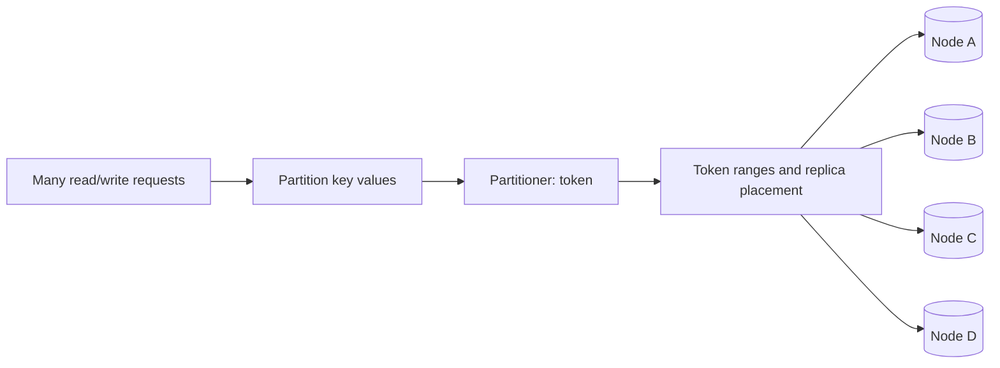
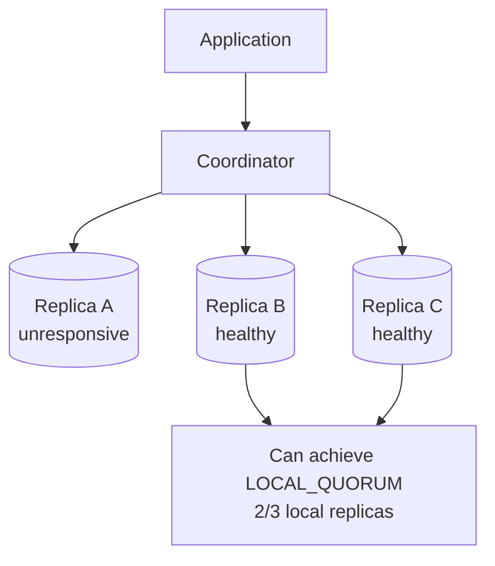
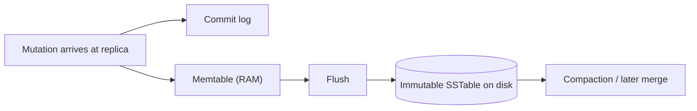
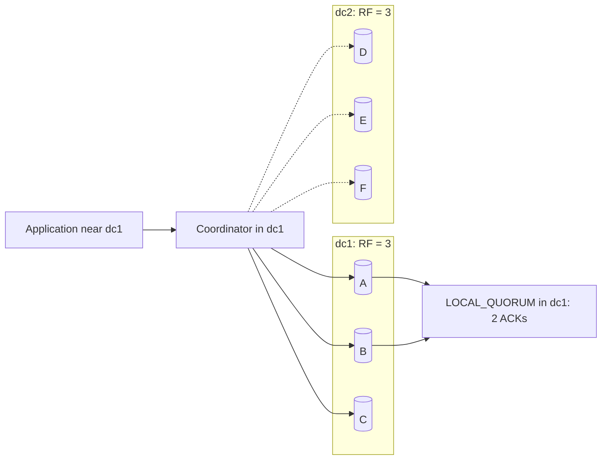
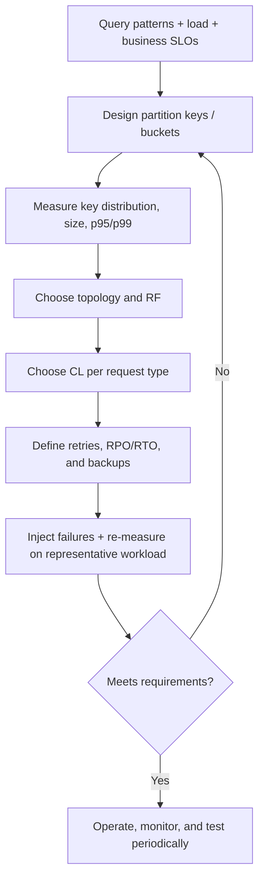

# Goals for Scalability, Availability, Durability, and Trade-Offs

> **Chapter:** Cassandra Foundations  
> **Context:** Apache Cassandra is a distributed NoSQL database in the *wide-column* family. Key goals for choosing Cassandra include scaling load across many nodes, maintaining service availability during failures, and reducing the risk of data loss. This lesson clearly distinguishes each goal, then explains how partition keys, replication, consistency levels, and cluster operations determine real-world trade-offs.

## 1. Learning Objectives

After this lesson, you will be able to:

1. Distinguish **scalability**, **availability**, **durability**, and **consistency**.
2. Explain why Cassandra supports horizontal scaling yet **does not guarantee linear throughput growth when adding nodes**.
3. Describe the impact of replication factor (**RF**) and consistency level (**CL**) on read/write outcomes when nodes or networks fail.
4. Explain the **commit log → memtable → SSTable** write path, the role of repair, and why replication does not replace backups.
5. Analyze trade-offs across latency, copy count, consistency level, fault tolerance, cost, and operational complexity.
6. Propose a conditional configuration for a real-world problem, stating assumptions to validate rather than promising "always available" or "never loses data".

## 2. Four Concepts That Sound Similar Yet Serve Different Purposes

Imagine a platform monitoring 200,000 devices. Each device regularly sends measurements; users want to view the 100 most recent measurements, and the system must continue ingesting events when one machine in the cluster fails.

There are four independent questions:

| Property | Practical question | One evaluation signal |
| --- | --- | --- |
| **Scalability** | As device count and data grow, can the system expand processing/storage capacity by adding resources? | Throughput, p95/p99 latency, per-node load as traffic rises |
| **Availability** | Within a defined timeframe and failure conditions, can the application still serve valid requests? | Request success rate against SLO, downtime duration |
| **Durability** | After the system acknowledges a write, does data survive anticipated failure types? | Ability to recover acknowledged data, node/disk loss and restore tests |
| **Consistency** | With what guarantees and under which conditions does a read observe the latest write? | Read-after-write behavior, CL levels, conflict rules, and concurrent updates |

An application can be **available** to respond yet return **stale data**. It can also keep data **durable** on disk yet be temporarily **unavailable** because insufficient replicas are up for the requested CL. Adding nodes may increase storage capacity yet fail to speed up a hot partition.

### 2.1. Do Not Collapse Goals Into a Single Label

For example, a write acknowledged at `LOCAL_ONE` can complete immediately when just one local replica responds. That helps certain availability requirements, yet does not mean data was written to all replicas or that every read will see the new value. Conversely, `ALL` requires more acknowledgments, meaning one slow or disconnected replica can cause requests to fail.

Always state the **scope** before evaluating: how many data centers does the cluster have, what is the RF in each data center, which CL does the application set, which failure mode is under consideration, and what is the timeout limit?

## 3. First Goal: Horizontal Scaling as Data and Traffic Grow

Cassandra is built to distribute data and requests across many nodes. Instead of endlessly upgrading CPU, RAM, and disks on a single machine (**scale up**), we can add nodes and redistribute storage responsibilities (**scale out**).

### 3.1. The Partition Key Is the Starting Point for Scaling

Each CQL row belongs to a **partition** determined by its partition key. Cassandra uses a partitioner (typically Murmur3) to compute a **token** from the partition key, then uses token ranges and the replication strategy to determine which replicas store that partition.



Nodes can manage multiple token ranges (vnodes), and each partition is replicated according to RF. **Not every row is split evenly across all nodes**; rows sharing the same partition key are kept on the same replica set. This yields two consequences:

- When partition keys and traffic are relatively well distributed, adding nodes helps spread load and capacity.
- If one key receives most requests, that partition's replica set can still become a bottleneck even while other nodes in the cluster sit idle.

### 3.2. Partition Design Example for Sensor Data

The application needs "the 100 most recent events for one device on one day." The CQL table can choose a composite partition key `(tenant_id, device_id, event_day)` and clustering column `event_time`:

```sql
CREATE TABLE telemetry.device_events_by_day (
    tenant_id text,
    device_id text,
    event_day date,
    event_time timestamp,
    event_id uuid,
    temperature_c double,
    PRIMARY KEY ((tenant_id, device_id, event_day), event_time, event_id)
) WITH CLUSTERING ORDER BY (event_time DESC, event_id ASC);
```

Query:

```sql
SELECT event_time, event_id, temperature_c
FROM telemetry.device_events_by_day
WHERE tenant_id = 'acme'
  AND device_id = 'sensor-42'
  AND event_day = '2026-11-21'
LIMIT 100;
```

Because the full partition key is known, Cassandra locates the exact partition to read. `event_time` orders rows **within the partition** rather than determining which node stores the data.

Adding `event_day` creates a **time bucket** so one device does not accumulate unbounded events in the same partition forever. However, if a device writes millions of events per day, a daily partition can still grow too large or too hot; hourly buckets or logical sharding may be needed, alongside multi-bucket read logic.

### 3.3. Why Adding Nodes Does Not Always Double System Speed

Throughput and latency depend on the entire execution path:

| Limiting factor | Symptom | What to inspect |
| --- | --- | --- |
| **Hot partition** | Some replicas overload while other nodes stay idle | Change partitioning/bucketing; redistribute traffic |
| **Disk and compaction** | Latency rises as SSTables merge | Pick compaction strategy for the workload; monitor I/O and temp disk space |
| **Replication and network** | Traffic between nodes/racks/DCs grows | Check RF, topology, bandwidth, and placement |
| **Queries missing partition key** | Broad scans, latency rises sharply with data size | Design tables around queries; avoid relying arbitrarily on `ALLOW FILTERING` |
| **Many tombstones** | Slow reads even when returning few rows | Inspect TTL, deletes, compaction, and repair |
| **Client overload** | Timeouts or growing queues right in the application | Concurrency limits, backpressure, timeouts, and connection/session management |
| **Adding nodes / data movement** | Network/disk load spikes during expansion | Capacity planning and throttling streaming/bootstrap |

Therefore, **horizontal scalability** is a design property enabling work distribution, not a promise of proportional throughput gain. When load testing, observe throughput **and** p95/p99 latency simultaneously on a representative query mix.

## 4. Second Goal: Availability When Part of the Cluster Fails

**Availability** refers to the ability to process requests within committed time bounds and conditions. A system can store data across multiple replicas and keep accepting requests when a node disconnects, yet the ability to complete each request still depends on **RF**, **CL**, replica health, network, and timeouts.

### 4.1. Replicas Reduce Single Points of Failure

Suppose a data center `dc1` has RF = 3 for each partition. For a specific partition, the three replicas are A, B, and C. If A temporarily fails, B and C still hold copies and can serve requests at certain CL levels.



Coordinator is a **per-request role of the receiving node**, not a fixed master. The driver can send requests to another suitable node if an intended coordinator is unreachable; Cassandra has metadata to locate the partition's replicas.

### 4.2. Example: RF = 3 and Consistency Levels

| Responding replicas in `dc1` | `LOCAL_ONE` (1 ACK) | `LOCAL_QUORUM` (2 ACKs) | `ALL` (3 ACKs, assuming single DC) |
| --- | --- | --- | --- |
| A, B, C | Achievable | Achievable | Achievable |
| A, B (C failed) | Achievable | Achievable | Not achievable |
| A (B, C failed) | Achievable | Not achievable | Not achievable |
| No replicas | Not achievable | Not achievable | Not achievable |

This indicates **CL satisfiability by replica count**, not a guarantee that the request will definitely succeed. Even when enough nodes are up, requests can still time out due to load, network issues, or other errors.

With RF = 3, `LOCAL_QUORUM` typically requires:

\[
Q = \left\lfloor \frac{3}{2} \right\rfloor + 1 = 2
\]

**Trade-off:** lower CL can allow continued service with fewer available replicas; higher CL requires more participating replicas and can make requests fail sooner during incidents.

### 4.3. Database Availability Differs From Overall Service Availability

Even when Cassandra replicas are healthy, users can still see errors if the Java API is overloaded, the driver has the wrong data center configured, DNS/TLS fails, or the network path from application to cluster is blocked. Conversely, an application might return HTTP 200 from a cache while Cassandra is unreachable; that does not mean returned data is always fresh.

Therefore, define SLOs along the **user request path**—for example, success rate of the history read API with p95 latency within the product team's target. Measuring only "Cassandra nodes are still up" is necessary but insufficient.

## 5. Third Goal: Durability of Acknowledged Data

**Durability** answers: after the client receives a write success acknowledgment, which failures can the data survive? Cassandra has two groups of mechanisms supporting this goal:

1. **Write path and local storage:** commit log, memtable, SSTable.
2. **Replication across multiple nodes:** maintaining multiple copies of the same partition.

### 5.1. Write Path: Commit Log, Memtable, SSTable



At a high level:

1. The coordinator sends the mutation to the required replicas.
2. Each replica receives the mutation, writes to the **commit log** to aid recovery if the process crashes, and updates the **memtable**.
3. The replica replies per write-path rules; the coordinator returns success once CL acknowledgments are met.
4. The memtable is flushed into immutable **SSTables**. Later, **compaction** merges multiple SSTables and handles versions/tombstones per safety rules.

The mere existence of a commit log does not mean every write is **fsynced to storage** before returning an ACK under every configuration. Cassandra has different **commit log sync** modes and parameters; what an ACK guarantees against sudden power loss depends on configuration, OS/hardware guarantees, and how many replicas acknowledged.

In particular, if configured to acknowledge before logs are durably synced to disk, a risk window can exist during simultaneous power loss. When data criticality is high, **test node/power failures** under your actual configuration rather than inferring durability solely from the phrase "commit log".

### 5.2. How Does RF Help Durability?

With RF = 3, losing one copy completely does not necessarily lose the whole partition because other replicas still hold data. However:

- **RF is not a count of independent backup copies:** replicas receive the same bad mutation or delete operation; logic bugs propagate to all three.
- **Writing at low CL** may be acknowledged by just one replica; if that replica loses data before other copies receive the write, the newly acknowledged value risks being lost.
- **Writing at quorum** requires multiple replicas to respond, reducing reliance on a single copy, though commit log sync, correlated failures, and recovery capability still matter.
- **High RF** increases disk cost and write traffic; it does not automatically protect against accidental deletes, application bugs, or losing an entire data center if all replicas sit in one region.

Strong durability comes from proper placement, appropriate RF/CL, durable storage, periodic repair, monitoring, **backups, and restore drills**.

### 5.3. Repair, Tombstones, and Backups Solve Three Different Problems

| Mechanism | Primary problem solved | Cannot replace |
| --- | --- | --- |
| **Replication** | Keeps online copies for reads/writes and node fault tolerance | Backups against accidental deletion or logic corruption across all replicas |
| **Hinted handoff** | Replays some mutations to a temporarily absent replica under supported conditions | Comprehensive anti-entropy repair |
| **Repair** | Compares and synchronizes discrepancies across replicas to converge | Backups and restoring earlier versions |
| **Compaction** | Merges SSTables and purges eligible old versions/tombstones | Repair, replication, or backups |
| **Backup/snapshot** | Provides a recovery source across certain logical/operational incidents | Online request-serving mechanisms |

**Tombstones** must be retained long enough per configuration and repair plans to prevent deleted data from resurrecting when an old replica returns. Do not lower `gc_grace_seconds` solely to reclaim disk quickly without analyzing your repair cycle and appropriate safety measures.

## 6. Consistency: The Trade-Off Axis Linking Availability and Read/Write Behavior

Cassandra provides **tunable consistency**: clients choose the consistency level per operation or via application defaults. CL states which and how many replica responses must satisfy the condition before the request completes.

For example, with one data center and RF = 3:

- Write `ONE`: needs one replica to respond.
- Write `QUORUM`: needs two replicas to respond.
- Read `QUORUM`: needs matching/reconciled responses from two replicas.
- Write/read `ALL`: requires three replicas; if one replica is unavailable, the request can fail.

### 6.1. Quorum Overlap Condition

Within the **same replica scope**, to force the read and write replica sets to intersect:

\[
W + R > RF
\]

With RF = 3, quorum write `W = 2` and quorum read `R = 2` give `2 + 2 > 3`. If a write succeeded and there are no conflicting writes, a quorum read set cannot consist solely of replicas **all outside** the set that acknowledged the write.

However, this is **not a promise of linearizability for all operations**. Concurrent writes, timestamps, clock skew, version conflicts, TTL/tombstones, and multi-partition operations require separate analysis. Cassandra's **lightweight transaction (LWT)** mechanism uses consensus for conditional operations like `IF NOT EXISTS`, carrying different costs and semantics from regular writes.

### 6.2. Why Can a Read Return Stale Data Immediately After a Write?

Suppose a new mutation was acknowledged by A at CL `ONE`, while B and C are not yet synced. A `ONE` read from B can return the stale value. That is expected behavior to anticipate, not proof that the write was lost completely.

If the application requires **read-after-write** within a defined scope, select corresponding read/write CLs, data models, and concurrency handling. Never look solely at RF and assume every read immediately observes new updates.

### 6.3. CAP Must Be Read in the Context of a Network Partition

During a **network partition**, replicas cannot communicate normally. CAP describes the conflict between strong consistency (in the theorem's specific sense) and the ability for all requests to keep receiving non-error responses in that situation.

Do not say "Cassandra is always AP so every request succeeds." Under the exact same network failure:

- `ONE` requests may be served by one side if an eligible replica is reachable.
- `QUORUM` or `LOCAL_QUORUM` requests may lack enough replicas on one side.
- `ALL` requests are even more likely to fail whenever any required replica is partitioned away.

Because Cassandra lets you select CL, **concrete availability outcomes depend on each operation**. That is a design choice tied to business requirements, not a blind "AP" or "CP" label.

## 7. Trade-Offs in Multi-Data-Center Architecture

A system serving multiple regions may want to:

- Place replicas close to applications to reduce latency.
- Avoid making a single data center a massive point of failure.
- Clearly define how far behind backup-region data can lag and how long failover takes.

Illustrative CQL:

```sql
-- Configuration example only: the cluster must actually have dc1 and dc2,
-- with sufficient nodes for the declared RF.
CREATE KEYSPACE telemetry_multi_dc
WITH replication = {
    'class': 'NetworkTopologyStrategy',
    'dc1': 3,
    'dc2': 3
};
```

Each partition then has three replicas in `dc1` and three replicas in `dc2` (assuming topology is satisfied). An application in `dc1` can read/write using `LOCAL_QUORUM`, requiring a quorum **locally in dc1**. This typically reduces dependence on cross-region network latency along the request acknowledgment path.



Dashed arrows remind us that responses from `dc2` are **not completion criteria for LOCAL_QUORUM in dc1**; this does not mean Cassandra skips sending mutations to the other region.

### 7.1. Losing a Data Center Does Not Automatically Mean Successful Failover

If `dc1` stops serving, the application can switch to `dc2` when infrastructure, drivers, routing, and recovery policies are designed properly. Still, you must answer:

1. Can the application connect to `dc2`, authenticate, and shift requests within an acceptable timeframe?
2. Have writes recently acknowledged in `dc1` fully arrived in `dc2`?
3. When both regions received independent writes, how will conflicts be resolved?
4. Is there a **failback** procedure to shift traffic back without causing duplicate writes or stale overwrites?

**LOCAL_QUORUM in dc1 does not confirm that dc2 is synchronized.** When cross-region links are disrupted, the standby region may miss recent writes. Therefore, claiming "zero data loss if a whole region fails" must rest on explicit design, CL, and real-world testing.

### 7.2. RPO and RTO Are Business Requirements, Not Default Properties

| Metric | Meaning | How should it be tested? |
| --- | --- | --- |
| **RPO – Recovery Point Objective** | Maximum acceptable data loss measured in time during recovery | Simulate region loss; reconcile acknowledged writes against standby-region data |
| **RTO – Recovery Time Objective** | Maximum acceptable time for the service to recover | Drill end-to-end failover across application, network, and database to healthy service |

RF and CL are **design inputs** toward RPO/RTO, not measured RPO/RTO values. Also factor in replication lag, traffic shifting procedures, stale read tolerance, snapshots/backups, and standby region capacity.

## 8. Cost of Trade-Offs: No Single Configuration Is Optimal for Everything

A decision that increases durability/consistency or fault tolerance usually affects other goals.

| Choice | Expected benefit | Price / limitation |
| --- | --- | --- |
| **Increase RF** | More copies improve node fault tolerance | Costs disk, bandwidth, and write/repair resources; correlated failures still exist |
| **Lower CL from quorum to one** | Some requests complete more easily during replica failures | Risk of reading stale data; a write acknowledged by one replica carries higher risk if that replica loses data |
| **Raise CL from one to quorum/all** | Increases participating acknowledging replicas | Latency and failure rate when replicas are missing can increase |
| **Add a data center** | Serves closer to multiple regions and supports regional disaster recovery | Cross-region cost, data synchronization, operations, and conflict handling |
| **Smaller partitions via time buckets** | Bounds partition size and reduces hotspots in some workloads | Queries over long time spans must merge multiple partitions; increases API complexity |
| **TTL for event data** | Caps long-term storage growth | Tombstones, compaction, and coordination with repair; expired data is no longer queryable |
| **Strict backup policy** | Provides recovery points against operator mistakes | Costs storage, backup/restore time, and requires restore testing |
| **Scale writes via high request concurrency** | Increases throughput up to what devices can sustain | Easily increases queuing, p99 latency, timeouts, and compaction pressure without backpressure |

**Principle:** select configurations based on business requirements and benchmark/chaos test results on representative workloads. "RF = 3, LOCAL_QUORUM" is a common example for analysis, **not a mandatory answer for every dataset**.

## 9. Failure Analysis: Availability and Durability Can Diverge

The following scenarios assume a single data center with RF = 3 for the partition, unless stated otherwise.

### 9.1. One Node Fails While the Application Writes at LOCAL_QUORUM

A fails; B and C remain healthy and respond on time.

- **Availability:** writes can still succeed because 2/3 replicas suffice.
- **Durability:** two replicas acknowledged in this scenario; still evaluate commit log sync settings and correlated failures.
- **Action needed:** recover the node and verify sync/repair; do not treat the failure as completely resolved merely because requests still succeed.

### 9.2. Two Nodes Fail, One Node Still Accepts Writes at LOCAL_ONE

Only A responds; B and C are down.

- **Availability:** requests can succeed at `LOCAL_ONE`.
- **Durability:** the new value is acknowledged by only one replica; losing A before other replicas recover could leave that data with no available copy.
- **Trade-off:** ingestion continuity during an incident was prioritized over multi-replica acknowledgment.

### 9.3. Write Timeout: Do Not Automatically Assume Rollback

The application writes at `LOCAL_QUORUM`. A and B receive the mutation yet responses are slow or lost on the network; the client receives a timeout.

- **You cannot conclude** the mutation definitely does not exist: some replicas may have written it.
- **The Java application** must distinguish safe retries from operations with side effects. An event should keep a stable `event_id` across retries to avoid creating extra rows from regenerated UUIDs.
- **The driver** has timeout/retry policies and an idempotence flag, yet that flag does not prove end-to-end business idempotency.

### 9.4. A Replica Returns Yet Stale Data Is Read

A and B just acknowledged a write; C returns after downtime. A `ONE` read from C may see stale data before convergence.

- **Availability** of the read can still succeed.
- **Consistency** under a "immediately read the just-written value" requirement may not be met.
- **Remediation:** design CLs within the appropriate replica scope, monitor replica lag/repair, and clarify true business requirements.

### 9.5. Accidental Deletion of All Data

A valid delete command can replicate across all replicas. The cluster can remain completely available with all nodes "healthy" while business data is wiped out.

- **Replication is not backup.**
- You need snapshots/backups and restore drills, including post-restore data verification.
- Enforce safeguards around dangerous operations and access controls across application, database, and operations layers.

## 10. CQL and Java: At Which Layer Are Consistency Requirements Set?

### 10.1. Creating a Keyspace for the Lab

This example assumes the cluster has a data center named `dc1` and at least **three suitable nodes** for RF = 3. In a single-node lab, you can use RF = 1 and `LOCAL_ONE`; in that case, you **cannot realistically test** RF = 3 quorum fault-tolerance scenarios.

```sql
CREATE KEYSPACE IF NOT EXISTS telemetry
WITH replication = {
    'class': 'NetworkTopologyStrategy',
    'dc1': 3
};

CREATE TABLE IF NOT EXISTS telemetry.device_events_by_day (
    tenant_id text,
    device_id text,
    event_day date,
    event_time timestamp,
    event_id uuid,
    temperature_c double,
    PRIMARY KEY ((tenant_id, device_id, event_day), event_time, event_id)
) WITH CLUSTERING ORDER BY (event_time DESC, event_id ASC);
```

In `cqlsh`, you can set the CL for subsequent operations:

```sql
CONSISTENCY LOCAL_QUORUM;

INSERT INTO telemetry.device_events_by_day (
    tenant_id, device_id, event_day, event_time, event_id, temperature_c
) VALUES (
    'acme', 'sensor-42', '2026-11-21',
    '2026-11-21T08:05:00Z',
    11111111-1111-1111-1111-111111111111, 27.4
);

SELECT event_time, temperature_c
FROM telemetry.device_events_by_day
WHERE tenant_id = 'acme'
  AND device_id = 'sensor-42'
  AND event_day = '2026-11-21'
LIMIT 100;
```

**`CONSISTENCY` is a `cqlsh` command**, not CQL syntax embedded directly in every `INSERT` or `SELECT`. When running from Java, use the driver API to set CL on the statement or execution profile.

### 10.2. Java Driver Choosing CL Per Operation

Abbreviated example with Java driver 4.x APIs:

```java
import java.time.LocalDate;
import java.time.Instant;
import java.util.UUID;

import com.datastax.oss.driver.api.core.CqlSession;
import com.datastax.oss.driver.api.core.DefaultConsistencyLevel;
import com.datastax.oss.driver.api.core.cql.PreparedStatement;
import com.datastax.oss.driver.api.core.cql.BoundStatement;

// CqlSession is initialized and reused across the application lifecycle.
// The telemetry keyspace/table have already been created.
PreparedStatement ps = session.prepare(
    "INSERT INTO telemetry.device_events_by_day " +
    "(tenant_id, device_id, event_day, event_time, event_id, temperature_c) " +
    "VALUES (?, ?, ?, ?, ?, ?)"
);

UUID stableEventId = UUID.fromString(
    "11111111-1111-1111-1111-111111111111"
);
BoundStatement write = ps.bind(
        "acme",
        "sensor-42",
        LocalDate.of(2026, 11, 21),
        Instant.parse("2026-11-21T08:05:00Z"),
        stableEventId,
        27.4
    ).setConsistencyLevel(DefaultConsistencyLevel.LOCAL_QUORUM);

session.execute(write);
```

This snippet is an **excerpt inside an application that already holds a `CqlSession session` variable**, not a standalone compilable Java class. The driver handles connections, parameter binding, routing, and request dispatch; the Cassandra coordinator and replicas execute the write and evaluate CL. The application decides when to retry, how to reconcile timeouts, and what the event means.

Do not automatically mark every write as idempotent. Sharing the same primary key often helps safely retry a value-setting operation, yet timestamps, TTL, counters, LWTs, and related side effects can still make retries unsafe without careful design.

## 11. Setting Measurable Targets Before Choosing Configurations

To evaluate a Cassandra system, define verification criteria for your specific workload:

| Design question | How to verify |
| --- | --- |
| How many writes/reads per second and how much daily storage growth are needed? | Load test with realistic read/write ratios, row sizes, and key distributions |
| What are the target p95/p99 latencies? | Measure under normal load, peak load, compaction, and node failure |
| How long can stale reads be tolerated? | Test read-after-write behavior with CLs and multiple data centers |
| When a node/rack/DC fails, which requests must keep succeeding? | Safe chaos/failure injection, comparing CL against actual errors |
| Which failure types must acknowledged writes survive? | Appropriate node/disk/power loss testing, considering commit log config and RF |
| Does accidentally deleted data need recovery? | Test snapshots/backups and restores in a suitable environment |
| What are RPO/RTO after a region outage? | Drill failover/failback and data reconciliation |
| Does running the system fit within budget? | Calculate storage multiplied by RF, compaction/repair I/O, cross-DC traffic, and headroom |

During the pilot phase, document **assumptions, measurements, action thresholds, and owners**. Never take a benchmark on a small cluster as a guarantee for a production workload with a different partition key.

### 11.1. A Pragmatic Decision Flow



This cycle helps avoid choosing RF/CL upfront only to discover later that the partition key creates hotspots, or promising regional failover without application access paths and recovery plans.

## 12. Scenario Exercise: Choosing Trade-Offs Based on Business Needs

A company stores two kinds of data on the same Cassandra cluster:

- **Type A – telemetry:** sensor events; brief delays on a status screen are acceptable, yet ingestion must continue when one node fails.
- **Type B – device configuration state:** administrators update alert thresholds; immediately afterward, the control panel must observe the new configuration within a defined scope. Conflicting updates from two administrators cannot be taken lightly.

The cluster has one data center, RF = 3. Answer before reading the hints:

1. How do `LOCAL_ONE` and `LOCAL_QUORUM` differ when one replica fails?
2. Is choosing the exact same CL for all requests always reasonable?
3. If two nodes fail and a `LOCAL_ONE` write still succeeds on the surviving node, where does durability risk appear?
4. If we must prevent two administrators from overwriting a configuration based on a stale version, will merely raising CL solve it?
5. If the whole cluster receives an accidental configuration delete command, can RF = 3 restore the pre-delete state?

### Solution Hints

**Question 1.** While two replicas respond, both `LOCAL_ONE` and `LOCAL_QUORUM` can succeed; the difference shows in how many ACKs are awaited and in the case where only one replica remains.

**Question 2.** No. Different CLs can be considered per read/write path's goals, provided you verify freshness, timeouts, and fault tolerance. You cannot simply label telemetry "unimportant" and ignore durability.

**Question 3.** The mutation may exist on only one replica. If that last replica also loses data before other replicas recover or catch up, the new value risks having zero available copies.

**Question 4.** No. Regular quorums do not replace conditional concurrency control. Consider LWTs with `IF`/`IF NOT EXISTS` where appropriate, plus versioning and conflict-resolution rules in the application.

**Question 5.** You cannot rely on RF to recover an old state that was validly deleted across replicas. You need backups/snapshots and a tested restore procedure.

## 13. Misconceptions to Avoid

| Misconception | Accurate understanding |
| --- | --- |
| "Doubling nodes guarantees doubling throughput." | Gains depend on partition distribution, compaction, network, disk, and actual workload. |
| "RF = 3 means the client must wait for three ACKs." | Required ACKs depend on CL; RF is the configured replica count. |
| "A successful ONE write means data is on every node." | It only met the CL condition; some replicas may not have received or synced it yet. |
| "Data durability and availability are the same thing." | Data may stay safe while CL fails, or a request may succeed with few acknowledging replicas. |
| "Having a commit log guarantees zero write loss on power failure under all configs." | You must inspect fsync mode, hardware, correlated failures, and replication. |
| "Replication is backup." | Replicas also replicate accidental deletes or bad writes; backups provide independent recovery points. |
| "LOCAL_QUORUM in one region means other regions are synced." | It only requires sufficient local replicas for requests in that region. |
| "CAP guarantees Cassandra is always available." | Request completion during a network partition depends on CL, replica scope, and network state. |
| "Read quorum / write quorum automatically create multi-partition ACID transactions." | Overlapping quorums do not replace LWTs or multi-partition relational transactions. |
| "Write timeout means the server did not write the data." | Some replicas may already have received the mutation; design retries safely. |

## 14. Knowledge Self-Check

1. **How do scalability, availability, and durability differ?** Scalability is handling growth; availability is completing requests; durability is retaining acknowledged writes across defined failure modes.
2. **Why is the partition key directly tied to scalability?** Tokens from the partition key determine which replica group handles load; skewed distribution creates hot partitions.
3. **RF = 3, one node fails—can LOCAL_QUORUM work?** Yes, if the two remaining local replicas respond on time.
4. **RF = 3, one replica remains—can LOCAL_ONE work?** Possibly, though durability of new writes carries higher risk and not every request is guaranteed to succeed.
5. **Which components of Cassandra's write path should you remember?** Commit log, memtable, SSTable flush, and later compaction; durability on ACK depends on configuration and the failures considered.
6. **Why is repair needed even when RF > 1?** Replicas can drift due to failures/outages; repair compares and converges data.
7. **Does W + R > RF guarantee every operation is linearizable?** No. It is an intuition for replica set overlap; concurrency, timestamps, and LWTs are separate concerns.
8. **Does LOCAL_QUORUM in dc1 guarantee immediately reading the newest data in dc2?** No. Replicas in dc2 may not have converged yet.
9. **Are RPO and RTO numbers Cassandra provides automatically when setting RF = 3?** No. They are business targets that must be measured through recovery testing.
10. **What should you do when a table with TTL and many tombstones causes slow reads?** Inspect read/delete patterns, compaction strategy, repair, and retention design; do not arbitrarily lower tombstone purge thresholds.

## 15. Takeaways Before Deploying

**Cassandra helps distribute data and requests, providing replication and selectable consistency levels. The system's value is realized only when you actively design partition keys, RF, CL, read/write paths, and operations to fit the business.**

When comparing two Cassandra designs, ask in order: **what kind of load must scale → how is data partitioned → which failures must be tolerated → which consistency guarantees do requests need → which failures must acknowledged writes survive → how do backups/repair and RPO/RTO testing work → are latency, network, disk, and operational costs acceptable?**

This mindset forms the foundation of the **DATABASE_ENGINE_WIDE_COLUMN_CASSANDRA** module: hands-on CQL, query-driven partition key and schema selection, replication and read/write consistency design, understanding compaction, repair, failure scenarios, and integrating from Java applications.
