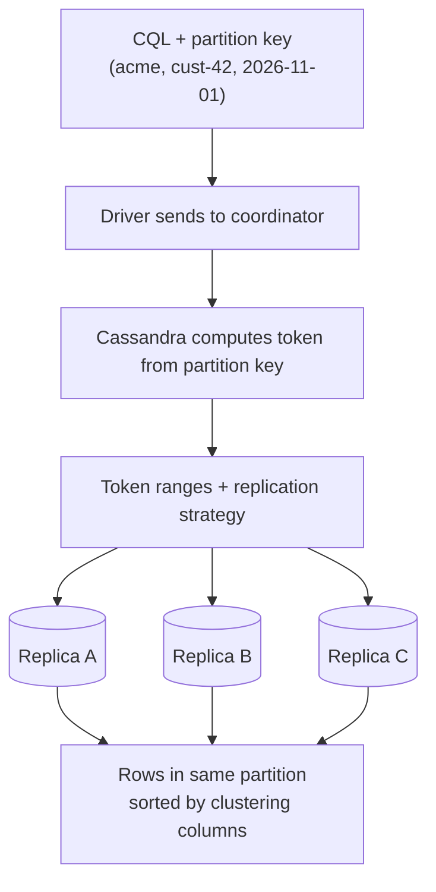
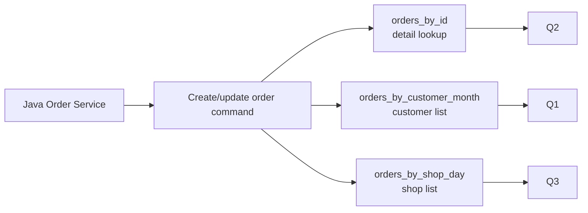
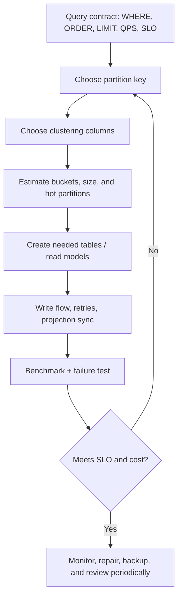

# Query-Driven Design and the Role of the Partition Key

> **Chapter:** Cassandra Foundations  
> **Scope:** Understanding how to design Apache Cassandra tables starting from the queries an application actually needs to serve. This lesson focuses on partition keys, clustering columns, data distribution across the cluster, time-based partitioning, hotspots, duplicating data per read path, and trade-offs involving consistency, CQL, operations, and Java applications.

## 1. Learning Objectives

After this lesson, you will be able to:

1. Translate a business requirement into a **query pattern** with explicit filter predicates, ordering, limits, frequency, and latency targets.
2. Distinguish **partition keys**, **clustering columns**, and **regular columns** when reading a `PRIMARY KEY` declaration in CQL.
3. Explain how Cassandra computes tokens from partition keys, distributes partitions to replicas, and why key selection determines horizontal scalability.
4. Design tables for at least two distinct access paths, embracing **denormalization** and understanding data synchronization responsibilities.
5. Identify oversized partitions, hot partitions, wide-scan queries, and misuse of `ALLOW FILTERING`.
6. Choose a time-bucket or sharding strategy backed by measurements; understand the cost of reading across multiple partitions.
7. Write CQL and use the Java driver to query with the full partition key, while identifying the boundaries of replication, consistency, and retries.

## 2. Start From Queries, Not From an Entity List

In relational databases, learners often build a domain model first, normalize entities like `customers`, `orders`, and `shops`, and then use JOINs or indexes to answer many kinds of questions. That approach has real value, yet **cannot be lifted as-is onto Cassandra** with the expectation that every query will perform efficiently.

Cassandra is a distributed *wide-column* NoSQL database. It locates data primarily via the **partition key**, while rows inside a partition are ordered by **clustering columns**. Therefore, in Cassandra, designing a table must answer:

> "How will the application query this data, which keys will it know, how many rows must it read, in what order, and at what frequency?"

This is **query-first data modeling**: identify frequent access paths first, then build schemas to satisfy those access paths.

### 2.1. Example: A Multi-Tenant Order System

An e-commerce application has multiple tenants, buyers, and shops. Three main screens require:

| ID | Business question | Known conditions at query time | Ordering / limit |
| --- | --- | --- | --- |
| **Q1** | View the 20 most recent orders of a buyer in a month | `tenant_id`, `customer_id`, month | `ordered_at` newest first; max 20 |
| **Q2** | View details of a single order by order ID | `tenant_id`, `order_id` | One specific order |
| **Q3** | View the 50 most recent orders of a shop on a given day | `tenant_id`, `shop_id`, day | `ordered_at` newest first; max 50 |

All three questions touch "order" data, yet **start from three different lookup keys**. A table optimized only by `order_id` will not automatically serve buyer or shop lists efficiently.

Additionally, the analytics team wants a report: "nationwide revenue by city and product category over 90 days." That is a fourth access path requiring aggregation across large datasets. We will decide how to address it separately later.

### 2.2. What Does a Query Contract Need?

Before writing `CREATE TABLE`, record at least:

- **Required filter predicates:** which fields does the application always have? Which are optional?
- **Ordering:** newest first, ascending, or by score?
- **Result size limit:** one row, dozens of rows, or millions of rows?
- **Frequency and load:** QPS, concurrent users, read/write ratio.
- **Data size and lifecycle:** how many rows does one key accumulate per day/month?
- **Latency and freshness requirements:** p95/p99 targets; is briefly seeing stale records acceptable?

These inputs drive the choice of partition keys, clustering, buckets, replication, and consistency. Without them, tidy column names are not enough to prove a table is designed properly.

## 3. A Cassandra Primary Key Has Two Parts With Distinct Responsibilities

Consider the declaration:

```sql
PRIMARY KEY ((tenant_id, customer_id, order_month), ordered_at, order_id)
```

The syntax reads as:

| Component | Role | Consequence |
| --- | --- | --- |
| `(tenant_id, customer_id, order_month)` | **Composite partition key** | The combination of all three values defines a logical partition and determines token/replica group |
| `ordered_at` | **First clustering column** | Orders rows chronologically within the partition |
| `order_id` | **Second clustering column** | Disambiguates orders sharing the same timestamp and participates in ordering |
| `status`, `total_amount`, `shop_id` | **Regular columns** | Store returned data; do not automatically create cluster-wide search paths |

The **partition key** answers "which replica group holds the data?". **Clustering columns** answer "once the partition is located, which rows and in what order should be read?". They cannot swap roles.

### 3.1. A Single Partition Can Contain Many Rows

Suppose we have these orders:

| tenant_id | customer_id | order_month | ordered_at | order_id |
| --- | --- | --- | --- | --- |
| acme | cust-42 | 2026-11-01 | 21/11 09:15 | id-A |
| acme | cust-42 | 2026-11-01 | 21/11 08:02 | id-B |
| acme | cust-42 | 2026-11-01 | 20/11 18:35 | id-C |
| acme | cust-42 | 2026-10-01 | 31/10 21:10 | id-D |
| acme | cust-99 | 2026-11-01 | 21/11 09:00 | id-E |

The first three rows belong to the same partition `(acme, cust-42, 2026-11-01)`; the fourth belongs to October's partition, and the last belongs to a different buyer's partition. With `CLUSTERING ORDER BY (ordered_at DESC, order_id ASC)`, newer orders appear first inside **each** partition.

A partition containing many rows **does not mean** the whole table is sorted by `ordered_at`. Partitions are routed by token; Cassandra does not maintain a global chronological list across all buyers.

### 3.2. Why Are All Components of the Partition Key Required?

For a table using composite partition key `(tenant_id, customer_id, order_month)`, an efficient standard query needs **all three values**. Having only `tenant_id` and `customer_id` without `order_month` does not pinpoint a single partition.

CQL has certain multi-partition query forms or indexing capabilities depending on version/features, yet those do not turn a query missing its partition key into a free point lookup. If the UI must view multiple months, the application should determine **which buckets need to be read**, bound request count, and merge results.

## 4. How Does the Partition Key Determine the Path Across the Cluster?

When a client sends an operation with a partition key, Cassandra uses a partitioner—commonly **Murmur3**—to compute a **token** from the key value. The token along with token ranges, topology, and the replication strategy determine which replicas store the partition.



The diagram illustrates a partition with three replicas; it does not mean every cluster has exactly three nodes. **Replicas hold copies of the partition**, rather than each clustering row being re-hashed and sent to a random node. The coordinator may simultaneously be a replica of the partition while coordinating the operation, or simply be the node receiving the request.

### 4.1. Impact on Scalability

Suppose there are 100,000 buyers and traffic is fairly distributed per buyer. Including `customer_id` in the key spreads many partitions across token ranges. Yet if one buyer or one tenant generates most of the traffic, the corresponding partition can still run **hot** even when the cluster has many nodes.

Adding nodes helps rebalance load **across many partitions**; it does not automatically split one hot partition into multiple new partitions. This is why partition key choice determines horizontal scaling effectiveness right from the design phase.

### 4.2. Impact on Replication and Consistency

**RF (replication factor)** specifies how many replicas each partition has within the configured topology scope; **CL (consistency level)** specifies the response condition for a request. For example, RF = 3 in `dc1` and a `LOCAL_QUORUM` read typically requires **two local replicas** to respond appropriately.

Choosing a higher CL can alter latency and the ability to keep serving when a replica fails. However, adjusting RF or CL **does not fix** a partition key that forces broad scans or funnels most writes into one partition. Query design, partitioning, and consistency levels solve different problems.

## 5. Designing the First Table: Orders by Customer and Month

We start with **Q1**, since the application already knows the tenant, buyer, and month. Dates follow a uniform convention such as UTC, and `order_month` stores **the first day of the month** to represent the bucket.

### 5.1. Declaring the Keyspace and Table

```sql
-- Example cluster with a data center named dc1 and enough eligible nodes for RF = 3.
-- If your lab only has one node, adjust RF/CL accordingly.
CREATE KEYSPACE IF NOT EXISTS commerce
WITH replication = {
    'class': 'NetworkTopologyStrategy',
    'dc1': 3
};

CREATE TABLE IF NOT EXISTS commerce.orders_by_customer_month (
    tenant_id text,
    customer_id text,
    order_month date,
    ordered_at timestamp,
    order_id uuid,
    shop_id text,
    status text,
    total_amount decimal,
    PRIMARY KEY ((tenant_id, customer_id, order_month), ordered_at, order_id)
) WITH CLUSTERING ORDER BY (ordered_at DESC, order_id ASC);
```

Here, the table is named after its **access path**: `orders_by_customer_month`. Anyone reading the table name immediately knows how the application intends to look up data. This naming convention is not required by CQL syntax, yet helps prevent mistakenly assuming a single table named `orders` should serve every report.

### 5.2. Writing Sample Data

```sql
INSERT INTO commerce.orders_by_customer_month (
    tenant_id, customer_id, order_month, ordered_at, order_id,
    shop_id, status, total_amount
) VALUES (
    'acme', 'cust-42', '2026-11-01', '2026-11-21T09:15:00Z',
    11111111-1111-1111-1111-111111111111,
    'shop-9', 'PLACED', 590000.00
);

INSERT INTO commerce.orders_by_customer_month (
    tenant_id, customer_id, order_month, ordered_at, order_id,
    shop_id, status, total_amount
) VALUES (
    'acme', 'cust-42', '2026-11-01', '2026-11-21T08:02:00Z',
    22222222-2222-2222-2222-222222222222,
    'shop-3', 'PLACED', 125000.00
);
```

In CQL, `INSERT` follows **upsert** semantics for rows sharing the same primary key. Writing the same key again can update that row's data; Cassandra does not enforce business constraints like "unique order ID across all tables" unless the application designs and enforces them.

### 5.3. Query Q1: Fast Because It Hits the Exact Partition

```sql
SELECT ordered_at, order_id, shop_id, status, total_amount
FROM commerce.orders_by_customer_month
WHERE tenant_id = 'acme'
  AND customer_id = 'cust-42'
  AND order_month = '2026-11-01'
LIMIT 20;
```

The query supplies the full partition key, so the coordinator identifies the corresponding replica group. Since `ordered_at` is configured descending, newer rows appear first in the partition. `LIMIT 20` caps returned results; it does not guarantee low latency when a partition is huge, packed with tombstones, or replicas are overloaded.

You can add a time range **within the same partition**:

```sql
SELECT ordered_at, order_id, status
FROM commerce.orders_by_customer_month
WHERE tenant_id = 'acme'
  AND customer_id = 'cust-42'
  AND order_month = '2026-11-01'
  AND ordered_at >= '2026-11-20T00:00:00Z'
  AND ordered_at < '2026-11-22T00:00:00Z'
LIMIT 20;
```

The `ordered_at` range works cleanly because it is the first clustering column after locating the partition. Without the partition key predicate, adding `LIMIT 20` or a time range **does not magically create a cheap routing path**.

## 6. Designing the Second Table: Direct Lookup by Order ID

**Q2** knows `tenant_id` and `order_id`, yet does not necessarily know the buyer, placement timestamp, or month bucket. With only Q1's table, the application cannot locate the right partition from those two values.

Create another table serving Q2:

```sql
CREATE TABLE IF NOT EXISTS commerce.orders_by_id (
    tenant_id text,
    order_id uuid,
    customer_id text,
    shop_id text,
    ordered_at timestamp,
    order_month date,
    status text,
    total_amount decimal,
    PRIMARY KEY ((tenant_id, order_id))
);

INSERT INTO commerce.orders_by_id (
    tenant_id, order_id, customer_id, shop_id,
    ordered_at, order_month, status, total_amount
) VALUES (
    'acme', 11111111-1111-1111-1111-111111111111,
    'cust-42', 'shop-9', '2026-11-21T09:15:00Z',
    '2026-11-01', 'PLACED', 590000.00
);

SELECT customer_id, shop_id, ordered_at, status, total_amount
FROM commerce.orders_by_id
WHERE tenant_id = 'acme'
  AND order_id = 11111111-1111-1111-1111-111111111111;
```

In this table, **the entire primary key is a composite partition key** consisting of `tenant_id` and `order_id`, with no clustering columns. Each logical partition per order ID holds one row in this model.

### 6.1. Why Are There Two Logical Records for One Order?

`orders_by_customer_month` serves recent-order lists per buyer; `orders_by_id` serves point lookups by order ID. They store overlapping business attributes. That is **intentional denormalization** so both query types have keyed access paths.

The cost is that the application must have a synchronization strategy across read models:

- When creating an order, establish a **stable order ID** and write data for the required access paths.
- When changing order status, update tables containing the status field, or route changes through a designed pipeline/event flow.
- When an intermediate update step fails, provide retries, reconciliation, or drift repair.
- When a list table stores a snapshot, explicitly decide whether absolute current state is needed or brief sync lag is acceptable.

**CQL `BATCH` is not a general SQL transaction** that automatically rolls back every cross-table/cross-partition side effect. Logged batches have specific guarantees and overhead; do not treat batches as a general speedup tool or a replacement for cross-system business consistency workflows.

## 7. Designing the Third Table: Order List by Shop and Day

**Q3** queries by `tenant_id`, `shop_id`, and day. We can create a dedicated read model:

```sql
CREATE TABLE IF NOT EXISTS commerce.orders_by_shop_day (
    tenant_id text,
    shop_id text,
    order_day date,
    ordered_at timestamp,
    order_id uuid,
    customer_id text,
    status text,
    total_amount decimal,
    PRIMARY KEY ((tenant_id, shop_id, order_day), ordered_at, order_id)
) WITH CLUSTERING ORDER BY (ordered_at DESC, order_id ASC);

INSERT INTO commerce.orders_by_shop_day (
    tenant_id, shop_id, order_day, ordered_at,
    order_id, customer_id, status, total_amount
) VALUES (
    'acme', 'shop-9', '2026-11-21', '2026-11-21T09:15:00Z',
    11111111-1111-1111-1111-111111111111,
    'cust-42', 'PLACED', 590000.00
);

SELECT ordered_at, order_id, customer_id, status, total_amount
FROM commerce.orders_by_shop_day
WHERE tenant_id = 'acme'
  AND shop_id = 'shop-9'
  AND order_day = '2026-11-21'
LIMIT 50;
```

This example shows how **Cassandra tables are typically designed around read paths**, potentially duplicating one business entity into multiple rows across different tables. However, if a shop receives millions of orders/day, `(tenant_id, shop_id, order_day)` remains a potential hot partition. In that case, hourly buckets or logical sharding may be required.

### 7.1. Should You Create One Table Per API?

Not necessarily. APIs sharing the same partition key, ordering, and clustering conditions can share a table. Create a new table when the **access path truly differs** and existing indexing/query approaches cannot meet desired latency, load, or functionality.

Every added table increases:

- Disk usage and write volume.
- Number of mutations when creating or updating an order.
- Risk of drift between read models and reconciliation effort.
- Migration, repair, backup, and monitoring overhead.

Query-driven design does not mean creating infinite tables; the goal is **enough tables to serve critical query patterns at an acceptable cost**.

## 8. Queries That Easily Lead Newcomers to Pick the Wrong Key

Some requirements may look simple if you are used to relational SQL, yet require rethinking in Cassandra.

| Desired query | Why the schema above falls short | How to address it |
| --- | --- | --- |
| "Latest orders across all buyers in a month" | Must touch many `(tenant, customer, month)` partitions | Aggregation pipeline, a separate table with suitable shards/buckets, or an analytical store |
| "All orders with `status = 'PLACED'`" | `status` is not a partition key/clustering column for cluster-wide lookup | Design a scoped read model or evaluate index/search options |
| "20 most recent orders for customer X without knowing the month" | Missing `order_month` of the composite partition key | Application identifies and reads relevant month buckets and merges results |
| "90-day average revenue by city" | Aggregates across many partitions; CQL is not a general OLAP engine | Stream aggregation / ETL to an analytical store |
| "Orders by `customer_id` across all tenants" | Missing `tenant_id`, fails to target partition and risks cross-tenant mixing | Resolve tenant from auth context; if cross-tenant search is needed, build a dedicated access path |

### 8.1. The `ALLOW FILTERING` Trap

An example that should not be used as a "quick fix" for a missing access path:

```sql
-- Query missing partition key, unsuitable as a primary read path:
-- SELECT * FROM commerce.orders_by_customer_month
-- WHERE status = 'PLACED' ALLOW FILTERING;
```

`ALLOW FILTERING` lets the server perform expensive filtering forms; it does not guarantee efficient retrieval once the table grows to billions of rows. Even with `LIMIT`, the cost of scanning, filtering, and contacting many partitions can still be huge.

### 8.2. Do Secondary Indexes and Storage-Attached Indexes Solve Everything?

Secondary indexes and **Storage-Attached Indexes (SAI)** in supported Cassandra versions can help for certain filter predicates. Yet they carry write/storage overhead and query limitations, and performance depends on selectivity, value distribution, data size, and involved partition count.

Do not conclude "just add an index and get every search feature like PostgreSQL or an analytical warehouse." Evaluate indexes based on the **query contract**, expected result count, and real benchmarks; for heavy read paths or broad aggregations, a dedicated read model or specialized search/query engine may still be more appropriate.

## 9. Good Partitioning Needs Three Properties Simultaneously

Naming fields sensibly is not enough. A good partition key for a workload must balance:

1. **Targetable:** queries typically know all partition key components.
2. **Evenly distributed:** most requests or storage do not pile onto a small number of partitions.
3. **Bounded size and lifecycle:** partitions do not grow unboundedly; there is a clear retention and history-query strategy.

### 9.1. Comparing Several Key Choices

| Candidate partition key | Advantage | Risk |
| --- | --- | --- |
| `(order_month)` | Easy to find data by month | All orders in a month cram into very few partitions, easily forming hotspots |
| `(tenant_id)` | Easy to locate by tenant | Large tenants create oversized partitions and skewed load |
| `(order_id)` | Point lookup by order ID | Difficult to read lists by buyer or shop |
| `(tenant_id, customer_id, order_month)` | Matches Q1, bounded by month bucket | Heavy buyers can still run hot; multi-month reads add complexity |
| `(tenant_id, shop_id, order_day)` | Matches Q3 by shop/day | Shops running flash sales can overload within a single day |

**Rows sharing a key in one partition** are routed to that partition's replica set. Increasing RF adds more copies, while adding nodes can redistribute partitions across nodes; neither **automatically splits a hot partition** into smaller chunks.

### 9.2. Understanding Load Skew

Suppose 99,999 buyers place at most a few orders/month while one automated account places 500,000 orders/day. Even though `customer_id` cardinality is huge, that hyperactive account's partition still risks overloading. **High cardinality does not guarantee balanced traffic.**

Monitor request distribution per partition, row counts, partition byte sizes, compaction activity, and p95/p99 latency. Measure both **write** and **read** skew, since a modest-sized partition can still overheat if queried relentlessly.

## 10. Time Buckets and Shards: Splitting to Bound Size and Load

Time bucketing adds a time unit to the partition key: day, week, month, or hour. It bounds how many events accumulate in one partition over time.

### 10.1. Choosing Buckets With Numbers

Suppose a shop averages around 4,000 orders/day, with each row requiring roughly 700 bytes of logical payload on average. Logical data volume in a daily bucket is roughly:

\[
4.000 \times 700 \text{ byte} = 2.800.000 \text{ byte} \approx 2,8 \text{ MB}
\]

This is only a **logical data estimate**, not SSTable bytes on disk. RF, metadata, compression, tombstones, and compaction affect real disk usage. If traffic jumps to 2 million orders/day under the same assumptions, logical data alone hits roughly **1.4 GB/day**, vastly different from initial conditions.

Therefore, measure:

- Average and peak row counts **per partition**.
- Actual row sizes, SSTable sizes, and overhead from TTL/deletes/updates.
- Reads and writes per second on the hottest partitions.
- Typical query windows: a few hours, one day, one month.
- Acceptable number of partitions to query and merge.

No single "daily" bucket or fixed MB threshold fits every system.

### 10.2. When a Daily Bucket Is Still Too Hot

You can refine Q3 to partition by shop and hour:

```sql
-- Conceptual sketch: add order_hour as a UTC hourly bucket.
-- PRIMARY KEY ((tenant_id, shop_id, order_day, order_hour),
--              ordered_at, order_id)
```

Or add a **logical shard** with a bounded shard count, such as `shard_id` deterministically derived from `order_id`; the partition key becomes `(tenant_id, shop_id, order_day, shard_id)`.

**Trade-off:** to return "the 50 newest orders of a shop today," the application must read multiple hours or shards and then **merge sort** results by timestamp and ID. Picking a random shard on write without a deterministic way to query/reconstruct it makes targeted lookup difficult. Bounding fan-out, concurrency, and pagination becomes part of the design.

### 10.3. Querying Multiple Buckets Must Resolve Global Ordering

Suppose you need the 20 newest orders across **three months**. Each month is a separate partition, and each partition is sorted by `ordered_at`. However, Cassandra **does not guarantee** rows returned from three partitions automatically merge into one globally sorted list.

The application can:

1. Determine up to three month buckets to read from the time range.
2. Issue queries with full partition keys and appropriate limits.
3. Merge by `ordered_at` and tie-breaker `order_id`, deduplicating if business logic requires.
4. Return the newest 20 rows, while designing pagination and per-bucket cursor state.

The Java driver's paging state for a single CQL query does not turn multiple partitions into a single global cursor. To maintain stable pagination while new data keeps arriving, define boundary timestamps and rules for late updates/writes.

## 11. Designing Multiple Read Models: Synchronization and Error Handling

With Q1, Q2, and Q3, a single order can appear in three tables. This unlocks query optimization yet creates **multiple representations** of the same business entity.



The diagram shows three data targets, **not** an atomic transaction spanning all three tables.

### 11.1. Partial Update Risk

Suppose a new order is written to `orders_by_id`, yet writing to `orders_by_shop_day` times out. The customer looking up details sees the order, while shop staff do not see it in their list yet.

The application must choose and document a consistency strategy:

- **Multi-table writes with reconciliation:** use stable IDs, bounded retries, and ways to detect and repair missing records.
- **Event bus / pipeline:** persist a reliable event source and build read models from events, monitoring lag and handling duplicate messages.
- **Source of truth + projections:** define which table is authoritative and which tables are projections that can be rebuilt.

You cannot assume "multiple Cassandra tables will always match instantaneously." Nor should you use `LOGGED BATCH` as a multi-system business transaction with general rollback. Understand batch guarantees, coordinator overhead, partition scope, and duplicate-write protections.

### 11.2. Order Status Changes

If Q1 and Q3 store `status`, when an order transitions from `PLACED` to `SHIPPED`, the application must know the **full primary key** of every row to update. In the customer/month table, that key includes `tenant_id, customer_id, order_month, ordered_at, order_id`; knowing only `order_id` is insufficient to update a row in that table.

Hence `orders_by_id` can store extra metadata such as `customer_id`, `shop_id`, `ordered_at`, and buckets to locate projections when needed. Reading source data and updating projections still requires handling concurrency and intermediate states.

When update events can arrive out of order, enforce consistent versioning and timestamp rules; a late-arriving event should not blindly overwrite a newer business state. Cassandra uses timestamp semantics per cell version; it **does not understand** order lifecycles for the application.

## 12. Connecting From Java: Turning Query Contracts Into Prepared Statements

Access paths designed in CQL must be called by the application with **the exact partition key**. Java driver 4.x provides `CqlSession`, `PreparedStatement`, and `BoundStatement` to bind typed parameters.

Abbreviated Java 11+ example (assuming schema already exists and data center name is `dc1`):

```java
import java.net.InetSocketAddress;
import java.time.LocalDate;

import com.datastax.oss.driver.api.core.CqlSession;
import com.datastax.oss.driver.api.core.DefaultConsistencyLevel;
import com.datastax.oss.driver.api.core.cql.PreparedStatement;
import com.datastax.oss.driver.api.core.cql.ResultSet;
import com.datastax.oss.driver.api.core.cql.Row;

public final class CustomerOrdersExample {
    public static void main(String[] args) {
        try (CqlSession session = CqlSession.builder()
                .addContactPoint(new InetSocketAddress("127.0.0.1", 9042))
                .withLocalDatacenter("dc1")
                .build()) {

            PreparedStatement recentOrders = session.prepare(
                "SELECT ordered_at, order_id, shop_id, status, total_amount " +
                "FROM commerce.orders_by_customer_month " +
                "WHERE tenant_id = ? AND customer_id = ? " +
                "AND order_month = ? LIMIT 20"
            );

            ResultSet rs = session.execute(
                recentOrders.bind(
                    "acme", "cust-42", LocalDate.of(2026, 11, 1)
                ).setConsistencyLevel(DefaultConsistencyLevel.LOCAL_QUORUM)
                 .setIdempotent(true)
            );

            for (Row row : rs) {
                System.out.printf("%s | %s | %s | %s%n",
                    row.getInstant("ordered_at"),
                    row.getUuid("order_id"),
                    row.getString("status"),
                    row.getBigDecimal("total_amount"));
            }
        }
    }
}
```

Here:

- **Application** chooses tenant, customer, and month bucket based on the query contract and authorization.
- **Driver** binds CQL parameters with proper types; when routing key info is present, the driver can prefer nodes aligned with the partition.
- **Cassandra coordinator** locates replicas by token and executes the query at the requested CL.
- **Pure reads** are marked idempotent; for writes, analyze idempotency yourself regarding IDs, timestamps, TTL, and business side effects.

This snippet only illustrates the driver API; `127.0.0.1` and `dc1` must match your lab environment. RF = 3 with `LOCAL_QUORUM` requires sufficient local replicas. Production apps need security, timeouts, pooling/session lifecycle, pagination, and monitoring.

### 12.1. Prepared Statements Do Not Fix a Bad Schema

A `SELECT` using a prepared statement can still be very slow if `WHERE` lacks the partition key, scans many partitions, or hits dense tombstones. Prepared statements address **how queries are sent and bound**; the designer remains responsible for **access paths** and partition sizes.

## 13. Constraints Tied to Consistency and Operations

Query-driven table design must go hand in hand with operational design:

| Topic | Direct link to schema |
| --- | --- |
| **Replication** | Each partition has multiple replicas; high RF multiplies storage and write traffic across read models |
| **Consistency** | CL governs how many replicas must respond; it does not turn unkeyed lookups into optimal queries |
| **Commit log / memtable / SSTable** | Fast writes to immutable structures lead to flush and later compaction work |
| **Compaction** | Tables with heavy updates, TTLs, or deletes can increase I/O and compaction pressure |
| **Tombstones** | Deleting rows/projections and TTL expirations create tombstones, which can slow reads |
| **Repair** | Replicas can diverge on failures; repair compares and converges them after disruptions |
| **Backup/restore** | Multiple projection tables require a consistent recovery strategy; replication does not replace backups |
| **Hot partitions** | Adding nodes, raising RF, or changing CL does not automatically split a traffic-heavy partition |

### 13.1. A Fast Read Does Not Mean All Replicas Are Synchronized

Suppose the application uses RF = 3 in `dc1` and reads at `LOCAL_QUORUM`. Success means the coordinator received enough conforming responses per CL; not every replica, data center, and projection table has necessarily converged to the newest state.

If the application updates Q1, Q2, and Q3 tables separately, using quorum on every query **does not create multi-table atomicity**. When conditional control on certain writes is needed within Cassandra, lightweight transactions (LWT) can be considered, though they carry their own costs and semantic scope and do not replace a complete business synchronization model.

### 13.2. Write Timeouts and Retries

A write timeout **does not prove** no replica received the mutation. With multi-table read models, retries must preserve the same `order_id`, routing keys, and update version; generating a fresh key per retry can duplicate data.

The application should monitor failed requests, detect drifted projections, provide replay/reconciliation, and define SLOs for data synchronization lag.

## 14. Practical Workflow for Query-Driven Table Design

A checklist usable in design reviews:

1. **Write the query contract list:** for each API, document input predicates, ordering, result size, frequency, and SLO.
2. **Group compatible query patterns:** queries sharing partition keys, clustering order, and data lifecycle can share a table.
3. **Choose partition keys:** ensure queries pinpoint partitions and assess key-level load skew.
4. **Choose clustering columns:** optimize ordering and range predicates *within a partition*; include a tie-breaker for identical timestamps.
5. **Choose buckets/shards if needed:** measure partition growth rates and plan multi-bucket result merging.
6. **Map writes and synchronization:** with multiple read models, specify the source of truth, stable IDs, retries, reconciliation, and out-of-order updates.
7. **Choose RF, CL, TTL, and operational policies:** align with fault tolerance, freshness, cost, and repair/backup workflows.
8. **Measure on a representative workload:** benchmark key distribution, p95/p99 load, timeouts, partition sizes, fan-out, compaction, and tombstones.
9. **Test failures:** stop replicas, induce controlled timeouts, test multi-bucket reads, and verify read-model recovery.



This workflow is iterative. When query patterns change, treat it as a **data design change**, not just adding another predicate to a `WHERE` clause.

## 15. Scenario Exercise

A delivery platform stores events for 60,000 vehicles. Each vehicle typically reports coordinates every 10 seconds. The UI has four requirements:

1. Fetch the 100 newest coordinates for `vehicle-7` on November 21.
2. Display the **latest** coordinates of a vehicle by ID.
3. Calculate active vehicles by district over 30 days.
4. Browse a vehicle's full 7-day history with pagination.

### Questions

**A.** Which partition key and clustering columns suit requirement 1? If vehicles report continuously for years, is using only `vehicle_id` appropriate?

**B.** Should requirement 2 always scan the history table to fetch the first row, or can a separate state table be designed? How should late-arriving events be handled?

**C.** Should requirement 3 run an aggregation scanning the entire history table on every request? Which data system fits better?

**D.** With a daily time-bucket schema, what must requirement 4 watch out for to return chronologically ordered results across multiple partitions?

**E.** If one vehicle suddenly emits 5,000 events/second, will adding nodes automatically split that vehicle/day partition's load?

### Solution Hints

- **A.** One option is `PRIMARY KEY ((tenant_id, vehicle_id, event_day), event_time, event_id)` with `CLUSTERING ORDER BY (event_time DESC, event_id ASC)`. Daily bucketing prevents unbounded growth, though you should measure daily event counts to verify a day is small enough.
- **B.** You can build a `latest_location_by_vehicle` table keyed by `(tenant_id, vehicle_id)` for point lookups. The application must enforce timestamp/version update rules so late-arriving events cannot blindly overwrite newer locations.
- **C.** District- and time-based statistics across all vehicles suit an aggregation/OLAP pipeline or specialized read model. Cluster-wide scans per request are hard to keep cost-controlled.
- **D.** Query the relevant daily buckets, bound concurrency, and merge rows by timestamp/ID; design unified application-level paging state when required.
- **E.** No. A partition maps to its replica set; if it runs hot, evaluate hourly buckets or sharding while accounting for read-side merging complexity.

## 16. Misconceptions to Avoid

| Misconception | Accurate understanding |
| --- | --- |
| "One business entity must live in exactly one table." | One entity may be represented across multiple tables tailored to distinct access paths. |
| "Cassandra's primary key is just a unique key like SQL." | It consists of a partition key governing distribution and optional clustering columns sorting rows within each partition. |
| "Knowing just `customer_id` lets you query a table keyed by `(tenant_id, customer_id, order_month)`." | Standard targeted queries require the full composite partition key. |
| "Clustering by time means the entire table is sorted by time." | Clustering order applies only within a single partition. |
| "Raising RF turns a hot partition into many small partitions." | RF increases copy count; it does not change partition key boundaries. |
| "`LIMIT 20` always makes broad scans cheap." | Locating and filtering data before returning 20 rows can still be very expensive. |
| "Adding `ALLOW FILTERING` optimizes the query." | It may allow filtering, yet does not create an efficient distributed lookup path. |
| "CQL BATCH makes multi-table updates a general ACID transaction." | Batches have specific guarantees and costs, not replacing business consistency management. |
| "Using a prepared statement means the partition key was chosen right." | Prepared statements help with binding and routing; schema and query contracts still must be sound. |
| "Quorum guarantees read models always match." | Quorum applies to requests against replicas of data; it does not provide atomic sync across independent projection tables. |

## 17. Knowledge Self-Check

1. **Why does Cassandra typically design tables around queries?** Because routing and sorting follow partition and clustering keys, so the access path dictates read cost.
2. **Which part of `PRIMARY KEY ((a, b), c, d)` is the partition key?** `(a, b)`; `c` and `d` are clustering columns.
3. **Can `ordered_at` determine replicas if it is only a clustering column?** No. Replicas are determined by the token of the partition key.
4. **Why doesn't a table keyed by order ID automatically serve orders by buyer?** Because buyer queries lack the order-ID table's partition key.
5. **When do time buckets help?** When bounding partition accumulation over time and read patterns can specify the bucket.
6. **Is adding shards always better than daily buckets?** No. Sharding spreads load further yet complicates queries with fan-out, merging, and pagination.
7. **If you need three months of history across three partitions, does Cassandra automatically return one globally sorted list?** No. The application must merge results in order when querying independent partitions.
8. **What is the biggest hazard in maintaining three read models?** Data can drift due to partial updates, duplicate writes, out-of-order messages, or missing reconciliation.
9. **Can a higher CL fix a hot partition?** No. CL changes required response counts and trades availability/consistency, without altering key-based placement.
10. **Why benchmark with realistic key distributions?** Because high key count alone does not prove even traffic; skewed distributions and large partitions drive real latency.

## 18. Takeaways Before Moving to Practice

The critical decision chain is:

**Business requirement → query contract → partition key to locate and distribute data → clustering columns to sort rows inside a partition → buckets/shards to control load and size → additional read models when needed → synchronization, replication, consistency, and operations.**

Apache Cassandra shines when applications have clear read/write patterns, large data volumes, and a need to scale horizontally across many nodes. **The partition key is an architectural decision**, not just syntax inside `CREATE TABLE`. Picking the wrong key causes hot partitions, wide scans, heavy repair/compaction costs, and unpredictable latency.

From this foundation, you can dive deeper into CQL, replication, read/write consistency, compaction, repair, failure scenarios, and Java driver connectivity in the **DATABASE_ENGINE_WIDE_COLUMN_CASSANDRA** module.
