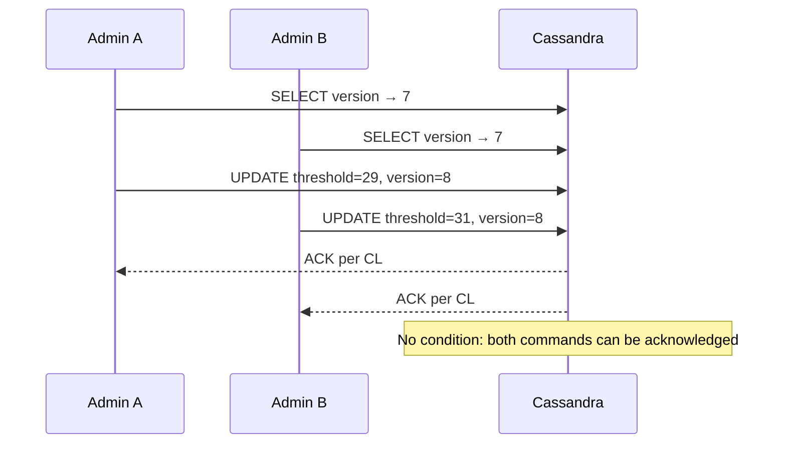
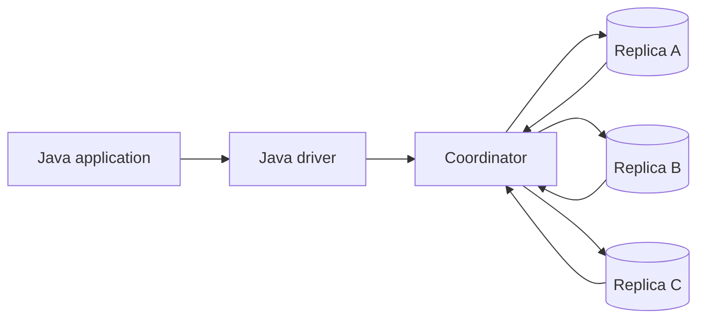
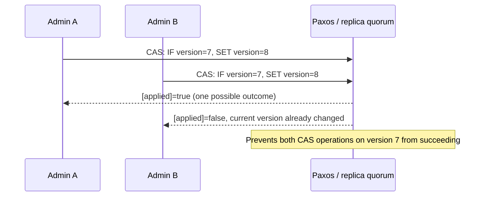
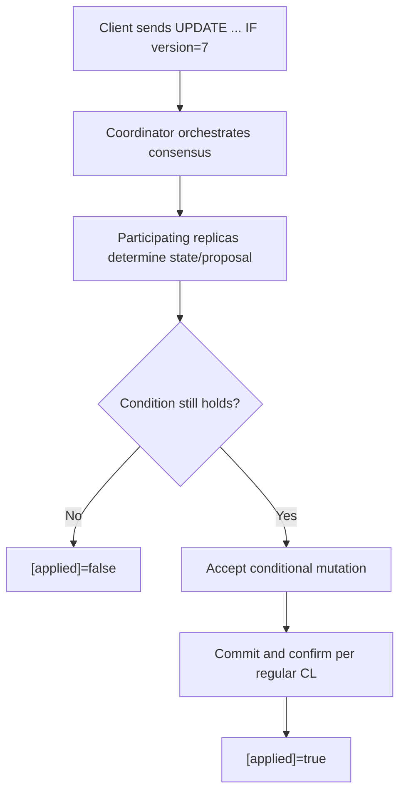

# Atomicity Scope, Consistency Levels, and Conditional Updates

> **Chapter:** Cassandra Foundations  
> **Scope:** Apache Cassandra is a distributed wide-column NoSQL DBMS capable of replicating data and tuning consistency per request. This lesson distinguishes **atomicity**, **isolation**, **consistency level**, and **conditional updates**; explains the limits of CQL `BATCH`, how lightweight transactions (LWT) work, and how to invoke them from Java applications while handling timeouts.

## 1. Learning Objectives

After this lesson, you will be able to:

1. Distinguish **atomicity**, **isolation**, **durability**, **replica consistency**, and **business consistency**.
2. State the exact guarantee scope of a single mutation, `BATCH`, and conditional operations in Cassandra; never confuse `BATCH` with arbitrary multi-table ACID transactions.
3. Calculate required acknowledgments when using `ONE`, `QUORUM`, `LOCAL_QUORUM`, and `ALL` based on replication factor (RF) and data center scope.
4. Explain why **quorum reads/writes do not automatically prevent two concurrent clients from overwriting each other**.
5. Write CQL `INSERT ... IF NOT EXISTS`, `UPDATE ... IF version = ...`, and read the `[applied]` result.
6. Understand the two consistency level groups in LWT: **serial consistency** for the consensus phase and **regular consistency** for the write confirmation phase.
7. Design Java driver code that distinguishes successful updates, version conflicts, ambiguous timeouts, and errors requiring reconciliation.

## 2. One Problem, Three Different Requirements

An IoT platform stores alert thresholds per device. Operators read the current configuration, adjust the threshold, and save it. Two administrators might edit the same device concurrently.

Suppose the initial configuration is:

| tenant_id | device_id | threshold_c | version |
| --- | --- | ---: | ---: |
| acme | sensor-42 | 28.0 | 7 |

Administrator A reads version 7 and wants to set 29.0°C. Almost simultaneously, Administrator B also reads version 7 and wants to set 31.0°C.

The system must answer three distinct questions:

1. **Atomicity:** If one operation modifies both `threshold_c` and `version` in the same partition, can someone observe a state where only one column was updated within Cassandra's guarantee scope?
2. **Consistency level:** How many replicas must respond for a read/write request to be deemed successful? If one replica disconnects, can the operation still be served?
3. **Conditional updates:** How do we ensure at most **one of the two** administrators succeeds based on version 7, instead of both believing they had exclusive updates?

Three questions require different mechanisms. **Atomicity does not automatically provide concurrency control; quorum does not automatically create a "write only if version is unchanged" condition.**

## 3. Separate Guarantees Before Picking a CQL Statement

| Concept | Question | Illustration in Cassandra |
| --- | --- | --- |
| **Atomicity** | Is a write unit applied as an atomic operation within a defined scope? | Mutation on a single partition; specific guarantees of a logged `BATCH` |
| **Isolation** | Do concurrent operations observe each other's intermediate states? | Limited scope and mechanisms; no default SQL transaction isolation across multiple partitions |
| **Replica consistency** | How many replicas must respond to reads/writes, and have replicas converged? | `ONE`, `LOCAL_QUORUM`, `ALL`; read reconciliation, repair |
| **Conditional correctness** | Write only if a condition on current data holds true? | `IF NOT EXISTS`, `IF EXISTS`, `IF version = ...` using LWT |
| **Durability** | Do acknowledged writes survive expected failure classes? | Commit log, replication, disk sync config, repair, backups |
| **Business invariant** | Does the system always obey business rules? | Version control, order state transitions, balance conservation, application-level deduplication |

### 3.1. "Consistency" Has Multiple Meanings

The *consistency* in **ACID** refers to keeping data/business constraints valid after a transaction. In Cassandra, **consistency level (CL)** usually refers to how many replicas must reply to reads/writes. These two meanings are **not interchangeable**.

For example, a `QUORUM` write can be acknowledged by two replicas at RF = 3 while still violating business rules if code allows transitioning an order from `CANCELLED` back to `PAID` without checking state conditions.

### 3.2. Atomicity Does Not Imply Durability

A change can be applied consistently within a partition, yet surviving power loss still depends on the commit log write path, sync settings, replicas, and failure mode. Conversely, two changes across multiple partitions may eventually persist durably without having **isolation** between them for a concurrent reader.

When designing, always state explicitly: **atomic with respect to which unit, consistent at which CL, and tolerant of which failure types?**

## 4. Cassandra's Access Unit: The Partition

Cassandra locates rows by **partition key**. Rows sharing a partition key reside on the same replica set; clustering columns sort rows inside the partition and do not scatter rows onto other nodes.

```sql
-- Two columns form a composite partition key; no clustering column.
CREATE TABLE IF NOT EXISTS device_control.device_config (
    tenant_id text,
    device_id text,
    threshold_c double,
    version int,
    updated_at timestamp,
    PRIMARY KEY ((tenant_id, device_id))
);
```

In this table, one device's configuration is one logical partition. An event history table differs:

```sql
CREATE TABLE IF NOT EXISTS device_control.device_events_by_day (
    tenant_id text,
    device_id text,
    event_day date,
    occurred_at timestamp,
    event_id uuid,
    event_type text,
    PRIMARY KEY ((tenant_id, device_id, event_day), occurred_at, event_id)
) WITH CLUSTERING ORDER BY (occurred_at DESC, event_id ASC);
```

Each partition can hold many clustering rows in the history table. A change touching only `device_config` for `sensor-42` is very different from a workflow needing to **simultaneously** update config, write an audit event, and call an external service.

### 4.1. Why Do Partition Boundaries Matter?

When two values reside in the same partition and are written via an appropriate mutation, Cassandra has mechanisms providing mutation atomicity/isolation at partition scope. This **does not automatically extend** across arbitrary tables, partitions, and external systems.

Even when a `BATCH` includes multiple statements, a reader scanning different partitions can still observe part of the changes before the rest. Do not build invariants like "the sum of two accounts always equals X at every instant" merely by placing two `UPDATE`s inside one `BEGIN BATCH`.

## 5. Regular Mutations: Atomic, Yet Not Compare-and-Set

Consider a configuration update:

```sql
UPDATE device_control.device_config
SET threshold_c = 29.0, version = 8
WHERE tenant_id = 'acme' AND device_id = 'sensor-42';
```

This is a single-partition mutation. Cassandra does not locate the row via JOINs; it uses the partition key to locate replicas. However, the `UPDATE` above **does not check** whether the current version is still 7.

### 5.1. Contention Between Two Writers

If A and B both read version 7 and both send regular `UPDATE`s:



Cassandra resolves cell value conflicts using cell timestamps/version rules (often described as **last-write-wins by timestamp**, not necessarily the order clients received ACKs). If multiple writers have skewed clocks or update different columns, the final state depends on individual cells and conflict rules.

Therefore, **reading then running a regular `UPDATE`** is not atomic as a pair. Even if both requests use `LOCAL_QUORUM`, both can succeed while only one final state remains visible.

### 5.2. Upserts Also Do Not Automatically Prevent Logical Duplicates

`INSERT` and `UPDATE` typically carry upsert semantics by primary key. If a client retries the same event yet generates a fresh `event_id` after a timeout, Cassandra sees **a new primary key** and can create an extra row. The application must keep IDs stable and define operation idempotency.

## 6. What Do Replication Factor and Consistency Level Control?

Suppose each partition has **RF = 3 in data center dc1**, with replicas A, B, and C. A node receiving a request acts as **coordinator**, locates replicas using tokens and the replication strategy, and waits for responses per CL.



| Consistency level | With RF = 3 in one DC | When one replica does not respond |
| --- | --- | --- |
| `ONE` | One replica responds | Can still succeed |
| `LOCAL_ONE` | One replica in local DC | Can still succeed |
| `QUORUM` | Majority of total replicas: 2/3 in example | Can succeed if two replicas respond |
| `LOCAL_QUORUM` | Majority of local replicas: 2/3 in `dc1` | Can succeed if two local replicas respond |
| `ALL` | All three replicas | Fails if a required replica does not respond |

These are conditions on **replica counts**, not guarantees of always succeeding within a time limit. Nodes can be up yet slow due to I/O, compaction, network, or overload. In multi-DC clusters, global `QUORUM` and `LOCAL_QUORUM` do not necessarily require the same ACK count.

### 6.1. Quorum Intersection Property

Within the same RF replica set, let W be the replicas required to acknowledge a write and R be the replicas consulted for a read. The read and write sets are guaranteed to intersect when:

\[
W + R > RF
\]

With RF = 3, a `QUORUM` write (W = 2) and `QUORUM` read (R = 2) give `2 + 2 > 3`. Under suitable conditions, this helps reads observe an acknowledged write because at least one replica overlaps the write set.

However, **W + R > RF does not turn regular writes into linearizable transactions**: two concurrent writes can both be ACKed, timestamp conflicts still occur, and business invariants can still break. To enforce "only the first client updating version 7 succeeds," you need **conditional updates**.

### 6.2. Consistency Level Is Not an Isolation Level

`ONE`, `QUORUM`, `LOCAL_QUORUM`, and `ALL` are not equivalent to `READ COMMITTED`, `REPEATABLE READ`, or `SERIALIZABLE` in an RDBMS. CL defines **replica response rules**; isolation defines what concurrent transactions may observe and how they interleave.

## 7. Conditional Updates: Lightweight Transactions (LWT)

Cassandra provides `IF` conditions in CQL for certain `INSERT`, `UPDATE`, and `DELETE` operations. They use **lightweight transactions (LWT)**, built on consensus protocols such as Paxos in corresponding implementations, to achieve ordered compare-and-set behavior within the supported scope.

Typical forms:

```sql
INSERT INTO device_control.device_config (
    tenant_id, device_id, threshold_c, version
) VALUES ('acme', 'sensor-42', 28.0, 1)
IF NOT EXISTS;

UPDATE device_control.device_config
SET threshold_c = 30.0, version = 2
WHERE tenant_id = 'acme' AND device_id = 'sensor-42'
IF version = 1;

DELETE FROM device_control.device_config
WHERE tenant_id = 'acme' AND device_id = 'sensor-42'
IF version = 2;
```

The statements above illustrate **condition types**; they are not advice to run sequentially on critical data. LWTs require more round-trips among replicas than regular writes, so avoid using them by default for every telemetry event unless CAS/uniqueness is needed.

### 7.1. How Does LWT Update a Version?

Suppose the current row has `version = 7`, `threshold_c = 28.0`. Both A and B have read version 7.

```sql
-- Admin A
UPDATE device_control.device_config
SET threshold_c = 29.0, version = 8
WHERE tenant_id = 'acme' AND device_id = 'sensor-42'
IF version = 7;

-- Admin B, sent almost concurrently
UPDATE device_control.device_config
SET threshold_c = 31.0, version = 8
WHERE tenant_id = 'acme' AND device_id = 'sensor-42'
IF version = 7;
```

With LWT conditions applied consistently to the same partition, **at most one of the two** operations conditioned on version 7 can be applied; the other receives a failed condition result and can read the current version to resolve the conflict.



The diagram shows one possible outcome ordering; A is not guaranteed priority merely for sending first. The application must inspect `[applied]` explicitly instead of assuming any `UPDATE` that did not throw an exception modified the data.

### 7.2. The `[applied]` Result

A conditional statement typically returns a result row containing the special column `[applied]`:

- `[applied] = true`: the condition held, and the operation was accepted per LWT mechanics.
- `[applied] = false`: the condition failed; Cassandra may include current values of relevant columns so the application can report the conflict.

Which current-value columns are returned depends on the statement and execution path; **do not assume** every column is always present in the response. A safe choice is checking `[applied]` first, then re-reading the row with an appropriate query if full state is needed.

### 7.3. Conditions Must Be Used Within the Right Scope

LWT does not create a relational transaction spanning multiple partitions, multiple tables, and external systems. `IF` conditions inside a conditional batch have specific scopes/constraints; do not use them to stitch arbitrary independent partitions into a system-wide ACID transaction.

If the business requires "place an order, deduct inventory across all warehouses, and charge via a payment service," redesign invariant boundaries and orchestration mechanisms (such as sagas or event/outbox patterns over suitable infrastructure) instead of expecting one CQL `IF` to cover everything.

## 8. Two Consistency Level Groups in LWT

LWT is not just a regular `UPDATE` with a condition attached. Conceptually, it has a **consensus phase on value/condition** and a mutation confirmation phase. Two CL groups are involved:

| Group | Examples | Role |
| --- | --- | --- |
| **Serial consistency** | `SERIAL`, `LOCAL_SERIAL` | Consensus scope for conditional/LWT operations |
| **Regular consistency** | `ONE`, `LOCAL_QUORUM`, `QUORUM` | Confirmation criterion for the corresponding regular write/read phase |

With `SERIAL`, consensus spans eligible cluster-wide replicas per configuration. With `LOCAL_SERIAL`, consensus is scoped to the local data center. Choosing local serial can reduce cross-region network dependence for local workloads, yet **must not** be relied upon for global CAS guarantees if clients write the same key across multiple DCs under separate local policies.

### 8.1. Conceptual Process



This diagram is a learning model, **not a specification of every Paxos message or exact ACK ordering across every version**. The essence is replica coordination preventing conflicting CAS operations from passing the same condition simultaneously.

### 8.2. Notes on the Read Phase and Fresh Values

Certain reads at `SERIAL` or `LOCAL_SERIAL` consistency can participate in resolving in-flight LWT transactions according to Cassandra's supported mechanisms. This behaves differently from a standard query at `ONE`; do not assume every `SELECT` automatically performs serial reads simply because the table uses LWT.

**Practical rule:** writers protecting the same invariant via CAS must follow the same concurrency-control model. Mixing regular `UPDATE` writers with `IF version = ...` writers on the same value breaks the assumption that "all updates are serialized via LWT."

## 9. CQL BATCH: Scoped Atomicity, Not an SQL Transaction

The keyword `BATCH` in CQL is easily misunderstood. Cassandra supports **logged batches**, **unlogged batches**, and **counter batches** with distinct purposes and semantics. `BATCH` groups mutations, yet **is not a general-purpose bulk-insert accelerator** and **does not provide cross-partition isolation like a multi-table SQL transaction**.

### 9.1. Batching Multiple Statements in the Same Partition

Suppose a history table has multiple clustering rows in one partition:

```sql
BEGIN UNLOGGED BATCH
  INSERT INTO device_control.device_events_by_day (
      tenant_id, device_id, event_day, occurred_at, event_id, event_type
  ) VALUES (
      'acme', 'sensor-42', '2026-11-21',
      '2026-11-21T08:00:00Z',
      11111111-1111-1111-1111-111111111111, 'BOOT'
  );
  INSERT INTO device_control.device_events_by_day (
      tenant_id, device_id, event_day, occurred_at, event_id, event_type
  ) VALUES (
      'acme', 'sensor-42', '2026-11-21',
      '2026-11-21T08:01:00Z',
      22222222-2222-2222-2222-222222222222, 'HEARTBEAT'
  );
APPLY BATCH;
```

Both rows share the same partition key. Within single-partition mutations, Cassandra provides atomicity/isolation appropriate to the operation type. That does **not** mean `BATCH` supports arbitrary business transactions with relational-style rollback.

### 9.2. Logged Batches Spanning Multiple Partitions

`BEGIN BATCH` (logged by default) uses a **batchlog** mechanism to help ensure mutations complete if the coordinator fails mid-execution. Its goal is eventual completion of the batch's mutations under recovery mechanics; **it does not guarantee all partitions become visible at the exact same instant or that readers never see intermediate states**.

For example, a batch writing to `orders_by_id` and `orders_by_customer_month` in two different partitions: another client reading both partitions closely together can still observe one updated while the other is not. If the client receives a timeout, final application state must be verified rather than assuming rollback.

### 9.3. When Is BATCH Inappropriate?

- Bundling thousands of `INSERT`s across many partitions just hoping to "run faster".
- Expecting multi-system `ROLLBACK` if an external service fails.
- Expecting readers scanning multiple partitions to always see an atomic snapshot.
- Using `BATCH` to enforce version conditions without LWT.

In many distributed write workloads, **prepared statements + independent requests with bounded concurrency** are more efficient and predictable than giant batches. Only use batches when you clearly understand the required guarantee, size, partition scope, and coordination cost.

## 10. Lab Example: Creating the Schema and Updating Configuration

Assume the lab has a data center named `dc1` and **at least three eligible nodes** for RF = 3. If you only have one node, use RF = 1 and matching CL to test syntax; in that case, RF = 3 quorum fault-tolerance scenarios cannot be tested realistically.

```sql
CREATE KEYSPACE IF NOT EXISTS device_control
WITH replication = {
    'class': 'NetworkTopologyStrategy',
    'dc1': 3
};

CREATE TABLE IF NOT EXISTS device_control.device_config (
    tenant_id text,
    device_id text,
    threshold_c double,
    version int,
    updated_at timestamp,
    PRIMARY KEY ((tenant_id, device_id))
);

-- Initial creation; succeeds only if the row does not exist yet.
INSERT INTO device_control.device_config (
    tenant_id, device_id, threshold_c, version, updated_at
) VALUES (
    'acme', 'sensor-42', 28.0, 7, '2026-11-21T08:00:00Z'
) IF NOT EXISTS;

SELECT threshold_c, version, updated_at
FROM device_control.device_config
WHERE tenant_id = 'acme' AND device_id = 'sensor-42';

-- CAS: update only if current version is still 7.
UPDATE device_control.device_config
SET threshold_c = 29.0,
    version = 8,
    updated_at = '2026-11-21T08:05:00Z'
WHERE tenant_id = 'acme' AND device_id = 'sensor-42'
IF version = 7;
```

`INSERT ... IF NOT EXISTS` is a CAS for initial creation, not a global uniqueness constraint across every table containing `device_id`. Uniqueness is checked only within the **primary key of the target table/partition**.

### 10.1. How Do Commands Differ Between cqlsh and Java?

In `cqlsh`, the commands:

```sql
CONSISTENCY LOCAL_QUORUM;
SERIAL CONSISTENCY LOCAL_SERIAL;
```

adjust the client tool's consistency settings (syntax support depends on `cqlsh` version). These are **not** two `UPDATE` statements sent as regular mutations. In the Java driver, configure consistency on the **statement** or execution profile, as shown below.

## 11. Java Driver: Handling Success, Conflicts, and Timeouts Explicitly

A Java application receives a request: "set the new threshold if version is still 7." Bind parameters and inspect the `[applied]` column instead of treating any non-throwing call as a successful update.

Java 11+ example with Java driver 4.x:

```java
import java.net.InetSocketAddress;
import java.time.Instant;
import java.util.UUID;

import com.datastax.oss.driver.api.core.CqlSession;
import com.datastax.oss.driver.api.core.DefaultConsistencyLevel;
import com.datastax.oss.driver.api.core.cql.BoundStatement;
import com.datastax.oss.driver.api.core.cql.PreparedStatement;
import com.datastax.oss.driver.api.core.cql.ResultSet;
import com.datastax.oss.driver.api.core.cql.Row;

public class DeviceConfigCasExample {
    public static void main(String[] args) {
        try (CqlSession session = CqlSession.builder()
                .addContactPoint(new InetSocketAddress("127.0.0.1", 9042))
                .withLocalDatacenter("dc1")
                .build()) {

            PreparedStatement casUpdate = session.prepare(
                "UPDATE device_control.device_config " +
                "SET threshold_c = ?, version = ?, updated_at = ? " +
                "WHERE tenant_id = ? AND device_id = ? " +
                "IF version = ?"
            );

            // expectedVersion comes from the state previously read by the user.
            int expectedVersion = 7;
            BoundStatement request = casUpdate.bind(
                29.0,
                expectedVersion + 1,
                Instant.parse("2026-11-21T08:05:00Z"),
                "acme",
                "sensor-42",
                expectedVersion
            ).setConsistencyLevel(DefaultConsistencyLevel.LOCAL_QUORUM)
             .setSerialConsistencyLevel(DefaultConsistencyLevel.LOCAL_SERIAL);

            // On timeout/exception: cannot yet infer whether the CAS was applied.
            ResultSet result = session.execute(request);
            Row first = result.one();
            if (first == null) {
                throw new IllegalStateException("LWT returned no result row");
            }

            boolean applied = first.getBoolean("[applied]");
            if (applied) {
                System.out.println("Configuration updated successfully");
            } else {
                // Returning HTTP 409 Conflict at the API layer can be an appropriate choice.
                System.out.println("Version changed; must re-read data");
            }
        }
    }
}
```

In the code above:

- `CqlSession` manages connections, topology, and sends CQL to the coordinator.
- `PreparedStatement` provides strongly typed parameter binding, avoiding CQL string concatenation from user input.
- `LOCAL_SERIAL` sets the LWT's serial consistency scope; `LOCAL_QUORUM` sets regular consistency for the request.
- `[applied] = false` is a **conditional conflict**, not a network error to retry automatically with the stale version value.
- If `session.execute(request)` throws a timeout, the client does not know for sure whether the mutation committed; determine state instead of immediately re-sending an operation that changes semantics.

This snippet only illustrates one operation; a production API must enforce authentication, user/tenant authorization, threshold validation, long-lived session management, TLS/auth, timeouts, metrics, and protection against concurrent edits.

### 11.1. Service Handling Scenarios

| Outcome | Interpretation | Application action |
| --- | --- | --- |
| `[applied] = true` | CAS succeeded and operation was confirmed per LWT/CL rules | Return success, record audit/metrics per design |
| `[applied] = false` | Version no longer matches client's expectation | Return conflict, fetch latest state, prompt user confirmation |
| Unavailable | Insufficient replicas for request | Return temporary error, monitor cluster, do not arbitrarily lower CL |
| Read/Write/Request timeout | Final state cannot be confirmed | Reconcile state / operation ID; apply bounded retries with explicit policy |
| CQL/schema error | Query or migration bug | Fix code/schema; blind retries do not help |

### 11.2. Reconciling CAS Timeouts

Suppose a client wants to change version 7 to 8, sends an LWT, and receives a timeout. Re-reading and seeing version 8 **does not always prove** this specific client's request succeeded: another writer might have updated the version to 8.

For tasks requiring exact attribution, add an **operation ID** or update marker and ensure it is written and read within the right logical boundary. Only report definitive success after confirming the applied value/marker matches that operation. Never generate a new operation ID on retries of the same business request.

## 12. LWT Is Not Free: Performance and Partitioning

Regular writes in Cassandra flow through coordinator to replicas, commit log/memtable, and confirmation per CL. LWT requires **consensus coordination across replicas**, incurring extra round-trips and higher latency/contention cost.

| Scenario | Suggestion |
| --- | --- |
| Create unique configuration by key | `INSERT ... IF NOT EXISTS` can fit |
| Update configuration based on previously read version | `UPDATE ... IF version = ...` suits CAS |
| Write immutable telemetry with stable event ID | Typically prefer regular `INSERT`, unless an invariant requires CAS |
| High-throughput counter increments | Do not replace with `SELECT + UPDATE IF` loops without evaluating contention and correctness; consider other models |
| One key receiving thousands of CAS/sec | Can become a **hot partition / contention point**; redesign write flow or split business boundaries |

**No CL or LWT fixes a bad partition key.** An oversized or hot partition still pressures the same replica group. When scaling out, distribute keys well, add time buckets/shards when needed, and verify p95/p99 latency.

## 13. Multi-Data-Center Cases and Common Mistakes

Suppose a keyspace uses `NetworkTopologyStrategy` with RF = 3 in `dc1` and RF = 3 in `dc2`:

```sql
CREATE KEYSPACE IF NOT EXISTS device_control_multi_dc
WITH replication = {
    'class': 'NetworkTopologyStrategy',
    'dc1': 3,
    'dc2': 3
};
```

When an application in `dc1` uses `LOCAL_QUORUM`, regular read/write quorums only require a local quorum (two replicas in `dc1`). `LOCAL_SERIAL` likewise executes local serial consensus within its defined scope. That does **not** mean a CAS in `dc1` automatically provides **global uniqueness or serializability across both DCs** if an application in `dc2` executes competing operations under separate local mechanics.

When a single invariant is required for data modified across multiple regions, **explicitly design the coordination scope**: use the appropriate serial consistency level, route competing writers through one consistent domain, or designate a service owning that invariant under another model. Adding RF and setting `LOCAL_QUORUM` is not enough to solve it automatically.

### 13.1. If a Data Center Loses Connectivity

- One side may still serve requests at lower CLs under suitable replica conditions.
- Global `QUORUM`/`ALL` may fail if insufficient replicas remain reachable.
- `LOCAL_QUORUM`/`LOCAL_SERIAL` reason only within the local scope; they do **not** guarantee the remote side has seen new mutations.
- Once connectivity returns, replicas may need read reconciliation and hinted handoff/repair where supported. Never use repair as a substitute for consensus on concurrent invariants.

## 14. How Do Compaction, Tombstones, and Repair Relate to Guarantees?

Cassandra persists writes via commit log, memtable, and SSTables; SSTables are merged via **compaction**. This yields distributed write characteristics along with read and operational costs:

- **Tombstones:** deletes/TTLs create deletion markers so replicas know versions are no longer valid. Reading across many tombstones can be slow.
- **Repair:** synchronizes discrepancies across replicas, vital after failures or prolonged disconnects.
- **Compaction:** merges SSTables and purges stale data/tombstones once safety conditions are met; it is not a consensus protocol for CAS operations.
- **Backups:** protect against logic bugs/accidental deletes; replication does not replace backups.

Do not lower `gc_grace_seconds` or alter compaction merely to "speed up CAS" without evaluating tombstone risks and repair cycles. Conditional update correctness relies on consensus and writer discipline, **not** on whether repair ran recently.

## 15. Choosing Tools by Invariant Type

| Need | Typically suitable approach | What to verify |
| --- | --- | --- |
| Read many events by `(device, day)` | Partitioned CQL table, regular reads | Partition size, clustering order, CL |
| Create config if not yet present | `INSERT ... IF NOT EXISTS` | Key-scoped CAS, serial CL |
| Update config if version is still old | `UPDATE ... IF version = ...` | All participating writers follow one CAS model |
| Update multiple rows in one partition | Appropriate mutation or `BATCH` | Atomicity/isolation scope and batch size |
| Update multiple partitions and emit events to another system | Business-level saga/coordination/pipeline with reconciliation | Partial failure, idempotency, retries, audit |
| Aggregate across millions of partitions | Analytical store or projections/pre-aggregation | Update frequency, sync lag, cost |
| Maintain a highly contended balance/quota | Evaluate data model and suitable transactional engine | Contention, global invariants, latency, failure modes |

**Principle:** keep invariants inside **a controllable boundary** whenever possible. If an invariant truly spans multiple partitions or systems, do not hide that complexity under a `BATCH` or a higher CL.

## 16. Practice Scenario: Inspecting Conditions and Predicting Outcomes

Suppose the row was created:

```text
tenant_id = acme
device_id = sensor-42
threshold_c = 28.0
version = 7
```

Two API instances A and B both read version 7 and send:

```sql
-- A
UPDATE device_control.device_config
SET threshold_c = 29.0, version = 8
WHERE tenant_id = 'acme' AND device_id = 'sensor-42'
IF version = 7;

-- B
UPDATE device_control.device_config
SET threshold_c = 31.0, version = 8
WHERE tenant_id = 'acme' AND device_id = 'sensor-42'
IF version = 7;
```

Answer:

1. Can both A and B return `[applied] = true` for the same version 7, assuming both follow the same CAS mechanism on the partition?
2. If A receives a timeout instead of a result, may A declare the operation failed and retry with version 8?
3. If B receives `[applied] = false`, should it automatically read the current version and overwrite immediately?
4. If A uses LWT while another flow uses an `UPDATE` without `IF` to change `threshold_c`, is the CAS invariant still fully protected?
5. If updating config must also send a notification email, can CQL `BEGIN BATCH` roll back the email when the email server fails?

### Solution Hints

**1.** No. Two competing CAS operations conditioned on the same version 7 cannot both succeed if all participating operations use the right consensus mechanism and scope.

**2.** No. A timeout can occur after the mutation was accepted. A must check state/operation ID or run reconciliation before deciding to retry; speculatively bumping the version is dangerous.

**3.** Not by default. `[applied] = false` means the client's precondition is stale. Blindly overwriting may erase another user's change; apply conflict-resolution rules, display fresh data, or ask the user to confirm.

**4.** No. Regular writes touching the same data outside LWT consensus can break invariants the application assumed were guarded by CAS.

**5.** No. An email server is an external system; CQL `BATCH` does not provide cross-system transactions or rollback across Cassandra and an email service.

## 17. Misconceptions to Avoid

| Misconception | Accurate understanding |
| --- | --- |
| "`QUORUM` means serializable transactions." | Quorum is a replica response rule; it does not coordinate competing writers via CAS. |
| "An atomic UPDATE means SELECT followed by UPDATE is also atomic." | Two separate requests have a race window; use LWT conditions if checking current values. |
| "Multi-partition BATCH gives atomic snapshots to all readers." | Logged batches assist mutation completion; they do not provide multi-partition snapshot isolation like SQL transactions. |
| "LWT is like a global lock across every table." | Conditions apply within the key/partition scope and corresponding topology/serial CL. |
| "`[applied] = false` is a connection error." | It normally means the CAS precondition was not met. |
| "No exception means `UPDATE IF` modified the data." | You must check `[applied]`. |
| "A timeout means the CAS did not commit." | State may be uncertain to the client; reconcile first. |
| "`LOCAL_SERIAL` always guarantees global uniqueness across multi-DC writes." | Serial consensus scope is local; cross-region invariants need explicit design. |
| "RF = 3 automatically prevents lost updates." | RF adds replicas; it does not replace version conditions or CAS. |
| "Prepared statements make updates conditional." | Prepared statements only support binding and reuse; use `IF` when CAS is required. |

## 18. Knowledge Self-Check

1. **Distinguish atomicity and consistency level in one sentence.** Atomicity defines the scope within which an operation applies atomically; CL defines response requirements from replicas.
2. **Why doesn't `UPDATE ... SET x = ...` prevent lost updates?** Because it does not compare state before writing, two writers can both be acknowledged.
3. **Which CQL statement creates a row only if it does not yet exist?** `INSERT ... IF NOT EXISTS`.
4. **To perform CAS by version, which condition do you use?** `UPDATE ... IF version = expectedVersion` while updating to the new version in the same statement.
5. **Which column determines whether an LWT succeeded in applying?** `[applied]` in the result.
6. **With RF = 3 in dc1, how many local replicas does `LOCAL_QUORUM` need?** Two.
7. **How do `SERIAL` and `LOCAL_SERIAL` differ from regular CLs?** They govern LWT's consensus scope rather than replacing regular CLs for all requests.
8. **Does a multi-partition logged `BATCH` provide multi-partition snapshot isolation?** No.
9. **Why must LWT timeouts be handled carefully?** The client does not necessarily know whether the condition was accepted or the mutation committed.
10. **Can LWT automatically roll back an action in an external payment system?** No. An appropriate multi-system business workflow is required.
11. **What does repair do for Cassandra?** Compares and synchronizes replica discrepancies; it is not a CAS protocol or transaction rollback.
12. **Does choosing `LOCAL_QUORUM` automatically fix a hot partition?** No. The partition key determines which replica group absorbs load.

## 19. Summary

To build a correct Cassandra application, first ask **which guarantee is needed for which operation**:

**Partition key defines data and replica boundaries → mutations/BATCH have specific atomicity scopes → regular CL defines acknowledging replicas → `IF`/LWT protects conditional updates → serial CL defines consensus scope → the Java application handles conflicts, timeouts, and invariants beyond Cassandra.**

Quorums, atomicity, and CAS complement one another without trading roles. Picking the right mechanism lets you design CQL, replication, read/write consistency, compaction, repair, error handling, and Java driver integration in **DATABASE_ENGINE_WIDE_COLUMN_CASSANDRA** without promising guarantees beyond what Cassandra actually provides.
